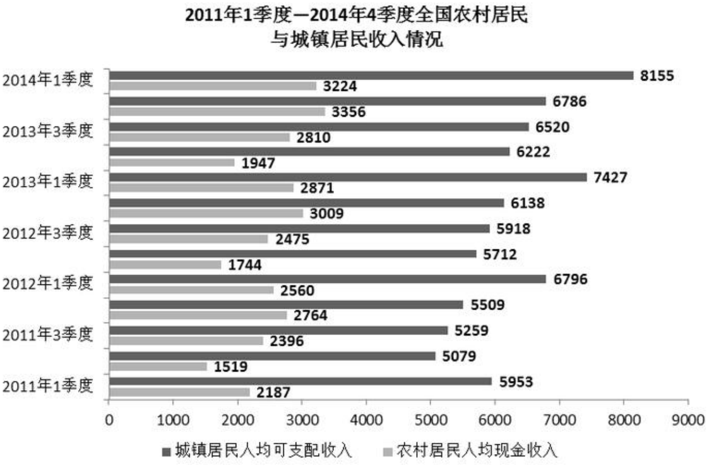
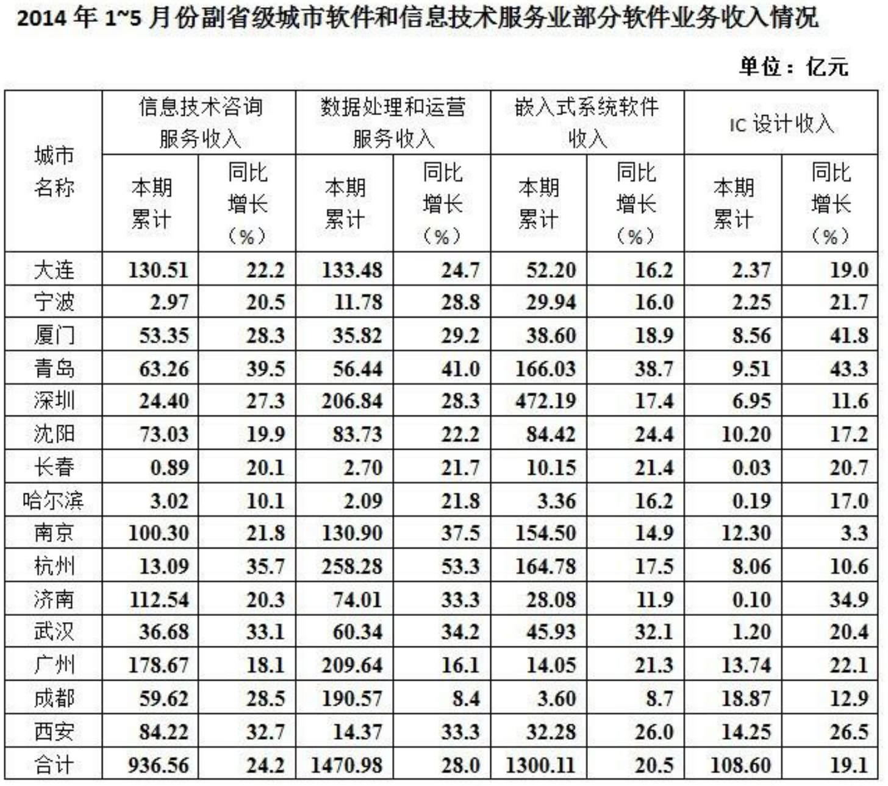
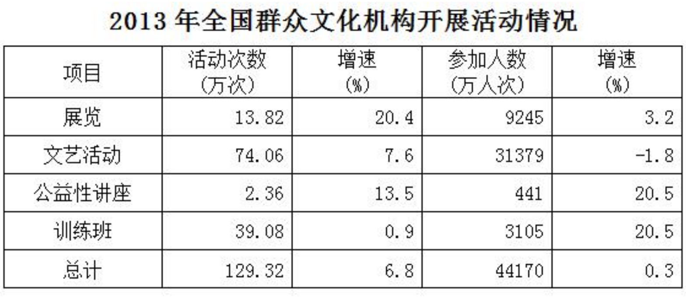
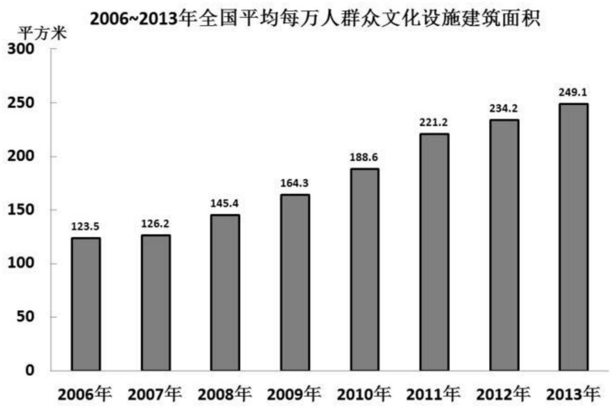

# 2015年国考行测（地市级）资料分析

共 20 题（第 111—130 题，原题号保留），4 组材料。内容：材料、题干、选项、答案（不收解析）；共用材料置于所属题组前，JSONL 每条记录完整内嵌材料。表格、统计图为题本按 288 DPI 渲染后的裁图，图中文字和数字另有转写。

[结构化数据](GK2015-DS.jsonl) · [图片清单](assets/GK2015-DS/manifest.json)

原题来源：[2015年国家公务员考试《行测》真题卷（地市级).pdf](../%E7%9C%9F%E9%A2%98/2015%E5%B9%B4%E5%9B%BD%E5%AE%B6%E5%85%AC%E5%8A%A1%E5%91%98%E8%80%83%E8%AF%95%E3%80%8A%E8%A1%8C%E6%B5%8B%E3%80%8B%E7%9C%9F%E9%A2%98%E5%8D%B7%EF%BC%88%E5%9C%B0%E5%B8%82%E7%BA%A7%29.pdf)（第 12—15 页）。答案来源：[2015年国家公务员考试《行测》真题卷（地市级)答案及解析...pdf](../%E7%AD%94%E6%A1%88%E8%A7%A3%E6%9E%90/2015%E5%B9%B4%E5%9B%BD%E5%AE%B6%E5%85%AC%E5%8A%A1%E5%91%98%E8%80%83%E8%AF%95%E3%80%8A%E8%A1%8C%E6%B5%8B%E3%80%8B%E7%9C%9F%E9%A2%98%E5%8D%B7%EF%BC%88%E5%9C%B0%E5%B8%82%E7%BA%A7%29%E7%AD%94%E6%A1%88%E5%8F%8A%E8%A7%A3%E6%9E%90...pdf)（第 13—15 页，只取答案）。

原卷资料分析四组材料的组号印作“（一）”至“（四）”，与本库 M1—M4 依次对应；每组组号后接“根据以下资料，回答……题。”（第一组的组号单独一行，其余与这句说明同行），组号与这句说明未收入材料。

## 资料分析

### 共用材料：第 111—115 题

2011年1季度—2014年4季度全国农村居民与城镇居民收入情况

| 季度 | 城镇居民人均可支配收入 | 农村居民人均现金收入 |
| --- | --- | --- |
| 2011年1季度 | 5953 | 2187 |
| 2011年2季度 | 5079 | 1519 |
| 2011年3季度 | 5259 | 2396 |
| 2011年4季度 | 5509 | 2764 |
| 2012年1季度 | 6796 | 2560 |
| 2012年2季度 | 5712 | 1744 |
| 2012年3季度 | 5918 | 2475 |
| 2012年4季度 | 6138 | 3009 |
| 2013年1季度 | 7427 | 2871 |
| 2013年2季度 | 6222 | 1947 |
| 2013年3季度 | 6520 | 2810 |
| 2013年4季度 | 6786 | 3356 |
| 2014年1季度 | 8155 | 3224 |

横向条形图，自下而上为2011年1季度至2014年1季度共13组，每组上条（深色）为城镇居民人均可支配收入、下条（浅色）为农村居民人均现金收入；纵轴只标了2011年1季度、2011年3季度、2012年1季度、2012年3季度、2013年1季度、2013年3季度、2014年1季度，其间各组（2、4季度）没有标签，按位置读取。横轴0—9000，未标单位（题目按元计）。图题印作“2014年4季度”，图中最后一组为2014年1季度，照录。

> 材料说明：原卷本组组号印作“（一）”，下一行为“根据以下资料，回答111—115题。”（四组组号依次为“（一）”至“（四）”，与M1—M4对应），组号与这句说明未收入材料。材料1没有文字，只有一张横向条形图（图题在图片内），已逐项转写；纵轴只隔一组标季度，未标的2、4季度按位置读取。图题印作“2011年1季度—2014年4季度”，图中最后一组为2014年1季度，照录。

### 第 111 题

`GK2015-DS-Q111` · 单选 · 原卷第 13 页

[共用材料](#GK2015-DS-M1)

与2011年同期相比，2014年1季度农村居民人均现金收入约增长了：

**A.** 25.9%

**B.** 36.8%

**C.** 47.4%

**D.** 52.5%

**答案：C**

### 第 112 题

`GK2015-DS-Q112` · 单选 · 原卷第 13 页

[共用材料](#GK2015-DS-M1)

2013年城镇居民人均可支配收入同比增加了：

**A.** 1千多元

**B.** 2千多元

**C.** 3千多元

**D.** 4千多元

**答案：B**

### 第 113 题

`GK2015-DS-Q113` · 单选 · 原卷第 13 页

[共用材料](#GK2015-DS-M1)

综合2011-2013年的数据，农村居民人均现金收入和城镇居民人均可支配收入最高的季度分别是：

**A.** 1季度和1季度

**B.** 1季度和4季度

**C.** 4季度和4季度

**D.** 4季度和1季度

**答案：D**

### 第 114 题

`GK2015-DS-Q114` · 单选 · 原卷第 13 页

[共用材料](#GK2015-DS-M1)

2011—2013年，农村居民年人均现金收入超过1万元的年份有几个：

**A.** 3

**B.** 2

**C.** 1

**D.** 0

**答案：C**

### 第 115 题

`GK2015-DS-Q115` · 单选 · 原卷第 13 页

[共用材料](#GK2015-DS-M1)

能够从上述资料中推出的是：

**A.** 2013年各季度农村居民人均现金收入均同比增加

**B.** 2013年4季度城镇人均可支配收入同比增速低于环比增速

**C.** 2013年1季度城镇居民人均可支配收入环比增长了三成多

**D.** 2013年下半年农村居民人均现金收入比上半年多约2000元

**答案：A**

### 共用材料：第 116—120 题

2013年，某省工业企业全年实现主营业务收入37864亿元，税金1680亿元，利润2080亿元，分别增长19.1%，19.4%，26.4%，分别高出全国7.9、8.4、14.2个百分点。该省工业企业主营业务收入占全国工业的3.7%，比上年提高0.3个百分点，百户重点企业主营业务收入、税金、利润分别增长10.2%、11.1%、20.8%，分别占全省工业的29.5%、51%、27.6%。
2013年，汽车工业实现主营业务收入4538亿元，增长23.1%；实现利润416.6亿元，增长19.9%；税金225.3亿元，增长50%。销售利润率(利润占主营业务收入的比重)攀升至9.2%。
食品(含烟草)实现主营业务收入6359亿元，增长20.8%，增速同比放缓9.2个百分点，实现利润398亿元，增长34.5%；工业税金506.2亿元，增长11.4%。
钢铁行业实现主营业务收入3510亿元，增长1.8%，利润总额34.6亿元，增长18.8%。行业销售利润率仅为1%。
石化行业主营业收入5138亿元，增长18.8%；实现利润204.2亿元，增长38.1%。子行业中，石油加工业净亏损0.2亿元，同比减亏13.6亿元；化工行业全年利润增长31.6%，扭转上半年利润下降局面；石油开采业净亏损8.6亿元，橡胶塑料行业利润增长29.1%。
建材行业实现主营业务收入2412亿元，增长27.1%；实现利润167.2亿元，增长51.6%。
机械行业实现主营业务收入3886元，增长26.6%；实现利润191.6亿元，增长23.8%。其中，电气机械(家电)利润增长38.5%，专用设备利润增长22.1%，船舶行业利润增长18.9%。

> 材料说明：原卷本组标题行印作“（二）根据以下资料，回答116-120题。”，未收入材料。纯文字7段；“机械行业实现主营业务收入3886元”漏“亿”字，“石化行业主营业收入”漏“务”字，均照录（本组各题不用这两处数）。

### 第 116 题

`GK2015-DS-Q116` · 单选 · 原卷第 13 页

[共用材料](#GK2015-DS-M2)

2013年全国工业企业主营业务收入约为多少万亿元：

**A.** 84

**B.** 90

**C.** 97

**D.** 102

**答案：D**

### 第 117 题

`GK2015-DS-Q117` · 单选 · 原卷第 13 页

[共用材料](#GK2015-DS-M2)

2013年全国工业企业的税金增速比利润增速：

**A.** 低1.2个百分点

**B.** 低5.8个百分点

**C.** 高7.0个百分点

**D.** 高8.4个百分点

**答案：A**

### 第 118 题

`GK2015-DS-Q118` · 单选 · 原卷第 13 页

[共用材料](#GK2015-DS-M2)

2013年该省以下行业利润增速从高到低排序正确的是：

**A.** 石化行业，建材行业，机械行业

**B.** 建材行业，石化行业，机械行业

**C.** 汽车行业，食品(含烟草)行业，钢铁行业

**D.** 食品(含烟草)行业，钢铁行业，汽车行业

**答案：B**

### 第 119 题

`GK2015-DS-Q119` · 单选 · 原卷第 13 页

[共用材料](#GK2015-DS-M2)

2013年该省工业企业的哪项信息，能够从上述资料中直接推出：

**A.** 工业企业利润占全国工业企业利润总额的比重

**B.** 船舶行业主营业务收入占机械行业的比重

**C.** 橡胶塑料行业工业企业实现利润额

**D.** 百户重点企业的总体销售利润率

**答案：D**

### 第 120 题

`GK2015-DS-Q120` · 单选 · 原卷第 13 页

[共用材料](#GK2015-DS-M2)

能够从上述资料中推出的是：

**A.** 2012年该省食品(含烟草)行业主营业务收入同比增速为11.6%

**B.** 2012年该省工业企业税金总额中，汽车行业所占比重超过15%

**C.** 2013年该省建材行业的销售利润率高于2012年水平

**D.** 2012年该省石油加工业净亏损13.4亿元

**答案：C**

### 共用材料：第 121—125 题

2014年1—5月，我国软件和信息技术服务业实现软件业务收入13254亿元，同比增长20.9%，比去年同期回落3.3个百分点。其中，软件产品完成收入4141亿元，信息系统集成服务完成收入2649.3亿元，信息技术咨询服务完成收入1399.2亿元，数据处理和运营服务完成收入2429.5亿元，嵌入式系统软件完成收入2230.3亿元，IC设计完成收入405.1亿元。

2014年1~5月份副省级城市软件和信息技术服务业部分软件业务收入情况（单位：亿元）

| 城市名称 | 信息技术咨询服务收入：本期累计 | 信息技术咨询服务收入：同比增长（%） | 数据处理和运营服务收入：本期累计 | 数据处理和运营服务收入：同比增长（%） | 嵌入式系统软件收入：本期累计 | 嵌入式系统软件收入：同比增长（%） | IC设计收入：本期累计 | IC设计收入：同比增长（%） |
| --- | --- | --- | --- | --- | --- | --- | --- | --- |
| 大连 | 130.51 | 22.2 | 133.48 | 24.7 | 52.20 | 16.2 | 2.37 | 19.0 |
| 宁波 | 2.97 | 20.5 | 11.78 | 28.8 | 29.94 | 16.0 | 2.25 | 21.7 |
| 厦门 | 53.35 | 28.3 | 35.82 | 29.2 | 38.60 | 18.9 | 8.56 | 41.8 |
| 青岛 | 63.26 | 39.5 | 56.44 | 41.0 | 166.03 | 38.7 | 9.51 | 43.3 |
| 深圳 | 24.40 | 27.3 | 206.84 | 28.3 | 472.19 | 17.4 | 6.95 | 11.6 |
| 沈阳 | 73.03 | 19.9 | 83.73 | 22.2 | 84.42 | 24.4 | 10.20 | 17.2 |
| 长春 | 0.89 | 20.1 | 2.70 | 21.7 | 10.15 | 21.4 | 0.03 | 20.7 |
| 哈尔滨 | 3.02 | 10.1 | 2.09 | 21.8 | 3.36 | 16.2 | 0.19 | 17.0 |
| 南京 | 100.30 | 21.8 | 130.90 | 37.5 | 154.50 | 14.9 | 12.30 | 3.3 |
| 杭州 | 13.09 | 35.7 | 258.28 | 53.3 | 164.78 | 17.5 | 8.06 | 10.6 |
| 济南 | 112.54 | 20.3 | 74.01 | 33.3 | 28.08 | 11.9 | 0.10 | 34.9 |
| 武汉 | 36.68 | 33.1 | 60.34 | 34.2 | 45.93 | 32.1 | 1.20 | 20.4 |
| 广州 | 178.67 | 18.1 | 209.64 | 16.1 | 14.05 | 21.3 | 13.74 | 22.1 |
| 成都 | 59.62 | 28.5 | 190.57 | 8.4 | 3.60 | 8.7 | 18.87 | 12.9 |
| 西安 | 84.22 | 32.7 | 14.37 | 33.3 | 32.28 | 26.0 | 14.25 | 26.5 |
| 合计 | 936.56 | 24.2 | 1470.98 | 28.0 | 1300.11 | 20.5 | 108.60 | 19.1 |

原表表头为两层：四项收入下各分“本期累计”“同比增长（%）”；“单位：亿元”印在表右上方，表题在图片内。

> 材料说明：原卷本组标题行印作“（三）根据以下资料，回答121—125题。”，未收入材料。文字一段跨第13、14页；表格（表题、单位在图片内）为原卷图片，已裁图并逐项转写。

### 第 121 题

`GK2015-DS-Q121` · 单选 · 原卷第 14 页

[共用材料](#GK2015-DS-M3)

2014年前5个月完成收入排名前三的软件业务，同期完成收入占我国软件业务总收入的比重约为：

**A.** 61.8%

**B.** 69.6%

**C.** 81.2%

**D.** 86.5%

**答案：B**

### 第 122 题

`GK2015-DS-Q122` · 单选 · 原卷第 14 页

[共用材料](#GK2015-DS-M3)

2014年1～5月，表中四项软件业务收入之和最高的东北地区副省级城市是：

**A.** 大连

**B.** 长春

**C.** 沈阳

**D.** 哈尔滨

**答案：A**

### 第 123 题

`GK2015-DS-Q123` · 单选 · 原卷第 14 页

[共用材料](#GK2015-DS-M3)

2014年1－5月，副省级城市哪项软件业务完成收入之和低于该业务全国总收入的一半。

**A.** 数据处理和运营服务

**B.** 信息技术咨询服务

**C.** 嵌入式系统软件

**D.** IC设计

**答案：D**

> 转写说明：题干以句号结尾（原卷）。

### 第 124 题

`GK2015-DS-Q124` · 单选 · 原卷第 14 页

[共用材料](#GK2015-DS-M3)

2014年1～5月，信息技术咨询服务收入同比增速最快的副省级城市，该项收入约是增速最慢的副省级城市的多少倍：

**A.** 21

**B.** 4

**C.** 201

**D.** 70

**答案：A**

### 第 125 题

`GK2015-DS-Q125` · 单选 · 原卷第 14 页

[共用材料](#GK2015-DS-M3)

关于2014年1～5月副省级城市软件业务收入，能够从上述资料中推出的是：

**A.** 广州市的四项业务收入在副省级城市中均排名前三

**B.** 武汉市的四项业务收入增速均高于副省级城市平均水平

**C.** 深圳市IC设计业务收入超过副省级城市该项业务收入的平均水平

**D.** 数据处理和运营服务收入与嵌入式系统软件收入最高的副省级城市是同一个

**答案：B**

### 共用材料：第 126—130 题

2013年末全国共有群众文化机构44260个。比上年末增加384个，其中乡镇文化站34343个，增加242个。年末群众文化机构从业人员164355人，比上年末增加8127人，群众文化机构实际使用房屋建筑面积3389.4万平方米。比上年末增长6.9%，年末群众文化机构共有馆办文艺团体6022个，演出15.13万场，观众6569万人次。

2013年全国群众文化机构开展活动情况

| 项目 | 活动次数（万次） | 增速（%） | 参加人数（万人次） | 增速（%） |
| --- | --- | --- | --- | --- |
| 展览 | 13.82 | 20.4 | 9245 | 3.2 |
| 文艺活动 | 74.06 | 7.6 | 31379 | -1.8 |
| 公益性讲座 | 2.36 | 13.5 | 441 | 20.5 |
| 训练班 | 39.08 | 0.9 | 3105 | 20.5 |
| 总计 | 129.32 | 6.8 | 44170 | 0.3 |

表题在图片内。

2006~2013年全国平均每万人群众文化设施建筑面积

| 年份 | 平均每万人群众文化设施建筑面积（平方米） |
| --- | --- |
| 2006年 | 123.5 |
| 2007年 | 126.2 |
| 2008年 | 145.4 |
| 2009年 | 164.3 |
| 2010年 | 188.6 |
| 2011年 | 221.2 |
| 2012年 | 234.2 |
| 2013年 | 249.1 |

纵轴单位为平方米（0—300）；图题在图片内、印在图上方。

> 材料说明：原卷本组标题行印作“（四）根据以下资料，回答126～130题。”，未收入材料。文字中“44260个。比上年末增加384个”“3389.4万平方米。比上年末增长6.9%”两处句号照录；表格和柱形图（表题、图题在图片内）为原卷图片，已裁图并逐项转写。

### 第 126 题

`GK2015-DS-Q126` · 单选 · 原卷第 15 页

[共用材料](#GK2015-DS-M4)

2013年末全国群众文化机构数量同比约增长了：

**A.** 8%

**B.** 3%

**C.** 0.9%

**D.** 0.4%

**答案：C**

### 第 127 题

`GK2015-DS-Q127` · 单选 · 原卷第 15 页

[共用材料](#GK2015-DS-M4)

2013年每个馆办文艺团体平均每月演出约多少场：

**A.** 25

**B.** 12

**C.** 5

**D.** 2

**答案：D**

### 第 128 题

`GK2015-DS-Q128` · 单选 · 原卷第 15 页

[共用材料](#GK2015-DS-M4)

2013年群众文化机构开展的活动中，平均每次活动参加人数最多的是：

**A.** 展览

**B.** 文艺活动

**C.** 公益性讲座

**D.** 训练班

**答案：A**

### 第 129 题

`GK2015-DS-Q129` · 单选 · 原卷第 15 页

[共用材料](#GK2015-DS-M4)

2007－2013年间，平均每万人群众文化设施建筑面积同比增速高于10%的年份有几个？

**A.** 5

**B.** 4

**C.** 3

**D.** 2

**答案：B**

### 第 130 题

`GK2015-DS-Q130` · 单选 · 原卷第 15 页

[共用材料](#GK2015-DS-M4)

能够给从上述资料中推出的是：

**A.** 2013年文艺活动的参加人数约是公益性讲座的50倍

**B.** 2012年末全国群众文化机构共有从业人员16万多人

**C.** 2013年全国人均群众文化设施建筑面积比2006年翻了一番

**D.** 2013年乡镇文化站占群众文化机构总数的比重高于上年水平

**答案：C**

> 转写说明：题干“能够给从上述资料中推出的是”多一“给”字（原卷），照录。
