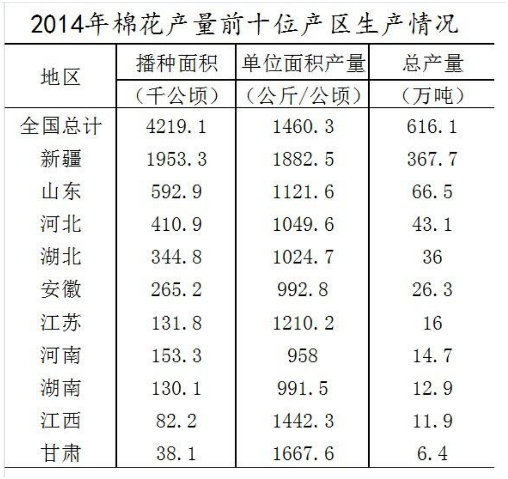
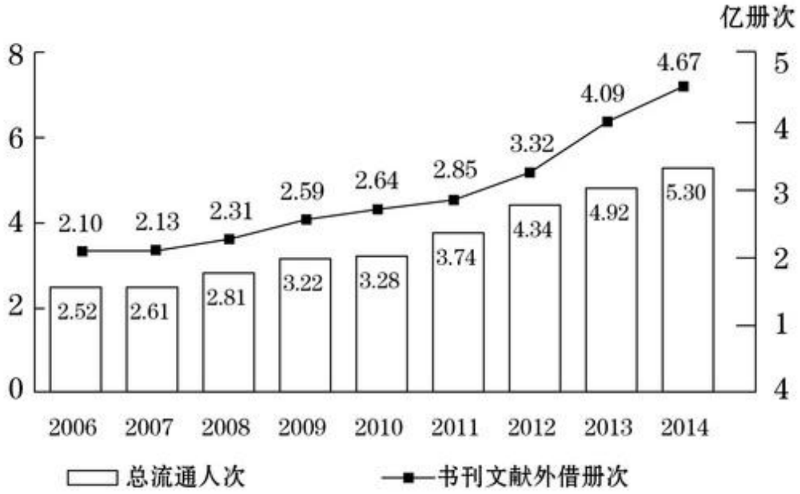
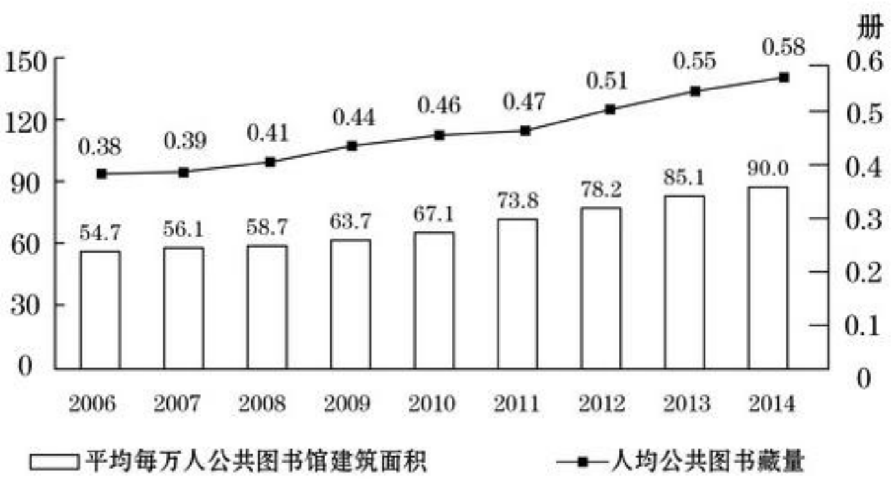
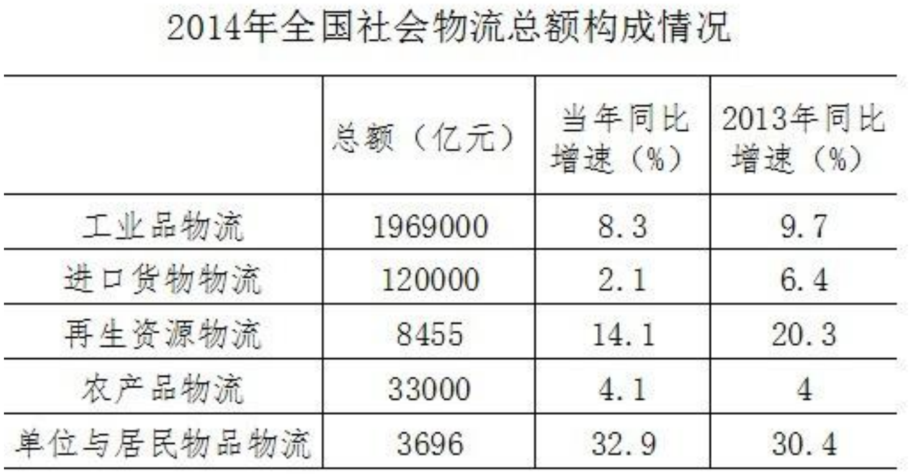
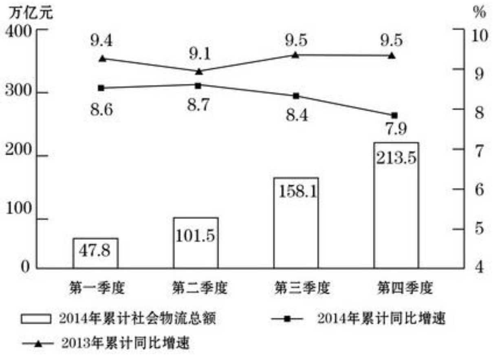

# 2016年国考行测（地市级）资料分析

共 20 题（第 111—130 题，原题号保留），4 组材料。内容：材料、题干、选项、答案（不收解析）；共用材料置于所属题组前，JSONL 每条记录完整内嵌材料。表格、统计图为题本按 288 DPI 渲染后的裁图，图中文字和数字另有转写。

[结构化数据](GK2016-DS.jsonl) · [图片清单](assets/GK2016-DS/manifest.json)

原题来源：[2016年国家公务员考试《行测》真题卷（地市级）.pdf](../%E7%9C%9F%E9%A2%98/2016%E5%B9%B4%E5%9B%BD%E5%AE%B6%E5%85%AC%E5%8A%A1%E5%91%98%E8%80%83%E8%AF%95%E3%80%8A%E8%A1%8C%E6%B5%8B%E3%80%8B%E7%9C%9F%E9%A2%98%E5%8D%B7%EF%BC%88%E5%9C%B0%E5%B8%82%E7%BA%A7%EF%BC%89.pdf)（第 13—16 页）。答案来源：[2016年国家公务员考试《行测》真题卷（地市级）答案及解析...pdf](../%E7%AD%94%E6%A1%88%E8%A7%A3%E6%9E%90/2016%E5%B9%B4%E5%9B%BD%E5%AE%B6%E5%85%AC%E5%8A%A1%E5%91%98%E8%80%83%E8%AF%95%E3%80%8A%E8%A1%8C%E6%B5%8B%E3%80%8B%E7%9C%9F%E9%A2%98%E5%8D%B7%EF%BC%88%E5%9C%B0%E5%B8%82%E7%BA%A7%EF%BC%89%E7%AD%94%E6%A1%88%E5%8F%8A%E8%A7%A3%E6%9E%90...pdf)（第 16—19 页，只取答案）。

## 资料分析

### 共用材料：第 111—115 题

2014年全国棉花播种面积4219.1千公顷，比2013年减少2.9％。棉花总产量616.1万吨，比2013年减产2.2％。

2014年棉花产量前十位产区生产情况

| 地区 | 播种面积（千公顷） | 单位面积产量（公斤/公顷） | 总产量（万吨） |
| --- | --- | --- | --- |
| 全国总计 | 4219.1 | 1460.3 | 616.1 |
| 新疆 | 1953.3 | 1882.5 | 367.7 |
| 山东 | 592.9 | 1121.6 | 66.5 |
| 河北 | 410.9 | 1049.6 | 43.1 |
| 湖北 | 344.8 | 1024.7 | 36 |
| 安徽 | 265.2 | 992.8 | 26.3 |
| 江苏 | 131.8 | 1210.2 | 16 |
| 河南 | 153.3 | 958 | 14.7 |
| 湖南 | 130.1 | 991.5 | 12.9 |
| 江西 | 82.2 | 1442.3 | 11.9 |
| 甘肃 | 38.1 | 1667.6 | 6.4 |

表题在图片内。“湖北”“江苏”的总产量原表作“36”“16”（不带小数），“河南”单位面积产量作“958”，照录。

> 材料说明：材料1原卷标题行“一、根据以下资料，回答111～115题。”未收入材料；表格为原卷图片，已裁图并逐项转写。表中湖北总产量作“36”，按播种面积×单位面积产量约为35.3万吨，原表如此，照录（不影响本组作答）。

### 第 111 题

`GK2016-DS-Q111` · 单选 · 原卷第 13 页

[共用材料](#GK2016-DS-M1)

2014年全国棉花单位面积产量比上年约：

**A.** 提高了5.1%

**B.** 提高了0.7%

**C.** 降低了5.1%

**D.** 降低了0.7%

**答案：B**

### 第 112 题

`GK2016-DS-Q112` · 单选 · 原卷第 13 页

[共用材料](#GK2016-DS-M1)

2014年棉花总产量最高的省（区）播种面积占全国棉花播种面积的比重约为：

**A.** 52%

**B.** 60%

**C.** 40%

**D.** 46%

**答案：D**

### 第 113 题

`GK2016-DS-Q113` · 单选 · 原卷第 13 页

[共用材料](#GK2016-DS-M1)

表中有几个省（区）2014年棉花单位面积产量不低于全国平均水平的80%?

**A.** 2

**B.** 3

**C.** 4

**D.** 5

**答案：C**

> 转写说明：题干句末问号为半角“?”，照录。

### 第 114 题

`GK2016-DS-Q114` · 单选 · 原卷第 13 页

[共用材料](#GK2016-DS-M1)

如果2014年安徽省的棉花单位面积产量能够达到全国平均水平，那么其棉花总产量将达到约多少万吨？

**A.** 30

**B.** 26

**C.** 39

**D.** 35

**答案：C**

### 第 115 题

`GK2016-DS-Q115` · 单选 · 原卷第 13、14 页

[共用材料](#GK2016-DS-M1)

关于2014年棉花生产情况，能够从上述资料中推出的是：

**A.** 山东棉花总产量和单位面积产量均为全国第二

**B.** 河南棉花播种面积和单位面积产量均高于湖南

**C.** 全国播种面积比2013年多126千公顷

**D.** 新疆棉花产量占全国总产量的一半以上

**答案：D**

### 共用材料：第 116—120 题

2014年末全国共有公共图书馆3117个，比上年末增加5个。年末全国共图书馆从业人员56071人。

（原图无图题）

| 年份 | 总流通人次（左轴，原图未标单位） | 书刊文献外借册次（亿册次） |
| --- | --- | --- |
| 2006 | 2.52 | 2.10 |
| 2007 | 2.61 | 2.13 |
| 2008 | 2.81 | 2.31 |
| 2009 | 3.22 | 2.59 |
| 2010 | 3.28 | 2.64 |
| 2011 | 3.74 | 2.85 |
| 2012 | 4.34 | 3.32 |
| 2013 | 4.92 | 4.09 |
| 2014 | 5.30 | 4.67 |

图例：空心柱为“总流通人次”（左轴0—8，原图左轴未标单位，按题意为亿人次），带方块的折线为“书刊文献外借册次”（右轴，单位“亿册次”）。右轴刻度原图自下而上印作“4、1、2、3、4、5”，最下一格应为0，照录。

2014年末全国公共图书馆实际使用房屋建筑面积1231.60万平方米，比上年末增长6.3%；图书总藏量79092万册，比上年末增长5.6％；电子图书50674万册，比上年末增长34.2%；阅览室座席数85.55万个，比上年末增长5.7%。

（原图无图题）

| 年份 | 平均每万人公共图书馆建筑面积（左轴，原图未标单位） | 人均公共图书藏量（册） |
| --- | --- | --- |
| 2006 | 54.7 | 0.38 |
| 2007 | 56.1 | 0.39 |
| 2008 | 58.7 | 0.41 |
| 2009 | 63.7 | 0.44 |
| 2010 | 67.1 | 0.46 |
| 2011 | 73.8 | 0.47 |
| 2012 | 78.2 | 0.51 |
| 2013 | 85.1 | 0.55 |
| 2014 | 90.0 | 0.58 |

图例：空心柱为“平均每万人公共图书馆建筑面积”（左轴0—150，原图未标单位），带方块的折线为“人均公共图书藏量”（右轴0—0.6，单位“册”）。

> 材料说明：材料2原卷组号“（二）”未收入材料；两幅柱线图为原卷图片（原图无图题），已裁图并逐项转写。两图左轴原图都未标单位，图1右轴最下一格刻度原图印作“4”（应为0）。文字“年末全国共图书馆从业人员”疑漏“公”字（应为“公共图书馆”，副省级卷同），照录。

### 第 116 题

`GK2016-DS-Q116` · 单选 · 原卷第 14 页

[共用材料](#GK2016-DS-M2)

2014年，全国平均每个公共图书馆月均流通人次约为：

**A.** 1万多

**B.** 不到1万

**C.** 2万多

**D.** 3万多

**答案：A**

> 转写说明：材料2图1左轴原图未标单位，“总流通人次”须按“亿人次”理解（2014年5.30亿人次；解析按“5.3亿”计算）。

### 第 117 题

`GK2016-DS-Q117` · 单选 · 原卷第 14 页

[共用材料](#GK2016-DS-M2)

2014年，公共图书馆电子图书藏量增长册数约是图书总藏量增长册数的多少倍？

**A.** 3

**B.** 2

**C.** 8

**D.** 5

**答案：A**

### 第 118 题

`GK2016-DS-Q118` · 单选 · 原卷第 14 页

[共用材料](#GK2016-DS-M2)

2012～2014年，平均每流通人次约产生多少册次的书刊文献外借？

**A.** 1.0

**B.** 0.8

**C.** 0.6

**D.** 0.4

**答案：B**

> 转写说明：材料2图1左轴原图未标单位，须按“亿人次”与右轴“亿册次”同量级相除。

### 第 119 题

`GK2016-DS-Q119` · 单选 · 原卷第 14 页

[共用材料](#GK2016-DS-M2)

2008～2014年，人均公共图书藏量同比增速快于上年的年份有几个？

**A.** 2

**B.** 4

**C.** 3

**D.** 5

**答案：C**

### 第 120 题

`GK2016-DS-Q120` · 单选 · 原卷第 14 页

[共用材料](#GK2016-DS-M2)

能够从上述资料中推出的是：

**A.** “十一五”期间全国公共图书馆总流通人次超过15亿

**B.** 2014年平均每个公共图书馆拥有二十多个阅览室座席

**C.** 2008～2014年间，每年平均每万人公共图书馆建筑面积同比增速均低于12%

**D.** 2008年人均公共图书馆建筑面积增量和人均公共图书藏量增量均低于2011年

**答案：C**

> 转写说明：A项须把材料2图1左轴（原图未标单位）按“亿人次”理解。

> 转写说明：D项说“人均公共图书馆建筑面积”，图2为“平均每万人公共图书馆建筑面积”，比较两年增量大小不受影响，照录。

### 共用材料：第 121—125 题

截至2014年12月底，全国实有各类市场主体6932.22万户，比上年末增长14.35%，增速较上年同期增加4.02个百分点；注册资本（金）129.23万亿元，比上年末增长27.70%。其中，企业1819.28万户，个体工商户4984.06万户，农民专业合作社128.88万户。
2014年，全国新登记注册市场主体1292.5万户，比上年同期增加160.97万户，注册资本（金）20.66万亿元，比上年同期增加9.66万亿元。其中，企业365.1万户，个体工商户896.45万户。农民专业合作社30.95万户。
2014年，新登记注册现代服务业企业114.10万户，同比增长61.41%。其中，信息传输、软件和信息技术服务业14.67万户，同比增长97.87%；科学研究和技术服务业26.26万户，同比增长70.32%；文化、体育和娱乐业6.59万户，同比增长83.51%；教育业0.68万户．同比增长86.17%
2014年，新登记注册外商投资企业3.84万户，同比增长5.76%。投资总额2763.31亿美元，同比增长15.05%；注册资本1796.39亿美元，同比增长23.87%。

> 材料说明：材料3原卷组号“（三）”未收入材料；纯文字4段，跨第14、15页。“教育业0.68万户．同比增长86.17%”中的“．”（应为“，”）与句末缺句号均为原卷所有（副省级卷同），照录。

### 第 121 题

`GK2016-DS-Q121` · 单选 · 原卷第 15 页

[共用材料](#GK2016-DS-M3)

截至2012年12月底，全国实有各类市场主体户数最接近以下哪个数字？

**A.** 6100万

**B.** 5500万

**C.** 5100万

**D.** 4500万

**答案：B**

### 第 122 题

`GK2016-DS-Q122` · 单选 · 原卷第 15 页

[共用材料](#GK2016-DS-M3)

2014年,全国新登记注册市场主体中个体工商户所占比重约为：

**A.** 75%

**B.** 69%

**C.** 85%

**D.** 81%

**答案：B**

> 转写说明：题干“2014年,”的逗号为半角，照录。

### 第 123 题

`GK2016-DS-Q123` · 单选 · 原卷第 15 页

[共用材料](#GK2016-DS-M3)

2014年，以下哪个现代服务业新登记注册企业的户数同比增速最快？

**A.** 科学研究和技术服务业

**B.** 教育业

**C.** 文化、体育和娱乐业

**D.** 信息传输、软件和信息技术服务业

**答案：D**

### 第 124 题

`GK2016-DS-Q124` · 单选 · 原卷第 15 页

[共用材料](#GK2016-DS-M3)

2014年，新登记注册外商投资企业户均注册资本约比上年同期增长：

**A.** 17%

**B.** 12%

**C.** 8%

**D.** 4%

**答案：A**

### 第 125 题

`GK2016-DS-Q125` · 单选 · 原卷第 15 页

[共用材料](#GK2016-DS-M3)

能够从上述资料中推出的是：

**A.** 2014年新登记注册现代服务业企业大部分属于教育行业

**B.** 2014年末超过三分之一的农民专业合作社成立不满一年

**C.** 2013年全国实有各类市场主体注册资本（金）不足100万亿元

**D.** 2013年新登记注册科学研究和技术服务业企业不到20万户

**答案：D**

> 转写说明：B项“三分之一”的“一”在文字层为“―”（U+2015，横线符号），印出来也是一条横线，按文义录作“一”。

### 共用材料：第 126—130 题

2014年全国社会物流总额213.5万亿元，同比增长7.9％，比上年回落1.6个百分点。
2014年全国社会物流总费用10.6万亿元，同比增长6.9%。其中，运输费用5.6万亿元，同比增长6.6%；保管费用3.7万亿元，同比增长7.0%；管理费用1.3万亿元，同比增长7.9％。

2014年全国社会物流总额构成情况

|  | 总额（亿元） | 当年同比增速（%） | 2013年同比增速（%） |
| --- | --- | --- | --- |
| 工业品物流 | 1969000 | 8.3 | 9.7 |
| 进口货物物流 | 120000 | 2.1 | 6.4 |
| 再生资源物流 | 8455 | 14.1 | 20.3 |
| 农产品物流 | 33000 | 4.1 | 4 |
| 单位与居民物品物流 | 3696 | 32.9 | 30.4 |

表题在图片内；首列表头原表空白。

（原图无图题）

| 季度 | 2014年累计社会物流总额（万亿元） | 2014年累计同比增速（%） | 2013年累计同比增速（%） |
| --- | --- | --- | --- |
| 第一季度 | 47.8 | 8.6 | 9.4 |
| 第二季度 | 101.5 | 8.7 | 9.1 |
| 第三季度 | 158.1 | 8.4 | 9.5 |
| 第四季度 | 213.5 | 7.9 | 9.5 |

图例：空心柱为“2014年累计社会物流总额”（左轴0—400，单位“万亿元”），带方块的折线为“2014年累计同比增速”，带三角的折线为“2013年累计同比增速”（右轴4—10，单位“%”）。

> 材料说明：材料4原卷组号“（四）”未收入材料；表格（表题在图片内）和柱线图（原图无图题）为原卷图片，已裁图并逐项转写。

### 第 126 题

`GK2016-DS-Q126` · 单选 · 原卷第 15、16 页

[共用材料](#GK2016-DS-M4)

2014年每实现100万元的社会物流额，其运输费用平均约为多少万元？

**A.** 5.6

**B.** 10.6

**C.** 2.6

**D.** 5.0

**答案：C**

### 第 127 题

`GK2016-DS-Q127` · 单选 · 原卷第 16 页

[共用材料](#GK2016-DS-M4)

2013、2014年占全国社会物流总额比重均高于上一年水平的分类包括：

**A.** 再生资源物流、单位与居民物品物流、农产品物流

**B.** 工业品物流、再生资源物流、单位与居民物品物流

**C.** 进口货物物流、农产品物流、单位与居民物品物流

**D.** 工业品物流、进口货物物流、农产品物流

**答案：B**

> 转写说明：题干“2013、2014年”的顿号在本PDF题本中缺字：“2013”与“2014”之间是约两字宽的空白（文字层与印出的页面都没有字，本卷第111、112、116—119、126—129题题号后的“、”也同样缺失）；据2016年副省级卷同一道题（第132题）“2013、2014年占全国社会物流总额比重均高于上一年水平的分类包括：”补“、”。

### 第 128 题

`GK2016-DS-Q128` · 单选 · 原卷第 16 页

[共用材料](#GK2016-DS-M4)

2014年全国社会物流总额最高的季度是：

**A.** 第一季度

**B.** 第二季度

**C.** 第三季度

**D.** 第四季度

**答案：C**

### 第 129 题

`GK2016-DS-Q129` · 单选 · 原卷第 16 页

[共用材料](#GK2016-DS-M4)

2012年上半年全国社会物流总额约为多少万亿元？

**A.** 75

**B.** 86

**C.** 93

**D.** 102

**答案：B**

### 第 130 题

`GK2016-DS-Q130` · 单选 · 原卷第 16 页

[共用材料](#GK2016-DS-M4)

能够从上述资料中推出的是：

**A.** 2013年第三季度社会物流总额同比增速高于第四季度

**B.** 2014年每万元社会物流总额的平均管理费用低于上年水平

**C.** 2014年农产品物流额在社会物流总额中的比重高于一成

**D.** 2014年单位与居民物品物流额超过2012年的两倍

**答案：A**
