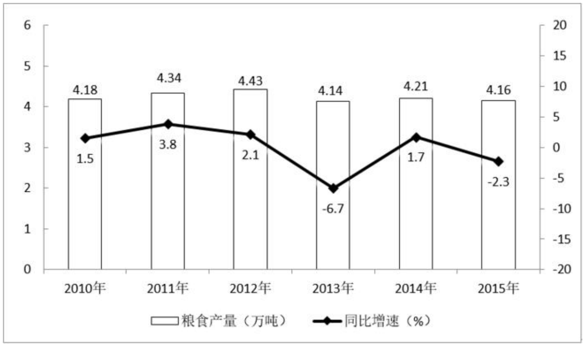
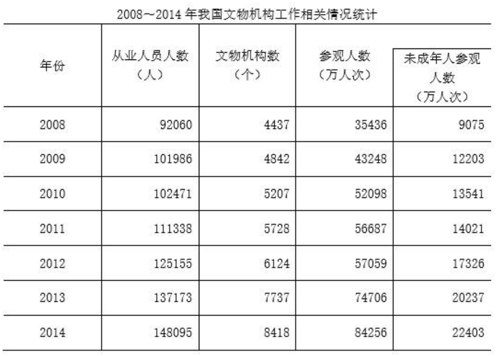
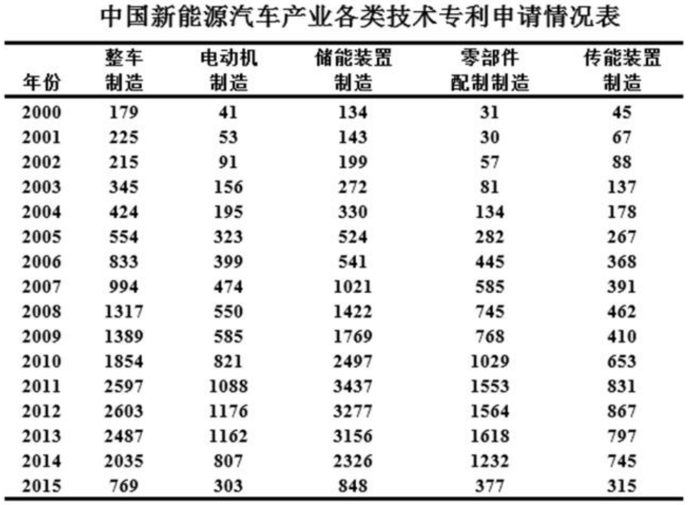
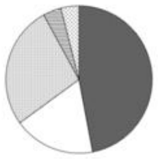
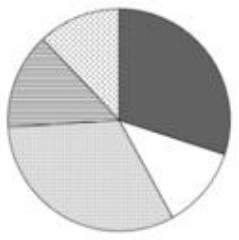
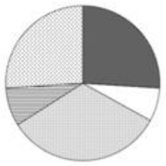
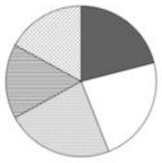

# 2017年国考行测（地市级）资料分析

共 20 题（第 111—130 题，原题号保留），4 组材料。内容：材料、题干、选项、答案（不收解析）；共用材料置于所属题组前，JSONL 每条记录完整内嵌材料。表格、统计图为题本按 288 DPI 渲染后的裁图，图中文字和数字另有转写。

[结构化数据](GK2017-DS.jsonl) · [图片清单](assets/GK2017-DS/manifest.json)

原题来源：[2017年国家录用公务员考试《行测》真题卷（地市级）.pdf](../%E7%9C%9F%E9%A2%98/2017%E5%B9%B4%E5%9B%BD%E5%AE%B6%E5%BD%95%E7%94%A8%E5%85%AC%E5%8A%A1%E5%91%98%E8%80%83%E8%AF%95%E3%80%8A%E8%A1%8C%E6%B5%8B%E3%80%8B%E7%9C%9F%E9%A2%98%E5%8D%B7%EF%BC%88%E5%9C%B0%E5%B8%82%E7%BA%A7%EF%BC%89.pdf)（第 12—15 页）。答案来源：[2017年国家录用公务员考试《行测》真题卷（地市级）答案及解析...pdf](../%E7%AD%94%E6%A1%88%E8%A7%A3%E6%9E%90/2017%E5%B9%B4%E5%9B%BD%E5%AE%B6%E5%BD%95%E7%94%A8%E5%85%AC%E5%8A%A1%E5%91%98%E8%80%83%E8%AF%95%E3%80%8A%E8%A1%8C%E6%B5%8B%E3%80%8B%E7%9C%9F%E9%A2%98%E5%8D%B7%EF%BC%88%E5%9C%B0%E5%B8%82%E7%BA%A7%EF%BC%89%E7%AD%94%E6%A1%88%E5%8F%8A%E8%A7%A3%E6%9E%90...pdf)（第 18—21 页，只取答案）。

## 资料分析

### 共用材料：第 111—115 题

某市2015年全年粮食总产量4.16万吨，同比下降2.3%；甘蔗产量0.57万吨，下降23.6%；油料产量0.12万吨，增长32.4%；蔬菜产量15.79万吨，下降3.4%；水果产量7.84万吨，增长7.4%。
全年水产品产量29.16万吨，同比增长3.6%，其中海洋捕捞1.09万吨，与上年持平；海水养殖6.07万吨，增长89.5%；淡水捕捞0.18万吨，增长1.1%；淡水养殖21.81万吨，下降7.9%。

2010-2015年某市粮食产量及其增速（图题是印在图下方的正文文字，不在图片内）

| 年份 | 粮食产量（万吨） | 同比增速（%） |
| --- | --- | --- |
| 2010年 | 4.18 | 1.5 |
| 2011年 | 4.34 | 3.8 |
| 2012年 | 4.43 | 2.1 |
| 2013年 | 4.14 | -6.7 |
| 2014年 | 4.21 | 1.7 |
| 2015年 | 4.16 | -2.3 |

图例：空心柱为“粮食产量（万吨）”（左轴0—6），带菱形的折线为“同比增速（%）”（右轴-20—20）。

2010-2015年某市粮食产量及其增速

> 材料说明：材料1原卷标题行作“一、根据以下资料，回答116~120题。”，而本卷此组题号为111—115（副省级卷同一组材料为第116—120题），标题行未收入材料。文字跨第12、13页；统计图为原卷图片，已裁图并逐项转写；图题“2010-2015年某市粮食产量及其增速”是印在图下方的正文文字，按原位置排在图后。图中2014、2015年粮食产量作4.21、4.16万吨，按此算2015年同比约−1.2%，而图中增速与文字都作−2.3%（原卷数据不一致，照录）。

### 第 111 题

`GK2017-DS-Q111` · 单选 · 原卷第 13 页

[共用材料](#GK2017-DS-M1)

2014年该市蔬菜产量比水果产量约高多少万吨？

**A.** 9

**B.** 8

**C.** 7

**D.** 6

**答案：A**

### 第 112 题

`GK2017-DS-Q112` · 单选 · 原卷第 13 页

[共用材料](#GK2017-DS-M1)

“十二五”期间，该市粮食总产量在以下哪个范围？

**A.** 23-24万吨之间

**B.** 22-23万吨之间

**C.** 21-22万吨之间

**D.** 20-21万吨之间

**答案：C**

### 第 113 题

`GK2017-DS-Q113` · 单选 · 原卷第 13 页

[共用材料](#GK2017-DS-M1)

按照2015年水产品产量从多到少，以下排序正确的是：

**A.** 海洋捕捞、海水养殖、淡水捕捞、淡水养殖

**B.** 淡水养殖、海水养殖、海洋捕捞、淡水捕捞

**C.** 淡水捕捞、淡水养殖、海洋捕捞、海水养殖

**D.** 淡水养殖、海洋捕捞、海水养殖、淡水捕捞

**答案：B**

### 第 114 题

`GK2017-DS-Q114` · 单选 · 原卷第 13 页

[共用材料](#GK2017-DS-M1)

以下哪张折线图能准确反映2011-2015年间，该市粮食生产同比增量的变化趋势？

**A.** 见上方题图中 A 项。

**B.** 见上方题图中 B 项。

**C.** 见上方题图中 C 项。

**D.** 见上方题图中 D 项。

**答案：A**

> 转写说明：四个选项为折线示意图（无坐标轴、无数值）；原卷四条折线印在同一张图片里，选项字母“A B C D”是图下方的正文文字，已按选项分别裁出四条折线，选项 image_refs 各指向对应的图。

### 第 115 题

`GK2017-DS-Q115` · 单选 · 原卷第 13 页

[共用材料](#GK2017-DS-M1)

能够从上述资料中推出的是：

**A.** 2014年油料产量超过1000吨

**B.** 除淡水养殖之外，其余类型的水产品2015年产量占水产品总产量的比重均高于上年

**C.** 2014-2015年甘蔗累计产量不到1万吨

**D.** 2010-2015年，粮食产量同比上升的年份多于同比下降的年份

**答案：D**

### 共用材料：第 116—120 题

截至2014年末，我国共有博物馆3658个，占文物机构总数的43.5%。全国文化机构拥有文物藏品4063.58万件，比上年末增加222.77万件。其中，博物馆文物藏品2929.97万件，文物商店文物藏品770.00万件。文物藏品中，一级文物9.82万件，二级文物68.82万件，三级文物340.51万件。
2014年全国文物机构共安排基本陈列9996个，比上年增长19.1%；举办临时展览11174个，增长15.8%；接待观众84256万人次，增长12.8%，其中博物馆接待观众71774万人次，占文物机构接待观众总人次的85.2%。

2008～2014年我国文物机构工作相关情况统计

| 年份 | 从业人员人数（人） | 文物机构数（个） | 参观人数（万人次） | 未成年人参观人数（万人次） |
| --- | --- | --- | --- | --- |
| 2008 | 92060 | 4437 | 35436 | 9075 |
| 2009 | 101986 | 4842 | 43248 | 12203 |
| 2010 | 102471 | 5207 | 52098 | 13541 |
| 2011 | 111338 | 5728 | 56687 | 14021 |
| 2012 | 125155 | 6124 | 57059 | 17326 |
| 2013 | 137173 | 7737 | 74706 | 20237 |
| 2014 | 148095 | 8418 | 84256 | 22403 |

表题在图片内。

> 材料说明：材料2原卷组号“（二）”未收入材料；表格（表题在图片内）为原卷图片，已裁图并逐项转写。文字“全国文化机构拥有文物藏品”疑为“文物机构”之误，照录。

### 第 116 题

`GK2017-DS-Q116` · 单选 · 原卷第 14 页

[共用材料](#GK2017-DS-M2)

2014年，我国文物机构相关指标同比增速最快的是：

**A.** 从业人员数

**B.** 参观人数

**C.** 文物机构数

**D.** 未成年人参观人数

**答案：B**

### 第 117 题

`GK2017-DS-Q117` · 单选 · 原卷第 14 页

[共用材料](#GK2017-DS-M2)

2014年，平均每家博物馆接待观众人次数约是其他文物机构的多少倍？

**A.** 2

**B.** 4.5

**C.** 7.5

**D.** 11

**答案：C**

### 第 118 题

`GK2017-DS-Q118` · 单选 · 原卷第 14 页

[共用材料](#GK2017-DS-M2)

2014年末，我国一、二、三级文物总量占全部文物藏品的比重最接近以下哪个数字？

**A.** 8%

**B.** 10%

**C.** 14%

**D.** 54%

**答案：B**

### 第 119 题

`GK2017-DS-Q119` · 单选 · 原卷第 14 页

[共用材料](#GK2017-DS-M2)

2008～2014年间，文物机构参观者中未成年人占比超过三成的年份有几个？

**A.** 1

**B.** 2

**C.** 3

**D.** 4

**答案：A**

### 第 120 题

`GK2017-DS-Q120` · 单选 · 原卷第 14 页

[共用材料](#GK2017-DS-M2)

能够从上述资料中推出的是：

**A.** 2014年末，我国平均每家博物馆文物藏品超过1万件

**B.** 2013年，我国全部文物机构日均接待参观者200多万人次

**C.** 2014年平均每家文物机构安排的基本陈列数低于上年水平

**D.** 2010～2012年，文物机构接待成年参观者人次数逐年上升

**答案：B**

### 共用材料：第 121—125 题

2015年我国钟表全行业实现工业总产值约675亿元，同比增长3.2％，增速比上年同期提高1.7个百分点。
全行业全年生产手表10.7亿只，同比增长3.9％，完成产值约417亿元，同比增长4.3％，增速提高1.9个百分点；生产时钟（含钟心）5.2亿只，同比下降3.7％，完成产值162亿元，同比下降4.7％，降幅扩大1.3个百分点；钟表零配件、定时器及其他计时仪器产值96亿元，同比增长14.3％，增速基本保持上年水平。
2015年我国钟表行业规模以上工业企业主营业务收入365.8亿元，同比增长8.7％；实现利润23.4亿元，与上年相比下降1.5％，而2015年轻工行业主营业务利润率（利润/主营业务收入）的平均水平为7.57％。
2015年我国钟表行业海关进出口总额为92.5亿美元，同比增长4％，完成出口总额为57.7亿美元，同比增长8.3％，进口额34.8亿美元。出口总额中加工贸易额占47％，较上年缩小2个百分点。

> 材料说明：材料3原卷组号“（三）”未收入材料；纯文字4段。

### 第 121 题

`GK2017-DS-Q121` · 单选 · 原卷第 14 页

[共用材料](#GK2017-DS-M3)

2015年我国钟表全行业生产时钟（含钟心）的产值与2013年相比约：

**A.** 上升了11%

**B.** 下降了11%

**C.** 上升了8%

**D.** 下降了8%

**答案：D**

### 第 122 题

`GK2017-DS-Q122` · 单选 · 原卷第 14 页

[共用材料](#GK2017-DS-M3)

2015年钟表全行业平均每制造一只手表，能实现约多少元的产值？

**A.** 36

**B.** 39

**C.** 42

**D.** 63

**答案：B**

### 第 123 题

`GK2017-DS-Q123` · 单选 · 原卷第 14 页

[共用材料](#GK2017-DS-M3)

2015年我国钟表行业规模以上工业企业主营业务利润率比轻工行业平均水平：

**A.** 低3个百分点

**B.** 高3个百分点

**C.** 低1.2个百分点

**D.** 高1.2个百分点

**答案：C**

### 第 124 题

`GK2017-DS-Q124` · 单选 · 原卷第 14 页

[共用材料](#GK2017-DS-M3)

2014年我国钟表行业贸易顺差约为多少亿美元？

**A.** 27

**B.** 25

**C.** 23

**D.** 18

**答案：D**

### 第 125 题

`GK2017-DS-Q125` · 单选 · 原卷第 14 页

[共用材料](#GK2017-DS-M3)

能够从上述资料中推出的是：

**A.** 2015年钟表零配件、定时器及其它计时仪器产值比2013年增长20%以上

**B.** 2015年钟表行业海关出口总额中加工贸易额占进出口总额的40%以上

**C.** 2014年手表产值同比增速低于钟表全行业工业总产值增速

**D.** 2015年时钟（含钟心）产值达到手表产值的一半以上

**答案：A**

> 转写说明：A项作“其它计时仪器”，材料作“其他计时仪器”，照录。

### 共用材料：第 126—130 题

单位：件

中国新能源汽车产业各类技术专利申请情况表（“单位：件”印在表外左上方，为正文文字）

| 年份 | 整车制造 | 电动机制造 | 储能装置制造 | 零部件配制制造 | 传能装置制造 |
| --- | --- | --- | --- | --- | --- |
| 2000 | 179 | 41 | 134 | 31 | 45 |
| 2001 | 225 | 53 | 143 | 30 | 67 |
| 2002 | 215 | 91 | 199 | 57 | 88 |
| 2003 | 345 | 156 | 272 | 81 | 137 |
| 2004 | 424 | 195 | 330 | 134 | 178 |
| 2005 | 554 | 323 | 524 | 282 | 267 |
| 2006 | 833 | 399 | 541 | 445 | 368 |
| 2007 | 994 | 474 | 1021 | 585 | 391 |
| 2008 | 1317 | 550 | 1422 | 745 | 462 |
| 2009 | 1389 | 585 | 1769 | 768 | 410 |
| 2010 | 1854 | 821 | 2497 | 1029 | 653 |
| 2011 | 2597 | 1088 | 3437 | 1553 | 831 |
| 2012 | 2603 | 1176 | 3277 | 1564 | 867 |
| 2013 | 2487 | 1162 | 3156 | 1618 | 797 |
| 2014 | 2035 | 807 | 2326 | 1232 | 745 |
| 2015 | 769 | 303 | 848 | 377 | 315 |

表题在图片内。表头第5列原图作“零部件配制制造”（题干作“零部件配件制造”，副省级卷同一张表以文字排印，作“零部件配件制造”），第6列作“传能装置制造”（第130题C项作“供能装置制造”），均照录。

> 材料说明：材料4原卷组号“（四）”未收入材料；“单位：件”是表格左上方的正文文字。表格（表题在图片内）为原卷图片，已裁图并逐项转写；原图表格左侧有一处与表无关的弧形污点，裁图时已避开。表头“零部件配制制造”“传能装置制造”照原图（题干分别作“零部件配件制造”“供能装置制造”）。

### 第 126 题

`GK2017-DS-Q126` · 单选 · 原卷第 14 页

[共用材料](#GK2017-DS-M4)

表中新能源汽车产业零部件配件制造技术专利申请数增速最快的年份为：

**A.** 2005年

**B.** 2002年

**C.** 2014年

**D.** 2010年

**答案：A**

> 转写说明：题干“零部件配件制造”，表头原图作“零部件配制制造”，指同一列。

### 第 127 题

`GK2017-DS-Q127` · 单选 · 原卷第 15 页

[共用材料](#GK2017-DS-M4)

能够正确描述2015年新能源汽车产业五种专利申请数占比的统计图是：

**A.** 见上方题图中 A 项。

**B.** 见上方题图中 B 项。

**C.** 见上方题图中 C 项。

**D.** 见上方题图中 D 项。

**答案：B**

> 转写说明：四个选项为饼图（无图例、无数值）；原卷四张饼图印在同一张图片里，字母A、B、C、D在各图下方、也在图片内，已按选项分别裁出饼图（不含字母）。扇区自12点钟方向顺时针排列（解析说第一块为整车制造；按B图量得的比例，各块依次对应表中五列），图片说明里的扇区占比为量图估计，仅供检索。

### 第 128 题

`GK2017-DS-Q128` · 单选 · 原卷第 15 页

[共用材料](#GK2017-DS-M4)

“十二五”期间整车制造专利申请总数约是“十五”期间总数的多少倍？

**A.** 2

**B.** 4

**C.** 6

**D.** 8

**答案：C**

### 第 129 题

`GK2017-DS-Q129` · 单选 · 原卷第 15 页

[共用材料](#GK2017-DS-M4)

2001～2015年间，新能源汽车五种技术专利申请数均高于上年的年份有多少个？

**A.** 7

**B.** 8

**C.** 9

**D.** 10

**答案：B**

### 第 130 题

`GK2017-DS-Q130` · 单选 · 原卷第 15 页

[共用材料](#GK2017-DS-M4)

能够从上述资料中推出的是：

**A.** 2000～2015年间，五种技术专利中申请数年均增速最快的是零部件配件制造

**B.** 2011～2015年间，储能装置制造专利申请数均超过电动机制造的3倍

**C.** 2010年供能装置制造专利申请数比2005年翻了两番

**D.** 2001～2015年间，储能装置制造专利申请数增加最多的年份是2010年

**答案：A**

> 转写说明：A项“零部件配件制造”表头作“零部件配制制造”；C项“供能装置制造”表头作“传能装置制造”（副省级卷同题同样作“供能”，解析按“传能装置制造”一列计算），照录。
