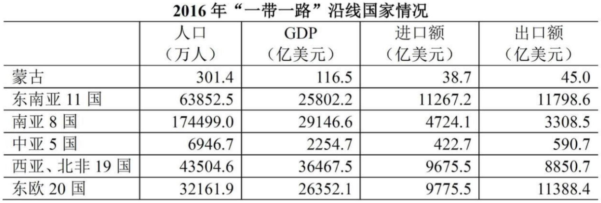
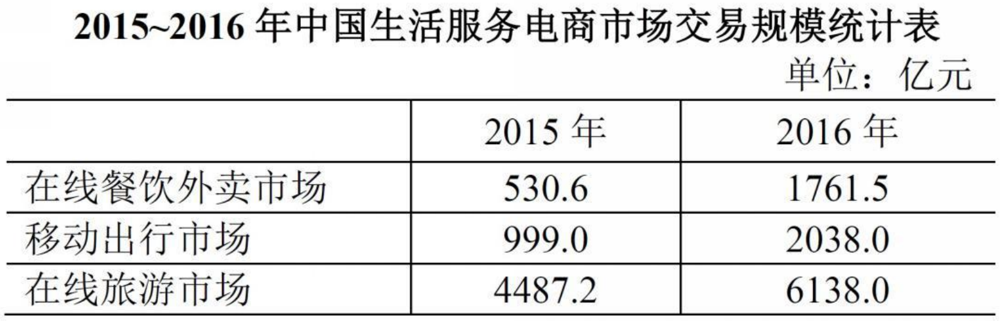
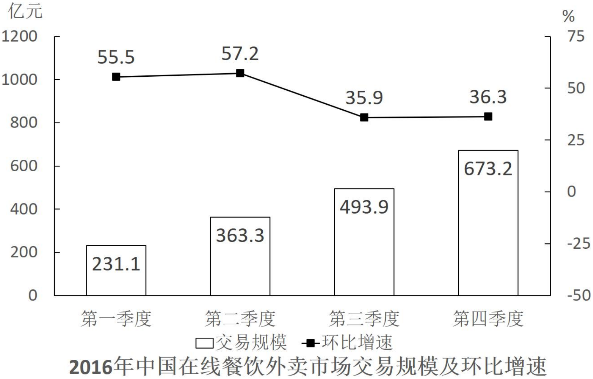
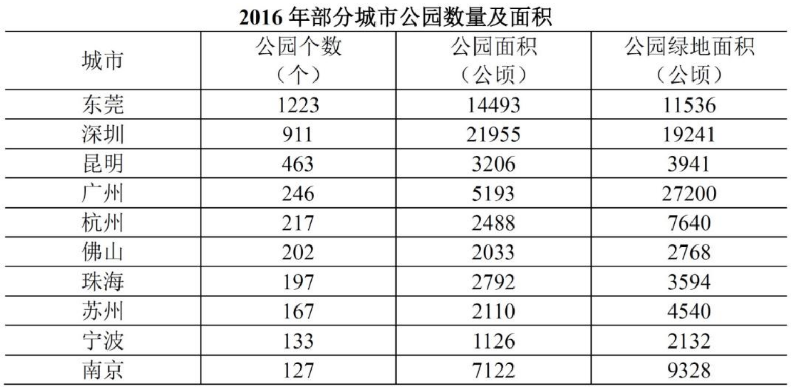

# 2018年国考行测（地市级）资料分析

共 20 题（第 111—130 题，原题号保留），4 组材料。内容：材料、题干、选项、答案（不收解析）；共用材料置于所属题组前，JSONL 每条记录完整内嵌材料。表格、统计图为题本按 288 DPI 渲染后的裁图，图中文字和数字另有转写。

[结构化数据](GK2018-DS.jsonl) · [图片清单](assets/GK2018-DS/manifest.json)

原题来源：[2018年国家录用公务员考试《行测》真题卷（地市级）.pdf](../%E7%9C%9F%E9%A2%98/2018%E5%B9%B4%E5%9B%BD%E5%AE%B6%E5%BD%95%E7%94%A8%E5%85%AC%E5%8A%A1%E5%91%98%E8%80%83%E8%AF%95%E3%80%8A%E8%A1%8C%E6%B5%8B%E3%80%8B%E7%9C%9F%E9%A2%98%E5%8D%B7%EF%BC%88%E5%9C%B0%E5%B8%82%E7%BA%A7%EF%BC%89.pdf)（第 11—14 页）。答案来源：[2018年国家录用公务员考试《行测》真题卷（地市级）答案及解析...pdf](../%E7%AD%94%E6%A1%88%E8%A7%A3%E6%9E%90/2018%E5%B9%B4%E5%9B%BD%E5%AE%B6%E5%BD%95%E7%94%A8%E5%85%AC%E5%8A%A1%E5%91%98%E8%80%83%E8%AF%95%E3%80%8A%E8%A1%8C%E6%B5%8B%E3%80%8B%E7%9C%9F%E9%A2%98%E5%8D%B7%EF%BC%88%E5%9C%B0%E5%B8%82%E7%BA%A7%EF%BC%89%E7%AD%94%E6%A1%88%E5%8F%8A%E8%A7%A3%E6%9E%90...pdf)（第 23—25 页，只取答案）。

## 资料分析

### 共用材料：第 111—115 题

2016年“一带一路”沿线64个国家GDP之和约为12.0万亿美元，占全球GDP的16.0%；人口总数约为32.1亿人，占全球总人口的43.4%；对外贸易总额（进口额+出口额）约为71885.6亿美元，占全球贸易总额的21.7%。

2016年“一带一路”沿线国家情况

|  | 人口（万人） | GDP（亿美元） | 进口额（亿美元） | 出口额（亿美元） |
| --- | --- | --- | --- | --- |
| 蒙古 | 301.4 | 116.5 | 38.7 | 45.0 |
| 东南亚11国 | 63852.5 | 25802.2 | 11267.2 | 11798.6 |
| 南亚8国 | 174499.0 | 29146.6 | 4724.1 | 3308.5 |
| 中亚5国 | 6946.7 | 2254.7 | 422.7 | 590.7 |
| 西亚、北非19国 | 43504.6 | 36467.5 | 9675.5 | 8850.7 |
| 东欧20国 | 32161.9 | 26352.1 | 9775.5 | 11388.4 |

表题在图片内；首列表头原表空白。

> 材料说明：材料1原卷标题行“（一）根据以下资料，回答下列5题。”未收入材料；文字在第11页末，表格（表题在图片内）在第12页，为原卷图片，已裁图并逐项转写，首列表头原表空白。

### 第 111 题

`GK2018-DS-Q111` · 单选 · 原卷第 12 页

[共用材料](#GK2018-DS-M1)

2016年全球贸易总额约为多少万亿美元？

**A.** 28

**B.** 33

**C.** 40

**D.** 75

**答案：B**

### 第 112 题

`GK2018-DS-Q112` · 单选 · 原卷第 12 页

[共用材料](#GK2018-DS-M1)

2016年“一带一路”沿线国家中，东欧20国的人均GDP约是中亚5国的多少倍？

**A.** 2.5

**B.** 3.6

**C.** 5.3

**D.** 11.7

**答案：A**

### 第 113 题

`GK2018-DS-Q113` · 单选 · 原卷第 12 页

[共用材料](#GK2018-DS-M1)

“一带一路”沿线主要区域中，2016年进口额与出口额数值相差最大的是：

**A.** 东南亚11国

**B.** 南亚8国

**C.** 西亚、北非19国

**D.** 东欧20国

**答案：D**

### 第 114 题

`GK2018-DS-Q114` · 单选 · 原卷第 12 页

[共用材料](#GK2018-DS-M1)

2016年，蒙古GDP约占全球总体GDP的：

**A.** 0.61‰

**B.** 1.56‰

**C.** 0.06‰

**D.** 0.16‰

**答案：D**

### 第 115 题

`GK2018-DS-Q115` · 单选 · 原卷第 12 页

[共用材料](#GK2018-DS-M1)

关于“一带一路”沿线国家2016年状况，能够从上述资料中推出的是：

**A.** 超过六成人口集中在南亚地区

**B.** 东南亚和南亚国家GDP之和占全球的8%以上

**C.** 平均每个南亚国家对外贸易额超过1000亿美元

**D.** 平均每个东欧国家的进口额高于平均每个西亚、北非国家的进口额

**答案：C**

### 共用材料：第 116—120 题

2015~2016年中国生活服务电商市场交易规模统计表
单位：亿元

|  | 2015年 | 2016年 |
| --- | --- | --- |
| 在线餐饮外卖市场 | 530.6 | 1761.5 |
| 移动出行市场 | 999.0 | 2038.0 |
| 在线旅游市场 | 4487.2 | 6138.0 |

表题与“单位：亿元”都在图片内；首列表头原表空白。

2016年中国在线餐饮外卖市场交易规模及环比增速

| 季度 | 交易规模（亿元） | 环比增速（%） |
| --- | --- | --- |
| 第一季度 | 231.1 | 55.5 |
| 第二季度 | 363.3 | 57.2 |
| 第三季度 | 493.9 | 35.9 |
| 第四季度 | 673.2 | 36.3 |

图例：空心柱为“交易规模”（左轴0—1200，单位“亿元”），带方块的折线为“环比增速”（右轴-50—75，单位“%”）；图题在图片内、印在图下方。

> 材料说明：材料2原卷标题行作“（三）根据以下资料，回答下列5题。”（本卷四组材料编号为（一）（三）（四）（五），缺（二），题号111—130连续，不缺题），标题行未收入材料。本组没有文字，只有一张表和一幅柱线图（表题、图题都在图片内），已裁图并逐项转写。

### 第 116 题

`GK2018-DS-Q116` · 单选 · 原卷第 12、13 页

[共用材料](#GK2018-DS-M2)

2016年在线旅游市场交易规模约比上年增加了：

**A.** 132%

**B.** 63%

**C.** 104%

**D.** 37%

**答案：D**

### 第 117 题

`GK2018-DS-Q117` · 单选 · 原卷第 13 页

[共用材料](#GK2018-DS-M2)

2015年第四季度在线餐饮外卖市场交易规模占全年交易规模的比重约为：

**A.** 21%

**B.** 28%

**C.** 37%

**D.** 49%

**答案：B**

### 第 118 题

`GK2018-DS-Q118` · 单选 · 原卷第 13 页

[共用材料](#GK2018-DS-M2)

如按2016年移动出行市场同比增长趋势估算，2018年该市场规模将为：

**A.** 接近5000亿元

**B.** 6000多亿元

**C.** 8000多亿元

**D.** 超过1万亿元

**答案：C**

### 第 119 题

`GK2018-DS-Q119` · 单选 · 原卷第 13 页

[共用材料](#GK2018-DS-M2)

以下哪项最能准确描述2016年生活服务电商市场中，三个不同细分市场交易规模同比增量的比例关系？

**A.** 见上方题图中 A 项。

**B.** 见上方题图中 B 项。

**C.** 见上方题图中 C 项。

**D.** 见上方题图中 D 项。

**答案：C**

> 转写说明：四个选项为三扇区饼图（无图例、无数值）；原卷四张饼图印在同一张图片里（左上A、右上B、左下C、右下D，字母“A.”“B.”“C.”“D.”在各图左侧、也在图片内），已按选项分别裁出饼图（不含字母）。图片说明里的扇区占比为量图估计，仅供检索。

### 第 120 题

`GK2018-DS-Q120` · 单选 · 原卷第 13 页

[共用材料](#GK2018-DS-M2)

能够从上述资料中推出的是：

**A.** 2015～2016年在线旅游市场总规模超过1万亿元

**B.** 2016年每个季度的在线餐饮外卖市场环比增量都高于100亿元

**C.** 2016年移动出行市场月均交易规模比2015年高100多亿元

**D.** 2016年下半年在线餐饮外卖市场规模比上半年高1倍以上

**答案：A**

### 共用材料：第 121—125 题

2016年，全国城市公园数量排名前五的省份依次是广东、浙江、江苏、山东和云南，公园数量分别为3512个、1171个、942个、828个和683个。其中，广东省的公园面积达到65318公顷，占全国公园面积的比重超过17%；公园绿地面积达到89591公顷，占全国公园绿地面积的比重约为14%。

2016年部分城市公园数量及面积

| 城市 | 公园个数（个） | 公园面积（公顷） | 公园绿地面积（公顷） |
| --- | --- | --- | --- |
| 东莞 | 1223 | 14493 | 11536 |
| 深圳 | 911 | 21955 | 19241 |
| 昆明 | 463 | 3206 | 3941 |
| 广州 | 246 | 5193 | 27200 |
| 杭州 | 217 | 2488 | 7640 |
| 佛山 | 202 | 2033 | 2768 |
| 珠海 | 197 | 2792 | 3594 |
| 苏州 | 167 | 2110 | 4540 |
| 宁波 | 133 | 1126 | 2132 |
| 南京 | 127 | 7122 | 9328 |

表题在图片内。

注：公园绿地指具有公园作用的所有绿地的统称，即公园性质的绿地，并非公园中的绿地面积，包括综合公园、专类公园、带状公园、街旁游乐园和社区公园等。

> 材料说明：材料3原卷标题行作“（四）根据以下资料，回答下列5题。”，未收入材料；表格（表题在图片内）为原卷图片，已裁图并逐项转写；表下的“注：”是正文文字，按原位置排在表后。

### 第 121 题

`GK2018-DS-Q121` · 单选 · 原卷第 13 页

[共用材料](#GK2018-DS-M3)

2016年，佛山市平均每个公园的面积约为多少公顷？

**A.** 10

**B.** 15

**C.** 20

**D.** 25

**答案：A**

### 第 122 题

`GK2018-DS-Q122` · 单选 · 原卷第 13 页

[共用材料](#GK2018-DS-M3)

2016年，全国公园绿地面积约为多少万公顷？

**A.** 200

**B.** 640

**C.** 20

**D.** 64

**答案：D**

### 第 123 题

`GK2018-DS-Q123` · 单选 · 原卷第 13 页

[共用材料](#GK2018-DS-M3)

表中公园面积大于公园绿地面积的城市有几个？

**A.** 1

**B.** 2

**C.** 3

**D.** 4

**答案：B**

### 第 124 题

`GK2018-DS-Q124` · 单选 · 原卷第 13 页

[共用材料](#GK2018-DS-M3)

2016年，杭州公园数量约占浙江省公园总数的：

**A.** 19%

**B.** 15%

**C.** 27%

**D.** 23%

**答案：A**

### 第 125 题

`GK2018-DS-Q125` · 单选 · 原卷第 13 页

[共用材料](#GK2018-DS-M3)

关于表中城市公园数量及面积，能够从上述资料中推出的是：

**A.** 平均每个公园面积最大的城市是深圳

**B.** 公园绿地面积最大的城市，其公园面积排第3

**C.** 昆明市公园数量多于云南其他城市公园数量之和

**D.** 珠海和佛山两市公园面积之和为400多公顷

**答案：C**

### 共用材料：第 126—130 题

2017年1~2月，全国造船完工936万载重吨，同比增长123%；承接新船订单221万载重吨，同比增长133%。2月末，手持船舶订单9207万载重吨，同比下降22.6%，比2016年末下降7.6%。
2017年1~2月，全国完工出口船907万载重吨，同比增长127%；承接出口船订单191万载重吨，同比增长122%。2月末，手持出口船订单8406万载重吨，同比下降25.9%。
2017年1~2月，53家重点监测的造船企业（以下简称重点企业）造船完工912万载重吨，同比增长133%；承接新船订单197万载重吨，同比增长119%。2月末，手持船舶订单8874万载重吨，同比下降23.1%。
2017年1~2月，重点企业完工出口船886万载重吨，同比增长138%；承接出口船订单171万载重吨，同比增长109%。2月末，手持出口船订单8129万载重吨，同比下降26.6%。

> 材料说明：材料4原卷标题行作“（五）根据以下资料，回答下列5题。”，未收入材料；纯文字4段，跨第13、14页。材料中“1~2月”用半角波浪号（题干用“1～2月”），照录。

### 第 126 题

`GK2018-DS-Q126` · 单选 · 原卷第 14 页

[共用材料](#GK2018-DS-M4)

2016年末全国手持船舶订单较同年2月末：

**A.** 降低16.2%

**B.** 降低2.2%

**C.** 增加16.2%

**D.** 增加2.2%

**答案：A**

### 第 127 题

`GK2018-DS-Q127` · 单选 · 原卷第 14 页

[共用材料](#GK2018-DS-M4)

设2017年1～2月出口船完工量占全国造船完工量比重为X，同期出口船承接订单量占全国承接新船订单量比重为Y，2月末手持出口船订单量占全国手持船舶订单量比重为Z，则有：

**A.** X>Y>Z

**B.** X>Z>Y

**C.** Y>X>Z

**D.** Y>Z>X

**答案：B**

> 转写说明：题干中的X、Y、Z在原卷为行内小图（斜体字母），已转写为文字。

### 第 128 题

`GK2018-DS-Q128` · 单选 · 原卷第 14 页

[共用材料](#GK2018-DS-M4)

2017年1～2月，重点企业下列指标中同比增速最快的是：

**A.** 造船完工量

**B.** 承接新船订单量

**C.** 出口船完工量

**D.** 承接出口船订单量

**答案：C**

### 第 129 题

`GK2018-DS-Q129` · 单选 · 原卷第 14 页

[共用材料](#GK2018-DS-M4)

2017年1～2月，非重点企业出口船完工量约占全国出口船完工量的：

**A.** 2%

**B.** 5%

**C.** 95%

**D.** 98%

**答案：A**

### 第 130 题

`GK2018-DS-Q130` · 单选 · 原卷第 14 页

[共用材料](#GK2018-DS-M4)

能够从上述资料中推出的是：

**A.** 2016年末，重点企业手持船舶订单不到9000万载重吨

**B.** 2017年1～2月，非重点企业承接出口船订单约30万载重吨

**C.** 2017年2月末，重点企业手持船舶订单同比降幅低于全国平均水平

**D.** 2017年2月末，重点企业手持出口船订单占全国比重低于上年同期

**答案：D**
