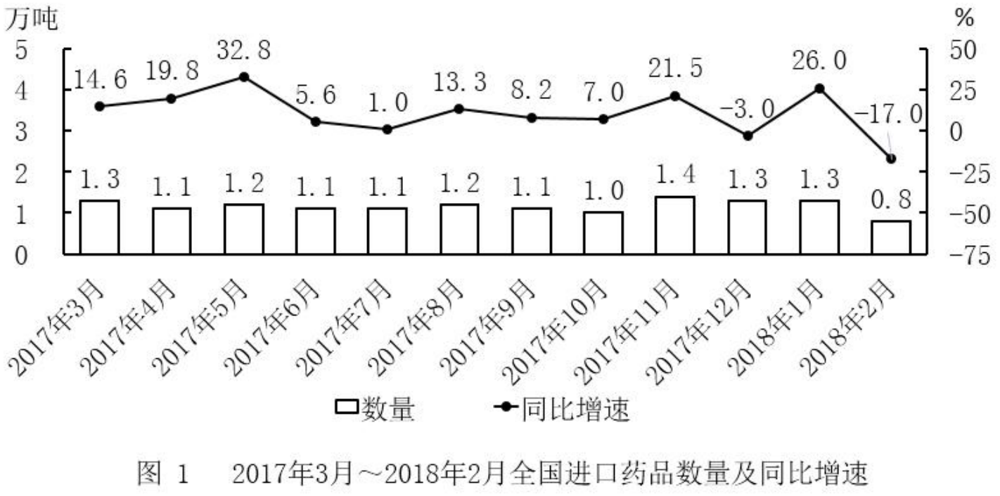
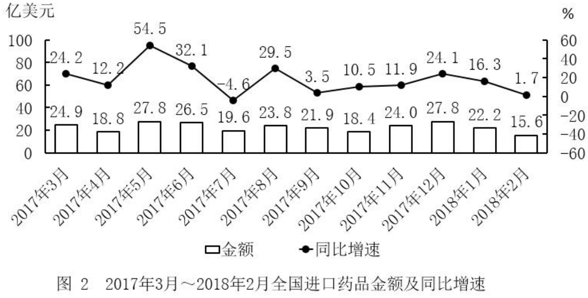
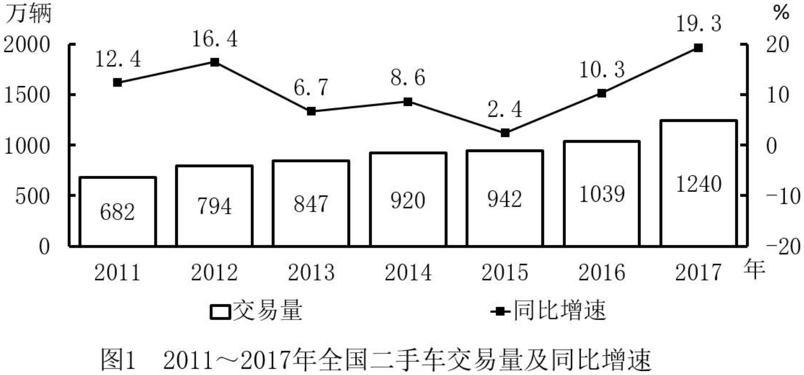
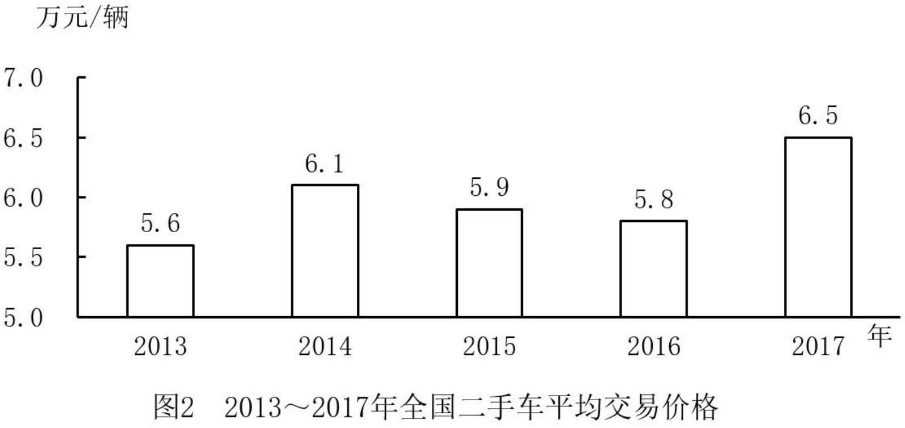
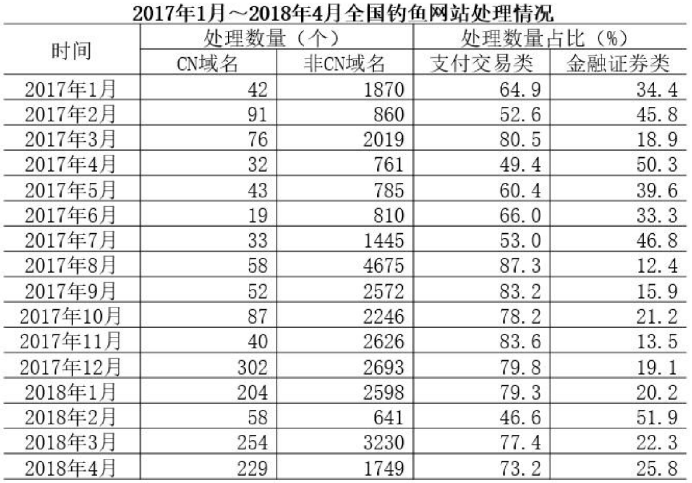

# 2019年国考行测（地市级）资料分析

共 20 题（第 111—130 题，原题号保留），4 组材料。内容：材料、题干、选项、答案（不收解析）；共用材料置于所属题组前，JSONL 每条记录完整内嵌材料。表格、统计图为题本按 288 DPI 渲染后的裁图，图中文字和数字另有转写。

[结构化数据](GK2019-DS.jsonl) · [图片清单](assets/GK2019-DS/manifest.json)

原题来源：[2019年国家公务员考试行测真题（地市级）.pdf](../%E7%9C%9F%E9%A2%98/2019%E5%B9%B4%E5%9B%BD%E5%AE%B6%E5%85%AC%E5%8A%A1%E5%91%98%E8%80%83%E8%AF%95%E8%A1%8C%E6%B5%8B%E7%9C%9F%E9%A2%98%EF%BC%88%E5%9C%B0%E5%B8%82%E7%BA%A7%EF%BC%89.pdf)（第 12—15 页）。答案来源：[2019年国家公务员考试行测真题（地市级）答案及解析...pdf](../%E7%AD%94%E6%A1%88%E8%A7%A3%E6%9E%90/2019%E5%B9%B4%E5%9B%BD%E5%AE%B6%E5%85%AC%E5%8A%A1%E5%91%98%E8%80%83%E8%AF%95%E8%A1%8C%E6%B5%8B%E7%9C%9F%E9%A2%98%EF%BC%88%E5%9C%B0%E5%B8%82%E7%BA%A7%EF%BC%89%E7%AD%94%E6%A1%88%E5%8F%8A%E8%A7%A3%E6%9E%90...pdf)（第 30—35 页，只取答案）。

原卷资料分析四组材料的组号印作“（一）”至“（四）”，与本库 M1—M4 依次对应。

## 资料分析

### 共用材料：第 111—115 题

图1　2017年3月～2018年2月全国进口药品数量及同比增速

| 月份 | 数量（万吨） | 同比增速（%） |
| --- | --- | --- |
| 2017年3月 | 1.3 | 14.6 |
| 2017年4月 | 1.1 | 19.8 |
| 2017年5月 | 1.2 | 32.8 |
| 2017年6月 | 1.1 | 5.6 |
| 2017年7月 | 1.1 | 1.0 |
| 2017年8月 | 1.2 | 13.3 |
| 2017年9月 | 1.1 | 8.2 |
| 2017年10月 | 1.0 | 7.0 |
| 2017年11月 | 1.4 | 21.5 |
| 2017年12月 | 1.3 | -3.0 |
| 2018年1月 | 1.3 | 26.0 |
| 2018年2月 | 0.8 | -17.0 |

柱为数量（左轴，万吨，0—5），折线为同比增速（右轴，%，-75—50）；图名在图片内、印在图下方。

图2　2017年3月～2018年2月全国进口药品金额及同比增速

| 月份 | 金额（亿美元） | 同比增速（%） |
| --- | --- | --- |
| 2017年3月 | 24.9 | 24.2 |
| 2017年4月 | 18.8 | 12.2 |
| 2017年5月 | 27.8 | 54.5 |
| 2017年6月 | 26.5 | 32.1 |
| 2017年7月 | 19.6 | -4.6 |
| 2017年8月 | 23.8 | 29.5 |
| 2017年9月 | 21.9 | 3.5 |
| 2017年10月 | 18.4 | 10.5 |
| 2017年11月 | 24.0 | 11.9 |
| 2017年12月 | 27.8 | 24.1 |
| 2018年1月 | 22.2 | 16.3 |
| 2018年2月 | 15.6 | 1.7 |

柱为金额（左轴，亿美元，0—100），折线为同比增速（右轴，%，-60—60）；图名在图片内、印在图下方。

> 材料说明：原卷本组组号印作“（一）”（四组依次为“（一）”至“（四）”，与M1—M4对应），组号未收入材料。材料1没有文字，只有两张统计图（图名“图1”“图2”在图片内、印在各图下方），已逐项转写。

### 第 111 题

`GK2019-DS-Q111` · 单选 · 原卷第 12、13 页

[共用材料](#GK2019-DS-M1)

2017年第三季度，全国平均每吨进口药品单价约为多少万美元？

**A.** 2

**B.** 19

**C.** 8

**D.** 96

**答案：B**

### 第 112 题

`GK2019-DS-Q112` · 单选 · 原卷第 13 页

[共用材料](#GK2019-DS-M1)

2017年下半年，全国进口药品数量同比增速低于上月水平的月份有几个？

**A.** 2

**B.** 3

**C.** 4

**D.** 5

**答案：C**

### 第 113 题

`GK2019-DS-Q113` · 单选 · 原卷第 13 页

[共用材料](#GK2019-DS-M1)

2016年5月，全国进口药品金额环比增速：

**A.** 超过100%

**B.** 在40%~100%之间

**C.** 在0%~40%之间

**D.** 低于0%

**答案：C**

### 第 114 题

`GK2019-DS-Q114` · 单选 · 原卷第 13 页

[共用材料](#GK2019-DS-M1)

以下折线图中，能准确反映2017年第四季度各月全国进口药品金额环比增长率的是：

**A.** 见上方选项图 A。

**B.** 见上方选项图 B。

**C.** 见上方选项图 C。

**D.** 见上方选项图 D。

**答案：D**

> 转写说明：四个选项为折线示意图（无坐标轴、无数值）；原卷A、B两项印在一张图片里，C、D两项印在另一张图片里，选项字母“A.”“B.”“C.”“D.”也在图片内，已按选项分别裁出折线（不含字母）。

### 第 115 题

`GK2019-DS-Q115` · 单选 · 原卷第 13 页

[共用材料](#GK2019-DS-M1)

能够从上述资料中推出的是：

**A.** 2016年下半年，全国进口药品数量低于1万吨的月份仅有2个

**B.** 2017年11月，全国平均每吨进口药品单价低于上年同期水平

**C.** 2017年第二季度，全国进口药品金额超过75亿美元

**D.** 2017年1月，全国进口药品金额超过20亿美元

**答案：B**

### 共用材料：第 116—120 题

2017年全国二手车累计交易量为1240万辆，同比增长19.3%；二手车交易额为8092.7亿元，同比增长34%。2017年12月，全国二手车市场交易量为123万辆，交易量环比上升7.4％，上年同期交易量为108万辆。

图1　2011～2017年全国二手车交易量及同比增速

| 年份 | 交易量（万辆） | 同比增速（%） |
| --- | --- | --- |
| 2011年 | 682 | 12.4 |
| 2012年 | 794 | 16.4 |
| 2013年 | 847 | 6.7 |
| 2014年 | 920 | 8.6 |
| 2015年 | 942 | 2.4 |
| 2016年 | 1039 | 10.3 |
| 2017年 | 1240 | 19.3 |

柱为交易量（左轴，万辆，0—2000），折线为同比增速（右轴，%，-20—20）；图名在图片内、印在图下方。

图2　2013～2017年全国二手车平均交易价格

| 年份 | 平均交易价格（万元/辆） |
| --- | --- |
| 2013年 | 5.6 |
| 2014年 | 6.1 |
| 2015年 | 5.9 |
| 2016年 | 5.8 |
| 2017年 | 6.5 |

纵轴单位为万元/辆（5.0—7.0，纵轴不从0起）；图名在图片内、印在图下方。

> 材料说明：原卷本组组号印作“（二）”，组号未收入材料。

### 第 116 题

`GK2019-DS-Q116` · 单选 · 原卷第 13 页

[共用材料](#GK2019-DS-M2)

2011～2017年，全国二手车交易量同比增量低于80万辆的年份有几个？

**A.** 3

**B.** 4

**C.** 5

**D.** 7

**答案：B**

### 第 117 题

`GK2019-DS-Q117` · 单选 · 原卷第 13 页

[共用材料](#GK2019-DS-M2)

“十二五”（2011～2015年）期间，全国二手车总计交易约多少亿辆？

**A.** 0.46

**B.** 0.50

**C.** 0.38

**D.** 0.42

**答案：D**

### 第 118 题

`GK2019-DS-Q118` · 单选 · 原卷第 13 页

[共用材料](#GK2019-DS-M2)

2017年1～10月，平均每月全国二手车交易量约为多少万辆？

**A.** 100

**B.** 105

**C.** 90

**D.** 95

**答案：A**

### 第 119 题

`GK2019-DS-Q119` · 单选 · 原卷第 13 页

[共用材料](#GK2019-DS-M2)

2015年全国二手车交易总金额比2014年：

**A.** 减少了不到100亿元

**B.** 减少了100亿元以上

**C.** 增长了100亿元以上

**D.** 增长了不到100亿元

**答案：A**

### 第 120 题

`GK2019-DS-Q120` · 单选 · 原卷第 13、14 页

[共用材料](#GK2019-DS-M2)

能够从上述资料中推出的是：

**A.** 2016～2017年，全国二手车平均交易价格在6.1～6.15万元之间

**B.** 2011～2017年，全国二手车交易量同比增速第4高的年份，当年二手车平均交易价格高于6万元

**C.** 2011～2017年，全国二手车交易量同比增长量最高的年份其增长量是最低年份的9倍多

**D.** 2011～2017年，全国二手车交易量同比增速低于10%的年份有4个

**答案：C**

### 共用材料：第 121—125 题

2017年1月～2018年4月全国钓鱼网站处理情况

| 时间 | 处理数量（个）：CN域名 | 处理数量（个）：非CN域名 | 处理数量占比（%）：支付交易类 | 处理数量占比（%）：金融证券类 |
| --- | --- | --- | --- | --- |
| 2017年1月 | 42 | 1870 | 64.9 | 34.4 |
| 2017年2月 | 91 | 860 | 52.6 | 45.8 |
| 2017年3月 | 76 | 2019 | 80.5 | 18.9 |
| 2017年4月 | 32 | 761 | 49.4 | 50.3 |
| 2017年5月 | 43 | 785 | 60.4 | 39.6 |
| 2017年6月 | 19 | 810 | 66.0 | 33.3 |
| 2017年7月 | 33 | 1445 | 53.0 | 46.8 |
| 2017年8月 | 58 | 4675 | 87.3 | 12.4 |
| 2017年9月 | 52 | 2572 | 83.2 | 15.9 |
| 2017年10月 | 87 | 2246 | 78.2 | 21.2 |
| 2017年11月 | 40 | 2626 | 83.6 | 13.5 |
| 2017年12月 | 302 | 2693 | 79.8 | 19.1 |
| 2018年1月 | 204 | 2598 | 79.3 | 20.2 |
| 2018年2月 | 58 | 641 | 46.6 | 51.9 |
| 2018年3月 | 254 | 3230 | 77.4 | 22.3 |
| 2018年4月 | 229 | 1749 | 73.2 | 25.8 |

原表表头为两层：“处理数量（个）”下分“CN域名”“非CN域名”，“处理数量占比（%）”下分“支付交易类”“金融证券类”。

> 材料说明：原卷本组组号印作“（三）”，组号未收入材料。

### 第 121 题

`GK2019-DS-Q121` · 单选 · 原卷第 14 页

[共用材料](#GK2019-DS-M3)

2017年，全国处理的支付交易类钓鱼网站数量超过金融证券类钓鱼网站2倍的月份有几个？

**A.** 5

**B.** 6

**C.** 7

**D.** 8

**答案：B**

### 第 122 题

`GK2019-DS-Q122` · 单选 · 原卷第 14 页

[共用材料](#GK2019-DS-M3)

2018年第一季度全国处理钓鱼网站总数：

**A.** 不到5000个

**B.** 在5000～6000个之间

**C.** 在6001～7000个之间

**D.** 超过7000个

**答案：C**

### 第 123 题

`GK2019-DS-Q123` · 单选 · 原卷第 14 页

[共用材料](#GK2019-DS-M3)

2017年下半年，金融证券类和支付交易类钓鱼网站占当月处理钓鱼网站总数比重最低的月份是：

**A.** 8月

**B.** 9月

**C.** 10月

**D.** 11月

**答案：D**

### 第 124 题

`GK2019-DS-Q124` · 单选 · 原卷第 14 页

[共用材料](#GK2019-DS-M3)

下列折线图中，能准确反映2018年第一季度CN域名钓鱼网站处理数量同比增速变化趋势的是：

**A.** 见上方选项图 A。

**B.** 见上方选项图 B。

**C.** 见上方选项图 C。

**D.** 见上方选项图 D。

**答案：B**

> 转写说明：四个选项为折线示意图（无坐标轴、无数值）；原卷A、B两项印在一张图片里，C、D两项印在另一张图片里，选项字母“A.”“B.”“C.”“D.”也在图片内，已按选项分别裁出折线（不含字母）。

### 第 125 题

`GK2019-DS-Q125` · 单选 · 原卷第 14 页

[共用材料](#GK2019-DS-M3)

能够从上述资料中推出的是：

**A.** 2018年3月全国支付交易类钓鱼网站处理数量超过2500个

**B.** 2017年第一季度全国CN域名钓鱼网站处理数量占同期钓鱼网站处理总数的一成以上

**C.** 2018年2月全国支付交易类钓鱼网站处理数量环比下降了不到50%

**D.** 2017年全国处理的CN域名钓鱼网站中，超过了一半的网站是在12月处理的

**答案：A**

### 共用材料：第 126—130 题

2017年，A省完成邮电业务总量6065.71亿元。其中，电信业务总量3575.86亿元，同比增长75.8%；邮政业务总量2489.85亿元，增长32.0%。
2017年，A省移动电话期末用户1.48亿户，比上年末增长3.1%。其中，4G期末用户达1.18亿户，比上年末增长29.3%。互联网宽带接入期末用户3128万户，比上年末增长9.9%。移动互联网期末用户1.31亿户，比上年末增长13.9%，移动互联网接入流量同比增长158.8%。
2017年，全省全年完成快递业务量100.51亿件，同比增长31.0%。其中，同城快递业务量增长29.3%，异地快递业务量增长33.0%，国际和港澳台地区快递业务量增长33.1%。
2017年，A省完成客运总量148339万人次，同比增长5.4%，增幅比前三季度提高0.2个百分点，比上年提高0.5个百分点；完成旅客周转总量4143.84亿人公里，增长7.7%，增幅比前三季度提高0.7个百分点，比上年提高1.8个百分点。
2017年，A省完成高铁客运量17872万人次，旅客周转量474.64亿人公里，同比分别增长20.3%和18.1%。高铁客运量和旅客周转量分别占铁路旅客运输总量的62.7%和54.3%，比重比上年分别提高4.3个和3.9个百分点。

> 材料说明：原卷本组组号印作“（四）”，组号未收入材料。

### 第 126 题

`GK2019-DS-Q126` · 单选 · 原卷第 14、15 页

[共用材料](#GK2019-DS-M4)

2017年A省邮电业务总量同比增速在以下哪个范围之内？

**A.** 低于25%

**B.** 25%~50%之间

**C.** 50%~75%之间

**D.** 超过75%

**答案：C**

### 第 127 题

`GK2019-DS-Q127` · 单选 · 原卷第 15 页

[共用材料](#GK2019-DS-M4)

2017年A省快递业务中，业务量占总业务量比重高于上年水平的分类是：

**A.** 仅国际和港澳台地区快递

**B.** 异地快递、国际和港澳台地区快递

**C.** 仅同城快递

**D.** 同城快递、异地快递

**答案：B**

### 第 128 题

`GK2019-DS-Q128` · 单选 · 原卷第 15 页

[共用材料](#GK2019-DS-M4)

2017年前三季度，A省平均每人次客运旅客运输距离（旅客周转量÷客运总量）同比（）

**A.** 下降了不到2%

**B.** 下降了2%以上

**C.** 上升了不到2%

**D.** 上升了2%以上

**答案：C**

### 第 129 题

`GK2019-DS-Q129` · 单选 · 原卷第 15 页

[共用材料](#GK2019-DS-M4)

2016年，A省高铁客运量约是普铁（除高铁外的铁路）客运量的多少倍？

**A.** 1.4

**B.** 1.7

**C.** 0.8

**D.** 1.1

**答案：A**

### 第 130 题

`GK2019-DS-Q130` · 单选 · 原卷第 15 页

[共用材料](#GK2019-DS-M4)

在以下4条关于A省的信息中，能够直接从资料中推出的有几条？  
①2017年非4G移动电话用户全年增量  
②2017年移动互联网用户日均增量  
③2015年客运总量  
④2017年铁路旅客运输总量占客运总量比重

**A.** 1

**B.** 2

**C.** 3

**D.** 4

**答案：D**
