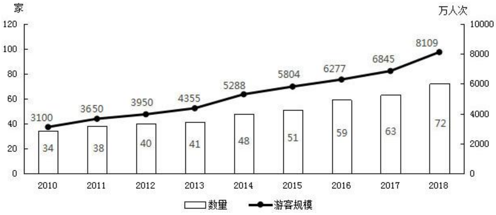
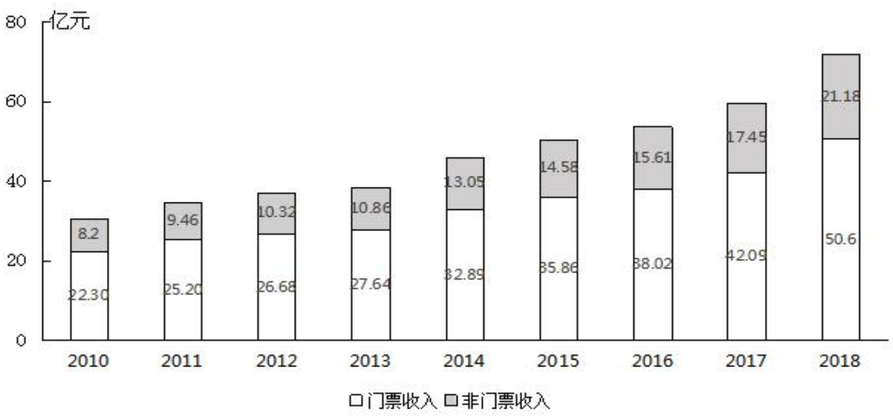
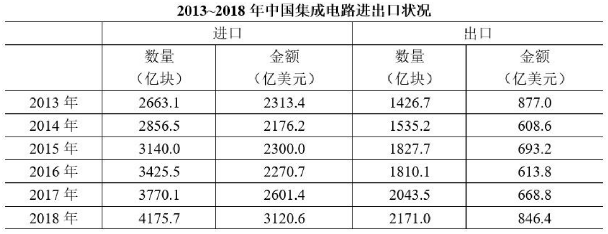
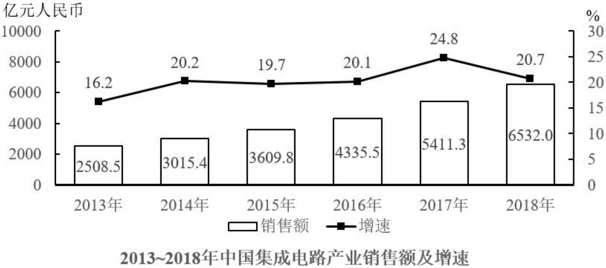
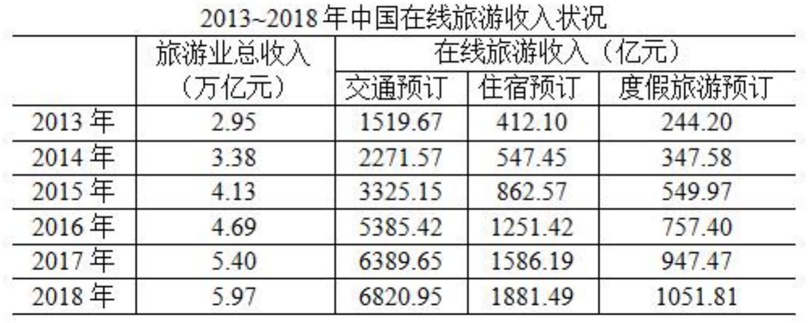

# 2020年国考行测（地市级）资料分析

共 20 题（第 111—130 题，原题号保留），4 组材料。内容：材料、题干、选项、答案（不收解析）；共用材料置于所属题组前，JSONL 每条记录完整内嵌材料。表格、统计图为题本按 288 DPI 渲染后的裁图，图中文字和数字另有转写。

[结构化数据](GK2020-DS.jsonl) · [图片清单](assets/GK2020-DS/manifest.json)

原题来源：[2020年国家公务员考试《行测》真题（地市级）.pdf](../%E7%9C%9F%E9%A2%98/2020%E5%B9%B4%E5%9B%BD%E5%AE%B6%E5%85%AC%E5%8A%A1%E5%91%98%E8%80%83%E8%AF%95%E3%80%8A%E8%A1%8C%E6%B5%8B%E3%80%8B%E7%9C%9F%E9%A2%98%EF%BC%88%E5%9C%B0%E5%B8%82%E7%BA%A7%EF%BC%89.pdf)（第 13—15 页）。答案来源：[2020年国家公务员考试《行测》真题（地市级）答案及解析...pdf](../%E7%AD%94%E6%A1%88%E8%A7%A3%E6%9E%90/2020%E5%B9%B4%E5%9B%BD%E5%AE%B6%E5%85%AC%E5%8A%A1%E5%91%98%E8%80%83%E8%AF%95%E3%80%8A%E8%A1%8C%E6%B5%8B%E3%80%8B%E7%9C%9F%E9%A2%98%EF%BC%88%E5%9C%B0%E5%B8%82%E7%BA%A7%EF%BC%89%E7%AD%94%E6%A1%88%E5%8F%8A%E8%A7%A3%E6%9E%90...pdf)（第 24—28 页，只取答案）。

原卷资料分析四组材料的组号印作“（二）”至“（五）”（与判断推理第106—110题的“（一）”连排），本库按次序记为 M1—M4。

## 资料分析

### 共用材料：第 111—115 题

图1　2010-2018年我国海洋主题公园年末数量及全年游客规模

| 年份 | 数量（家） | 游客规模（万人次） |
| --- | --- | --- |
| 2010年 | 34 | 3100 |
| 2011年 | 38 | 3650 |
| 2012年 | 40 | 3950 |
| 2013年 | 41 | 4355 |
| 2014年 | 48 | 5288 |
| 2015年 | 51 | 5804 |
| 2016年 | 59 | 6277 |
| 2017年 | 63 | 6845 |
| 2018年 | 72 | 8109 |

图名为图下的一行正文（见材料文字），不在图片内；柱为数量（左轴，家，0—120），折线为游客规模（右轴，万人次，0—10000）。

图1　2010-2018年我国海洋主题公园年末数量及全年游客规模

图2　2010-2018年我国海洋主题公园收入构成

| 年份 | 门票收入（亿元） | 非门票收入（亿元） |
| --- | --- | --- |
| 2010年 | 22.30 | 8.2 |
| 2011年 | 25.20 | 9.46 |
| 2012年 | 26.68 | 10.32 |
| 2013年 | 27.64 | 10.86 |
| 2014年 | 32.89 | 13.05 |
| 2015年 | 35.86 | 14.58 |
| 2016年 | 38.02 | 15.61 |
| 2017年 | 42.09 | 17.45 |
| 2018年 | 50.6 | 21.18 |

图名为图下的一行正文（见材料文字），不在图片内；堆积柱：下段（白色）为门票收入，上段（灰色）为非门票收入；纵轴单位亿元（0—80）。部分数字标签被柱边线压住一部分（如32.89、35.86、38.02的首位），按柱高核对无误。

图2　2010-2018年我国海洋主题公园收入构成

> 材料说明：原卷资料分析四组材料的组号依次印作“（二）”“（三）”“（四）”“（五）”（与判断推理第106—110题的材料组号“（一）”连排），本库按次序记为M1—M4。两张统计图的图名“图1……”“图2……”是图下的一行正文（不在图片内），已作为文字放在各图之后。

### 第 111 题

`GK2020-DS-Q111` · 单选 · 原卷第 13 页

[共用材料](#GK2020-DS-M1)

2018年我国平均每家海洋主题公园全年游客规模比2010年：

**A.** 减少了30万人次以上

**B.** 增加了30万人次以上

**C.** 减少了30万人次以内

**D.** 增加了30万人次以内

**答案：D**

### 第 112 题

`GK2020-DS-Q112` · 单选 · 原卷第 13 页

[共用材料](#GK2020-DS-M1)

已知2011年初～2018年末我国所有开业的海洋主题公园都持续营业，则该期间我国平均约多长时间新开一家海洋主题公园？

**A.** 两个半月

**B.** 两个月

**C.** 三个半月

**D.** 三个月

**答案：A**

### 第 113 题

`GK2020-DS-Q113` · 单选 · 原卷第 13 页

[共用材料](#GK2020-DS-M1)

2011～2018年间，我国海洋主题公园非门票收入同比增速超过10%的年份有几个？

**A.** 5

**B.** 6

**C.** 3

**D.** 4

**答案：A**

### 第 114 题

`GK2020-DS-Q114` · 单选 · 原卷第 13 页

[共用材料](#GK2020-DS-M1)

2016年我国海洋主题公园平均每名游客创造的门票收入比非门票收入多约多少元？

**A.** 42

**B.** 48

**C.** 30

**D.** 36

**答案：D**

### 第 115 题

`GK2020-DS-Q115` · 单选 · 原卷第 13 页

[共用材料](#GK2020-DS-M1)

关于我国海洋主题公园状况，能够从上述资料中推出的是：

**A.** 2013～2017年间累计游客规模超3亿人次

**B.** 2013年平均每家海洋主题公园的门票收入高于上年水平

**C.** 2011～2018年间，年末公园数量同比增量和游客规模同比增量最大的年份不是同一个

**D.** 2014年海洋主题公园总收入比上年增长了8亿多元

**答案：B**

### 共用材料：第 116—120 题

2013~2018年中国集成电路进出口状况

| 年份 | 进口：数量（亿块） | 进口：金额（亿美元） | 出口：数量（亿块） | 出口：金额（亿美元） |
| --- | --- | --- | --- | --- |
| 2013年 | 2663.1 | 2313.4 | 1426.7 | 877.0 |
| 2014年 | 2856.5 | 2176.2 | 1535.2 | 608.6 |
| 2015年 | 3140.0 | 2300.0 | 1827.7 | 693.2 |
| 2016年 | 3425.5 | 2270.7 | 1810.1 | 613.8 |
| 2017年 | 3770.1 | 2601.4 | 2043.5 | 668.8 |
| 2018年 | 4175.7 | 3120.6 | 2171.0 | 846.4 |

原表表头为两层：“进口”“出口”下各分“数量（亿块）”“金额（亿美元）”。

2013~2018年中国集成电路产业销售额及增速

| 年份 | 销售额（亿元人民币） | 增速（%） |
| --- | --- | --- |
| 2013年 | 2508.5 | 16.2 |
| 2014年 | 3015.4 | 20.2 |
| 2015年 | 3609.8 | 19.7 |
| 2016年 | 4335.5 | 20.1 |
| 2017年 | 5411.3 | 24.8 |
| 2018年 | 6532.0 | 20.7 |

柱为销售额（左轴，亿元人民币，0—10000），折线为增速（右轴，%，0—30）；图名在图片内、印在图下方。

### 第 116 题

`GK2020-DS-Q116` · 单选 · 原卷第 14 页

[共用材料](#GK2020-DS-M2)

2018年中国进出口贸易总额为4.62万亿美元，其中集成电路进出口贸易额占比：

**A.** 超过10个百分点

**B.** 在5～10个百分点之间

**C.** 在1～5个百分点之间

**D.** 不到1个百分点

**答案：B**

> 转写说明：四个选项把集成电路进出口贸易额占进出口贸易总额的比重写作“超过10个百分点”“在5～10个百分点之间”等，照录。

### 第 117 题

`GK2020-DS-Q117` · 单选 · 原卷第 14 页

[共用材料](#GK2020-DS-M2)

2012～2015年，中国集成电路产业累计销售额在以下哪个范围内？

**A.** 不到1万亿元

**B.** 在1～1.1万亿元之间

**C.** 在1.1～1.2万亿元之间

**D.** 超过1.2万亿元

**答案：C**

### 第 118 题

`GK2020-DS-Q118` · 单选 · 原卷第 14 页

[共用材料](#GK2020-DS-M2)

2013～2018年间中国集成电路产业销售额增速最高的年份，当年集成电路进口金额同比约增加：

**A.** 5%

**B.** 10%

**C.** 15%

**D.** 20%

**答案：C**

### 第 119 题

`GK2020-DS-Q119` · 单选 · 原卷第 14 页

[共用材料](#GK2020-DS-M2)

2018年中国平均每块集成电路出口单价比上年：

**A.** 下降了30%以上

**B.** 上升了30%以上

**C.** 下降了30%以内

**D.** 上升了30%以内

**答案：D**

### 第 120 题

`GK2020-DS-Q120` · 单选 · 原卷第 14 页

[共用材料](#GK2020-DS-M2)

关于中国集成电路产业销售及进出口状况，能够从上述资料中推出的是：

**A.** 2016～2017年，月均进出口总量超过450亿块

**B.** 2016年销售额同比增量低于上年水平

**C.** 2015～2018年，进口量和进口额均逐年上升

**D.** 2014～2018年，出口总量超过1万亿块

**答案：A**

### 共用材料：第 121—125 题

2013~2018年中国在线旅游收入状况

| 年份 | 旅游业总收入（万亿元） | 在线旅游收入（亿元）：交通预订 | 在线旅游收入（亿元）：住宿预订 | 在线旅游收入（亿元）：度假旅游预订 |
| --- | --- | --- | --- | --- |
| 2013年 | 2.95 | 1519.67 | 412.10 | 244.20 |
| 2014年 | 3.38 | 2271.57 | 547.45 | 347.58 |
| 2015年 | 4.13 | 3325.15 | 862.57 | 549.97 |
| 2016年 | 4.69 | 5385.42 | 1251.42 | 757.40 |
| 2017年 | 5.40 | 6389.65 | 1586.19 | 947.47 |
| 2018年 | 5.97 | 6820.95 | 1881.49 | 1051.81 |

原表表头为两层：“在线旅游收入（亿元）”下分“交通预订”“住宿预订”“度假旅游预订”；旅游业总收入单位为万亿元。

### 第 121 题

`GK2020-DS-Q121` · 单选 · 原卷第 14 页

[共用材料](#GK2020-DS-M3)

2018年中国在线旅游收入约占旅游业总收入的：

**A.** 20%

**B.** 25%

**C.** 12%

**D.** 16%

**答案：D**

### 第 122 题

`GK2020-DS-Q122` · 单选 · 原卷第 14 页

[共用材料](#GK2020-DS-M3)

2017年中国在线旅游收入同比约增长多少万亿元？

**A.** 0.15

**B.** 0.20

**C.** 0.25

**D.** 0.30

**答案：A**

### 第 123 题

`GK2020-DS-Q123` · 单选 · 原卷第 14 页

[共用材料](#GK2020-DS-M3)

中国在线旅游收入中，2014年占中国旅游业总收入比重高于上年水平的包括：

**A.** 仅在线交通预订

**B.** 在线交通预订、在线住宿预订、在线度假旅游预订

**C.** 仅在线交通预订、在线住宿预订

**D.** 仅在线交通预订、在线度假旅游预订

**答案：B**

### 第 124 题

`GK2020-DS-Q124` · 单选 · 原卷第 15 页

[共用材料](#GK2020-DS-M3)

以下折线图反映了2014～2018年间哪项收入同比增量的变化趋势？

**A.** 在线住宿预订

**B.** 旅游业总体

**C.** 在线度假旅游预订

**D.** 在线交通预订

**答案：C**

> 转写说明：题图为一条5个点的折线示意图（无坐标轴、无数值），选项为文字。

### 第 125 题

`GK2020-DS-Q125` · 单选 · 原卷第 15 页

[共用材料](#GK2020-DS-M3)

能够从上述资料中推出的是：

**A.** 2014～2018年，中国旅游业总收入超过25万亿元

**B.** 2014～2016年，中国旅游业总收入同比增速逐年递增

**C.** 2016年中国在线交通预订收入同比增速快于上年水平

**D.** 如保持2018年同比增量，中国在线住宿预订收入将在2023年首超3000亿元

**答案：C**

### 共用材料：第 126—130 题

2018年，B市新经济实现增加值10057.4亿元，比上年增长9.3%，占全市地区生产总值的比重为33.2%，比上年提高0.4个百分点。全年全市新设立的企业中，信息服务业、科技服务业企业合计达到70661家，占比为38.5%，注册资本达到7311.4亿元，同比增长13.5%。
2018年，B市高技术产业实现增加值6976.8亿元，比上年增长9.4%，占地区生产总值的比重为23.0%，比上年提高0.2个百分点。战略性新兴产业实现增加值4893.4亿元，增长9.2%，占地区生产总值的比重为16.1%，比上年提高0.1个百分点。信息产业实现增加值4940.7亿元，增长14.3%，占地区生产总值的比重为（X）%，比上年提高0.9个百分点。
2018年，B市高技术服务业完成投资507.8亿元，同比增长18.9%。其中，信息服务业投资增长31.2%，科技服务业投资增长7.7%。
2018年，B市限额以上批发零售业网上零售额达到2632.9亿元，比上年增长10.3%，占全市零售额比重为22.4%，对全市零售额增长的贡献率（限额以上批发零售业网上零售额同比增量在全市零售额同比增量中占的比重）达到80.6%。限额以上住宿餐饮企业通过公共网络实现的餐费收入为124.7亿元，比上年增长39.3%，对全市餐费收入增长的贡献率达到33%。
2018年，B市高新技术示范区规模以上高新技术企业实现技术收入10629.4亿元，比上年增长13.4%，占高新技术示范区规模以上高新技术企业总收入的比重为18.1%，比上年提高1.8个百分点。

### 第 126 题

`GK2020-DS-Q126` · 单选 · 原卷第 15 页

[共用材料](#GK2020-DS-M4)

2018年B市平均每家新设立的信息服务业、科技服务业企业注册资本：

**A.** 在1000~1100万元之间

**B.** 超过1100万元

**C.** 不到900万元

**D.** 在900~1000万元之间

**答案：A**

### 第 127 题

`GK2020-DS-Q127` · 单选 · 原卷第 15 页

[共用材料](#GK2020-DS-M4)

第二段中（X）处应填入的数值最可能是：

**A.** 15.0

**B.** 13.7

**C.** 17.6

**D.** 16.3

**答案：D**

### 第 128 题

`GK2020-DS-Q128` · 单选 · 原卷第 15 页

[共用材料](#GK2020-DS-M4)

2018年，B市零售额同比增长了：

**A.** 超过600亿元

**B.** 400~600亿元之间

**C.** 200~400亿元之间

**D.** 不到200亿元

**答案：C**

### 第 129 题

`GK2020-DS-Q129` · 单选 · 原卷第 15 页

[共用材料](#GK2020-DS-M4)

2018年，B市高新技术示范区规模以上高新技术企业月均收入在以下哪个范围内？

**A.** 超过5500亿元

**B.** 4500~5500亿元之间

**C.** 3500~4500亿元之间

**D.** 不到3500亿元

**答案：B**

### 第 130 题

`GK2020-DS-Q130` · 单选 · 原卷第 15 页

[共用材料](#GK2020-DS-M4)

能够从上述资料中推出的是：

**A.** 2018年B市地区生产总值超过35000亿元

**B.** 2017年B市高新技术示范区规模以上高新技术企业非技术收入是技术收入的5倍多

**C.** 2018年B市战略性新兴产业增加值占新经济增加值的比重高于上年水平

**D.** 2018年B市高技术服务业完成投资比上年增长了100亿元以上

**答案：B**
