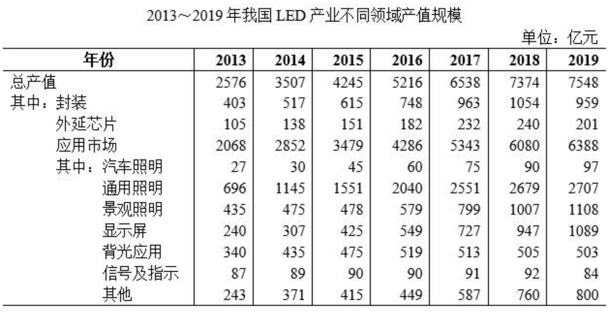
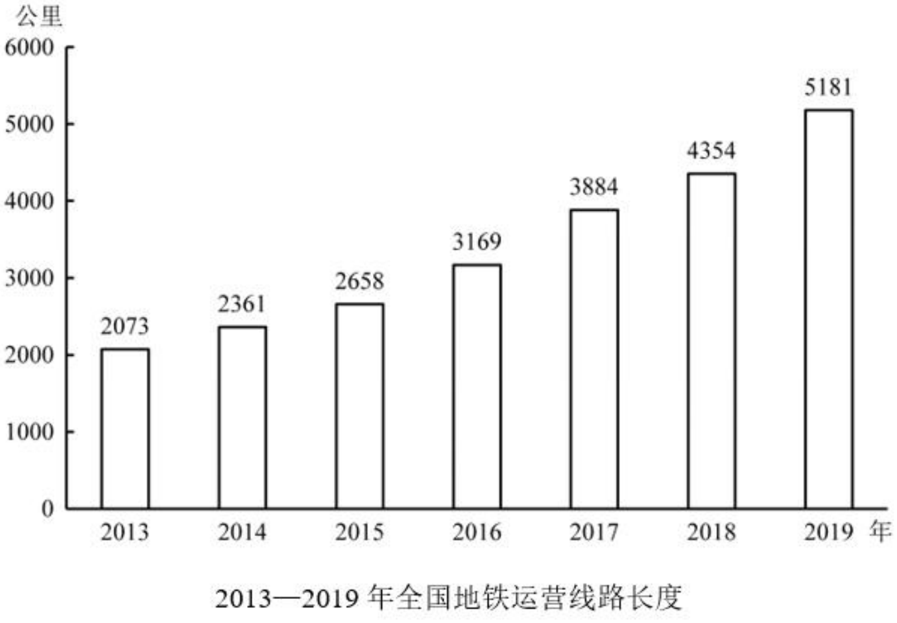
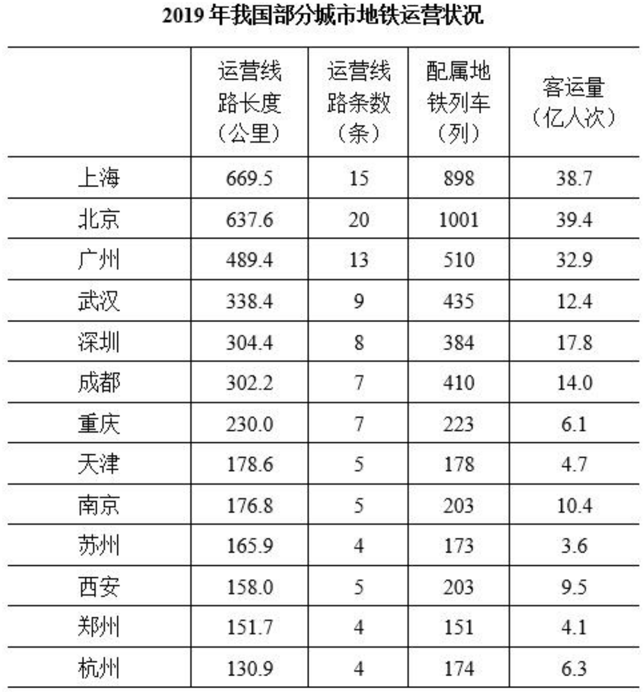
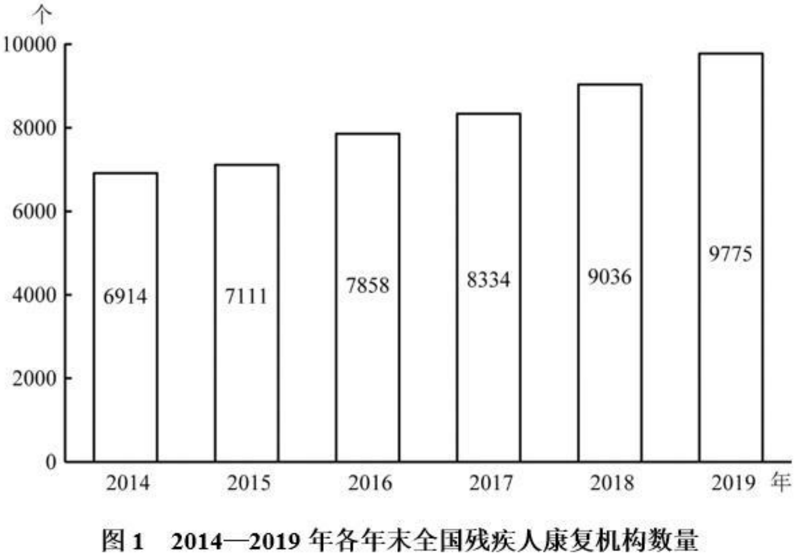
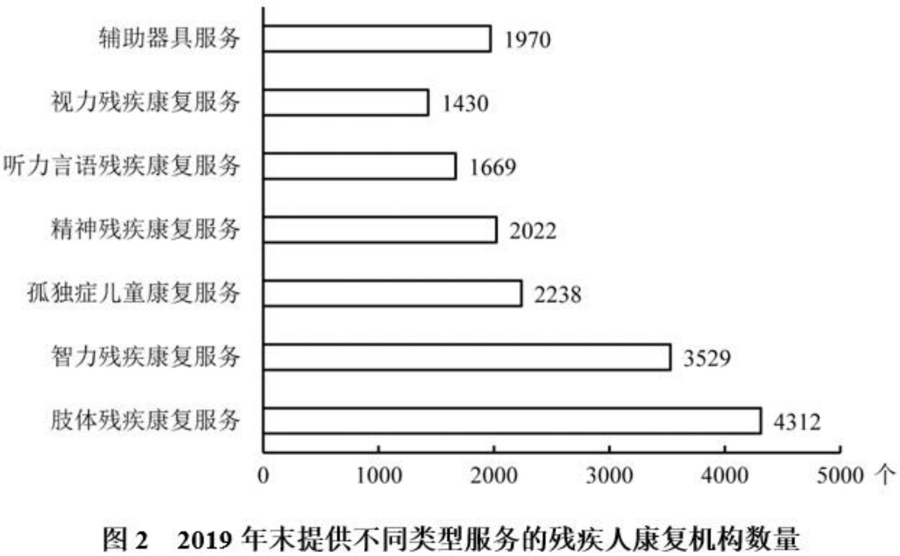

# 2021年国考行测（市地级）资料分析

共 20 题（第 111—130 题，原题号保留），4 组材料。内容：材料、题干、选项、答案（不收解析）；共用材料置于所属题组前，JSONL 每条记录完整内嵌材料。表格、统计图为题本按 288 DPI 渲染后的裁图，图中文字和数字另有转写。

[结构化数据](GK2021-DS.jsonl) · [图片清单](assets/GK2021-DS/manifest.json)

原题来源：[2021年国家公务员考试《行测》真题（市地级）.pdf](../%E7%9C%9F%E9%A2%98/2021%E5%B9%B4%E5%9B%BD%E5%AE%B6%E5%85%AC%E5%8A%A1%E5%91%98%E8%80%83%E8%AF%95%E3%80%8A%E8%A1%8C%E6%B5%8B%E3%80%8B%E7%9C%9F%E9%A2%98%EF%BC%88%E5%B8%82%E5%9C%B0%E7%BA%A7%EF%BC%89.pdf)（第 15—18 页）。答案来源：[2021年国家公务员考试《行测》真题（市地级）参考答案及解析...pdf](../%E7%AD%94%E6%A1%88%E8%A7%A3%E6%9E%90/2021%E5%B9%B4%E5%9B%BD%E5%AE%B6%E5%85%AC%E5%8A%A1%E5%91%98%E8%80%83%E8%AF%95%E3%80%8A%E8%A1%8C%E6%B5%8B%E3%80%8B%E7%9C%9F%E9%A2%98%EF%BC%88%E5%B8%82%E5%9C%B0%E7%BA%A7%EF%BC%89%E5%8F%82%E8%80%83%E7%AD%94%E6%A1%88%E5%8F%8A%E8%A7%A3%E6%9E%90...pdf)（第 30—35 页，只取答案）。

## 资料分析

### 共用材料：第 111—115 题

2013～2019年我国LED产业不同领域产值规模（单位：亿元）

| 年份 | 2013 | 2014 | 2015 | 2016 | 2017 | 2018 | 2019 |
| --- | --- | --- | --- | --- | --- | --- | --- |
| 总产值 | 2576 | 3507 | 4245 | 5216 | 6538 | 7374 | 7548 |
| 其中：封装 | 403 | 517 | 615 | 748 | 963 | 1054 | 959 |
| 外延芯片 | 105 | 138 | 151 | 182 | 232 | 240 | 201 |
| 应用市场 | 2068 | 2852 | 3479 | 4286 | 5343 | 6080 | 6388 |
| 其中：汽车照明 | 27 | 30 | 45 | 60 | 75 | 90 | 97 |
| 通用照明 | 696 | 1145 | 1551 | 2040 | 2551 | 2679 | 2707 |
| 景观照明 | 435 | 475 | 478 | 579 | 799 | 1007 | 1108 |
| 显示屏 | 240 | 307 | 425 | 549 | 727 | 947 | 1089 |
| 背光应用 | 340 | 435 | 475 | 519 | 513 | 505 | 503 |
| 信号及指示 | 87 | 89 | 90 | 90 | 91 | 92 | 84 |
| 其他 | 243 | 371 | 415 | 449 | 587 | 760 | 800 |

原表缩进排：“封装”“外延芯片”“应用市场”为总产值的分项（首项前印“其中：”）；“汽车照明”至“其他”七项为应用市场的分项（首项前印“其中：”）。“单位：亿元”印在表右上方。

### 第 111 题

`GK2021-DS-Q111` · 单选 · 原卷第 15 页

[共用材料](#GK2021-DS-M1)

“十三五”（2016—2020年）最后一年我国LED产业总产值要实现比“十二五”（2011—2015年）最后一年翻番的目标，总产值至少要同比增长：

**A.** 9.6%

**B.** 12.5%

**C.** 16.3%

**D.** 22.1%

**答案：B**

### 第 112 题

`GK2021-DS-Q112` · 单选 · 原卷第 15 页

[共用材料](#GK2021-DS-M1)

2014—2019年间，我国LED产业封装、外延芯片和应用市场产值同比增速均超过10%的年份有几个？

**A.** 1

**B.** 2

**C.** 3

**D.** 4

**答案：C**

### 第 113 题

`GK2021-DS-Q113` · 单选 · 原卷第 15 页

[共用材料](#GK2021-DS-M1)

在表中所列各类LED应用市场中，2013—2019年产值年均增速（以2013年为基期）最快的应用市场，2019年产值约占LED行业总产值的：

**A.** 14%

**B.** 17%

**C.** 36%

**D.** 85%

**答案：A**

### 第 114 题

`GK2021-DS-Q114` · 单选 · 原卷第 15 页

[共用材料](#GK2021-DS-M1)

以下折线图中，能准确反映2015—2018年间通用照明类LED应用市场产值同比增量变化趋势的是：

**A.** 见上方选项图 A。

**B.** 见上方选项图 B。

**C.** 见上方选项图 C。

**D.** 见上方选项图 D。

**答案：B**

> 转写说明：四个选项各为一张折线示意图（无坐标轴、无数值），选项字母“A、”“B、”“C、”“D、”为正文文字、印在各图左下方，裁图不含字母。

### 第 115 题

`GK2021-DS-Q115` · 单选 · 原卷第 15 页

[共用材料](#GK2021-DS-M1)

关于2013—2019年我国LED产业，能够从上述资料中推出的是：

**A.** 2016年总产值同比增量低于2015年

**B.** 2019年封装产值占行业总产值比重高于5年前水平

**C.** 7年间汽车照明应用累计产值规模超过500亿元

**D.** 每年景观照明应用的产值均高于背光应用产值

**答案：D**

### 共用材料：第 116—120 题

2019年全国地铁运营线路长度达5181公里，占城轨交通运营线路总里程的76.8%。

2013—2019年全国地铁运营线路长度

| 年份 | 地铁运营线路长度（公里） |
| --- | --- |
| 2013年 | 2073 |
| 2014年 | 2361 |
| 2015年 | 2658 |
| 2016年 | 3169 |
| 2017年 | 3884 |
| 2018年 | 4354 |
| 2019年 | 5181 |

纵轴单位为公里（0—6000）；图名在图片内、印在图下方。

2019年末，我国城轨交通配属地铁列车6178列，全年实现地铁客运量227.76亿人次。

2019年我国部分城市地铁运营状况

| 城市 | 运营线路长度（公里） | 运营线路条数（条） | 配属地铁列车（列） | 客运量（亿人次） |
| --- | --- | --- | --- | --- |
| 上海 | 669.5 | 15 | 898 | 38.7 |
| 北京 | 637.6 | 20 | 1001 | 39.4 |
| 广州 | 489.4 | 13 | 510 | 32.9 |
| 武汉 | 338.4 | 9 | 435 | 12.4 |
| 深圳 | 304.4 | 8 | 384 | 17.8 |
| 成都 | 302.2 | 7 | 410 | 14.0 |
| 重庆 | 230.0 | 7 | 223 | 6.1 |
| 天津 | 178.6 | 5 | 178 | 4.7 |
| 南京 | 176.8 | 5 | 203 | 10.4 |
| 苏州 | 165.9 | 4 | 173 | 3.6 |
| 西安 | 158.0 | 5 | 203 | 9.5 |
| 郑州 | 151.7 | 4 | 151 | 4.1 |
| 杭州 | 130.9 | 4 | 174 | 6.3 |

表下的“注：除客运量为全年数值外，其余指标为年末时点值。”是正文文字，见材料。

注：除客运量为全年数值外，其余指标为年末时点值。

### 第 116 题

`GK2021-DS-Q116` · 单选 · 原卷第 16 页

[共用材料](#GK2021-DS-M2)

2014—2019年间，全国地铁运营线路长度同比增长20%以上的年份有几个？

**A.** 1

**B.** 2

**C.** 3

**D.** 4

**答案：A**

### 第 117 题

`GK2021-DS-Q117` · 单选 · 原卷第 16 页

[共用材料](#GK2021-DS-M2)

2019年，直辖市（北京、天津、上海、重庆）地铁客运量占全国地铁客运总量的比重在以下哪个范围内？

**A.** 不到40%

**B.** 40%—45%之间

**C.** 45%—50%之间

**D.** 超过50%

**答案：A**

### 第 118 题

`GK2021-DS-Q118` · 单选 · 原卷第 16 页

[共用材料](#GK2021-DS-M2)

以下城市中，2019年末平均每条运营的地铁线路配属地铁列车数最多的是：

**A.** 广州

**B.** 武汉

**C.** 成都

**D.** 南京

**答案：C**

### 第 119 题

`GK2021-DS-Q119` · 单选 · 原卷第 16 页

[共用材料](#GK2021-DS-M2)

表中所列2019年地铁客运量超过10亿人次的城市中，2019年平均每条地铁运营线路长度超过40公里的城市有几个？

**A.** 1

**B.** 2

**C.** 3

**D.** 4

**答案：B**

### 第 120 题

`GK2021-DS-Q120` · 单选 · 原卷第 16 页

[共用材料](#GK2021-DS-M2)

能够从上述资料中推出的是：

**A.** 2019年全国城轨交通运营线路总里程不到6000公里

**B.** 2019年全国地铁运营线路长度相比2016年增量是2016年相比2013年增量的两倍以上

**C.** 表中2019年末地铁运营线路长度排名前3的城市地铁运营线路长度之和占全国总量的50%以上

**D.** 表中2019年平均每条运营线路客运量最少的城市，地铁客运量在表中各城市排前10位

**答案：D**

### 共用材料：第 121—125 题

截至2019年末，全国已有残疾人康复机构9775个，比2018年增长739个。2019年，1043.0万残疾儿童及持证残疾人得到基本康复服务，其中包括0—6岁残疾儿童18.1万人。

图1　2014—2019年各年末全国残疾人康复机构数量

| 年份 | 残疾人康复机构数量（个） |
| --- | --- |
| 2014年 | 6914 |
| 2015年 | 7111 |
| 2016年 | 7858 |
| 2017年 | 8334 |
| 2018年 | 9036 |
| 2019年 | 9775 |

纵轴单位为个（0—10000）；图名在图片内、印在图下方。

图2　2019年末提供不同类型服务的残疾人康复机构数量

| 服务类型 | 机构数量（个） |
| --- | --- |
| 辅助器具服务 | 1970 |
| 视力残疾康复服务 | 1430 |
| 听力言语残疾康复服务 | 1669 |
| 精神残疾康复服务 | 2022 |
| 孤独症儿童康复服务 | 2238 |
| 智力残疾康复服务 | 3529 |
| 肢体残疾康复服务 | 4312 |

横向条形图，自上而下按上表顺序；横轴单位为个（0—5000）；图名在图片内、印在图下方。

截至2019年末，全国已竣工的各级残疾人综合服务设施2341个，总建设规模584.5万平方米，总投资183.1亿元；已竣工各级残疾人康复设施1006个，总建设规模414.2万平方米，总投资132.2亿元。

### 第 121 题

`GK2021-DS-Q121` · 单选 · 原卷第 17 页

[共用材料](#GK2021-DS-M3)

2016—2019年，全国残疾人康复机构数量同比增量最大的年份是：

**A.** 2016年

**B.** 2017年

**C.** 2018年

**D.** 2019年

**答案：A**

### 第 122 题

`GK2021-DS-Q122` · 单选 · 原卷第 17 页

[共用材料](#GK2021-DS-M3)

2019年末，提供肢体残疾康复服务的康复机构的数量占全国残疾人康复机构总数的比重，比提供精神残疾康复服务的康复机构的数量占全国残疾人康复机构总数的比重高约多少个百分点？

**A.** 13

**B.** 18

**C.** 23

**D.** 28

**答案：C**

### 第 123 题

`GK2021-DS-Q123` · 单选 · 原卷第 17 页

[共用材料](#GK2021-DS-M3)

如提供视力残疾康复服务的残疾人康复机构中，同时提供听力言语残疾康复服务的机构比不提供该服务的机构多20%，则2019年末全国有多少家残疾人康复机构不提供以上两种康复服务中的任意一种？

**A.** 不到7300家

**B.** 7300—7600家之间

**C.** 7600—7900家之间

**D.** 超过7900家

**答案：B**

### 第 124 题

`GK2021-DS-Q124` · 单选 · 原卷第 17 页

[共用材料](#GK2021-DS-M3)

截至2019年末，全国平均每个已竣工的残疾人综合服务设施建设规模约是已竣工残疾人康复设施的多少倍？

**A.** 0.6

**B.** 0.8

**C.** 1.2

**D.** 1.7

**答案：A**

### 第 125 题

`GK2021-DS-Q125` · 单选 · 原卷第 17、18 页

[共用材料](#GK2021-DS-M3)

能够从上述资料中推出的是：

**A.** 2019年全国得到基本康复服务的0—6岁残疾儿童占得到基本康复服务的残疾儿童及持证残疾人的2%以上

**B.** 2015年，全国平均每月新增残疾人康复机构20家以上

**C.** 2019年末，全国残疾人康复机构中，超过25%提供孤独症儿童康复服务

**D.** 截至2019年末，全国已竣工的各级残疾人综合服务设施平均每平方米的投资额在3000—4000元之间

**答案：D**

### 共用材料：第 126—130 题

2019年上半年，我国服务进出口总额达到26124.6亿元，同比增长2.6%。其中，出口总额9333.7亿元，同比增长9.0%；进口总额16790.8亿元，同比下降0.6%。服务进出口总额占对外贸易总额的比重达到15.1%，比2018年全年高出0.5个百分点。
2019年全年，我国服务进出口总额54152.9亿元，同比增长2.8%。其中，出口总额19564.0亿元，同比增长8.9%；进口总额34588.9亿元，同比减少0.4%。
2019年上半年，我国知识密集型服务进出口额8923.9亿元，同比增长9.4%，其中，知识密集型服务出口额4674.1亿元，同比增长12.1%；进口额4249.8亿元，同比增长6.5%。从具体领域看，知识产权使用费出口同比增长33.0%；电信、计算机和信息服务出口同比增长15.7%，进口同比增长19.6%；其他商业服务（含技术、专业和管理咨询服务、研发成果转让费及委托研发等）出口同比增长10.4%；金融服务出口同比增长13.9%，进口同比增长43.9%。
2019年全年，我国知识密集型服务进出口额18777.7亿元，同比增长10.8%，其中，知识密集型服务出口额9916.8亿元，同比增长13.4%；进口额8860.9亿元，同比增长8.0%。从具体领域看，个人文化娱乐服务，电信、计算机和信息服务，金融服务进出口总额分别同比增长19.4%、18.9%、18.7%。

### 第 126 题

`GK2021-DS-Q126` · 单选 · 原卷第 18 页

[共用材料](#GK2021-DS-M4)

2019年下半年，我国服务进出口贸易状况为：

**A.** 顺差5000亿元以内

**B.** 顺差5000亿元以上

**C.** 逆差5000亿元以内

**D.** 逆差5000亿元以上

**答案：D**

### 第 127 题

`GK2021-DS-Q127` · 单选 · 原卷第 18 页

[共用材料](#GK2021-DS-M4)

2019年上半年，我国知识密集型服务进出口额环比约：

**A.** 上升了1.5%

**B.** 上升了10.5%

**C.** 下降了1.5%

**D.** 下降了10.5%

**答案：A**

### 第 128 题

`GK2021-DS-Q128` · 单选 · 原卷第 18 页

[共用材料](#GK2021-DS-M4)

2018年，我国对外贸易总额约为多少万亿元？

**A.** 17

**B.** 25

**C.** 36

**D.** 48

**答案：C**

### 第 129 题

`GK2021-DS-Q129` · 单选 · 原卷第 18 页

[共用材料](#GK2021-DS-M4)

2019年，我国知识密集型服务出口额占服务出口额比重：

**A.** 仅上半年高于上年同期水平

**B.** 仅下半年高于上年同期水平

**C.** 上、下半年均高于上年同期水平

**D.** 上、下半年均低于上年同期水平

**答案：C**

### 第 130 题

`GK2021-DS-Q130` · 单选 · 原卷第 18 页

[共用材料](#GK2021-DS-M4)

能够从上述资料中推出的是：

**A.** 2019年下半年，我国服务进口额同比为正增长

**B.** 2019年上半年，电信、计算机和信息服务进出口总额占知识密集型服务进出口总额的比重高于上年同期水平

**C.** 2019年上半年，非知识密集型服务进出口贸易逆差低于7000亿元

**D.** 2019年下半年，我国知识密集型服务出口额占服务出口额的比重低于知识密集型服务进口额占服务进口额的比重

**答案：B**
