# 2023年国考行测（地市级）资料分析

共 20 题（第 111—130 题，原题号保留），4 组材料。内容：材料、题干、选项、答案（不收解析）；共用材料置于所属题组前，JSONL 每条记录完整内嵌材料。表格、统计图为题本按 288 DPI 渲染后的裁图，图中文字和数字另有转写。

[结构化数据](GK2023-DS.jsonl) · [图片清单](assets/GK2023-DS/manifest.json)

原题来源：[2023年国家公务员录用考试《行测》真题（地市级）.pdf](../%E7%9C%9F%E9%A2%98/2023%E5%B9%B4%E5%9B%BD%E5%AE%B6%E5%85%AC%E5%8A%A1%E5%91%98%E5%BD%95%E7%94%A8%E8%80%83%E8%AF%95%E3%80%8A%E8%A1%8C%E6%B5%8B%E3%80%8B%E7%9C%9F%E9%A2%98%EF%BC%88%E5%9C%B0%E5%B8%82%E7%BA%A7%EF%BC%89.pdf)（第 25—30 页）。答案来源：[2023年国家公务员录用考试《行测》真题（地市级）（解析）.pdf](../%E7%AD%94%E6%A1%88%E8%A7%A3%E6%9E%90/2023%E5%B9%B4%E5%9B%BD%E5%AE%B6%E5%85%AC%E5%8A%A1%E5%91%98%E5%BD%95%E7%94%A8%E8%80%83%E8%AF%95%E3%80%8A%E8%A1%8C%E6%B5%8B%E3%80%8B%E7%9C%9F%E9%A2%98%EF%BC%88%E5%9C%B0%E5%B8%82%E7%BA%A7%EF%BC%89%EF%BC%88%E8%A7%A3%E6%9E%90%EF%BC%89.pdf)（第 34—39 页，只取答案）。

原卷资料分析四组材料的组号印作“（二）”至“（五）”（与判断推理第106—110题的“（一）”连排），本库按次序记为 M1—M4。本卷题本的题号单独一行、选项各占一行，文字层已按页面核对。

## 资料分析

### 共用材料：第 111—115 题

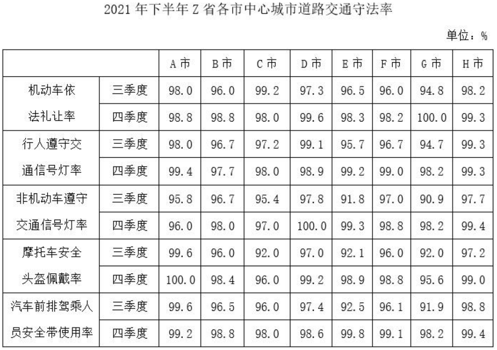

2021年下半年Z省各市中心城市道路交通守法率（单位：%）

| 指标 | 季度 | A市 | B市 | C市 | D市 | E市 | F市 | G市 | H市 |
| --- | --- | --- | --- | --- | --- | --- | --- | --- | --- |
| 机动车依法礼让率 | 三季度 | 98.0 | 96.0 | 99.2 | 97.3 | 96.5 | 96.0 | 94.8 | 98.2 |
| 机动车依法礼让率 | 四季度 | 98.8 | 98.8 | 98.0 | 99.6 | 98.3 | 98.2 | 100.0 | 99.3 |
| 行人遵守交通信号灯率 | 三季度 | 98.0 | 96.7 | 97.2 | 99.1 | 95.7 | 96.7 | 94.7 | 99.3 |
| 行人遵守交通信号灯率 | 四季度 | 99.4 | 97.7 | 98.0 | 98.9 | 99.2 | 99.0 | 98.2 | 99.3 |
| 非机动车遵守交通信号灯率 | 三季度 | 95.8 | 96.7 | 95.4 | 97.8 | 91.8 | 97.0 | 90.9 | 97.7 |
| 非机动车遵守交通信号灯率 | 四季度 | 96.0 | 98.0 | 97.0 | 100.0 | 99.3 | 98.8 | 98.2 | 99.4 |
| 摩托车安全头盔佩戴率 | 三季度 | 99.6 | 96.0 | 92.0 | 97.0 | 92.1 | 96.0 | 92.0 | 97.2 |
| 摩托车安全头盔佩戴率 | 四季度 | 100.0 | 98.4 | 96.0 | 99.2 | 98.9 | 98.8 | 95.6 | 99.0 |
| 汽车前排驾乘人员安全带使用率 | 三季度 | 99.6 | 96.5 | 96.0 | 97.4 | 92.5 | 96.1 | 91.9 | 98.8 |
| 汽车前排驾乘人员安全带使用率 | 四季度 | 99.2 | 98.8 | 98.0 | 98.6 | 99.8 | 99.1 | 98.2 | 99.4 |

原表每项指标占两行（三季度、四季度），指标名分两行印（如“机动车依”“法礼让率”）；“单位：%”印在表右上方，表题在图片内。

> 材料说明：原卷资料分析四组材料的组号依次印作“（二）”“（三）”“（四）”“（五）”（与判断推理第106—110题的材料组号“（一）”连排），本库按次序记为M1—M4；本组组号“（二）”未收入材料。材料1没有文字，只有一张表（表题、单位在图片内），已裁图并逐项转写。

### 第 111 题

`GK2023-DS-Q111` · 单选 · 原卷第 25 页

[共用材料](#GK2023-DS-M1)

2021年四季度，Z省有几个市的中心城市道路机动车依法礼让率高于上季度水平？

**A.** 5

**B.** 6

**C.** 7

**D.** 8

**答案：C**

### 第 112 题

`GK2023-DS-Q112` · 单选 · 原卷第 25、26 页

[共用材料](#GK2023-DS-M1)

2021年三季度Z省中心城市道路非机动车遵守交通信号灯率最低的城市，其四季度中心城市道路非机动车遵守交通信号灯率比上季度增长了：

**A.** 4~6个百分点之间

**B.** 超过6个百分点

**C.** 不到2个百分点

**D.** 2~4个百分点之间

**答案：B**

### 第 113 题

`GK2023-DS-Q113` · 单选 · 原卷第 26 页

[共用材料](#GK2023-DS-M1)

如用求各市算术平均值的方式计算全省数值，则2021年四季度Z省中心城市道路汽车前排驾乘人员安全带使用率比上季度：

**A.** 下降了不到2个百分点

**B.** 下降了2个百分点以上

**C.** 提升了不到2个百分点

**D.** 提升了2个百分点以上

**答案：D**

### 第 114 题

`GK2023-DS-Q114` · 单选 · 原卷第 26 页

[共用材料](#GK2023-DS-M1)

如单纯从统计数据判断，则2021年四季度B市在提升中心城市道路交通守法率方面，工作相比三季度最有成效的是：

**A.** 机动车依法礼让

**B.** 行人、非机动车遵守交通信号灯

**C.** 摩托车驾乘人员佩戴安全头盔

**D.** 汽车前排驾乘人员使用安全带

**答案：A**

### 第 115 题

`GK2023-DS-Q115` · 单选 · 原卷第 26 页

[共用材料](#GK2023-DS-M1)

以下条形图反映了2021年四季度Z省哪个城市中心城市道路交通守法率五项指标之间的大小关系？

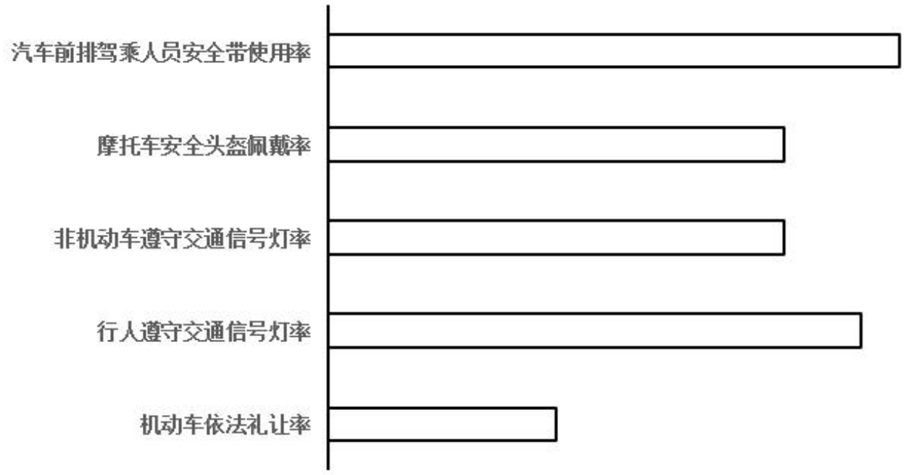

**A.** E市

**B.** F市

**C.** G市

**D.** H市

**答案：B**

> 转写说明：题图为五项指标的横向条形图（无数值、无刻度），选项为文字。

### 共用材料：第 116—120 题

超级计算，也被称为高性能计算。从算力资源的需求看，高性能计算可以分为尖端超算、通用超算、业务超算和人工智能超算四大类。

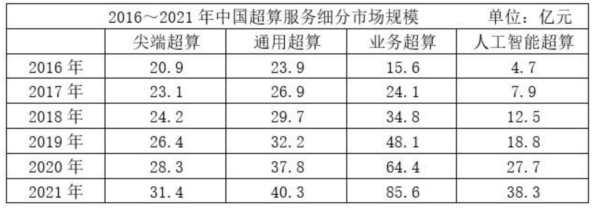

2016～2021年中国超算服务细分市场规模（单位：亿元）

| 年份 | 尖端超算 | 通用超算 | 业务超算 | 人工智能超算 |
| --- | --- | --- | --- | --- |
| 2016年 | 20.9 | 23.9 | 15.6 | 4.7 |
| 2017年 | 23.1 | 26.9 | 24.1 | 7.9 |
| 2018年 | 24.2 | 29.7 | 34.8 | 12.5 |
| 2019年 | 26.4 | 32.2 | 48.1 | 18.8 |
| 2020年 | 28.3 | 37.8 | 64.4 | 27.7 |
| 2021年 | 31.4 | 40.3 | 85.6 | 38.3 |

表题和“单位：亿元”印在表格首行内。

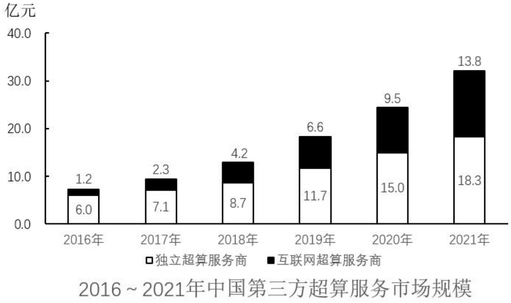

2016～2021年中国第三方超算服务市场规模

| 年份 | 独立超算服务商（亿元） | 互联网超算服务商（亿元） |
| --- | --- | --- |
| 2016年 | 6.0 | 1.2 |
| 2017年 | 7.1 | 2.3 |
| 2018年 | 8.7 | 4.2 |
| 2019年 | 11.7 | 6.6 |
| 2020年 | 15.0 | 9.5 |
| 2021年 | 18.3 | 13.8 |

堆积柱：下段（白色）为独立超算服务商，上段（黑色）为互联网超算服务商（数值标在柱顶上方）；纵轴单位亿元（0—40）；图题在图片内、印在图下方。

> 材料说明：原卷本组组号印作“（三）”（资料分析各组组号从“（二）”起，见M1说明），组号未收入材料。一段短文字＋一张表＋一幅堆积柱形图（表题、图题在图片内），已裁图并逐项转写。

### 第 116 题

`GK2023-DS-Q116` · 单选 · 原卷第 27 页

[共用材料](#GK2023-DS-M2)

2020～2021年，中国超算服务市场累计规模约为多少亿元？

**A.** 328

**B.** 354

**C.** 371

**D.** 396

**答案：B**

### 第 117 题

`GK2023-DS-Q117` · 单选 · 原卷第 27 页

[共用材料](#GK2023-DS-M2)

2019年，中国第三方超算服务市场规模约占同年超算服务总体市场规模的：

**A.** 15%

**B.** 18%

**C.** 21%

**D.** 24%

**答案：A**

### 第 118 题

`GK2023-DS-Q118` · 单选 · 原卷第 27 页

[共用材料](#GK2023-DS-M2)

2018年，中国超算服务4类细分市场中，同比增速最快和最慢的市场当年市场规模同比增速相差约多少个百分点？

**A.** 41

**B.** 47

**C.** 53

**D.** 59

**答案：C**

### 第 119 题

`GK2023-DS-Q119` · 单选 · 原卷第 27 页

[共用材料](#GK2023-DS-M2)

如保持2021年同比增量不变，则到哪一年第三方互联网超算服务商提供的服务市场规模将第一次超过第三方独立超算服务商？

**A.** 2025年

**B.** 2026年

**C.** 2027年

**D.** 2028年

**答案：B**

### 第 120 题

`GK2023-DS-Q120` · 单选 · 原卷第 27、28 页

[共用材料](#GK2023-DS-M2)

能够从上述资料中推出的是：

**A.** 2016～2020年，通用超算服务市场累计规模超过160亿元

**B.** 2016～2017年，业务超算服务市场累计规模比人工智能超算服务高30多亿元

**C.** 2018～2021年，第三方独立超算服务市场规模同比增量逐年递增

**D.** 2017～2020年，第三方互联网超算服务市场规模同比增速逐年递减

**答案：D**

### 共用材料：第 121—125 题

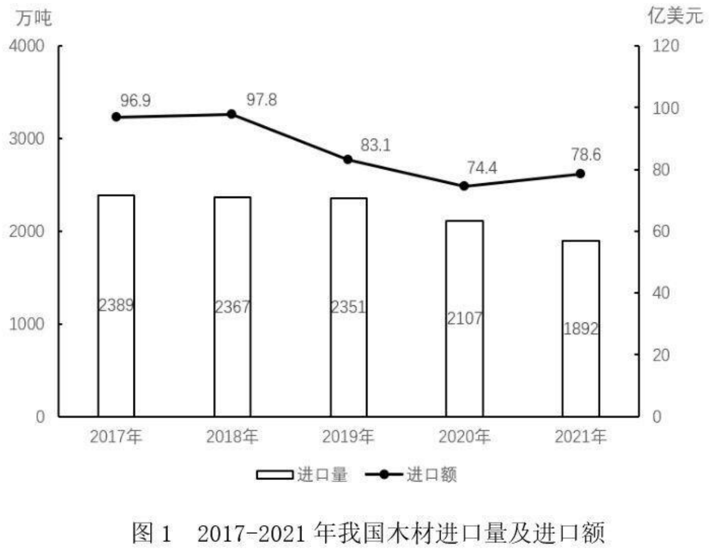

图1　2017-2021年我国木材进口量及进口额

| 年份 | 进口量（万吨） | 进口额（亿美元） |
| --- | --- | --- |
| 2017年 | 2389 | 96.9 |
| 2018年 | 2367 | 97.8 |
| 2019年 | 2351 | 83.1 |
| 2020年 | 2107 | 74.4 |
| 2021年 | 1892 | 78.6 |

柱为进口量（左轴，万吨，0—4000），折线为进口额（右轴，亿美元，0—120）；图名在图片内、印在图下方。

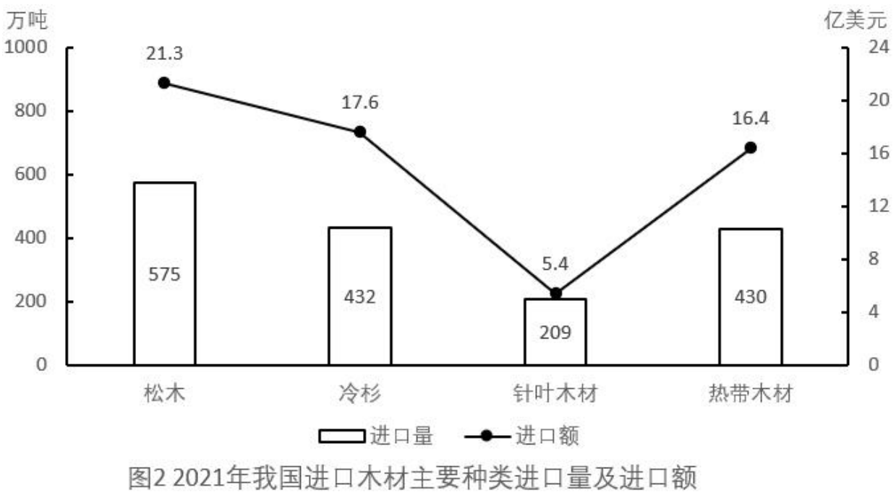

图2　2021年我国进口木材主要种类进口量及进口额

| 种类 | 进口量（万吨） | 进口额（亿美元） |
| --- | --- | --- |
| 松木 | 575 | 21.3 |
| 冷杉 | 432 | 17.6 |
| 针叶木材 | 209 | 5.4 |
| 热带木材 | 430 | 16.4 |

柱为进口量（左轴，万吨，0—1000），折线为进口额（右轴，亿美元，0—24）；图名在图片内、印在图下方。

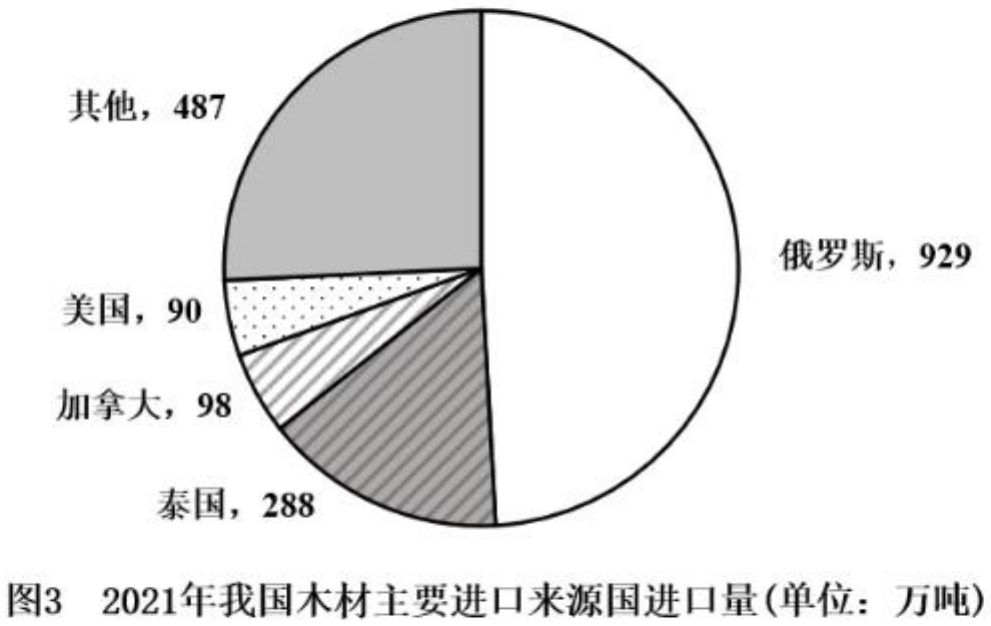

图3　2021年我国木材主要进口来源国进口量(单位：万吨)

| 来源国 | 进口量（万吨） |
| --- | --- |
| 俄罗斯 | 929 |
| 泰国 | 288 |
| 加拿大 | 98 |
| 美国 | 90 |
| 其他 | 487 |

饼图各扇区标“国名，数值”；五项合计1892万吨，与图1中2021年进口量一致。图名在图片内、印在图下方。

> 材料说明：原卷本组组号印作“（四）”（资料分析各组组号从“（二）”起，见M1说明），组号未收入材料。材料3没有文字，只有三幅统计图（图名“图1”“图2”“图3”在图片内），已逐项转写。

### 第 121 题

`GK2023-DS-Q121` · 单选 · 原卷第 28、29 页

[共用材料](#GK2023-DS-M3)

2017-2021年，我国总计进口了约多少亿吨木材？

**A.** 1.4

**B.** 1.3

**C.** 1.2

**D.** 1.1

**答案：D**

### 第 122 题

`GK2023-DS-Q122` · 单选 · 原卷第 29 页

[共用材料](#GK2023-DS-M3)

2017-2021年，我国木材进口平均单价高于400美元/吨的年份有几个？

**A.** 4

**B.** 3

**C.** 2

**D.** 1

**答案：B**

### 第 123 题

`GK2023-DS-Q123` · 单选 · 原卷第 29 页

[共用材料](#GK2023-DS-M3)

2021年，松木、冷杉和针叶木材进口量之和占当年我国木材进口总量的：

**A.** 不到60%

**B.** 60%~65%之间

**C.** 65%~70%之间

**D.** 70%以上

**答案：B**

### 第 124 题

`GK2023-DS-Q124` · 单选 · 原卷第 29 页

[共用材料](#GK2023-DS-M3)

2021年，自俄罗斯进口的木材占当年木材进口总量的比重约比美国高多少个百分点？

**A.** 44

**B.** 50

**C.** 32

**D.** 38

**答案：A**

### 第 125 题

`GK2023-DS-Q125` · 单选 · 原卷第 29 页

[共用材料](#GK2023-DS-M3)

以下折线图中，最能准确反映2018-2021年我国木材进口额同比增量变化趋势的是：

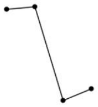

**A.** 见上方选项图 A。

**B.** 见上方选项图 B。

**C.** 见上方选项图 C。

**D.** 见上方选项图 D。

**答案：C**

> 转写说明：四个选项各为一张4个点的折线示意图（无坐标轴、无数值），选项字母“A、”“B、”“C、”“D、”为正文文字、印在各图左侧，裁图不含字母。

### 共用材料：第 126—130 题

2021年H省商品、服务类电子商务交易额为11526.13亿元，比上年同期增长21.8%，高于全国增速2.3个百分点。H省跨境电商进出口交易额为2018.3亿元，其中，出口1475.5亿元，同比增长15.7%；进口542.8亿元，同比增长16.0%。H省网上零售额为2948.2亿元，同比增长12.5%，其中，实物商品网上零售额为2426.4亿元，同比增长10.1%。
从交易对象看，2021年H省商品类电子商务交易额为8896.60亿元，同比增长16.6%；服务类电子商务交易额为2629.53亿元，同比增长43.5%。从交易主体看，2021年H省对单位电子商务交易额为7254.75亿元，同比增长19.8%，占商品、服务类电子商务交易额比重为62.9%；对个人电子商务交易额为4271.38亿元，同比增长25.4%。
2021年H省共有电子商务平台87个，在本省电商平台上实现交易金额为5354.93亿元，同比增长41.0%，收取的平台交易服务费为3.17亿元，同比增长49.5%。从地区分布来看，2021年本地电子商务平台拥有量最多的为Z市，有44个平台，实现交易金额4239.04亿元。

> 材料说明：原卷本组组号印作“（五）”（资料分析各组组号从“（二）”起，见M1说明），组号未收入材料。纯文字3段。

### 第 126 题

`GK2023-DS-Q126` · 单选 · 原卷第 29、30 页

[共用材料](#GK2023-DS-M4)

2021年，全国商品、服务类电子商务交易额同比增长了：

**A.** 17.2%

**B.** 19.5%

**C.** 21.8%

**D.** 24.1%

**答案：B**

### 第 127 题

`GK2023-DS-Q127` · 单选 · 原卷第 30 页

[共用材料](#GK2023-DS-M4)

2021年，H省实物商品网上零售额占网上零售额的比重比上年同期：

**A.** 下降了不到3个百分点

**B.** 下降了3个百分点以上

**C.** 上升了不到3个百分点

**D.** 上升了3个百分点以上

**答案：A**

### 第 128 题

`GK2023-DS-Q128` · 单选 · 原卷第 30 页

[共用材料](#GK2023-DS-M4)

以下饼图中，最能准确反映2021年H省商品类（白色）和服务类（黑色）电子商务交易额占商品、服务类电子商务交易额比重关系的是：

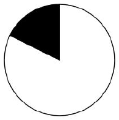

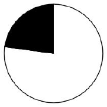

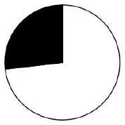

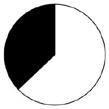

**A.** 见上方选项图 A。

**B.** 见上方选项图 B。

**C.** 见上方选项图 C。

**D.** 见上方选项图 D。

**答案：B**

> 转写说明：四个选项各为一张饼图（无数值），选项字母“A、”“B、”“C、”“D、”为正文文字、印在各图左侧，裁图不含字母；alt 中的扇区占比是按裁图像素量得的近似值。

### 第 129 题

`GK2023-DS-Q129` · 单选 · 原卷第 30 页

[共用材料](#GK2023-DS-M4)

2021年，H省除Z市外其他地区的电子商务平台平均每个平台实现的交易金额约为多少亿元？

**A.** 5

**B.** 12

**C.** 26

**D.** 62

**答案：C**

### 第 130 题

`GK2023-DS-Q130` · 单选 · 原卷第 30 页

[共用材料](#GK2023-DS-M4)

关于H省电子商务交易，能够从上述资料中推出的是：

**A.** 2021年，跨境电商进出口交易额同比增长16%以上

**B.** 2021年，网上零售额占商品、服务类电子商务交易额的比重高于上年水平

**C.** 2020年，对个人电子商务交易额占商品、服务类电子商务交易额的38%以上

**D.** 2020年，省内电子商务平台收取的平台交易服务费超过2亿元

**答案：D**
