# 2025年广东事业单位统考《基本能力测试》

共 100 题，原题号完整保留。内容：题干、选项、答案（不收解析）；资料分析共用材料置于所属题组前，JSONL 每条记录完整内嵌材料。

[结构化数据](SYDW2025.jsonl) · [字段说明](schema.json) · [质量报告](quality/SYDW2025.md)

原题来源：[2025年3月30日广东省事业单位高校毕业生招聘考试（广东统考）《基本能力测试》真题.pdf](https://github.com/dumarstoft-ship-it/xing-ce1/blob/3eadbf4cafe03d1f6e9089b3bb696e838ee60f0a/%E5%B9%BF%E4%B8%9C/%E4%BA%8B%E4%B8%9A%E5%8D%95%E4%BD%8D/2025/2025%E5%B9%B43%E6%9C%8830%E6%97%A5%E5%B9%BF%E4%B8%9C%E7%9C%81%E4%BA%8B%E4%B8%9A%E5%8D%95%E4%BD%8D%E9%AB%98%E6%A0%A1%E6%AF%95%E4%B8%9A%E7%94%9F%E6%8B%9B%E8%81%98%E8%80%83%E8%AF%95%EF%BC%88%E5%B9%BF%E4%B8%9C%E7%BB%9F%E8%80%83%EF%BC%89%E3%80%8A%E5%9F%BA%E6%9C%AC%E8%83%BD%E5%8A%9B%E6%B5%8B%E8%AF%95%E3%80%8B%E7%9C%9F%E9%A2%98.pdf)。答案来源：[2025年3月30日广东省事业单位高校毕业生招聘考试（广东统考）《基本能力测试》解析.pdf](https://github.com/dumarstoft-ship-it/xing-ce1/blob/3eadbf4cafe03d1f6e9089b3bb696e838ee60f0a/%E5%B9%BF%E4%B8%9C/%E4%BA%8B%E4%B8%9A%E5%8D%95%E4%BD%8D/2025/2025%E5%B9%B43%E6%9C%8830%E6%97%A5%E5%B9%BF%E4%B8%9C%E7%9C%81%E4%BA%8B%E4%B8%9A%E5%8D%95%E4%BD%8D%E9%AB%98%E6%A0%A1%E6%AF%95%E4%B8%9A%E7%94%9F%E6%8B%9B%E8%81%98%E8%80%83%E8%AF%95%EF%BC%88%E5%B9%BF%E4%B8%9C%E7%BB%9F%E8%80%83%EF%BC%89%E3%80%8A%E5%9F%BA%E6%9C%AC%E8%83%BD%E5%8A%9B%E6%B5%8B%E8%AF%95%E3%80%8B%E8%A7%A3%E6%9E%90.pdf)（只取答案）。参考：[2025年广东省事业单位高校毕业招聘考试试卷及答案-版本2（可看可不看）.pdf](https://github.com/dumarstoft-ship-it/xing-ce1/blob/3eadbf4cafe03d1f6e9089b3bb696e838ee60f0a/%E5%B9%BF%E4%B8%9C/%E4%BA%8B%E4%B8%9A%E5%8D%95%E4%BD%8D/2025/2025%E5%B9%B4%E5%B9%BF%E4%B8%9C%E7%9C%81%E4%BA%8B%E4%B8%9A%E5%8D%95%E4%BD%8D%E9%AB%98%E6%A0%A1%E6%AF%95%E4%B8%9A%E6%8B%9B%E8%81%98%E8%80%83%E8%AF%95%E8%AF%95%E5%8D%B7%E5%8F%8A%E7%AD%94%E6%A1%88-%E7%89%88%E6%9C%AC2%EF%BC%88%E5%8F%AF%E7%9C%8B%E5%8F%AF%E4%B8%8D%E7%9C%8B%EF%BC%89.pdf)（版本2（“广东优公”整理的WPS版，有文字层，答案以黄色底标在选项上）：只作转写底稿和答案对照，不作题源；与原版的出入见“与版本2的出入”）。

## 常识判断

### 第 1 题

`SYDW2025-Q001` · 判断 · 原卷第 1 页

中国共产党是用马克思主义武装起来的政党，马克思主义是中国共产党人理想信念的灵魂。（）

**答案：正确**

### 第 2 题

`SYDW2025-Q002` · 判断 · 原卷第 1 页

党的领导直接关系中国式现代化的根本方向、前途命运、最终成败。（）

**答案：正确**

### 第 3 题

`SYDW2025-Q003` · 判断 · 原卷第 1 页

敢于斗争是我们党与生俱来的政治基因和百年淬炼的鲜明品格。（）

**答案：正确**

### 第 4 题

`SYDW2025-Q004` · 判断 · 原卷第 1 页

党的十八届三中全会是划时代的，开启了新时代全面深化改革、系统整体设计推进改革新征程，开创了我国改革开放全新局面。（）

**答案：正确**

### 第 5 题

`SYDW2025-Q005` · 判断 · 原卷第 1 页

改革开放、创新是中国式现代化的基础性、战略性支撑。（）

**答案：错误**

### 第 6 题

`SYDW2025-Q006` · 判断 · 原卷第 1 页

高质量发展是创新成为第一动力、协调成为内生特点、绿色成为普遍形态，开放成为必由之路、共享成为根本目的的发展。（）

**答案：正确**

### 第 7 题

`SYDW2025-Q007` · 判断 · 原卷第 1 页

加快建成现代化产业体系，是推动高质量发展的必由之路。（）

**答案：错误**

### 第 8 题

`SYDW2025-Q008` · 判断 · 原卷第 1 页

全体人民共同富裕是中国式现代化的本质特征，区域协调发展是实现共同富裕的必然要求。（）

**答案：正确**

### 第 9 题

`SYDW2025-Q009` · 判断 · 原卷第 1 页

推动民法典实施是全面依法治国的首要任务。（）

**答案：错误**

### 第 10 题

`SYDW2025-Q010` · 判断 · 原卷第 1 页

传承和弘扬中华优秀传统文化，要坚持创造性转化和创新性发展。（）

**答案：正确**

### 第 11 题

`SYDW2025-Q011` · 判断 · 原卷第 1 页

民主决策是我们党的传家宝，是做好各项工作的基本功。（）

**答案：错误**

### 第 12 题

`SYDW2025-Q012` · 判断 · 原卷第 1 页

保障国家粮食安全是新时代新征程“三农”工作的总抓手。（）

**答案：错误**

### 第 13 题

`SYDW2025-Q013` · 判断 · 原卷第 1 页

“胡焕庸线”东南方以草原，戈壁沙漠，绿洲和雪域高原为主，西北方以平原、水网、低山丘陵和喀斯特地貌为主。（）

**答案：错误**

> 转写说明：原卷“东南方以草原，戈壁沙漠，绿洲和雪域高原为主”中列举项之间用逗号，照录。

### 第 14 题

`SYDW2025-Q014` · 判断 · 原卷第 1 页

广东纵深推进新阶段粤港澳大湾区建设，“澳门+横琴”正在成为丰富“一国两制”实践的新示范、推动粤港澳大湾区建设的新高地、实现国家高水平对外开放的新平台。（）

**答案：正确**

### 第 15 题

`SYDW2025-Q015` · 判断 · 原卷第 1 页

随着人类文明的发展、生产力的进步，人口数量也不断增长，明朝时期人口突破3亿。（）

**答案：错误**

### 第 16 题

`SYDW2025-Q016` · 判断 · 原卷第 1 页

根据《中华人民共和国大气污染防治法》，国家对重点大气污染排放实行重点监管。（）

**答案：错误**

### 第 17 题

`SYDW2025-Q017` · 判断 · 原卷第 1 页

《中华人民共和国粮食安全保障法》是我国第一部全面系统地规定粮食安全保障工作的专门法律。（）

**答案：正确**

### 第 18 题

`SYDW2025-Q018` · 判断 · 原卷第 1 页

“贤”一般用于称呼长辈，如称对方为“贤家”。（）

**答案：错误**

### 第 19 题

`SYDW2025-Q019` · 判断 · 原卷第 1 页

亚太经济合作组织属于全球性国际组织，秘书处设在新加坡。（）

**答案：错误**

### 第 20 题

`SYDW2025-Q020` · 判断 · 原卷第 1 页

韩江是广东省第二大河，其名源自曾任潮州刺史的韩愈。（）

**答案：正确**

### 第 21 题

`SYDW2025-Q021` · 多选 · 原卷第 1 页

党的二十大报告指出：“加强党的政治建设，严明政治纪律和政治规矩，落实各级党委（党组）主体责任，提高各级党组织和党员干部（）。”

**A.** 政治判断力

**B.** 政治宣传力

**C.** 政治领悟力

**D.** 政治执行力

**答案：ACD**

### 第 22 题

`SYDW2025-Q022` · 多选 · 原卷第 1 页

党的二十届三中全会对进一步全面深化改革作出系统部署，提出深化文化体制机制改革的重大任务，为新时代新征程文化改革发展指明了前进方向。以下属于深化文化体制机制改革措施的有（）。

**A.** 深化教育综合改革

**B.** 健全网络综合治理体系

**C.** 完善意识形态工作责任制

**D.** 构建更有效力的国际传播体系

**答案：BCD**

### 第 23 题

`SYDW2025-Q023` · 多选 · 原卷第 1、2 页

商品经济是以交换为目的而进行生产的经济形式，是一定社会历史条件的产物，根据马克思主义政治经济学，以下关于商品经济的说法正确的有（）。

**A.** 决定商品价值量的是生产商品的社会必要劳动时间

**B.** 在商品经济中，商品的价格围绕商品的价值自发波动

**C.** 货币是在长期交换过程中形成的固定充当一般等价物的商品

**D.** 生产商品所需要的社会必要劳动时间随着劳动生产率的提高而增加

**答案：ABC**

### 第 24 题

`SYDW2025-Q024` · 多选 · 原卷第 2 页

人民群众是社会历史的主体，是历史的创造者。这是马克思主义基本的观点之一，关于人民群众，以下选项正确的有（）。

**A.** 人民群众是社会精神财富的创造者

**B.** 人民群众是社会变革的决定力量

**C.** 时势造英雄，杰出人物的出现具有偶然性

**D.** 人民群众创造历史的活动不受社会历史条件的制约

**答案：AB**

> 答案说明：答案按原版答案解析记录；版本2标为ABC，与原版不同。

### 第 25 题

`SYDW2025-Q025` · 多选 · 原卷第 2 页

中华传统美德中，我们始终强调整体利益、国家利益和民族利益的重要性，以下选项中体现“重视整体利益，强调责任奉献”这一中华传统美德的有（）。

**A.** 夙夜在公

**B.** 以公灭私，民其允怀

**C.** 己欲立而立人，己欲达而达人

**D.** 苟利国家生死以，岂因祸福避趋之

**答案：ABD**

### 第 26 题

`SYDW2025-Q026` · 多选 · 原卷第 2 页

2024年和平共处五项原则发表70周年，以下关于和平共处五项原则的表述正确的有（）。

**A.** 和平共处五项原则已载入中国宪法

**B.** 和平共处五项原则是中国独立自主和平外交政策的基石

**C.** 构建人类命运共同体理念与和平共处五项原则一脉相承

**D.** 中国倡导将和平共处五项原则确立为指导国家间关系的基本准则

**答案：ABCD**

### 第 27 题

`SYDW2025-Q027` · 多选 · 原卷第 2 页

根据《中华人民共和国个人信息保护法》，以下属于敏感个人信息的有（）。

**A.** 生物识别信息

**B.** 医疗健康信息

**C.** 金融账户信息

**D.** 行踪轨迹信息

**答案：ABCD**

### 第 28 题

`SYDW2025-Q028` · 多选 · 原卷第 2 页

国家厉行节约，反对浪费，根据《中华人民共和国反食品浪费法》，为防止食物浪费，以下餐饮服务经营者的行为恰当的有（）。

**A.** 向消费者提供小份餐等不同规格选择

**B.** 对参与“光盘行动”的消费者给予奖励

**C.** 鼓励消费者自助携带餐具，并不提供打包服务

**D.** 对造成明显浪费的消费者收取处理厨余垃圾的相应费用

**答案：ABD**

### 第 29 题

`SYDW2025-Q029` · 多选 · 原卷第 2 页

2025年广东省政府工作报告指出，深入实施“百县千镇万村高质量发展工程”，奋力实现“三年初见成效”目标。以下属于深入实施“百县千镇万村高质量发展工程”的有（）。

**A.** 健全强县促镇动力机制

**B.** 加大力度强农惠农富农

**C.** 促进区域联动融合发展

**D.** 加快建设海洋强省

**答案：ABCD**

### 第 30 题

`SYDW2025-Q030` · 多选 · 原卷第 2 页

2024年，广东海洋经济竞争力持续提升，耕海牧鱼，向海图强的海上新广东画卷徐徐铺展，下列属于2024年广东海洋经济发展取得的成就有（）。

**A.** 水产种苗产量居全国首位

**B.** 深水网箱养殖水体总量居全国第一

**C.** 完成全国首宗海岸线占补指标交易

**D.** 中山市建成全国最大的国家级海洋牧场

**答案：ABC**

> 转写说明：原卷题干作“耕海牧鱼”（常作“耕海牧渔”，版本2即作“渔”），照录。

## 言语理解与表达

### 第 31 题

`SYDW2025-Q031` · 单选 · 原卷第 2 页

近年来，醒狮、武术等代表中华文化的具象元素传播到世界各地，因此不少外国人对这些具象元素________，这体现了中华文明的独特魅力和强大感染力。
填入画横线部分最恰当的一项是（）。

**A.** 耳熟能详

**B.** 如数家珍

**C.** 滚瓜烂熟

**D.** 娓娓而谈

**答案：B**

> 答案说明：答案按原版答案解析记录；版本2标为A，与原版不同。

> 转写说明：填空横线原卷为画出的线条，转写为“________”（跨行的一条横线合为一空）。

### 第 32 题

`SYDW2025-Q032` · 单选 · 原卷第 2 页

抓好改革落实，需要统筹近期目标和长远规划，既慢不得，也急不得，要以________的心态，做久久为功的努力。
填入画横线部分最恰当的一项是（）。

**A.** 只争朝夕

**B.** 筚路蓝缕

**C.** 时不再来

**D.** 破釜沉舟

**答案：A**

> 转写说明：填空横线原卷为画出的线条，转写为“________”。

### 第 33 题

`SYDW2025-Q033` · 单选 · 原卷第 3 页

融通中外，需要秉持________理念，寻找中华文化与其他国家文化的契合点，挖掘可感知的精神标识，探索可沟通的表达方式，搭建可共享的话语空间，用国际化语言讲好中国故事，提升中国形象的亲和力。
填入画横线部分最恰当的一项是（）。

**A.** 互惠互利

**B.** 本同末异

**C.** 中西合璧

**D.** 求同存异

**答案：D**

> 转写说明：填空横线原卷为画出的线条，转写为“________”。

### 第 34 题

`SYDW2025-Q034` · 单选 · 原卷第 3 页

________说我们要在问题中不断突围、让目标不断达成，________说我们与未来有了一个约定，要赴一场民族复兴之约、国家治理现代化之约，就没有什么困难不能战胜，而且也必定能战胜。
依次填入画横线部分最恰当的一项是（）。

**A.** 无论，还是

**B.** 既然，那么

**C.** 要么，要么

**D.** 与其，不如

**答案：D**

> 转写说明：填空横线原卷为画出的线条，转写为“________”。

### 第 35 题

`SYDW2025-Q035` · 单选 · 原卷第 3 页

中国“和”文化源远流长，________“以和为贵”“兼爱非攻”等理念，和平、和睦、和谐的追求深深________于中华民族的精神世界之中，深融于中国人民的血脉之中。
依次填入画横线部分最恰当的一项是（）。

**A.** 推崇，贯彻

**B.** 崇尚，植根

**C.** 崇敬，融合

**D.** 推举，扎根

**答案：B**

> 转写说明：填空横线原卷为画出的线条，转写为“________”。

### 第 36 题

`SYDW2025-Q036` · 单选 · 原卷第 3 页

幕布亮起，一大朵水墨________的向日葵徐徐绽开，随着光亮逐渐增强，向日葵的色彩明亮起来，孩子们渐渐________在儿童电影《向日葵中队》的故事中。
依次填入画横线部分最恰当的一项是（）。

**A.** 描摹，沉迷

**B.** 描画，徜徉

**C.** 描绘，沉浸

**D.** 刻画，陶醉

**答案：C**

> 转写说明：填空横线原卷为画出的线条，转写为“________”。

### 第 37 题

`SYDW2025-Q037` · 单选 · 原卷第 3 页

从自动化的生产线，到自动驾驶汽车，从跨越山河的无人机，到远程联动的手术室，5G技术正全面________各行各业，________制造业高端化、智能化、绿色化发展。
依次填入画横线部分最恰当的一项是（）。

**A.** 进入，引导

**B.** 渗入，引领

**C.** 迈入，带领

**D.** 融入，带动

**答案：D**

> 转写说明：填空横线原卷为画出的线条，转写为“________”。

### 第 38 题

`SYDW2025-Q038` · 单选 · 原卷第 3 页

文旅短剧要兼顾年轻人的文化消费心理，为了吸引年轻人的眼球，________地加入流行元素，能提升整部剧的时代感；反之，片面地追求________，便会消解短剧的文化韵味。
依次填入画横线部分最恰当的一项是（）。

**A.** 恰如其分，时髦

**B.** 不失时机，时尚

**C.** 恰到好处，时兴

**D.** 不遗余力，潮流

**答案：A**

> 转写说明：填空横线原卷为画出的线条，转写为“________”。

### 第 39 题

`SYDW2025-Q039` · 单选 · 原卷第 3 页

新时代以来，我们之所以能实现改革由局部探索、破冰突围到系统集成、全面深化的转变，一个重要原因就在于做到了“胆子要大、步子要稳”——“战略上________”，敢于啃硬骨头，敢于涉险滩；“战术上________”统筹考虑、全面论证、科学决策。
依次填入画横线部分最恰当的一项是（）。

**A.** 运筹帷幄，奋发图强

**B.** 勇往直前，稳扎稳打

**C.** 高瞻远瞩，稳操胜券

**D.** 力争上游，激流勇进

**答案：B**

> 转写说明：填空横线原卷为画出的线条，转写为“________”（跨行的一条横线合为一空）。

### 第 40 题

`SYDW2025-Q040` · 单选 · 原卷第 3 页

放眼广袤田野，牛羊成群、秫熟稻香。农业丰收、乡村振兴，关键要有发展________、产业________、政策________。
依次填入画横线部分最恰当的一项是（）。

**A.** 引路人，带头人，明白人

**B.** 引导人，耕耘人，指引人

**C.** 指引人，带头人，引导人

**D.** 引路人，耕耘人，明白人

**答案：A**

> 转写说明：填空横线原卷为画出的线条，转写为“________”（跨行的一条横线合为一空）。

### 第 41 题

`SYDW2025-Q041` · 单选 · 原卷第 3、4 页

________。新中国成立以来，在推进工业化过程中孕育形成了“两弹一星”精神、载人航天精神、工匠精神等精神，这些都是我国工业发展过程中形成的宝贵精神财富。面对严峻复杂的形势，面对繁重艰巨的任务，要大力弘扬党和人民在各个历史时期团结奋斗形成的伟大精神，引导广大党员干部提振干事创业的精气神，传承优良传统，增强历史主动，发扬斗争精神，提升斗争本领，踔厉奋发、勇毅前行，为全面建成社会主义现代化强国作出新的更大贡献。
以下句子填入画横线处，最恰当的是（）。

**A.** 人无精神则不立，国无精神则不强

**B.** 伟大事业孕育伟大精神，伟大精神引领伟大事业

**C.** 坚持以人民为中心，尊重人民主体地位和首创精神

**D.** 党的伟大大精神跨越时空、历久弥新，激励我们奋勇前进

**答案：B**

> 转写说明：填空横线原卷为画出的线条，转写为“________”。

> 转写说明：原卷D项作“党的伟大大精神”，多一个“大”字，照录。

### 第 42 题

`SYDW2025-Q042` · 单选 · 原卷第 4 页

时代总在前进，变化必然发生。当高铁让千里咫尺，当网络让无远弗届，不少如活字印刷、珠算、川江号子这样的非遗项目，难免会渐渐远离日常生活的上下文。但换个角度看，无论是社会的流动、信息的流通还是技术的流变，都让非遗进入了一个更大的世界。唢呐不仅能吹出《百鸟朝凤》，也可以吹出摇滚的曲调；剪纸不仅能剪出窗花，也可以剪出视窗的纹样；而视频平台上，非遗的展示更是推陈出新。作为一种“文化遗产”，非遗也可以也应该成为一种公共文化资源，在保持自身特点的同时，嵌入更为宏大的文化结构之中。
上述文段主要说的是（）。

**A.** 技术流变赋予非遗新的时代意义

**B.** 非遗发展面临的时代机遇与挑战

**C.** 非遗焕发新的活力的时代必然性

**D.** 非遗发展应实现传统与现代融合

**答案：D**

> 答案说明：答案按原版答案解析记录；版本2标为A，与原版不同。

### 第 43 题

`SYDW2025-Q043` · 单选 · 原卷第 4 页

创新是社会发展的动力。所谓创新，就是创造新的观念或事物，道前人所未道、发前人所未发，一个社会的文化氛围是不是鼓励探索、倡导创新，极大影响着科技创新，也影响着社会发展进程。工业化的历程告诉我们，越是创新氛围浓厚的地方，就越容易形成产业革命的广阔舞台，越容易形成创新集群以及各类资源汇聚的中心。可以说，科技创新活跃的国家和地区，都伴随创新文化的蓬勃发展。
上述文段主要是讲了（）。

**A.** 创新的内涵和价值

**B.** 工业化的创新历史

**C.** 创新文化的积极作用

**D.** 科技和创新文化的关系

**答案：D**

> 答案说明：答案按原版答案解析记录；版本2标为C，与原版不同。

### 第 44 题

`SYDW2025-Q044` · 单选 · 原卷第 4 页

将以下句子重新排列，顺序最恰当的是（）。
①《史记·历书》提到：“夏正以正月，殷正以十二月，周正以十一月”。
②此后，正月初一就成为中国人的传统新年，一直延续到今天。
③汉代建立之初沿用秦朝历法，到了汉武帝时期进行历法变革，于公元前104年颁行《太初历》，重新以农历正月为岁首。
④秦朝建立以后，又以农历十月为岁首。
⑤根据史书记载，我国汉代以前正月初一并不固定。

**A.** ①④②⑤③

**B.** ③⑤①②④

**C.** ⑤①④③②

**D.** ⑤③①④②

**答案：C**

### 第 45 题

`SYDW2025-Q045` · 单选 · 原卷第 4 页

将以下句子重新排列，顺序最恰当的是（）。
①近年来，我国银发经济发展很快，总体上呈现如下特点：市场规模巨大、消费人口规模超大、消费结构升级速度快、产业融合和行业细分趋势超强。
②银发经济又称为老年经济、银色经济、乐龄经济等，是面向全体老年公民的生产、分配、流通和消费等一系列经济活动的总称。
③例如，老年康养相关专业技术人才紧缺，这主要是受到职业认知、员工待遇以及劳动强度等多重因素影响。
④虽然我国银发经济市场空间大、发展速度很快，但总体上我国银发经济尚处于“青春期”，即发展的初级阶段，还存在不少问题亟待研究解决。
⑤1999年，我国60岁及以上人口占比达到10%，正式步入老龄化社会，老龄化问题在国内开始得到广泛关注。

**A.** ①④③⑤②

**B.** ②⑤①④③

**C.** ②④③①⑤

**D.** ⑤①②④③

**答案：B**

### 第 46 题

`SYDW2025-Q046` · 单选 · 原卷第 4、5 页

热电材料是指能够利用两端温差驱动材料内部的电荷移动，产生电压发电的功能材料，反过来，如果给热电材料通电，电荷移动会吸收或释放热量，他又能实现一端变冷而另一端变热，从而进行加热和制冷，也许未来，人们可以将热电材料制作成精美的腕带和色彩斑斓的热电涂料，利用体温或者汽车内外温差为手机等电子设备充电，又或者，利用热电材料制冷技术，让人们可以身穿温度可调的服装，在炎炎夏日享受“贴身降温”的快乐。
上述材料主要介绍了热电材料的（）。

**A.** 应用前景

**B.** 概念定义

**C.** 发展现状

**D.** 内部结构

**答案：A**

> 转写说明：原卷题干作“他又能实现一端变冷”，“他”应为“它”，照录。

### 第 47 题

`SYDW2025-Q047` · 单选 · 原卷第 5 页

老年人与青少年、中年人等群体在阅读内容、形式、时间等方面有着较大的差异，他们的阅读需求多元化，从人文社科到营养健康，从网络“冲浪”到手机阅报，涉及的领域和场景较多，以数字阅读为例，不仅面向老年群体的产品较少，且有的服务页面夹杂广告，影响他们的数字阅读体验，满足老年人的阅读需求，并不是调大字体，调高音量那么简单，需要做好谋划设计，多角度、全方位开展阅读产品和服务的适老化改造。
上述文段意在说明的是（）。

**A.** 老年人在阅读内容、形式等方面与其他群体差异很大

**B.** 应针对老年人的阅读需求及特点调整阅读产品和服务

**C.** 着力改造数字阅读产品，提升老年人的数字阅读体验

**D.** 整治阅读产品中的软广植入，防止老年人上当受骗

**答案：B**

### 第 48 题

`SYDW2025-Q048` · 单选 · 原卷第 5 页

深化财税体制改革要坚持社会主义市场经济改革方向，完善体制机制和调节政策，充分发挥市场机制作用，更好激发各方面积极性，实现资源配置效率最优化和效益最大化，同时，要统筹促进规则公平、机会公平、结果公平，打破利益固化，阶层固化的藩篱，规范财富积累机制，加大税收，社会保障、转移支付等调节力度，更好地让广大人民群众共享改革发展成果。
对上述文段概括最准确的是（）。

**A.** 深化财税体制改革的目的是让广大人民群众共享改革发展成果

**B.** 深化财税体制改革要做好统筹协调，实现资源优化配置

**C.** 深化财税体制改革需要政府和市场协同发力

**D.** 深化财税体制改革要兼顾效率与公平

**答案：D**

### 第 49 题

`SYDW2025-Q049` · 单选 · 原卷第 5 页

教师不仅要坚持正本清源，讲深辩证唯物主义和历史唯物主义的方法论，更要激浊扬清，及时批判错误言论，引导学生自觉运用马克思主义的立场、观点、方法来观察、分析、解决生活中的实际问题，真正体会马克思主义是“行在实处”，提升思想政治上的获得感。通过探讨明晰“怎么办”，帮助学生善用马克思主义的思想武器，真正做到“知所以必然”。
上述文段主要强调了教师在思想政治教育中应（）。

**A.** 坚持正本清源，让学生“知其然”

**B.** 重点关注学生在思想政治上的获得感

**C.** 坚持激浊扬清，引导学生及时摒弃错误言论

**D.** 引导学生自觉运用马克思主义解决实际问题

**答案：D**

> 转写说明：原卷题干作“真正做到“知所以必然””（常作“知其所以必然”，版本2即如此），照录。

### 第 50 题

`SYDW2025-Q050` · 单选 · 原卷第 5 页

随着信息化技术的迭代升级，我们未来的阅读，在时间、空间、信息传递方式与体验等各方面都将更加自由，为什么还需要这样一座“图书馆”呢？越是巨量的、即时性的、碎片化的信息越是难以构建完备的知识体系。因此，作为现代社会的知识资源储备中心，图书馆的核心价值并不在于时效性的信息服务，而在于相对科学完备、系统规范的知识服务，读者在图书馆里获取的，是一种更具历史纵深、更大时空跨度、更多凝聚人类思维动能的“深耕”服务。
以下选项内容，上述文段中没有提及的是（）。

**A.** 信息时代图书馆存续的必要性

**B.** 信息时代图书馆的核心价值

**C.** 信息时代图书馆的功能定位

**D.** 信息时代图书馆的发展困境

**答案：D**

## 数量关系

### 第 51 题

`SYDW2025-Q051` · 单选 · 原卷第 5 页

6，9，18，33，54，（    ）

**A.** 68

**B.** 72

**C.** 81

**D.** 96

**答案：C**

### 第 52 题

`SYDW2025-Q052` · 单选 · 原卷第 5 页

5，7，17，31，65，（    ）

**A.** 97

**B.** 113

**C.** 127

**D.** 135

**答案：C**

### 第 53 题

`SYDW2025-Q053` · 单选 · 原卷第 5 页

0，32，16，-24，-28，10，（    ）

**A.** 12

**B.** 20

**C.** 33

**D.** 48

**答案：C**

> 转写说明：第4、5项“-24”“-28”在原卷中为公式小图，已转写为文字；负号写作“-”。

### 第 54 题

`SYDW2025-Q054` · 单选 · 原卷第 6 页

3.1，5.4，9.7，12.13，20.16，（    ）

**A.** 21.28

**B.** 32.26

**C.** 46.53

**D.** 55.55

**答案：A**

### 第 55 题

`SYDW2025-Q055` · 单选 · 原卷第 6 页

从所给的四个选项中，选择最合适的一个填入问号处，使之呈现一定的规律性（）。

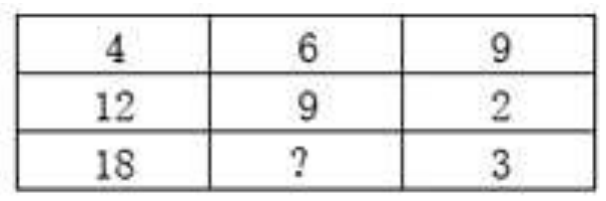

3×3数表（原卷为图片）

| 4 | 6 | 9 |
| --- | --- | --- |
| 12 | 9 | 2 |
| 18 | ？ | 3 |

原图为无表头的三行三列数表，转写时把第一行排在表头位置；第三行第二格为问号。

**A.** 3

**B.** 4

**C.** 5

**D.** 6

**答案：B**

### 第 56 题

`SYDW2025-Q056` · 单选 · 原卷第 6 页

某单位采购了大、中、小3种不同尺寸的文件袋，大号文件袋和中号文件袋共145个，小号文件袋的数量比大号文件多26%，且比中号文件袋的数量多，则大号文件袋的数量比中号文件袋多（）个。

**A.** 45

**B.** 55

**C.** 65

**D.** 75

**答案：B**

> 转写说明：原卷题干作“小号文件袋的数量比大号文件多26%”，疑缺“袋”字，照录。

### 第 57 题

`SYDW2025-Q057` · 单选 · 原卷第 6 页

某地教育部门计划向当地各小学发放学习材料，如果每所小学分配6套材料，则剩余70套材料，如果每所小学分配8套材料，则缺40套材料，则当地共有（）所小学需要发放资料。

**A.** 40

**B.** 55

**C.** 70

**D.** 85

**答案：B**

### 第 58 题

`SYDW2025-Q058` · 单选 · 原卷第 6 页

水果零售商采购了一批苹果，包括特级果和一级果两种规格。原计划特级果比一级果多采购200公斤，但在清点分拣后发现，特级果中有10%是一级果，一级果中有20%是特级果，这批水果中实际有60%的特级果，则该零售商共采购苹果（）公斤。

**A.** 600

**B.** 800

**C.** 1200

**D.** 1400

**答案：D**

### 第 59 题

`SYDW2025-Q059` · 单选 · 原卷第 6 页

某款影音设备的定价为3.6万元，如打九折销售，则销售10台的利润与以原价销售7台的利润相同。如打八折销售，要使利润不低于10万元，至少要售出（）台。

**A.** 19

**B.** 20

**C.** 21

**D.** 22

**答案：C**

### 第 60 题

`SYDW2025-Q060` · 单选 · 原卷第 6 页

甲、乙两名工人合作完成一批零件的加工任务，当乙完成了200个零件的加工时，甲完成了总量的一半，当零件加工完成时，甲完成了总量的3/5，假如两人的工作效率始终保持不变，则这批零件共有（）个。

**A.** 500

**B.** 600

**C.** 640

**D.** 800

**答案：B**

> 转写说明：“3/5”在原卷中为竖排分数小图，已按“分子/分母”转写。

### 第 61 题

`SYDW2025-Q061` · 单选 · 原卷第 6 页

某部门组织全体员工参与甲乙两项考核，其中有9人未通过甲考核，有12人通过了乙考核。如果只通过了其中一项考核的员工有10人，通过了两项考核的员工有5人，则该部门员工总人数为（）。

**A.** 17

**B.** 20

**C.** 23

**D.** 26

**答案：A**

### 第 62 题

`SYDW2025-Q062` · 单选 · 原卷第 6 页

如图所示，AOB为一块直角三角形的花坛，C为AB的中点，在OC的中点安装有一台洒水器，其圆形洒水区域的直径即为OC，已知OA、OB的长度分别为6米、8米，则洒水器的洒水面积约（）平方米。（π按3.14计算）

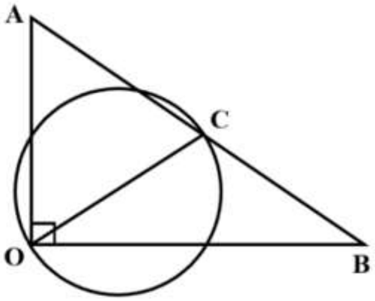

**A.** 7.85

**B.** 15.72

**C.** 19.63

**D.** 21.51

**答案：C**

> 转写说明：“（π按3.14计算）”中的“π”在原卷中为小图，已转写为文字。

### 第 63 题

`SYDW2025-Q063` · 单选 · 原卷第 6、7 页

单位食堂供应6道菜品，甲、乙、丙去食堂用餐，每人随机选择2道菜品，则他们选择的菜品完全不同的概率（）。

**A.** 不到2%

**B.** 在2%到3%之间

**C.** 在3%到4%之间

**D.** 超过4%

**答案：B**

### 第 64 题

`SYDW2025-Q064` · 单选 · 原卷第 7 页

甲地到乙地的路由一段下坡和一段上坡组成，张某从甲地出发，步行前往乙地，其下坡速度是上坡的2倍，如果40分钟后，他走完了60%的路程，又过了40分钟，他到达了乙地，则这段路中，下坡与上坡的路程之比可能为（）。

**A.** 1:2

**B.** 2:3

**C.** 2:1

**D.** 3:2

**答案：B**

> 答案说明：答案解析另注：“若前40分钟全走下坡，后40分钟先下坡后上坡，最终结果为4:1，无答案，故只考虑解析中的情况。”

### 第 65 题

`SYDW2025-Q065` · 单选 · 原卷第 7 页

工艺品厂从周一开始制作某种手工艺品，每个星期工作5天，每个工作日的产量都比前一个工作日多1件，第四周工厂生产了180件这种手工艺品，则在第（）个工作日，手工艺品的累计产量将首次达到1000件。

**A.** 28

**B.** 29

**C.** 30

**D.** 31

**答案：C**

## 判断推理

### 第 66 题

`SYDW2025-Q066` · 单选 · 图形推理 · 原卷第 7 页

从所给的四个选项中，选择最合适的一个填在问号处，使之呈现一定的规律性（）。

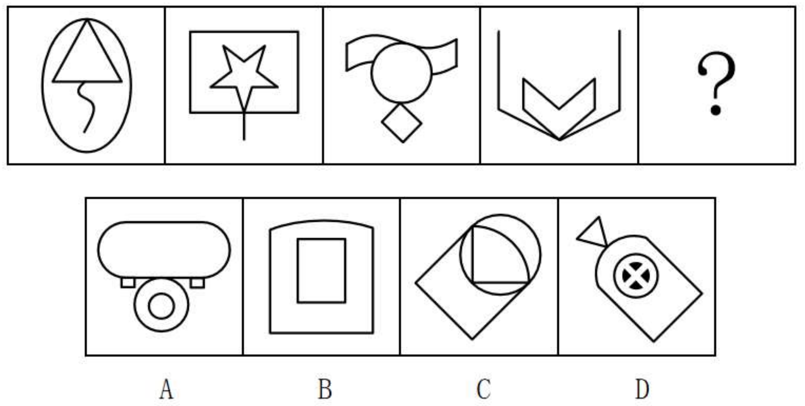

**A.** 见上方题图中 A 项。

**B.** 见上方题图中 B 项。

**C.** 见上方题图中 C 项。

**D.** 见上方题图中 D 项。

**答案：C**

### 第 67 题

`SYDW2025-Q067` · 单选 · 图形推理 · 原卷第 7 页

从所给的四个选项中，选择最合适的一个填在问号处，使之呈现一定的规律性（）。

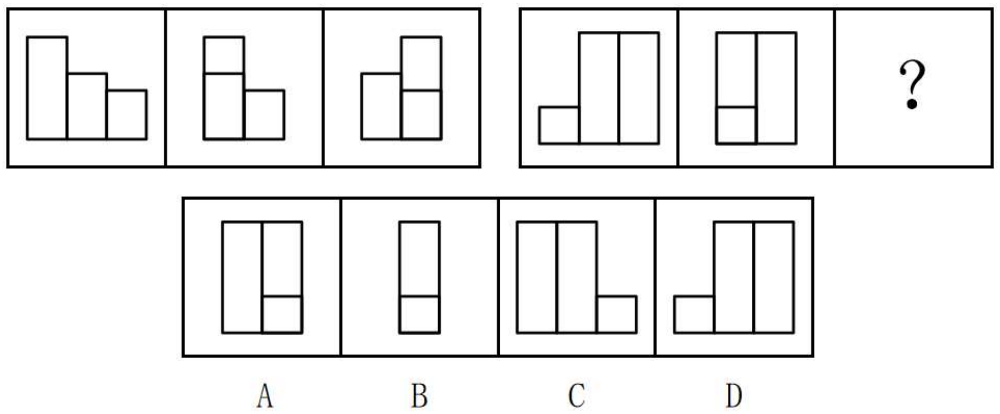

**A.** 见上方题图中 A 项。

**B.** 见上方题图中 B 项。

**C.** 见上方题图中 C 项。

**D.** 见上方题图中 D 项。

**答案：A**

### 第 68 题

`SYDW2025-Q068` · 单选 · 图形推理 · 原卷第 7、8 页

从所给的四个选项中，选择最合适的一个填在问号处，使之呈现一定的规律性（）。

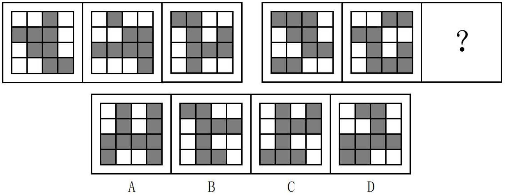

**A.** 见上方题图中 A 项。

**B.** 见上方题图中 B 项。

**C.** 见上方题图中 C 项。

**D.** 见上方题图中 D 项。

**答案：D**

### 第 69 题

`SYDW2025-Q069` · 单选 · 图形推理 · 原卷第 8 页

从所给的四个选项中，选择最合适的一个填在问号处，使之呈现一定的规律性（）。

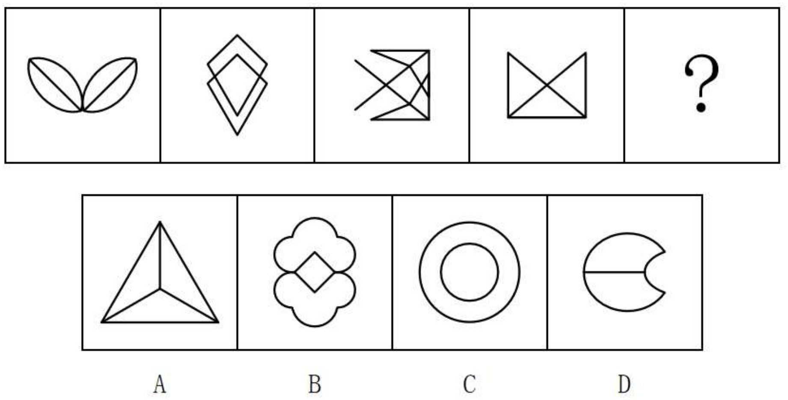

**A.** 见上方题图中 A 项。

**B.** 见上方题图中 B 项。

**C.** 见上方题图中 C 项。

**D.** 见上方题图中 D 项。

**答案：D**

### 第 70 题

`SYDW2025-Q070` · 单选 · 图形推理 · 原卷第 8 页

从所给的四个选项中，选择最合适的一个填在问号处，使之呈现一定的规律性（）。

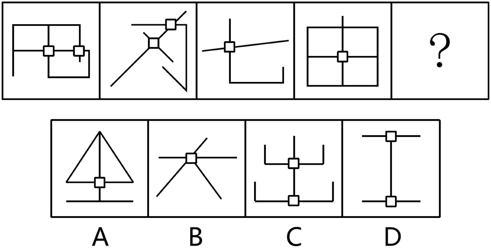

**A.** 见上方题图中 A 项。

**B.** 见上方题图中 B 项。

**C.** 见上方题图中 C 项。

**D.** 见上方题图中 D 项。

**答案：A**

### 第 71 题

`SYDW2025-Q071` · 单选 · 图形推理 · 原卷第 9 页

下列选项经旋转组合后，不可能组成所给图形的是（）。

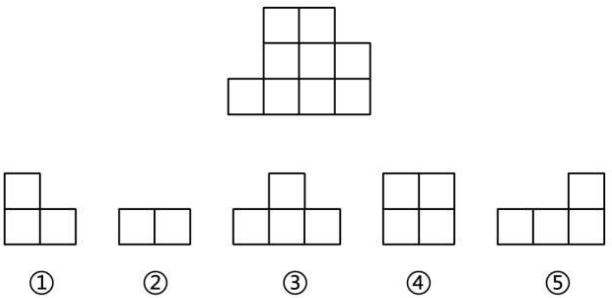

**A.** ①②③

**B.** ①②④

**C.** ①②⑤

**D.** ②③④

**答案：D**

> 答案说明：答案按原版答案解析记录（本题为选非题：①②③、①②④、①②⑤都可组成所给图形，②③④的小正方形共10个、所给图形为9个，故选D）；版本2标为A，与原版不同。

### 第 72 题

`SYDW2025-Q072` · 单选 · 图形推理 · 原卷第 9 页

下列选项最不可能是左侧立体图形某一角度视图的是（）。

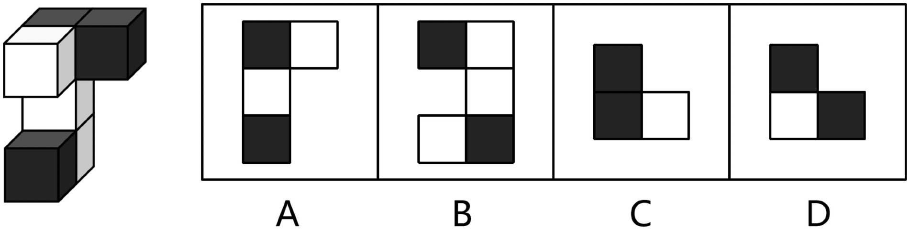

**A.** 见上方题图中 A 项。

**B.** 见上方题图中 B 项。

**C.** 见上方题图中 C 项。

**D.** 见上方题图中 D 项。

**答案：A**

### 第 73 题

`SYDW2025-Q073` · 单选 · 图形推理 · 原卷第 9 页

从所给的四个选项中，选择最合适的一个填在问号处，使之呈现一定的规律性（）。

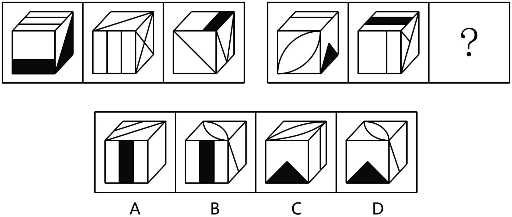

**A.** 见上方题图中 A 项。

**B.** 见上方题图中 B 项。

**C.** 见上方题图中 C 项。

**D.** 见上方题图中 D 项。

**答案：B**

### 第 74 题

`SYDW2025-Q074` · 单选 · 图形推理 · 原卷第 9、10 页

下列选项中，若干个（）选项图形能组成所给的立体图形。

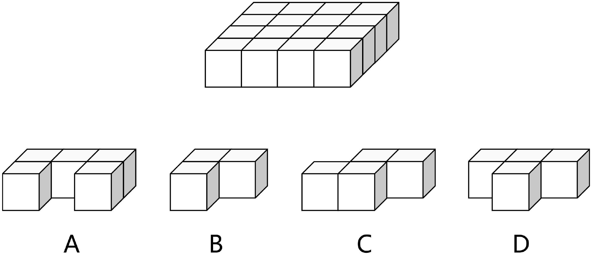

**A.** 见上方题图中 A 项。

**B.** 见上方题图中 B 项。

**C.** 见上方题图中 C 项。

**D.** 见上方题图中 D 项。

**答案：D**

### 第 75 题

`SYDW2025-Q075` · 单选 · 图形推理 · 原卷第 10 页

如图所示，是一个无盖正方体的展开图形，那么该无盖正方体的底面是（）。

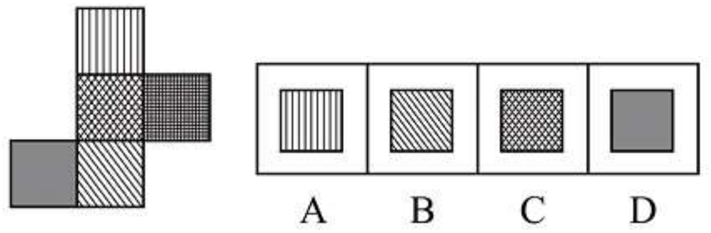

**A.** 见上方题图中 A 项。

**B.** 见上方题图中 B 项。

**C.** 见上方题图中 C 项。

**D.** 见上方题图中 D 项。

**答案：C**

### 第 76 题

`SYDW2025-Q076` · 单选 · 类比推理 · 原卷第 10 页

月亮：盈缺

**A.** 声音：抑扬

**B.** 品格：是非

**C.** 情绪：喜乐

**D.** 信念：荣辱

**答案：A**

### 第 77 题

`SYDW2025-Q077` · 单选 · 类比推理 · 原卷第 10 页

拦路虎：绊脚石

**A.** 应声虫：墙头草

**B.** 三脚猫：老狐狸

**C.** 领头羊：火车头

**D.** 黑天鹅：灰犀牛

**答案：C**

### 第 78 题

`SYDW2025-Q078` · 单选 · 类比推理 · 原卷第 10 页

曲高和寡：下里巴人

**A.** 今非昔比：日新月异

**B.** 安如磐石：摇摇欲坠

**C.** 差强人意：心满意足

**D.** 南辕北辙：朝秦暮楚

**答案：B**

### 第 79 题

`SYDW2025-Q079` · 单选 · 类比推理 · 原卷第 10 页

选择：抽签：随机

**A.** 阅历：旅行：轻松

**B.** 演奏：音乐：艺术

**C.** 专利：发明：产权

**D.** 表达：写作：主观

**答案：D**

### 第 80 题

`SYDW2025-Q080` · 单选 · 类比推理 · 原卷第 10 页

氮气对于（）相当于（）对于工具书。

**A.** 气体 词典

**B.** 燃烧 查阅

**C.** 氧气 小说

**D.** 氮原子 字音

**答案：A**

> 转写说明：原卷各选项两词之间以空格分隔（如“气体 词典”），照录一个空格。

### 第 81 题

`SYDW2025-Q081` · 单选 · 逻辑判断 · 原卷第 10 页

如果学生没参加过自然科学竞赛，或者对自然科学没有浓厚的兴趣，那么就不能成为科普志愿者。
据此，可以推出的是（）。

**A.** 成为科普志愿者既要对自然科学有浓厚的兴趣，也要参加过自然科学竞赛

**B.** 如果对自然科学有浓厚的兴趣，就能成为科普志愿者

**C.** 如果参加过自然科学竞赛，就能成为科普志愿者

**D.** 学生小杨没有参加过自然科学竞赛，仍然能成为科普志愿者

**答案：A**

### 第 82 题

`SYDW2025-Q082` · 单选 · 逻辑判断 · 原卷第 10、11 页

某学校食堂的甲、乙、丙3位厨师对本周最受欢迎的4种饮品——牛奶、豆浆、果汁、咖啡的销售量进行了预测。
甲：豆浆销量第二，咖啡销量最高。
乙：咖啡销量第二，果汁销量第三。
丙：牛奶销量第二，果汁销量垫底。
他们对实际销售数据统计后发现，各自都预测正确一半。
据此推断，这4种饮品销售量从高到低的排序为（）。

**A.** 咖啡、果汁、豆浆、牛奶

**B.** 果汁、豆浆、牛奶、咖啡

**C.** 咖啡、牛奶、果汁、豆浆

**D.** 牛奶、豆浆、咖啡、果汁

**答案：C**

### 第 83 题

`SYDW2025-Q083` · 单选 · 逻辑判断 · 原卷第 11 页

某单位4名员工小贾、小杨、小李、小陈住在以单位为中心的正东、正南、正西、正北四个方向。其中，小贾住在小李的西南方，小李住在小杨的东南方。
根据以上陈述，可以推出的是（）。

**A.** 小陈住在小杨的东南方

**B.** 单位在小贾家的正北方

**C.** 小李住在小陈的东北方

**D.** 小陈住在单位的正东方

**答案：B**

### 第 84 题

`SYDW2025-Q084` · 单选 · 逻辑判断 · 原卷第 11 页

有研究发现，当小白鼠的食物中增加了西蓝花、花椰菜等富含芳香烃受体的十字花科类蔬菜时，其肺部感染的症状得以减轻，对病原体的防御能力增强。因此，为增强身体抵抗力，可以推荐肺部感染者多吃十字花科类蔬菜。
要使上述结论成立，必须补充的前提是（）。

**A.** 小白鼠的生理免疫机制与人类非常类似

**B.** 所有的十字花科类蔬菜都富含芳香烃受体

**C.** 肺部感染患者迫切需要增强身体免疫力

**D.** 只有十字花科类蔬菜含有芳香烃受体

**答案：A**

### 第 85 题

`SYDW2025-Q085` · 单选 · 逻辑判断 · 原卷第 11 页

近年来，全国各地开展“留白增绿”行动，城市绿色空间不断拓展，一项社会学研究发现，在过去的十年中，城市中绿色空间的增加与居民的幸福感提升显著相关。研究者认为，绿色空间的增加为居民提供了更多的休闲和运动场所，是居民幸福感提升的原因之一。
上述推论暗含的前提是（）。

**A.** 拓展绿色空间能够有效改善城市生态环境

**B.** 居民幸福感的提升是城市建设的核心目标

**C.** 居民幸福感只受城市绿色空间规模的影响

**D.** 参加休闲活动和运动能够提升居民幸福感

**答案：D**

### 第 86 题

`SYDW2025-Q086` · 单选 · 逻辑判断 · 原卷第 11 页

在我国历史上，北魏时期的佛教造像艺术风格中，“秀骨清像”与“褒衣博带”并存，佛教造像的艺术特点一定程度反映了这一时期人们的审美偏好，由此可以推测，北魏时期人们的审美偏好是不一样的。
以下最能够支持上述推论的是（）。

**A.** 北魏时期大众审美偏好受到佛教造像艺术特点的影响

**B.** 某一佛教造像不可能兼具“秀骨清像”和“褒衣博带”的风格

**C.** “秀骨清像”与“褒衣博带”是两种迥然不同的佛教造像艺术风格

**D.** 北魏时期，“秀骨清像”与“褒衣博带”的造像常共存于用一石窟中

**答案：C**

> 转写说明：原卷D项作“常共存于用一石窟中”，“用一”应为“同一”，照录。

### 第 87 题

`SYDW2025-Q087` · 单选 · 逻辑判断 · 原卷第 11 页

某企业是一家以海外营收为主的外贸企业，其最大的海外市场在S国。今年年初，该企业因多种原因退出了S国市场。据此有人预测，该企业今年的营收较去年会大幅下滑。
以下选项中，最能指出上述推论存在逻辑漏洞的是（）。

**A.** 默认了该企业往年的经营业绩都非常亮眼

**B.** 忽视了该企业在其他市场营收增长的可能性

**C.** 没有考虑该企业未来重返S国市场的可能性

**D.** 没有对比同类外贸企业今年的业务经营状况

**答案：B**

### 第 88 题

`SYDW2025-Q088` · 单选 · 逻辑判断 · 原卷第 11、12 页

调查显示，如果长期引用的饮料口感发生变化，人们往往会怀疑饮料存在品质问题，为此，某饮料品牌要求全国各地门店统一安装水处理系统，控制水的硬度以保持其产品稳定的口感，该品牌负责人对此表示，保持稳定的口感，能让顾客始终相信和享受品质如一的产品。
以下最能反映其负责人推断中存在的逻辑漏洞的是（）。

**A.** 默认了饮料的口感主要由水的硬度决定

**B.** 忽视了人们更适应其长期居住地的水质

**C.** 默认口感稳定能让顾客认为饮料不存在品质问题

**D.** 忽视了水处理系统无法使各门店的水的硬度完全一致

**答案：C**

> 答案说明：答案按原版答案解析记录；版本2标为A，与原版不同。

> 转写说明：原卷题干作“如果长期引用的饮料口感发生变化”，“引用”应为“饮用”，照录。

### 第 89 题

`SYDW2025-Q089` · 单选 · 逻辑判断 · 原卷第 12 页

运动员不是在比赛就是在训练，只有训练才能提升竞技水平。因此，运动员要提升竞技水平，就不能参加比赛。
以下选项与题干逻辑最为相似的是（）。

**A.** 一棵苗木历经多年成长为参天大树，需要悉心照顾、做好施肥和浇水。为此，为了使这批苗木成长为一片茂密的树林，就不能只是施肥而不浇水

**B.** 没有文学作品的生活，就等于没有意义，没有趣味的生活，可见，只要能够大量创作文学作品，人们就能过上精神富足、充实有趣的生活

**C.** 安居才能乐业，人们要解决居住问题，如果不是选择租房，就会选择买房。所以，某市居民都能开开心心工作，可见该市居民都买了房或者租了房

**D.** 实验动物要么是甲动物要么是乙动物。如果要把实验结果用于人类，就要用乙动物做实验。所以，要将实验结果用于人类，实验时就不能用甲动物

**答案：D**

### 第 90 题

`SYDW2025-Q090` · 单选 · 逻辑判断 · 原卷第 12 页

只要奋力追赶，再遥远的梦想也总有实现的一天。所以，如果不奋力追赶，梦想又怎么可能实现。
以下选项与题干逻辑最为相似的是（）。

**A.** 人才是科技产业发展的重要支撑。所以，要想大力发展科技产业，必须着力培养科技人才

**B.** 只有整体考量、系统谋划，才能驾驭全局。所以，推进全盘工作，离不开系统思维

**C.** 理论一旦对接了实践，就赋有了生命。所以，离开实践的理论是没有生命力的

**D.** 中国式现代化不是中国独善其身的现代化。所以，中国愿与世界各国共享机遇，互相成就

**答案：C**

## 资料分析

### 共用材料：第 91—95 题

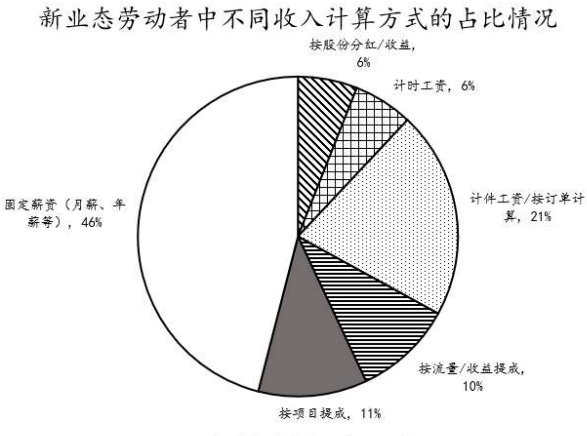

新业态劳动者中不同收入计算方式的占比情况（饼图）

| 收入计算方式 | 占比 |
| --- | --- |
| 固定薪资（月薪、年薪等） | 46% |
| 计件工资/按订单计算 | 21% |
| 按项目提成 | 11% |
| 按流量/收益提成 | 10% |
| 计时工资 | 6% |
| 按股份分红/收益 | 6% |

各扇区标签与百分数照图转写，合计100%。

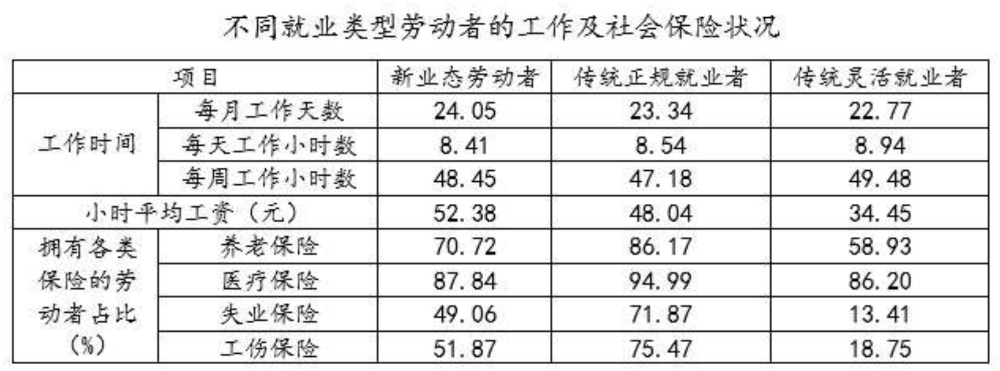

不同就业类型劳动者的工作及社会保险状况

| 项目 | | 新业态劳动者 | 传统正规就业者 | 传统灵活就业者 |
| --- | --- | --- | --- | --- |
| 工作时间 | 每月工作天数 | 24.05 | 23.34 | 22.77 |
| 工作时间 | 每天工作小时数 | 8.41 | 8.54 | 8.94 |
| 工作时间 | 每周工作小时数 | 48.45 | 47.18 | 49.48 |
| 小时平均工资（元） | | 52.38 | 48.04 | 34.45 |
| 拥有各类保险的劳动者占比（%） | 养老保险 | 70.72 | 86.17 | 58.93 |
| 拥有各类保险的劳动者占比（%） | 医疗保险 | 87.84 | 94.99 | 86.20 |
| 拥有各类保险的劳动者占比（%） | 失业保险 | 49.06 | 71.87 | 13.41 |
| 拥有各类保险的劳动者占比（%） | 工伤保险 | 51.87 | 75.47 | 18.75 |

原表“工作时间”“拥有各类保险的劳动者占比（%）”为跨行合并的单元格，转写时逐行重复。

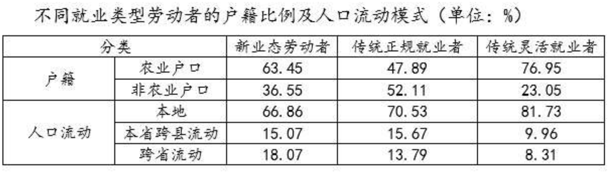

不同就业类型劳动者的户籍比例及人口流动模式（单位：%）

| 分类 | | 新业态劳动者 | 传统正规就业者 | 传统灵活就业者 |
| --- | --- | --- | --- | --- |
| 户籍 | 农业户口 | 63.45 | 47.89 | 76.95 |
| 户籍 | 非农业户口 | 36.55 | 52.11 | 23.05 |
| 人口流动 | 本地 | 66.86 | 70.53 | 81.73 |
| 人口流动 | 本省跨县流动 | 15.07 | 15.67 | 9.96 |
| 人口流动 | 跨省流动 | 18.07 | 13.79 | 8.31 |

原表“户籍”“人口流动”为跨行合并的单元格，转写时逐行重复。传统正规就业者人口流动三项之和为99.99（原资料舍入），照录。

### 第 91 题

`SYDW2025-Q091` · 单选 · 原卷第 13 页

[共用材料](#SYDW2025-M1)

新业态劳动者中，按流量/收益提成计算收入的和按项目提成计算收入的占总体的比重为（）。

**A.** 10%

**B.** 21%

**C.** 27%

**D.** 31%

**答案：B**

### 第 92 题

`SYDW2025-Q092` · 单选 · 原卷第 13 页

[共用材料](#SYDW2025-M1)

关于不同就业类型劳动者工作时间，以下表述正确的是（）。

**A.** 新业态劳动者每月工作天数最多，但每周工作小时数最少

**B.** 传统灵活就业者每月工作天数最少，但每周工作小时数最多

**C.** 传统正规就业者每周工作小时数最少，每月休息的天数也最少

**D.** 新业态劳动者每天工作小时数最多，传统灵活就业者每天工作小时数最少

**答案：B**

### 第 93 题

`SYDW2025-Q093` · 单选 · 原卷第 14 页

[共用材料](#SYDW2025-M1)

按照不同就业类型劳动者的小时平均工资计算，新业态劳动者的月收入大约比传统灵活就业者多（）。

**A.** 20%

**B.** 30%

**C.** 40%

**D.** 50%

**答案：D**

### 第 94 题

`SYDW2025-Q094` · 单选 · 原卷第 14 页

[共用材料](#SYDW2025-M1)

按拥有各类保险的劳动者占比排序。下列选项与3种就业类型劳动者的社会保险状况相符的是（）。

**A.** 医疗保险＞养老保险＞工伤保险＞失业保险

**B.** 医疗保险＞养老保险＞失业保险＞工伤保险

**C.** 养老保险＞医疗保险＞工伤保险＞失业保险

**D.** 养老保险＞医疗保险＞失业保险＞工伤保险

**答案：A**

> 转写说明：原卷选项中的大于号按字形与字距判为全角“＞”，照录。

### 第 95 题

`SYDW2025-Q095` · 单选 · 原卷第 14 页

[共用材料](#SYDW2025-M1)

根据材料，以下说法无法判断正误的是（）。

**A.** 非农业户口的劳动者中，传统正规就业者占了多数

**B.** 3种就业类型劳动者中，本省跨县流动的比例均最高

**C.** 新业态劳动者跨省流动的比例高于其他两种就业类型劳动者

**D.** 新业态劳动者和传统灵活就业者中，农业户口占比均超过非农业户口

**答案：A**

### 共用材料：第 96—100 题

《2023年我国健康卫生事业发展统计公报》显示，我国卫生资源总量持续稳步增长。2023年末，全国医疗卫生机构总数1070785个，比上年增加37867个，其中医院38355个，比上年增加1379个。2023年末，全国卫生技术人员总数1248.8万人，比上年增加83.0万人，其中医院卫生技术人员772.3万人。

根据公报，我国医疗服务提供量和效率回步提升。2023年，全国医疗卫生机构总诊疗人次95.5亿，比上年增加11.3亿人次，居民平均到医疗卫生机构就诊6.8次，入院人次30187.3万，比上年增加5501.1万人次。2023年，乡镇卫生院诊疗人次13.1亿，比上年增加1.0亿人次，入院人次3992.1万，比上年增加753.0万人次。社区卫生服务中心诊疗人次8.3亿，入院人次480.4万，社区卫生服务站诊疗人次2.1亿，村卫生室诊疗人次14.0亿，比上年增加1.2亿人次。

公报还显示，2023年全国卫生总费用初步核算为90575.8亿元，其中政府卫生支出占26.7%，社会卫生支出占46.0%，个人卫生支出占27.3%。

> 材料说明：资料第二段原卷作“我国医疗服务提供量和效率回步提升”，“回步”应为“同步”，照录。

### 第 96 题

`SYDW2025-Q096` · 单选 · 原卷第 14 页

[共用材料](#SYDW2025-M2)

2023年，全国医疗卫生机构总数同比增加约（）个百分点。

**A.** 2.1

**B.** 2.7

**C.** 3.1

**D.** 3.7

**答案：D**

> 答案说明：答案解析在结论后另注：“备注：本题表述不严谨，增长率应表述为百分之几，而非几个百分点。百分点表示百分数之间的差值。”

### 第 97 题

`SYDW2025-Q097` · 单选 · 原卷第 14 页

[共用材料](#SYDW2025-M2)

2023年，全国平均每家医院有卫生技术人员约（）人。

**A.** 101

**B.** 201

**C.** 301

**D.** 401

**答案：B**

### 第 98 题

`SYDW2025-Q098` · 单选 · 原卷第 14 页

[共用材料](#SYDW2025-M2)

2022～2023年，平均每年全国医疗卫生机构总诊疗人次（）。

**A.** 不到80亿

**B.** 在80亿～85亿之间

**C.** 在85亿～90亿之间

**D.** 在90亿～95亿之间

**答案：C**

> 转写说明：原卷“2022～2023年”“在80亿～85亿之间”等的连接号按字形与字距判为全角“～”，照录。

### 第 99 题

`SYDW2025-Q099` · 单选 · 原卷第 14 页

[共用材料](#SYDW2025-M2)

将①全国医疗卫生机构入院人次，②乡镇卫生院诊疗人次，③乡镇卫生院入院人次，④村卫生室诊疗人次按2023年同比增速从高到低排序，以下顺序正确的是（）。

**A.** ①②③④

**B.** ①④②③

**C.** ③①④②

**D.** ③②④①

**答案：C**

> 答案说明：答案按原版答案解析记录；版本2标为B，与原版不同。

### 第 100 题

`SYDW2025-Q100` · 单选 · 原卷第 14 页

[共用材料](#SYDW2025-M2)

根据材料，以下说法错误的是（）。

**A.** 2023年，全国卫生总费用中政府卫生支出超过3万亿元

**B.** 2023年，村卫生室诊疗人次约是社区卫生服务站诊疗人次的6.7倍

**C.** 2023年末，全国卫生技术人员中有超过一半是医院卫生技术人员

**D.** 2023年，乡镇卫生院入院人次比社区卫生服务中心入院人次多约3512万

**答案：A**
