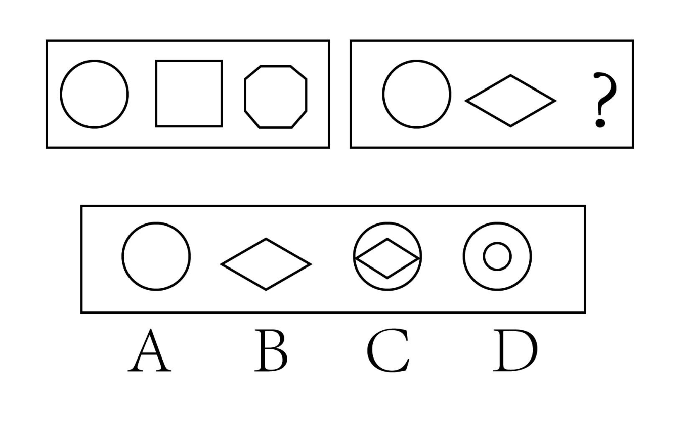
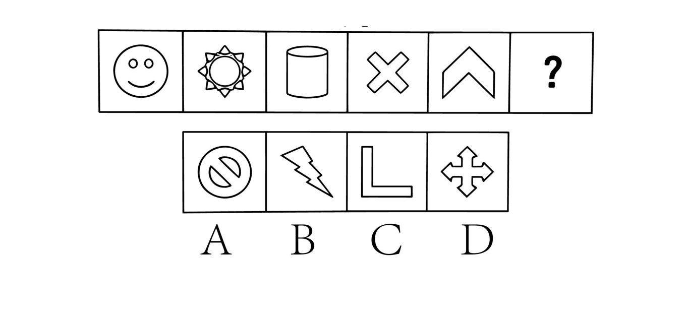
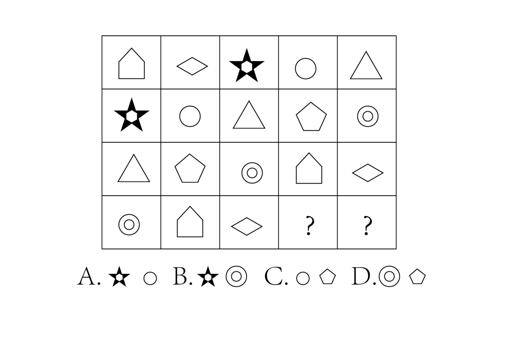
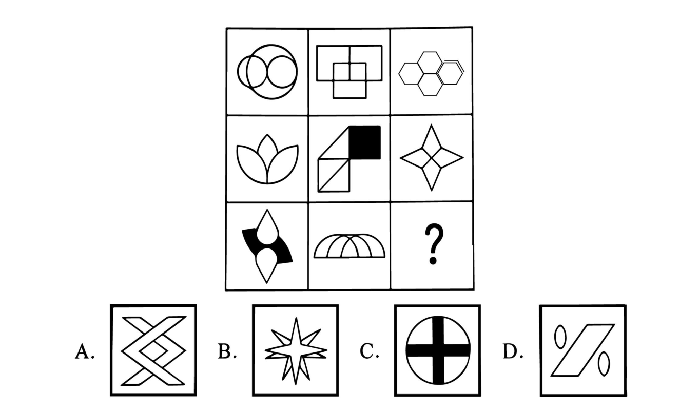
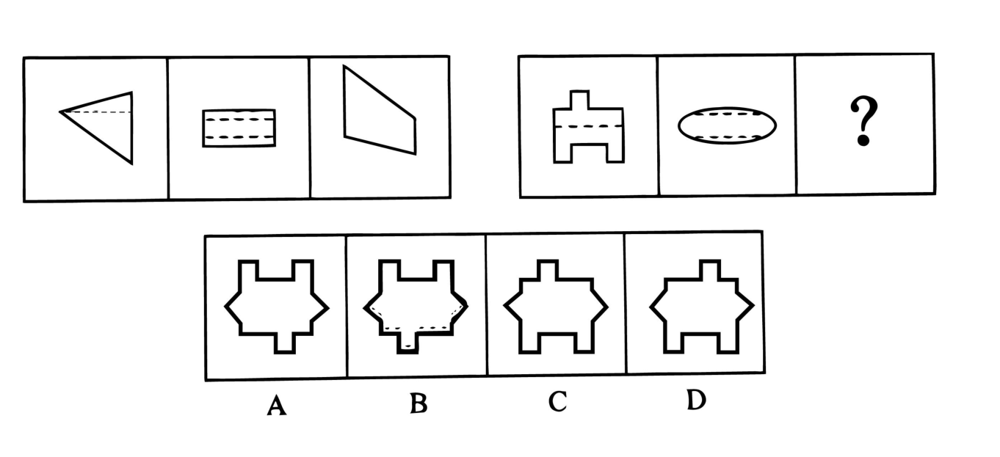
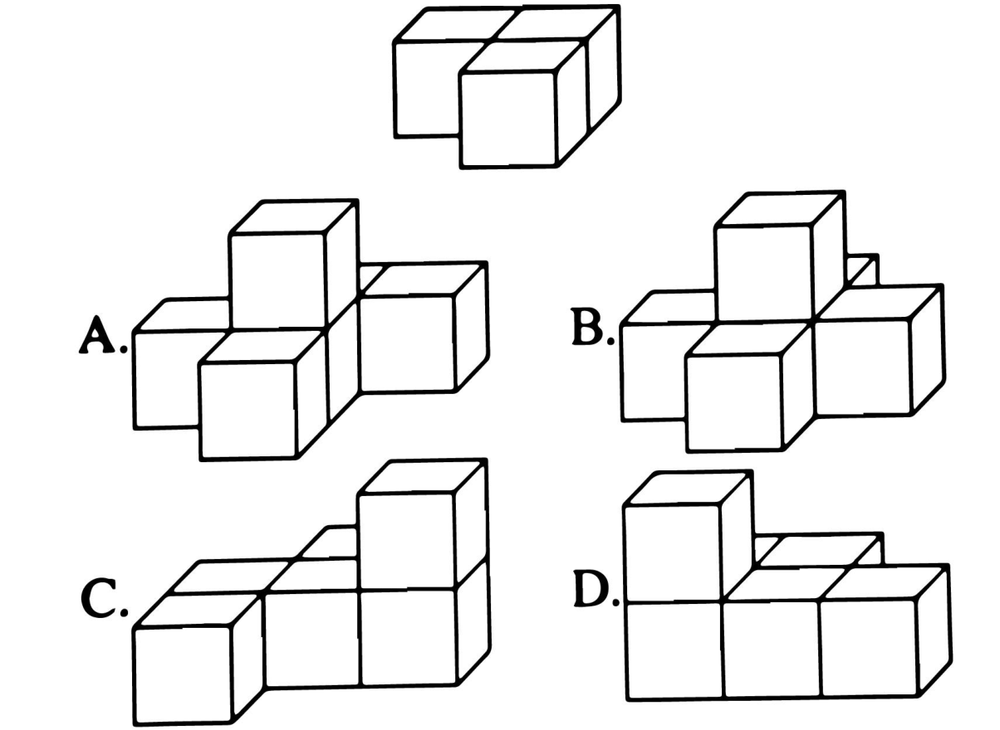
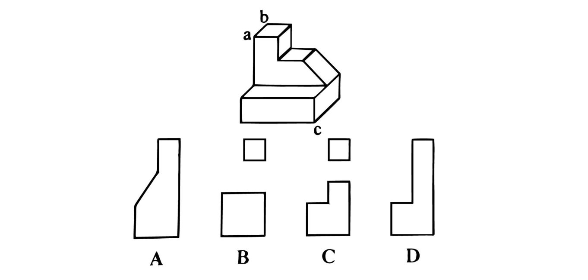

# 2026年广东事业单位统考《基本能力测试》

共 100 题，原题号完整保留。内容：题干、选项、答案（不收解析）；资料分析共用材料置于所属题组前，JSONL 每条记录完整内嵌材料。

[结构化数据](SYDW2026.jsonl) · [字段说明](schema.json) · [质量报告](quality/SYDW2026.md)

原题来源：[2026广东事业单位统考-题目及答案解析（非空白卷）.docx](https://github.com/dumarstoft-ship-it/xing-ce1/blob/3eadbf4cafe03d1f6e9089b3bb696e838ee60f0a/%E5%B9%BF%E4%B8%9C/%E4%BA%8B%E4%B8%9A%E5%8D%95%E4%BD%8D/2026/2026%E5%B9%BF%E4%B8%9C%E4%BA%8B%E4%B8%9A%E5%8D%95%E4%BD%8D%E7%BB%9F%E8%80%83-%E9%A2%98%E7%9B%AE%E5%8F%8A%E7%AD%94%E6%A1%88%E8%A7%A3%E6%9E%90%EF%BC%88%E9%9D%9E%E7%A9%BA%E7%99%BD%E5%8D%B7%EF%BC%89.docx)。答案取自同一文档每题后的“答案：”（只取答案，不收解析）。

## 常识判断

> 说明：原文档按题型分为“一、判断题”“二、多项选择题”“三、单项选择题”三部分，未标内容部分；按题目内容记为“常识判断”（与2024年卷的部分划分一致）。

### 第 1 题

`SYDW2026-Q001` · 判断 · 原文档为 Word（无页码）

科学社会主义基本原则是马克思主义的核心内容。（）

**答案：正确**

### 第 2 题

`SYDW2026-Q002` · 判断 · 原文档为 Word（无页码）

创新创造是文化的生命所在，是文化的本质特征。（）

**答案：正确**

### 第 3 题

`SYDW2026-Q003` · 判断 · 原文档为 Word（无页码）

区域协调发展是中国式现代化的内在要求。（）

**答案：正确**

### 第 4 题

`SYDW2026-Q004` · 判断 · 原文档为 Word（无页码）

加强理想信念教育，是思想政治工作的首要任务。（）

**答案：正确**

### 第 5 题

`SYDW2026-Q005` · 判断 · 原文档为 Word（无页码）

政绩观问题是一个根本性问题，关乎立党为公、执政为民。（）

**答案：正确**

### 第 6 题

`SYDW2026-Q006` · 判断 · 原文档为 Word（无页码）

企业是产业体系的细胞单元，细胞活力足、功能强，产业大树才能更新陈代谢、生长发育。（）

**答案：正确**

> 转写说明：原文档题干作“产业大树才能更新陈代谢”，解析作“才能更快新陈代谢”，疑缺“快”字，照录。

### 第 7 题

`SYDW2026-Q007` · 判断 · 原文档为 Word（无页码）

2026年，广东省高质量发展大会的主题是制造业与服务业协同发展。（）

**答案：正确**

### 第 8 题

`SYDW2026-Q008` · 判断 · 原文档为 Word（无页码）

审批是行政机关履行政府职能、管理经济社会事务的主要方式。（）

**答案：正确**

### 第 9 题

`SYDW2026-Q009` · 判断 · 原文档为 Word（无页码）

人民民主建立在社会主义经济基础之上，体现了社会主义国家的性质，反映了社会主义制度的本质要求，是一种新型的社会主义民主。（）

**答案：正确**

### 第 10 题

`SYDW2026-Q010` · 判断 · 原文档为 Word（无页码）

每个党员都必须编入党的一个支部、小组或其他特定组织，参加党的组织生活，接受党内外群众的监督。（）

**答案：正确**

### 第 11 题

`SYDW2026-Q011` · 判断 · 原文档为 Word（无页码）

广州起义中建立的广州苏维埃政府，是第一次在中国的大城市中，通过工农兵代表大会选举产生的，由中国共产党独立领导的完全新型的革命政权。（）

**答案：正确**

### 第 12 题

`SYDW2026-Q012` · 判断 · 原文档为 Word（无页码）

在新中国成立初期，具有临时宪法地位的文件是《中华人民共和国立法法》。（）

**答案：错误**

### 第 13 题

`SYDW2026-Q013` · 判断 · 原文档为 Word（无页码）

改革开放后，我国迎来“科学的春天”，先后取得“两弹一星”关键科学问题、人工合成牛胰岛素、多复变函数论突破等重大基础研究成果。（）

**答案：错误**

### 第 14 题

`SYDW2026-Q014` · 判断 · 原文档为 Word（无页码）

以事实为依据是社会主义法律的基本属性，是社会主义法治的基本要求。（）

**答案：错误**

### 第 15 题

`SYDW2026-Q015` · 判断 · 原文档为 Word（无页码）

在我国，法律是对全体公民的要求，党内法规制度是对全体党员的要求，而且很多地方比法律的要求更严格。（）

**答案：正确**

### 第 16 题

`SYDW2026-Q016` · 判断 · 原文档为 Word（无页码）

根据《中华人民共和国生物安全法》，任何单位和个人未经批准，不得擅自引进、释放或者丢弃外来物种。（）

**答案：正确**

### 第 17 题

`SYDW2026-Q017` · 判断 · 原文档为 Word（无页码）

某小区业主大会通过决定，约定每户需缴纳200元管网维修资金。业主吴某可以其未参加业主大会为由，拒绝缴纳费用。（）

**答案：错误**

### 第 18 题

`SYDW2026-Q018` · 判断 · 原文档为 Word（无页码）

广东音乐已有400多年的历史，是流行于珠江三角洲及广府方言区的传统丝竹乐种，具有轻、柔、华、细、浓的特点。（）

**答案：正确**

### 第 19 题

`SYDW2026-Q019` · 判断 · 原文档为 Word（无页码）

我国泰山上留存着创作于秦朝的刻石，刻石上的书体主要是隶书。（）

**答案：错误**

### 第 20 题

`SYDW2026-Q020` · 判断 · 原文档为 Word（无页码）

在实验室中通常使用过滤的方法将水转化为纯净水。（）

**答案：错误**

### 第 21 题

`SYDW2026-Q021` · 多选 · 原文档为 Word（无页码）

《中共中央关于制定国民经济和社会发展第十五个五年规划的建议》指出，“高质量发展取得显著成效”是“十五五”时期我国经济社会发展的主要目标之一。下列选项中，属于“高质量发展取得显著成效”的有（）。

**A.** 经济增长保持在合理区间

**B.** 全要素生产率稳步提升

**C.** 全国统一大市场建设纵深推进

**D.** 超大规模市场优势持续显现

**答案：ABCD**

### 第 22 题

`SYDW2026-Q022` · 多选 · 原文档为 Word（无页码）

中国式现代化是我们党领导人民长期探索和实践的重大成果。以下有关“中国式现代化”探索和实践历程的表述，符合历史事实的有（）。

**A.** 在新民主主义革命时期，我们消灭了在中国延续几千年的封建制度

**B.** 新中国成立后，我们党团结带领人民进行社会主义革命，确立社会主义基本制度

**C.** 改革开放和社会主义现代化建设新时期，我们党作出把党和国家工作中心转移到经济建设上来、实行改革开放的历史性决策

**D.** 党的十八大以来，我们在认识上不断深化，创立了习近平新时代中国特色社会主义思想，实现了马克思主义中国化时代化新的飞跃，为中国式现代化提供了根本遵循

**答案：BCD**

### 第 23 题

`SYDW2026-Q023` · 多选 · 原文档为 Word（无页码）

随着新时代生态文明建设实践的深入推进，我们对生态文明建设的规律性认识不断深化。以下对生态文明建设规律的认识，正确的有（）。

**A.** 生态优先、绿色低碳的高质量发展只有依靠高水平保护才能实现

**B.** 生态环境治理是一项系统工程，要求我们立足全局，坚持系统观念，谋定而后动

**C.** 推进碳达峰碳中和是推动经济结构转型升级、形成绿色低碳产业竞争优势，实现高质量发展的内在要求

**D.** 良好生态环境是最公平的公共产品，要发挥这一公共产品的最大效用，做到取用有节、行止有度，离不开强有力的外部约束

**答案：ABCD**

### 第 24 题

`SYDW2026-Q024` · 多选 · 原文档为 Word（无页码）

习近平总书记指出，要坚持城乡融合发展，扎实推进乡村全面振兴。关于实现城乡融合发展，下列说法正确的有（）。

**A.** 更好发挥县城连接城市、带动乡村作用，率先在县域内实现城乡融合发展

**B.** 坚持农业农村优先发展，坚持城乡融合发展，畅通城乡要素流动

**C.** 延伸现代农业产业链条，以城乡融合发展带动乡村全面振兴，促进城乡共同富裕

**D.** 把县域作为城乡融合发展的重要切入点，推进空间布局、产业发展、基础设施等县域统筹

**答案：ABCD**

### 第 25 题

`SYDW2026-Q025` · 多选 · 原文档为 Word（无页码）

2025年中央一号文件提出要践行大农业观、大食物观，全方位多途径开发食物资源。下列说法符合这一要求的有（）。

**A.** 以推进农业供给侧结构性改革为主线

**B.** 减轻主粮压力，降低粮食自给率要求

**C.** 从更好满足人民美好生活需要出发，掌握人民群众食物结构变化趋势

**D.** 坚持生态优先，绿色开发，立足资源禀赋，因地制宜开发

**答案：ACD**

### 第 26 题

`SYDW2026-Q026` · 多选 · 原文档为 Word（无页码）

中华人民共和国第十五届运动会于2025年11月成功举办。以下关于第十五届全国运动会的说法，正确的有（）。

**A.** 本届全运会是粤港澳三地首次联合承办的大型体育赛事

**B.** 开幕式和闭幕式分别在广州和深圳举行

**C.** 在全运会史上首次实现不新建任何大型场馆

**D.** 吉祥物的设计理念来自广州“五羊衔谷”的传说

**答案：ABC**

### 第 27 题

`SYDW2026-Q027` · 多选 · 原文档为 Word（无页码）

“随着每一次社会秩序的巨大历史变革，人们的观点和观念也会发生变革。”人们的社会存在和社会生活是具体的、现实的，是属于一定时代的，反映社会存在和社会生活的价值观总是表现出鲜明的时代特点。关于价值观，以下说法正确的有（）。

**A.** 任何一个社会都存在多种多样的价值观念和价值取向

**B.** 有什么性质的社会存在，就会有什么性质和内容的价值观

**C.** 价值观不具有独立性，其变化发展与社会存在的变化发展始终同步

**D.** 价值观反映着特定的时代精神

**答案：ABD**

### 第 28 题

`SYDW2026-Q028` · 多选 · 原文档为 Word（无页码）

据《中华人民共和国商标法》，以下说法正确的有（）

**A.** 商标使用人应当对其使用商标的商品质量负责

**B.** 不以使用为目的的恶意商标注册申请，应当予以驳回

**C.** 同我国国旗、国徽近似的标志不得作为商标使用

**D.** 自核准注册之日起，注册商标永久有效

**答案：ABC**

### 第 29 题

`SYDW2026-Q029` · 多选 · 原文档为 Word（无页码）

我国有许多成语出自春秋战国时期，以下成语典故发生在春秋战国时期的有（）。

**A.** 负荆请罪

**B.** 煮豆燃萁

**C.** 卧薪尝胆

**D.** 四面楚歌

**答案：AC**

### 第 30 题

`SYDW2026-Q030` · 多选 · 原文档为 Word（无页码）

跑步机是健身房常见的运动器械。关于跑步机的使用，下列说法有误的有（）。

**A.** 选择合适的配速匀速跑步，时间不宜过长

**B.** 相较爬坡跑，平地跑步更容易造成软骨磨损

**C.** 选择专业合脚的跑鞋，长时间跑步戴上护膝

**D.** 体脂率过高时，最适合使用跑步机减脂

**答案：BD**

> 转写说明：原文档中本题排在“三、单项选择题：共70题”标题之后，但题号后标注为{多选题}、答案为BD，且“二、多项选择题：共10题”应为第21—30题；按多选题记录。

## 言语理解与表达

> 说明：原文档按题型分为“一、判断题”“二、多项选择题”“三、单项选择题”三部分，未标内容部分；按题目内容记为“言语理解与表达”（与2024年卷的部分划分一致）。

### 第 31 题

`SYDW2026-Q031` · 单选 · 原文档为 Word（无页码）

十年树木，百年树人，干部培养也有客观的周期规律。（）、现抓现用，破解不了“用人荒”的根本难题，只会让可选的空间越来越小。
最恰当的一项是（）。

**A.** 鱼目混珠

**B.** 江心补漏

**C.** 临渴掘井

**D.** 拔苗助长

**答案：C**

### 第 32 题

`SYDW2026-Q032` · 单选 · 原文档为 Word（无页码）

企业只有充分认识到法治建设对自身发展的重要性，筑牢法治“防火填”才能在风险挑战前（），才能在市场竞争中立得住、站得稳。
最恰当的一项是（）。

**A.** 泰然处之

**B.** 厚积薄发

**C.** 高枕无忧

**D.** 怡然自得

**答案：A**

> 转写说明：原文档题干作“防火填”，应为“防火墙”，照录。

### 第 33 题

`SYDW2026-Q033` · 单选 · 原文档为 Word（无页码）

沉迷短视频极易造成青少年视力下降、注意力不集中等后果，一些不良信息还会产生误导，进而影响未成年人身心健康，危害（）。防范短视频沉迷，是保护青少年身心健康的题中应有之义。
最恰当的一项是（）。

**A.** 司空见惯

**B.** 后患无穷

**C.** 不容小觑

**D.** 不一而足

**答案：C**

### 第 34 题

`SYDW2026-Q034` · 单选 · 原文档为 Word（无页码）

建设社会主义法治文化，必须在法治实践中体现人民群众的需求维护人民群众的利益。（）在立法、执法、司法实践中都维护了人民权益，法（）能得到人民的拥护。
依次填入最恰当的一项是（）。

**A.** 不仅，还

**B.** 只有，才

**C.** 即使，也

**D.** 如果，就

**答案：B**

### 第 35 题

`SYDW2026-Q035` · 单选 · 原文档为 Word（无页码）

文旅短剧的制作，首先要突出当地文化特色。这一类的短剧，以当地的文化（）为主线，在突出风土人情的同时，有效地承载了当地文化，以沉浸式体验的方式（）人心。依次填入最恰当的一项是（）。

**A.** 传承，慰藉

**B.** 底蕴，打动

**C.** 积淀，贴近

**D.** 脉络，沁润

**答案：D**

### 第 36 题

`SYDW2026-Q036` · 单选 · 原文档为 Word（无页码）

人的自主性既是人类认识技术、使用技术、发展技术的智力前提，也是（）人工智能技术的根本保障。人工智能治理要实现技术创新与风险防控的（），就要坚持发挥人类独特的能动性，以人的主体性对抗算法日益膨胀的“自主性”。
依次填入最恰当的一项是（）。

**A.** 控制，统筹

**B.** 驾驭，平衡

**C.** 把控，协调

**D.** 掌握，兼容

**答案：B**

### 第 37 题

`SYDW2026-Q037` · 单选 · 原文档为 Word（无页码）

转变城市发展方式，关键要更加注重（）高效。有的城市“把每一寸土地都规划得清清楚楚再开始建设”；有的城市扎实推进城市更新行动，实现老城市新活力，在紧凑的空间里腾挪，“（）”推进口袋公园建设。
依次填入最恰当的一项是（）。

**A.** 集约，见缝插针

**B.** 精细，精雕细琢

**C.** 协同，精益求精

**D.** 循环，刻意求工

**答案：A**

### 第 38 题

`SYDW2026-Q038` · 单选 · 原文档为 Word（无页码）

具有三千多年历史的家训文献卷帙浩繁，既是传统社会指导、规约家庭成员的行为（），又是居家生活、（）的家庭教育教科书。
依次填入最恰当的一项是（）。

**A.** 规范，以身作则

**B.** 原则，言传身教

**C.** 标准，举足为法

**D.** 准则，轨物范世

**答案：D**

### 第 39 题

`SYDW2026-Q039` · 单选 · 原文档为 Word（无页码）

教育是创新的源头，需要在基础领域“深挖井"，也需主动（）产业链、创新链，为产业创新提供新知识、新技术、新理念。当“教”不再只盯着书本里的道理，而是与产业需求紧密结合，“产”与“教”就能实现（），为创新发展赋能助力。
依次填入最恰当的一项是（）。

**A.** 联通，同条共贯

**B.** 联系，合而为一

**C.** 对接，同频共振

**D.** 衔接，一举两全

**答案：C**

> 转写说明：原文档“深挖井"”的后引号为半角"，照录。

### 第 40 题

`SYDW2026-Q040` · 单选 · 原文档为 Word（无页码）

在社会大潮中历经淬炼的个体，本身就是传奇故事的载体，八位“共和国勋章“获得者（）的人生轨迹，可谓新中国（）历程的生动注脚。
依次填入最恰当的一项是（）。

**A.** 荡气回肠，披荆斩棘

**B.** 波澜壮阔，建功立业

**C.** 可歌可泣，白手起家

**D.** 跌宕起伏，筚路蓝缕

**答案：D**

> 转写说明：原文档“共和国勋章“获得者”的后引号误作前引号“，照录。

### 第 41 题

`SYDW2026-Q041` · 单选 · 原文档为 Word（无页码）

世界遗产作为无可辩驳的历史证明材料，镌刻着中华民族在历史进程中艰苦奋斗、勠力同心的精神风貌与价值观念。在科学对待的基础上，我们必须重点做好创造性转化和创新性发展，激活其生命力，切实做到在保护中发展、在发展中保护。文化和自然遗产的传承与发展要结合时代的发展，结合先进的传播技术才可以不断发挥世界遗产的恒久魅力。
上述文字意在说明，文化和自然遗产的传承与发展要（）。

**A.** 坚持守正创新

**B.** 坚持统筹兼顾

**C.** 坚持系统观念

**D.** 坚持人民至上

**答案：A**

### 第 42 题

`SYDW2026-Q042` · 单选 · 原文档为 Word（无页码）

近年来，国家大力推进高标准农田建设，通过土地平整、灌溉设施完善、土壤改良等措施，使“低产田”变“高产田”。此外，盐碱地等边际土地的改良利用也是耕地建设的重要方向。通过耐盐碱作物育种等技术，曾经的“不毛之地”也能变为“新粮仓”。当然，耕地建设也必须遵循耕地和作物生态系统的自然规律，以保证粮食生产的可持续性。这段文字主要讲了（）。

**A.** 高标准农田建设的综合成效

**B.** 耕地保护与建设的常态化措施

**C.** 粮食生产提质增效的关键因素

**D.** 高质量推进耕地建设的途径

**答案：D**

### 第 43 题

`SYDW2026-Q043` · 单选 · 原文档为 Word（无页码）

生产力决定生产关系，生产关系对生产力具有反作用。新质生产力的发展客观上会促进形成新型生产关系;主动完善与新质生产力相适应的生产关系发展新型生产关系，又能够激励劳动者充分发挥主观能动性、创造力，促进生产要素自由流动，使劳动资料、劳动对象能够合理配置到各类劳动者手中，进而对生产要素进行更高效率的配置，促进新质生产力发展。
上述文段意在强调（）

**A.** 加快发展新质生产力的紧迫性

**B.** 推动构建新型生产关系的重要性

**C.** 高效合理配置生产要素的必要性

**D.** 发挥劳动者主观能动性的实效性

**答案：B**

### 第 44 题

`SYDW2026-Q044` · 单选 · 原文档为 Word（无页码）

越来越多的群众希望可以在夜间参观博物馆，这是群众对城市文化生活供给提出的新要求。博物馆开放夜场将扩大其在公众中的社会影响，对于所在城市的文化建设也十分重要。在一座繁华的城市里，人们的夜间生活不应只有餐饮与娱乐，博物馆开放夜场将为群众提供更高品质的文化服务。
根据这段文字，博物馆开放夜场的意义在于（）

**A.** 扩大博物馆的社会影响

**B.** 获得客观社会经济效益

**C.** 提升城市文化生活品质

**D.** 丰富城市夜间生化方式

**答案：C**

> 转写说明：原文档D项作“丰富城市夜间生化方式”，“生化”应为“生活”，照录。

### 第 45 题

`SYDW2026-Q045` · 单选 · 原文档为 Word（无页码）

共建“一带一路”致力于实现世界的互联互通和联动发展，打通经济全球化的大动脉，推动更大范围、更高水平的国际合作，既做大又分好经济全球化的“蛋糕”。通过基础设施互联互通，推动国际投资，激发全球基建热情，拓展国际分工，扩大世界市场，为世界经济增长注入持续动力。提升贸易和投资自由化、便利化水平，构建起全方位、多层次、复合型的贸易畅通网络，同时着力打造高效互联的国际大通道。
上述文段没有提及共建“一带一路”的（）

**A.** 目的

**B.** 范围

**C.** 路径

**D.** 意义

**答案：B**

### 第 46 题

`SYDW2026-Q046` · 单选 · 原文档为 Word（无页码）

共建网上美好精神家园，各地区各部门要结合文明创建工作制定出台符合自身特点的网络文明准则，加强网站平台社区规则、用户协议建设；互联网企业要积极履行社会责任、扩大优质网络产品和服务供给；各类网络社会组织要参与网络文明建设；开发者、运营者、平台方等在内的各类网络信息提供者要自觉遵循道德规范、加强行业自律，共同营造良好网络环境。
根据这段文字，作者最有可能认同（）。

**A.** 网络文明建设是全社会的共同责任

**B.** 加强网络文明建设重在政企协同发力

**C.** 政府在网络治理中需承担主要责任

**D.** 网络道德规范是优化网络环境的基础

**答案：A**

### 第 47 题

`SYDW2026-Q047` · 单选 · 原文档为 Word（无页码）

有些人总是羡慕别人的高超技艺和非凡功业，总是想从别人身上学得成功的方法、经验和法宝。殊不知，向别人学“规矩”容易，向别人学刻苦、学奋斗、学执著却不容易。要想成就一番事业，将本职工作做到炉火纯青地步，仅学得“规矩”远远不够，还需坚持不懈、潜心修炼，不怕吃苦、勤习不辍。古往今来的大家、大艺、大品都不是轻易修来的，唯有心无旁骛，凝神专注，“焚膏继晷，兀兀穷年”，才能达到一定技艺，上升到艺术之境。
以下对这段文字理解有误的是（）

**A.** 只有坚持不懈才能取得事业成功

**B.** 历练是技艺登峰造极的必经之路

**C.** 高超的技艺可以在短时间内掌握

**D.** 学得“规矩”是成就事业的前提

**答案：C**

### 第 48 题

`SYDW2026-Q048` · 单选 · 原文档为 Word（无页码）

一寸山河一寸血，世界上没有哪一个民族比历经磨难的中华民族更加懂，和平、更加珍视和平。中华民族的血液中没有侵略他人、称霸世界的基因，我们从不接受“国强必霸”的逻辑，只信奉“_________”的道理。中国始终主张尊重历史，与邻友善，追求合作共赢，同各方力量携手前行，推动构建人类命运共同体，弘扬全人类共同价值。中，反对霸权强权，坚持主持公道、伸张正义，坚定站在历史正确的一边，站在人类进步的一边，坚持用对话解决争端。
上文横线处最适合填入的是（）。

**A.** 美美与共，天下大同

**B.** 前事不忘，后事之师

**C.** 海内存知己，天涯若比邻

**D.** 得道者多助，失道者亮助

**答案：D**

> 转写说明：原文档题干“更加懂，和平”多一个逗号（疑为“更加懂得和平”）；“弘扬全人类共同价值。中，反对霸权强权”中的“中，”疑为错位残字；D项“失道者亮助”应为“失道者寡助”。以上均照录。

### 第 49 题

`SYDW2026-Q049` · 单选 · 原文档为 Word（无页码）

沉睡3000年、一“醒”惊天下的三星堆一一金沙文明，揭示了古蜀文明的辉煌，延续并融合了中华文明的整体框架。隐匿近千载、神秘又辉煌的玛雅文明，作为拉丁美洲古文明重要组成部分，深刻影响了拉美的文化历史。金沙遗址出土的太阳神鸟金饰，是古蜀文明太阳崇拜最有力的证据，玛群人也敬奉太阳为神祗，他们塑造太阳神的形象，并为之修建神庙，在金沙遗地发现的大树根代表了古蜀人和自然相处的智慧，三星堆的青铜树构建了古现人独特的宇宙。而玛雅文明的很多雕刻和绘面，都有表现类似通天神树的场景。这些细节生动体现了人类文明的相通之处。以下对这段文字理解有误的是（）

**A.** 古蜀人和玛雅人都崇拜太阳

**B.** 古人的宇宙观主要通过神树展现

**C.** 古蜀文明在某些方面与玛雅文明相通

**D.** 许多古代文明对当地文化历史产生了深刻影响

**答案：B**

> 转写说明：原文档题干错字照录：“三星堆一一金沙文明”（应为“——”）、“玛群人”（应为“玛雅人”）、“金沙遗地”（应为“遗址”）、“古现人”（应为“古蜀人”）、“绘面”（应为“绘画”）。

### 第 50 题

`SYDW2026-Q050` · 单选 · 原文档为 Word（无页码）

将以下句子进行排序，最为恰当的是（）。
①新能源汽车产业的迅速崛起，就是一个生动的例证。
②“看得见的手”和“看不见的手”各展其长、同向而行，一起书写了我国汽车产业“换道超车”的非凡故事。
③一方面，充分利用我国超大规模市场优势，推动动力电池等核心技术不断突破，持续完善产业链供应链。
④我国经济发展获得巨大成功的一个关键因素，就是我们既发挥了市场经济的长处，又发挥了社会主义制度的优越性。
⑤另一方面，前瞻性开展产业规划，推动公共充电设施加速普及，为产业创新发展培厚土壤。

**A.** ④①③⑤②

**B.** ②④①③⑤

**C.** ④③⑤②①

**D.** ②①④③⑤

**答案：A**

## 数量关系

> 说明：原文档按题型分为“一、判断题”“二、多项选择题”“三、单项选择题”三部分，未标内容部分；按题目内容记为“数量关系”（与2024年卷的部分划分一致）。

### 第 51 题

`SYDW2026-Q051` · 单选 · 原文档为 Word（无页码）

12，10，13，11，14，12，（    ）

**A.** 13

**B.** 14

**C.** 15

**D.** 16

**答案：C**

### 第 52 题

`SYDW2026-Q052` · 单选 · 原文档为 Word（无页码）

2，4，8，16，20，40，44，（    ）

**A.** 48

**B.** 60

**C.** 64

**D.** 88

**答案：D**

### 第 53 题

`SYDW2026-Q053` · 单选 · 原文档为 Word（无页码）

1.2，3，1.8，6，4.2，9，4.8，12，（    ）

**A.** 5.4

**B.** 6.6

**C.** 7.2

**D.** 8.4

**答案：C**

### 第 54 题

`SYDW2026-Q054` · 单选 · 原文档为 Word（无页码）

21/16，27/22，39/34，63/58，（    ）

**A.** 113/105，

**B.** 111/106

**C.** 112/107

**D.** 110/108

**答案：B**

> 转写说明：原文档A项作“113/105，”（末尾多一个逗号），照录；分数在原文档中即为“分子/分母”文字。

### 第 55 题

`SYDW2026-Q055` · 单选 · 原文档为 Word（无页码）

3.8，5.24，2.3，6.35，（    ）

**A.** 9.80

**B.** 8.21

**C.** 7.45

**D.** 4.11

**答案：A**

### 第 56 题

`SYDW2026-Q056` · 单选 · 原文档为 Word（无页码）

某志愿组织向社区图书馆捐赠一批图书，其中文学类书籍比艺术类的2倍多500册，自然科学类书籍比文学类的2倍少1500册，比艺术类书籍的3倍多1000册，则自然科学类书籍有（）册。

**A.** 1500

**B.** 3500

**C.** 5500

**D.** 7500

**答案：C**

### 第 57 题

`SYDW2026-Q057` · 单选 · 原文档为 Word（无页码）

公园内有一长方形花坛，长30米，宽18米。公园管理处计划在花坛四周安装灭蚊灯，为保证美观，要求相邻2台灭蚊灯之间距离保持一致，且花坛四角处均需安装灭蚊灯。则公园管理处最少需要订购（）台灭蚊灯。

**A.** 14

**B.** 16

**C.** 18

**D.** 20

**答案：B**

### 第 58 题

`SYDW2026-Q058` · 单选 · 原文档为 Word（无页码）

某单位组织全体职工前往外地参观学习，如果所有职工乘坐40座的大巴则至少需要租用，12辆;如果乘坐35座的大巴，则至少需要租用13辆。则该单位职工的人数范围是（）人。

**A.** 421-455

**B.** 421-441

**C.** 441-455

**D.** 441-480

**答案：C**

> 转写说明：原文档题干“则至少需要租用，12辆;”多一个逗号、分号为半角，照录。

### 第 59 题

`SYDW2026-Q059` · 单选 · 原文档为 Word（无页码）

某地计划由甲和乙两支工程队完成老旧供水管网改造工程，该工程由地上和地下两部分构成(相互之间没有影响，。如果地上部分由两支工程队单独完成，分别需要12天和24天;如果地下部分由两支工程队单独完成，分别需要12天和6天。则由甲、乙两支工程队合作完成整个改造工程至少需要（）天。

**A.** 10

**B.** 12

**C.** 14

**D.** 16

**答案：A**

> 转写说明：原文档题干“(相互之间没有影响，。”括号未闭合（疑为“(相互之间没有影响)。”），“12天和24天;”分号为半角，照录。

### 第 60 题

`SYDW2026-Q060` · 单选 · 原文档为 Word（无页码）

在一场射击训练中，甲、乙、丙三人击中目标的概率分别为1/2、2/3和3/4如果三人向同一个目标射击，则目标至少被其中一人击中的概率是（）。

**A.** 3/4

**B.** 5/6

**C.** 11/12

**D.** 23/24

**答案：D**

> 转写说明：原文档题干“3/4如果三人”之间缺标点，照录；分数在原文档中即为“分子/分母”文字。

### 第 61 题

`SYDW2026-Q061` · 单选 · 原文档为 Word（无页码）

甲、乙、丙参加一项考试，满分100分。已知乙、丙两人扣掉的分数之和比甲的分数低28分，乙、丙的分数分别比三人的平均分低3分、5分。则甲的分数为（）分。

**A.** 76

**B.** 80

**C.** 84

**D.** 88

**答案：C**

### 第 62 题

`SYDW2026-Q062` · 单选 · 原文档为 Word（无页码）

一艘货轮在大海上行驶，到达A点时测得灯塔C位于南偏东30°方向，往南继续直线行驶8km到B点，此时测得灯塔C位于南偏东60°方向，那么在B点时货轮与灯塔C的距离为（）。

**A.** 8km

**B.** 16km

**C.** km

**D.** km

**答案：A**

> 转写说明：原文档C、D两项只有单位“km”，数值缺失（疑为根式等公式在转换中丢失）；答案A（8km）不受影响，但C、D两项无法还原。

### 第 63 题

`SYDW2026-Q063` · 单选 · 原文档为 Word（无页码）

某单位工会组织春节茶话会，需要从6名男职工和4名女职工中选出5人担任主持人。如果选出的5人中至少有3名女职工，则有（）种不同的主持人组合。

**A.** 60

**B.** 66

**C.** 120

**D.** 132

**答案：B**

### 第 64 题

`SYDW2026-Q064` · 单选 · 原文档为 Word（无页码）

商店从周一开始销售某种产品，且之后每一天的销量都比前一天多2件，第五周的销量正好是第二周的2倍，则商店第一周销售了（）件这种产品。

**A.** 82

**B.** 196

**C.** 210

**D.** 224

**答案：B**

> 转写说明：题干末尾“)件这种产品。”在原文档中错排到解析开头，已按原句接回题干（见质量报告“人工修正”）。

### 第 65 题

`SYDW2026-Q065` · 单选 · 原文档为 Word（无页码）

某公司法务、运营、财务三个部门共收到70份求职简历(每名求职者只能向一个部门投递简历)，其中有40%的求职者拥有硕士学位。在法务和运营两个部门收到的简历中，拥有硕士学位的求职者占比分别为55%和36%。则在财务部收到的简历中，拥有硕士学位的求职者占比为（）。

**A.** 21%

**B.** 24%

**C.** 29%

**D.** 32%

**答案：D**

## 判断推理

> 说明：原文档按题型分为“一、判断题”“二、多项选择题”“三、单项选择题”三部分，未标内容部分；按题目内容记为“判断推理”（与2024年卷的部分划分一致）。

### 第 66 题

`SYDW2026-Q066` · 单选 · 图形推理 · 原文档为 Word（无页码）

下列选项中最符合所给图形规律的是（）

**答案：B**

> 答案说明：原文档缺题图，答案B照“答案：”行记录，无法对照题图核对。

> 转写说明：原文档缺第66题题图（选项画在图中），只有题干“下列选项中最符合所给图形规律的是（）”与答案B；解析称“分内外圈来看，最外圈按顺时针依次移动1、2、3、4格……”，可知原题有图。本题无法单独使用。

### 第 67 题

`SYDW2026-Q067` · 单选 · 图形推理 · 原文档为 Word（无页码）

下列选项中最符合所给图形规律的是（）

**A.** 见上方题图中 A 项。

**B.** 见上方题图中 B 项。

**C.** 见上方题图中 C 项。

**D.** 见上方题图中 D 项。

**答案：C**

> 答案说明：答案解析称本题图形有误（左边这组第三个图形应为直曲线图形），按“直曲性”规律得C；答案照原文档记录。

> 转写说明：答案解析注明：“本题图形错误，左边这组第三个图形应为直曲线图形”；题图照原文档，未改动。

### 第 68 题

`SYDW2026-Q068` · 单选 · 图形推理 · 原文档为 Word（无页码）

下列选项中最符合所给图形规律的是（）

**A.** 见上方题图中 A 项。

**B.** 见上方题图中 B 项。

**C.** 见上方题图中 C 项。

**D.** 见上方题图中 D 项。

**答案：D**

### 第 69 题

`SYDW2026-Q069` · 单选 · 图形推理 · 原文档为 Word（无页码）

下列选项中，最适合依次填入问号处的是（）

**A.** 见上方题图中 A 项。

**B.** 见上方题图中 B 项。

**C.** 见上方题图中 C 项。

**D.** 见上方题图中 D 项。

**答案：A**

### 第 70 题

`SYDW2026-Q070` · 单选 · 图形推理 · 原文档为 Word（无页码）

下列选项中最符合所给图形规律的是（）

**A.** 见上方题图中 A 项。

**B.** 见上方题图中 B 项。

**C.** 见上方题图中 C 项。

**D.** 见上方题图中 D 项。

**答案：C**

### 第 71 题

`SYDW2026-Q071` · 单选 · 图形推理 · 原文档为 Word（无页码）

下列选项中最符合所给图形规律的是（）

**A.** 见上方题图中 A 项。

**B.** 见上方题图中 B 项。

**C.** 见上方题图中 C 项。

**D.** 见上方题图中 D 项。

**答案：B**

> 答案说明：答案解析称本题选项有误（各选项中间部分的两边应为弧线），答案照原文档记为B。

> 转写说明：答案解析注明：“本题选项错误，各选项中间部分的两边应为弧线”；题图照原文档，未改动。

### 第 72 题

`SYDW2026-Q072` · 单选 · 图形推理 · 原文档为 Word（无页码）

某立体图形的正视图和俯视图都为下图，那么该立体图形最少由（）个相同的小正方体组成。

**A.** 4

**B.** 5

**C.** 6

**D.** 7

**答案：A**

### 第 73 题

`SYDW2026-Q073` · 单选 · 图形推理 · 原文档为 Word（无页码）

下列选项中，最有可能由两个所给立体图形组成的是（）

**A.** 见上方题图中 A 项。

**B.** 见上方题图中 B 项。

**C.** 见上方题图中 C 项。

**D.** 见上方题图中 D 项。

**答案：D**

> 答案说明：解析只写“一个竖起来，一个平放”，没有写选项字母；答案照“答案：”行记为D。

### 第 74 题

`SYDW2026-Q074` · 单选 · 图形推理 · 原文档为 Word（无页码）

如图所示，所给长方体有3个面带有对角线，则该长方体的展开图最有可能是（）。

**A.** 见上方题图中 A 项。

**B.** 见上方题图中 B 项。

**C.** 见上方题图中 C 项。

**D.** 见上方题图中 D 项。

**答案：C**

> 转写说明：题图两张：上为长方体，下为A—D四个展开图。

### 第 75 题

`SYDW2026-Q075` · 单选 · 图形推理 · 原文档为 Word（无页码）

以下为给定的多面体，将其沿a、b、c三个顶点所在的平面切开，截面最有可能是（）。

**A.** 见上方题图中 A 项。

**B.** 见上方题图中 B 项。

**C.** 见上方题图中 C 项。

**D.** 见上方题图中 D 项。

**答案：D**

### 第 76 题

`SYDW2026-Q076` · 单选 · 类比推理 · 原文档为 Word（无页码）

生长：养分（）

**A.** 倾听：歌声

**B.** 制动：摩擦

**C.** 切制：毛料

**D.** 观察：路径

**答案：B**

### 第 77 题

`SYDW2026-Q077` · 单选 · 类比推理 · 原文档为 Word（无页码）

转危：为安（）

**A.** 返璞：归真

**B.** 貌合：神离

**C.** 求同：存异

**D.** 改邪：归正

**答案：D**

### 第 78 题

`SYDW2026-Q078` · 单选 · 类比推理 · 原文档为 Word（无页码）

网球：足球：小（）

**A.** 手臂：身体：短

**B.** 高原：平原：低

**C.** 水能：风能：快

**D.** 火车：轿车：长

**答案：D**

### 第 79 题

`SYDW2026-Q079` · 单选 · 类比推理 · 原文档为 Word（无页码）

机场：顾客：候机（）

**A.** 商场：顾客：销售

**B.** 书店：作者：购书

**C.** 厨房：厨师：烹饪

**D.** 企业：职员：出差

**答案：C**

### 第 80 题

`SYDW2026-Q080` · 单选 · 类比推理 · 原文档为 Word（无页码）

弄巧成拙：画虎不成反类狗

**A.** 因小失大：捡了芝麻丢了西瓜

**B.** 以弱制强：太岁头上动土

**C.** 忍气吞声：前言不搭后语

**D.** 自不量力：一条扁担挑泰山

**答案：A**

### 第 81 题

`SYDW2026-Q081` · 单选 · 逻辑判断 · 原文档为 Word（无页码）

如果没有建立统一规划体系，那么城市建设的各个方面都会缺乏系统性。只要建立统一规划体系，就能有序推进城市更新。只有建立统一规划体系，城市的经济增速才可能超出预期。
由此可以推出的是（）。

**A.** 如果缺乏统一的规划体系，那么就无法推动城市经济发展

**B.** 一旦建立统一规划体系，那么城市建设的各个方面都会具有系统性

**C.** 除非城市的经济增速超出预期，否则该城市没有建立统一规划体系

**D.** 如果城市更新未能有序推进，那么城市经济增速不可能超出预期

**答案：D**

### 第 82 题

`SYDW2026-Q082` · 单选 · 逻辑判断 · 原文档为 Word（无页码）

随着群众对公园多样化需求的不断提升，某市近年来积极探索公园市场化改革，引入社会资本参与公园建设管理运营，结合当地历史文化底蕴打造特色主题公园，全面提升服务品质，丰富消费场景。然而，有反对者提出，公园市场化改革势必引入餐饮、娱乐等收费项目，影响市民在公园休闲健身、亲近自然，损害公园的公益属性。
如果下列选项为真，最能削弱反对者观点的是（）。

**A.** 市场化改革可吸引社会资本，弥补公园绿地建设运营的资金缺口，缓解财政压力

**B.** 某公园将当地历史文化与自然景观深度融合，打造了具有特色的主题公园，成为市民休闲的好去处

**C.** 公园市场化改革也会完善停车场、健身步道、无障碍设施等，有助实现群众满意、经济效益提升的“双赢”

**D.** 市场化运营后，企业往往将商业设施集中布局在公园某一区域，不会过度压缩市民的免费活动空间

**答案：D**

### 第 83 题

`SYDW2026-Q083` · 单选 · 逻辑判断 · 原文档为 Word（无页码）

随着新能源汽车技术的快速发展，许多市民选择购买新能源汽车作为交通工具。近期某市新建设了许多公共充电桩，然而正式运营一段时间后该市发现，新建设的公共充电桩使用率始终较低。以下选项如果为真，最能解释这一现象的是（）。

**A.** 调查显示，该市现有的多数充电桩充电效率都比较低

**B.** 部分新能源汽车车主认为新能源汽车的保值率低于燃油车

**C.** 新建设的公共充电桩收费比原有的充电桩高，许多车主不愿意使用

**D.** 新建设的公共充电桩主要集中在人流密集的区域，充电排队时间较长

**答案：C**

### 第 84 题

`SYDW2026-Q084` · 单选 · 逻辑判断 · 原文档为 Word（无页码）

为了提升公司内部的技术创新能力，公司成立之初组建了技术创新小组，该小组的部分成员拥有高级技术职称。近日，出于降本增效考虑，公司所有高管都赞同解散该小组的决定，但该小组所有成员都反对这一决定。由此可以得出，该公司内（）。

**A.** 有些拥有高级技术职称的员工不是高管

**B.** 所有高管都没有高级技术职称

**C.** 该小组的成员都拥有高级技术职称

**D.** 有些高管拥有高级技术职称

**答案：A**

### 第 85 题

`SYDW2026-Q085` · 单选 · 逻辑判断 · 原文档为 Word（无页码）

有研究显示，电子游戏在促进中国文化出海方面具有极大优势，其互动机制允许玩家深度参与文化叙事，游戏场景设计可突破时空壁垒实现即时触达，沉浸式体验则能强化文化记忆。有学者据此提出，电子游戏的沉浸性和全球可及性，使其成为中国文化出海的重要载体。以下选项如果为真，最能支持上述结论的是（）。

**A.** 海外玩家在游戏中深度参与文化叙事，能够促使他们主动搜索了解相关文化背景

**B.** 有调查显示，许多外国人通过观看华语电影和阅读中文书籍了解和学习中国文化

**C.** 近期多款电子游戏在国内游戏平台上架后销售火爆，受到许多玩家的追捧

**D.** 有研究发现，玩家探索游戏场景时激活的脑部区域与观看历史文化纪录片时激活的脑区高度重合

**答案：A**

### 第 86 题

`SYDW2026-Q086` · 单选 · 逻辑判断 · 原文档为 Word（无页码）

数据统计显示，人们爱看电影的年均时长相较于20年前有所减少，然而电影院的票房收入却持续增长。下列选项如果为真，最不能解释这一现象的是（）。

**A.** 人们在电影院的消费常常包括购买食品、饮品等其他消费

**B.** 20年前，人们更倾向于在家通过电视或录像带观看电影

**C.** 随着经济不断发展，电影票的平均价格远高于20年前

**D.** 与20年前相比，前往电影院看电影的人数大幅增加

**答案：A**

### 第 87 题

`SYDW2026-Q087` · 单选 · 逻辑判断 · 原文档为 Word（无页码）

一个国家，如果不树立底线思维，那么将无法防范化解各种风险挑战。如果一个国家无法保持社会长期稳定，就不可能实现高质量发展。因此，一个国家想要实现高质量发展，必须树立底线思维。要使上述结论成立，需要补充的前提是（）。

**A.** 防范化解各种风险挑战是保持社会长期稳定的必要条件

**B.** 树立底线思维是保持社会长期稳定的充分条件

**C.** 只要防范化解各种风险挑战就能保持社会长期稳定

**D.** 只要防范化解各种风险挑战就能实现高质量发展

**答案：A**

### 第 88 题

`SYDW2026-Q088` · 单选 · 逻辑判断 · 原文档为 Word（无页码）

植物需要光合作用，珊瑚不是植物，因此珊瑚不需要光合作用。下列选项与题干论证方式最为相似的是（）。

**A.** 光合作用是植物将光能转化为化学能的过程，而动物主要通过捕食获取化学能量，因此光合作用不是动物获取能量的主要途径

**B.** 应届毕业生已修完所有课程，校友不是应届毕业生，因此校友没有修完所有课程

**C.** 狗的臼齿发达，狗不是猫科动物，因此猫科动物的臼齿不发达

**D.** 汉语言专业的学生不是理科生，小明不是汉语言专业的学生，因此小明是理科生

**答案：B**

### 第 89 题

`SYDW2026-Q089` · 单选 · 逻辑判断 · 原文档为 Word（无页码）

某市推进老城区更新项目，需为历史文化保护区、老旧生活区、工业遗址区3个片区分配财政资金、企业投资、社会捐赠3类资源，每个片区都能获得2类资源。已知：①企业投资只分配给1个片区，要么是工业遗址区，要么是老旧生活区；②历史文化保护区与老旧生活区所获得的资源只有1类相同；③工业遗址区如果获得企业投资，则不会获得社会捐赠。
根据上述条件，下列选项一定正确的是（）。

**A.** 老旧生活区所获得的资源中一定有财政资金

**B.** 历史文化保护区与工业遗址区所获得的资源类别完全相同

**C.** 老旧生活区与工业遗址区所获得的资源类别完全相同

**D.** 工业遗址区所获得的资源中可能有企业投资

**答案：B**

### 第 90 题

`SYDW2026-Q090` · 单选 · 逻辑判断 · 原文档为 Word（无页码）

有的街道办负责运营便民服务中心，有的便民服务中心上线了数字化服务平台，因此有的街道办负责运营数字化服务平台。
下列选项与题干论证方式最为相似的是（）

**A.** 有些养老机构是医养结合机构，而医养结合机构入住率高，因此有些养老机构入住率高

**B.** 有的公共图书馆是24小时开放的公共设施，有的设施在24小时内都有市民使用，因此有的市民使用了公共图书馆

**C.** 部分邻里议事会是线上进行的，部分居民没有参加线上活动，因此部分居民没有参加邻里议事会

**D.** 有些健身设施是智能化设施，有些社区安装了健身设施，因此有些社区安装了智能化设施

**答案：D**

## 资料分析

> 说明：原文档按题型分为“一、判断题”“二、多项选择题”“三、单项选择题”三部分，未标内容部分；按题目内容记为“资料分析”（与2024年卷的部分划分一致）。

### 第 91 题

`SYDW2026-Q091` · 单选 · 原文档为 Word（无页码）

2022—2024年，广东省图书出版种数年均增长（）种。

**A.** 273

**B.** 354

**C.** 609

**D.** 914

**答案：D**

> 答案说明：原文档缺本组资料，答案照“答案：”行记录；解析的计算（(12385-10557)/2=914）与答案一致，但无法对照资料核对。

> 转写说明：原文档缺第91—95题的资料：只有“根据以下资料，回答91-95题:”一句，资料表格（解析中引用的2020—2024年广东省图书、杂志、报纸出版种数、总印数、总印张数等）没有收录；material 记为 null，本题无法单独使用。

### 第 92 题

`SYDW2026-Q092` · 单选 · 原文档为 Word（无页码）

2024年，广东省图书出版总印数比上年增长（）。

**A.** 不到3%

**B.** 在3%—4%之间

**C.** 在4%—5%之

**D.** 超过5%

**答案：B**

> 答案说明：原文档缺本组资料，答案照“答案：”行记录；解析的计算（(5.72-5.53)/5.53≈3.4%）与答案一致，但无法对照资料核对。

> 转写说明：原文档缺第91—95题的资料：只有“根据以下资料，回答91-95题:”一句，资料表格（解析中引用的2020—2024年广东省图书、杂志、报纸出版种数、总印数、总印张数等）没有收录；material 记为 null，本题无法单独使用。

> 转写说明：原文档C项作“在4%—5%之”（缺“间”字），照录。

### 第 93 题

`SYDW2026-Q093` · 单选 · 原文档为 Word（无页码）

2024年，平均每种图书、杂志、报纸出版印张数，从大到小排序正确的是（）。

**A.** 图书>杂志>报纸

**B.** 图书>报纸>杂志

**C.** 报纸>杂志>图书

**D.** 报纸>图书>杂志

**答案：C**

> 答案说明：原文档缺本组资料，答案照“答案：”行记录；解析算得报纸＞杂志＞图书，与答案一致，但无法对照资料核对。

> 转写说明：原文档缺第91—95题的资料：只有“根据以下资料，回答91-95题:”一句，资料表格（解析中引用的2020—2024年广东省图书、杂志、报纸出版种数、总印数、总印张数等）没有收录；material 记为 null，本题无法单独使用。

> 转写说明：原文档C项标号作“C..”，已去掉多余的点。

### 第 94 题

`SYDW2026-Q094` · 单选 · 原文档为 Word（无页码）

与2020年相比，2024年下列项目变化幅度最大的是（）。

**A.** 杂志出版总印数

**B.** 杂志出版总印张数

**C.** 报纸出版总印数

**D.** 报纸出版总印张数

**答案：D**

> 答案说明：原文档缺本组资料，答案照“答案：”行记录；解析的计算与答案一致，但无法对照资料核对。

> 转写说明：原文档缺第91—95题的资料：只有“根据以下资料，回答91-95题:”一句，资料表格（解析中引用的2020—2024年广东省图书、杂志、报纸出版种数、总印数、总印张数等）没有收录；material 记为 null，本题无法单独使用。

### 第 95 题

`SYDW2026-Q095` · 单选 · 原文档为 Word（无页码）

根据以上资料，以下说法错误的是（）。

**A.** 2020—2024年，广东省图书出版总印张数年均增长超15%

**B.** 2020—2024年，广东省报纸出版种数总体呈下降趋势

**C.** 2020—2024年，广东省报纸出版总印数在2020年最多

**D.** 2024年，广东省平均每种杂志出版印数同比下降超过2万册

**答案：A**

> 答案说明：原文档缺本组资料，答案照“答案：”行记录；解析的计算与答案一致，但无法对照资料核对。

> 转写说明：原文档缺第91—95题的资料：只有“根据以下资料，回答91-95题:”一句，资料表格（解析中引用的2020—2024年广东省图书、杂志、报纸出版种数、总印数、总印张数等）没有收录；material 记为 null，本题无法单独使用。

### 共用材料：第 96—100 题

2025年我国电信业务收入累计完成1.75万亿元，比上年增长0.7%。截至2025年，,三家基础电信企业的固定互联网宽带接入用户总数达，6.91亿户，全年净增0.21亿户，其中，100M及以上接入速率的用户为6.59亿户。全年净增0.23亿户；1000M及以上接入速率的用户为2.38亿户，全年净增0.32亿户，占用户总数的34.5%。

> 材料说明：本组资料在原文档中只有一段文字；资料文字照录：“截至2025年，,三家基础电信企业”“总数达，6.91亿户”中多出的逗号，以及“为6.59亿户。全年净增0.23亿户”中的句号，均为原文档如此。

### 第 96 题

`SYDW2026-Q096` · 单选 · 原文档为 Word（无页码）

[共用材料](#SYDW2026-M2)

2024年，我国电信业务收入累计完成金额（）

**A.** 不到1.6万亿元

**B.** 在1.6-1.7万亿元之间

**C.** 在1.7一1.8万亿元之间

**D.** 超过1.8万亿元

**答案：C**

> 转写说明：原文档C项“在1.7一1.8万亿元之间”中的连接号为汉字“一”，照录。

### 第 97 题

`SYDW2026-Q097` · 单选 · 原文档为 Word（无页码）

[共用材料](#SYDW2026-M2)

2025年，固定互联网宽带接入用户总数同比增加约（）。

**A.** 1%

**B.** 3%

**C.** 10%

**D.** 30%

**答案：B**

### 第 98 题

`SYDW2026-Q098` · 单选 · 原文档为 Word（无页码）

[共用材料](#SYDW2026-M2)

2025年上半年，1000M及以上接入速率的用户净增约（）亿户

**A.** 0.09

**B.** 0.11

**C.** 0.20

**D.** 0.22

**答案：C**

> 答案说明：原文档答案写作小写“c”，按C记录；解析算得0.20亿户，对应C；所需统计图原文档缺失。

> 转写说明：原文档缺本题所需的统计图：解析用到“6月末用户数2.26亿户”等2025年各月1000M及以上接入速率用户数，资料文字中没有，本题无法完整作答。

### 第 99 题

`SYDW2026-Q099` · 单选 · 原文档为 Word（无页码）

[共用材料](#SYDW2026-M2)

2025，,100M及以上接入速率的用户数占用户总数的比例，上年（）

**A.** 增加不到1个百分点

**B.** 增加超过1个百分点

**C.** 减少不到1个百分点

**D.** 减少超过1个百分点

**答案：A**

> 转写说明：原文档题干作“2025，,100M及以上接入速率的用户数占用户总数的比例，上年（）”：“2025”后疑缺“年”，逗号重复，“比例，上年”疑为“比例比上年”，照录。

### 第 100 题

`SYDW2026-Q100` · 单选 · 原文档为 Word（无页码）

[共用材料](#SYDW2026-M2)

根据资料，下列说法错误的是（）。

**A.** 2024年，1000M以下接入速率的用户数小于5亿

**B.** 2025年，1000M以下接入速率的用户数同比有所减少

**C.** 2025年第四季度，1000M及以上接入速率的用户数占用户总数的比例逐月提高

**D.** 2025年12月末，固定互联网宽带接入用户总数达到全年峰值

**答案：D**

> 答案说明：解析称D项“无法推出，说法错误”；所需统计图原文档缺失，无法对照资料核对。

> 转写说明：原文档缺本题所需的统计图：C、D项及解析用到2025年10—12月1000M及以上接入速率用户占比等月度数据，资料文字中没有，本题无法完整作答。
