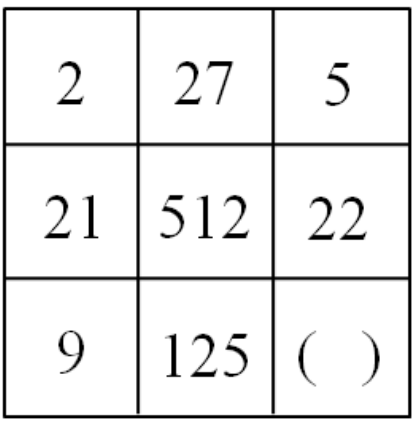
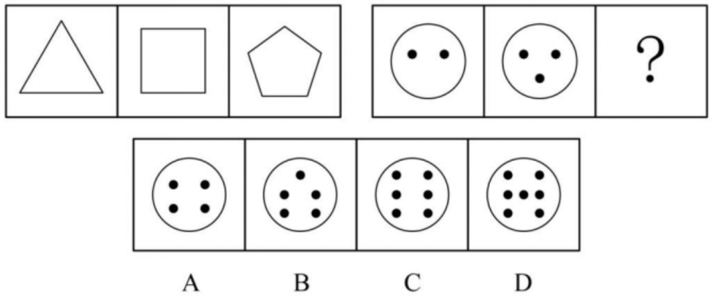
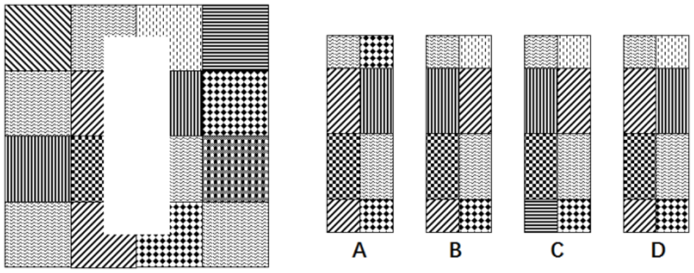
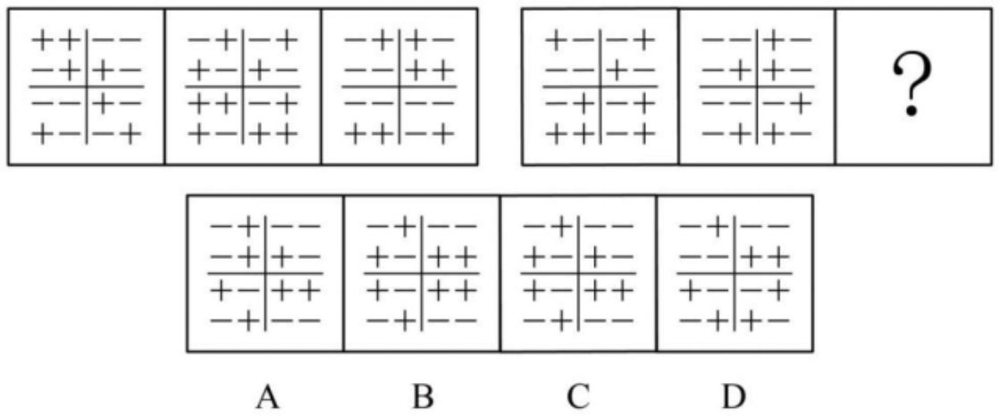
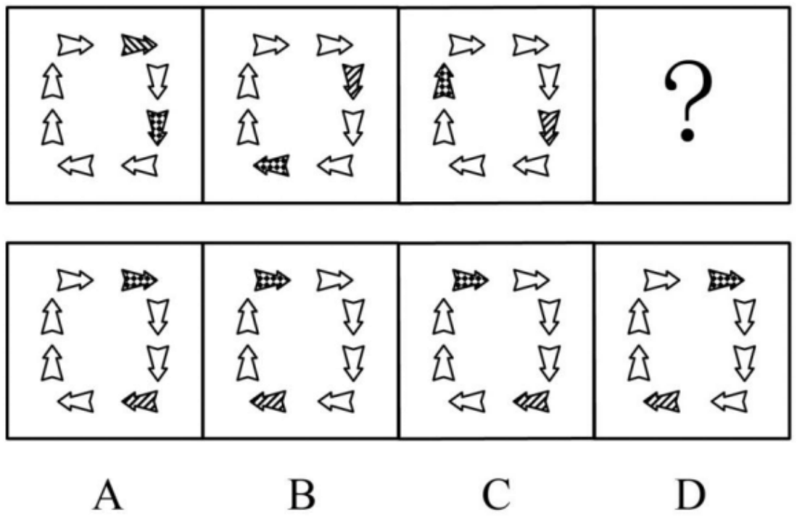
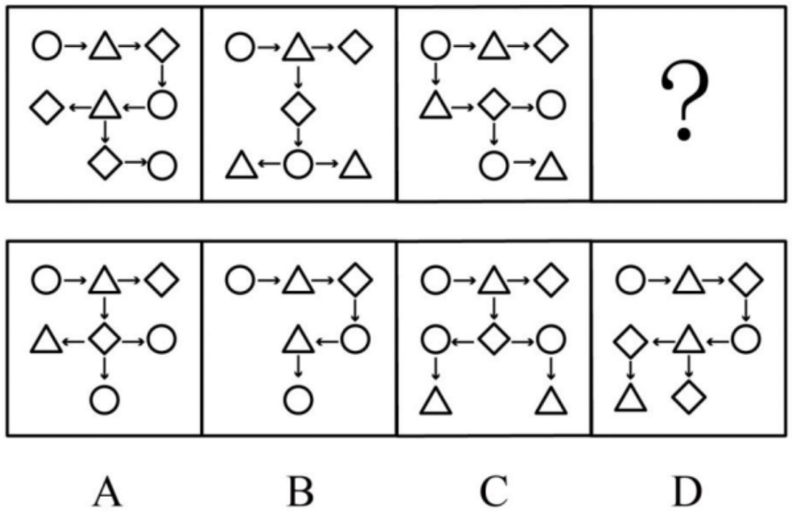
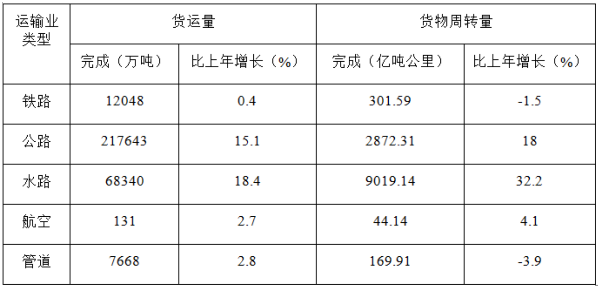
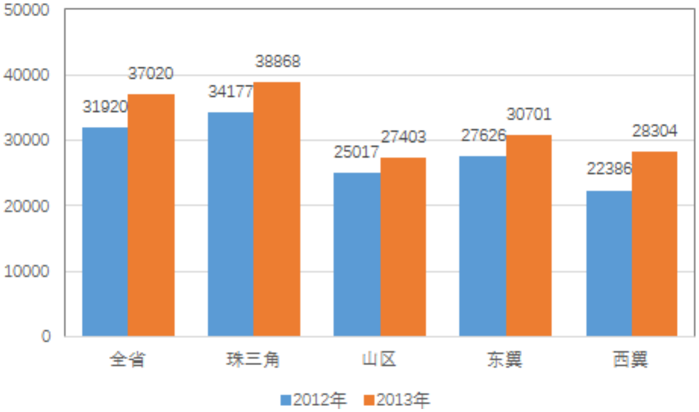

# 2014年广东行测（乡镇卷）

共 100 题，原题号完整保留。内容：题干、选项、答案（不收解析）；资料分析共用材料置于所属题组前，JSONL 每条记录完整内嵌材料。

[结构化数据](GD2014-XZ.jsonl) · [字段说明](schema.json) · [质量报告](quality/GD2014-XZ.md)

原题来源：[2014年广东省公务员录用考试《行测》题（乡镇）.pdf](https://github.com/dumarstoft-ship-it/xing-ce1/blob/52f9811b22cad5410a7108dd0a07a879f1187aa5/%E7%9C%9F%E9%A2%98/2014%E5%B9%B4%E5%B9%BF%E4%B8%9C%E7%9C%81%E5%85%AC%E5%8A%A1%E5%91%98%E5%BD%95%E7%94%A8%E8%80%83%E8%AF%95%E3%80%8A%E8%A1%8C%E6%B5%8B%E3%80%8B%E9%A2%98%EF%BC%88%E4%B9%A1%E9%95%87%EF%BC%89.pdf)。答案来源：[2014年广东省公务员录用考试《行测》题（乡镇）答案及解析.pdf](https://github.com/dumarstoft-ship-it/xing-ce1/blob/52f9811b22cad5410a7108dd0a07a879f1187aa5/%E7%AD%94%E6%A1%88%E8%A7%A3%E6%9E%90/2014%E5%B9%B4%E5%B9%BF%E4%B8%9C%E7%9C%81%E5%85%AC%E5%8A%A1%E5%91%98%E5%BD%95%E7%94%A8%E8%80%83%E8%AF%95%E3%80%8A%E8%A1%8C%E6%B5%8B%E3%80%8B%E9%A2%98%EF%BC%88%E4%B9%A1%E9%95%87%EF%BC%89%E7%AD%94%E6%A1%88%E5%8F%8A%E8%A7%A3%E6%9E%90.pdf)（只取答案）。

## 常识判断

### 第 1 题

`GD2014-XZ-Q001` · 单选 · 原卷第 1 页

乡镇人民政府是：

**A.** 国家行政机关

**B.** 国家立法机关

**C.** 国家权力机关

**D.** 国家司法机关

**答案：A**

### 第 2 题

`GD2014-XZ-Q002` · 单选 · 原卷第 1 页

2014年中央一号文件提出，推进中国特色农业现代化，要始终把改革作为根本动力，立足国情农情，顺应时代要求，坚持（）为基础与多种经营形式共同发展。

**A.** 家庭经营

**B.** 集体经营

**C.** 合作经营

**D.** 企业经营

**答案：A**

### 第 3 题

`GD2014-XZ-Q003` · 单选 · 原卷第 1 页

农村村民实现村民自治的基本手段是：

**A.** 党的政策

**B.** 村民会议

**C.** 村规民约

**D.** 法律法规

**答案：B**

### 第 4 题

`GD2014-XZ-Q004` · 单选 · 原卷第 1 页

根据《中国共产党章程》，党的（）每届任期两年或三年。

**A.** 支部委员会

**B.** 基层委员会

**C.** 地方委员会

**D.** 中央委员会

**答案：A**

### 第 5 题

`GD2014-XZ-Q005` · 单选 · 原卷第 1 页

中国共产党党员的党龄，从（）算起。

**A.** 递交入党申请书之日

**B.** 成为入党积极分子之日

**C.** 成为预备党员之日

**D.** 预备期满转为正式党员之日

**答案：D**

### 第 6 题

`GD2014-XZ-Q006` · 单选 · 原卷第 1 页

根据《城市居民委员会组织法》，居民委员会决定问题，采取（）的原则。

**A.** 民主集中制

**B.** 少数服从多数

**C.** 居民委员会成员集体决定

**D.** 居民小组组长讨论决定

**答案：B**

### 第 7 题

`GD2014-XZ-Q007` · 单选 · 原卷第 1 页

乡、民族乡、镇的人民政府对村民委员会的工作给予指导、支持和帮助，（）依法属于村民自治范围内的事项。

**A.** 不得干预

**B.** 必要时责令改正

**C.** 根据工作需要决定

**D.** 根据村民委员会申请决定

**答案：A**

### 第 8 题

`GD2014-XZ-Q008` · 单选 · 原卷第 1 页

某镇人民政府镇长是该镇安全生产的第一责任人，对辖区范围内的安全生产：

**A.** 负间接责任

**B.** 负普通责任

**C.** 不负责任

**D.** 负全面责任

**答案：D**

### 第 9 题

`GD2014-XZ-Q009` · 单选 · 原卷第 1 页

根据《村民委员会组织法》，提名权是直接提名村民委员会成员候选人的权利。直接提名不包括：

**A.** 选民自我提名

**B.** 选民联名提名

**C.** 选民个人提名

**D.** 村民委员会提名

**答案：D**

### 第 10 题

`GD2014-XZ-Q010` · 单选 · 原卷第 1 页

根据《村民委员会组织法》，登记参加选举的村民，选举期间外出不能参加投票的，可以（）本村有选举权的近亲属代为投票，村民选举委员会应当公布委托人和受委托人的名单。

**A.** 间接委托

**B.** 口头委托

**C.** 书面委托

**D.** 电话委托

**答案：C**

### 第 11 题

`GD2014-XZ-Q011` · 单选 · 原卷第 1 页

李某是甲村村民委员会成员，根据《村民委员会组织法》，以下人员可以担任该村村务监督机构成员的是：

**A.** 李某的妻子

**B.** 李某的父亲

**C.** 李某的哥哥

**D.** 李某的朋友

**答案：D**

### 第 12 题

`GD2014-XZ-Q012` · 单选 · 原卷第 1 页

以下不属于村民委员会职责的是：

**A.** 调解民间纠纷

**B.** 促进农村公共服务

**C.** 协助维护社会治安

**D.** 林木砍伐的罚没

**答案：D**

### 第 13 题

`GD2014-XZ-Q013` · 单选 · 原卷第 1 页

农作物肥料最主要的三要素是：

**A.** 硅、钾、磷

**B.** 钙、镁、铁

**C.** 氮、磷、钾

**D.** 锌、钾、氮

**答案：C**

### 第 14 题

`GD2014-XZ-Q014` · 单选 · 原卷第 1 页

根据《广东省城乡居民基本养老保险实施办法》，参加城乡居民基本养老保险的人员应当按规定缴纳养老保险费。缴费标准的最低档次是每年（）元。

**A.** 50

**B.** 120

**C.** 240

**D.** 300

**答案：B**

### 第 15 题

`GD2014-XZ-Q015` · 单选 · 原卷第 1 页

广东省人民代表大会常务委员会于（）通过了《关于修改〈广东省人口与计划生育条例〉的决定》，“单独二孩”政策在我省开始实施。

**A.** 2014年1月1日

**B.** 2014年3月27日

**C.** 2014年6月15日

**D.** 2014年7月1日

**答案：B**

### 第 16 题

`GD2014-XZ-Q016` · 单选 · 原卷第 1 页

根据《广东省社会抚养费征收管理办法》，当事人一次缴纳社会抚养费确有实际困难的，应当按规定向委托作出征收决定的机关提出分期缴纳申请，缴纳期限不得超过：

**A.** 两年

**B.** 三年

**C.** 四年

**D.** 五年

**答案：B**

### 第 17 题

`GD2014-XZ-Q017` · 单选 · 原卷第 2 页

根据《村民委员会组织法》，村民委员会实行村务公开制度。下列不属于村务公开内容的是：

**A.** 国家计划生育政策的落实方案

**B.** 政府拨付和接受社会捐献的救灾救助、补贴补助等资金、物资的管理使用情况

**C.** 村民委员会协助人民政府开展工作的情况

**D.** 村民委员会干部个人财产信息

**答案：D**

### 第 18 题

`GD2014-XZ-Q018` · 单选 · 原卷第 2 页

根据《广东省信访条例》，信访人反映村（社区）一级干部问题，需走访有权处理的单位，应当到（）提出信访事项。越级走访，国家机关不支持、不受理。

**A.** 乡（镇）人民政府、街道办事处

**B.** 地级市信访部门

**C.** 省级信访部门

**D.** 中央信访部门

**答案：A**

### 第 19 题

`GD2014-XZ-Q019` · 单选 · 原卷第 2 页

村民委员会设立的治安保卫委员会，俗称“治保会”，是：

**A.** 国家机关

**B.** 行政机关

**C.** 事业单位

**D.** 群众性自治组织

**答案：D**

### 第 20 题

`GD2014-XZ-Q020` · 单选 · 原卷第 2 页

二十四节气是中国古代订立的一种用来指导农事的补充历法。二十四节中，“立夏”之后的下一个节气是：

**A.** 芒种

**B.** 小满

**C.** 夏至

**D.** 小暑

**答案：B**

> 转写说明：原卷题干作“二十四节中”（漏“气”字），照录。

## 言语理解与表达

### 第 21 题

`GD2014-XZ-Q021` · 单选 · 原卷第 2 页

乡村的魅力在于历史记忆，千百年来________的村落空间、建筑风格，镌刻着一圈圈生命的年轮。
填入划横线处最恰当的一项是：

**A.** 养成

**B.** 形成

**C.** 造成

**D.** 变成

**答案：B**

### 第 22 题

`GD2014-XZ-Q022` · 单选 · 原卷第 2 页

正如中国乡村在拥抱现代化的过程中不断嬗变一样，乡村道德也在剧烈变化的大时代里面临________。
填入划横线处最恰当的一项是：

**A.** 转移

**B.** 转化

**C.** 转型

**D.** 转换

**答案：C**

### 第 23 题

`GD2014-XZ-Q023` · 单选 · 原卷第 2 页

夏粮生产喜获丰收________提振了农业工作者的信心，也为全年粮食丰收奠定基础，奏响序曲。
填入划横线处最恰当的一项是：

**A.** 虽然

**B.** 如果

**C.** 不仅

**D.** 既然

**答案：C**

### 第 24 题

`GD2014-XZ-Q024` · 单选 · 原卷第 2 页

________原有产业基础和区位优势，某地区在金融、行政管理、涉外经济等领域不断推出改革创新举措。
填入划横线处最恰当的一项是：

**A.** 依据

**B.** 依托

**C.** 依仗

**D.** 依赖

**答案：B**

### 第 25 题

`GD2014-XZ-Q025` · 单选 · 原卷第 2 页

当前，农村各地正在不失时机对失地农民、失业返乡农民开展各种创业就业培训，并取得显著________。

**A.** 成果

**B.** 成效

**C.** 成功

**D.** 成就

**答案：B**

> 转写说明：原卷本题没有“填入划横线处最恰当的一项是”这一设问行，照录。

### 第 26 题

`GD2014-XZ-Q026` · 单选 · 原卷第 2 页

来自人民、根植人民、造福人民。是我们党先进性和纯洁性的集中________也是我们党永远立于不败之地的根本。

**A.** 体现

**B.** 展现

**C.** 展示

**D.** 呈现

**答案：A**

> 转写说明：原卷本题没有设问行；题干“造福人民。是我们党……集中________也是……”的标点照录。

### 第 27 题

`GD2014-XZ-Q027` · 单选 · 原卷第 2 页

真情关注民生，着力改善民生，切实________民生，努力解决好群众最关心、最直接、最现实的利益问题。
填入划横线处最恰当的一项是：

**A.** 保证

**B.** 保障

**C.** 保护

**D.** 保卫

**答案：B**

### 第 28 题

`GD2014-XZ-Q028` · 单选 · 原卷第 2 页

文艺的力量是无声无息的，它以春风化雨、潜移默化的方式________着人们，如鲁迅所说，是“于无声处听惊雷”，这是文艺创作的一个定律。
填入划横线处最恰当的一项是：

**A.** 鼓励

**B.** 激发

**C.** 鼓动

**D.** 激励

**答案：D**

### 第 29 题

`GD2014-XZ-Q029` · 单选 · 原卷第 2 页

产业发展是农业增收致富的基础，由于各地情况不同，农业产业的具体方式和途径应该________。
填入划横线处最恰当的一项是：

**A.** 因势利导

**B.** 因地制宜

**C.** 因利乘便

**D.** 因事制宜

**答案：B**

### 第 30 题

`GD2014-XZ-Q030` · 单选 · 原卷第 2、3 页

为知识分子营造良好的学习、工作和生活环境，使他们成长有机会、干事有舞台、发展有空间，是党和政府的重要________。
填入横线处最恰当的一项是:

**A.** 职责

**B.** 责任

**C.** 义务

**D.** 职权

**答案：A**

> 转写说明：原卷设问作“填入横线处最恰当的一项是:”（与其他题的“划横线处”不同，冒号为半角），照录。

### 第 31 题

`GD2014-XZ-Q031` · 单选 · 原卷第 3 页

凡事从坏处准备，努力争取最好的结果，这样才能________，遇事不慌，牢牢把握主动权。
填入划横线处最恰当的一项是：

**A.** 胸有成竹

**B.** 有备无患

**C.** 防患未然

**D.** 有的放矢

**答案：B**

### 第 32 题

`GD2014-XZ-Q032` · 单选 · 原卷第 3 页

在过去的十年间，信息技术的飞速发展给当代人的生活、工作方式带来巨大的变革，而________这一切的基础——通信网络，在神州大地上实现了________式的发展。
填入划横线处最恰当的一项是：

**A.** 建造 飞越

**B.** 建造 跨越

**C.** 缔造 飞越

**D.** 缔造 跨越

**答案：D**

### 第 33 题

`GD2014-XZ-Q033` · 单选 · 原卷第 3 页

如果一味________于所谓的“成功之道”，放弃对生活的体验和思考，则有可能在追求“成功”的路上，与自己最初的梦想________。
填入划横线处最恰当的一项是：

**A.** 沉溺 南辕北辙

**B.** 沉湎 南辕北辙

**C.** 沉迷 渐行渐远

**D.** 沉醉 渐行渐远

**答案：C**

### 第 34 题

`GD2014-XZ-Q034` · 单选 · 原卷第 3 页

无论是经验还是教训都表明，面对信任危机，主动________比逃避拖延更理性，用心________比一味堵塞更管用，未雨绸缪比应急救火更重要。
填入划横线处最恰当的一项是：

**A.** 应对 疏通

**B.** 应付 疏通

**C.** 应付 疏导

**D.** 应对 疏导

**答案：D**

### 第 35 题

`GD2014-XZ-Q035` · 单选 · 原卷第 3 页

我们把美丽乡村建设作为培育农村经济新增长点的有效________，________区位条件、生态资源、人文积淀等优势。
填入划横线处最恰当的一项是：

**A.** 途径 发扬

**B.** 路径 发扬

**C.** 途径 发挥

**D.** 路径 发挥

**答案：C**

### 第 36 题

`GD2014-XZ-Q036` · 单选 · 原卷第 3 页

农机产业的快速发展为农机化水平的稳定提升提供了装备________，但目前农机产品的有效供给远不能满足发展现代农业对其的________。
填入划横线处最恰当的一项是：

**A.** 支援 需要

**B.** 支撑 需要

**C.** 支撑 需求

**D.** 支援 需求

**答案：C**

### 第 37 题

`GD2014-XZ-Q037` · 单选 · 原卷第 3 页

互联网为人们获取和交流信息提供了极大________，同时也给个人信息被他人非法泄露、搜集、公开、传播和利用提供了________。
填入划横线处最恰当的一项是：

**A.** 方便 可能

**B.** 便利 可行

**C.** 便利 可能

**D.** 方便 可行

**答案：C**

### 第 38 题

`GD2014-XZ-Q038` · 单选 · 原卷第 3 页

我们身边有许许多多优秀基层干部，把自己的生命无私地投入于百姓的幸福生活，他们闪光的足迹，就是最________的表述和最________的注解。
填入划横线处最恰当的一项是：

**A.** 生动 透彻

**B.** 深刻 透彻

**C.** 生动 精辟

**D.** 深刻 精辟

**答案：C**

### 第 39 题

`GD2014-XZ-Q039` · 单选 · 原卷第 3 页

在有条件的地方开展按实际粮食播种面积或产量对生产者补贴试点，提高补贴精准性、指向性。这是中央一号文件的一个突出________，也是对一直以来农业补贴政策上各种呼声的一个合理________。
填入划横线处最恰当的一项是：

**A.** 亮点 回应

**B.** 特点 回应

**C.** 特点 回复

**D.** 亮点 回复

**答案：A**

### 第 40 题

`GD2014-XZ-Q040` · 单选 · 原卷第 3 页

物质消费________，但违背公序良俗和高尚生活的畸形消费则应抵制，树立科学、文明的消费观________。
填入划横线处最恰当的一项是：

**A.** 无可厚非 迫在眉睫

**B.** 无可厚非 急不可待

**C.** 无可置疑 急不可待

**D.** 无可置疑 迫在眉睫

**答案：A**

### 第 41 题

`GD2014-XZ-Q041` · 单选 · 原卷第 3、4 页

乡村文化，只有跟乡村的未来发展相和谐，跟老百姓过日子不冲突，才能引动我们广袤乡村社会的文化之河长流。
下列选项中，与作者观点一致的是：

**A.** 乡村文化的保护与传承，要与乡村的发展变化相适应

**B.** 乡村文化的保护与传承，要保持乡村的原有风貌

**C.** 乡村文化的保护与传承，与社会发展完全没有关系

**D.** 乡村文化的保护与传承，常与老百姓利益发生冲突

**答案：A**

### 第 42 题

`GD2014-XZ-Q042` · 单选 · 原卷第 4 页

简单恢复历史旧貌，绝不可能实现复兴的目标。只有创造一种融合古今的新兴文明，才能恢复曾经有过的世界一流兴盛状态。因此，________________。
下列选项中，最适合填入横线上的是：

**A.** 复兴之道，应当是改革创新之道

**B.** 要复兴，就要敞开胸怀学习全世界

**C.** 要复兴，就要批判地继承历史遗产

**D.** 复兴之道，需要敢想、敢干、能干

**答案：A**

### 第 43 题

`GD2014-XZ-Q043` · 单选 · 原卷第 4 页

我国环境保护和治理污染的重心在城市，特别是中心城市，而相对忽视了广大的农村。其实，我国农村最需要环境保护、环境治理和生态建设。
这段文字主要说明了：

**A.** 环境保护和治理污染的重心在城市

**B.** 环境保护和治理污染需要城市与农村联动

**C.** 环境保护和治理污染的重心要向农村转移

**D.** 环境保护和治理污染的难点在农村

**答案：C**

### 第 44 题

`GD2014-XZ-Q044` · 单选 · 原卷第 4 页

如果说中央政府改革是上篇，地方政府改革就是下篇，需要整体构思，通盘考虑、上下贯通，把政府改革的整篇文章做好。地方政府职能转变和机构改革，是党和国家改革开放事业大局的重要内容，也是深化行政体制改革的重要组成部分。
这段文字主要说明了：

**A.** 取消地方行政审批的重要性

**B.** 搞好地方政府改革的重要性

**C.** 调整优化机构编制的重要性

**D.** 加快政府职能转变的重要性

**答案：B**

### 第 45 题

`GD2014-XZ-Q045` · 单选 · 原卷第 4 页

人以食为天，食品安全尤其是粮食安全是根本，在水土资源刚性约束的条件下，种业成为挖掘增产潜力、保障食品安全的关键，它不仅是农业发展的战略产物，也决定着农业发展的水平和竞争力，而且是人类赖以持续生存发展的战略。
这段文字主要说明了：

**A.** 种业的重要性

**B.** 粮食安全的重要性

**C.** 环境保护的重要性

**D.** 农业发展的重要性

**答案：A**

### 第 46 题

`GD2014-XZ-Q046` · 单选 · 原卷第 4 页

富人有富人的忧愁，穷人有穷人的快乐。立业与成功，是诸多人的幸福理想；生活幸福，工作幸福，则是每个人的平常愿望。幸福密码，似乎像账户密码，一般人都有，但是别人看不到，只有自己用心才能体会。
下列选项中，与作者观点不一致的是：

**A.** 富人与穷人都能获得幸福的感觉

**B.** 实现平常愿望也能让人感到幸福

**C.** 幸福与每个人的内心感受有关

**D.** 物质支撑的幸福才更加恒定持久

**答案：D**

### 第 47 题

`GD2014-XZ-Q047` · 单选 · 原卷第 4 页

调查研究发现，某地基层农业科技队伍“断层”问题较为突出。因受地方事业总编制数的限制，当地农业科技推广服务机构已超过10年没有补充人才，而随着农业科技人员的升迁、调动，基层农业科技骨干日渐减少，农技服务队伍“青黄不接”。
通过这段文字，作者旨在建议：

**A.** 建立多元基层农技技术推广体系，实现技术推广与生产需求结合

**B.** 明确建设中以公益性为指导原则，解除县乡农技服务的后顾之忧

**C.** 发展政府外的涉农企业力量加入，完善现代农业的农技推广体系

**D.** 增设基层农业科技推广专项编制，解决农技服务队伍断层的问题

**答案：D**

### 第 48 题

`GD2014-XZ-Q048` · 单选 · 原卷第 4 页

马克思指出：“人们自己创造自己的历史，但是他们并不是随心所欲地创造，历史不在他们自己选定的条件下创造，而是在直接碰到的、既定的、从过去承接下来的条件下创造。”当前，探讨中国特色社会主义政治发展，同样离不开中国的现实国情。这必然是中国特色社会主义政治发展的逻辑起点。
对上文中的“这”理解最准确的是：

**A.** 中国的现实国情

**B.** 人们创造的历史

**C.** 马克思的原话

**D.** 政治发展的方向

**答案：A**

### 第 49 题

`GD2014-XZ-Q049` · 单选 · 原卷第 4、5 页

乡村与城市，本是两种不同的生活空间和文明形态，自有其不同的运行路径和发展规律。推进城乡一体，建设美丽乡村，不是追求城乡一样，不是让乡村全然变成城市，而是要尊重不同的文明，顺应不同的规律，走出一条生态、生产与生活契合，自然、文化与历史和谐的城乡差别化互动型协调发展道路。从文明的演进看，我们不可以割断历史；从社会的变迁看，我们也不可能消灭乡村。
这段文字理解不准确的一项是：

**A.** 建设美丽乡村不能简单等同于农村城市化

**B.** 建设美丽乡村要符合乡村的发展规律

**C.** 建设美丽乡村是让乡村全然变成城市

**D.** 建设美丽乡村要考虑城乡差别化发展

**答案：C**

### 第 50 题

`GD2014-XZ-Q050` · 单选 · 原卷第 5 页

调查显示，一方面当前的农村文化生活有了一定的发展，随着新农村建设的逐步深入，农村文化建设取得了一些成绩，各项公益文化设施不断增加，农民享受文化生活的意识得到提高，农民文化生活内容不断丰富，精神面貌也为之焕然一新。另一方面，受各种条件制约，农民享受文化生活的渴望与相对滞后的文化产品的矛盾日益显著，这在一定程度上抑制了农村文化生活建设和进一步发展。
这段文字主要说明了：

**A.** 农村文化生活的现状及特征

**B.** 农村文化生活存在的问题

**C.** 影响农村文化生活的主要因素

**D.** 农村文化建设所取得的成绩

**答案：A**

### 第 51 题

`GD2014-XZ-Q051` · 单选 · 原卷第 5 页

推进改革需要相应的经济环境，从实际情况看，速度过高或过低都不利于改革。如果发展速度过低，就业会出问题，居民收入增速及民生改善步伐也会相应放缓，老百姓就会不满意，改革就难以推进。但发展速度过高，会使各方面的关系绷得很紧，容易引发通胀，妨碍结构调整，也会影响改革。改革是发展的动力，总体有利于经济增长。
这段文字主要说明了：

**A.** 实现经济持续稳定健康地发展要靠改革

**B.** 要处理好改革与发展的关系

**C.** 经济发展仍是解决我国所有问题的关键

**D.** 我国市场经济改革和发展取得明显成效

**答案：B**

### 第 52 题

`GD2014-XZ-Q052` · 单选 · 原卷第 5 页

中国人的饭碗任何时候都要牢牢端在自己手上，保障一个国家的农业安全，造就一大批高素质的农民是一项重大战略选择。农业里不靠农民，我们面临的现实不仅是农民数量萎缩，而且素质堪忧。青壮年农民数量急剧减少，农业劳动力老龄化严重，“未来谁种地”备受社会关注。因为没有人，农业安全就是一句空话。
这段文字旨在说明：

**A.** 吸引有志于农业的年轻人务农至关重要

**B.** 保障农业安全需要依靠高素质农民

**C.** 劳动力数量急剧下降对农业安全的影响

**D.** 国家的农业安全取决于农业劳动力的素质

**答案：B**

### 第 53 题

`GD2014-XZ-Q053` · 单选 · 原卷第 5 页

实践一再告诫我们，要真正服务好干部群众，就必须关注“沉默的大多数”，特别要注意听那些平时听不到、难听到的底层干部群众的声音。要畅通各种民主渠道，通过开通热线电话、举办问政问计活动等形式，多捕捉来自“无声”干部群众的声音，从中去了解、感知、分析、思考，切实找准服务指导基层的差距不足和用力方向，使之成为推动基层建设的重要依据和参考。
对这段文字理解最准确的一项是：

**A.** “无声”干部群众的声音更值得重视

**B.** 要重视来自“无声”干部群众的声音

**C.** 大多数干部群众都是“沉默的”

**D.** 畅通民主渠道才能获取干部群众的声音

**答案：B**

### 第 54 题

`GD2014-XZ-Q054` · 单选 · 原卷第 5 页

城镇化是一个自然历史过程，有其内在规律。要坚持按规律办事，理清政府和市场的边界。要发挥市场在资源配置中的决定性作用，以市场化、社会化方式整合城镇化建设资源，壮大城市产业基础，改善就业条件，解决好公共服务投融资等问题。同时，政府要切实履行在创造制度环境、编制发展规划、建设基础设施、提供公共服务，加强社会治理等方面的职责。
这段文字主要说明了：

**A.** 推进城镇化建设要处理好政府与市场的关系

**B.** 推进城镇化建设要注重发挥政府的主导作用

**C.** 推进城镇化建设要发挥市场的决定作用

**D.** 推进城镇化建设要尊重城镇化的内在规律

**答案：A**

### 第 55 题

`GD2014-XZ-Q055` · 单选 · 原卷第 5 页

记忆力的改善并不需要求助于神奇的记忆术或昂贵的营养补充剂。一项针对120名老人进行的为期一年的研究表明，坚持每周快走3次、每次持续30到40分钟的老人，在实验结束时，负责记忆与计划关键部位的体积不但没有像预料那样随着衰老而萎缩，反而增长了2%到3%。这意味着将记忆力衰退的进程逆转了1到2年。此外，经常快步行走的老人在空间记忆测试中的得分也要高于运动的对照组。
以下最合适做这段文字标题的一项是：

**A.** 神奇的记忆术

**B.** 超强记忆“走”出来

**C.** 记忆力的改善

**D.** 记忆力与行走

**答案：B**

## 数量关系

### 第 56 题

`GD2014-XZ-Q056` · 单选 · 原卷第 6 页

11，18，25，32，（    ）

**A.** 34

**B.** 37

**C.** 39

**D.** 41

**答案：C**

### 第 57 题

`GD2014-XZ-Q057` · 单选 · 原卷第 6 页

4，12，36，108，（    ）

**A.** 223

**B.** 257

**C.** 315

**D.** 324

**答案：D**

### 第 58 题

`GD2014-XZ-Q058` · 单选 · 原卷第 6 页

10，5，15，20，35，（    ）

**A.** 50

**B.** 55

**C.** 65

**D.** 70

**答案：B**

### 第 59 题

`GD2014-XZ-Q059` · 单选 · 原卷第 6 页

90，45，15，3.75，（    ）

**A.** 0.25

**B.** 0.5

**C.** 0.75

**D.** 1

**答案：C**

### 第 60 题

`GD2014-XZ-Q060` · 单选 · 原卷第 6 页

（见题图）

题图数字方阵（按原图行列）

| 第1列 | 第2列 | 第3列 |
| --- | --- | --- |
| 2 | 27 | 5 |
| 21 | 512 | 22 |
| 9 | 125 | （ ） |

**A.** 10

**B.** 9

**C.** 8

**D.** 7

**答案：D**

> 转写说明：原卷第60题没有题干文字，只有3行3列的数字方阵；方阵按原图行列转写在题图 transcription 中。

### 第 61 题

`GD2014-XZ-Q061` · 单选 · 原卷第 6 页

做同一种零件，赵师傅3小时做15个，钱师傅4小时做21个，孙师傅5小时做27个，李师傅6小时做31个，则（）的工作效率最高。

**A.** 赵师傅

**B.** 钱师傅

**C.** 孙师傅

**D.** 李师傅

**答案：C**

### 第 62 题

`GD2014-XZ-Q062` · 单选 · 原卷第 6 页

某合作社农场有5块稻田，今年夏季每块稻田的产量分别为：580千克、562千克、517千克、543千克、529千克。则5块稻田的平均产量是（）千克。

**A.** 546.2

**B.** 548.4

**C.** 549.6

**D.** 550.8

**答案：A**

### 第 63 题

`GD2014-XZ-Q063` · 单选 · 原卷第 6 页

某工程队给一个长方形广场铺地砖，已知每平方米铺设成本为25元，若广场的宽不变，长增加5米，总成本则上升1.25万元；若广场的长不变，宽增加3米，总成本则上升1.5万元。则广场原来铺设的总成本为（）万元。

**A.** 50

**B.** 60

**C.** 70

**D.** 80

**答案：A**

### 第 64 题

`GD2014-XZ-Q064` · 单选 · 原卷第 6 页

小李晚上到镇中心广场看电影。第一排共有21个座位，部分座位已有人就座，小李发现，他无论坐在第一排的哪个位置，都将与第一排已经就座的人相邻。在小李之前已在第一排就坐的人数最少是：

**A.** 6

**B.** 7

**C.** 8

**D.** 9

**答案：B**

### 第 65 题

`GD2014-XZ-Q065` · 单选 · 原卷第 6 页

某市组织技术人员到外地培训学习，需要先乘车再乘船才能到达目的地。要保证每个人都有座位，需要每辆有60个座位的大巴至少4辆，需要定员为70人的船至少3条。到达目的地之后，对技术人员进行分组培训，结果发现，分的组数跟每组的人数恰好相等。则参加这次培训学习的技术人员共有（）名。

**A.** 169

**B.** 181

**C.** 196

**D.** 225

**答案：C**

## 判断推理

### 第 66 题

`GD2014-XZ-Q066` · 单选 · 类比推理 · 原卷第 6 页

排忧∶解难

**A.** 明亮∶干净

**B.** 树木∶花草

**C.** 创先∶争优

**D.** 走访∶寻找

**答案：C**

### 第 67 题

`GD2014-XZ-Q067` · 单选 · 类比推理 · 原卷第 6 页

水稻∶粮食

**A.** 课本∶学校

**B.** 电视∶空调

**C.** 阳光∶雨露

**D.** 大象∶动物

**答案：D**

### 第 68 题

`GD2014-XZ-Q068` · 单选 · 类比推理 · 原卷第 6 页

报纸∶杂志

**A.** 厨师∶菜单

**B.** 广播∶电视

**C.** 银行∶金钱

**D.** 企业∶经理

**答案：B**

### 第 69 题

`GD2014-XZ-Q069` · 单选 · 类比推理 · 原卷第 6 页

儿童∶孩子

**A.** 同学∶朋友

**B.** 兄长∶哥哥

**C.** 饭店∶商场

**D.** 玩具∶游戏

**答案：B**

### 第 70 题

`GD2014-XZ-Q070` · 单选 · 类比推理 · 原卷第 6 页

聪明∶伶俐

**A.** 申请∶申明

**B.** 颜色∶色彩

**C.** 羡慕∶嫉妒

**D.** 相信∶信任

**答案：D**

### 第 71 题

`GD2014-XZ-Q071` · 单选 · 类比推理 · 原卷第 6、7 页

平凡∶伟大

**A.** 高尚∶伟岸

**B.** 平庸∶优秀

**C.** 洪亮∶宽阔

**D.** 可敬∶可爱

**答案：B**

### 第 72 题

`GD2014-XZ-Q072` · 单选 · 类比推理 · 原卷第 7 页

客车∶载客

**A.** 电影∶观众

**B.** 歌曲∶戏曲

**C.** 货车∶运输

**D.** 音乐∶播放

**答案：C**

### 第 73 题

`GD2014-XZ-Q073` · 单选 · 类比推理 · 原卷第 7 页

粗茶∶淡饭

**A.** 道听∶途说

**B.** 见利∶忘义

**C.** 丰功∶伟绩

**D.** 四分∶五裂

**答案：C**

### 第 74 题

`GD2014-XZ-Q074` · 单选 · 类比推理 · 原卷第 7 页

农民∶土地∶耕种

**A.** 学生∶阅读∶考试

**B.** 工人∶工厂∶生产

**C.** 教师∶备课∶授课

**D.** 医生∶诊断∶手术

**答案：B**

### 第 75 题

`GD2014-XZ-Q075` · 单选 · 类比推理 · 原卷第 7 页

拔刀相助∶袖手旁观

**A.** 群策群力∶一意孤行

**B.** 见义勇为∶助人为乐

**C.** 和衷共济∶同心协力

**D.** 化险为夷∶转危为安

**答案：A**

### 第 76 题

`GD2014-XZ-Q076` · 单选 · 图形推理 · 原卷第 7 页

从所给的四个选项中，选择最合适的一个填入问号处，使之呈现一定的规律性：

**A.** 见上方题图中 A 项。

**B.** 见上方题图中 B 项。

**C.** 见上方题图中 C 项。

**D.** 见上方题图中 D 项。

**答案：A**

### 第 77 题

`GD2014-XZ-Q077` · 单选 · 图形推理 · 原卷第 7 页

从所给的四个选项中，选择最合适的一个填入问号处，使之呈现一定的规律性：

**A.** 见上方题图中 A 项。

**B.** 见上方题图中 B 项。

**C.** 见上方题图中 C 项。

**D.** 见上方题图中 D 项。

**答案：D**

### 第 78 题

`GD2014-XZ-Q078` · 单选 · 图形推理 · 原卷第 7 页

从所给的四个选项中，选择最合适的一个填入问号处，使之呈现一定的规律性：

**A.** 见上方题图中 A 项。

**B.** 见上方题图中 B 项。

**C.** 见上方题图中 C 项。

**D.** 见上方题图中 D 项。

**答案：B**

### 第 79 题

`GD2014-XZ-Q079` · 单选 · 图形推理 · 原卷第 7、8 页

从所给四个选项中，选择最合适的一个填入问号处，使之呈现一定规律性：

**A.** 见上方题图中 A 项。

**B.** 见上方题图中 B 项。

**C.** 见上方题图中 C 项。

**D.** 见上方题图中 D 项。

**答案：A**

### 第 80 题

`GD2014-XZ-Q080` · 单选 · 图形推理 · 原卷第 8 页

从所给的四个选项中，选择最合适的一个填入问号处，使之呈现一定的规律性：

**A.** 见上方题图中 A 项。

**B.** 见上方题图中 B 项。

**C.** 见上方题图中 C 项。

**D.** 见上方题图中 D 项。

**答案：C**

### 第 81 题

`GD2014-XZ-Q081` · 单选 · 逻辑判断 · 原卷第 8 页

爸爸、妈妈只要有一个人在家时，孩子可以留在家里；爸爸、妈妈都出差时，家中必须有人照顾孩子，才能把孩子留在家里。
根据以上条件，下列判断必定成真的是：

**A.** 爸爸出差时，孩子不能留在家里

**B.** 妈妈出差时，孩子不能留在家里

**C.** 孩子不能和爸爸、妈妈一起外出

**D.** 爸爸、妈妈出差时，可以由外祖母在家照顾孩子

**答案：D**

### 第 82 题

`GD2014-XZ-Q082` · 单选 · 逻辑判断 · 原卷第 8 页

某公司计划招聘一批员工，最不可能被录用的是学历在初中以下，或者是没有工作经历的人，在有可能被录用的人中，品德高尚的会被优先录用。
以下最有可能被该公司录用的是：

**A.** 老李，小学文化水平，从未放松过学习，常参加各种培训班，收获较大

**B.** 小张，大学应届毕业生，学习成绩优秀，品德高尚

**C.** 孙先生，40岁，高中文化水平，具有8年工作经验

**D.** 赵女士，小学文化水平，为人随和，品德高尚

**答案：C**

### 第 83 题

`GD2014-XZ-Q083` · 单选 · 逻辑判断 · 原卷第 8 页

某县政府部门工作人员表示：“总的来说，我县居民的家庭经济困难情况比起以前更加严峻了。这种情况十分明显，因为我们县居民申请最低生活补助的人数越来越多了。”
以上结论基于的假设是：

**A.** 金融危机使得很多下岗工人面临家庭经济困难的问题

**B.** 许多人不找工作，所以申请最低生活补助的人就多了

**C.** 尽管有的居民有工作，但是他们仍然申请了最低生活补助

**D.** 是否申请最低生活补助是判断一个家庭经济是否困难的重要标志

**答案：D**

### 第 84 题

`GD2014-XZ-Q084` · 单选 · 逻辑判断 · 原卷第 8、9 页

对某城镇居民休闲运动的一项调查显示：所有广场舞爱好者都爱好看电视；有些电视爱好者喜欢打羽毛球，所有喜欢打羽毛球的人都不爱好太极拳，有些广场舞爱好者同时爱好太极拳。
根据以上结论，下列判断必定为假的是：

**A.** 有些广场舞爱好者喜欢打羽毛球

**B.** 所有电视爱好者都爱好太极拳

**C.** 所有喜欢打羽毛球的人都爱好看电视

**D.** 有些太极拳爱好者不喜欢打羽毛球

**答案：B**

### 第 85 题

`GD2014-XZ-Q085` · 单选 · 逻辑判断 · 原卷第 9 页

村里新来一位干部，乡镇村民分别听到这位干部的如下情况：
（1）姓莫，中年，女干部，精通会计
（2）姓徐，中年，男干部，懂建筑设计
（3）姓刘，青年，男干部，熟悉农业生产技术
（4）姓昌，青年，男干部，懂建筑设计
（5）姓莫，老年，男干部，熟悉农业生产技术
每位村民听到的四项情况中各有一项正确，这位新来的干部是一位：

**A.** 姓刘的青年女干部

**B.** 姓莫的老年男干部

**C.** 精通会计的干部

**D.** 懂建筑设计的干部

**答案：D**

## 资料分析

### 共用材料：第 86—90 题

城市社区卫生服务中心和农村乡镇卫生院是我国卫生体系的重要组成部分。
2011年底，我国共有社区卫生服务中心7861家，从业人员328676人，其中，卫生技术人员276252人，占全国卫生技术人员总数的4.5%，占城市卫生技术人员总数的8.8%，城市每千人口卫生技术人员数为7.97人。
2011年底，乡镇卫生院37295家，从业人员1165996人，其中，卫生技术人员981227人，占全国卫生技术人员总数的15.8%，占农村卫生技术人员总数的32.1%。农村每千人口卫生技术人员数为3.18人。

### 第 86 题

`GD2014-XZ-Q086` · 单选 · 原卷第 9 页

[共用材料](#GD2014-XZ-M1)

2011年底，社区卫生服务中心的机构数量和乡镇卫生院相比：

**A.** 社区卫生服务中心多

**B.** 乡镇卫生院多

**C.** 两者一样多

**D.** 无法比较

**答案：B**

### 第 87 题

`GD2014-XZ-Q087` · 单选 · 原卷第 9 页

[共用材料](#GD2014-XZ-M1)

2011年底，乡镇卫生院从业人员约为社区卫生服务中心从业人员的（）倍。

**A.** 1.5

**B.** 2.5

**C.** 3.5

**D.** 4.5

**答案：C**

### 第 88 题

`GD2014-XZ-Q088` · 单选 · 原卷第 9 页

[共用材料](#GD2014-XZ-M1)

2011年底，我国社区卫生服务中心从业人员中，不是卫生技术人员的有：

**A.** 48790

**B.** 52424

**C.** 57438

**D.** 69873

**答案：B**

### 第 89 题

`GD2014-XZ-Q089` · 单选 · 原卷第 9 页

[共用材料](#GD2014-XZ-M1)

2011年底，社区卫生服务中心和乡镇卫生院的卫生技术人数数量之和占全部卫生技术人员总数的：

**A.** 17.5%

**B.** 18.6%

**C.** 19.8%

**D.** 20.3%

**答案：D**

### 第 90 题

`GD2014-XZ-Q090` · 单选 · 原卷第 9 页

[共用材料](#GD2014-XZ-M1)

2011年底，城市每千人口卫生技术人员数比农村每千人口卫生技术人员数（）人。

**A.** 多4.79

**B.** 少4.79

**C.** 多3.87

**D.** 少3.87

**答案：A**

### 共用材料：第 91—95 题

据统计，2013年我省完成货运量305830万吨，比上年增长14.8%；完成货运周转量12407.08亿吨公里，比上年增长26.9%。

2013年我省各类运输业货运量与货物周转量

| 运输业类型 | 货运量完成（万吨） | 货运量比上年增长（%） | 货物周转量完成（亿吨公里） | 货物周转量比上年增长（%） |
| --- | --- | --- | --- | --- |
| 铁路 | 12048 | 0.4 | 301.59 | -1.5 |
| 公路 | 217643 | 15.1 | 2872.31 | 18 |
| 水路 | 68340 | 18.4 | 9019.14 | 32.2 |
| 航空 | 131 | 2.7 | 44.14 | 4.1 |
| 管道 | 7668 | 2.8 | 169.91 | -3.9 |

原表没有表题，两层表头合成一格；表题为转写时所加。

### 第 91 题

`GD2014-XZ-Q091` · 单选 · 原卷第 10 页

[共用材料](#GD2014-XZ-M2)

2013年，我省各类运输业务货运量完成最多的是：

**A.** 铁路

**B.** 公路

**C.** 水路

**D.** 管道

**答案：B**

### 第 92 题

`GD2014-XZ-Q092` · 单选 · 原卷第 10 页

[共用材料](#GD2014-XZ-M2)

2013年，我省各类运输业货物周转量比上年出现下降的运输业有（）个。

**A.** 4

**B.** 3

**C.** 2

**D.** 1

**答案：C**

### 第 93 题

`GD2014-XZ-Q093` · 单选 · 原卷第 10 页

[共用材料](#GD2014-XZ-M2)

2012年，我省完成货物周转量约（）亿吨公里。

**A.** 8907

**B.** 9777

**C.** 10198

**D.** 11764

**答案：B**

### 第 94 题

`GD2014-XZ-Q094` · 单选 · 原卷第 10 页

[共用材料](#GD2014-XZ-M2)

2013年，我省各类运输业中，货运量和货物周转量增长率均超过15%的是：

**A.** 公路、水路

**B.** 公路、航空

**C.** 水路、航空

**D.** 铁路、管道

**答案：A**

### 第 95 题

`GD2014-XZ-Q095` · 单选 · 原卷第 10 页

[共用材料](#GD2014-XZ-M2)

2012年，全省运输业货运量中水路完成的比例，比货物周转量中水路完成的比例约低（）个百分点。

**A.** 52

**B.** 46

**C.** 50

**D.** 48

**答案：D**

### 共用材料：第 96—100 题

据统计，2013年广东省城镇化私营单位就业人员年平均工资为37020元，比上年增长16.0%，增幅回落3.9个百分点。

2013年广东省城镇私营单位分区域就业人员年平均工资（单位：元）

| 区域 | 2012年 | 2013年 |
| --- | --- | --- |
| 全省 | 31920 | 37020 |
| 珠三角 | 34177 | 38868 |
| 山区 | 25017 | 27403 |
| 东翼 | 27626 | 30701 |
| 西翼 | 22386 | 28304 |

蓝柱为2012年，橙柱为2013年；图题原卷印在图下方（见材料文字）。

2013年广东省城镇私营单位分区域就业人员年平均工资图（单位：元）

> 材料说明：材料3正文与第96题作“城镇化私营单位”，图题作“城镇私营单位”，照录。

### 第 96 题

`GD2014-XZ-Q096` · 单选 · 原卷第 10 页

[共用材料](#GD2014-XZ-M3)

2013年，我省城镇化私营单位就业人员年平均工资比2012年增加了（）元。

**A.** 5100

**B.** 5200

**C.** 5300

**D.** 5400

**答案：A**

### 第 97 题

`GD2014-XZ-Q097` · 单选 · 原卷第 10 页

[共用材料](#GD2014-XZ-M3)

2013年，城镇私营单位就业人员年平均工资与2012年相比，增长最慢的区域是：

**A.** 珠三角

**B.** 山区

**C.** 东翼

**D.** 西翼

**答案：B**

### 第 98 题

`GD2014-XZ-Q098` · 单选 · 原卷第 10、11 页

[共用材料](#GD2014-XZ-M3)

2012年，我省城镇私营单位就业人员年平均工资最高的区域约为最低区域的（）倍。

**A.** 1.2

**B.** 1.8

**C.** 1.5

**D.** 2.0

**答案：C**

### 第 99 题

`GD2014-XZ-Q099` · 单选 · 原卷第 11 页

[共用材料](#GD2014-XZ-M3)

2011年，我省城镇私营单位就业人员年平均工资约为（）元。

**A.** 25891

**B.** 26622

**C.** 28083

**D.** 31920

**答案：B**

### 第 100 题

`GD2014-XZ-Q100` · 单选 · 原卷第 11 页

[共用材料](#GD2014-XZ-M3)

如果2014年我省各区域城镇私营单位就业人员年平均工资保持2013年的增长速度，则2014年各区域年平均工资从高到底的正确排序是：

**A.** 珠三角>东翼>山区>西翼

**B.** 珠三角>山区>东翼>西翼

**C.** 珠三角>东翼>西翼>山区

**D.** 珠三角>西翼>东翼>山区

**答案：D**

> 转写说明：原卷题干作“从高到底”（应为“从高到低”），照录。
