# 2015年广东行测（县级卷）

共 100 题，原题号完整保留。内容：题干、选项、答案（不收解析）；资料分析共用材料置于所属题组前，JSONL 每条记录完整内嵌材料。

[结构化数据](GD2015-XJ.jsonl) · [字段说明](schema.json) · [质量报告](quality/GD2015-XJ.md)

原题来源：[2015年广东公务员考试《行测》真题县级卷.pdf](https://github.com/dumarstoft-ship-it/xing-ce1/blob/52f9811b22cad5410a7108dd0a07a879f1187aa5/%E7%9C%9F%E9%A2%98/2015%E5%B9%B4%E5%B9%BF%E4%B8%9C%E5%85%AC%E5%8A%A1%E5%91%98%E8%80%83%E8%AF%95%E3%80%8A%E8%A1%8C%E6%B5%8B%E3%80%8B%E7%9C%9F%E9%A2%98%E5%8E%BF%E7%BA%A7%E5%8D%B7.pdf)。答案来源：[2015年广东公务员考试《行测》真题县级卷答案及解析.pdf](https://github.com/dumarstoft-ship-it/xing-ce1/blob/52f9811b22cad5410a7108dd0a07a879f1187aa5/%E7%AD%94%E6%A1%88%E8%A7%A3%E6%9E%90/2015%E5%B9%B4%E5%B9%BF%E4%B8%9C%E5%85%AC%E5%8A%A1%E5%91%98%E8%80%83%E8%AF%95%E3%80%8A%E8%A1%8C%E6%B5%8B%E3%80%8B%E7%9C%9F%E9%A2%98%E5%8E%BF%E7%BA%A7%E5%8D%B7%E7%AD%94%E6%A1%88%E5%8F%8A%E8%A7%A3%E6%9E%90.pdf)（只取答案）。

## 言语理解与表达

### 第 1 题

`GD2015-XJ-Q001` · 单选 · 原卷第 1 页

十八大之后，中国经济航船行进在“新常态”这片新海域上。尽管有风浪、有礁石，但依然交出了一份令世人______的答卷，呈现出增长平稳、改革深入、结构优化、质量提升、民生改善的良好态势。
填入划横线部分最恰当的一项是：

**A.** 侧目

**B.** 注目

**C.** 炫目

**D.** 瞩目

**答案：D**

### 第 2 题

`GD2015-XJ-Q002` · 单选 · 原卷第 1 页

清正廉洁，不仅是党员干部的自我追求，也是老百姓的______希望。
填入划横线部分最恰当的一项是：

**A.** 深切

**B.** 急切

**C.** 殷切

**D.** 恳切

**答案：C**

### 第 3 题

`GD2015-XJ-Q003` · 单选 · 原卷第 1 页

在历史使命的______下，唯有深化改革开放，才能实现广东“三个定位，两个率先”的总目标。
填入划横线部分最恰当的一项是：

**A.** 指引

**B.** 召唤

**C.** 指导

**D.** 召集

**答案：B**

### 第 4 题

`GD2015-XJ-Q004` · 单选 · 原卷第 1 页

只有从根本上解决农民问题，调动农民生产积极性，培养一代新型职业农民，农业问题才能______，国民经济的基础才会更加牢固。
填入划横线部分最恰当的一项是：

**A.** 迎刃而解

**B.** 水到渠成

**C.** 立竿见影

**D.** 知难而进

**答案：A**

### 第 5 题

`GD2015-XJ-Q005` · 单选 · 原卷第 1 页

发展没有局外人，谁也不能______，各级领导干部更是要身先士卒、做出表率。
填入划横线部分最恰当的一项是：

**A.** 置之度外

**B.** 置身事外

**C.** 置之不理

**D.** 置若罔闻

**答案：B**

### 第 6 题

`GD2015-XJ-Q006` · 单选 · 原卷第 1 页

造成城市白领们“亚营养”危机的原因之一，是他们长期在外就餐且通常凑合应付。这样容易导致某种营养素的______，并使他们不知不觉中养成多油、高糖、高盐等______膳食习惯。
填入划横线部分最恰当的一项是：

**A.** 缺乏 不良

**B.** 失衡 不当

**C.** 流失 不良

**D.** 失调 不当

**答案：A**

### 第 7 题

`GD2015-XJ-Q007` · 单选 · 原卷第 1 页

某市推出“自住型商品房”，意在______涨价预期，但由于自住型商品房用地进一步______了普通商品房用地，使得商品房地价一再上涨。
填入划横线部分最恰当的一项是：

**A.** 平抑 缩减

**B.** 制止 挤压

**C.** 抑制 压缩

**D.** 平抑 挤压

**答案：D**

### 第 8 题

`GD2015-XJ-Q008` · 单选 · 原卷第 1 页

很多人对励志书籍的阅读体验是，读的时候______，但激动了几天之后却发现生活还在继续，自己的人生道路并没有多大______。
填入划横线部分最恰当的一项是：

**A.** 心潮澎湃 改变

**B.** 思潮起伏 改变

**C.** 热血沸腾 转变

**D.** 慷慨激昂 转变

**答案：A**

### 第 9 题

`GD2015-XJ-Q009` · 单选 · 原卷第 1 页

建设现代农业，要努力在提高粮食生产能力上______新潜力，在优化农业结构上______新途径，在转变农业发展方式上______新突破。
填入划横线部分最恰当的一项是：

**A.** 发掘 开发 寻求

**B.** 挖掘 开发 寻找

**C.** 发掘 开辟 寻找

**D.** 挖掘 开辟 寻求

**答案：D**

### 第 10 题

`GD2015-XJ-Q010` · 单选 · 原卷第 1 页

______改革开放大业是一座正在建设中的大厦，______老百姓身边细微之处的需求，就是建成这座大厦的一块砖、一片瓦，______给这座大厦添砖加瓦，则是每个党员干部义不容辞的责任。
填入划横线部分最恰当的一项是：

**A.** 如果 那么 而

**B.** 尽管 但是 也

**C.** 因为 所以 则

**D.** 假设 那么 且

**答案：A**

### 第 11 题

`GD2015-XJ-Q011` · 单选 · 原卷第 1 页

从高层决心和公众自觉方面看，大气污染治理的步伐不断加快。调整能源结构、产业转型升级，需要政府更有所作为，这是无可争议的重头。同时，作为每位公民却可做到少些抱怨，多些从自身做起，比如不放鞭炮、多乘坐公共交通等等。
作者通过这段文字主要想表达的是：

**A.** 每位公民在大气污染治理中都应承担相应责任

**B.** 大气污染治理需要政府与每位公民的共同努力

**C.** 政府在大气污染治理中应承担起最主要的责任

**D.** 政府与公民都已经开始积极投身于大气污染治理中

**答案：B**

> 转写说明：原卷A、B两项排在同一行，C、D两项排在下一行，均无留白；已按选项字母拆为四项。

### 第 12 题

`GD2015-XJ-Q012` · 单选 · 原卷第 1、2 页

当前意义上的人民福祉已经不同于历史上简单的温饱状态，而是包括极为丰富的内容：既包括人民的权利和尊严，也包括人民的收入和消费，同时也涉及自由、安全、社会保障和精神生活等方面。
这段文字主要说明了：

**A.** 人民福祉的内涵相比以往有了巨大的变化

**B.** 人民已经不仅仅满足于温饱状态了

**C.** 人民福祉的含义在历史发展过程中会不断丰富

**D.** 人民福祉已经从物质层面向精神层面过渡

**答案：A**

### 第 13 题

`GD2015-XJ-Q013` · 单选 · 原卷第 2 页

现代社会中对公共事务的探讨已经成为一种常态，与一般的“公共知识分子”和媒体不同，智库对公共事务的参与应基于科学的分析和论证，而非情绪的宣泄和价值判断的争议。智库要尽可能从自己一手得到的材料和客观事实出发进行研究，完成对复杂资料的筛选和判断，建立持之以恒的预测分析系统。
作者通过这段文字主要想表达：

**A.** 智库是一个参与公共事务管理的专业机构

**B.** 智库的运作具有相当高规格的要求

**C.** 智库应该科学客观地参与公共事务的探讨

**D.** 智库对公共事务的探讨比一般的“公共知识分子”和媒体更深入

**答案：C**

### 第 14 题

`GD2015-XJ-Q014` · 单选 · 原卷第 2 页

宋、明、清三代，非进士出身者，基本无法成为宰相，而许多炙手可热的官职，也规定不是进士出身者不许担任。能考上一个进士，已经殊为不易，更何况作为进士中第一名的状元了！状元一旦出笼，便立刻进入国家的储才机构——翰林院，被作为未来的宰相加以重点培养，各种别人削尖了脑袋也谋不到的美差也会扑面而来，挡都挡不住。
根据这段文字，下列说法正确的是：

**A.** 考取状元是成为宰相的必经之路

**B.** 重要官职都由进士出身者担任

**C.** 状元在仕途上有更好的发展机会

**D.** 只有状元才能进入翰林院

**答案：C**

### 第 15 题

`GD2015-XJ-Q015` · 单选 · 原卷第 2 页

从发展趋势来看，淡化GDP（国内生产总值）增长目标是大势所趋，因为片面过度追求这一个指标，不足以满足人民群众对青山绿水、放心食品、良好教育、便捷出行、健康工作、安享晚年等美好生活方面更高水平的期待与向往。
这段文字主要谈论的是：

**A.** 片面追求GDP指标的不当之处

**B.** 淡化GDP增长目标后的发展趋势

**C.** 人民群众对美好生活的期待与向往

**D.** 淡化GDP增长目标这一趋势出现的原因

**答案：D**

### 第 16 题

`GD2015-XJ-Q016` · 单选 · 原卷第 2 页

一项调查结果显示，那些态度最积极乐观的被调查者在研究持续期间膳食结构的改善幅度最大，而最消极悲观的被调查者不仅从一开始便更倾向于选择较不健康的饮食，而且在运用各种手段加以干预后，改善的情况也不理想。研究者指出，自控能力是令乐观者更易成功戒除抽烟、喝酒和暴饮暴食等坏习惯的关键。
对这段文字理解准确的一项是：

**A.** 饮食结构取决于人的情绪的好坏

**B.** 不健康的饮食习惯很难通过干预而改善

**C.** 积极乐观的人更容易改善不良饮食习惯

**D.** 悲观者的自控能力无法通过干预而改善

**答案：C**

### 第 17 题

`GD2015-XJ-Q017` · 单选 · 原卷第 2 页

经济增长下滑源于人口的老龄化，果真如此吗？有结论指出：人口结构越年轻，国家越穷，而反之则越富。那么为什么要恐惧老龄化呢？人们认为衰老会让人变得脆弱，65岁以上的人是社会的负担。不过，一些人的生产力要远远高于其他人，而这并不关乎年龄。事实证明，人口老龄化需要结合人力资本，特别是教育和健康状况来综合考虑。全球大多数国家年轻人受教育程度高于年长者，他们通过提高教育程度来提高生产力水平的办法，或许可以弥补人口少的缺陷。
这段文字旨在说明：

**A.** 人们完全有能力应对人口老龄化问题

**B.** 要多角度分析人口老龄化对经济的影响

**C.** 人口老龄化对经济增长没有任何影响

**D.** 人口老龄化对经济增长造成负面影响

**答案：B**

### 第 18 题

`GD2015-XJ-Q018` · 单选 · 原卷第 2 页

对于雾霾天气，人们深受其害。殊不知，精神上也存在雾霾现象，如果不及时驱除，就会使心灵压抑灰暗，精神萎靡不振，思想浑浑噩噩，危害一点儿都不比雾霾天气小。现代社会，节奏快，压力大，矛盾多，这种精神的雾霾对于个人生活和各项事业的害处多多。如何调试心情，驱散雾霾？一剂良方就是借助文艺的力量，以文“明”志、以文“养”心、以文“怡”情、以文“化”人。
对这段文字理解准确的一项是：

**A.** 借助文艺有助于驱散精神雾霾

**B.** 精神雾霾比雾霾天气更难驱散

**C.** 不良生活方式是导致精神雾霾出现的原因

**D.** 精神雾霾对人们的危害比雾霾天气更大

**答案：A**

### 第 19 题

`GD2015-XJ-Q019` · 单选 · 原卷第 2、3 页

在现代社会中，虽然以有经济保障和物质享受为前提的婚姻数量迅速减少，但是“金钱决定一切”、“拜金论”仍然在一些人心中根深蒂固。在恋爱婚姻自由的现代社会里，依然存在家长极力干涉子女婚姻的情形，家庭背景、教育背景和工作条件仍然是主要的参考因素。我们不禁思考：金钱能决定一切吗？当然不是。
通过这段文字最有可能作出的结论是：

**A.** 纯粹建立在美貌和激情基础上的婚姻将会是失败和不幸的婚姻

**B.** 婚姻中感情是最重要的因素，经济保障和物质享受均无需考虑

**C.** 现代社会中女性需要通过婚姻中的财富和地位提高自身的身份

**D.** 为了美好的婚姻，我们要有正确的婚姻观和对待婚姻的态度

**答案：D**

### 第 20 题

`GD2015-XJ-Q020` · 单选 · 原卷第 3 页

对于消费者来讲，传统零售业最大的弊端在于信息的不对称。而互联网可以将一件商品的真正定价变得透明，让每个人都知道商品的真正价格区间。传统制造业属于封闭式生产，由生产商决定商品品种、型号，生产者与消费者之间是割裂的。而互联网会让消费者全程参与到生产环节，由用户决定他们想要的商品。
这段文字旨在说明：

**A.** 互联网将打破信息不对称的格局

**B.** 个性化定制是传统零售业的发展方向

**C.** 互联网会对传统行业进行渗透与改造

**D.** 互联网会对传统零售业和制造业产生影响

**答案：D**

## 数量关系

### 第 21 题

`GD2015-XJ-Q021` · 单选 · 原卷第 3 页

3、10、31、94、（    ）

**A.** 125

**B.** 188

**C.** 283

**D.** 2914

**答案：C**

> 转写说明：数列末项的括号“（ ）”在原卷中为小图片，转写为“（    ）”。

### 第 22 题

`GD2015-XJ-Q022` · 单选 · 原卷第 3 页

2、10、30、68、130、（    ）

**A.** 222

**B.** 272

**C.** 300

**D.** 390

**答案：A**

> 转写说明：数列末项的括号“（ ）”在原卷中为小图片，转写为“（    ）”。

### 第 23 题

`GD2015-XJ-Q023` · 单选 · 原卷第 3 页

19、18、26、24、33、30、40、（    ）

**A.** 32

**B.** 34

**C.** 36

**D.** 38

**答案：C**

> 转写说明：数列末项的括号“（ ）”在原卷中为小图片，转写为“（    ）”。

### 第 24 题

`GD2015-XJ-Q024` · 单选 · 原卷第 3 页

2/5、3/10、7/30、23/210、（    ）

**A.** 31/967

**B.** 35/1208

**C.** 159/2282

**D.** 187/4830

**答案：D**

> 转写说明：题干与选项的分数在原卷中为图片，已按“分子/分母”转写。

### 第 25 题

`GD2015-XJ-Q025` · 单选 · 原卷第 3 页

（见题图）

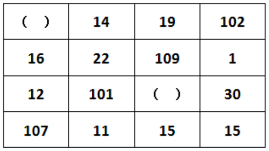

题图数字表格（按原图行列）

| 第1列 | 第2列 | 第3列 | 第4列 |
| --- | --- | --- | --- |
| （ ） | 14 | 19 | 102 |
| 16 | 22 | 109 | 1 |
| 12 | 101 | （ ） | 30 |
| 107 | 11 | 15 | 15 |

**A.** 117

**B.** 135

**C.** 179

**D.** 213

**答案：B**

> 答案说明：答案解析按“每行、每列之和都为148”算出左上角括号为13，结论为“故正确答案为B”（135）；同一规律下第3行第3列括号为5，B项“135”即13与5连写（2015年乡镇卷同题B项作“13 5”）。答案按解析记B。

> 转写说明：原卷第25题没有题干文字，只有一个4行4列的数字表格，表中有两处括号（左上角、第3行第3列）；表格按原图行列转写在题图 transcription 中。选项原卷印作117、135、179、213，对照2015年乡镇卷同一题（选项作“11 7”“13 5”“17 9”“21 3”），应是两处括号中的数连写、漏了分隔，照录。

### 第 26 题

`GD2015-XJ-Q026` · 单选 · 原卷第 3 页

阅览室有100本杂志，小赵借阅过其中75本，小王借阅过70本，小刘借阅过60本，则三人共同借阅过的杂志最少有（）本。

**A.** 5

**B.** 10

**C.** 15

**D.** 30

**答案：A**

### 第 27 题

`GD2015-XJ-Q027` · 单选 · 原卷第 3 页

在一次抽奖活动中，要把18个奖品分成数量不等的4份各自放进不同的抽奖箱。则一个抽奖箱最多可以放（）个奖品。

**A.** 6

**B.** 8

**C.** 12

**D.** 15

**答案：C**

### 第 28 题

`GD2015-XJ-Q028` · 单选 · 原卷第 3 页

水果店一天卖出每千克为10元，12元，16元的3种水果共100千克，共收入1316元。已知售出的每千克12元和每千克16元的水果共收入1016元，那么每千克10元的水果售出了（）千克。

**A.** 26

**B.** 30

**C.** 34

**D.** 38

**答案：B**

### 第 29 题

`GD2015-XJ-Q029` · 单选 · 原卷第 3 页

一个人骑车去工厂上班。他从家出发，用30分钟骑行一半的路程后，他加快了速度，以每分钟比原来快50米的速度，又骑行了10分钟。这时发现距离工厂还有2千米。那么他从家到工厂之间的距离为多少千米：

**A.** 6

**B.** 7.5

**C.** 8

**D.** 8.5

**答案：B**

### 第 30 题

`GD2015-XJ-Q030` · 单选 · 原卷第 3 页

小吴到商店买布。有两种同样长的布料，小吴买了第一种布料25米，买了第二种布料12米。小吴买完后，第一种布料剩下的长度是第二种布料剩下的长度的一半。那么这两种布料原来共有多少米：

**A.** 26

**B.** 38

**C.** 72

**D.** 76

**答案：D**

### 第 31 题

`GD2015-XJ-Q031` · 单选 · 原卷第 3 页

某乡镇举行运动会，共有长跑、跳远和短跑三个项目。参加长跑的有49人，参加跳远的有36人，参加短跑的有28人，其中只参加两个项目的有13人，参加全部项目的有9人。那么参加该次运动会的总人数为多少：

**A.** 75

**B.** 82

**C.** 88

**D.** 95

**答案：B**

### 第 32 题

`GD2015-XJ-Q032` · 单选 · 原卷第 3 页

在400米的环形跑道上每隔16米插一面彩旗。现在要增加一些彩旗，并且保持每两面相邻彩旗的距离相等，起点的一面彩旗不动，重新插完后发现共有5面彩旗没有移动，则现在彩旗间的间隔最大可达到（）米。

**A.** 15

**B.** 12

**C.** 10

**D.** 5

**答案：C**

### 第 33 题

`GD2015-XJ-Q033` · 单选 · 原卷第 3、4 页

小李有一部手机，手机充满电后，可供通话6小时或者供待机210小时。某天，小李乘坐火车，上车时手机处于满电状态，而当他下车时手机电量刚好耗尽。如果小李在火车上的通话时长相当于他乘坐火车时长的一半，其余时间手机均为待机状态，那么他乘坐火车的时长是：

**A.** 9小时10分

**B.** 9小时30分

**C.** 10小时20分

**D.** 11小时40分

**答案：D**

### 第 34 题

`GD2015-XJ-Q034` · 单选 · 原卷第 4 页

某次考试中，成绩不超过30分的有153名考生，平均分为24分；成绩不低于80分的有59名考生，平均分为92分；成绩超过30分的平均分为62分；成绩低于80分的平均分为54分。那么参加这次考试的考生共有多少人：

**A.** 795

**B.** 875

**C.** 1007

**D.** 1264

**答案：C**

### 第 35 题

`GD2015-XJ-Q035` · 单选 · 原卷第 4 页

有两箱数量相同的文件需要整理。小张单独整理好一箱文件要用4.5小时，小钱要用9小时，小周要用3小时。小周和小张一起整理第一箱文件，小钱同时开始整理第二箱文件。一段时间后，小周又转去和小钱一起整理第二箱文件，最后两箱文件同时整理完毕。则小周和小张、小钱一起整理文件的时间分别是：

**A.** 1小时，2小时

**B.** 1.5小时，1.5小时

**C.** 2小时，1小时

**D.** 1.2小时，1.8小时

**答案：A**

## 判断推理

### 第 36 题

`GD2015-XJ-Q036` · 单选 · 图形推理 · 原卷第 4 页

从所给的四个选项中，选择最合适的一个填入问号处，使之呈现一定的规律性：

**A.** 见上方题图中 A 项。

**B.** 见上方题图中 B 项。

**C.** 见上方题图中 C 项。

**D.** 见上方题图中 D 项。

**答案：C**

### 第 37 题

`GD2015-XJ-Q037` · 单选 · 图形推理 · 原卷第 4 页

从所给的四个选项中，选择最合适的一个填入问号处，使之呈现一定的规律性：

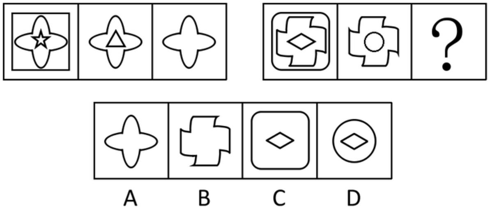

**A.** 见上方题图中 A 项。

**B.** 见上方题图中 B 项。

**C.** 见上方题图中 C 项。

**D.** 见上方题图中 D 项。

**答案：B**

### 第 38 题

`GD2015-XJ-Q038` · 单选 · 图形推理 · 原卷第 4 页

从所给的四个选项中，选择最合适的一个填入问号处，使之呈现一定的规律性：

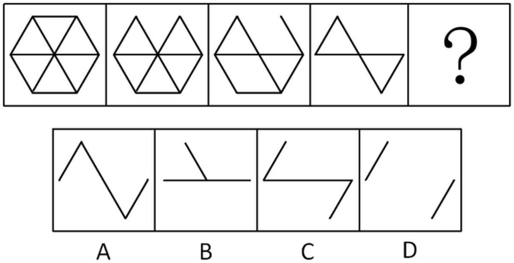

**A.** 见上方题图中 A 项。

**B.** 见上方题图中 B 项。

**C.** 见上方题图中 C 项。

**D.** 见上方题图中 D 项。

**答案：D**

### 第 39 题

`GD2015-XJ-Q039` · 单选 · 图形推理 · 原卷第 4、5 页

请从所给的四个选项中，选择最合适的一项填在问号处，使之呈现一定的规律性：

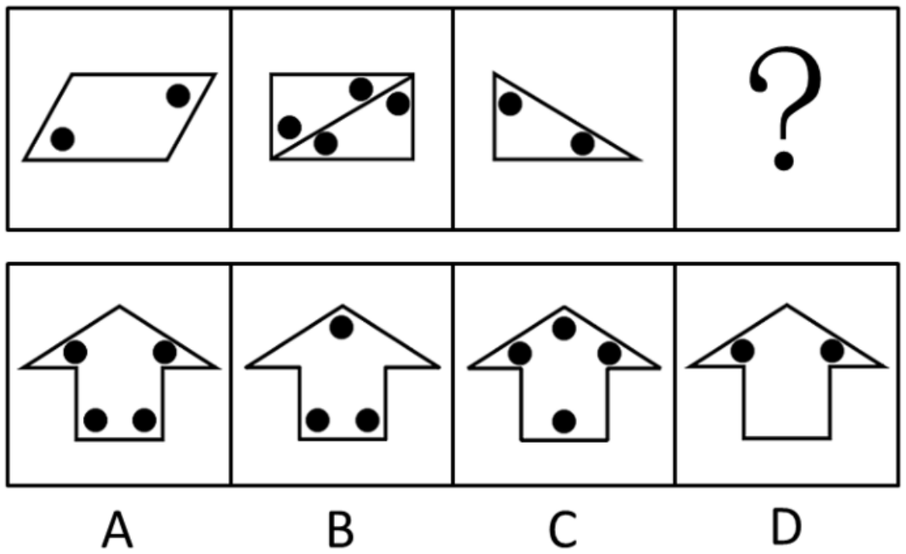

**A.** 见上方题图中 A 项。

**B.** 见上方题图中 B 项。

**C.** 见上方题图中 C 项。

**D.** 见上方题图中 D 项。

**答案：D**

### 第 40 题

`GD2015-XJ-Q040` · 单选 · 图形推理 · 原卷第 5 页

从所给的四个选项中，选择最合适的一个填入问号处，使之呈现一定的规律性：

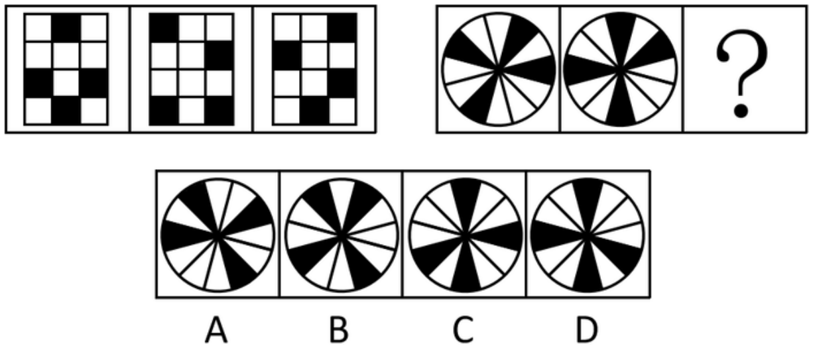

**A.** 见上方题图中 A 项。

**B.** 见上方题图中 B 项。

**C.** 见上方题图中 C 项。

**D.** 见上方题图中 D 项。

**答案：B**

### 第 41 题

`GD2015-XJ-Q041` · 单选 · 图形推理 · 原卷第 5 页

从所给的四个选项中，选择最合适的一个填入问号处，使之呈现一定的规律性：

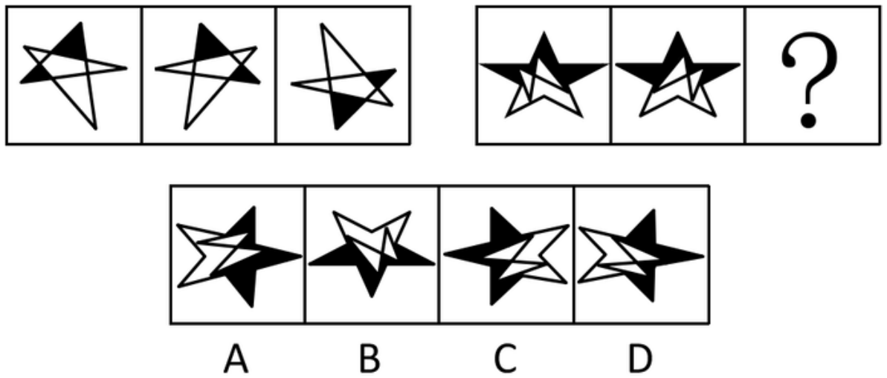

**A.** 见上方题图中 A 项。

**B.** 见上方题图中 B 项。

**C.** 见上方题图中 C 项。

**D.** 见上方题图中 D 项。

**答案：B**

### 第 42 题

`GD2015-XJ-Q042` · 单选 · 图形推理 · 原卷第 5 页

从所给的四个选项中，选择最合适的一个填入问号处，使之呈现一定的规律性：

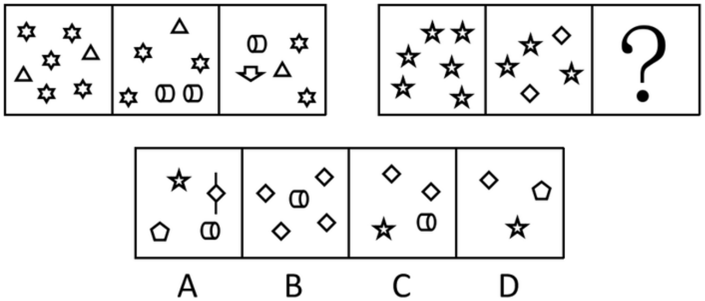

**A.** 见上方题图中 A 项。

**B.** 见上方题图中 B 项。

**C.** 见上方题图中 C 项。

**D.** 见上方题图中 D 项。

**答案：C**

### 第 43 题

`GD2015-XJ-Q043` · 单选 · 图形推理 · 原卷第 5、6 页

从所给的四个选项中，选择最合适的一个填入问号处，使之呈现一定的规律性：

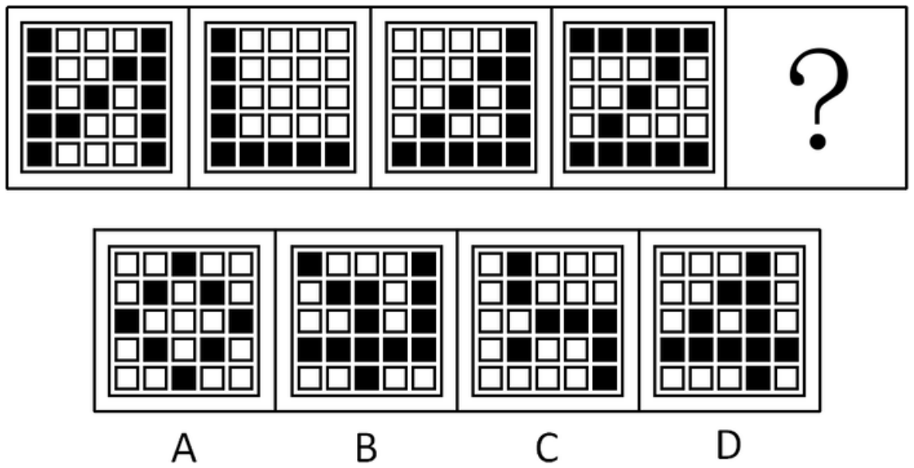

**A.** 见上方题图中 A 项。

**B.** 见上方题图中 B 项。

**C.** 见上方题图中 C 项。

**D.** 见上方题图中 D 项。

**答案：A**

### 第 44 题

`GD2015-XJ-Q044` · 单选 · 图形推理 · 原卷第 6 页

从所给的四个选项中，选择最合适的一个填入问号处，使之呈现一定的规律性：

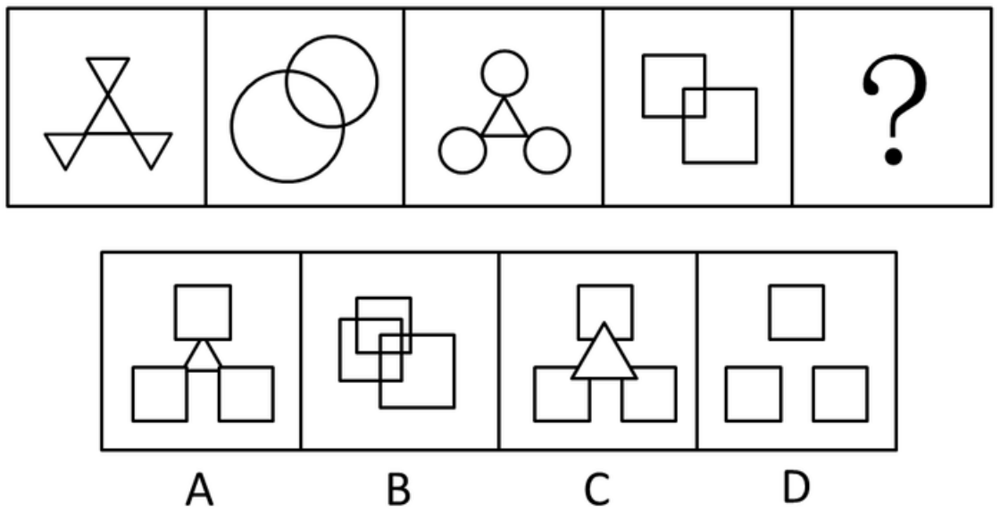

**A.** 见上方题图中 A 项。

**B.** 见上方题图中 B 项。

**C.** 见上方题图中 C 项。

**D.** 见上方题图中 D 项。

**答案：B**

### 第 45 题

`GD2015-XJ-Q045` · 单选 · 图形推理 · 原卷第 6 页

从所给的四个选项中选，择最合适的一个填入问号处，使之呈现一定的规律性：

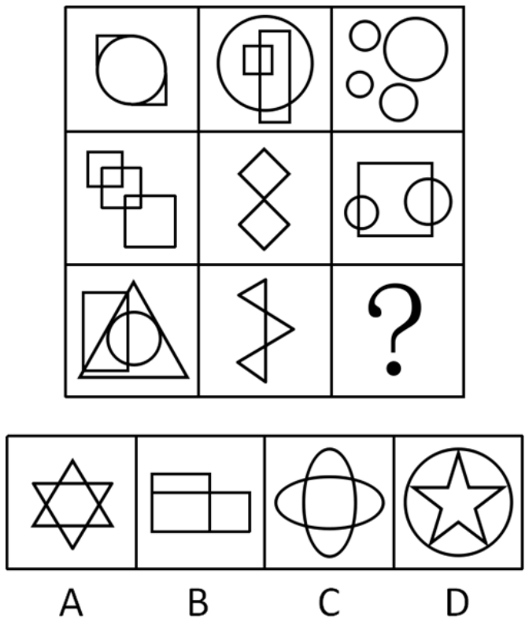

**A.** 见上方题图中 A 项。

**B.** 见上方题图中 B 项。

**C.** 见上方题图中 C 项。

**D.** 见上方题图中 D 项。

**答案：A**

> 转写说明：原卷题干作“从所给的四个选项中选，择最合适的一个……”（逗号位置错），照录。

### 第 46 题

`GD2015-XJ-Q046` · 单选 · 类比推理 · 原卷第 6 页

商场：小卖部

**A.** 县城：农村

**B.** 拖拉机：农用车

**C.** 水稻：莲藕

**D.** 工厂：作坊

**答案：D**

### 第 47 题

`GD2015-XJ-Q047` · 单选 · 类比推理 · 原卷第 6 页

天真：幼稚

**A.** 小偷：强盗

**B.** 懵懂：糊涂

**C.** 公正：公平

**D.** 懦弱：忍让

**答案：B**

### 第 48 题

`GD2015-XJ-Q048` · 单选 · 类比推理 · 原卷第 6 页

高大：渺小

**A.** 无穷：无尽

**B.** 春种：秋收

**C.** 赞誉：诋毁

**D.** 牛奶：面包

**答案：C**

### 第 49 题

`GD2015-XJ-Q049` · 单选 · 类比推理 · 原卷第 6 页

计算：电脑

**A.** 可乐：饮料

**B.** 热水：茶壶

**C.** 载货：货车

**D.** 火焰：灶台

**答案：C**

### 第 50 题

`GD2015-XJ-Q050` · 单选 · 类比推理 · 原卷第 6 页

和平：战争

**A.** 小生：老生

**B.** 油画：素描

**C.** 遗传：变异

**D.** 整齐：凌乱

**答案：D**

### 第 51 题

`GD2015-XJ-Q051` · 单选 · 类比推理 · 原卷第 6 页

艳羡：嫉妒

**A.** 崇拜：迷信

**B.** 增长：衰退

**C.** 淡漠：热心

**D.** 排放：污染

**答案：A**

### 第 52 题

`GD2015-XJ-Q052` · 单选 · 类比推理 · 原卷第 6 页

花木：盆景

**A.** 布料：窗帘

**B.** 轮胎：汽车

**C.** 墨水：书画

**D.** 石头：假山

**答案：D**

### 第 53 题

`GD2015-XJ-Q053` · 单选 · 类比推理 · 原卷第 6 页

近视：远视

**A.** 雨水：冰雹

**B.** 瘦弱：肥胖

**C.** 前进：后退

**D.** 收缩：松弛

**答案：B**

### 第 54 题

`GD2015-XJ-Q054` · 单选 · 类比推理 · 原卷第 7 页

散步：走路：赶路

**A.** 战斗：战役：战争

**B.** 想象：理想：幻想

**C.** 休闲：无聊：空虚

**D.** 好感：喜欢：热爱

**答案：D**

### 第 55 题

`GD2015-XJ-Q055` · 单选 · 类比推理 · 原卷第 7 页

空气：空调：冷气

**A.** 信号：电视：图像

**B.** 食材：烹饪：美食

**C.** 面粉：烤箱：面包

**D.** 石油：提炼：汽油

**答案：A**

### 第 56 题

`GD2015-XJ-Q056` · 单选 · 逻辑判断 · 原卷第 7 页

只有遇到下雨天，客车才不会准时到达。现在，客车没有准时到达，所以（）遇到下雨天。
填入划横线部分最恰当的一项是：

**A.** 没有

**B.** 可能

**C.** 一定

**D.** 不可能

**答案：C**

> 转写说明：原卷题干的空格处是括号“（ ）”，但设问作“填入划横线部分最恰当的一项是”，照录。

### 第 57 题

`GD2015-XJ-Q057` · 单选 · 逻辑判断 · 原卷第 7 页

已知甲、乙、丙、丁四人具有以下直系、旁系血亲关系：甲是乙的父亲，丙是甲的弟弟，丁是丙的母亲。则甲、乙、丙、丁四人中年龄最大的是：

**A.** 甲

**B.** 乙

**C.** 丙

**D.** 丁

**答案：D**

### 第 58 题

`GD2015-XJ-Q058` · 单选 · 逻辑判断 · 原卷第 7 页

海水经过海水淡化技术的处理可变成淡水，而海水的量是极其巨大的。因此，无须节约使用淡水资源。
最能质疑上述结论的是：

**A.** 近海海水的污染比较严重

**B.** 海水淡化成本高昂

**C.** 冰川水储量巨大，可替代海水淡化

**D.** 地球上的水资源总量是恒定的

**答案：B**

### 第 59 题

`GD2015-XJ-Q059` · 单选 · 逻辑判断 · 原卷第 7 页

有甲、乙两家公司，甲公司售后服务部门接到的产品投诉电话是乙公司的3倍。因此，甲公司产品的质量没有乙公司的好。以下最能反驳上述结论的是：

**A.** 乙公司的产品操作相对来说更为简单

**B.** 甲公司接到电话大多数是咨询电话

**C.** 甲公司的咨询电话机数量比乙公司多

**D.** 甲公司产品的市场占有率达到76%

**答案：D**

### 第 60 题

`GD2015-XJ-Q060` · 单选 · 逻辑判断 · 原卷第 7 页

某高中只有文科班和理科班，男生人数比女生多，理科班人数比文科班多。根据以上条件，可以判断下列说法必定为真的是：

**A.** 文科班的男生总人数多于文科班的女生总人数

**B.** 理科班的男生总人数多于理科班的女生总人数

**C.** 文科班的男生总人数多于理科班的女生总人数

**D.** 理科班的男生总人数多于文科班的女生总人数

**答案：D**

### 第 61 题

`GD2015-XJ-Q061` · 单选 · 逻辑判断 · 原卷第 7 页

据统计，和去年相比，今年1月以来流感患者的数量有明显的下降。这得益于新型特效药的发明和投入使用。以下最能反驳上述结论的是：

**A.** 2月份为流感的高发期

**B.** 流感患者很少到医院去治疗

**C.** 流感病毒具有抗药性

**D.** 新型特效药定价高，患者使用少

**答案：D**

### 第 62 题

`GD2015-XJ-Q062` · 单选 · 逻辑判断 · 原卷第 7 页

某项科学研究发现：经常使用左手能更好地锻炼右脑，使得人的形象思维能力增强，更利于促进创造性思维的发展。但事实证明：发明家中左撇子的比例并不高。因此，这个科学研究的结论不可信。以下最能削弱上述结论的是：

**A.** 用右手也可以达到锻炼右脑的效果

**B.** 用右手的人数大大超过用左手的人数

**C.** 发明创造主要依靠天赋，而非后天锻炼

**D.** 发明创造不依靠形象思维能力

**答案：B**

### 第 63 题

`GD2015-XJ-Q063` · 单选 · 逻辑判断 · 原卷第 7 页

有调查显示，那些作息时间不同的夫妻，虽然每天相处的时间较少，但他们发生争吵的次数比作息时间基本相同的夫妻更多。因此，为了建立良好的夫妻关系，夫妻之间应当尽量有相同的作息时间。最能削弱上述论点的一项是：

**A.** 夫妻产生矛盾后，往往以作息时间不同来表现不满

**B.** 具有同事关系的夫妻更容易在工作上产生矛盾

**C.** 作息时间不同的夫妻更容易产生矛盾

**D.** 生活习惯不同是夫妻产生矛盾的主要原因

**答案：A**

### 第 64 题

`GD2015-XJ-Q064` · 单选 · 逻辑判断 · 原卷第 7 页

小张准备在下周去观看一场比赛，但他忘了具体是哪一天，便分别询问了甲、乙、丙、丁和戊，他们五人的回答如下：
甲：肯定是在双休日。
乙：是周二、周四、周六的其中的一天。
丙：就是周一。
丁：绝对是周一、周三、周五、周日的其中一天。
戊：肯定是周五。
甲、乙、丙、丁和戊只有一个人说对了。那么比赛时间是：

**A.** 周一

**B.** 周三

**C.** 周五

**D.** 周六

**答案：B**

### 第 65 题

`GD2015-XJ-Q065` · 单选 · 逻辑判断 · 原卷第 7、8 页

某市举办了一场职业技能竞赛，有甲、乙、丙、丁四支代表队进入决赛，每支队伍有两名参赛选手，获得第一名的选手将得10分，第二名得8分，第三名到第八名分别是6、5、4、3、2、1分，最后总分最高的队伍将获得冠军。比赛的排名情况如下：
甲队选手的排名都是偶数，乙队两名选手的排名相连，丙队选手的排名一个是奇数一个是偶数，丁队选手的排名都是奇数；第一名是丁队选手，第八名是丙队选手；乙队两名选手的排名在甲队两名选手之间，同时也在丙队两名选手之间。
根据以上条件，可以判断各队总分由高到低的排列顺序为：

**A.** 丁＞甲＞丙＞乙

**B.** 甲＞丁＞乙＞丙

**C.** 甲＞丁＞丙＞乙

**D.** 丁＞甲＞乙＞丙

**答案：D**

## 科学推理

> 说明：原卷第66—70题（物理、化学题）排在第三部分“判断推理”下，未单列部分；按题型并与2022—2026题库一致，记为科学推理。

### 第 66 题

`GD2015-XJ-Q066` · 单选 · 原卷第 8 页

如下图所示，木框里面有两个平面镜相互垂直。一束入射光射入木框内，经两个平面镜反射出去。则入射光与出射光的位置关系是：

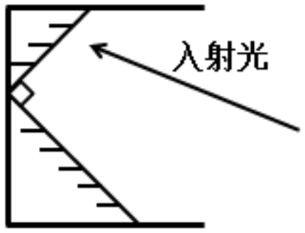

**A.** 平行关系

**B.** 垂直关系

**C.** 相交关系，交角为锐角

**D.** 相交关系，交角为钝角

**答案：A**

### 第 67 题

`GD2015-XJ-Q067` · 单选 · 原卷第 8 页

如下图所示，一支试管口朝下插入水中，管内封闭有一定的量的空气，恰好悬浮在水中。当水的温度升高时，下列说法正确的是：

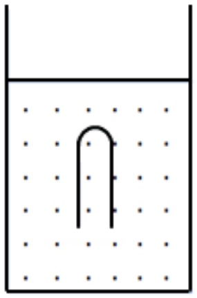

**A.** 试管下沉

**B.** 试管上浮

**C.** 试管先下沉后上浮

**D.** 试管静止不动

**答案：B**

### 第 68 题

`GD2015-XJ-Q068` · 单选 · 原卷第 8 页

如下图所示，小球A从斜面上由静止状态开始向下滑，撞击静止于水平木板上的木块B，下列说法正确的是：

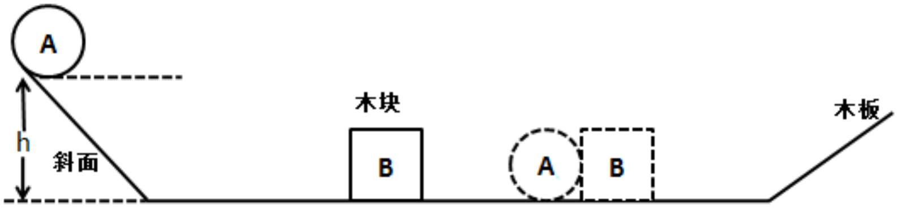

**A.** 小球A对木块B的作用力等于木板对木块B的摩擦力与木块B的重力相加

**B.** 若木板的表面光滑且足够长，小球A和木块B将一直保持匀速运动

**C.** 小球A在斜面上向下滑的过程中，以木板为参照物，小球是静止的

**D.** 小球A对木块B的作用力等于小球A的重力

**答案：B**

### 第 69 题

`GD2015-XJ-Q069` · 单选 · 原卷第 8 页

在下图所示的电路中，电源电压保持不变，闭合开关S₁、S₂后，电路正常工作。开关S₁闭合，开关S₂由闭合到断开时，下列说法正确的是：

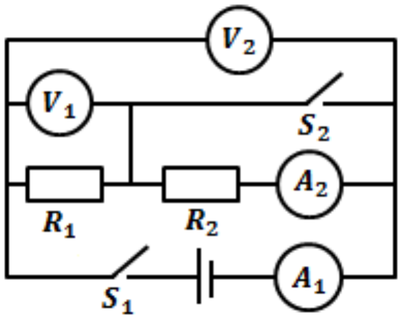

**A.** 电流表A₁的示数不变

**B.** 电流表A₂的示数不变

**C.** 电压表V₁的示数不变

**D.** 电压表V₂的示数不变

**答案：D**

> 转写说明：题干与选项中的S₁、S₂、A₁、A₂、V₁、V₂在原卷中为小图片，已转写为文字。原卷第二行选项印作“B、C、电压表V₁的示数不变”（C项前多印一个“B、”），多印的“B、”不收录。

### 第 70 题

`GD2015-XJ-Q070` · 单选 · 原卷第 8、9 页

下图是A B两种物质的溶解度曲线，下列说法正确的是：

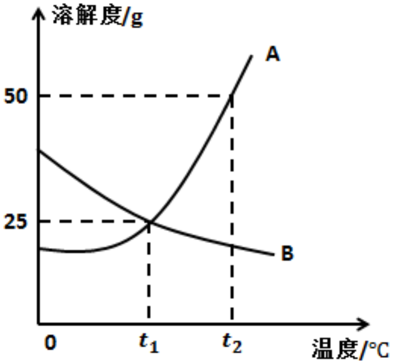

**A.** A物质的溶解度大于B物质的溶解度

**B.** 温度越高，则A B两种物质的溶解度越大

**C.** 将t₁℃时A物质的饱和溶液降温，A物质变为不饱和溶

**D.** 将t₂℃时B物质的饱和溶液降温至t₁℃时，没有B物质析出

**答案：D**

> 转写说明：题干和B项中“A B两种物质”的A、B之间原卷是空白（疑漏“、”），转写保留一个空格；C项原卷作“A物质变为不饱和溶”（漏“液”字），照录；t₁、t₂在原卷中为小图片，已转写为文字。

## 常识判断

### 第 71 题

`GD2015-XJ-Q071` · 单选 · 原卷第 9 页

京剧脸谱采用不同色彩来表现人物的不同性格特点，其中白色用来表现：

**A.** 忠勇侠义

**B.** 刚烈正直

**C.** 粗豪暴躁

**D.** 阴险奸诈

**答案：D**

### 第 72 题

`GD2015-XJ-Q072` · 单选 · 原卷第 9 页

蜻蜓点水是指蜻蜓在水面飞行时轻触水面的动作，其主要是为了：

**A.** 求偶

**B.** 饮水

**C.** 产卵

**D.** 呼吸

**答案：C**

### 第 73 题

`GD2015-XJ-Q073` · 单选 · 原卷第 9 页

下列现象属于化学反应的是：

**A.** 春江水暖鸭先知

**B.** 蜡炬成灰泪始干

**C.** 玉不琢不成器

**D.** 绳锯木断、水滴石穿

**答案：B**

### 第 74 题

`GD2015-XJ-Q074` · 单选 · 原卷第 9 页

某商店贴出下列四个标语，不合法的是：
①特价商品，概不退还
②商品打折，不开发票
③小本买卖，概不赊欠
④损一赔十，偷一罚十

**A.** ①②③

**B.** ①②④

**C.** ①③④

**D.** ②③④

**答案：B**

### 第 75 题

`GD2015-XJ-Q075` · 单选 · 原卷第 9 页

2014年，《注册资本登记制度改革方案》获得国务院批准通过。该方案大幅度降低了公司的设立门槛，取消了公司最低注册资本限制。这项改革最有可能产生的传导效应是：
①创业成本下降
②创业积极性提高
③注册资本降低
④带动就业

**A.** ①—②—③—④

**B.** ②—③—④—①

**C.** ③—①—②—④

**D.** ①—③—④—②

**答案：C**

### 第 76 题

`GD2015-XJ-Q076` · 单选 · 原卷第 9 页

随着社会的发展，一些新的职业会不断出现。下列选项中，按照职业出现时间先后顺序排列正确的是：

**A.** 大学教师，火车司机，汽车修理工，软件工程师

**B.** 大学教师，汽车修理工，火车司机，软件工程师

**C.** 汽车修理工，火车司机，软件工程师，大学教师

**D.** 汽车修理工，软件工程师，大学教师，火车司机

**答案：A**

### 第 77 题

`GD2015-XJ-Q077` · 单选 · 原卷第 9 页

举重运动员、体操运动员比赛前，会抓一些白色粉末（主要成分是碳酸镁）涂抹在手掌上，来增加手掌与器械之间的摩擦力。这主要是利用碳酸镁的：

**A.** 润滑作用

**B.** 吸湿作用

**C.** 中和作用

**D.** 保温作用

**答案：B**

### 第 78 题

`GD2015-XJ-Q078` · 单选 · 原卷第 9、10 页

存款准备金是指金融机构为保证客户提取存款和资金清算需求而准备的在中央银行的存款。存款准备金率是存款准备金占存款总额的比例。中央银行降低存款准备金率后，在市场上引起的可能反应是：

**A.** 商业银行可用资金增多，贷款上升，货币供应量增多，通货膨胀

**B.** 商业银行可用资金增多，贷款下降，货币供应量减少，通货紧缩

**C.** 商业银行可用资金减少，贷款上升，货币供应量增多，通货膨胀

**D.** 商业银行可用资金减少，贷款下降，货币供应量减少，通货紧缩

**答案：A**

### 第 79 题

`GD2015-XJ-Q079` · 单选 · 原卷第 10 页

冰冻的肉类在水中比在同温度的空气中解冻得快，这是因为：

**A.** 水的热容量比空气大

**B.** 水的密度比空气大

**C.** 水的热传递性比空气好

**D.** 水和冰的化学成分完全相同

**答案：C**

### 第 80 题

`GD2015-XJ-Q080` · 单选 · 原卷第 10 页

下列选项中，按照诗句所代表的时间先后顺序排列正确的是：
①问东城春色，正谷雨，牡丹期
②露从今夜白，月是故乡明
③微雨众卉新，一雷惊蛰始
④麦穗初齐稚子娇，桑叶正肥蚕食饱

**A.** ③①④②

**B.** ①④③②

**C.** ②③①④

**D.** ①②③④

**答案：A**

### 第 81 题

`GD2015-XJ-Q081` · 单选 · 原卷第 10 页

全国两会开幕前，人大代表、政协委员们为了提交议案、提案，会对经济社会发展问题进行深入的调查研究。这体现的哲理是：

**A.** 主观与客观具体的历史的统一

**B.** 具体问题具体分析

**C.** 科学理论对实践具有指导作用

**D.** 意识是人脑对客观事物的正确反映

**答案：A**

### 第 82 题

`GD2015-XJ-Q082` · 单选 · 原卷第 10 页

在我国，野外迷路时，下列辨别方向的方法不正确的是：

**A.** 树木年轮较密的一侧是南方

**B.** 树木枝叶茂盛的一侧是南方

**C.** 岩石上布满青苔的一侧是北方

**D.** 蚂蚁的洞口朝向的一侧是南方

**答案：A**

### 第 83 题

`GD2015-XJ-Q083` · 单选 · 原卷第 10 页

下列选项中，用热水比用冷水洗涤效果更好的是：

**A.** 有油渍的碗筷

**B.** 有汗渍的衣服

**C.** 有血渍的衣服

**D.** 有农药残留的蔬菜

**答案：A**

### 第 84 题

`GD2015-XJ-Q084` · 单选 · 原卷第 10 页

我国古代有重阳节插茱萸的习俗，这种做法意在表达：

**A.** 敬老爱老之情

**B.** 对父母的感恩之情

**C.** 对亲朋好友的思念之情

**D.** 对美好生活的向往

**答案：C**

### 第 85 题

`GD2015-XJ-Q085` · 单选 · 原卷第 10 页

根据干支纪年法，2015年是乙未羊年，那么2020年是：

**A.** 癸丑牛年

**B.** 庚丑牛年

**C.** 庚子鼠年

**D.** 壬子鼠年

**答案：C**

## 资料分析

### 共用材料：第 86—90 题

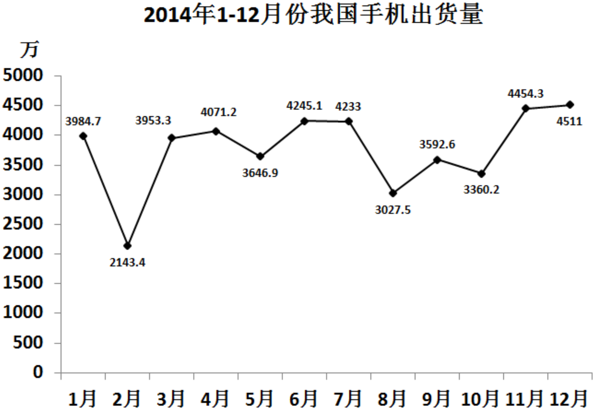

2014年1-12月份我国手机出货量（单位：万）

| 月份 | 出货量（万） |
| --- | --- |
| 1月 | 3984.7 |
| 2月 | 2143.4 |
| 3月 | 3953.3 |
| 4月 | 4071.2 |
| 5月 | 3646.9 |
| 6月 | 4245.1 |
| 7月 | 4233 |
| 8月 | 3027.5 |
| 9月 | 3592.6 |
| 10月 | 3360.2 |
| 11月 | 4454.3 |
| 12月 | 4511 |

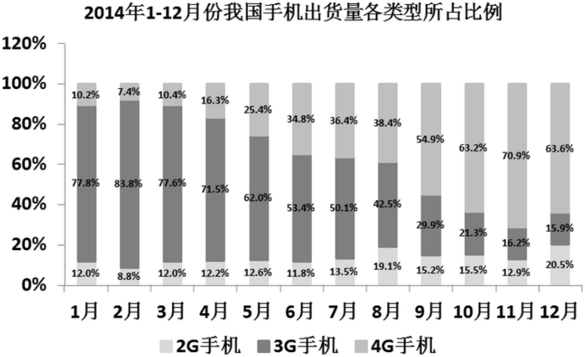

2014年1-12月份我国手机出货量各类型所占比例

| 月份 | 2G手机 | 3G手机 | 4G手机 |
| --- | --- | --- | --- |
| 1月 | 12.0% | 77.8% | 10.2% |
| 2月 | 8.8% | 83.8% | 7.4% |
| 3月 | 12.0% | 77.6% | 10.4% |
| 4月 | 12.2% | 71.5% | 16.3% |
| 5月 | 12.6% | 62.0% | 25.4% |
| 6月 | 11.8% | 53.4% | 34.8% |
| 7月 | 13.5% | 50.1% | 36.4% |
| 8月 | 19.1% | 42.5% | 38.4% |
| 9月 | 15.2% | 29.9% | 54.9% |
| 10月 | 15.5% | 21.3% | 63.2% |
| 11月 | 12.9% | 16.2% | 70.9% |
| 12月 | 20.5% | 15.9% | 63.6% |

按图例读取：柱子底段为2G手机，中段为3G手机，顶段为4G手机；每月三项合计均为100.0%。

> 材料说明：材料1没有文字，只有两张图（手机出货量折线图、各类型所占比例堆积柱状图），已逐项转写。

### 第 86 题

`GD2015-XJ-Q086` · 单选 · 原卷第 11 页

[共用材料](#GD2015-XJ-M1)

2014年2~12月，我国手机出货量与上月相比增长率最高的月份是：

**A.** 2月

**B.** 3月

**C.** 6月

**D.** 11月

**答案：B**

> 转写说明：“2~12”在原卷中为小图片，已转写为文字。

### 第 87 题

`GD2015-XJ-Q087` · 单选 · 原卷第 11 页

[共用材料](#GD2015-XJ-M1)

2014年1~12月，我国3G手机和4G手机出货量相差最大，最小在月份分别是：

**A.** 1月、8月

**B.** 2月、8月

**C.** 1月、7月

**D.** 2月、7月

**答案：A**

> 转写说明：“1~12”在原卷中为小图片，已转写为文字；原卷作“相差最大，最小在月份分别是”（“在”疑为“的”），照录。

### 第 88 题

`GD2015-XJ-Q088` · 单选 · 原卷第 11 页

[共用材料](#GD2015-XJ-M1)

2014年2~12月，我国2G手机出货量所占比例与上月相比有所上升的月份共有多少个：

**A.** 2

**B.** 4

**C.** 7

**D.** 8

**答案：C**

> 转写说明：“2~12”在原卷中为小图片，已转写为文字。

### 第 89 题

`GD2015-XJ-Q089` · 单选 · 原卷第 11 页

[共用材料](#GD2015-XJ-M1)

2014年1~12月，最接近我国手机出货量全年平均数的月份是：

**A.** 5月

**B.** 8月

**C.** 9月

**D.** 10月

**答案：A**

> 转写说明：“1~12”在原卷中为小图片，已转写为文字。

### 第 90 题

`GD2015-XJ-Q090` · 单选 · 原卷第 11、12 页

[共用材料](#GD2015-XJ-M1)

下列说法错误的是：

**A.** 2014年2-12月，我国手机出货量与上月相比有所下降的月份有5个

**B.** 2014年2月，我国2G手机和4G手机的出货量均为全年最低

**C.** 2014年7月，我国4G手机出货量首次超过了1500万

**D.** 2014年1-12月，我国3G手机出货量所占比例逐月下降

**答案：D**

### 共用材料：第 91—95 题

2014年，全国汽车产销分别是2372万辆和2349万辆，同比增长7.3%和6.9%。汽车销售排名前十位的企业集团销售合计为2107.7万辆，比上年同期增长8.9%，高于全行业增速2个百分点。
2014年乘用车销售1970万辆，比上年同期增长9.89%。其中轿车增速放缓，SUV、MPV依旧保持高速增长，交叉型乘用车则继续下降。乘用车分车型看：轿车销售1238万辆，同比增长3.1%；SUV销售为408万辆，同比增长36.4%；MPV销量为191万辆，同比增长46.8%；交叉型乘用车销量为133万辆，同比下降18.1%。市场结构上，轿车占乘用车比重62.8%，比去年下降4.2个百分点；SUV占比20.7%，比去年提高4个百分点，MPV占比9.7%，比去年提高3个百分点；交叉型乘用车占比为6.8%，比去年下降2.4个百分点。
受宏观经济和相关政策法规影响，今年的商用车市场销量降幅较大。全年商用车销售完成379万辆，同比下降6.5%，分车型看，其中货车销售318万辆，同比下降8.9%，客车销售61万辆，同比增长8.4%。货车车型中，受国四排放标准执行后带来成本上升和厂家生产准备不足等原因影响，使轻型货车出现了大幅下降，全年降幅达到了12.9%。由于轻型货车占到货车的比重较高，导致货车整体出现了较高降幅。客车方面受到城市公交（含新能源车）、校车增长及轻型客车带动，使客车市场继续保持平稳增长。
随着政府全面出台支持发展新能源汽车的政策，企业对产品的升级改造和社会对新能源汽车认可度的提升，2014年新能源汽车有了较快的发展，全年新能源汽车销量为7.5万辆，同比增长324%，其中纯电动汽车销售4.5万辆，同比增长208%，插电式电动车销售3万辆，同比增长878%。
中国品牌乘用车销售757万辆，同比增长4.1%，占有率为38.4%，比去年下降2.1个百分点。其中，中国品牌轿车销售277万辆，同比下降17.4%，占有率为22.4%，比去年下降5.6个百分点。中国品牌SUV销售55万辆，同比增长50.36%，占SUV市场份额为44.76%，比去年增长4.14个百分点。德、日、美、韩、法各系乘用车分别占到今年乘用车销售的20%、16%、13%、9%、4%，其中日系车占有率下降了0.34%，其余系别都有不同程度上升。

### 第 91 题

`GD2015-XJ-Q091` · 单选 · 原卷第 12 页

[共用材料](#GD2015-XJ-M2)

2014年汽车销量排名前十位的企业集团销量占汽车销售总量的：

**A.** 89.7%

**B.** 88.9%

**C.** 73.4%

**D.** 67.5%

**答案：A**

### 第 92 题

`GD2015-XJ-Q092` · 单选 · 原卷第 12 页

[共用材料](#GD2015-XJ-M2)

2013年乘用车销量约是商用车销量的多少倍？

**A.** 4.0

**B.** 4.4

**C.** 5.0

**D.** 5.2

**答案：B**

### 第 93 题

`GD2015-XJ-Q093` · 单选 · 原卷第 12 页

[共用材料](#GD2015-XJ-M2)

下列关于2014年乘用车各车型销量同比变化幅度的大小关系，正确的是：

**A.** MPV>SUV>交叉型>轿车

**B.** SUV>轿车>MPV>交叉型

**C.** SUV>交叉型>轿车>MPV

**D.** MPV>SUV>轿车>交叉型

**答案：A**

### 第 94 题

`GD2015-XJ-Q094` · 单选 · 原卷第 12 页

[共用材料](#GD2015-XJ-M2)

2014年商用车市场销量降幅较大，原因在于：

**A.** 受政府全面出台支持发展新能源汽车政策影响

**B.** 受宏观经济和相关政策法规影响

**C.** 受外国品牌汽车价格下降影响

**D.** 受中国品牌乘用车销售占有率下降影响

**答案：B**

### 第 95 题

`GD2015-XJ-Q095` · 单选 · 原卷第 12 页

[共用材料](#GD2015-XJ-M2)

下列说法正确的是：

**A.** 2013年，全国汽车产量低于销量

**B.** 2014年，商用车各车型销量均有所下降

**C.** 2013年，新能源汽车销量不足2万辆

**D.** 2013年，中国品牌乘用车销售量低于德系与日系乘用车销售量之和

**答案：C**

### 共用材料：第 96—100 题

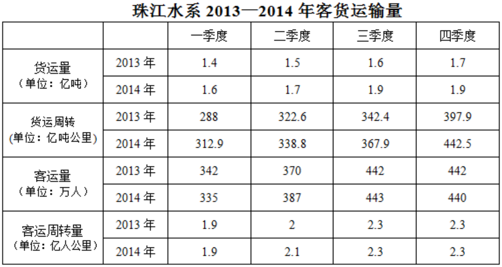

珠江水系2013—2014年客货运输量

| 指标 | 年份 | 一季度 | 二季度 | 三季度 | 四季度 |
| --- | --- | --- | --- | --- | --- |
| 货运量（单位：亿吨） | 2013年 | 1.4 | 1.5 | 1.6 | 1.7 |
| 货运量（单位：亿吨） | 2014年 | 1.6 | 1.7 | 1.9 | 1.9 |
| 货运周转（单位：亿吨公里） | 2013年 | 288 | 322.6 | 342.4 | 397.9 |
| 货运周转（单位：亿吨公里） | 2014年 | 312.9 | 338.8 | 367.9 | 442.5 |
| 客运量（单位：万人） | 2013年 | 342 | 370 | 442 | 442 |
| 客运量（单位：万人） | 2014年 | 335 | 387 | 443 | 440 |
| 客运周转量（单位：亿人公里） | 2013年 | 1.9 | 2 | 2.3 | 2.3 |
| 客运周转量（单位：亿人公里） | 2014年 | 1.9 | 2.1 | 2.3 | 2.3 |

原表“指标”一栏为合并单元格，转写时每行重复写出；“货运周转”原表即无“量”字，照录。

> 材料说明：材料3没有文字，只有一张表格，已逐格转写。

### 第 96 题

`GD2015-XJ-Q096` · 单选 · 原卷第 13 页

[共用材料](#GD2015-XJ-M3)

珠江水系2014年货运量比2013年多多少亿吨：

**A.** 0.5

**B.** 0.9

**C.** 1.2

**D.** 1.7

**答案：B**

### 第 97 题

`GD2015-XJ-Q097` · 单选 · 原卷第 13 页

[共用材料](#GD2015-XJ-M3)

珠江水系2014年客运量与2013年相差最大的是：

**A.** 一季度

**B.** 二季度

**C.** 三季度

**D.** 四季度

**答案：B**

### 第 98 题

`GD2015-XJ-Q098` · 单选 · 原卷第 13 页

[共用材料](#GD2015-XJ-M3)

与2013年相比，珠江水系2014年货运周转量增长率最高、最低的分别是：

**A.** 一季度、二季度

**B.** 一季度、三季度

**C.** 四季度、三季度

**D.** 四季度、二季度

**答案：D**

### 第 99 题

`GD2015-XJ-Q099` · 单选 · 原卷第 13 页

[共用材料](#GD2015-XJ-M3)

与2013年相比，珠江水系2014年客货运输量增长率最低的是：

**A.** 货运量

**B.** 货运周转量

**C.** 客运量

**D.** 客运周转量

**答案：C**

### 第 100 题

`GD2015-XJ-Q100` · 单选 · 原卷第 13 页

[共用材料](#GD2015-XJ-M3)

下列说法正确的是：

**A.** 珠江水系2014年客运量与2013年相差最大的季度是一季度

**B.** 珠江水系2014年货运周转量与2013年相差最小的季度是一季度

**C.** 与2013年相比，珠江水系2014年客运周转量增长率低于2%

**D.** 2013年、2014年，珠江水系货运量、客运量的最高值都出现在四季度

**答案：C**
