# 2016年广东行测（县级卷）

共 100 题，原题号完整保留。内容：题干、选项、答案（不收解析）；资料分析共用材料置于所属题组前，JSONL 每条记录完整内嵌材料。

[结构化数据](GD2016-XJ.jsonl) · [字段说明](schema.json) · [质量报告](quality/GD2016-XJ.md)

原题来源：[2016年广东公务员考试《行测》真题（县级卷）.pdf](https://github.com/dumarstoft-ship-it/xing-ce1/blob/52f9811b22cad5410a7108dd0a07a879f1187aa5/%E7%9C%9F%E9%A2%98/2016%E5%B9%B4%E5%B9%BF%E4%B8%9C%E5%85%AC%E5%8A%A1%E5%91%98%E8%80%83%E8%AF%95%E3%80%8A%E8%A1%8C%E6%B5%8B%E3%80%8B%E7%9C%9F%E9%A2%98%EF%BC%88%E5%8E%BF%E7%BA%A7%E5%8D%B7%EF%BC%89.pdf)。答案来源：[2016年广东公务员考试《行测》真题（县级卷）答案及解析.pdf](https://github.com/dumarstoft-ship-it/xing-ce1/blob/52f9811b22cad5410a7108dd0a07a879f1187aa5/%E7%AD%94%E6%A1%88%E8%A7%A3%E6%9E%90/2016%E5%B9%B4%E5%B9%BF%E4%B8%9C%E5%85%AC%E5%8A%A1%E5%91%98%E8%80%83%E8%AF%95%E3%80%8A%E8%A1%8C%E6%B5%8B%E3%80%8B%E7%9C%9F%E9%A2%98%EF%BC%88%E5%8E%BF%E7%BA%A7%E5%8D%B7%EF%BC%89%E7%AD%94%E6%A1%88%E5%8F%8A%E8%A7%A3%E6%9E%90.pdf)（只取答案）。

## 常识判断

### 第 1 题

`GD2016-XJ-Q001` · 单选 · 原卷第 1 页

粮食生产是国民经济的基础，耕地是粮食生产的基础。立足国内耕地资源、保障国家粮食安全是关系我国经济社会发展全局的重大问题。
以下有关表述有误的是（）。

**A.** 人多地少是我国基本国情，人均耕地少于世界上许多国家

**B.** “坚守18亿亩红线”是指确保我国耕地面积不能低于18亿亩

**C.** 除保障性安居工程外，任何住房用地均不得占用基本农田

**D.** 目前，卫星遥感监测技术已被应用于我国耕地保护工作

**答案：C**

### 第 2 题

`GD2016-XJ-Q002` · 单选 · 原卷第 1 页

以下适合于建设防火林带的树种是（）。

**A.** 木荷

**B.** 松树

**C.** 樟树

**D.** 杉木

**答案：A**

### 第 3 题

`GD2016-XJ-Q003` · 单选 · 原卷第 1 页

春耕前，农民向田里施用草木灰主要是为了给农作物补充（）元素。

**A.** 钾

**B.** 氮

**C.** 磷

**D.** 碳

**答案：A**

### 第 4 题

`GD2016-XJ-Q004` · 单选 · 原卷第 1 页

梯田是在山坡上开辟的农田，样子像楼梯，每一级边缘均筑有田埂。一些历史悠久的梯田已成为受国家保护的文化遗产。修建梯田的主要目的是（）。

**A.** 保护环境

**B.** 传承文化

**C.** 保持水土

**D.** 节约人力

**答案：C**

### 第 5 题

`GD2016-XJ-Q005` · 单选 · 原卷第 1 页

现代化工业社会过多燃烧煤炭、石油和天然气等化石资源，使自然界更多（更强）地产生灾害性天气（气候）现象，包括有（）。
①雾霾②极光③温室效应④龙卷风⑤酸雨⑥冰雹

**A.** ②③④

**B.** ①④⑥

**C.** ①④⑤

**D.** ①③⑤

**答案：D**

### 第 6 题

`GD2016-XJ-Q006` · 单选 · 原卷第 1 页

在众多色彩中，人们往往对红色“情有独钟”，常采用红灯做指示，比如指挥交通的红灯，汽车尾部的红灯，公共场所安全门的红灯。这是因为，红色光在可见光中（）。

**A.** 波长最长，且不容易被散射

**B.** 波长最短，且不容易被散射

**C.** 波长最长，且容易被散射

**D.** 波长最短，且容易被散射

**答案：A**

### 第 7 题

`GD2016-XJ-Q007` · 单选 · 原卷第 1 页

人口红利是指一个国家的劳动年龄人口占总人口比重较大，抚养率比较低，为经济发展创造了有利的人口条件。目前，我国正处于人口红利的（）阶段。

**A.** 成熟

**B.** 发展

**C.** 停滞

**D.** 下降

**答案：D**

### 第 8 题

`GD2016-XJ-Q008` · 单选 · 原卷第 1 页

当一种商品价格升高而导致另一种商品需求的增加，那么这两种商品之间存在替代关系，互为替代品。下列各项中的两种商品互为替代品的是（）。

**A.** 羊肉、牛肉

**B.** 大米、糖果

**C.** 手表、时钟

**D.** 电脑、手机

**答案：A**

### 第 9 题

`GD2016-XJ-Q009` · 单选 · 原卷第 1 页

人们在厨房做菜时，如果不小心把水滴进热油锅中，常常会发生溅油的现象。这是因为（）。

**A.** 水与油一起加热产生了化学反应，释放出热量

**B.** 水密度比油大而沸点比油低，会在油面下迅速汽化

**C.** 油在加热情况下与水相溶，更容易蒸发而产生气泡

**D.** 水在加热时对流速度加快，与油发生摩擦而产生了热量

**答案：B**

### 第 10 题

`GD2016-XJ-Q010` · 单选 · 原卷第 1 页

物质在发生能量转化时通常都存在一系列的物理或化学反应，下列能量转化的过程存在化学反应的是（）。

**A.** 风力发电

**B.** 烧煤取暖

**C.** 冰雪融化

**D.** 酒精挥发

**答案：B**

### 第 11 题

`GD2016-XJ-Q011` · 单选 · 原卷第 1 页

声音可以在固态、液态和气态的介质中传播，传播的速度与介质分子间距有关，分子间距越小，声音的传播速度越快。下列介质中声音传播速度最快的是（）。

**A.** 铁棒

**B.** 竹竿

**C.** 盐水

**D.** 液态汞

**答案：A**

### 第 12 题

`GD2016-XJ-Q012` · 单选 · 原卷第 1 页

吸烟严重威胁人体健康。针对香烟产生的各种有害物质的描述，下列说法错误的是（）。

**A.** 尼古丁可让吸烟者成瘾，并有较强的毒性

**B.** 烟焦油易沉积于肺等器官，可诱发癌变

**C.** 香烟燃烧时物质分解放出的射线可以致癌

**D.** 一氧化碳易溶于水，从而与血红蛋白结合

**答案：D**

### 第 13 题

`GD2016-XJ-Q013` · 单选 · 原卷第 1 页

在我国的一些地区，冰雹通常出现在（）天气。

**A.** 春日的阴雨

**B.** 夏日的雷暴

**C.** 秋日的晴朗

**D.** 冬日的寒冷

**答案：B**

### 第 14 题

`GD2016-XJ-Q014` · 单选 · 原卷第 1 页

木本植物指根和茎因增粗生长形成大量的木质部，而细胞壁也多数木质化的坚固的植物，是草本植物的对应词，以下属于木本植物的是（）

**A.** 牡丹

**B.** 玉米

**C.** 菊花

**D.** 棉花

**答案：A**

### 第 15 题

`GD2016-XJ-Q015` · 单选 · 原卷第 1 页

自然界中，我们看到大部分植物的叶片都呈现绿色，对此解释正确的是（）。

**A.** 叶片进行光合作用吸收了绿光

**B.** 叶片进行光合作用释放出绿光

**C.** 叶片反射了太阳光中的绿光

**D.** 叶片表皮覆盖着一层绿色物质

**答案：C**

## 言语理解与表达

### 第 16 题

`GD2016-XJ-Q016` · 单选 · 原卷第 2 页

创新的目的不是发论文，培育新的经济增长点才能（）科技的真功夫。让创新更紧密地面向经济社会发展，把创新实实在在地（）为新产品、新项目、新产业，是创新的要义所在。
依次填入空格处最恰当的一项是：

**A.** 发挥 转变

**B.** 凸显 催化

**C.** 反映 转换

**D.** 彰显 转化

**答案：D**

### 第 17 题

`GD2016-XJ-Q017` · 单选 · 原卷第 2 页

在经济社会不断发展的今天，我们应将明礼知耻（）于社会主义核心价值观的实践中。同时，应（）古今中外礼仪礼教之精华，把明礼提升到一个新高度、新水平。
依次填入空格处最恰当的一项是：

**A.** 贯彻 融合

**B.** 落实 吸取

**C.** 贯穿 融汇

**D.** 实行 继承

**答案：C**

### 第 18 题

`GD2016-XJ-Q018` · 单选 · 原卷第 2 页

亚洲是全球最具活力的地区之一，经济规模占世界的1/3，人口有40多亿，劳动力供给充足，后发优势明显，发展潜力远未（）。同时，亚洲大多是发展中国家，人均GDP不高，地区发展水平很不平衡，还有7亿多人生活在国际贫困线以下，发展经济、改善民生的任务依然（）。

**A.** 开发 艰难

**B.** 解放 艰险

**C.** 释放 艰巨

**D.** 发挥 困难

**答案：C**

### 第 19 题

`GD2016-XJ-Q019` · 单选 · 原卷第 2 页

当你80岁时，只有你一个人静静对内心（）着自己的人生故事，其中最为充实、最有意义的那段，会被你们做出的一系列决定所填满。最终，是选择（）了我们的人生。

**A.** 诉说 决定

**B.** 讲述 塑造

**C.** 叙述 描绘

**D.** 描述 修正

**答案：B**

### 第 20 题

`GD2016-XJ-Q020` · 单选 · 原卷第 2 页

随着国际反腐合作深化，外逃腐败分子难逃________的命运。
填入画横线部分最恰当的一项是：

**A.** 害群之马

**B.** 瓮中之鳖

**C.** 井底之蛙

**D.** 涸辙之鲋

**答案：B**

### 第 21 题

`GD2016-XJ-Q021` · 单选 · 原卷第 2 页

政府部门应该在社区治理中鼓励社区自治。假如政府部门在这过程中（），没有处理好社区自治和政府管理的关系，那么，最终所作出的决策就很可能会引发社会矛盾。
填入空格处最恰当的一项是：

**A.** 李代桃僵

**B.** 萧规曹随

**C.** 越俎代庖

**D.** 广纳良言

**答案：C**

### 第 22 题

`GD2016-XJ-Q022` · 单选 · 原卷第 2 页

一本好的社会科学著作，不仅应该做到于无声处听惊雷，在琐屑的生活细节中（），而且应该让读者在阅读的过程中，情不自禁地借助作者的方法去检验生活和理解社会。

**A.** 见微知著

**B.** 管中窥豹

**C.** 一叶知秋

**D.** 洞若观火

**答案：A**

### 第 23 题

`GD2016-XJ-Q023` · 单选 · 原卷第 2 页

新中国成立以来，普通话的推广对于普及教育、提高全民文化素质起到了重要作用，这一点（）。但随着普通话的地位越来越重要，各地方言受到很大的冲击。一些汉语方言悄然发生变化，其发音、词汇不断向普通话靠拢；一些汉语方言甚至出现快速（）的状况。

**A.** 无可厚非 式微

**B.** 毋庸置疑 衰微

**C.** 显而易见 衰减

**D.** 不言而喻 衰败

**答案：B**

### 第 24 题

`GD2016-XJ-Q024` · 单选 · 原卷第 2 页

有关取消全运会奖牌榜的消息成为既定事实之后，体育界对此的看法并不（）。取消了奖牌榜，竞技体育还有什么存在价值？类似的不解与怨艾，（）没有成为业界的主流声音，（）丝丝缕缕、不绝于耳。

**A.** 同意 如果 仍然

**B.** 一致 一旦 那就

**C.** 统一 虽然 却也

**D.** 成熟 即便 也是

**答案：C**

### 第 25 题

`GD2016-XJ-Q025` · 单选 · 原卷第 2 页

社会保障研究可能（），各国的制度特征可能（），各个学科对社会保障的解读可能（），但是社会保障力量的永恒话题说到底是要对不同国家、不同发展水平、不同文化传统背景下的平衡点位置作出解释。

**A.** 千变万化 千差万别 千头万绪

**B.** 千差万别 千头万绪 千变万化

**C.** 千变万化 千头万绪 千差万别

**D.** 千头万绪 千差万别 千变万化

**答案：D**

### 第 26 题

`GD2016-XJ-Q026` · 单选 · 原卷第 2 页

人才是创新的根基，创新驱动实质上是人才驱动。深化改革、推动创新，一方面离不开激发民智，汇聚民力，另一方面要发挥高端人才的关键作用。只有大力实施人才强国战略，“择天下英才而用之，聚集一批站在行业科技前沿、具有国际视野和能力的领军人才”，努力抢占经济科技制高点，才能为推动“中国制造”向“中国智造”转变夯实人才基础，为提升综合国力注入强大推力。
这段文字意在说明（）

**A.** 人才是创新的一部分

**B.** 人才是创新的特点

**C.** 人才是创新的关键

**D.** 人才是创新的原因

**答案：C**

### 第 27 题

`GD2016-XJ-Q027` · 单选 · 原卷第 2 页

中国经济发展进入新常态，最重要的是两个转变，一是经济增速从高速增长转向中高速增长，二是经济发展方式从规模速度型粗放增长转向质量效率型集约增长。第一个转变已接近完成，但第二个转变明显滞后，质量效率型集约增长模式尚未完全形成。我国发展过程中出现的不平衡不协调不可持续问题，与两个转变不同步有很大关系。延续中国经济发展奇迹，必须加快经济发展方式转变，推动经济从高速增长转向高效增长、实现由大到强的质的飞跃。
对这段文字理解有误的是：

**A.** 我国不少地方仍存在经济规模速度型粗放增长现象

**B.** 两个转变同步进行可减少我国经济发展的一些问题

**C.** 新常态推动我国经济发展实现由大到强的质的飞跃

**D.** 我国经济增速已经完成从高速增长转向中高速增长

**答案：D**

### 第 28 题

`GD2016-XJ-Q028` · 单选 · 原卷第 2、3 页

扶贫，粗略地说，有两个责任主体。一个是党和政府，另一个是贫困户自身。后者的责任平时说得少，其实，要改变命运，自己不奋斗、不拼搏，怎么可能实现呢？政府可以开拓融资渠道、给技术支持、给创业就业环境，但具体怎么用好这些条件，离不开贫困户自身努力。政策再好，不伸手也够不着。当然，丧失劳动能力，实在伸不出手的，可以另当别论。这段文字意在说明（）。

**A.** 贫困户自身对脱贫的责任比党和政府的要轻

**B.** 贫困户应积极通过自身的努力改变贫困的现状

**C.** 党和政府应当加强贫困户奋斗拼搏精神的教育工作

**D.** 丧失劳动能力的贫困户应争取党和政府更多的帮助

**答案：B**

### 第 29 题

`GD2016-XJ-Q029` · 单选 · 原卷第 3 页

从宏观调控看，保持政策连续性和稳定性，是精准把握稳增长与调结构平衡的最优选择，这有助于我们在保持经济运行合理区间的前提下，既能实现稳就业的目标，又能促进结构调整取得积极进展。当务之急是做好处置预案和政策储备，加强相关的舆论引导、风险隔离和社会保障等配套工作，同时运用必要的金融工具，调整负债的期限结构，缓解地方政府和企业的短期债务压力。只要处置得当，就不会演变为系统性风险。
与这段文字意思相符的一项是（）。

**A.** 促进结构调整取得进展的因素之一是保持政策的连续性和稳定性

**B.** 运用必要的金融工具，调整负债的期限结构，有助于实现稳就业的目标

**C.** 处置预案和政策储备可以缓解地方政府和企业的短期债务压力

**D.** 阻止系统性风险发生主要在于缓解地方政府和企业的短期债务压力

**答案：A**

### 第 30 题

`GD2016-XJ-Q030` · 单选 · 原卷第 3 页

犯其至难方能图其至远。一棵树苗，必须经历风吹、雨淋、日晒、虫害等挑战，才能长成参天大树；一名干部，也要经受意志、耐力、定力、孤独等考验，方能成为合格干部。没有在恶劣条件下的摸爬滚打，不经受心理上的辗转反侧乃至痛苦煎熬，就很难获得应对困难的“免疫力”，让内心真正强大起来，做到“逢辱而不惊，遇屈而不乱”。
下列与这段文字表达的意思最为贴近的一项是（）。

**A.** 只要功夫深，铁杵磨成针

**B.** 工欲善其事，必先利其器

**C.** 任凭风浪起，稳坐钓鱼台

**D.** 成人不自在，自在不成人

**答案：D**

### 第 31 题

`GD2016-XJ-Q031` · 单选 · 原卷第 3 页

网络时代独有的文化，可以说是一种“新集体文化”。知识之海、观念之海，在每个“集体人”的参与中更显无涯。网站“豆瓣”上，无数网友的标记、评论和打分，形成了影片、书籍、音乐的“豆瓣标准”；网站“知乎”中，许多专业人士分享的知识、经验、见解，形成了对一个问题的多角度考察。而如博客、微博、朋友圈，离开了成千上万用户的参与则会毫无意义。互联网，网聚人的力量；新集体文化，就是网聚每个人的文化。
上述材料中“新集体文化”指的是（）。

**A.** 互联网把来自各行各业的人凝聚起来

**B.** 网友在网络上对问题的回答实现了标准化和多样化

**C.** 互联网上来自网友群体的各类信息的文化价值

**D.** 网友利用网络这个平台自由发表见解的文化现象

**答案：D**

### 第 32 题

`GD2016-XJ-Q032` · 单选 · 原卷第 3 页

经过长期不懈的努力，我国已经形成了多个层次法律规范构成的中国特色社会主义法律体系。虽然这个法律体系尚存不足，但我们应当珍惜这种来之不易的成就，确立执行法律就是实现人民意志和公共利益的信仰，而不应当因为现行法律及根据法律制定的其他法规本身存在不足就主张“另起炉灶”，也不应当因为有的法律规范没有得到很好实施就动摇对法律的信仰，完全无视“做到重大改革于法有据”这一价值取舍判断标准，主张“冲破”现行法律制度的羁绊。对于这段文字，以下理解有误的是（）。

**A.** 中国特色社会主义法律体系已经形成

**B.** 我国的法律体系本身还存在着一些不足

**C.** 法律改革应该突破现行法律制度的桎梏

**D.** 实现对法律的信仰需要法律的良好执行

**答案：C**

### 第 33 题

`GD2016-XJ-Q033` · 单选 · 原卷第 3 页

汉字的产生从根源和雏形上说，来自劳动人民，汉字简化的动力主要来自民间。但经过采集、整理和加工创造而形成的汉字，则出于史卜和达官贵人之手。文明社会早期只有宫廷和贵族才有文化，他们祭天祀祖征战讨伐需要巫师神汉算命打卦占卜扶乱。商代甲骨文相对成熟，比较系统，但因一字多形，字形复杂，仅为少数人掌握和垄断，是贵族化的标志。西周末期，民间兴学，文化下移，文字走出史卜之手。越来越多的人识字用字学文化，简化文字便成为众望所归。
下列选项符合文意的一项是（）

**A.** 汉字由劳动人民搜集、创造而形成

**B.** 在周朝，一般的劳动人民都不掌握汉字

**C.** 汉字早期主要用于信息记录和沟通交流

**D.** 汉字简化是在民间文化兴起后成为趋势的

**答案：D**

### 第 34 题

`GD2016-XJ-Q034` · 单选 · 原卷第 3 页

分享经济作为一种新的经济形态，面临的挑战和问题不少，行业、社会、监管等也在逐渐调整和适应。但是不能因此采取一种压制态度，而应创造更好的环境，使其规范健康得发展。这段文字主要表达的意思是（）。

**A.** 要以包容的态度，营造分享经济发展的良好环境

**B.** 相关法规的调整和监管手段都跟不上分享经济的步伐

**C.** 分享经济是新生事物，本身仍有许多需要完整的地方

**D.** 不能压制新生事物的发展，否则就无法跟上新时代的发展

**答案：A**

### 第 35 题

`GD2016-XJ-Q035` · 单选 · 原卷第 3、4 页

中国改革开放的30多年，与经济发展相比，社会建设发展水平相对滞后，出现了一些新情况、新矛盾和新问题，收入分配差距拉大、医患纠纷、劳资纠纷、非法集资等矛盾明显增多。由于社会组织等发展滞后，我们往往习惯于用行政和经济办法解决这些问题，而实际上每个社会成员都有社会归属感和多样化的社会需求。除经济物质需求外，还有社会精神需求等诸方面，需要组织归属、社会救助、心理辅导等社会支持。很多社会问题往往由于处置不当，从而引发和积累更深的社会矛盾。
这段文字的主要意思（）。

**A.** 处理社会问题，不适合再使用行政和经济的手段

**B.** 我国经济社会发展不平衡，出现了一些新的社会问题

**C.** 处理社会问题不能局限于行政和经济办法，还需要社会支持

**D.** 社会成员的需求既有经济物质需求，也有精神心理需求

**答案：C**

## 数量关系

### 第 36 题

`GD2016-XJ-Q036` · 单选 · 原卷第 4 页

5,13,25,41（    ）

**A.** 57

**B.** 59

**C.** 61

**D.** 3

**答案：C**

### 第 37 题

`GD2016-XJ-Q037` · 单选 · 原卷第 4 页

8,14,16,21,24,28（    ）

**A.** 35

**B.** 34

**C.** 33

**D.** 32

**答案：D**

### 第 38 题

`GD2016-XJ-Q038` · 单选 · 原卷第 4 页

1 2 3 10 39（    ）

**A.** 157

**B.** 257

**C.** 390

**D.** 490

**答案：D**

### 第 39 题

`GD2016-XJ-Q039` · 单选 · 原卷第 4 页

12.7 20.9 31.1 43.3（    ）

**A.** 55.5

**B.** 57.5

**C.** 57.7

**D.** 59.7

**答案：B**

### 第 40 题

`GD2016-XJ-Q040` · 单选 · 原卷第 4 页

（见题图）

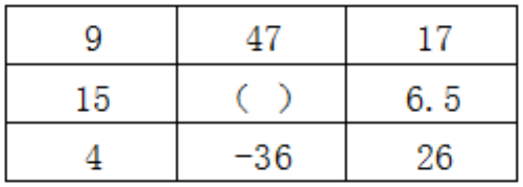

**A.** 55

**B.** 103

**C.** 199

**D.** 212

**答案：D**

### 第 41 题

`GD2016-XJ-Q041` · 单选 · 原卷第 4 页

一批零件如果全部都交由甲厂加工，正好在计划时间完成，如果全部交由乙厂加工，要超过计划时间5天才能完成，如果甲乙两厂合作加工3天，再由乙厂单独加工，正好也是在计划时间完成，则加工完这批零件计划时间是（）

**A.** 5

**B.** 7

**C.** 7.5

**D.** 8.5

**答案：C**

### 第 42 题

`GD2016-XJ-Q042` · 单选 · 原卷第 4 页

某服装店有一批衬衣共76件，分别卖给了33位顾客，每位顾客最多买了3件。衬衣定价为100元，买1件按原价，买2件总价打九折，买3件总价打八折。最后卖完这批衬衣共收入6460元，则买了3件的顾客有（）位。

**A.** 4

**B.** 8

**C.** 14

**D.** 15

**答案：C**

### 第 43 题

`GD2016-XJ-Q043` · 单选 · 原卷第 4 页

园林工人用一辆汽车将20棵行道树运往1公里的地方开始种植。在1公里处种第一棵，以后往更远处每隔50米种一棵，该辆汽车每次最多能运三棵树。当园林工人完成任务时，这辆汽车行程最短是（）米。

**A.** 20800

**B.** 20900

**C.** 21000

**D.** 21100

**答案：C**

### 第 44 题

`GD2016-XJ-Q044` · 单选 · 原卷第 4 页

某单位租赁了两辆同样的大巴车运送员工外出活动，从出发地到目的地的车程是2个小时，两车以相同速度同时出发，但甲车刚出发10分钟即发生故障，只能以原速的1/3匀速较慢行驶，乙车将本车员工送到目的地后，原路返回与甲车相遇，载上甲车员工驶往目的地，当所有员工到达目的地时，在途用时总计为（）（上下车时间不计）

**A.** 3小时50分钟

**B.** 4小时

**C.** 4小时20分钟

**D.** 4小时40分钟

**答案：A**

### 第 45 题

`GD2016-XJ-Q045` · 单选 · 原卷第 4 页

一个木制正方体在表面涂上颜色，将它的每条棱三等分，然后从等分点将正方体展开，得到27个小正方体，将这些小正方体充分混合后，装入一个口袋，从这个口袋中随机取出两个小正方体，其中一个正方体只有一个面涂有颜色，另一个至少有2个面涂有颜色的概率约为（）

**A.** 0.05

**B.** 0.17

**C.** 0.34

**D.** 0.67

**答案：C**

### 第 46 题

`GD2016-XJ-Q046` · 单选 · 原卷第 4 页

大型体育竞赛开幕式需要列队，共10排。导演安排演员总数的一半多一个在第一排，安排剩下演员人数的一半多一个在第2排……..依次类推。如果在第10排恰好将演员排完，那么参与排队列的演员共有（）名。

**A.** 2000

**B.** 2008

**C.** 2012

**D.** 2046

**答案：D**

### 第 47 题

`GD2016-XJ-Q047` · 单选 · 原卷第 4 页

小王早上看到挂钟显示8点多，急忙赶往公司上班。但是到了公司却发现时间和自己出门看到的挂钟时间一样，才明白是自己出门前误把挂钟的时针看成分针、分针看成时针。已知小王平时上班路程不超过1.5小时，今天上班他花费了（）。

**A.** 48分钟

**B.** 55分钟

**C.** 1小时

**D.** 1小时3分钟

**答案：B**

### 第 48 题

`GD2016-XJ-Q048` · 单选 · 原卷第 4 页

某羽毛球赛共有23支队伍报名参赛，赛事安排23支队伍抽签两两争夺下一轮的出线权，没有抽到对手的队伍轮空，直接进入下一轮。那么，本次羽毛球赛一共会出现（）次轮空的情况。

**A.** 2

**B.** 3

**C.** 4

**D.** 5

**答案：A**

### 第 49 题

`GD2016-XJ-Q049` · 单选 · 原卷第 5 页

甲乙两人需托运行李。托运收费标准为10kg以下6元/kg，超出10kg部分每公斤收费标准略低一些。已知甲乙两人托运费分别为109.5元、78元，甲的行李比乙重了50%。那么，超出10kg部分每公斤收费标准比10kg以内的低了（）元。

**A.** 1.5

**B.** 2.5

**C.** 3.5

**D.** 4.5

**答案：A**

### 第 50 题

`GD2016-XJ-Q050` · 单选 · 原卷第 5 页

甲乙两地位于不同时区，小张早上10点从甲地乘飞机到乙地，到达的时间为当地时间早上十点，第二天下午4点30分从乙地飞回甲地，到达的时间为当地时间22点30分。如果两次飞行时间相同。那么，当甲地时间为中午12点时，乙地时间为（）。

**A.** 8点30分

**B.** 9点

**C.** 9点30分

**D.** 10点

**答案：B**

## 判断推理

### 第 51 题

`GD2016-XJ-Q051` · 单选 · 图形推理 · 原卷第 5 页

（见题图）

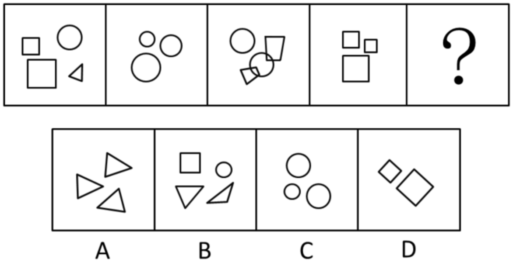

**A.** 见上方题图中 A 项。

**B.** 见上方题图中 B 项。

**C.** 见上方题图中 C 项。

**D.** 见上方题图中 D 项。

**答案：B**

### 第 52 题

`GD2016-XJ-Q052` · 单选 · 图形推理 · 原卷第 5 页

（见题图）

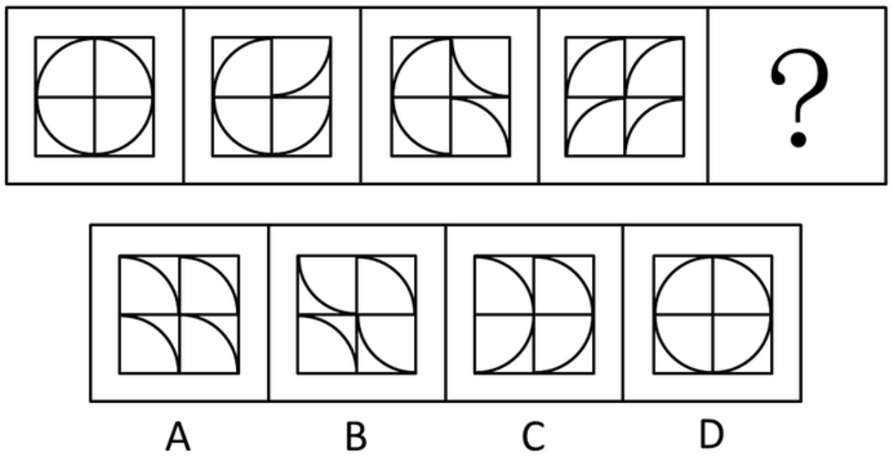

**A.** 见上方题图中 A 项。

**B.** 见上方题图中 B 项。

**C.** 见上方题图中 C 项。

**D.** 见上方题图中 D 项。

**答案：B**

### 第 53 题

`GD2016-XJ-Q053` · 单选 · 图形推理 · 原卷第 5 页

（见题图）

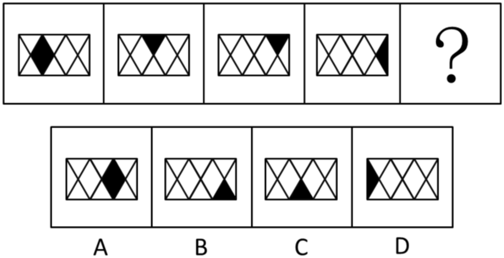

**A.** 见上方题图中 A 项。

**B.** 见上方题图中 B 项。

**C.** 见上方题图中 C 项。

**D.** 见上方题图中 D 项。

**答案：A**

### 第 54 题

`GD2016-XJ-Q054` · 单选 · 图形推理 · 原卷第 6 页

（见题图）

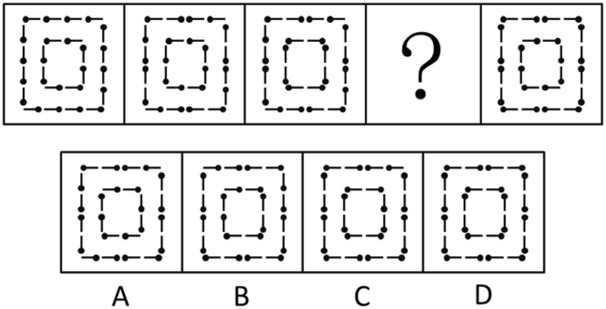

**A.** 见上方题图中 A 项。

**B.** 见上方题图中 B 项。

**C.** 见上方题图中 C 项。

**D.** 见上方题图中 D 项。

**答案：D**

### 第 55 题

`GD2016-XJ-Q055` · 单选 · 图形推理 · 原卷第 6 页

（见题图）

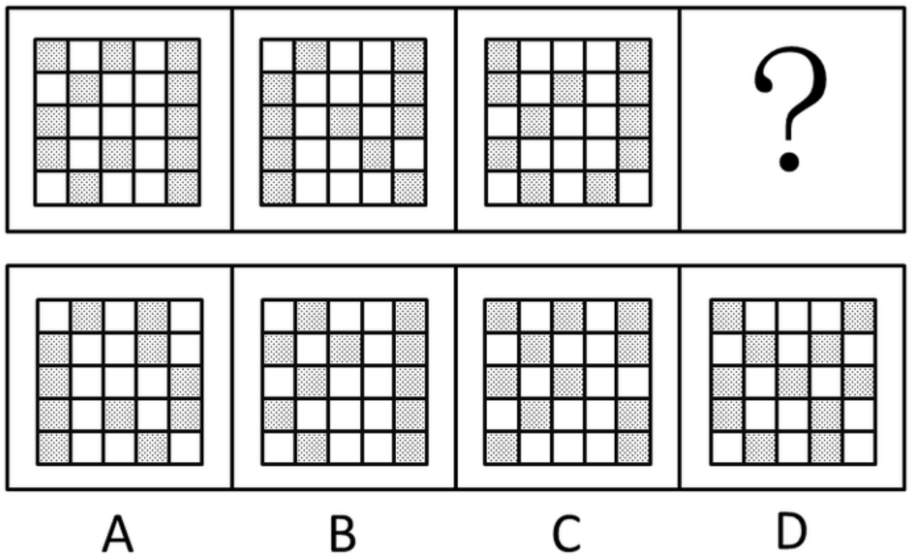

**A.** 见上方题图中 A 项。

**B.** 见上方题图中 B 项。

**C.** 见上方题图中 C 项。

**D.** 见上方题图中 D 项。

**答案：C**

### 第 56 题

`GD2016-XJ-Q056` · 单选 · 图形推理 · 原卷第 6 页

（见题图）

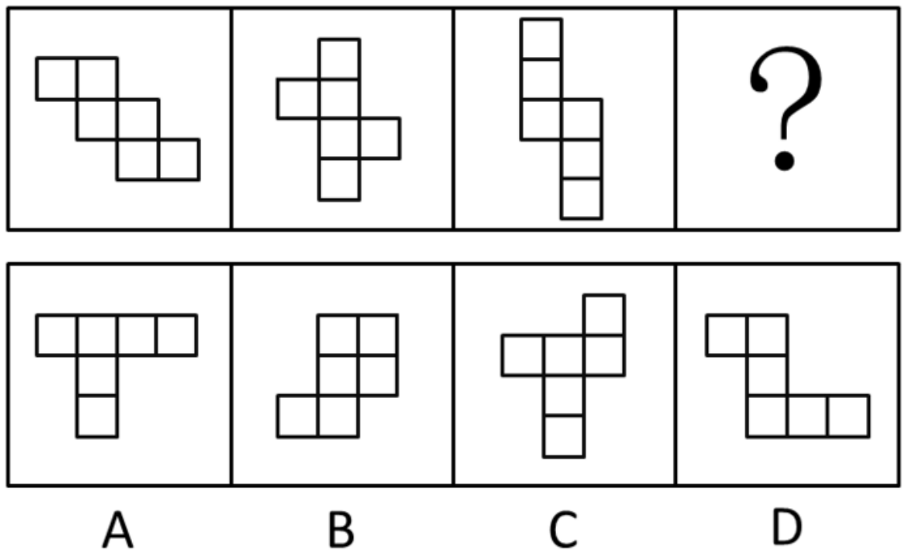

**A.** 见上方题图中 A 项。

**B.** 见上方题图中 B 项。

**C.** 见上方题图中 C 项。

**D.** 见上方题图中 D 项。

**答案：C**

### 第 57 题

`GD2016-XJ-Q057` · 单选 · 图形推理 · 原卷第 6 页

（见题图）

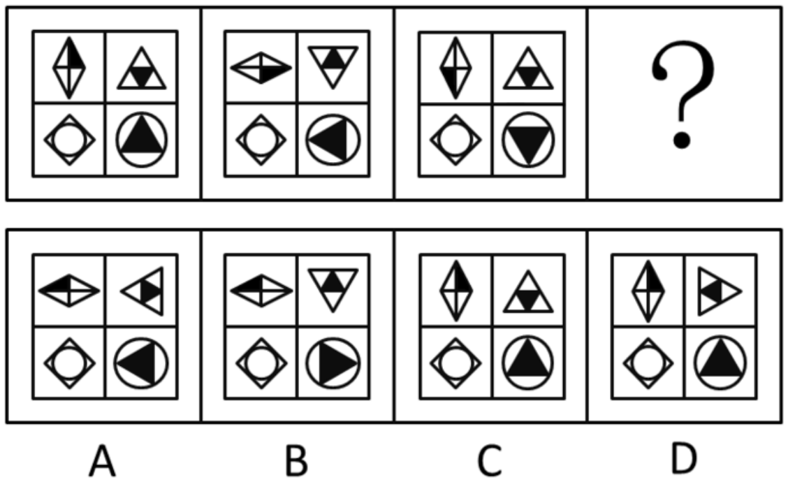

**A.** 见上方题图中 A 项。

**B.** 见上方题图中 B 项。

**C.** 见上方题图中 C 项。

**D.** 见上方题图中 D 项。

**答案：B**

### 第 58 题

`GD2016-XJ-Q058` · 单选 · 图形推理 · 原卷第 7 页

（见题图）

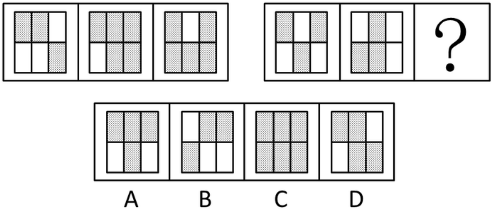

**A.** 见上方题图中 A 项。

**B.** 见上方题图中 B 项。

**C.** 见上方题图中 C 项。

**D.** 见上方题图中 D 项。

**答案：B**

### 第 59 题

`GD2016-XJ-Q059` · 单选 · 图形推理 · 原卷第 7 页

（见题图）

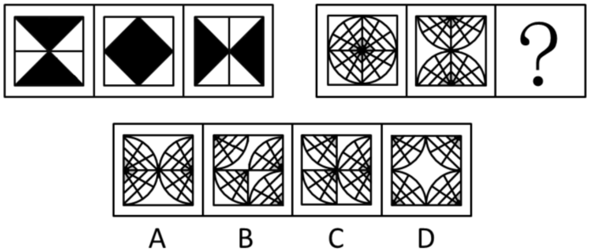

**A.** 见上方题图中 A 项。

**B.** 见上方题图中 B 项。

**C.** 见上方题图中 C 项。

**D.** 见上方题图中 D 项。

**答案：D**

### 第 60 题

`GD2016-XJ-Q060` · 单选 · 图形推理 · 原卷第 7 页

（见题图）

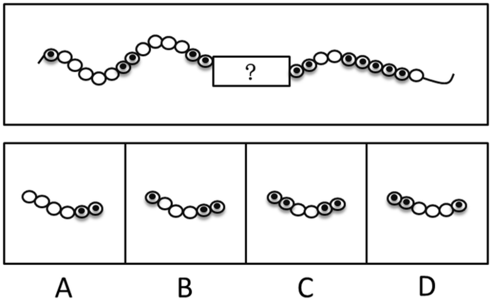

**A.** 见上方题图中 A 项。

**B.** 见上方题图中 B 项。

**C.** 见上方题图中 C 项。

**D.** 见上方题图中 D 项。

**答案：B**

### 第 61 题

`GD2016-XJ-Q061` · 单选 · 逻辑判断 · 原卷第 7 页

天空：蔚蓝（）

**A.** 气氛：融洽

**B.** 土地：耕种

**C.** 茶叶：保健

**D.** 河流：灌溉

**答案：A**

### 第 62 题

`GD2016-XJ-Q062` · 单选 · 逻辑判断 · 原卷第 7 页

蜡烛：电灯（）

**A.** 椅子：写字台

**B.** 茶杯：饮水机

**C.** 拖把：吸尘器

**D.** 电视：计算机

**答案：C**

### 第 63 题

`GD2016-XJ-Q063` · 单选 · 逻辑判断 · 原卷第 7 页

富裕：扶贫（）

**A.** 干燥：抽湿

**B.** 蒙昧：教育

**C.** 落后：推进

**D.** 健康：保卫

**答案：A**

### 第 64 题

`GD2016-XJ-Q064` · 单选 · 逻辑判断 · 原卷第 7 页

干旱：沙漠（）

**A.** 笔直：树干

**B.** 坚硬：水泥

**C.** 寒冷：南极

**D.** 多雨：赤道

**答案：C**

### 第 65 题

`GD2016-XJ-Q065` · 单选 · 逻辑判断 · 原卷第 7 页

菜刀：食物（）

**A.** 子弹：枪支

**B.** 毛巾：身体

**C.** 铅笔：书籍

**D.** 窗帘：窗户

**答案：B**

### 第 66 题

`GD2016-XJ-Q066` · 单选 · 逻辑判断 · 原卷第 7 页

玉石：雕琢：玉器（）

**A.** 蚕丝：织造：丝绸

**B.** 粮食：酿造：美酒

**C.** 生铁：冶炼：钢材

**D.** 蚊香：点燃：烟雾

**答案：A**

### 第 67 题

`GD2016-XJ-Q067` · 单选 · 逻辑判断 · 原卷第 7 页

站台：码头：停机坪（）

**A.** 现金：支票：银行卡

**B.** 软件：硬件：互联网

**C.** 外套：婚纱：羽绒服

**D.** 演员：群众：主持人

**答案：A**

### 第 68 题

`GD2016-XJ-Q068` · 单选 · 逻辑判断 · 原卷第 7 页

沙龙：志趣相投（）

**A.** 论坛：千言万语

**B.** 擂台：针锋相对

**C.** 网站：集思广益

**D.** 枢纽：承上启下

**答案：B**

### 第 69 题

`GD2016-XJ-Q069` · 单选 · 逻辑判断 · 原卷第 7 页

陈词滥调：老生常谈（）

**A.** 按部就班：循序渐进

**B.** 博闻强识：见多识广

**C.** 见义勇为：助人为乐

**D.** 八面玲珑：面面俱到

**答案：D**

### 第 70 题

`GD2016-XJ-Q070` · 单选 · 逻辑判断 · 原卷第 7、8 页

吹毛求疵：鸡蛋里面挑骨头（）

**A.** 赶鸭子上架：牛不喝水强按头

**B.** 敬酒不吃吃罚酒：不识抬举

**C.** 舍本逐末：捡了芝麻丢了西瓜

**D.** 福无双至：屋漏偏逢连夜雨

**答案：C**

### 第 71 题

`GD2016-XJ-Q071` · 单选 · 逻辑判断 · 原卷第 8 页

某县计划引进一种生长快、肉质好的良种牛，在本县推广养殖，以提高农民养牛的经济收益。
以下最能对该计划可行性提出质疑的是（）。

**A.** 该良种牛不适应当地气候

**B.** 当地农民养牛的积极性不高

**C.** 该良种牛的养殖成本较高

**D.** 当地农民没有饲养过该良种牛

**答案：A**

### 第 72 题

`GD2016-XJ-Q072` · 单选 · 逻辑判断 · 原卷第 8 页

老张为了试验某品牌化肥的效果，把自家的稻田分成东边、西边两块，在东边地块施肥，西边地块不施肥。水稻收割后，东边地块亩产700公斤，西边地块亩产400公斤。因此，该品牌化肥能有效增产。
以下最能反驳上述论证的是（）。

**A.** 东边地块的土壤肥力原本就比西边地块高

**B.** 东西两块地种植的是同一种品种的水稻

**C.** 东边地块的水稻遭受过病虫害

**D.** 老张收割西边地块的水稻先于东边地块

**答案：A**

### 第 73 题

`GD2016-XJ-Q073` · 单选 · 逻辑判断 · 原卷第 8 页

全球气候变暖给人类带来诸多影响的同时也影响着地球上的其他生物，降水的增加可以改善植被，从而有利于鼠类的增长。研究表明，降水的增加使原本干旱的内蒙古地区植物更加丰富，也增加了鼠类的食物，长爪沙鼠数量随之增加。
以下最能削弱上述论断的一项是（）。

**A.** 据统计，一些地区的植被覆盖率并没有增加

**B.** 据测算，全球沙漠化面积近年有所增加

**C.** 内蒙古地区植被的增加和近年的生态保护有很大关系

**D.** 植被的增加使各种动物包括鼠类的天敌都增加了

**答案：C**

### 第 74 题

`GD2016-XJ-Q074` · 单选 · 逻辑判断 · 原卷第 8 页

根据人事部门的数据，某单位的女性员工多于男性员工。中共党员员工多于政治面貌为群众的员工。（该单位员工政治面貌只有中共党员和群众两种情况）下列判断一定正确的是（）。

**A.** 政治面貌为群众的女性员工多于政治面貌为群众的男性员工

**B.** 政治面貌为中共党员的男性员工多于政治面貌为中共党员的女性员工

**C.** 政治面貌为中共党员的女性员工多于政治面貌为群众的男性员工

**D.** 政治面貌为群众的男性员工多于政治面貌为中共党员的男性员工

**答案：C**

### 第 75 题

`GD2016-XJ-Q075` · 单选 · 逻辑判断 · 原卷第 8 页

随着网络的普及，电子版图书也越来越多，其中包括电子版的文学名著，而且价格很低。人们只要打开电脑，在网上几乎可以浏览到任何一本名著。电子版文学名著的问世，会改变大众的阅读品味，有利于造就高素质读者群体。
以下最能削弱上述结论的一项是（）。

**A.** 对文学没有兴趣的人不会因为文学名著的价钱高低或者是否方便而阅读文学名著

**B.** 文学名著的普及率一直不如娱乐杂志、时事报刊等大众读物

**C.** 许多读者认为阅读电子书籍的感觉不如阅读印刷书籍的那么好，宁愿选择印刷版读物

**D.** 在互联网上阅读文学名著仍然需要收费

**答案：A**

### 第 76 题

`GD2016-XJ-Q076` · 单选 · 逻辑判断 · 原卷第 8 页

有研究表明，运动，特别是大量运动，会提高人体内血清基的水平。在某种程度上，人的心情由体内血清基的水平决定。抗抑郁药物可以通过提高体内血清基的水平来起作用。
下列论断一定正确的是（）。
I.提高体内血清基水平，要么大量运动，要么吃抗抑郁药物。
II.人的心情，可能由运动量决定，也可能受抗抑郁药物影响。
III.大量运动会影响人的心情，或影响抗抑郁药物的疗效。

**A.** I

**B.** II

**C.** I和II

**D.** II和III

**答案：D**

### 第 77 题

`GD2016-XJ-Q077` · 单选 · 逻辑判断 · 原卷第 8 页

气候与经济发展具有密切关系。在欧洲，北部气候较冷的国家总体上比南部国家发达；在美洲，加拿大和美国比南部的墨西哥发达；在亚洲，韩国的GDP是东南亚所有国家的总和。之所以有这种差别，是因为寒冷地区的人们为了生存，大脑会进一步地复杂化，而热带的人们，由于食物充足，大脑失去了进一步进化的动力。
以下最能削弱上述论断的一项是（）

**A.** 人类共有的惰性使任何地区的人都类似

**B.** 寒冷地区的人并不比热带的人智商高

**C.** 经济的发达与文化的繁荣没有必然联系

**D.** 获取食物并不是人类主要的脑力活动

**答案：A**

### 第 78 题

`GD2016-XJ-Q078` · 单选 · 逻辑判断 · 原卷第 8 页

我国以占世界7%的耕地养活了占世界22%的人口，其中年平均生产大豆1200万吨左右。同时，还利用国外的耕地、国外的农民，继续开放市场，降低关税或免除关税，年平均进口大豆5800万吨左右。更多利用国外的资源来让我国人民生活得更好。
以上论断基于下列假设，除了（）。

**A.** 大量进口粮食不会带来粮食安全问题

**B.** 政府相关部门对进口粮食严把质量关

**C.** 进口粮食的价格能被国内群众所接受

**D.** 大量进口粮食损害了国内生产者的利益

**答案：D**

### 第 79 题

`GD2016-XJ-Q079` · 单选 · 逻辑判断 · 原卷第 8、9 页

一项研究发现：经常喝咖啡的成年人患上心脏病的概率是不常喝咖啡成年人患心脏病概率的2.5倍。由此可以判定，咖啡中的某种物质能够导致人患上心脏疾病。
以下最能削弱上述结论的一项是（）。

**A.** 咖啡含有提高心脏活力的成分

**B.** 用餐时喝咖啡有降低血脂的作用

**C.** 心脏病高危人群更容易爱上喝咖啡

**D.** 爱喝咖啡的人大都性格开朗，喜欢运动

**答案：C**

### 第 80 题

`GD2016-XJ-Q080` · 单选 · 逻辑判断 · 原卷第 9 页

液体都能够流动。水能够流动，所以水是液体。
以下与上述推理在结构上最为相似的一项是（）。

**A.** 哲学家都爱思考。李教授是哲学家，所以他爱思考

**B.** 哺乳类动物都是恒温动物。蛇不是哺乳类动物，所以蛇不是恒温动物

**C.** 平板电脑都有触摸屏。手机有触摸屏，所以手机是平板电脑

**D.** 工作态度端正就能取得好的业绩。小刘取得好业绩，所以他工作态度端正

**答案：C**

## 科学推理

> 说明：原卷第81—85题排在第四部分“判断推理”下，未单列部分；按题型（物理）并与2022—2026题库一致，记为科学推理。

### 第 81 题

`GD2016-XJ-Q081` · 单选 · 原卷第 9 页

如图所示，一个装有水的杯子中悬浮着一个小球，杯子放在斜面上，该小球受到的浮力方向是（）。

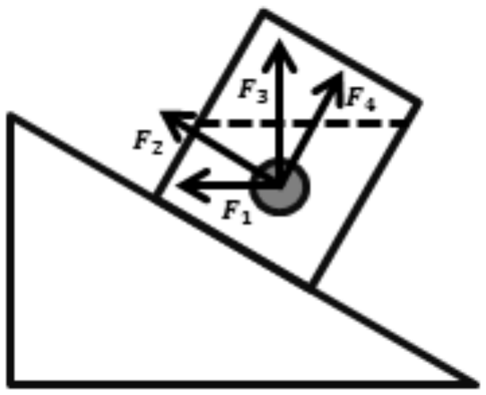

**A.** F1

**B.** F2

**C.** F3

**D.** F4

**答案：C**

### 第 82 题

`GD2016-XJ-Q082` · 单选 · 原卷第 9 页

如图所示，物体沿斜面匀速滑下时，它的（）。

**A.** 动能增加，重力势能减少，机械能不变

**B.** 动能不变，重力势能减少，机械能不变

**C.** 动能增加，重力势能不变，机械能减少

**D.** 动能不变，重力势能减少，机械能减少

**答案：D**

### 第 83 题

`GD2016-XJ-Q083` · 单选 · 原卷第 9 页

如图所示，实心蜡球漂浮在杯中的水面上，当向杯中不断慢慢加入酒精时,以下不可能出现的情况是（）。（己知：水的密度>蜡球的密度>酒精的密度）

**A.** 蜡球向下沉一些，所受浮力增大

**B.** 蜡球向下沉一些，所受浮力不变

**C.** 蜡球悬浮于液体中，所受浮力不变

**D.** 蜡球沉到杯底，所受浮力变小

**答案：A**

### 第 84 题

`GD2016-XJ-Q084` · 单选 · 原卷第 9、10 页

如图所示，在一个装着水的杯子里放进一块冰，则在冰块融化的过程中，杯子水面高度的变化情况应当是（）。

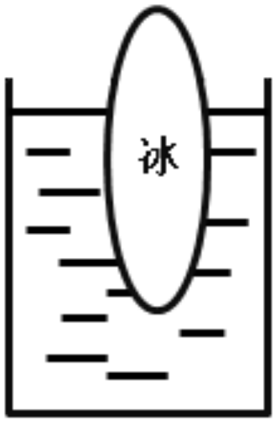

**A.** 一直上升

**B.** 先下降后上升

**C.** 先上升后下降

**D.** 一直不变

**答案：D**

### 第 85 题

`GD2016-XJ-Q085` · 单选 · 原卷第 10 页

如图所示，地面上有一架天平，天平左端系有一个50g的物体，右端通过绳子连接一组滑轮。滑轮组合中，O、Q为定滑轮，P为动滑轮，下端系有一个100g的物体。要使天平两端平衡，需要的操作是（）。

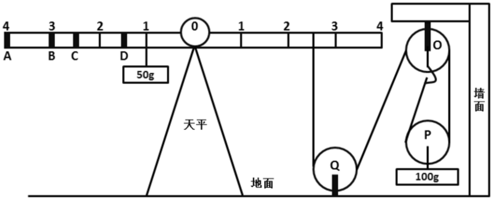

**A.** 在A处挂上重15g的物体

**B.** 在B处挂上重25g的物体

**C.** 在C处挂上重50g的物体

**D.** 在D处挂上重75g的物体

**答案：B**

## 资料分析

### 共用材料：第 86—90 题

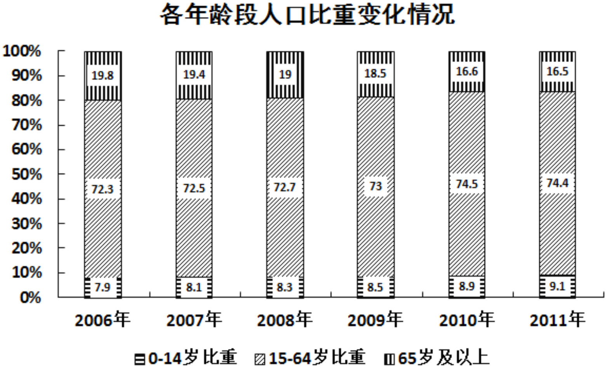

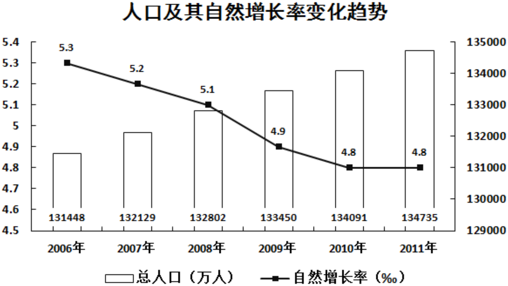

### 第 86 题

`GD2016-XJ-Q086` · 单选 · 原卷第 11 页

[共用材料](#GD2016-XJ-M1)

2006年至2011年期间，平均每年增加的人数为（）万人。

**A.** 531.3

**B.** 657.4

**C.** 752.4

**D.** 839.2

**答案：B**

### 第 87 题

`GD2016-XJ-Q087` · 单选 · 原卷第 11 页

[共用材料](#GD2016-XJ-M1)

按2011年的人口自然增长率计算，预计2012年的人口约为（）万人。

**A.** 135382

**B.** 135409

**C.** 141129

**D.** 141202

**答案：A**

### 第 88 题

`GD2016-XJ-Q088` · 单选 · 原卷第 11 页

[共用材料](#GD2016-XJ-M1)

2011年的总人口中，“65岁及以上”的人口比“0-14岁”的人口大约多（）万人。

**A.** 7910

**B.** 8850

**C.** 9320

**D.** 9970

**答案：D**

### 第 89 题

`GD2016-XJ-Q089` · 单选 · 原卷第 11 页

[共用材料](#GD2016-XJ-M1)

以下说法错误的是（）。

**A.** 2007年至2010年，每年比上年增加的人口数量一直递减

**B.** 人口自然增长率不断下降并趋于平缓

**C.** 人口自然增长越来越少，相比2010年，2011年的人口增长几乎停滞

**D.** 2009年的人口自然增长率下降得最快

**答案：C**

### 第 90 题

`GD2016-XJ-Q090` · 单选 · 原卷第 11 页

[共用材料](#GD2016-XJ-M1)

根据资料，我们可以得知（）。

**A.** 65岁及以上人口数量越来越多

**B.** 0-14岁人口占总人口的比重越来越大

**C.** 除了2011年，15-64岁人口数量每年都在增长

**D.** 65岁及以上人口占总人口的比重越来越大

**答案：B**

### 共用材料：第 91—95 题

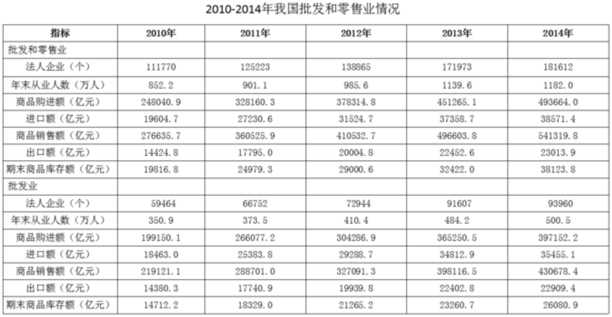

### 第 91 题

`GD2016-XJ-Q091` · 单选 · 原卷第 11、12 页

[共用材料](#GD2016-XJ-M2)

2013年，批发业法人企业比零售业多（）个。

**A.** 7023

**B.** 7158

**C.** 8281

**D.** 11241

**答案：D**

### 第 92 题

`GD2016-XJ-Q092` · 单选 · 原卷第 12 页

[共用材料](#GD2016-XJ-M2)

零售业期末商品库存额最多的年份是（）年。

**A.** 2011

**B.** 2012

**C.** 2013

**D.** 2014

**答案：D**

### 第 93 题

`GD2016-XJ-Q093` · 单选 · 原卷第 12 页

[共用材料](#GD2016-XJ-M2)

与2013年相比，下列指标在2014年增长额最小的是（）。

**A.** 批发业出口额

**B.** 批发业进口额

**C.** 零售业商品购进额

**D.** 零售业商品销售额

**答案：A**

### 第 94 题

`GD2016-XJ-Q094` · 单选 · 原卷第 12 页

[共用材料](#GD2016-XJ-M2)

以下各项中两个指标之间差额最大的是（）。

**A.** 2014年批发业期末商品库存额与零售业期末商品库存额

**B.** 2013年批发业进口额与出口额

**C.** 2012年批发和零售业商品销售额与商品购进额

**D.** 2011年批发和零售业进口额与出口额

**答案：C**

### 第 95 题

`GD2016-XJ-Q095` · 单选 · 原卷第 12 页

[共用材料](#GD2016-XJ-M2)

以下说法正确的是（）。

**A.** 2010-2013年，批发业每年年末从业人数均多于零售业

**B.** 2010-2014年，零售业出口额逐年上升

**C.** 相比2010年，2013年的零售业进口额翻了一番

**D.** 2011-2014，批发业期末商品库存额增幅逐年收窄

**答案：C**

### 共用材料：第 96—100 题

2000年、2005年、2010年我国普通高中专任教师总人数分别为756850人、1299460人、1518194人。其中，女性人数分别为273110人、558625人、723566人。
从年龄结构看，2000年、2005年、2010年31-35岁普通高中专任教师总人数分别为185873人、265509人、322829人，其中，女性人数分别为68346人、117838人、164175人；36-40岁普通高中专任教师总人数分别为117242人、248837人、272313人，其中，女性人数分别为35751人、95566人、122953人；41-45岁普通高中专任教师总人数分别为55522人、137235人、239616人，其中，女性人数分别为15728人、42931人、93641人。

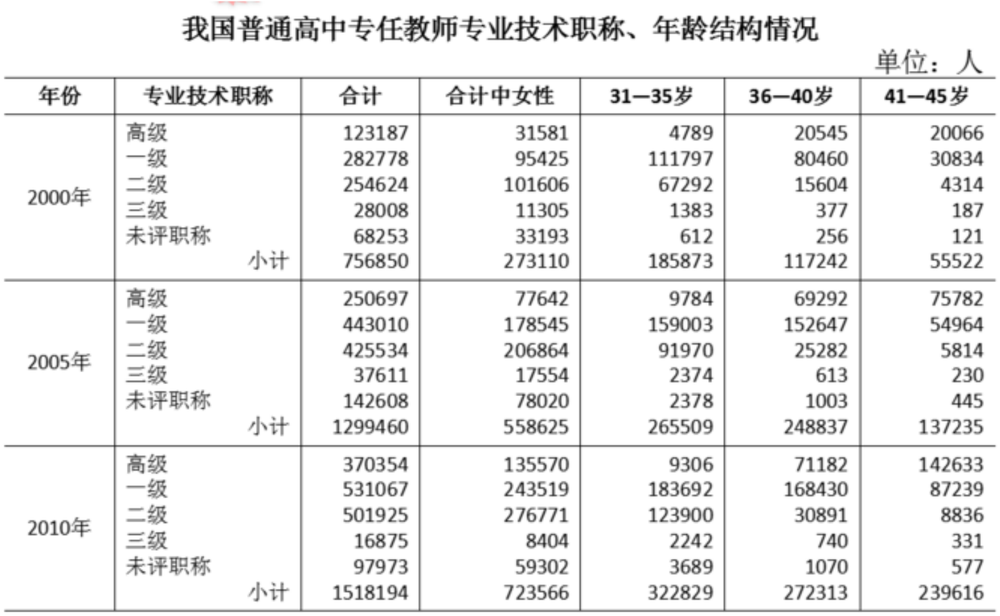

### 第 96 题

`GD2016-XJ-Q096` · 单选 · 原卷第 12 页

[共用材料](#GD2016-XJ-M3)

2000年，我国31-45岁普通高中专任教师中，共有（）人未评职称。

**A.** 68253

**B.** 33193

**C.** 989

**D.** 612

**答案：C**

### 第 97 题

`GD2016-XJ-Q097` · 单选 · 原卷第 12 页

[共用材料](#GD2016-XJ-M3)

2005年，我国31-45岁的普通高中专任教师的平均年龄可能会是（）岁。

**A.** 34

**B.** 37

**C.** 40

**D.** 41

**答案：B**

### 第 98 题

`GD2016-XJ-Q098` · 单选 · 原卷第 12 页

[共用材料](#GD2016-XJ-M3)

2010年，我国41-45岁的普通高中专任教师中，至少约有（）万人在2000年还不是普通高中专任教师。

**A.** 5

**B.** 8

**C.** 18

**D.** 16

**答案：A**

### 第 99 题

`GD2016-XJ-Q099` · 单选 · 原卷第 12 页

[共用材料](#GD2016-XJ-M3)

我国普通高中专任教师中，以下年龄组女性所占比重最大的是（）。

**A.** 2005年的36-40岁

**B.** 2010年的31-35岁

**C.** 2010年的36-40岁

**D.** 2010年的41-45岁

**答案：B**

### 第 100 题

`GD2016-XJ-Q100` · 单选 · 原卷第 12 页

[共用材料](#GD2016-XJ-M3)

以下说法正确的是（）。

**A.** 我国普通高中专任教师中，女性教师人数在2005年达到顶峰后逐年减少。

**B.** 2005年我国36-40岁一级普通高中专任教师中有6万多人在2010年评上了高级教师。

**C.** 2000-2010年我国普通高中专任教师人数以每年约10%速度增。

**D.** 2010年我国未评职称的普通高中专任教师占专任教师总人数的比重，比2000年下降了近3个百分点。

**答案：D**
