# 2017年广东行测（县乡统一卷）

共 100 题，原题号完整保留。内容：题干、选项、答案（不收解析）；资料分析共用材料置于所属题组前，JSONL 每条记录完整内嵌材料。

[结构化数据](GD2017.jsonl) · [字段说明](schema.json) · [质量报告](quality/GD2017.md)

原题来源：[2017年广东公务员考试《行测》真题.pdf](https://github.com/dumarstoft-ship-it/xing-ce1/blob/52f9811b22cad5410a7108dd0a07a879f1187aa5/%E7%9C%9F%E9%A2%98/2017%E5%B9%B4%E5%B9%BF%E4%B8%9C%E5%85%AC%E5%8A%A1%E5%91%98%E8%80%83%E8%AF%95%E3%80%8A%E8%A1%8C%E6%B5%8B%E3%80%8B%E7%9C%9F%E9%A2%98.pdf)。答案来源：[2017年广东公务员考试《行测》真题答案及解析.pdf](https://github.com/dumarstoft-ship-it/xing-ce1/blob/52f9811b22cad5410a7108dd0a07a879f1187aa5/%E7%AD%94%E6%A1%88%E8%A7%A3%E6%9E%90/2017%E5%B9%B4%E5%B9%BF%E4%B8%9C%E5%85%AC%E5%8A%A1%E5%91%98%E8%80%83%E8%AF%95%E3%80%8A%E8%A1%8C%E6%B5%8B%E3%80%8B%E7%9C%9F%E9%A2%98%E7%AD%94%E6%A1%88%E5%8F%8A%E8%A7%A3%E6%9E%90.pdf)（只取答案）。

## 言语理解与表达

### 第 1 题

`GD2017-Q001` · 单选 · 原卷第 1 页

党的十八大以来，中央以猛药去疴、重典治乱的_____，以刮骨疗毒、壮士断腕的_____，不断加大党风廉政建设和巡视的力度，效果显著。
依次填入画横线部分最恰当的一项是：

**A.** 意念 底气

**B.** 恒心 气势

**C.** 意志 气魄

**D.** 决心 勇气

**答案：D**

### 第 2 题

`GD2017-Q002` · 单选 · 原卷第 1 页

这些亮相于世界互联网大会的中国创新成果，勾勒出未来生活的诱人______，也______着“创新中国”的蓬勃生机。
依次填入画横线部分最恰当的一项是：

**A.** 图景 彰显

**B.** 图画 呈现

**C.** 画面 凸显

**D.** 景象 显示

**答案：A**

### 第 3 题

`GD2017-Q003` · 单选 · 原卷第 1 页

生活中细小的变化都可能让我们的感觉大不相同，我们要学会欣赏和赞扬，随时_____身边美好的事物，因为关注美好事物有助于规避不良情绪，同时切记多与乐观豁达、愉快向上的人相处。此外，_____一下日常生活节奏，也会让你的生活更有活力。
依次填入画横线部分最恰当的一项是：

**A.** 留意 改善

**B.** 发现 改变

**C.** 寻找 调整

**D.** 发掘 调节

**答案：B**

### 第 4 题

`GD2017-Q004` · 单选 · 原卷第 1 页

一个人的成长成才，并不完全由其起点决定，而是看在这个过程之中个人所付出的努力。如果一味_____“出生在农村，注定样样落后”，不仅是对一些客观事实选择性地无视，而且_____了个人奋斗的价值。
依次填入画横线部分最恰当的一项是：

**A.** 鼓吹 漠视

**B.** 宣扬 肯定

**C.** 渲染 抹杀

**D.** 鼓励 否定

**答案：C**

### 第 5 题

`GD2017-Q005` · 单选 · 原卷第 1 页

中央政令下达后，除了加大督查力度，更需要强化政策信息______，通过各种渠道让政策为民众所熟知，利用舆论和公众的监督，提高政策执行的______。
依次填入画横线部分最恰当的一项是：

**A.** 公布 水平

**B.** 发布 速度

**C.** 宣传 力度

**D.** 公开 效率

**答案：D**

### 第 6 题

`GD2017-Q006` · 单选 · 原卷第 1 页

冷静观察，直面现实，正视困难，我们的双脚就能站到_______的大地上，拥有牢固的立足点，就能看到远方的地平线，找到_______的方位感。
依次填入画横线部分最恰当的一项是：

**A.** 结实 正确

**B.** 坚韧 精准

**C.** 坚实 准确

**D.** 坚硬 精确

**答案：C**

### 第 7 题

`GD2017-Q007` · 单选 · 原卷第 1 页

结构性改革是一项长期性任务，需要_______地推进。就当前而言，则需要针对突出问题加以解决。
填入画横线部分最恰当的一项是：

**A.** 大刀阔斧

**B.** 持之以恒

**C.** 贯穿始终

**D.** 一劳永逸

**答案：B**

### 第 8 题

`GD2017-Q008` · 单选 · 原卷第 1 页

利用互联网等信息技术促进留守儿童家庭的亲子交流，不仅有很强的必要性，也具备相当的_______。长期以来，我国科技和信息工作的推进，已经为______留守儿童难题奠定了良好的软硬件基础。
依次填入画横线部分最恰当的一项是：

**A.** 合理性 根治

**B.** 现实性 治理

**C.** 可行性 缓解

**D.** 针对性 解决

**答案：C**

### 第 9 题

`GD2017-Q009` · 单选 · 原卷第 1 页

实现中华民族伟大复兴的中国梦，不是当代青年_______的额外任务，而是其_______的神圣使命。
依次填入画横线部分最恰当的一项是：

**A.** 无足轻重 责无旁贷

**B.** 坚辞不受 当仁不让

**C.** 理所当然 义无反顾

**D.** 可有可无 义不容辞

**答案：D**

### 第 10 题

`GD2017-Q010` · 单选 · 原卷第 1 页

依次填入下列画横线部分的词语，最恰当的一项是：
①对于民众反映比较集中紧迫的事情，______不当容易引发群体性事件。
②大雾天气致使飞机无法按时起飞，______了我一天的行程。
③央行发布的史上最严新规是为了______日益猖狂的金融犯罪和网络诈骗。

**A.** 应对 耽误 遏制

**B.** 治理 耽搁 遏止

**C.** 操作 耽误 遏止

**D.** 处置 耽搁 遏制

**答案：A**

> 转写说明：原卷三处横线是带下划线的空格（文字层只有空格，下划线另画），转写时补为“______”。

### 第 11 题

`GD2017-Q011` · 单选 · 原卷第 1 页

贫困有时不仅是收入低下，还是能力匮乏。能力的根本是素质。文明也是一种素质，而且是更重要的素质。“贫困文化”的研究者早就提出，不但要关注穷人的生活状态，而且要关注他们的价值观念、生活态度和行为模式。这种“亚文化”一旦形成，就会影响他们改变贫困的状况，而且会代代相传使贫困维持下去。当年民国乡村建设运动的先驱晏阳初先生，就认定乡村建设的根本之策在于治理“愚、贫、弱、私”，以培养农民的知识力、生产力、强健力和团结力。
这段文字意在说明：

**A.** 国民素质的提高根本在于文明的发展

**B.** 要大力提升贫困群众的发展能力

**C.** 个人能力发展的根本是文明素质

**D.** 提升贫困群众的文明素质意义重大

**答案：D**

### 第 12 题

`GD2017-Q012` · 单选 · 原卷第 1、2 页

随着东部沿海地区发展转型、产业转移，中西部地区经济崛起，重庆、湖南、四川等传统劳动力输出地，正迎来返乡创业的热潮。这些创业者中，既有返乡的农民工、企业管理者，也有大学生、公司职员等，他们怀着浓浓的乡情，抓住家乡发展的大好机遇，带着资金、技术以及先进的管理理念回乡打拼。在中西部的一些地方，返乡创业的企业数量和创造的产值，已占据县域经济的半壁江山。目前，这一趋势方兴未艾，它给中西部地区的城镇化、工业化带来了强劲的动力，也改变着中国的经济版图。
对这段文字理解不准确的是：

**A.** 中西部返乡创业主要受益于东部的发展转型

**B.** 返乡创业热潮主要出现在传统劳动力输出地

**C.** 返乡创业成为推动中西部县域经济发展的动力

**D.** 返乡创业已成为撬动中西部地区转型的新杠杆

**答案：A**

### 第 13 题

`GD2017-Q013` · 单选 · 原卷第 2 页

科学素质是公民实现美好生活的前提，是实施创新驱动发展战略和全面建成小康社会的社会基础。目前我国公民科学素质还不能满足国家建设和社会发展的需要。研究表明，进入创新型国家行列的30多个发达国家，公民具备科学素质的比例最低都在10%以上，我国仅为6.2%。虽然我国公民科学素质提高很快，但发展不平衡，与世界发达国家的差距仍然很大，特别是我国科普方面的公共服务很不均衡，农民、城镇新居民、边远和少数民族地区群众获得服务的机会明显偏少。
这段文字意在说明：

**A.** 我国公民科学素质还需进一步提高

**B.** 全社会应关注公民科学素质的提高

**C.** 我国与发达国家在公民科学素质上存在差距

**D.** 我国公民科学素质不高是一个严重的问题

**答案：A**

> 转写说明：题干中的百分数在原卷中为图片，已转写为文字。

### 第 14 题

`GD2017-Q014` · 单选 · 原卷第 2 页

文化本质上拥有让人处变不惊的力量，不仅让人们依恋传统，也鼓励人们接受新的可能。就像春节团聚，返回家乡固然是极好的方式，但春节离不开岗位，错峰返乡也依然情意浓浓。选择在第三地旅游过节，又何尝不是另一种天伦之乐？时代环境变了，文化形态也会相应改变。过去代表“年味儿”的某些形式，或许将离我们远去，但只要心在一起，就能找到新的“年味儿”取而代之，而不会留下情感或文化空缺。
这段文字的主旨是：

**A.** 春节的重要性对于国人来说已经有所变化

**B.** 文化的变迁是其本质主导下的正常现象

**C.** 家人团聚有很多种时间、形式可以选择

**D.** 文化是否空缺取决于人们的心是否在一起

**答案：B**

### 第 15 题

`GD2017-Q015` · 单选 · 原卷第 2 页

改革进入深层的利益调整和权力重构阶段，阻力越来越大。但是，再硬的骨头也要啃下来，再深的河水也要蹚过去。政府改革的核心是简政放权、转变职能。中央三令五申，实施清单制度，力度不可谓不大，但成效却难以让百姓满意。在不少地方和部门，该放的权力难以放到位，该管的环境难以管理好。那么多的“双创”行为受制于政策的悬置，那么多的企业不是战死沙场，而是倒在了行政审批的“最后一公里”。
这段文字主要说明：

**A.** 改革越深入，遭遇的阻力越大

**B.** 改革不可回避，阵痛在所难免

**C.** 改革深入攻坚，已是不容迟滞

**D.** 创新发展的巨大潜能蕴藏在改革之中

**答案：C**

## 数量关系

### 第 16 题

`GD2017-Q016` · 单选 · 原卷第 2 页

7 14 28 56（    ）

**A.** 110

**B.** 112

**C.** 114

**D.** 119

**答案：B**

> 转写说明：原卷各数之间以空白分隔、没有逗号，转写时保留一个空格。

### 第 17 题

`GD2017-Q017` · 单选 · 原卷第 2 页

1 7 17 31 49（    ）

**A.** 65

**B.** 67

**C.** 69

**D.** 71

**答案：D**

> 转写说明：原卷各数之间以空白分隔、没有逗号，转写时保留一个空格。

### 第 18 题

`GD2017-Q018` · 单选 · 原卷第 2 页

4 9 16 25（    ）

**A.** 36

**B.** 49

**C.** 64

**D.** 76

**答案：A**

> 转写说明：原卷各数之间以空白分隔、没有逗号，转写时保留一个空格。

### 第 19 题

`GD2017-Q019` · 单选 · 原卷第 2 页

1 2 6 16 44 120（    ）

**A.** 164

**B.** 176

**C.** 240

**D.** 328

**答案：D**

> 转写说明：原卷各数之间以空白分隔、没有逗号，转写时保留一个空格。

### 第 20 题

`GD2017-Q020` · 单选 · 原卷第 2 页

325 118 721 604（    ）

**A.** 911

**B.** 541

**C.** 431

**D.** 242

**答案：B**

> 转写说明：原卷各数之间以空白分隔、没有逗号，转写时保留一个空格。

### 第 21 题

`GD2017-Q021` · 单选 · 原卷第 2 页

如图所示，公园有一块四边形的草坪，由四块三角形的小草坪组成。已知四边形草坪的面积为480平方米，其中两个小三角形草坪的面积分别为70平方米和90平方米，则四块三角形小草坪中最大的一块面积为多少平方米？

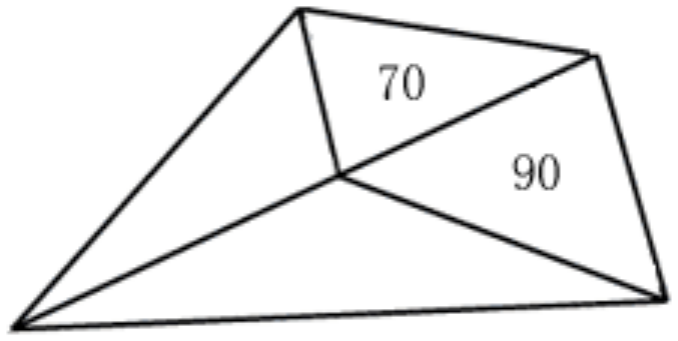

**A.** 120

**B.** 150

**C.** 180

**D.** 210

**答案：C**

### 第 22 题

`GD2017-Q022` · 单选 · 原卷第 2 页

小王到某单位办事，只有一个窗口在办理业务，小王排在第6位，第一位客户开始办理业务的时间为9:02。假如每单业务的办理时间为6分钟，而且排在小王前面的人不会提前离开。那么小王在什么时候可以开始办理业务？

**A.** 9:32

**B.** 9:38

**C.** 9:45

**D.** 9:52

**答案：A**

### 第 23 题

`GD2017-Q023` · 单选 · 原卷第 2、3 页

现有一批零件，甲师傅单独加工需要4小时，乙师傅单独加工需要6小时。两人一起加工这批零件的50%需要多少个小时？

**A.** 0.6

**B.** 1

**C.** 1.2

**D.** 1.5

**答案：C**

> 转写说明：题干中的百分数在原卷中为图片，已转写为文字。

### 第 24 题

`GD2017-Q024` · 单选 · 原卷第 3 页

老林和小陈绕着周长为720米的小花园匀速散步，小陈比老林速度快。若两人同时从某一起点同向出发，则每隔18分钟相遇一次；若两人同时从某一起点相反方向出发，则每隔6分钟相遇一次。由此可知，小陈绕小花园散步一圈需要多少分钟？

**A.** 6

**B.** 9

**C.** 15

**D.** 18

**答案：B**

### 第 25 题

`GD2017-Q025` · 单选 · 原卷第 3 页

在公司年会表演中，有甲、乙、丙、丁四个部门的员工参演。已知甲、乙两部门共有16名员工参演，乙、丙两部门共有20名员工参演，丙、丁两部门共有34名员工参演。且各部门参演人数从少到多的顺序为：甲<乙<丙<丁。由此可知，丁部门有多少人参演？

**A.** 16

**B.** 20

**C.** 23

**D.** 25

**答案：C**

> 转写说明：“甲<乙<丙<丁”在原卷中为图片，已转写为文字（半角“<”）。

### 第 26 题

`GD2017-Q026` · 单选 · 原卷第 3 页

现有浓度为15%和30%的盐水若干，如要配出600克浓度为25%的盐水，则分别需要浓度15%和30%的盐水多少克？

**A.** 100、300

**B.** 200、400

**C.** 300、600

**D.** 400、800

**答案：B**

> 转写说明：题干中的百分数在原卷中为图片，已转写为文字。

### 第 27 题

`GD2017-Q027` · 单选 · 原卷第 3 页

某单位有107名职工为灾区捐献了物资，其中78人捐献衣物，77人捐献食品。该单位既捐献衣物，又捐献食品的职工有多少人？

**A.** 48

**B.** 50

**C.** 52

**D.** 54

**答案：A**

### 第 28 题

`GD2017-Q028` · 单选 · 原卷第 3 页

有两支蜡烛，粗细不同，长度相等，粗蜡烛燃尽需要2小时，细蜡烛燃尽需要1小时。一天晚上停电，同时点燃了这两支蜡烛，若干分钟后来电了，将两支蜡烛同时熄灭，此时，粗蜡烛的长度是细蜡烛的2倍。假如蜡油的燃烧速度（单位时间的蜡油燃量）恒定，则停电时长为多少分钟？

**A.** 30

**B.** 35

**C.** 40

**D.** 45

**答案：C**

### 第 29 题

`GD2017-Q029` · 单选 · 原卷第 3 页

单位工会组织拔河比赛，每支参赛队都由3名男职工和3名女职工组成。假设比赛时要求3名男职工的站位不能全部连在一起，则每支队伍有几种不同的站位方式？

**A.** 432

**B.** 504

**C.** 576

**D.** 720

**答案：C**

### 第 30 题

`GD2017-Q030` · 单选 · 原卷第 3 页

施工队给一个周长为40米的圆形花坛安装护栏。刚开始，每隔1米挖一个洞用于埋栏杆。后来发现洞的间隔太远，决定改为每隔0.8米挖一个洞。那么，至少需要再挖几个洞？

**A.** 39

**B.** 40

**C.** 41

**D.** 42

**答案：B**

## 判断推理

### 第 31 题

`GD2017-Q031` · 单选 · 图形推理 · 原卷第 3 页

从所给四个选项中，选择最合适的一个填入问号处，使之呈现一定规律性：

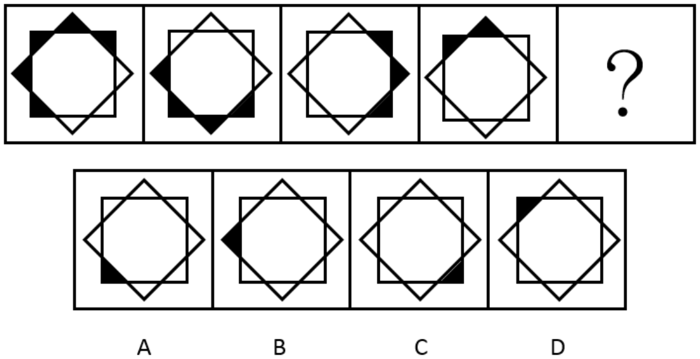

**A.** 见上方题图中 A 项。

**B.** 见上方题图中 B 项。

**C.** 见上方题图中 C 项。

**D.** 见上方题图中 D 项。

**答案：A**

### 第 32 题

`GD2017-Q032` · 单选 · 图形推理 · 原卷第 3 页

从所给四个选项中，选择最合适的一个填入问号处，使之呈现一定规律性：

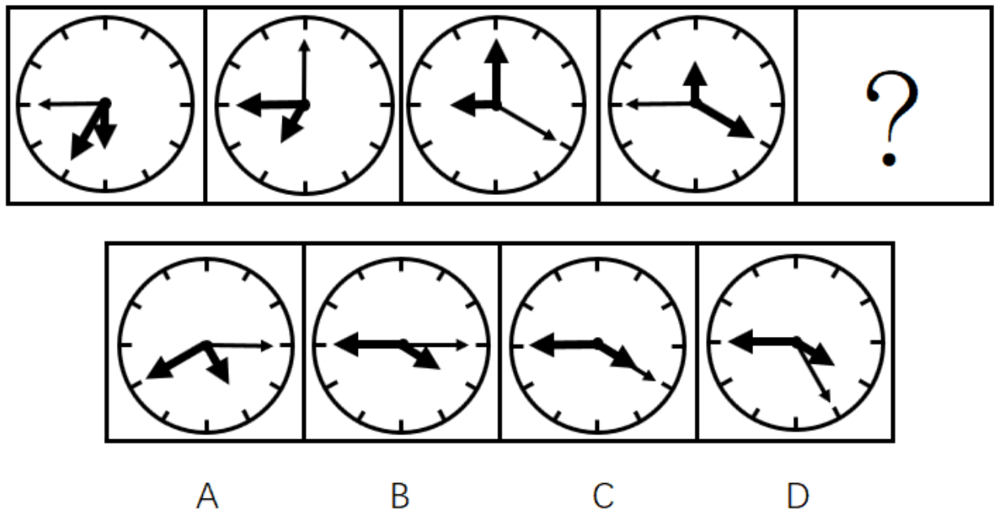

**A.** 见上方题图中 A 项。

**B.** 见上方题图中 B 项。

**C.** 见上方题图中 C 项。

**D.** 见上方题图中 D 项。

**答案：B**

### 第 33 题

`GD2017-Q033` · 单选 · 图形推理 · 原卷第 3、4 页

从所给四个选项中，选择最合适的一个填入问号处，使之呈现一定规律性：

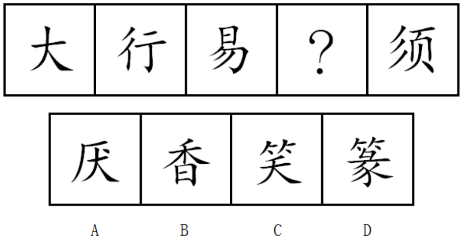

**A.** 见上方题图中 A 项。

**B.** 见上方题图中 B 项。

**C.** 见上方题图中 C 项。

**D.** 见上方题图中 D 项。

**答案：C**

### 第 34 题

`GD2017-Q034` · 单选 · 图形推理 · 原卷第 4 页

从所给四个选项中，选择最合适的一个填入问号处，使之呈现一定规律性：

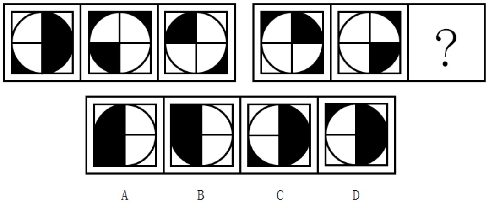

**A.** 见上方题图中 A 项。

**B.** 见上方题图中 B 项。

**C.** 见上方题图中 C 项。

**D.** 见上方题图中 D 项。

**答案：A**

### 第 35 题

`GD2017-Q035` · 单选 · 图形推理 · 原卷第 4 页

从所给四个选项中，选择最合适的一个填入问号处，使之呈现一定规律性：

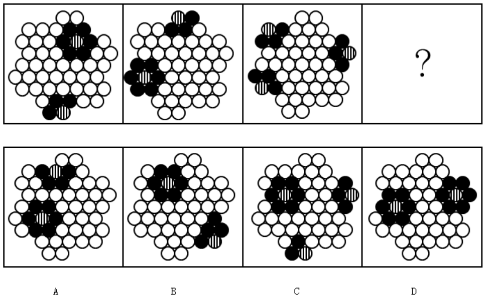

**A.** 见上方题图中 A 项。

**B.** 见上方题图中 B 项。

**C.** 见上方题图中 C 项。

**D.** 见上方题图中 D 项。

**答案：D**

### 第 36 题

`GD2017-Q036` · 单选 · 图形推理 · 原卷第 4 页

从所给四个选项中，选择最合适的一个填入问号处，使之呈现一定规律性：

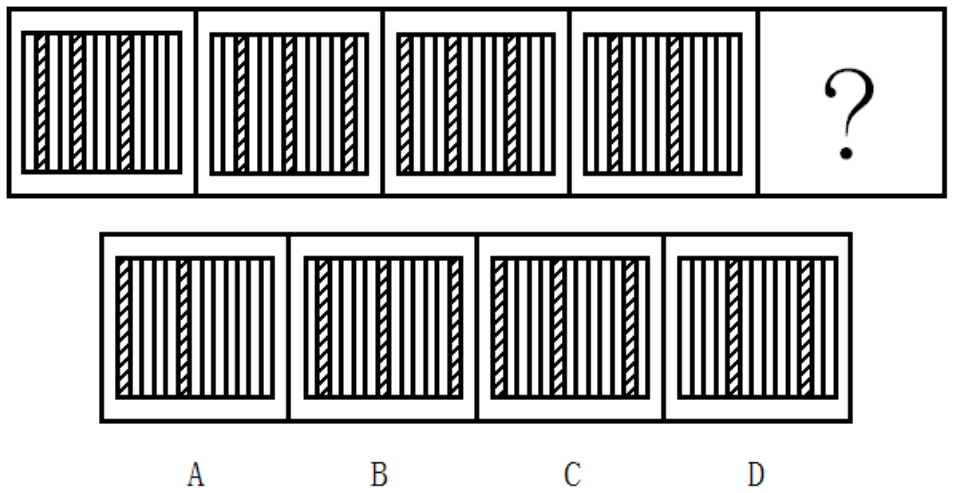

**A.** 见上方题图中 A 项。

**B.** 见上方题图中 B 项。

**C.** 见上方题图中 C 项。

**D.** 见上方题图中 D 项。

**答案：C**

### 第 37 题

`GD2017-Q037` · 单选 · 图形推理 · 原卷第 4 页

从所给四个选项中，选择最合适的一个填入问号处，使之呈现一定规律性：

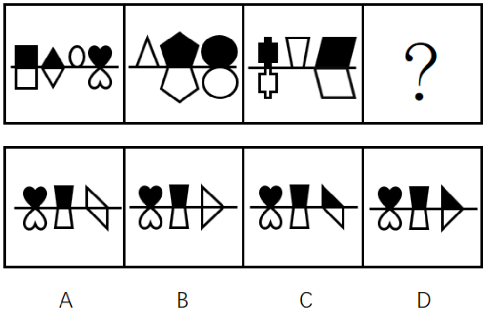

**A.** 见上方题图中 A 项。

**B.** 见上方题图中 B 项。

**C.** 见上方题图中 C 项。

**D.** 见上方题图中 D 项。

**答案：D**

### 第 38 题

`GD2017-Q038` · 单选 · 图形推理 · 原卷第 5 页

从所给四个选项中，选择最合适的一个填入问号处，使之呈现一定规律性：

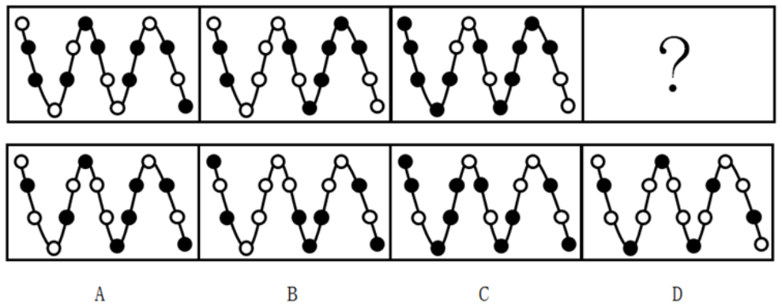

**A.** 见上方题图中 A 项。

**B.** 见上方题图中 B 项。

**C.** 见上方题图中 C 项。

**D.** 见上方题图中 D 项。

**答案：C**

### 第 39 题

`GD2017-Q039` · 单选 · 图形推理 · 原卷第 5 页

把下面的六个图形分为两类，使每一类图形都有各自的共同特征或规律，分类正确的一项是：

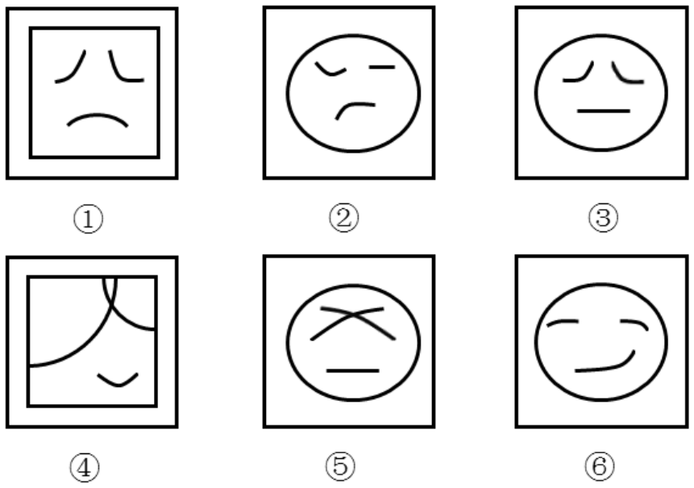

**A.** ①④⑥，②③⑤

**B.** ①②⑤，③④⑥

**C.** ①⑤⑥，②③④

**D.** ①③⑤，②④⑥

**答案：A**

> 转写说明：第39、40题的四个选项文字完全相同，原卷如此；①—⑥指题图中的六个图形。

### 第 40 题

`GD2017-Q040` · 单选 · 图形推理 · 原卷第 5 页

把下面的6个图形分为两类，使每一类图形都有各自的共同规律，分类正确的是:

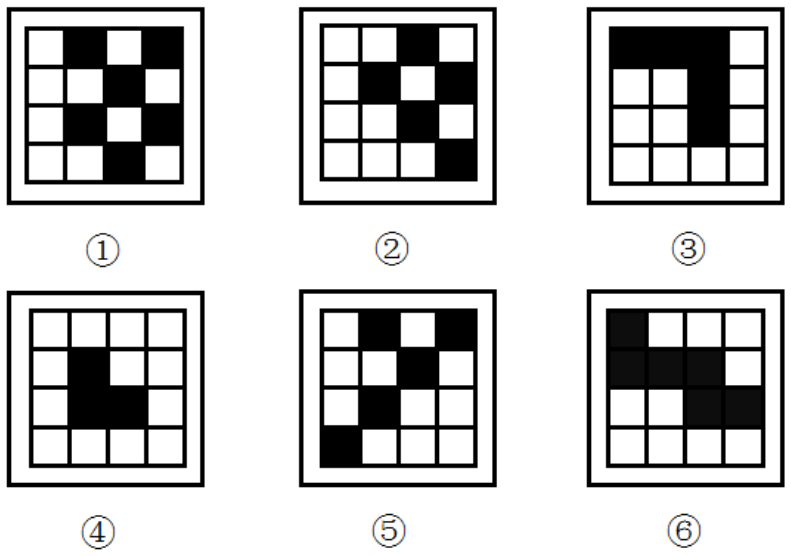

**A.** ①④⑥，②③⑤

**B.** ①②⑤，③④⑥

**C.** ①⑤⑥，②③④

**D.** ①③⑤，②④⑥

**答案：B**

> 转写说明：原卷题干末尾为半角冒号“:”，照录；四个选项文字与第39题完全相同，原卷如此。

### 第 41 题

`GD2017-Q041` · 单选 · 类比推理 · 原卷第 5 页

U盘：光盘

**A.** 楼梯：电梯

**B.** 插头：插座

**C.** 国画：毛笔

**D.** 水杯：杯盖

**答案：A**

### 第 42 题

`GD2017-Q042` · 单选 · 类比推理 · 原卷第 5 页

春暖：花开

**A.** 和风：细雨

**B.** 雨后：天晴

**C.** 天寒：地冻

**D.** 云开：雾散

**答案：C**

### 第 43 题

`GD2017-Q043` · 单选 · 类比推理 · 原卷第 5 页

投票：抽签

**A.** 联系：沟通

**B.** 管理：服务

**C.** 劝说：争辩

**D.** 推荐：号召

**答案：C**

### 第 44 题

`GD2017-Q044` · 单选 · 类比推理 · 原卷第 5 页

调研：座谈

**A.** 转型：创新

**B.** 垄断：专营

**C.** 发明：试验

**D.** 秩序：通畅

**答案：A**

### 第 45 题

`GD2017-Q045` · 单选 · 类比推理 · 原卷第 5 页

言论：自由

**A.** 版权：保护

**B.** 危机：调控

**C.** 生产：安全

**D.** 设计：创新

**答案：C**

### 第 46 题

`GD2017-Q046` · 单选 · 类比推理 · 原卷第 5 页

水：火

**A.** 美：丑

**B.** 有：无

**C.** 左：右

**D.** 红：绿

**答案：D**

### 第 47 题

`GD2017-Q047` · 单选 · 类比推理 · 原卷第 5 页

净水：过滤

**A.** 名次：竞赛

**B.** 房屋：装修

**C.** 苗条：节食

**D.** 环境：绿化

**答案：C**

### 第 48 题

`GD2017-Q048` · 单选 · 类比推理 · 原卷第 5 页

雾霾：污染：治理

**A.** 风扇：电器：使用

**B.** 粳米：粮食：调查

**C.** 信息：报纸：阅读

**D.** 报告：文件：审批

**答案：A**

### 第 49 题

`GD2017-Q049` · 单选 · 类比推理 · 原卷第 6 页

好感：喜欢：热爱

**A.** 伤心：悲伤：悲哀

**B.** 不安：紧张：焦躁

**C.** 不悦：反感：厌恶

**D.** 高兴：愉快：喜悦

**答案：B**

### 第 50 题

`GD2017-Q050` · 单选 · 类比推理 · 原卷第 6 页

自行车：出行：环保

**A.** 蔬菜：食品：健康

**B.** 台灯：灯泡：节能

**C.** 手表：时间：指针

**D.** 货车：运输：载体

**答案：A**

### 第 51 题

`GD2017-Q051` · 单选 · 逻辑判断 · 原卷第 6 页

某单位每个月都要对工作人员的工作表现进行考评。去年上半年，该单位的甲、乙、丙、丁4位员工均获得了3次月度优秀奖。已知，甲和乙有2个月同时获奖，乙和丙也有2个月同时获奖，甲和丁获奖的月份完全不同。
以下说法一定正确的是：

**A.** 只有3个人同时获奖的月份有2个

**B.** 只有2个人同时获奖的月份有3个

**C.** 只有1个人获奖的月份有1个

**D.** 只有2个人同时获奖的月份少于只有1个人获奖的月份

**答案：A**

### 第 52 题

`GD2017-Q052` · 单选 · 逻辑判断 · 原卷第 6 页

现在人们常常提到大学毕业生就业难。但据统计，近年我国就业市场空缺岗位与求职人数的比率一般大于1，劳动力市场的需求大于供给。而在求职人群中，大学毕业生的文化水平较高。因此，我国大学毕业生实际上不存在就业难的问题。
以下信息如果为真，能够有效反驳上述结论的是：

**A.** 当前经济下行压力较大，不少企业严控用工成本，已经开始裁员

**B.** 劳动力市场最紧缺的一些岗位主要是适合高级技工的岗位

**C.** 大学毕业生愿意从事的岗位往往竞争激烈

**D.** 一些高级技能人才的收入水平要高于大学毕业生

**答案：B**

### 第 53 题

`GD2017-Q053` · 单选 · 逻辑判断 · 原卷第 6 页

甲和乙都有可能受邀参加某专家论坛。现在，甲得知了以下消息：
（1）论坛主办方决定，至少邀请甲或乙中的一位。
（2）论坛主办方决定不邀请甲。
（3）论坛主办方一定会邀请甲。
（4）论坛主办方决定邀请乙。
假如上述消息中，两条为真，两条为假，则：

**A.** 论坛主办方决定邀请甲，不邀请乙

**B.** 论坛主办方决定邀请乙，不邀请甲

**C.** 论坛主办方决定同时邀请甲和乙

**D.** 论坛主办方决定既不邀请甲，也不邀请乙

**答案：A**

### 第 54 题

`GD2017-Q054` · 单选 · 逻辑判断 · 原卷第 6 页

某科研机构研发了一项神经刺激技术，他们在试验中对一批滑雪选手实施了该刺激，持续数周后发现，相比未接受刺激的选手，接受刺激选手的跳跃能力和协调性分别提高了10%和15%。本国体育部门计划与该机构合作，在滑雪运动员的训练、比赛中推广使用这一技术。
以下哪项为真，最能质疑该国体育部门的计划？

**A.** 未接受刺激的运动员通过正常训练也能提高跳跃能力和协调性

**B.** 这项合作会增加该国体育部门的经费支出

**C.** 该国是传统滑雪强国，滑雪成绩长期处于世界领先地位

**D.** 这项技术会降低运动员的专注力，而专注力是能力发挥的前提

**答案：D**

> 转写说明：题干中的百分数在原卷中为图片，已转写为文字。

### 第 55 题

`GD2017-Q055` · 单选 · 逻辑判断 · 原卷第 6 页

一名茶叶经销商在对客人介绍一种茶叶时说：“这种茶叶产自云山，而大名鼎鼎的云山茶正是产自云山，所以这就是正宗的云山茶。”
以下与该经销商介绍茶叶时的逻辑最为相似的是：

**A.** 三班的学生都勤奋好学，小李是三班的学生，所以小李勤奋好学

**B.** 飞驰牌汽车产自某国，刚才那辆汽车不是飞驰牌，所以肯定不是该国产的

**C.** 所有司机都必须有驾照，小郑有驾照，所以小郑是司机

**D.** 好医生需要具备精湛的医术和高尚的医德，小陈二者兼备，所以他是好医生

**答案：C**

### 第 56 题

`GD2017-Q056` · 单选 · 逻辑判断 · 原卷第 6 页

某公司招聘业务经理，小张和小李前来应聘。小张说：“如果我做了业务经理，我会积极进取，开拓新业务。”小李说：“如果我做了经理，我会优化管理，精减人员。”最终，他们其中一人当上了业务经理，并顺利实现了自己的工作主张。
由此可知，以下说法必定为真的是：

**A.** 该公司不仅开拓了新业务，还精减了人员

**B.** 如果该公司开拓了新业务，那么肯定是小张当上了业务经理

**C.** 如果该公司精减了人员，那么肯定是小李当上了业务经理

**D.** 如果该公司没有开拓新业务，就肯定精减了人员

**答案：D**

### 第 57 题

`GD2017-Q057` · 单选 · 逻辑判断 · 原卷第 6 页

由于按揭贷款的利率下调，人们每月还贷压力减小，因此一家机构预测某地的商品房销售量会增长，但实际上，销售量并未出现明显增长。
下列哪项如果为真，最能解释以上现象？

**A.** 当地一直存在人口外流的现象

**B.** 本地的商品房价格没有明显下降

**C.** 有的开发商取消了购房优惠政策

**D.** 因经济环境不好，当地人均收入下降

**答案：D**

### 第 58 题

`GD2017-Q058` · 单选 · 逻辑判断 · 原卷第 7 页

媒体A报道称：今年以来，患季节性皮肤病的人数大幅上升，这是因为城市水污染日益严重和空气质量恶化造成的。
媒体B报道称：患季节性皮肤病的人数大幅上升与城市水污染、空气质量恶化没有关系，主要是因为人们缺乏锻炼，身体素质下降造成的。
以下哪项如果为真，最能对媒体B的观点提出质疑？

**A.** 目前7-12周岁儿童的身体素质比10年前普遍下降

**B.** 大多数春季患皮肤病的人，在秋冬季节症状会有所好转

**C.** 环保局承认，城市水污染和空气质量问题日益严重

**D.** 游泳运动员患季节性皮肤病的人数逐年增多

**答案：D**

### 第 59 题

`GD2017-Q059` · 单选 · 逻辑判断 · 原卷第 7 页

某投资公司在评价一个项目时说：我们挑选投资项目，主要是看项目的技术门槛和未来市场需求量，而不是当前的业务增长率。现在新的可投资项目这么多，短期内发展很迅速但很快就被其他项目追赶上来的也不少，这显然不是我们想要的。这个项目在一年内营业额就增加了5倍，倒是很有必要怀疑它将来的状况。
以下和该投资公司评价项目的逻辑最为类似的是：

**A.** 婚姻生活是否幸福取决于夫妻双方的和谐程度，而不是家庭收入，有些收入高的夫妻，婚姻生活反而不幸福

**B.** 通过票房评价一部电影并不靠谱，一部电影即使票房再高，观众的口碑也不一定好

**C.** 某足球队在选拔新队员时，除了关注他们的技术水平，更看重他们的训练状态和发展潜力

**D.** 歌手要成功，天赋和优秀的市场推广缺一不可。那些失败的歌手，要么没有天赋，要么市场推广做得不好

**答案：A**

### 第 60 题

`GD2017-Q060` · 单选 · 逻辑判断 · 原卷第 7 页

流感病毒的变异速度相当快，即使疫苗每年更新，也不能保证疫苗接种覆盖全部的“当季流行款”。接种流感疫苗，既不能保证百分之百不得流感，还可能导致接种人群出现低烧等副作用。因此，没有必要接种流感疫苗。
以下选项如果为真，不能有效反驳上文结论的是：

**A.** 接种流感疫苗可以减少儿童、慢性病患者等高危人群因流感而发生严重并发症的风险

**B.** 接种季节性流感疫苗可以降低易感人群感染流感病毒的概率

**C.** 接种流感疫苗后只有极少数人会出现全身反应，且一两天可以缓解，比流感的症状要轻很多

**D.** 从疾病中恢复过来的人可以获得一定的免疫力，1年内不会再次被同样的流感病毒感染

**答案：D**

## 科学推理

### 第 61 题

`GD2017-Q061` · 单选 · 原卷第 7 页

在下面的电路图中，c、d是两个不同的灯泡，e、f均为安培表。当开关g闭合时（如图1），e显示读数为1.3A，f显示读数为0.9A。如果将断开的开关g与灯泡c的位置互换（如图2），则以下情况不会出现的是：

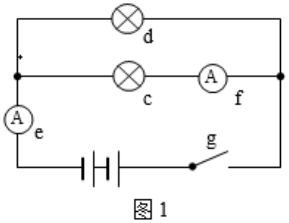

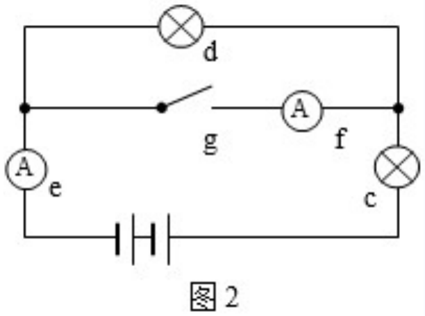

**A.** f的读数变为0A

**B.** e的读数变小

**C.** c比原来亮

**D.** d比c亮

**答案：C**

> 转写说明：题图两张：图1为原电路，图2为开关g与灯泡c互换位置后的电路。

### 第 62 题

`GD2017-Q062` · 单选 · 原卷第 7 页

下列关于蔬菜大棚内氧气和二氧化碳含量变化的说法，不正确的是：

**A.** 在无光的环境下，植物只进行呼吸作用，二氧化碳含量增加

**B.** 在有光的环境下，植物同时进行光合作用和呼吸作用，氧气含量增加

**C.** 光线逐渐增强时，植物的光合作用逐渐增强，氧气含量增加

**D.** 光线逐渐减弱时，植物的光合作用和呼吸作用也逐渐减弱，氧气含量降低

**答案：D**

### 第 63 题

`GD2017-Q063` · 单选 · 原卷第 7、8 页

小王用塑料圆筒做了一个简易哨子（如图），当他从吹气口吹气的同时，将活塞慢慢往下拉，可以听到哨声：

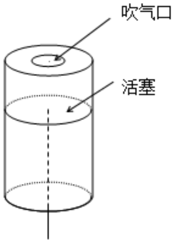

**A.** 逐渐变小声

**B.** 音调越来越高

**C.** 音调越来越低

**D.** 没有变化

**答案：C**

### 第 64 题

`GD2017-Q064` · 单选 · 原卷第 8 页

两块完全相同的平面玻璃砖相互垂直放置（如图），一束单色光从左侧水平射入左边的玻璃砖，从右边的玻璃砖射出，则出射光线相对入射光线：

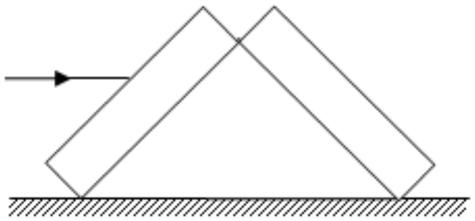

**A.** 向上偏折

**B.** 向下偏折

**C.** 在同一条直线上

**D.** 平行

**答案：C**

### 第 65 题

`GD2017-Q065` · 单选 · 原卷第 8 页

有一家四口，包括一对夫妻和他们的两个亲生子女，四人的ABO血型各不相同。已知儿子有一次受伤时，是爸爸献的血，那么，以下信息可以确定的是：

**A.** 爸爸的血可以献给家里所有人使用

**B.** 妈妈的血不能献给家里所有人使用

**C.** 女儿有可能是AB型血

**D.** 儿子只可能是A型或B型血

**答案：B**

### 第 66 题

`GD2017-Q066` · 单选 · 原卷第 8 页

为节约用电，有生产商为楼道照明开发出“光控开关”和“声控开关”。“光控开关”在天黑时自动闭合，天亮时自动断开；“声控开关”在有人走动发出声音时自动闭合，无人走动时自动断开。若将这两种开关配合使用，就可以使楼道照明变得更加节能。为达到这个目的，楼道照明的电路安装简图是：

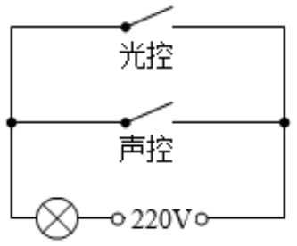

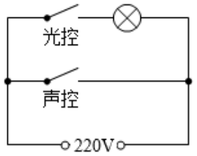

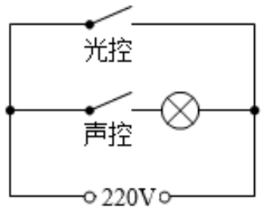

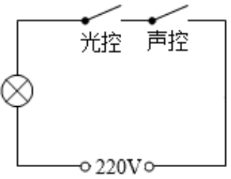

**A.** 见上方题图中 A 项。

**B.** 见上方题图中 B 项。

**C.** 见上方题图中 C 项。

**D.** 见上方题图中 D 项。

**答案：C**

> 转写说明：四个选项各为一张电路简图，原卷图下只排“A、B、C、D、”字母；按从左到右的位置对应A—D，分别裁图（role=option），选项各自指向对应的图。

### 第 67 题

`GD2017-Q067` · 单选 · 原卷第 8 页

下图是某地市区与郊区之间的热力环流图。根据该图，为保证市区空气质量，下列说法正确的是：

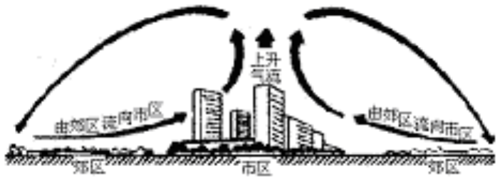

**A.** 化工厂可以建设在郊区

**B.** 绿化带应该建设在郊区外

**C.** 绿化带可以建设在市区内

**D.** 化工厂应该建设在郊区与市区之间

**答案：C**

### 第 68 题

`GD2017-Q068` · 单选 · 原卷第 8 页

如图所示，两物体M、N用绳子连接，绳子跨过固定在斜面顶端的滑轮（不计滑轮的质量和摩擦力），N悬于空中，M放在斜面上，均处于静止状态。当用水平向右的拉力F作用于物体M时，M、N仍静止不动，则下列说法正确的是：

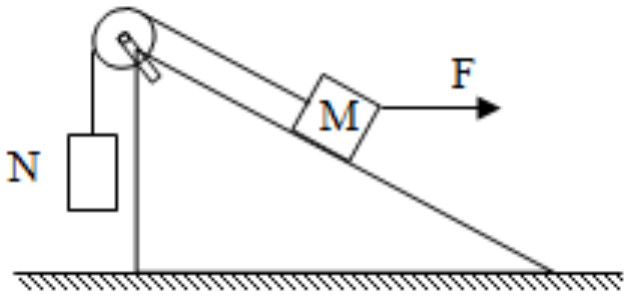

**A.** 绳子的拉力始终不变

**B.** M受到的摩擦力方向沿斜面向上

**C.** 物体M所受到的合外力变大

**D.** 物体M总共受到4个力的作用

**答案：A**

### 第 69 题

`GD2017-Q069` · 单选 · 原卷第 8、9 页

下图是某辆汽车的位移x随着时间t变化而变化的图像，下列说法中正确的是：

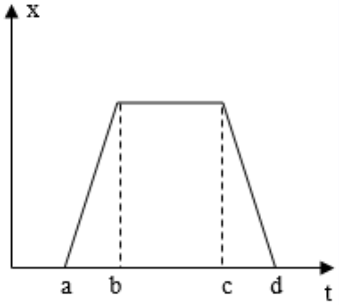

**A.** 在a到b的时间段内，汽车的加速度不断增大

**B.** 在b到c的时间段内，汽车做匀速运动

**C.** 在c到d的时间段内，汽车的速度保持不变

**D.** 在d时间点，汽车回到出发地

**答案：C**

> 答案说明：解析PDF第11页结论为“综上所述，本题正确答案为C”，并备注本题不严谨：C、D两项简单来看都没有问题，作为单选题“更倾向于C项”。答案按解析记C。

### 第 70 题

`GD2017-Q070` · 单选 · 原卷第 9 页

下列能正确反映自由落体速度随时间变化的图像是：

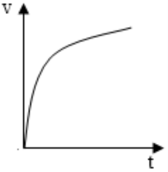

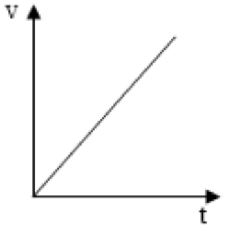

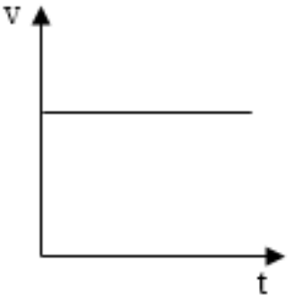

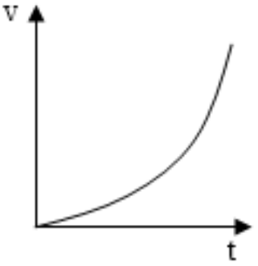

**A.** 见上方题图中 A 项。

**B.** 见上方题图中 B 项。

**C.** 见上方题图中 C 项。

**D.** 见上方题图中 D 项。

**答案：B**

> 转写说明：四个选项各为一张速度—时间图像，原卷图下只排“A、B、C、D、”字母；按从左到右的位置对应A—D，分别裁图（role=option），选项各自指向对应的图。

## 常识判断

### 第 71 题

`GD2017-Q071` · 单选 · 原卷第 9 页

“海上丝绸之路”是古代中国与外国交通贸易和文化交往的海上通道，包括东海航线和南海航线。以下城市不属于“海上丝绸之路”航线中主要港口的是：

**A.** 广州

**B.** 泉州

**C.** 宁波

**D.** 厦门

**答案：D**

### 第 72 题

`GD2017-Q072` · 单选 · 原卷第 9 页

角蛋白是一种控制细胞形状和稳定性的蛋白。以下对角蛋白认识错误的是：

**A.** 人的头发、指甲主要是由角蛋白构成的

**B.** 角蛋白是爬行动物鳞片、羽毛、爪子的主要成分

**C.** 在人的皮肤中，角蛋白主要分布在真皮层

**D.** 角蛋白来源于外胚层分化而来的细胞，是一种硬蛋白

**答案：C**

> 答案说明：解析PDF第12页答案为C，另注“B项表述不严谨：羽毛应当为鸟类标志”；答案仍记C。

### 第 73 题

`GD2017-Q073` · 单选 · 原卷第 9 页

从卫星在外太空拍摄的地球照片来看，地球是一个蓝色的星球，这是因为：

**A.** 地球上大部分地区都被水覆盖着

**B.** 天空是蓝色的，而蓝天包围着大地

**C.** 大气分子、冰晶、水滴等和阳光的共同作用

**D.** 太阳光穿过地球大气层产生折射

**答案：A**

### 第 74 题

`GD2017-Q074` · 单选 · 原卷第 9 页

2016年11月，习近平主席在出国访问发表演讲时，引用了一句古诗“相知无远近，万里尚为邻”来表明两国关系的亲密不因地理上的距离而疏远。习近平主席当时访问的国家是：

**A.** 柬埔寨

**B.** 哈萨克斯坦

**C.** 秘鲁

**D.** 马来西亚

**答案：C**

### 第 75 题

`GD2017-Q075` · 单选 · 原卷第 9 页

我国海洋综合科考船“海洋六号”从珠江口进入南海海域，执行大洋南极科考任务。下列关于科考船从珠江口进入南海，所受浮力情况说法正确的是：

**A.** 由于船始终浮在水面上，所以受到的浮力不变

**B.** 由于海水的密度更大，所以船在海洋里受到的浮力更大

**C.** 由于船排开海水的体积更小，所以在海洋里受到的浮力更小

**D.** 由于船排开江水的体积更大，所以在江水里受到的浮力更大

**答案：A**

### 第 76 题

`GD2017-Q076` · 单选 · 原卷第 9 页

以下对人的各种感觉描述不正确的是：

**A.** 触觉感受器大部分存在于皮肤中，指尖尤其敏感

**B.** 人看到物体时，视网膜上会形成一幅上下颠倒的影像

**C.** 耳朵可以帮助人体保持平衡

**D.** 嗅觉和味觉是一起工作的，感知食物味道更多依赖味觉

**答案：D**

### 第 77 题

`GD2017-Q077` · 单选 · 原卷第 9 页

地球上的矿产资源非常丰富。关于矿产，以下认识不正确的是：

**A.** 最坚硬的矿石是金刚石，最软的矿石是石膏

**B.** 砂岩按照砂粒直径划分为微粒、细粒、中粒、粗粒和巨粒

**C.** 煤、石油和天然气都是化石燃料，由动植物的遗体演变而成

**D.** 大多数矿物是在熔融的岩石或炽热的熔体冷却结晶时形成的

**答案：A**

### 第 78 题

`GD2017-Q078` · 单选 · 原卷第 9 页

世界上多数国家都采用以区时为单位的标准时。关于时间，以下认识不正确的是：

**A.** 所有时区都以格林尼治本初子午线为基础

**B.** 国际日期变更线的西边要比东边晚一天

**C.** 许多国家在夏季人为地把时钟拨快一小时，使用夏令时间

**D.** 全球共分为24个时区，每个时区都有自己的时间

**答案：B**

### 第 79 题

`GD2017-Q079` · 单选 · 原卷第 9、10 页

地球上生物的种类极其丰富，从表面上看，不同的生物之间似乎并没有相同之处，但其实所有的生物都具有一些共同特征。以下不属于生物共同特征的是：

**A.** 由单细胞构成

**B.** 需要能量才能生存

**C.** 具有生命周期

**D.** 新陈代谢

**答案：A**

### 第 80 题

`GD2017-Q080` · 单选 · 原卷第 10 页

水银可用于制作体温计，其主要原因不包括：

**A.** 水银对温度变化敏感

**B.** 水银容易获得

**C.** 水银的熔点低，沸点高

**D.** 水银的化学性质稳定

**答案：B**

### 第 81 题

`GD2017-Q081` · 单选 · 原卷第 10 页

如果将豆腐冰冻一段时间再解冻，豆腐内部会出现非常多的小孔。这一变化的原因是：

**A.** 豆腐内的水分聚集凝结成冰晶，体积增大，挤出了这些小孔

**B.** 豆腐在低温下组织纤维变硬，体积膨大，露出了空隙

**C.** 温度骤然变化导致豆腐的组织纤维热胀冷缩，露出了空隙

**D.** 豆腐中的某些成分在低温环境下释放出大量气体，挤出了这些小孔

**答案：A**

### 第 82 题

`GD2017-Q082` · 单选 · 原卷第 10 页

人口增长模式包括原始型、传统型、现代型三种。目前，我国已基本实现了从（）的转变。

**A.** 原始型向传统型

**B.** 原始型向现代型

**C.** 现代型向传统型

**D.** 传统型向现代型

**答案：D**

### 第 83 题

`GD2017-Q083` · 单选 · 原卷第 10 页

准备活动是指在比赛、训练和体育课正式开始前，为克服内脏器官的生理惰性，缩短进入运动状态的时间和预防运动创伤而进行的身体练习，为接下来的剧烈运动或比赛做好准备。下列不属于准备活动主要作用的是：

**A.** 提高中枢神经系统的兴奋性

**B.** 增加皮肤血流量以利于散热

**C.** 提高运动时对氧气的利用率

**D.** 提高机体的代谢水平

**答案：C**

### 第 84 题

`GD2017-Q084` · 单选 · 原卷第 10 页

以下不属于导致听力下降、听力减退原因的是：

**A.** 太多的噪音伤害了内耳中的细毛

**B.** 经常用耳勺掏挖耳朵碰伤了耳道

**C.** 精神压力过大导致内耳供血障碍

**D.** 戴耳机听音乐导致听觉中枢受损

**答案：B**

### 第 85 题

`GD2017-Q085` · 单选 · 原卷第 10 页

2016年，我国推动供给侧结构性改革取得初步成效，部分行业的供求关系、政府和企业的理念行为发生积极变化。2017年是供给侧结构性改革的深化之年。下列经济行为中，不符合供给侧结构性改革精神的是：

**A.** 推动钢铁、煤炭行业化解过剩产能

**B.** 消化三四线城市房地产库存

**C.** 加强减税、降费，降低各类交易成本

**D.** 对缺乏市场竞争力的企业进行补贴

**答案：D**

## 资料分析

### 共用材料：第 86—90 题

2016年，某省小微服务业呈现出经营平稳面、资产规模、享受税收优惠政策范围“三扩大”的特点，主要行业实现较快增长。
2016年，该省小微服务业样本企业实现营业收入80.1亿元，同比增长15.4%，高于规模以上重点服务业企业8.2个百分点，增速比上年回落0.6个百分点。经营平稳面扩大，2016年4季度，79.5%的企业认为本企业综合经营状况良好或稳定，同比提高3.3个百分点，处于历史较高水平。

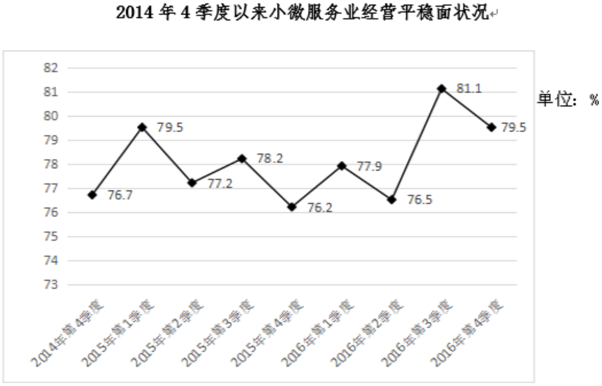

2014年4季度以来小微服务业经营平稳面状况

| 季度 | 经营平稳面（%） |
| --- | --- |
| 2014年第4季度 | 76.7 |
| 2015年第1季度 | 79.5 |
| 2015年第2季度 | 77.2 |
| 2015年第3季度 | 78.2 |
| 2015年第4季度 | 76.2 |
| 2016年第1季度 | 77.9 |
| 2016年第2季度 | 76.5 |
| 2016年第3季度 | 81.1 |
| 2016年第4季度 | 79.5 |

纵轴刻度73—82；“单位：%”在图右侧。原图标题末尾印有Word段落标记“↵”，不是内容。

2016年，小微服务业样本企业资产总计367亿元，同比增长9.3%，户均1643.7万元。负债合计194.8亿元，同比增长8.1%，低于资产增长速度1.2个百分点。资产负债率为53.1%，处于较为合理水平。实现利润总额4.6亿元，销售利润率为5.7%。小微服务业企业的资金和盈利水平均处于平稳状态。
各主要行业中，水利、环境和公共设施管理业，信息传输、软件和信息技术服务业，租赁和商务服务业，房地产业的增速明显高于平均水平。

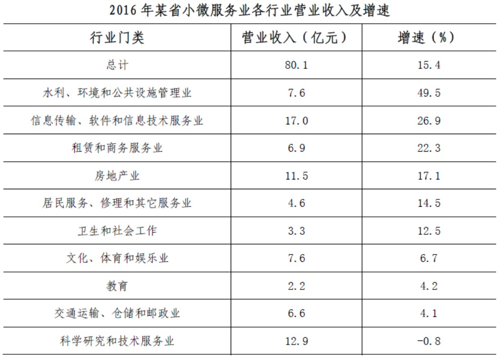

2016年某省小微服务业各行业营业收入及增速

| 行业门类 | 营业收入（亿元） | 增速（%） |
| --- | --- | --- |
| 总计 | 80.1 | 15.4 |
| 水利、环境和公共设施管理业 | 7.6 | 49.5 |
| 信息传输、软件和信息技术服务业 | 17.0 | 26.9 |
| 租赁和商务服务业 | 6.9 | 22.3 |
| 房地产业 | 11.5 | 17.1 |
| 居民服务、修理和其它服务业 | 4.6 | 14.5 |
| 卫生和社会工作 | 3.3 | 12.5 |
| 文化、体育和娱乐业 | 7.6 | 6.7 |
| 教育 | 2.2 | 4.2 |
| 交通运输、仓储和邮政业 | 6.6 | 4.1 |
| 科学研究和技术服务业 | 12.9 | -0.8 |

> 材料说明：材料1正文中的百分数（15.4%、79.5%、9.3%、8.1%、53.1%、5.7%）在原卷中为图片，已转写为文字。

### 第 86 题

`GD2017-Q086` · 单选 · 原卷第 11 页

[共用材料](#GD2017-M1)

2016年，该省小微服务业样本企业的营业收入比2015年大约多多少亿元？

**A.** 5.3

**B.** 10.7

**C.** 12.3

**D.** 23.0

**答案：B**

### 第 87 题

`GD2017-Q087` · 单选 · 原卷第 11 页

[共用材料](#GD2017-M1)

2016年，小微服务业经营平稳面同比扩大最显著的是：

**A.** 1季度

**B.** 2季度

**C.** 3季度

**D.** 4季度

**答案：D**

### 第 88 题

`GD2017-Q088` · 单选 · 原卷第 11 页

[共用材料](#GD2017-M1)

2015-2016年，平均每季度大约有多少企业认为自身综合经营状况良好或稳定？

**A.** 77.2%

**B.** 78.3%

**C.** 79.6%

**D.** 82.8%

**答案：B**

> 转写说明：四个选项的百分数在原卷中为图片，已转写为文字。

### 第 89 题

`GD2017-Q089` · 单选 · 原卷第 11 页

[共用材料](#GD2017-M1)

2016年，小微服务业的下列各行业，按营业收入同比变化量的大小排序正确的是：

**A.** 文化、体育和娱乐业>卫生和社会工作>科学研究和技术服务业>教育

**B.** 文化、体育和娱乐业>卫生和社会工作>教育>科学研究和技术服务业

**C.** 文化、体育和娱乐业>科学研究和技术服务业>卫生和社会工作>教育

**D.** 卫生和社会工作>文化、体育和娱乐业>科学研究和技术服务业>教育

**答案：A**

> 转写说明：各项中的“>”在原卷中为图片，已转写为半角“>”。

### 第 90 题

`GD2017-Q090` · 单选 · 原卷第 11 页

[共用材料](#GD2017-M1)

下列说法不正确的是：

**A.** 2016年，大多数小微服务业行业的营业收入同比有所增长

**B.** 2015年，小微服务业样本企业的户均资产大约为1504万元

**C.** 2016年，小微服务业样本企业的户均负债大约为873万元

**D.** 2016年，信息传输、软件和信息技术服务业的营业收入增加最多

**答案：B**

### 共用材料：第 91—95 题

2016年，广东民营经济增加值突破四万亿元。经初步核算，全年实现民营经济增加值42578.76亿元，按可比价计算，比上年同期增长7.8%，增幅高于同期GDP增幅0.3个百分点，其中第二产业增幅比同期GDP第二产业增幅高3个百分点。民营经济占GDP的比重为53.6%，比2010年提高3.9个百分点，占比逐年提高；对GDP增长的贡献率为55.5%，同比提高1.3个百分点，拉动GDP增速达4.2个百分点，民营经济的作用不断提升，是广东经济增长的主力军。

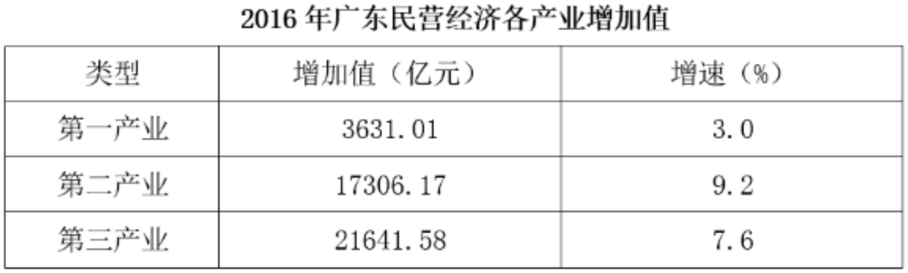

2016年广东民营经济各产业增加值

| 类型 | 增加值（亿元） | 增速（%） |
| --- | --- | --- |
| 第一产业 | 3631.01 | 3.0 |
| 第二产业 | 17306.17 | 9.2 |
| 第三产业 | 21641.58 | 7.6 |

分行业看，民营经济发展速度快于全部经济类型的行业有工业、金融业和其他服务业，其中民营工业实现增加值15898.95亿元，同比增长9.7%，比全部经济类型工业快3.3个百分点；民营经济占全部经济类型比重较大的行业有农林牧渔业、住宿餐饮业、批发零售业和房地产业，分别为98.2%、85.3%、73.2%和68.3%；民营经济对GDP贡献率较大的行业有工业、其他服务业，分别为25.7%、11.3%。

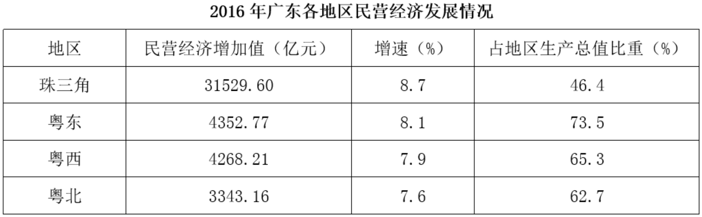

2016年广东各地区民营经济发展情况

| 地区 | 民营经济增加值（亿元） | 增速（%） | 占地区生产总值比重（%） |
| --- | --- | --- | --- |
| 珠三角 | 31529.60 | 8.7 | 46.4 |
| 粤东 | 4352.77 | 8.1 | 73.5 |
| 粤西 | 4268.21 | 7.9 | 65.3 |
| 粤北 | 3343.16 | 7.6 | 62.7 |

【注释】生产总值（GDP）：指按市场价格计算的一个地区所有常住单位在一定时期内生产活动的最终成果。从价格形态看，它是所有常住单位的增加值之和。
增加值：总产出减去中间投入后的余额，反映一定时期内各部门、各单位生产经营活动的最终成果，也就是本部门、本单位对生产总值提供的份额。

> 材料说明：材料2正文中的百分数（7.8%、53.6%、55.5%、9.7%、98.2%、85.3%、73.2%、68.3%、25.7%、11.3%）在原卷中为图片，已转写为文字。

> 材料说明：材料2表2四个地区民营经济增加值之和为43493.74亿元，与正文“全年实现民营经济增加值42578.76亿元”不一致（答案解析第95题也指出文字与表格数据有矛盾）；照录。

> 材料说明：“【注释】”在原卷单独占一行，转写时与下一行“生产总值（GDP）：……”连排。

### 第 91 题

`GD2017-Q091` · 单选 · 原卷第 12 页

[共用材料](#GD2017-M2)

2016年广东民营经济第二产业实现的增加值约是第一产业的多少倍？

**A.** 4.11

**B.** 4.32

**C.** 4.77

**D.** 5.17

**答案：C**

### 第 92 题

`GD2017-Q092` · 单选 · 原卷第 12 页

[共用材料](#GD2017-M2)

2016年广东民营经济中第三产业所占的比重相比2015年大约：

**A.** 提高了0.1个百分点

**B.** 降低了0.1个百分点

**C.** 提高了0.2个百分点

**D.** 降低了0.2个百分点

**答案：B**

### 第 93 题

`GD2017-Q093` · 单选 · 原卷第 12 页

[共用材料](#GD2017-M2)

2015年广东民营工业实现的增加值约占当年GDP的：

**A.** 16.6%

**B.** 19.6%

**C.** 22.6%

**D.** 25.6%

**答案：B**

> 转写说明：四个选项的百分数在原卷中为图片，已转写为文字。

### 第 94 题

`GD2017-Q094` · 单选 · 原卷第 12 页

[共用材料](#GD2017-M2)

根据资料可知：

**A.** 2016年广东民营经济对GDP增长的贡献率高于其他经济类型

**B.** 广东民营经济占GDP的比重从2011年开始超过50%

**C.** 2016年广东的房地产市场中，国有经济占了近三分之一的份额

**D.** 民营经济仅在部分行业具有优势

**答案：A**

> 转写说明：B项中的“50%”在原卷中为图片，已转写为文字。

### 第 95 题

`GD2017-Q095` · 单选 · 原卷第 12 页

[共用材料](#GD2017-M2)

下列说法正确的是：

**A.** 2016年珠三角地区民营经济占全省的比重相比2015年提高了超过0.5个百分点

**B.** 2016年广东各地区中，民营经济增速越慢的地区，当地民营经济占生产总值的比重也越低

**C.** 2015年珠三角地区民营经济的增加值是广东其他各地区之和的3倍

**D.** 2016年广东民营经济在各行业中的发展速度都是最快的

**答案：A**

### 共用材料：第 96—100 题

2016年，某省完成邮政通信业务总量6886.15亿元，同比增长56.6%，增幅比上年提高27.4个百分点。其中，完成邮政业务总量1879.99亿元，增长53.0%，增幅提高11.0个百分点；完成通信业务总量5006.16亿元，增长58.0%，增幅提高33.2个百分点。
2016年，该省完成快递业务量76.72亿件，同比增长53.0%，占全国快递业务量的比重达到24.5%，比排名第二的Z省多16.80亿件。

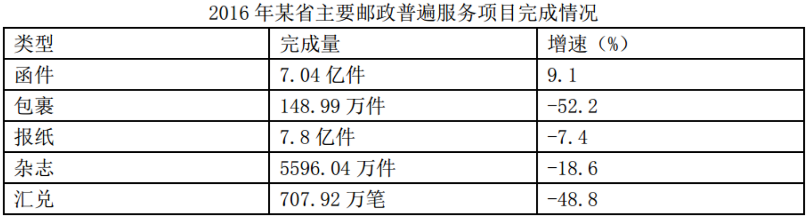

2016年某省主要邮政普遍服务项目完成情况

| 类型 | 完成量 | 增速（%） |
| --- | --- | --- |
| 函件 | 7.04亿件 | 9.1 |
| 包裹 | 148.99万件 | -52.2 |
| 报纸 | 7.8亿件 | -7.4 |
| 杂志 | 5596.04万件 | -18.6 |
| 汇兑 | 707.92万笔 | -48.8 |

2016年，该省电话用户数为1.69亿，其中固定电话用户数为2609.7万，移动电话用户数为14349万，分别比上年减少197.4万户和203.1万户。移动电话中4G用户数为9085.30万，占移动电话用户的比重由上年的38.5%提升至63.3%。固定电话本地通话时长、长途通话时长以及移动电话通话时长同比分别减少12.3%、19.5%和6.5%，移动短信、彩信业务量分别减少22.2%和2.1%。
2016年，该省固定互联网宽带用户数为2850.60万，宽带接入流量同比增长40%，其中8M及以上和20M及以上宽带接入用户占比分别为81.9%和65.1%，分别比上年提升26.2个和40.4个百分点，固定宽带用户均资费同比下降3.8%。该省移动互联网用户数达1.15亿，移动互联网接入流量同比增长128.9%，移动流量资费水平同比下降40.5%，通信资费总体水平同比下降32.5%。

> 材料说明：材料3正文中的百分数（56.6%、53.0%、58.0%、24.5%、38.5%、63.3%、12.3%、19.5%、6.5%、22.2%、2.1%、40%、81.9%、65.1%、3.8%、128.9%、40.5%、32.5%）在原卷中为图片，已转写为文字。

### 第 96 题

`GD2017-Q096` · 单选 · 原卷第 13 页

[共用材料](#GD2017-M3)

2016年该省完成的通信业务总量占邮政通信业务总量的比重相比2014年大约：

**A.** 提高了0.6个百分点

**B.** 降低了0.6个百分点

**C.** 提高了1.9个百分点

**D.** 降低了1.9个百分点

**答案：D**

### 第 97 题

`GD2017-Q097` · 单选 · 原卷第 13 页

[共用材料](#GD2017-M3)

2015年该省报纸的订销完成量约是杂志的多少倍？

**A.** 12.3

**B.** 13.9

**C.** 15.1

**D.** 16.7

**答案：A**

### 第 98 题

`GD2017-Q098` · 单选 · 原卷第 13 页

[共用材料](#GD2017-M3)

2016年该省移动电话用户中4G用户数比2015年大约增加了多少万？

**A.** 3154

**B.** 3483

**C.** 3844

**D.** 4239

**答案：B**

### 第 99 题

`GD2017-Q099` · 单选 · 原卷第 13 页

[共用材料](#GD2017-M3)

根据资料，下列选项无法得出的是：

**A.** 2016年该省邮政通信业务总量的增长速度约是上一年的2倍

**B.** 2016年该省手机流量的资费水平大幅降低

**C.** 4G正成为该省移动电话用户的主流制式

**D.** 固定宽带运营商未采取有效降低资费水平的措施

**答案：D**

> 转写说明：原卷A、B两项排在同一行且中间没有留白（“……2倍B、2016年……”），B项折行，C、D两项在下一行；已按选项字母拆为四项。

### 第 100 题

`GD2017-Q100` · 单选 · 原卷第 13 页

[共用材料](#GD2017-M3)

根据资料可知：

**A.** 2015年该省的快递业务量比Z省少

**B.** 2016年该省主要邮政普遍服务项目均出现下滑

**C.** 2016年该省8M以下宽带接入用户的占比相较于上一年减少了一半以上

**D.** 2016年该省电话通话时长和短信业务量的下降是由于移动互联网的迅速发展所致

**答案：C**
