# 2018年广东行测（县级、乡镇统一卷）

共 100 题，原题号完整保留。内容：题干、选项、答案（不收解析）；资料分析共用材料置于所属题组前，JSONL 每条记录完整内嵌材料。

[结构化数据](GD2018.jsonl) · [字段说明](schema.json) · [质量报告](quality/GD2018.md)

原题来源：[2018年广东省公务员录用考试《行测》真题（县级、乡镇统一卷）.pdf](https://github.com/dumarstoft-ship-it/xing-ce1/blob/52f9811b22cad5410a7108dd0a07a879f1187aa5/%E7%9C%9F%E9%A2%98/2018%E5%B9%B4%E5%B9%BF%E4%B8%9C%E7%9C%81%E5%85%AC%E5%8A%A1%E5%91%98%E5%BD%95%E7%94%A8%E8%80%83%E8%AF%95%E3%80%8A%E8%A1%8C%E6%B5%8B%E3%80%8B%E7%9C%9F%E9%A2%98%EF%BC%88%E5%8E%BF%E7%BA%A7%E3%80%81%E4%B9%A1%E9%95%87%E7%BB%9F%E4%B8%80%E5%8D%B7%EF%BC%89.pdf)。答案来源：[2018年广东省公务员录用考试《行测》真题（县级、乡镇统一卷）答案及解析.pdf](https://github.com/dumarstoft-ship-it/xing-ce1/blob/52f9811b22cad5410a7108dd0a07a879f1187aa5/%E7%AD%94%E6%A1%88%E8%A7%A3%E6%9E%90/2018%E5%B9%B4%E5%B9%BF%E4%B8%9C%E7%9C%81%E5%85%AC%E5%8A%A1%E5%91%98%E5%BD%95%E7%94%A8%E8%80%83%E8%AF%95%E3%80%8A%E8%A1%8C%E6%B5%8B%E3%80%8B%E7%9C%9F%E9%A2%98%EF%BC%88%E5%8E%BF%E7%BA%A7%E3%80%81%E4%B9%A1%E9%95%87%E7%BB%9F%E4%B8%80%E5%8D%B7%EF%BC%89%E7%AD%94%E6%A1%88%E5%8F%8A%E8%A7%A3%E6%9E%90.pdf)（只取答案）。

## 言语理解与表达

### 第 1 题

`GD2018-Q001` · 单选 · 原卷第 1 页

宪法是治国安邦的总（），是党和人民意志的集中（），在我们党治国理政活动中具有十分重要的地位和作用。

**A.** 规范 呈现

**B.** 章法 展现

**C.** 章程 体现

**D.** 标准 表现

**答案：C**

### 第 2 题

`GD2018-Q002` · 单选 · 原卷第 1 页

党的十八大以来，中国人民的创造精神前所未有地（）出来，推动我国（）向前发展，大踏步走在世界前列。

**A.** 迸发 日新月异

**B.** 激发 气象万千

**C.** 涌现 千变万化

**D.** 呈现 一日千里

**答案：A**

### 第 3 题

`GD2018-Q003` · 单选 · 原卷第 1 页

在新时代，我们要大力提升发展质量和效益，坚持质量第一、（）质量变革、（）质量优势、建设质量强国、（）高质量发展。

**A.** 发动 增强 追求

**B.** 提倡 增加 达到

**C.** 推动 增强 实现

**D.** 倡导 增加 完成

**答案：C**

### 第 4 题

`GD2018-Q004` · 单选 · 原卷第 1 页

经过五年的不懈努力，群众反映强烈的突出问题得到有效（），不正之风得以扭转，可以说作风建设改变了中国，在全面从严治党历史进程中写下了（）的一笔。

**A.** 遏制 铿锵有力

**B.** 遏止 入木三分

**C.** 遏止 掷地有声

**D.** 遏制 浓墨重彩

**答案：D**

### 第 5 题

`GD2018-Q005` · 单选 · 原卷第 1 页

总理在两会上所作的政府工作报告是一个（）民心、（）民意、体现民情的报告，也是一个增强信心、鼓舞士气、催人奋进的报告。

**A.** 代表 反应

**B.** 表现 反映

**C.** 表现 反应

**D.** 代表 反映

**答案：D**

### 第 6 题

`GD2018-Q006` · 单选 · 原卷第 1 页

开展国土绿化行动，既要注重数量，更要注重质量，坚持科学绿化、规划引导、（），走科学、生态、借鉴的绿化发展之路，久久为功，善做善成，不断（）森林面积，不断（）森林质量，不断提升生态系统质量和稳定性。

**A.** 因地制宜 扩大 提高

**B.** 因势利导 加大 增强

**C.** 因地制宜 扩充 强化

**D.** 因势利导 增加 改善

**答案：A**

> 转写说明：原卷题干作“走科学、生态、借鉴的绿化发展之路”，原提法为“科学、生态、节俭的绿化发展之路”，“借鉴”疑为“节俭”之误，照录。

### 第 7 题

`GD2018-Q007` · 单选 · 原卷第 1 页

在当代中国，维护社会公平正义，就是要在现代化进程中逐步建立起以权利公平、机会公平、规则公平为主要内容的社会公平保障体系，（）公平的社会环境，让公平正义的阳光（）每一个国民，使每个社会成员都能享有平等的权利，有实现个人理想的机会，有表达利益（）的合法途径。

**A.** 打造 映照 诉求

**B.** 营造 普照 诉求

**C.** 创造 照射 要求

**D.** 制造 照耀 要求

**答案：B**

### 第 8 题

`GD2018-Q008` · 单选 · 原卷第 1 页

历代仁人志士所处的历史时代不同，但都以自己的行为作出了这样的诠释：“忠”就是（），在国家和民族危难之时大义凛然，挺身而出；“忠”就是（），在是非曲直面前旗帜鲜明，刚直不阿；“忠”就是（），在各种诱惑面前心有定力，不为所动。

**A.** 担当 正直 坚持

**B.** 勇敢 刚正 坚守

**C.** 担当 刚正 坚守

**D.** 勇敢 正直 坚持

**答案：C**

### 第 9 题

`GD2018-Q009` · 单选 · 原卷第 1 页

中国发展到今天，我们（）不需要对西方文明持仰视与全盘肯定的态度，（）对传统文化回归的呼唤也必须建立在科学理性的基础上，（）不能落入对“己”过于自信与对“他”全然排斥的窠臼。

**A.** 肯定 但 也

**B.** 固然 但 而

**C.** 虽然 而 却

**D.** 即使 而 又

**答案：B**

### 第 10 题

`GD2018-Q010` · 单选 · 原卷第 1 页

（）的中华民族发展史是中国人民书写的，（）的中华文明是中国人民创造的，（）的中华民族精神是中国人民培育的，中华民族迎来了从站起来、富起来到强起来的伟大飞跃是中国人民奋斗出来的。

**A.** 波澜壮阔 博大精深 历久弥新

**B.** 恢弘壮丽 源远流长 同舟共济

**C.** 气势磅礴 奔流不息 与时俱进

**D.** 延绵不断 厚积薄发 奋发有为

**答案：A**

### 第 11 题

`GD2018-Q011` · 单选 · 原卷第 1、2 页

改革开放使我国走向繁荣富强，经济实力、科技实力、国防实力、综合国力快速提升。改革开放之所以能给我国带来翻天覆地的变化，一个重要原因是__________，主要体现为我们既坚持以经济建设为中心、把发展作为第一要务，又主动为发展营造安全环境。前者以改革开放解放和发展生产力，提高资源配置效率和发展水平；后者改变了我们处理自身与外部关系的方式，主动改善和发展与其他国家的关系，积极缓解外部安全威胁。
填入划线部分的句子，最恰当的是（）。

**A.** 它推动了经济快速发展和综合国力的提高

**B.** 它得到了人民群众的衷心拥护和支持

**C.** 它优化了政策制度体系和施政方式

**D.** 它带来了重大的理念和战略转变

**答案：D**

> 转写说明：原卷填空处是带下划线的10个空格（文字层只有空格字符），转写为10个下划线“__________”。

### 第 12 题

`GD2018-Q012` · 单选 · 原卷第 2 页

习近平总书记强调，“调查研究是我们党的传家宝，是做好各项工作的基本功”，同时要求“要拜人民为师，向人民学习，放下架子、扑下身子，接地气、通下情，‘身入’更要‘心至’”。当前，面对新目标新形势，党员干部要甘当群众的“学生”。党员干部只有“扑下身子”，才能了解群众需要什么、盼望什么，群众才会愿意、敢于讲真话、说实情、谈想法。如此，调查研究才能抓住老百姓最急最忧最怨的问题，准确掌握真实情况，避免“走马观花”“蜻蜓点水”。
这段文字主要讲了（）。

**A.** 调查研究是各项工作的基础

**B.** 调查研究要讲究方式方法

**C.** 调查研究的意义及方法

**D.** 如何了解群众真实情况

**答案：C**

### 第 13 题

`GD2018-Q013` · 单选 · 原卷第 2 页

乡村振兴根本上是要实现农村经济增收和农民收入提高，其前提是提高劳动生产率水平。由于农业行业天然具有较大风险的特征，因而需要政府引导更多资本、有效分散风险的金融制度安排和其匹配，通过产融结合完善农业产业链；通过农业供给侧结构性改革推进农业产业升级，将劳动力、土地、资本等生产要素更多投入到附加值高的绿色优质安全和特色农产品上，提高农产品的质量，满足人民对高品质农产品的需求。
以下最能概括这段文字主要内容的是（）。

**A.** 乡村振兴的体制机制创新

**B.** 乡村振兴的本质和基础

**C.** 乡村振兴战略的实践

**D.** 乡村振兴战略的改革

**答案：A**

### 第 14 题

`GD2018-Q014` · 单选 · 原卷第 2 页

网络已经渗透到生活的方方面面，语言文字正在从精英创造时代进入大众智慧时代。近日，语言文字规范类刊物《咬文嚼字》杂志社发布“2017年度十大流行语”，“不忘初心”“砥砺奋进”“流量”“尬”“怼”等入选。近年来，年度十大流行语的网络特色日益明显，2017年有超过一半的入选流行语来自于网络或由网络赋予了新的涵义。
对这段文字理解准确的是（）。

**A.** 网络语言的流行说明大众对语言文字发展的重要影响

**B.** 网络流行语逐渐成为大众语言文字的主要组成部分

**C.** 年度十大流行语征集范围主要以互联网用户为主

**D.** 精英创造的语言文字正逐渐从网络使用中减少

**答案：A**

### 第 15 题

`GD2018-Q015` · 单选 · 原卷第 2 页

任何技术的价值观，说到底还是人的价值观。技术中立不代表对技术的使用是无害的，失去道德与法律的约束，就会有碰触底线的危险。一方面，对于商业组织来说，即使其抱有保护个人数据的使命感，然而一旦出现商业利益的冲突，仅靠自律是否足够？另一方面，政府组织也会在各类公共服务中采集大量个人数据，这部分个人数据的敏感程度往往较高，如果缺乏一套完善的制度监管体系严防其被滥用、盗用，那么也将使公民的个人信息被暴露在较大风险之中。
这段文字意在说明（）。

**A.** 商业组织的自律有助于保护个人数据

**B.** 人的价值观决定了技术使用的利弊

**C.** 技术中立给个人数据带来风险

**D.** 个人数据的收集需要监管

**答案：D**

## 数量关系

### 第 16 题

`GD2018-Q016` · 单选 · 原卷第 2 页

31 29 28 26 25 23（    ）

**A.** 22

**B.** 24

**C.** 35

**D.** 38

**答案：A**

### 第 17 题

`GD2018-Q017` · 单选 · 原卷第 2、3 页

3 5 17 39 71（    ）

**A.** 107

**B.** 113

**C.** 121

**D.** 135

**答案：B**

### 第 18 题

`GD2018-Q018` · 单选 · 原卷第 3 页

0.5 3 8 18 38（    ）

**A.** 75

**B.** 78

**C.** 82

**D.** 85

**答案：B**

### 第 19 题

`GD2018-Q019` · 单选 · 原卷第 3 页

1 2 5 26（    ）

**A.** 377

**B.** 477

**C.** 577

**D.** 677

**答案：D**

### 第 20 题

`GD2018-Q020` · 单选 · 原卷第 3 页

14 28 56 112（    ）

**A.** 155

**B.** 186

**C.** 224

**D.** 320

**答案：C**

### 第 21 题

`GD2018-Q021` · 单选 · 原卷第 3 页

工厂的两个车间共同组装6300辆自行车。如果先由一号车间组装8天，再由二号车间组装3天，刚好可以完成任务；如果先由二号车间组装6天，再由一号车间组装6天，也刚好可以完成任务。则一号车间每天比二号车间多组装（）辆自行车。

**A.** 210

**B.** 180

**C.** 150

**D.** 130

**答案：A**

### 第 22 题

`GD2018-Q022` · 单选 · 原卷第 3 页

一列货运火车和一列客运火车同向匀速行驶，货车的速度为72千米/时，客车的速度为108千米/时。已知货车的长度是客车的1.5倍，两列火车由车尾平齐到车头平齐共用了20秒，则客运火车长（）米。

**A.** 160

**B.** 240

**C.** 400

**D.** 600

**答案：C**

### 第 23 题

`GD2018-Q023` · 单选 · 原卷第 3 页

某市服务行业举行业务技能大赛，其中东区参赛人数占总人数的1/5，西区参赛人数占总人数的2/5，南区参赛人数占总人数的1/4，其余的是北区的参赛人员。结果东区参赛人数的1/3获奖，西区参赛人数的1/12获奖，南区参赛人数的1/9获奖。已知参赛总人数超过100人，不到200人，则参赛总人数为（）。

**A.** 120

**B.** 140

**C.** 160

**D.** 180

**答案：D**

> 转写说明：题干中的6个分数在原卷中为图片，已按“分子/分母”转写。

### 第 24 题

`GD2018-Q024` · 单选 · 原卷第 3 页

一个箱子的底部由5块正方形纸板ABCDE和1块长方形纸板F拼接而成（如图所示），已知A B两块纸板的面积比是1:16，假设A纸板的边长为2厘米，则该箱子底部的面积为（）平方厘米。

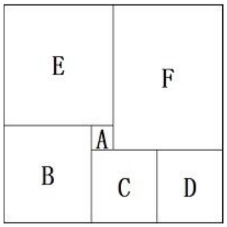

**A.** 200

**B.** 320

**C.** 360

**D.** 420

**答案：C**

> 转写说明：原卷“已知A”在行末、“B两块纸板”在下一行行首，A、B之间没有标点，转写为“A B”。

### 第 25 题

`GD2018-Q025` · 单选 · 原卷第 3 页

工厂要对一台已经拆成6个部件的机器进行清洗，并重新组装。清洗6个部件的时间分别为10分钟、15分钟、21分钟、8分钟、5分钟、26分钟，重新组装需要15分钟。假设清洗每一个部件或重新组装时都需要甲乙两人合作才能完成，报酬标准为每人每小时150元（不足一小时按一小时计），则工厂需要支付给甲乙两人共（）元。

**A.** 300

**B.** 600

**C.** 900

**D.** 1200

**答案：B**

### 第 26 题

`GD2018-Q026` · 单选 · 原卷第 3 页

有一条长100厘米的纸带，从一端开始，先涂一段红色，长度为4厘米；再涂一段白色，长度为4厘米。按此规律重复操作，直到颜色涂满整条纸带。则涂红色的部分共有（）段。

**A.** 10

**B.** 13

**C.** 15

**D.** 25

**答案：B**

### 第 27 题

`GD2018-Q027` · 单选 · 原卷第 3 页

某软件公司对旗下甲、乙、丙、丁四款手机软件进行使用情况调查，在接受调查的1000人中，有68%的人使用过甲软件，有87%的人使用过乙软件，有75%的人使用过丙软件，有82%的人使用过丁软件。那么，在这1000人中，使用过全部四款手机软件的至少有（）人。

**A.** 120

**B.** 250

**C.** 380

**D.** 430

**答案：A**

> 转写说明：题干中的“68%”“87%”“75%”“82%”在原卷中为图片（数字与百分号各一张），已转写为文字。

### 第 28 题

`GD2018-Q028` · 单选 · 原卷第 4 页

某公园有一个周长为1千米的长方形花坛，计划在其周围每隔100米放置一个垃圾桶。现已将所需垃圾桶全部放在其中一个放置点(如图所示)，接下来要用手推车将垃圾桶运到每一个放置点。假如该手推车每次最多能运3个垃圾桶，则将垃圾桶运到最后一个放置点时手推车行程最少为（）米。

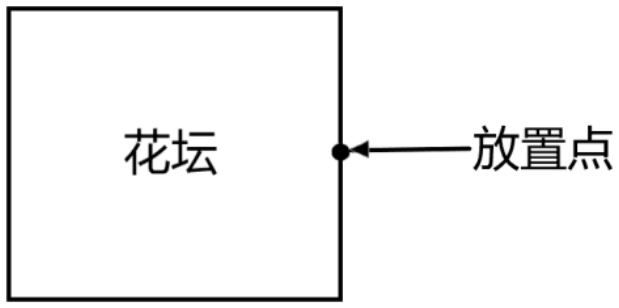

**A.** 1600

**B.** 1800

**C.** 1900

**D.** 2200

**答案：B**

### 第 29 题

`GD2018-Q029` · 单选 · 原卷第 4 页

某条道路一侧共有20盏路灯。为了节约用电，计划只打开其中的10盏。但为了不影响行路安全，要求相邻的两盏路灯中至少有一盏是打开的，则共有（）种开灯方案。

**A.** 2

**B.** 6

**C.** 11

**D.** 13

**答案：C**

### 第 30 题

`GD2018-Q030` · 单选 · 原卷第 4 页

一项足球比赛共有8支队伍参加，每两支队伍之间需要踢两场比赛，获胜得3分，打平得1分，落败不得分。在该项足球比赛中，获得第一名的队伍积分最多可能比第二名多（）分。

**A.** 40

**B.** 30

**C.** 20

**D.** 10

**答案：B**

## 判断推理

### 第 31 题

`GD2018-Q031` · 单选 · 图形推理 · 原卷第 4 页

从所给的四个选项中，选择最合适的一个填在问号处，使之呈现一定的规律性：

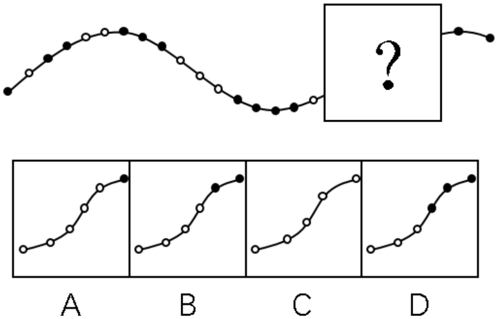

**A.** 见上方题图中 A 项。

**B.** 见上方题图中 B 项。

**C.** 见上方题图中 C 项。

**D.** 见上方题图中 D 项。

**答案：D**

### 第 32 题

`GD2018-Q032` · 单选 · 图形推理 · 原卷第 4 页

从所给的四个选项中，选择最合适的一个填在问号处，使之呈现一定的规律性：

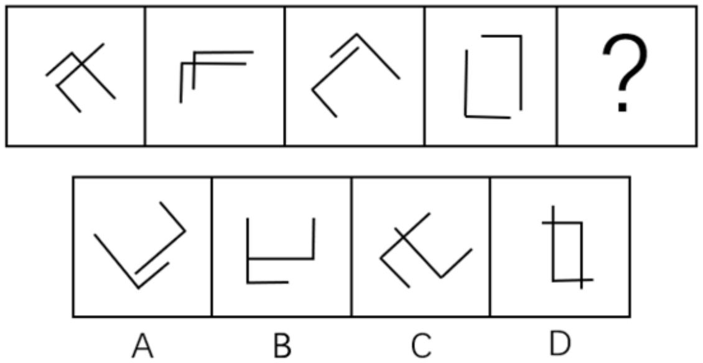

**A.** 见上方题图中 A 项。

**B.** 见上方题图中 B 项。

**C.** 见上方题图中 C 项。

**D.** 见上方题图中 D 项。

**答案：A**

### 第 33 题

`GD2018-Q033` · 单选 · 图形推理 · 原卷第 4、5 页

从所给的四个选项中，选择最合适的一个填在问号处，使之呈现一定的规律性：

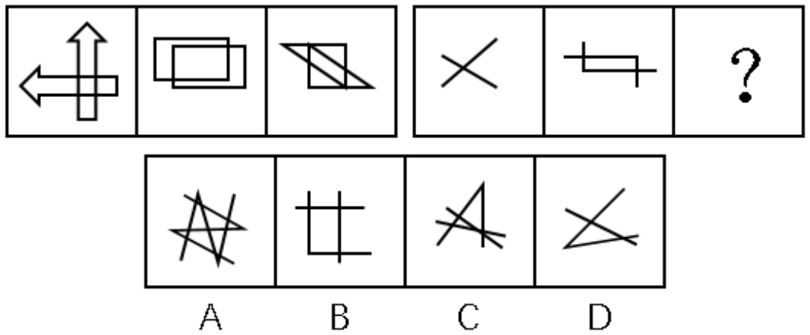

**A.** 见上方题图中 A 项。

**B.** 见上方题图中 B 项。

**C.** 见上方题图中 C 项。

**D.** 见上方题图中 D 项。

**答案：A**

### 第 34 题

`GD2018-Q034` · 单选 · 图形推理 · 原卷第 5 页

从所给的四个选项中，选择最合适的一个填在问号处，使之呈现一定的规律性：

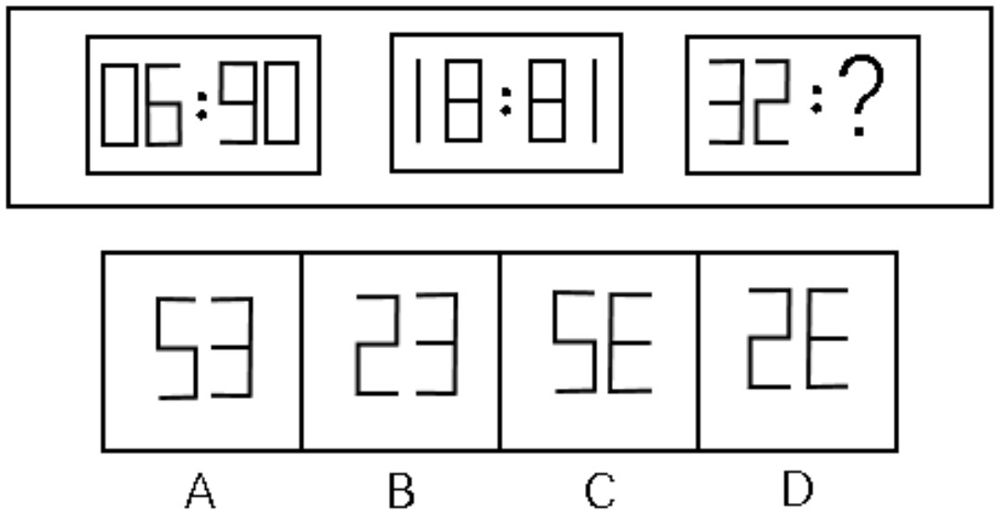

**A.** 见上方题图中 A 项。

**B.** 见上方题图中 B 项。

**C.** 见上方题图中 C 项。

**D.** 见上方题图中 D 项。

**答案：D**

### 第 35 题

`GD2018-Q035` · 单选 · 图形推理 · 原卷第 5 页

从所给的四个选项中，选择最合适的一个填在问号处，使之呈现一定的规律性：

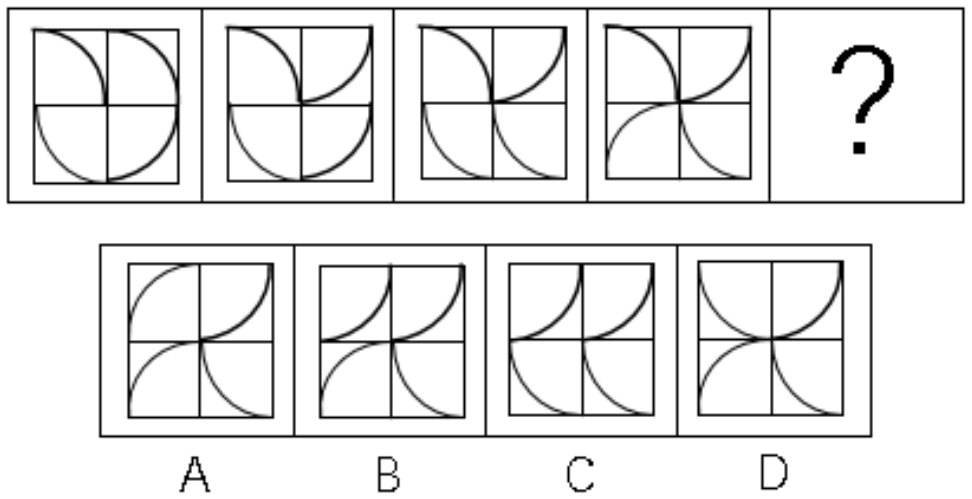

**A.** 见上方题图中 A 项。

**B.** 见上方题图中 B 项。

**C.** 见上方题图中 C 项。

**D.** 见上方题图中 D 项。

**答案：B**

> 转写说明：本题题图在原PDF中的图片对象下缘越过第36题的题号行，脚本按下缘排序会把它归入第36题，已归回本题（见质量报告“复核方法”）。

### 第 36 题

`GD2018-Q036` · 单选 · 图形推理 · 原卷第 5 页

从所给的四个选项中，选择最合适的一个填在问号处，使之呈现一定的规律性：

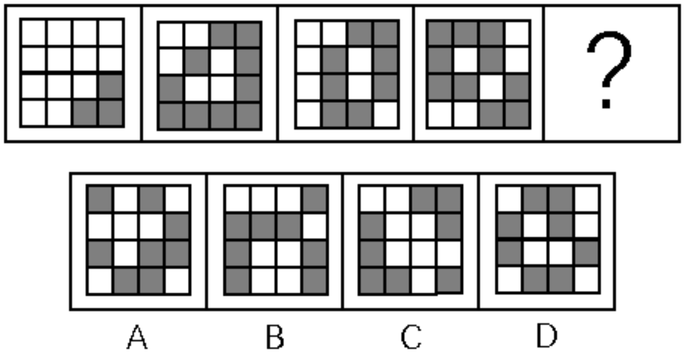

**A.** 见上方题图中 A 项。

**B.** 见上方题图中 B 项。

**C.** 见上方题图中 C 项。

**D.** 见上方题图中 D 项。

**答案：D**

### 第 37 题

`GD2018-Q037` · 单选 · 图形推理 · 原卷第 5、6 页

从所给的四个选项中，选择最合适的一个填在问号处，使之呈现一定的规律性：

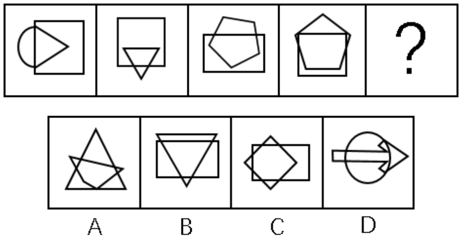

**A.** 见上方题图中 A 项。

**B.** 见上方题图中 B 项。

**C.** 见上方题图中 C 项。

**D.** 见上方题图中 D 项。

**答案：C**

### 第 38 题

`GD2018-Q038` · 单选 · 图形推理 · 原卷第 6 页

从所给的四个选项中，选择最合适的一个填在问号处，使之呈现一定的规律性：

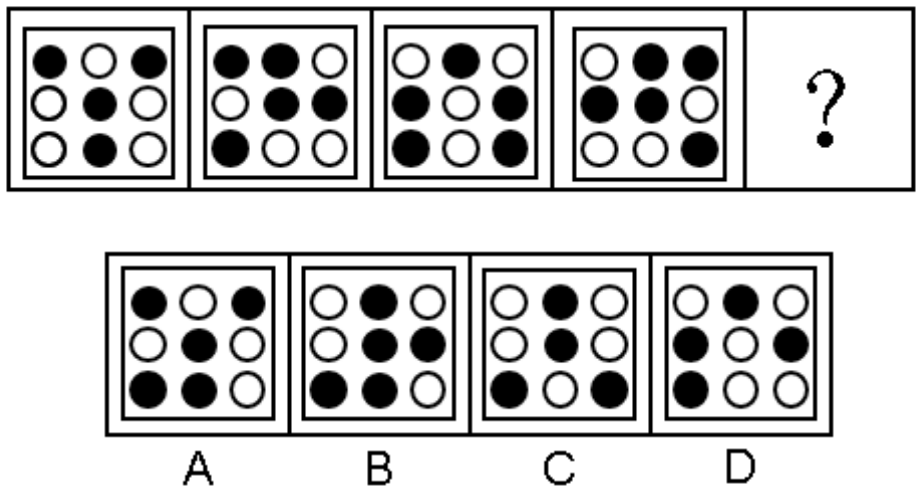

**A.** 见上方题图中 A 项。

**B.** 见上方题图中 B 项。

**C.** 见上方题图中 C 项。

**D.** 见上方题图中 D 项。

**答案：C**

> 转写说明：本题题图在原PDF中的图片对象下缘越过第39题的题号行，脚本按下缘排序会把它归入第39题，已归回本题（见质量报告“复核方法”）。

### 第 39 题

`GD2018-Q039` · 单选 · 图形推理 · 原卷第 6 页

从所给的四个选项中，选择最合适的一个填在问号处，使之呈现一定的规律性：

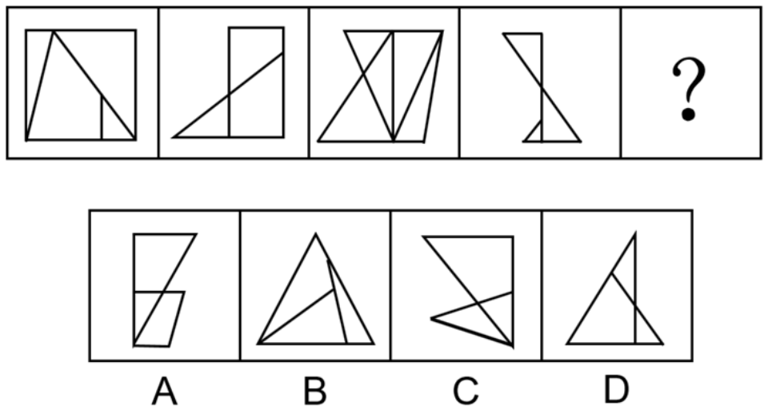

**A.** 见上方题图中 A 项。

**B.** 见上方题图中 B 项。

**C.** 见上方题图中 C 项。

**D.** 见上方题图中 D 项。

**答案：A**

### 第 40 题

`GD2018-Q040` · 单选 · 图形推理 · 原卷第 6 页

从所给的四个选项中，选择最合适的一个填在问号处，使之呈现一定的规律性：

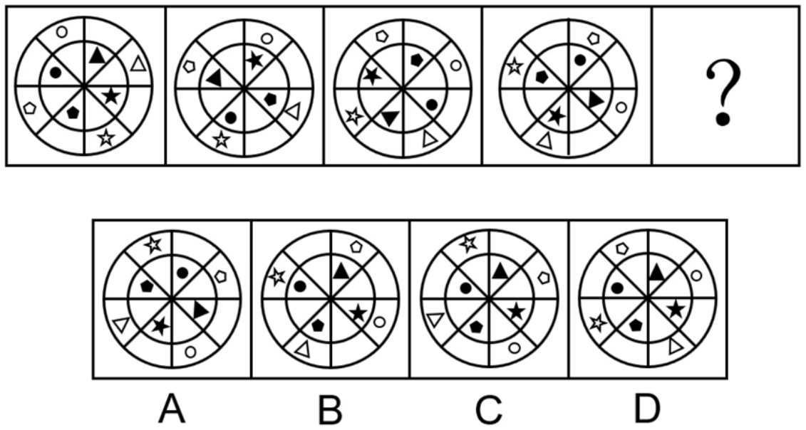

**A.** 见上方题图中 A 项。

**B.** 见上方题图中 B 项。

**C.** 见上方题图中 C 项。

**D.** 见上方题图中 D 项。

**答案：C**

### 第 41 题

`GD2018-Q041` · 单选 · 类比推理 · 原卷第 6 页

畅通：拥堵

**A.** 结实：松散

**B.** 详尽：简略

**C.** 踏实：忧虑

**D.** 男性：女性

**答案：B**

### 第 42 题

`GD2018-Q042` · 单选 · 类比推理 · 原卷第 6 页

法律：遵守

**A.** 政策：推动

**B.** 资源：利用

**C.** 经济：发达

**D.** 环境：整洁

**答案：B**

### 第 43 题

`GD2018-Q043` · 单选 · 类比推理 · 原卷第 6 页

创新：发展

**A.** 批评：进步

**B.** 辞旧：迎新

**C.** 竞赛：夺冠

**D.** 学习：提高

**答案：D**

### 第 44 题

`GD2018-Q044` · 单选 · 类比推理 · 原卷第 6 页

钢笔：墨水

**A.** 牙刷：牙膏

**B.** 手机：电脑

**C.** 词典：报纸

**D.** 壁画：台灯

**答案：A**

### 第 45 题

`GD2018-Q045` · 单选 · 类比推理 · 原卷第 7 页

降价：促销

**A.** 编程：语言

**B.** 复习：考试

**C.** 实验：研究

**D.** 实践：真理

**答案：C**

### 第 46 题

`GD2018-Q046` · 单选 · 类比推理 · 原卷第 7 页

节能：环保

**A.** 贪污：腐败

**B.** 文明：文化

**C.** 秋天：节气

**D.** 运动：休闲

**答案：A**

### 第 47 题

`GD2018-Q047` · 单选 · 类比推理 · 原卷第 7 页

摄影：绘画

**A.** 复印：扫描

**B.** 书法：刺绣

**C.** 雕刻：打磨

**D.** 歌唱：弹奏

**答案：B**

### 第 48 题

`GD2018-Q048` · 单选 · 类比推理 · 原卷第 7 页

木头：家具

**A.** 纤维：水管

**B.** 纸张：报纸

**C.** 棉花：衣服

**D.** 金属：电缆

**答案：C**

### 第 49 题

`GD2018-Q049` · 单选 · 类比推理 · 原卷第 7 页

机器：出厂：检测

**A.** 商品：出口：试用

**B.** 技工：经验：实践

**C.** 白炽灯：照明：通电

**D.** 大学生：毕业：实习

**答案：C**

### 第 50 题

`GD2018-Q050` · 单选 · 类比推理 · 原卷第 7 页

索然无味：味同嚼蜡

**A.** 走投无路：山穷水尽

**B.** 抛砖引玉：抛头露面

**C.** 目光如炬：鼠目寸光

**D.** 一无所得：一箭双雕

**答案：A**

### 第 51 题

`GD2018-Q051` · 单选 · 逻辑判断 · 原卷第 7 页

某市举行春季音乐节系列活动，其中一项活动首次邀请了某知名交响乐团前来该市演出，该市交响乐爱好者对此十分期待。考虑到该乐团的影响力，主办方预计为期两天的交响乐团演出将“一票难求”。但开始售票后发现，实际情况并非如此。
以下哪项为真，最能解释这一情况？

**A.** 音乐节的其他活动吸引了许多观众

**B.** 交响乐未能被该市大部分群众所接受

**C.** 音乐节活动期间该市一直为阴雨天气

**D.** 此次交响乐团演出门票价格过高

**答案：B**

### 第 52 题

`GD2018-Q052` · 单选 · 逻辑判断 · 原卷第 7 页

对多个省份的调查研究发现，对于外向者而言，花大量时间用于网络社交并不会影响与他人面对面交流的意愿，而内向者即使不进行网络社交也不会变成社交达人。因此，有研究者认为，网络社交会妨碍传统社交的担忧是毫无必要的。
以下哪项为真，最有助于支持上述结论？

**A.** 有许多花费大量时间在网络社交上的人不愿意与他人面对面交流

**B.** 无论采用哪种方式，大多数人参与社会活动的总时间是相对固定的

**C.** 在网络社交的帮助下，许多人在传统社交中的能力和自信得到了提升

**D.** 该研究由某大学开展，而在该校学生中，网络社交并不是主要的社交方式

**答案：C**

### 第 53 题

`GD2018-Q053` · 单选 · 逻辑判断 · 原卷第 7 页

近年来，某公司生产的汽车发生了几起严重的交通事故，有人认为这是因为该汽车在设计上存在缺陷导致的。对此，该公司坚决否认设计上存在缺陷，理由是根据这几起交通事故的分析报告，发生事故时，司机都存在酒后驾驶或疲劳驾驶的情况。
以下哪项为真，最不能支持该公司的观点？

**A.** 该公司一直宣称自己的产品安全性能良好

**B.** 该公司所依据的交通事故分析报告真实可靠

**C.** 喝酒和疲劳都会严重影响司机驾驶时的判断力

**D.** 经过对事故车辆的检测，并没有发现存在设计缺陷

**答案：A**

### 第 54 题

`GD2018-Q054` · 单选 · 逻辑判断 · 原卷第 7、8 页

某围棋队有选手会在比赛时喝茶，他们或者喝红茶，或者喝绿茶。
如果以上描述为真，下列哪项一定是真的？
I．该围棋队一名在比赛时不喝红茶的选手，一定喝绿茶。
II．该围棋队没有选手比赛时喝黑茶。
III．该围棋队有的选手比赛时不喝茶。

**A.** 只有II

**B.** 只有III

**C.** I和II

**D.** II和III

**答案：A**

> 转写说明：列项序号原卷作拉丁字母“I．”“II．”“III．”（后接全角点号），选项中的“II”“III”同样是拉丁字母，照录。

### 第 55 题

`GD2018-Q055` · 单选 · 逻辑判断 · 原卷第 8 页

某市高新区离老城区较远，且公交车班次很少。高新区企业的员工大部分居住在老城区，他们经常会因为无法按时坐上公交车而迟到。为此，公交车公司大量增加了高新区与老城区之间的公交车班次，以满足这些员工的乘车需求。但是经过一段时间的观察，情况并没有得到改善，这些员工依然经常迟到。
以下哪项为真，最能解释上述现象？

**A.** 高新区的许多企业都调整了上班时间

**B.** 部分原来开车上班的高新区企业员工改为乘坐公交车

**C.** 由于道路狭窄，公交车班次大量增加后经常出现长时间塞车

**D.** 许多原本乘坐公交车上班的高新区企业员工改为开车或乘坐出租车

**答案：C**

### 第 56 题

`GD2018-Q056` · 单选 · 逻辑判断 · 原卷第 8 页

有研究小组调查显示，在封闭环境中入睡的人更容易频繁醒来，而且自我感觉睡眠质量不佳。因此，有人认为，就寝时关闭门窗将会降低睡眠质量。
以下哪项为真，最能削弱上述结论？

**A.** 研究小组调查的对象大多是年轻人

**B.** 睡眠质量差的人更喜欢关闭门窗睡觉

**C.** 门窗紧闭会影响室内空气质量，从而影响睡眠

**D.** 由于安全、保暖等原因，夜间开窗并不适合所有房间

**答案：B**

### 第 57 题

`GD2018-Q057` · 单选 · 逻辑判断 · 原卷第 8 页

外界环境中的阳光辐射、空气污染等都会使人体产生更多活性氧自由基。体内活性氧自由基正是人类衰老的根源，而抗氧化剂可以有效清除体内多余的自由基。
如果以上描述为真，下列哪项一定是正确的？

**A.** 清除体内多余的自由基，要么避免阳光辐射和空气污染，要么摄入抗氧化剂

**B.** 人的衰老速度可能由环境决定，也可能受抗氧化剂的影响

**C.** 严重的空气污染会影响人的衰老速度和抗氧化剂的效果

**D.** 抗氧化剂能够有效延长人的寿命

**答案：B**

### 第 58 题

`GD2018-Q058` · 单选 · 逻辑判断 · 原卷第 8 页

近期，某公司推出了一款空调，其耗电量比市面上所有其他同类产品都要低。因此，该公司管理层认为，这款空调的销量将会超过市面上所有其他同类产品。
以下哪项为真，最能质疑该公司管理层的判断？

**A.** 该公司的品牌知名度低于其他同类企业

**B.** 该款空调的售后服务质量比不上其他同类产品

**C.** 该款空调的使用寿命低于同类产品的平均水平

**D.** 耗电量并不是大部分消费者在选购空调时的主要关注点

**答案：D**

### 第 59 题

`GD2018-Q059` · 单选 · 逻辑判断 · 原卷第 8 页

单位接到一项工作任务，领导决定从张、王、李、林、沈、赵6人中选出3人组成工作小组。工作组应符合以下3个条件：
①张、林两人中至少需要一人入选。
②王、李两人中至多能有一人入选。
③如果沈、赵两人同时入选，则王不能入选。
以下工作人员组成不符合条件的是：

**A.** 沈、李、赵

**B.** 李、张、林

**C.** 赵、张、王

**D.** 沈、王、林

**答案：A**

### 第 60 题

`GD2018-Q060` · 单选 · 逻辑判断 · 原卷第 8、9 页

某市实体零售店的数量由2013年的3800家，增加到了2017年的4500家。但这几年来，该市实体零售店的销售额在整个零售业中所占的比例并没有增加，反而有所下降。
以下哪项为真，最不能解释上述现象？

**A.** 这几年来该市实体零售店的整体销售额显著下降

**B.** 这几年来该市非实体零售店的整体销售额迅速增加

**C.** 这几年来该市零售业的整体销售额有了大幅度的提升

**D.** 这几年来该市非实体零售店数量的增长速度快于实体零售店

**答案：D**

## 科学推理

### 第 61 题

`GD2018-Q061` · 单选 · 原卷第 9 页

如图所示，质量为m的物体A在水平力F的作用下，恰好沿竖直墙壁匀速下滑，当水平力增大为2F时，物体A逐渐减速，最后保持静止。则静止时物体A所受摩擦力的大小（）。

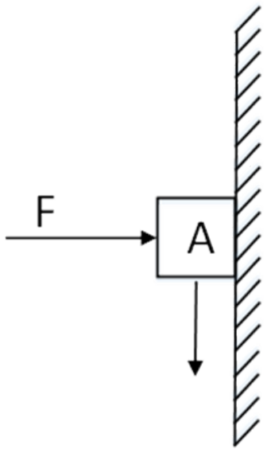

**A.** 为原来的2倍

**B.** 小于F

**C.** 大于mg

**D.** 等于2F

**答案：B**

### 第 62 题

`GD2018-Q062` · 单选 · 原卷第 9 页

一颗种子在地下生根发芽，最终破土而出，长成一株小树苗。在这个过程中，其有机物总量（）。

**A.** 逐渐增加

**B.** 先增加后减少

**C.** 先减少后增加

**D.** 先保持不变，后逐渐增加

**答案：C**

### 第 63 题

`GD2018-Q063` · 单选 · 原卷第 9 页

现在，人们常利用碘化银实现人工降雨。通过高炮将含有碘化银的炮弹打入云雾厚度比较大的高空中，碘化银因为炮弹的爆炸在高空扩散，促使降雨产生（如图所示）。下列说法正确的是（）。

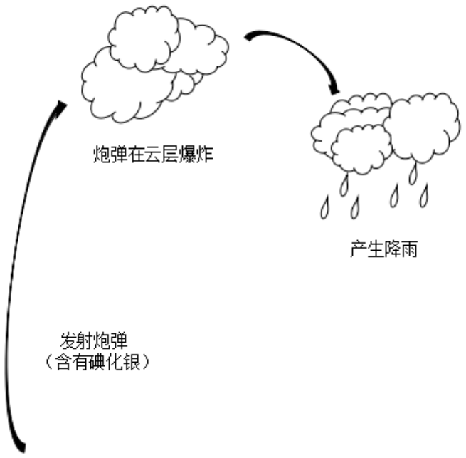

**A.** 利用碘化银人工降雨需要选择炎热的天气才能实现

**B.** 银是重金属，利用碘化银人工降雨会对环境造成极大破坏

**C.** 碘化银在高空形成极细的粒子，云中的水分在其周围凝聚，形成降雨

**D.** 碘化银作为催化剂，让高空中固态的水液化，实现人工降雨

**答案：C**

### 第 64 题

`GD2018-Q064` · 单选 · 原卷第 10 页

用手推车将两箱货物A和B拉到仓库存储，途中要经过一段斜坡（如图所示）。已知货物A和B的质量均为m，斜坡的坡度为30°。当手推车匀速经过斜坡时，货物A和B均处于静止状态，则受力情况正确的是（）。

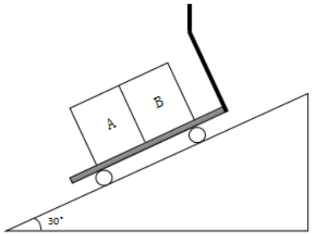

**A.** 货物B所受的合外力方向沿斜面向上

**B.** 货物B对货物A的作用力大小为0.5mg

**C.** 货物A所受的摩擦力比货物B所受的摩擦力大

**D.** 手推车对货物A的支持力等于对货物B的支持力

**答案：D**

### 第 65 题

`GD2018-Q065` · 单选 · 原卷第 10 页

下图是两种不同导体（R₁、R₂）的伏安特性曲线，则以下选项无法确定的是（）。

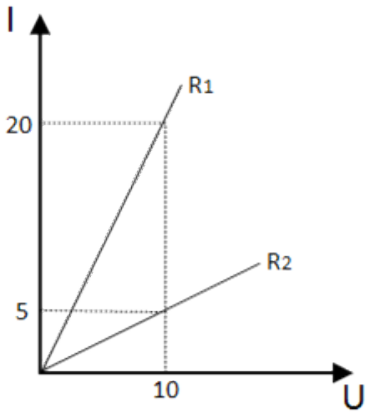

伏安特性曲线：纵轴为I，横轴为U；R1、R2均为过原点的直线。U=10时，R1对应I=20，R2对应I=5（图中以虚线标出）。

**A.** R₁、R₂的电阻之比为1:4

**B.** R₁、R₂的额定功率相同

**C.** 并联在电路中时，R₁、R₂电流比为4:1

**D.** 串联在电路中时，R₁、R₂电压比为1:4

**答案：B**

> 转写说明：题干与四个选项中的R₁、R₂在原卷中为图片（斜体，数字为下标），已转写为“R₁”“R₂”（Unicode下标数字）；题图中的“R1”“R2”标注在图内，未改动。

### 第 66 题

`GD2018-Q066` · 单选 · 原卷第 10 页

地表某相对独立的生态系统，其主要物种及数量如图所示，则下列说法必然正确的是（）。

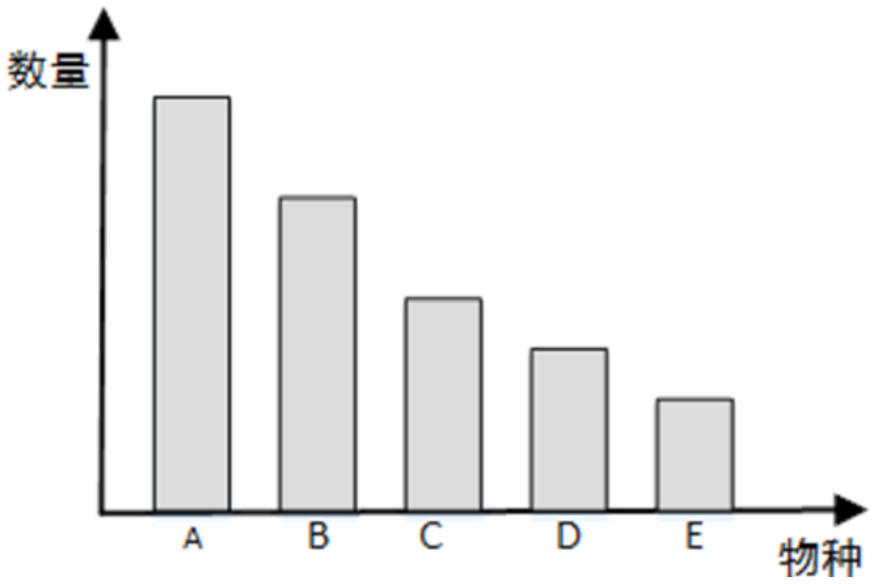

**A.** 物种A是该生态系统生产者

**B.** 物种B是该生态系统的初级消费者

**C.** 该生态系统的能量流动是从A到E

**D.** 该生态系统的最终能量来源是太阳能

**答案：D**

### 第 67 题

`GD2018-Q067` · 单选 · 原卷第 10、11 页

用如图所示的杠杆提升物体。从B点垂直向下用力，在将物体匀速提升到一定高度的过程中，用力的大小将（）。

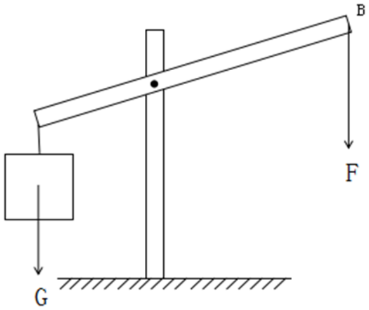

**A.** 保持不变

**B.** 逐渐变小

**C.** 逐渐变大

**D.** 先变大，后变小

**答案：A**

### 第 68 题

`GD2018-Q068` · 单选 · 原卷第 11 页

在检查视力时，检查者通常从面前的平面镜中看身后的视力表（如图所示）。下列说法正确的是（）。

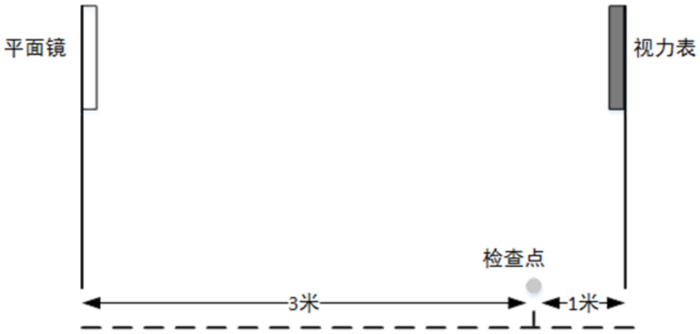

图中标注：平面镜在左，视力表在右；平面镜到检查点3米，检查点到视力表1米。

**A.** 视力表在平面镜中的像与检查点相距7米

**B.** 平面镜中的像略小于视力表本身

**C.** 平面镜中的像与视力表上下颠倒

**D.** 平面镜中的成像是真像

**答案：A**

### 第 69 题

`GD2018-Q069` · 单选 · 原卷第 11 页

以下关于惯性的分析，正确的是（）。

**A.** 滚动的足球受地面摩擦，滚动速度逐渐减慢，惯性也随之减小

**B.** 月球绕地球转动，其惯性与地球对它的引力相关

**C.** 自由落体在下落过程中速度增大，惯性也增加

**D.** 桌面上静止不动的乒乓球也有惯性

**答案：D**

### 第 70 题

`GD2018-Q070` · 单选 · 原卷第 11 页

现有三个同样的玻璃瓶，分别装有空气、氧气和氢气。以下能将三瓶气体区分开来的是（）。

**A.** 观察气体的颜色

**B.** 倒入澄清石灰水

**C.** 插入燃着的木条

**D.** 闻气体的气味

**答案：C**

## 常识判断

### 第 71 题

`GD2018-Q071` · 单选 · 原卷第 11 页

我国提出“创新、协调、绿色、开放、共享”五大发展理念。下列措施体现五大发展理念的是（）。
①建设粤港澳大湾区
②强化知识产权创造与保护
③“一带一路”建设
④降低农村学生辍学率
⑤淘汰黄标车和老旧车
⑥精准扶贫

**A.** ①③⑤

**B.** ②④⑤⑥

**C.** ②③④⑤⑥

**D.** ①②③④⑤⑥

**答案：D**

### 第 72 题

`GD2018-Q072` · 单选 · 原卷第 11、12 页

（）是近代以来中华民族最伟大的梦想。实现伟大梦想，必须推进中国特色社会主义伟大事业。

**A.** 建设社会主义现代化强国

**B.** 实现中华民族伟大复兴

**C.** 世界和平与发展

**D.** 实现共产主义

**答案：B**

### 第 73 题

`GD2018-Q073` · 单选 · 原卷第 12 页

党的十九大报告指出：“中国特色社会主义进入新时代。”这一论断体现的哲学原理是（）。

**A.** 事物是质变与量变的统一

**B.** “两点论”与“重点论”的统一

**C.** 矛盾是社会发展的动力

**D.** 事物是普遍联系的

**答案：A**

### 第 74 题

`GD2018-Q074` · 单选 · 原卷第 12 页

“简政放权、放管结合、优化服务”改革简称“放管服”改革。下列措施不属于“放管服”改革的是（）。
①建设政府服务大数据
②降低制度性交易成本
③减少小微企业碳排放
④职责相近的党政机关合署办公
⑤推出市场准入负面清单
⑥发展电子商务

**A.** ①⑤

**B.** ③⑥

**C.** ①③⑤⑥

**D.** ②③④⑤

**答案：B**

### 第 75 题

`GD2018-Q075` · 单选 · 原卷第 12 页

2018年3月11日第十三届全国人民代表大会第一次会议通过《中华人民共和国宪法修正案》，确立了（）是中国特色社会主义最本质的特征。

**A.** 人民当家作主

**B.** 中国共产党领导

**C.** 解放和发展社会生产力

**D.** 我国仍处于并将长期处于社会主义初级阶段

**答案：B**

### 第 76 题

`GD2018-Q076` · 单选 · 原卷第 12 页

党的十九大报告提出“开启全面建设社会主义现代化国家新征程”。下列关于“社会主义现代化”表述不准确的是（）。

**A.** 把我国建成富强民主文明和谐的社会主义现代化强国

**B.** “三步走”目标是我国社会主义现代化建设的战略安排

**C.** 从十九大到二十大，是“两个一百年”奋斗目标的历史交汇期

**D.** 实现社会主义现代化是新时代坚持和发展中国特色社会主义的总任务之一

**答案：A**

### 第 77 题

`GD2018-Q077` · 单选 · 原卷第 12 页

我国经济已由高速增长阶段转向高质量发展阶段，正处在攻关期。下列不属于攻关期三大特征的是（）。

**A.** 转变发展方式

**B.** 优化经济结构

**C.** 转换增长动力

**D.** 优化营商环境

**答案：D**

### 第 78 题

`GD2018-Q078` · 单选 · 原卷第 12 页

行政行为应依法实施，遵守法定权限、法定条件、法定要求和法定程序。行政法规、行政规章和行政规定均不得与法律相抵触，不得规定依法只能由法律规定的事项。这是行政程序法的（）。

**A.** 正当程序原则

**B.** 依法行政原则

**C.** 公开原则

**D.** 参与原则

**答案：B**

### 第 79 题

`GD2018-Q079` · 单选 · 原卷第 12 页

水力发电是直接利用水的动能作为原动力，驱动发电机工作的发电方式。以下属于其优点的是（）。
①发电设施工程建设投资少、周期短、发电效率高。
②发电过程中不会产生污染环境的大量废气和废渣。
③水用作发电后，还可用于其他用途。

**A.** ①②③

**B.** 仅有①和②

**C.** 仅有②和③

**D.** 仅有③

**答案：C**

### 第 80 题

`GD2018-Q080` · 单选 · 原卷第 12 页

沉管隧道就是将若干个预制段分别浮运到海面(河面)现场，并逐个沉放在已疏浚好的基槽内，以此修建的水下隧道。以下隧道采用了外海环境沉管隧道技术的是（）。

**A.** 广州珠江隧道

**B.** 深圳地铁隧道

**C.** 贵广高铁隧道

**D.** 港珠澳大桥隧道

**答案：D**

### 第 81 题

`GD2018-Q081` · 单选 · 原卷第 12、13 页

许多食物在超过120℃的温度下烘焙煎炸烤时，食物中的碳水化合物和蛋白质在高温烹制过程中，很容易产生丙烯酰胺，这种物质对人类健康有潜在危害。为避免摄入过多丙烯酰胺，以下食物最应减少食用的是（）。

**A.** 热茶

**B.** 馒头

**C.** 炒白菜

**D.** 炸鸡

**答案：D**

> 转写说明：题干中的“120℃”在原卷中为图片（原图作“120°C”），已转写为“120℃”。

### 第 82 题

`GD2018-Q082` · 单选 · 原卷第 13 页

海又称为“大海”，是指与“大洋”相连接的大面积咸水区域，即大洋的边缘部分。以下不属于海的是（）。

**A.** 死海

**B.** 红海

**C.** 地中海

**D.** 亚丁湾

**答案：A**

### 第 83 题

`GD2018-Q083` · 单选 · 原卷第 13 页

手指表皮上突起的纹线，被称为指纹。指纹人人皆有，它是遗传与环境共同作用产生的。下列关于指纹的说法有误的是（）。

**A.** 指纹可以用于身份识别

**B.** 人的指纹一般终身不变

**C.** 同卵双胞胎的指纹是相同的

**D.** 只要不伤及真皮层，手指伤愈后仍能长出同样的指纹

**答案：C**

### 第 84 题

`GD2018-Q084` · 单选 · 原卷第 13 页

在阴雨天，由于空气潮湿，衣物容易发霉。下列措施不能防止房间里衣物发霉的是（）。

**A.** 打开室内暖气设备

**B.** 在潮湿天气适当打开门窗通风透气

**C.** 开启室内空调抽湿功能或抽风装置

**D.** 将石灰用布或麻袋包装起来，放在房间的角落

**答案：B**

### 第 85 题

`GD2018-Q085` · 单选 · 原卷第 13 页

“春困”是人体随着自然气候的变化而发生的生理反应。为克服“春困”，下列做法不合适的是（）。

**A.** 多吃黄绿色蔬菜

**B.** 保持室内空气流通

**C.** 尽可能多做剧烈运动

**D.** 养成早睡早起的习惯

**答案：C**

## 资料分析

### 共用材料：第 86—90 题

A市坚持发挥科技创新的引领作用，强化企业的创新主体地位，研发投入不断增加，研发人员快速增长，创新能力持续增强，锂电池等新兴产业尤为突出。
五年来，企业创新意愿不断提升，研发投入快速增长。2016年，该市有研究与试验发展（R&D）活动的单位172家，比2012年增加26家，R&D经费内部支出19.55亿元，比2012年增加11.65亿元，增长147.5%，年均增长率为25.4%；R&D经费内部支出与地区生产总值之比为1.20%，比2012年提高0.5个百分点。规模以上工业企业研发投入大幅提高，2016年该市规模以上工业企业R&D经费内部支出19.14亿，比2012年增加11.52亿元，增长151.2%，年均增长25.9%。全年技术改造经费支出10.74亿元，比2012年增长184.9%；引进境外技术经费支出1.61亿元，增长257.8%；引进境外技术的消化吸收经费支出0.54亿元，增长100%。

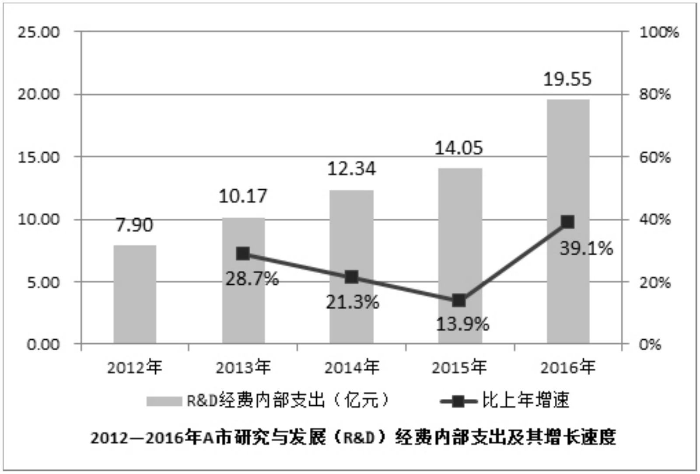

2012—2016年A市研究与发展（R&D）经费内部支出及其增长速度

| 年份 | R&D经费内部支出（亿元） | 比上年增速 |
| --- | --- | --- |
| 2012年 | 7.90 |  |
| 2013年 | 10.17 | 28.7% |
| 2014年 | 12.34 | 21.3% |
| 2015年 | 14.05 | 13.9% |
| 2016年 | 19.55 | 39.1% |

2012年没有增速数据点（空格不补值）；右侧纵轴刻度为0%—100%。

该市在增加科技投入的同时，研发人才引进和培养力度持续加大。2016年全市R&D人员合计6924人，比2012年增长50.9%，年均增长10.8%，其中研究人员3268人，占R&D人员的47.2%，比2012年提高18.8个百分点。全市R&D人员中，本科及以上学历人员4007人，占全部R&D人员比重的57.9%，比2012年提高24个百分点；其中研究生及以上学历1216人，占全部R&D人员比重的17.6%，比2012年提高9.1个百分点。
2016年，该市加大力度发展新兴科技产业，全市锂电池等制造行业R&D经费内部支出12.63亿元，比2012年增长17.5倍，年均增长104.6%。R&D人员2851人，比2012年增长435.9%，年均增长52.1%。新产品产值达241.06亿元，比2012年增加219.37亿元，增长10.1倍。

> 材料说明：材料1中的百分数（147.5%、25.4%、1.20%、151.2%、25.9%、184.9%、257.8%、100%、50.9%、10.8%、47.2%、57.9%、17.6%、104.6%、435.9%、52.1%）在原卷中为图片，已转写为文字；“R&D经费内部支出19.14亿”后无“元”字，照录。

### 第 86 题

`GD2018-Q086` · 单选 · 原卷第 14 页

[共用材料](#GD2018-M1)

2012年，该市的下列各项经费支出最多的是（）。

**A.** 规模以上工业企业R&D经费

**B.** 全年技术改造经费

**C.** 引进境外技术经费

**D.** 引进境外技术的消化吸收经费

**答案：A**

### 第 87 题

`GD2018-Q087` · 单选 · 原卷第 14 页

[共用材料](#GD2018-M1)

2016年，该市生产总值比2012年约多（）亿元。

**A.** 350

**B.** 430

**C.** 500

**D.** 660

**答案：C**

### 第 88 题

`GD2018-Q088` · 单选 · 原卷第 14 页

[共用材料](#GD2018-M1)

2012年，该市平均每家研究与试验发展（R&D）活动单位的R&D经费内部支出约为（）亿元。

**A.** 0.023

**B.** 0.054

**C.** 0.163

**D.** 0.242

**答案：B**

### 第 89 题

`GD2018-Q089` · 单选 · 原卷第 14 页

[共用材料](#GD2018-M1)

2016年，该市R&D人员中，本科学历的人数为（）。

**A.** 1216

**B.** 1517

**C.** 2791

**D.** 4007

**答案：C**

### 第 90 题

`GD2018-Q090` · 单选 · 原卷第 14 页

[共用材料](#GD2018-M1)

根据材料，下列说法不正确的是（）。

**A.** 2013-2016年，R&D经费内部支出增加最多的是2015年

**B.** 2012-2016年，R&D经费内部年均支出约12.8亿元

**C.** 2016年，该市新兴科技产业的发展较2012年有较大提高

**D.** 2016年，该市R&D人员学历水平较2012年有所提高

**答案：A**

### 共用材料：第 91—95 题

2017年第四季度，人力资源部门对东、中、西三大区域共95个城市的公共就业服务机构市场供求信息进行了统计分析，部分数据如下：
总体而言，用人单位通过公共就业服务机构招聘各类人员约433.7万人，进入市场的求职者约354.2万人，岗位空缺与求职人数的比率约为1.22，比去年同期上升0.09，市场需求略大于供给。
与去年同期相比，需求人数增加15.6万人，求职人数减少17.3万人。与上季度相比，需求人数和求职人数分别减少了58.9万人和73.2万人，各下降了12%和17.2%。

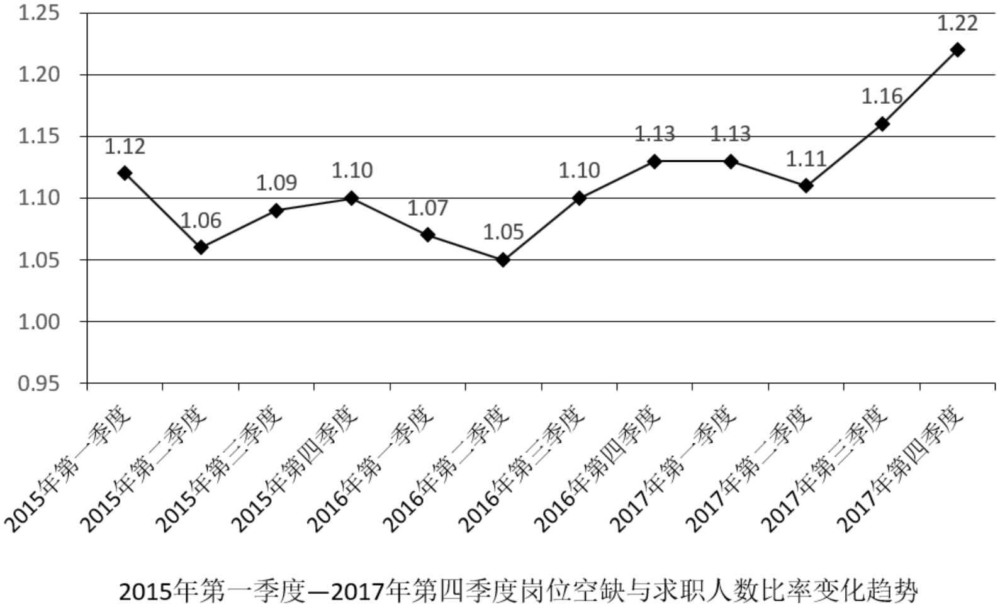

2015年第一季度—2017年第四季度岗位空缺与求职人数比率变化趋势

| 季度 | 岗位空缺与求职人数比率 |
| --- | --- |
| 2015年第一季度 | 1.12 |
| 2015年第二季度 | 1.06 |
| 2015年第三季度 | 1.09 |
| 2015年第四季度 | 1.10 |
| 2016年第一季度 | 1.07 |
| 2016年第二季度 | 1.05 |
| 2016年第三季度 | 1.10 |
| 2016年第四季度 | 1.13 |
| 2017年第一季度 | 1.13 |
| 2017年第二季度 | 1.11 |
| 2017年第三季度 | 1.16 |
| 2017年第四季度 | 1.22 |

分区域看，东、中、西部市场岗位空缺与求职人数的比率分别为1.22、1.18、1.29，市场需求均略大于供给。

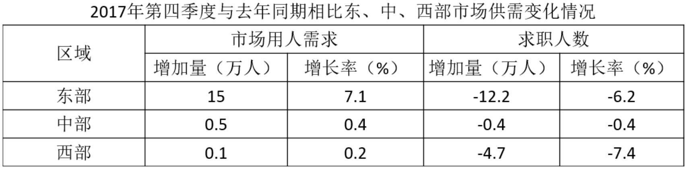

2017年第四季度与去年同期相比东、中、西部市场供需变化情况

| 区域 | 市场用人需求：增加量（万人） | 市场用人需求：增长率（%） | 求职人数：增加量（万人） | 求职人数：增长率（%） |
| --- | --- | --- | --- | --- |
| 东部 | 15 | 7.1 | -12.2 | -6.2 |
| 中部 | 0.5 | 0.4 | -0.4 | -0.4 |
| 西部 | 0.1 | 0.2 | -4.7 | -7.4 |

原表表头分两层（“市场用人需求”“求职人数”下各分增加量、增长率两列），转写时合成一格。

> 材料说明：材料2中的“12%”“17.2%”在原卷中为图片，已转写为文字。

### 第 91 题

`GD2018-Q091` · 单选 · 原卷第 15 页

[共用材料](#GD2018-M2)

2017年，第四季度岗位空缺与求职人数比率较第三季度上升了（）。

**A.** 0.03

**B.** 0.06

**C.** 0.09

**D.** 0.12

**答案：B**

### 第 92 题

`GD2018-Q092` · 单选 · 原卷第 15 页

[共用材料](#GD2018-M2)

2015—2017年，各季度的岗位空缺与求职人数比率的平均值约为（）。

**A.** 1.07

**B.** 1.09

**C.** 1.11

**D.** 1.13

**答案：C**

### 第 93 题

`GD2018-Q093` · 单选 · 原卷第 15 页

[共用材料](#GD2018-M2)

2017年第四季度求职人数比2016年第四季度下降了约（）。

**A.** 5%

**B.** 8%

**C.** 10%

**D.** 12%

**答案：A**

> 转写说明：四个选项的百分数在原卷中为图片，已转写为文字。

### 第 94 题

`GD2018-Q094` · 单选 · 原卷第 15 页

[共用材料](#GD2018-M2)

2015—2017年，人力资源市场供给最能满足市场需求的是（）。

**A.** 2015年第三季度

**B.** 2016年第二季度

**C.** 2017年第一季度

**D.** 2017年第四季度

**答案：B**

### 第 95 题

`GD2018-Q095` · 单选 · 原卷第 15 页

[共用材料](#GD2018-M2)

根据材料，下列说法正确的是（）。

**A.** 2015年第一季度以来，东、中、西三大区域市场需求长期大于供给

**B.** 2016年第二季度以来，岗位空缺与求职人数比率总体呈“W”型变化趋势

**C.** 2017年第三季度东、中、西三大区域人才市场中，西部市场岗位空缺与求职人数的比率最大

**D.** 2016年第四季度，中部市场岗位空缺与求职人数的比率约为1.25

**答案：A**

### 共用材料：第 96—100 题

近年来，广东全省医疗卫生资源总量继续增加，医疗服务能力不断增强。截止2016年底，全省医疗卫生机构4.91万个，医疗卫生机构拥有床位46.5万张，其中：医院37.2万张，卫生院5.7万张。医疗卫生机构卫生技术人员66.8万人，其中：执业（助理）医师24.4万人，注册护士28.4万人，医护比1：1.16。

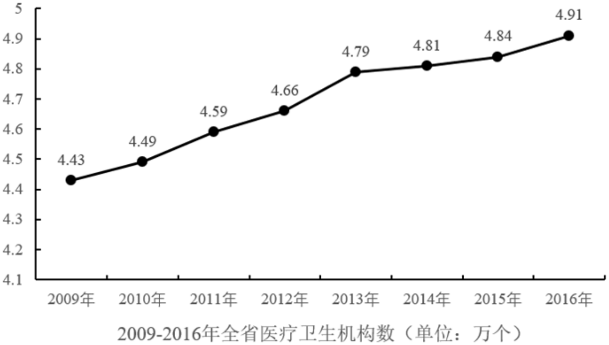

2009-2016年全省医疗卫生机构数（单位：万个）

| 年份 | 医疗卫生机构数（万个） |
| --- | --- |
| 2009年 | 4.43 |
| 2010年 | 4.49 |
| 2011年 | 4.59 |
| 2012年 | 4.66 |
| 2013年 | 4.79 |
| 2014年 | 4.81 |
| 2015年 | 4.84 |
| 2016年 | 4.91 |

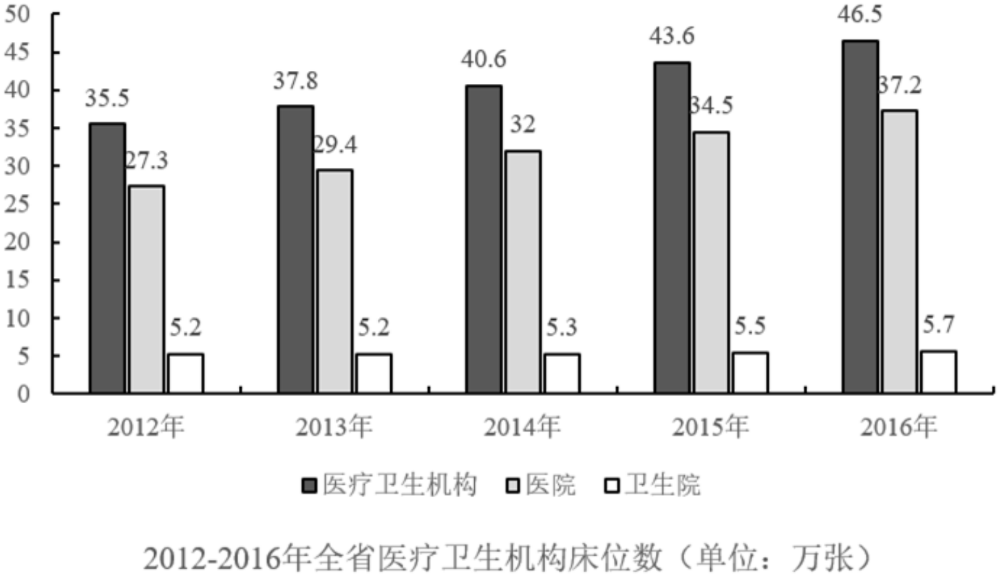

2012-2016年全省医疗卫生机构床位数（单位：万张）

| 年份 | 医疗卫生机构 | 医院 | 卫生院 |
| --- | --- | --- | --- |
| 2012年 | 35.5 | 27.3 | 5.2 |
| 2013年 | 37.8 | 29.4 | 5.2 |
| 2014年 | 40.6 | 32 | 5.3 |
| 2015年 | 43.6 | 34.5 | 5.5 |
| 2016年 | 46.5 | 37.2 | 5.7 |

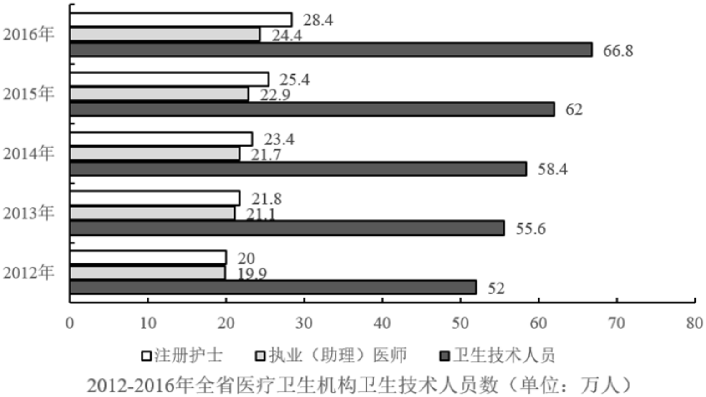

2012-2016年全省医疗卫生机构卫生技术人员数（单位：万人）

| 年份 | 注册护士 | 执业（助理）医师 | 卫生技术人员 |
| --- | --- | --- | --- |
| 2012年 | 20 | 19.9 | 52 |
| 2013年 | 21.8 | 21.1 | 55.6 |
| 2014年 | 23.4 | 21.7 | 58.4 |
| 2015年 | 25.4 | 22.9 | 62 |
| 2016年 | 28.4 | 24.4 | 66.8 |

> 材料说明：材料3“截止2016年底”中的“截止”应为“截至”，照录。

### 第 96 题

`GD2018-Q096` · 单选 · 原卷第 16 页

[共用材料](#GD2018-M3)

2010—2016年，全省医疗卫生机构数同比上一年增长率最高的是（）年。

**A.** 2012

**B.** 2013

**C.** 2014

**D.** 2016

**答案：B**

### 第 97 题

`GD2018-Q097` · 单选 · 原卷第 17 页

[共用材料](#GD2018-M3)

2013—2016年，全省医疗卫生机构平均每年较上一年增加执业（助理）医师约（）万人。

**A.** 0.9

**B.** 1.1

**C.** 1.7

**D.** 2.1

**答案：B**

### 第 98 题

`GD2018-Q098` · 单选 · 原卷第 17 页

[共用材料](#GD2018-M3)

2016年全省医疗卫生机构的平均床位数约是2012年的（）倍。

**A.** 1.2

**B.** 1.5

**C.** 2

**D.** 2.3

**答案：A**

### 第 99 题

`GD2018-Q099` · 单选 · 原卷第 17 页

[共用材料](#GD2018-M3)

2012—2016年，全省医疗卫生机构卫生技术人员中注册护士所占比率最高的一年比例约为（）。

**A.** 38.2%

**B.** 40.1%

**C.** 42.5%

**D.** 48.7%

**答案：C**

> 转写说明：四个选项的百分数在原卷中为图片，已转写为文字。

### 第 100 题

`GD2018-Q100` · 单选 · 原卷第 17 页

[共用材料](#GD2018-M3)

根据材料，下列说法正确的是（）。

**A.** 2016年全省医疗卫生机构数量是2009年的1.5倍

**B.** 2012—2016年，医院床位数占全省医疗卫生机构床位数的比例均低于80%

**C.** 2009—2016年，全省医疗卫生机构的平均卫生技术人员数均大于10

**D.** 2012—2016年，全省医疗卫生机构中注册护士与执业（助理）医师人数相差最大的是2016年

**答案：D**

> 转写说明：B项末尾的“80%”在原卷中为图片，已转写为文字。
