# 2019年广东行测（县级卷）

共 100 题，原题号完整保留。内容：题干、选项、答案（不收解析）；资料分析共用材料置于所属题组前，JSONL 每条记录完整内嵌材料。

[结构化数据](GD2019-XJ.jsonl) · [字段说明](schema.json) · [质量报告](quality/GD2019-XJ.md)

原题来源：[2019年广东公务员考试《行测》真题（县级）.pdf](https://github.com/dumarstoft-ship-it/xing-ce1/blob/52f9811b22cad5410a7108dd0a07a879f1187aa5/%E7%9C%9F%E9%A2%98/2019%E5%B9%B4%E5%B9%BF%E4%B8%9C%E5%85%AC%E5%8A%A1%E5%91%98%E8%80%83%E8%AF%95%E3%80%8A%E8%A1%8C%E6%B5%8B%E3%80%8B%E7%9C%9F%E9%A2%98%EF%BC%88%E5%8E%BF%E7%BA%A7%EF%BC%89.pdf)。答案来源：[2019年广东公务员考试《行测》真题（县级）答案及解析.pdf](https://github.com/dumarstoft-ship-it/xing-ce1/blob/52f9811b22cad5410a7108dd0a07a879f1187aa5/%E7%AD%94%E6%A1%88%E8%A7%A3%E6%9E%90/2019%E5%B9%B4%E5%B9%BF%E4%B8%9C%E5%85%AC%E5%8A%A1%E5%91%98%E8%80%83%E8%AF%95%E3%80%8A%E8%A1%8C%E6%B5%8B%E3%80%8B%E7%9C%9F%E9%A2%98%EF%BC%88%E5%8E%BF%E7%BA%A7%EF%BC%89%E7%AD%94%E6%A1%88%E5%8F%8A%E8%A7%A3%E6%9E%90.pdf)（只取答案）。

## 言语理解与表达

### 第 1 题

`GD2019-XJ-Q001` · 单选 · 原卷第 1 页

提升市民的幸福感、获得感是城市治理精细化的根本目的。如果把城市治理比作绣花，那么，以人民为中心的原则就是那条在千头万绪中（）城市治理方方面面的线。

**A.** 疏通

**B.** 贯彻

**C.** 联合

**D.** 串联

**答案：D**

### 第 2 题

`GD2019-XJ-Q002` · 单选 · 原卷第 1 页

多元的发展机会和自由的成长空间，是时代给予每个追梦人的馈赠；（）每个追梦人在前进道路上迈出的每一步，（）都在推动时代的进步。

**A.** 而 也

**B.** 但 却

**C.** 如果 就

**D.** 只有 才

**答案：A**

### 第 3 题

`GD2019-XJ-Q003` · 单选 · 原卷第 1 页

新的一年，我们将迎来新的历史坐标和奋斗起点，也必将面临一定的挑战。但只要我们迈出的步伐足够（），前进的意志足够（），奋斗路上的困难终将被克服，前进路上的沟壑终将被跨越。

**A.** 坚实 坚定

**B.** 坚固 坚强

**C.** 牢靠 强大

**D.** 牢固 奋勇

**答案：A**

### 第 4 题

`GD2019-XJ-Q004` · 单选 · 原卷第 1 页

从广州南沙到深圳前海、珠海横琴，从香港科技大学（广州）校区合作项目建设，到推进深港青年创新创业、加速粤澳合作中医药科技产业园建设，聚力打造深度合作发展平台的探索（）。

**A.** 如履平地

**B.** 如箭在弦

**C.** 如愿以偿

**D.** 如火如荼

**答案：D**

### 第 5 题

`GD2019-XJ-Q005` · 单选 · 原卷第 1 页

中国特色社会主义进入新时代，文艺创作、学术创新拥有无比（）的空间。而高质量的文化（），是满足人民美好生活向往的重要组成部分，也是时代发展所需。

**A.** 浩瀚 需求

**B.** 悠长 创作

**C.** 广阔 供给

**D.** 宽敞 库存

**答案：C**

### 第 6 题

`GD2019-XJ-Q006` · 单选 · 原卷第 1 页

持续深入的人才发展体制机制改革，为（）、（）、（）、（）打牢了坚实基础，有力推进了新时代中国特色社会主义伟大事业不断夺取新的伟大胜利。

**A.** 引才 聚才 用才 育才

**B.** 聚才 用才 育才 引才

**C.** 用才 育才 引才 聚才

**D.** 育才 引才 聚才 用才

**答案：D**

### 第 7 题

`GD2019-XJ-Q007` · 单选 · 原卷第 1 页

构建人类命运共同体，需要世界各国人民努力建设一个远离（）、普遍安全的世界；一个远离（）、共同繁荣的世界；一个远离封闭、开放包容的世界。

**A.** 战乱 争端

**B.** 战乱 贫困

**C.** 纷扰 争端

**D.** 纷扰 贫困

**答案：B**

### 第 8 题

`GD2019-XJ-Q008` · 单选 · 原卷第 1 页

新时代广东发展需要抓住粤港澳大湾区建设的历史（），同时必须（）供求结构、经济增长内生动力、生产要素高效便捷流动、生态环境等面临的发展难题。

**A.** 机遇 破除

**B.** 机会 破除

**C.** 机遇 破解

**D.** 机会 破解

**答案：C**

### 第 9 题

`GD2019-XJ-Q009` · 单选 · 原卷第 1 页

近年来，各地纷纷大刀阔斧地开展（），向不担当不作为亮剑。

**A.** 整理

**B.** 整治

**C.** 修理

**D.** 梳理

**答案：B**

### 第 10 题

`GD2019-XJ-Q010` · 单选 · 原卷第 1 页

在落实乡村振兴战略的过程中，一定要科学规划，（），才能最终实现目标，任何希望（）的想法都是不切实际的。

**A.** 循序渐进 一蹴而就

**B.** 寻根究底 一鼓作气

**C.** 蔚然成风 一劳永逸

**D.** 未雨绸缪 一马当先

**答案：A**

### 第 11 题

`GD2019-XJ-Q011` · 单选 · 原卷第 1、2 页

推动媒体融合发展，事关推进国家治理体系和治理能力现代化。在全媒体时代，媒体不仅是信息的提供者和传播者，而且在国家治理中也发挥着重要作用。因此，媒体融合不仅仅是一个传播命题，还是一个治理命题。
这段文字的主旨是（）。

**A.** 国家治理现代化需要促进媒体融合

**B.** 媒体融合发展有利于促进信息传播

**C.** 媒体融合发展是信息技术发展的需要

**D.** 媒体在国家治理中应承担主要责任

**答案：A**

### 第 12 题

`GD2019-XJ-Q012` · 单选 · 原卷第 2 页

人贵有恒。事实证明，但凡成就一番事业的人，无不是有恒心、有毅力的强者。他们聚焦主要目标，一以贯之，久久为功，在坚持中集聚力量、成就作为。“当代愚公”李保国三十五年如一日扎根太行山区，用科技为荒山带来苍翠，用产业为乡亲拔除“穷根”。古人说得好：“锲而舍之，朽木不折；锲而不舍，金石可镂。”_______________，一个人将在平凡中书写不凡。
下列句子填入横线处，最恰当的是（）。

**A.** 改造自我、成就自我，崇德向善、勇毅前行

**B.** 葆有坚持不懈的精神，蓄积水滴石穿的韧劲

**C.** 向上向善，将良好的品行、好的习惯贯穿始终

**D.** 以坚定的决心和意志不断纯洁党性、修身律己

**答案：B**

### 第 13 题

`GD2019-XJ-Q013` · 单选 · 原卷第 2 页

国务院及地方政府机构改革顺利实施。重点领域改革迈出新的步伐，市场准入负面清单制度全面实行，简政放权、放管结合、优化服务改革力度加大，营商环境国际排名大幅上升。对外开放全方位扩大，共建“一带一路”取得重要进展。首届中国国际进口博览会成功举办，海南自贸试验区启动建设。货物进出口总额超过30万亿元，实际使用外资1383亿美元、稳居发展中国家首位。
对这段文字概括最准确的一项是（）。

**A.** 中国经济运行保持在合理区间

**B.** 中国经济结构不断优化

**C.** 中国发展新动能快速增长

**D.** 中国改革开放取得新突破

**答案：D**

### 第 14 题

`GD2019-XJ-Q014` · 单选 · 原卷第 2 页

智慧城市是指应用新一代信息技术，进行精细化、动态化管理的城市形态。智慧城市概念已提出10年，但是当前大多数智慧城市都还停留在信息系统建设的阶段，无法向信息的整合利用阶段迈进。这一问题的根源在于大量“数据孤岛”的存在。虽然各个企业、单位都有自己的信息系统，但建设水平参差不齐、没有统一的建设标准，使得各系统间的数据难以共享，信息很难处理应用。
这段文字主要讲了（）。

**A.** 建设智慧城市的必要性

**B.** 智慧城市发展缓慢的原因

**C.** 各企业、单位应积极打破“数据孤岛”

**D.** 如何破除智慧城市建设中的“数据孤岛”问题

**答案：B**

### 第 15 题

`GD2019-XJ-Q015` · 单选 · 原卷第 2 页

扶贫干部自掏腰包到基层扶贫，是真扶贫、扶真贫的体现。但若一味宣扬扶贫干部自掏腰包扶贫，不仅会加重扶贫干部的经济负担，还会在一定程度上让贫困群众产生依赖心理。
对这段文字理解准确的是（）。

**A.** 一味宣扬扶贫干部自掏腰包扶贫具有一定的副作用

**B.** 应该大力提倡扶贫干部自掏腰包支持贫困户

**C.** 当前存在大量扶贫干部自掏腰包扶贫的情况

**D.** 扶贫干部自掏腰包扶贫是不得已而为之的

**答案：A**

## 数量关系

### 第 16 题

`GD2019-XJ-Q016` · 单选 · 原卷第 2 页

120 60 20 5（    ）

**A.** 1

**B.** 2

**C.** 3

**D.** 4

**答案：A**

### 第 17 题

`GD2019-XJ-Q017` · 单选 · 原卷第 2 页

2 9 11 20 31（    ）

**A.** 39

**B.** 43

**C.** 47

**D.** 51

**答案：D**

### 第 18 题

`GD2019-XJ-Q018` · 单选 · 原卷第 2 页

24 32 41 51 62（    ）

**A.** 72

**B.** 74

**C.** 76

**D.** 78

**答案：B**

### 第 19 题

`GD2019-XJ-Q019` · 单选 · 原卷第 2、3 页

1 1 2 6 24（    ）

**A.** 86

**B.** 112

**C.** 120

**D.** 144

**答案：C**

### 第 20 题

`GD2019-XJ-Q020` · 单选 · 原卷第 3 页

1/2 2/6 2/8 3/15（    ）

**A.** 3/18

**B.** 3/16

**C.** 5/25

**D.** 7/25

**答案：A**

> 转写说明：题干与选项的分数在原卷中为图片，已按“分子/分母”转写；原卷即作2/6、2/8、3/15等，未约分。

### 第 21 题

`GD2019-XJ-Q021` · 单选 · 原卷第 3 页

某机构计划在一块边长为18米的正方形空地开展活动，需要在空地四边每隔2米插上一面彩旗，若该空地的四个角都需要插上彩旗，那么一共需要（）面彩旗。

**A.** 32

**B.** 36

**C.** 44

**D.** 48

**答案：B**

### 第 22 题

`GD2019-XJ-Q022` · 单选 · 原卷第 3 页

办公室有一些黑色和红色的签字笔，最近由于工作需要，每周都会用掉6支黑色签字笔和3支红色签字笔。3周后整理剩余物资时发现，剩下的红色签字笔的数量是黑色签字笔的2倍。则办公室原有签字笔至少（）支。

**A.** 27

**B.** 28

**C.** 29

**D.** 30

**答案：D**

### 第 23 题

`GD2019-XJ-Q023` · 单选 · 原卷第 3 页

甲乙两人绕着周长为600米的环形跑道跑步，他们从相同的起点同时同向起跑。已知甲的速度为每秒4米，乙的速度为每秒3米，则当甲第一次回到起点时，乙距离起点还有（）米。

**A.** 100

**B.** 150

**C.** 200

**D.** 250

**答案：B**

### 第 24 题

`GD2019-XJ-Q024` · 单选 · 原卷第 3 页

甲、乙、丙三人加工一种零件，三人每小时一共可以加工70个零件。如果甲乙两人每小时加工的零件数之比为2:3，乙丙两人每小时加工的零件数之比为4:5，则丙每小时比甲多加工（）个零件。

**A.** 8

**B.** 10

**C.** 14

**D.** 16

**答案：C**

> 转写说明：原卷题干中的比例“2:3”“4:5”用半角冒号，照录。

### 第 25 题

`GD2019-XJ-Q025` · 单选 · 原卷第 3 页

某企业销售洗碗机，第一季度平均每个月销售800台，上半年平均每个月销售850台。如果4月份和6月份的销售总量是5月份的2倍，那么该企业5月份的洗碗机销售量为（）台。

**A.** 800

**B.** 900

**C.** 1000

**D.** 1100

**答案：B**

### 第 26 题

`GD2019-XJ-Q026` · 单选 · 原卷第 3 页

某物业公司规定，小区大门每2天清洁一次，消防设施每3天检查一次，绿化植物每5天养护一次，如果上述3项工作刚好都在本周四完成了，那么下一次3项工作刚好同一天完成是在（）。

**A.** 星期一

**B.** 星期二

**C.** 星期六

**D.** 星期日

**答案：C**

### 第 27 题

`GD2019-XJ-Q027` · 单选 · 原卷第 3 页

某办公室有大、中、小三种型号的文件袋共200个，已知大号文件袋数量是中号文件袋的2倍，小号文件袋的数量为50个，那么大号文件袋有（）个。

**A.** 50

**B.** 60

**C.** 80

**D.** 100

**答案：D**

### 第 28 题

`GD2019-XJ-Q028` · 单选 · 原卷第 3 页

某工厂采购了铜和铁各30吨。假如工厂在生产过程中，每天需要消耗2吨铜和3吨铁，则在（）天后，剩余铜的质量将是铁的4倍。

**A.** 6

**B.** 7

**C.** 8

**D.** 9

**答案：D**

### 第 29 题

`GD2019-XJ-Q029` · 单选 · 原卷第 3 页

小李今天上午有a、b、c、d这4项工作要完成，下午有e、f、g这3项工作要完成，每半天内各项工作的顺序可以随意调整，则他今天有（）种完成工作的顺序。

**A.** 30

**B.** 60

**C.** 72

**D.** 144

**答案：D**

### 第 30 题

`GD2019-XJ-Q030` · 单选 · 原卷第 3、4 页

某小区规划建设一块边长为10米的正方形绿地。如图所示，以绿地的2个顶点为圆心，边长为半径分别作扇形，把绿地划分为不同的区域。小区现准备在图中阴影部分种植杜鹃，则杜鹃种植面积为（）平方米。

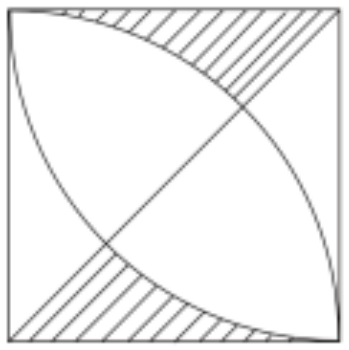

**A.** 100-25π

**B.** 200-35π

**C.** 200-50π

**D.** 100π-100

**答案：A**

> 转写说明：四个选项中的式子在原卷中为图片，已转写为文字（减号写作“-”）。

## 判断推理

### 第 31 题

`GD2019-XJ-Q031` · 单选 · 图形推理 · 原卷第 4 页

下列选项中最符合所给图形规律的是（）。

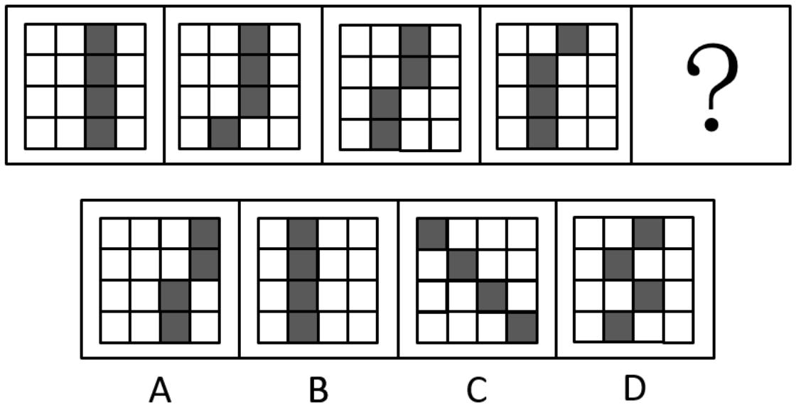

**A.** 见上方题图中 A 项。

**B.** 见上方题图中 B 项。

**C.** 见上方题图中 C 项。

**D.** 见上方题图中 D 项。

**答案：B**

### 第 32 题

`GD2019-XJ-Q032` · 单选 · 图形推理 · 原卷第 4 页

下列选项中最符合所给图形规律的是（）。

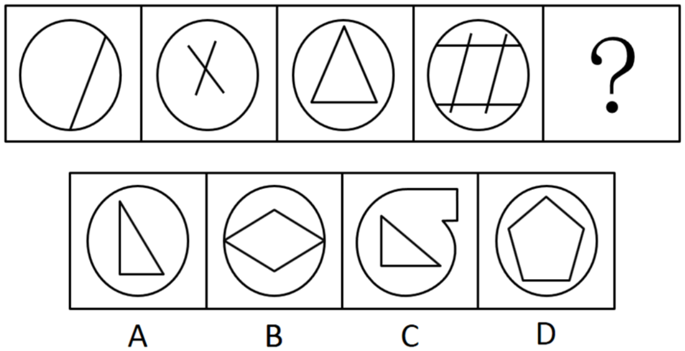

**A.** 见上方题图中 A 项。

**B.** 见上方题图中 B 项。

**C.** 见上方题图中 C 项。

**D.** 见上方题图中 D 项。

**答案：D**

### 第 33 题

`GD2019-XJ-Q033` · 单选 · 图形推理 · 原卷第 4 页

下列选项中最符合所给图形规律的是（）。

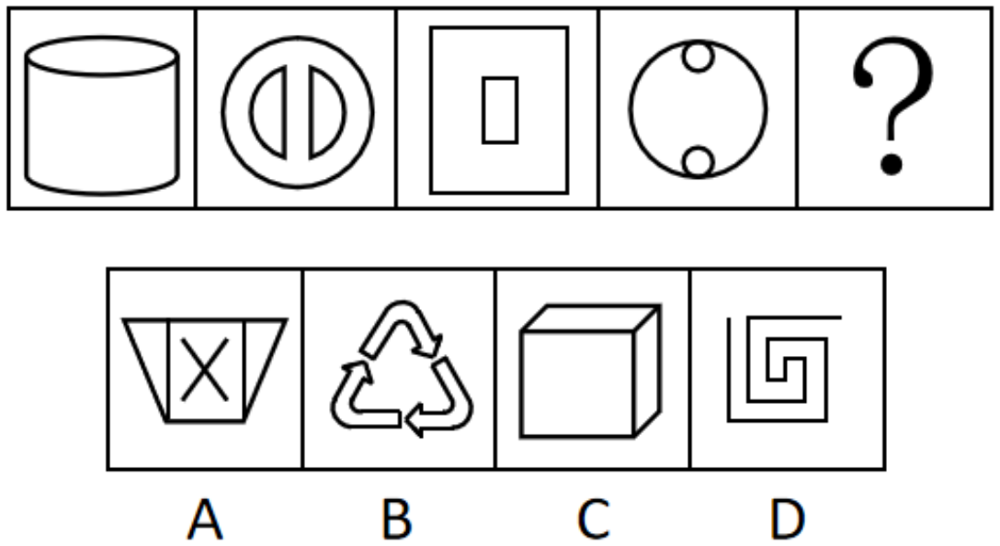

**A.** 见上方题图中 A 项。

**B.** 见上方题图中 B 项。

**C.** 见上方题图中 C 项。

**D.** 见上方题图中 D 项。

**答案：A**

### 第 34 题

`GD2019-XJ-Q034` · 单选 · 图形推理 · 原卷第 4、5 页

如图所示，四个相同的等腰直角三角形，不可能组成的图形是（）。

**A.** 长方形

**B.** 三角形

**C.** 直角梯形

**D.** 平行四边形

**答案：C**

### 第 35 题

`GD2019-XJ-Q035` · 单选 · 图形推理 · 原卷第 5 页

如图所示，下列物体均由纯黑色和纯白色的小立方体组成。则物体①与物体②中，（）由5块物体③堆积而成。

**A.** 只有物体①可能

**B.** 只有物体②可能

**C.** 物体①与②均可能

**D.** 物体①与②均不可能

**答案：C**

### 第 36 题

`GD2019-XJ-Q036` · 单选 · 图形推理 · 原卷第 5 页

下列选项，与所给立体图形不同的是（）。

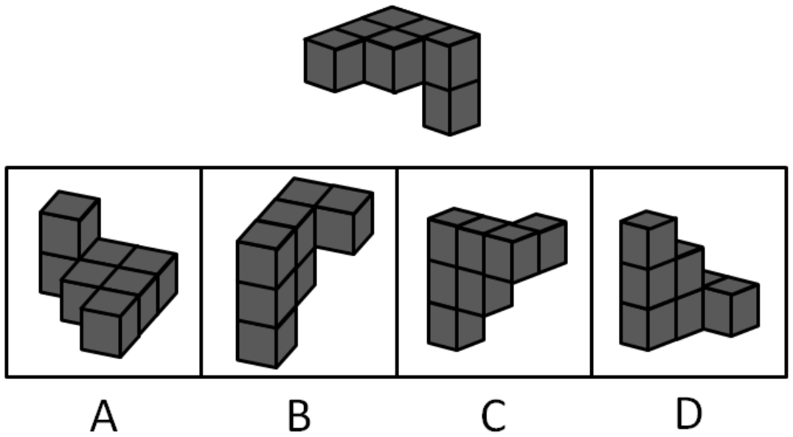

**A.** 见上方题图中 A 项。

**B.** 见上方题图中 B 项。

**C.** 见上方题图中 C 项。

**D.** 见上方题图中 D 项。

**答案：B**

### 第 37 题

`GD2019-XJ-Q037` · 单选 · 图形推理 · 原卷第 5 页

如图所示是从两个不同角度观察到的同一个正四面体的外表面，将该四面体展开，可能得到的图形是（）。

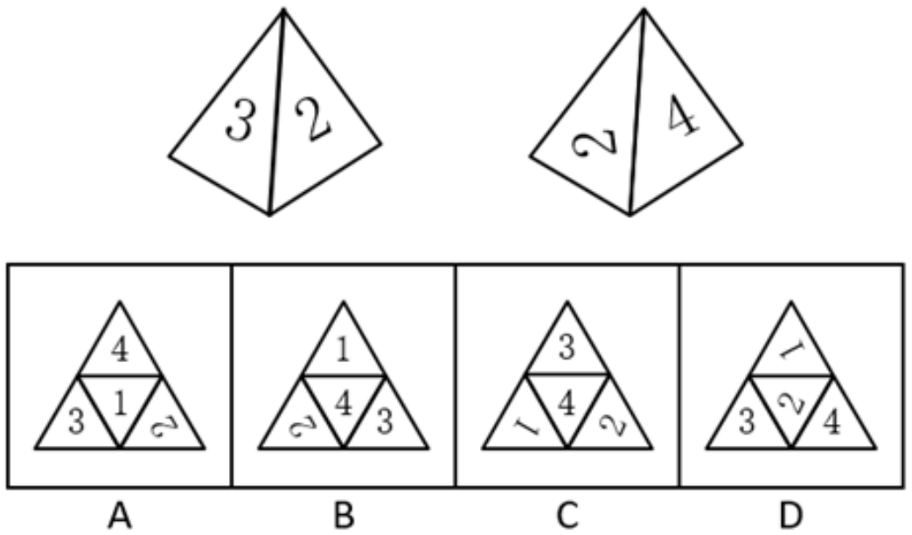

**A.** 见上方题图中 A 项。

**B.** 见上方题图中 B 项。

**C.** 见上方题图中 C 项。

**D.** 见上方题图中 D 项。

**答案：D**

### 第 38 题

`GD2019-XJ-Q038` · 单选 · 图形推理 · 原卷第 5 页

一个正方形旋转360°后，其旋转轨迹不可能形成的图形是（）。

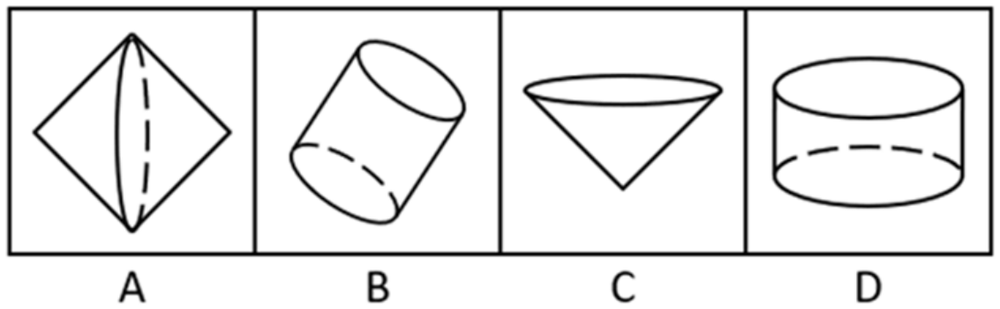

**A.** 见上方题图中 A 项。

**B.** 见上方题图中 B 项。

**C.** 见上方题图中 C 项。

**D.** 见上方题图中 D 项。

**答案：C**

> 转写说明：题干中的“360°”在原卷中为图片，已转写为文字。

### 第 39 题

`GD2019-XJ-Q039` · 单选 · 图形推理 · 原卷第 6 页

将一个空心圆柱体斜切，得到下图所示物体。不可能是这一物体截面的是（）。

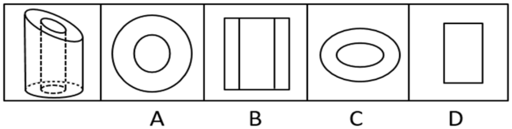

**A.** 见上方题图中 A 项。

**B.** 见上方题图中 B 项。

**C.** 见上方题图中 C 项。

**D.** 见上方题图中 D 项。

**答案：B**

### 第 40 题

`GD2019-XJ-Q040` · 单选 · 图形推理 · 原卷第 6 页

下列选项中，不可能是所给立方体展开图的是（）。

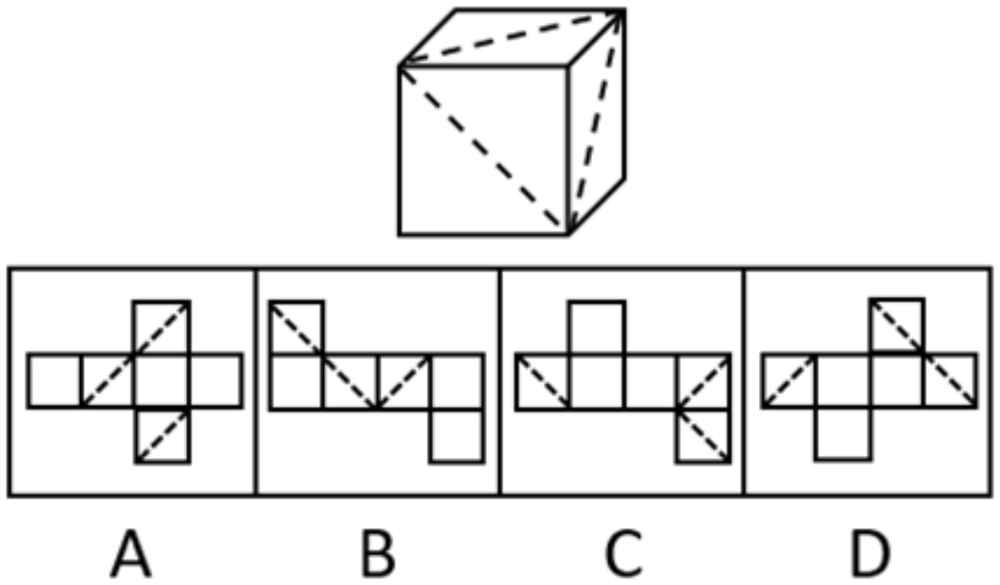

**A.** 见上方题图中 A 项。

**B.** 见上方题图中 B 项。

**C.** 见上方题图中 C 项。

**D.** 见上方题图中 D 项。

**答案：A**

### 第 41 题

`GD2019-XJ-Q041` · 单选 · 类比推理 · 原卷第 6 页

电脑：主板（）

**A.** 台历：挂历

**B.** 水果：苹果

**C.** 胶片：相机

**D.** 房屋：地基

**答案：D**

### 第 42 题

`GD2019-XJ-Q042` · 单选 · 类比推理 · 原卷第 6 页

打扫：整洁（）

**A.** 复习：考试

**B.** 降价：实惠

**C.** 绿化：环保

**D.** 实践：真理

**答案：B**

### 第 43 题

`GD2019-XJ-Q043` · 单选 · 类比推理 · 原卷第 6 页

丰富：贫乏（）

**A.** 体贴：粗犷

**B.** 精美：丑恶

**C.** 拘束：随意

**D.** 振奋：冷静

**答案：C**

### 第 44 题

`GD2019-XJ-Q044` · 单选 · 类比推理 · 原卷第 6 页

投递：收件（）

**A.** 逛街：娱乐

**B.** 购买：赠送

**C.** 借阅：整理

**D.** 授课：学习

**答案：D**

### 第 45 题

`GD2019-XJ-Q045` · 单选 · 类比推理 · 原卷第 6 页

画作：风景（）

**A.** 著作：英雄

**B.** 歌剧：电影

**C.** 抒发：情感

**D.** 蓝图：设计

**答案：A**

### 第 46 题

`GD2019-XJ-Q046` · 单选 · 逻辑判断 · 原卷第 6 页

一座城市要想发展好会展产业，就需要“筑巢引凤”——先具备软硬件基础，再吸引会展活动。拥有完备的会展设施和理想的交通条件，只是说明一座城市具备了发展会展产业的硬件基础，要想吸引足够数量的高质量会展活动，还需要提高公共服务水平、构建良好的营商环境，从而加强软实力的建设。
如果上述表述为真，则以下情况中不可能发生的是（）。

**A.** 甲市具备了发展会展产业的硬件基础，却发展不好会展产业

**B.** 乙市大力提升公共服务水平，吸引了足够数量的高质量会展活动

**C.** 丙市的会展产业非常发达，但市政设施老化的问题日渐突出

**D.** 丁市会展设施完备、交通条件理想，但未具备发展会展产业的硬件基础

**答案：D**

### 第 47 题

`GD2019-XJ-Q047` · 单选 · 逻辑判断 · 原卷第 6、7 页

芯片产业是全球分工合作的产业，其分布的领域非常广，不同领域面对的问题和挑战也大不相同，没有一个国家能够拥有完完整整的自主可控芯片产业链。但一国想要获得芯片产业的话语权，至少应该掌握产业链条上某些环节的关键技术，这样才能避免受制于人。
根据上述表述，下列判断一定正确的是（）。

**A.** 一个国家只要有了芯片产业话语权，该国就可能拥有完整的芯片产业链

**B.** 一个国家如果没有芯片产业的关键技术，则该国的芯片产业将受制于人

**C.** 一个国家的芯片产业要想不受制于人，就必须拥有完整的芯片产业链

**D.** 一个国家如果掌握了芯片产业的关键技术，那么该国一定具有芯片产业的话语权

**答案：B**

### 第 48 题

`GD2019-XJ-Q048` · 单选 · 逻辑判断 · 原卷第 7 页

在发达国家的产业结构中，服务业占了很高的比重。根据他们的经验，提高服务业占比就可以促进就业。但是，服务业具有较高的进入壁垒，这也是我国服务业发展相对滞后的一个重要原因。因此，我国可以通过打破服务业的行业壁垒进一步促进就业。
以下最可能是上述论证潜在假设的是（）。

**A.** 服务业促进就业的规律适用于我国

**B.** 我国创造就业的能力弱于发达国家

**C.** 发达国家的服务业也存在行业壁垒

**D.** 其他行业对促进就业没有显著作用

**答案：A**

### 第 49 题

`GD2019-XJ-Q049` · 单选 · 逻辑判断 · 原卷第 7 页

某办公室有教育学硕士、教育学学士、哲学硕士、哲学学士各一人。四人中，甲不是教育学硕士也不是哲学学士；甲和丙学习的是同一门学科；乙只获得了学士学位；丁不学哲学。
如果上述表述为真，则以下说法正确的是（）。

**A.** 甲是教育学学士

**B.** 乙是哲学学士

**C.** 丙是哲学学士

**D.** 丁是教育学学士

**答案：C**

### 第 50 题

`GD2019-XJ-Q050` · 单选 · 逻辑判断 · 原卷第 7 页

历史经验告诉我们，世界经济危机往往伴随着巨大的世界变革：1857年世界经济危机后的电气革命，推动人类社会从蒸汽时代进入电气时代；1929年世界经济危机引发了第二次世界大战，客观上推动了科学技术的发展。由此可知，是经济危机造成了巨大的世界变革。
以下和该论证过程的逻辑最为类似的是（）。

**A.** 不正确的坐姿会加重颈部负担，因而是腰酸背痛的主要诱因

**B.** 海底地震是海啸的主要成因，因为海啸发生前往往能观测到海底地震

**C.** 宇航员的预期寿命明显高于一般人，因此太空旅行中的辐射暴露并不会危害人体

**D.** 许多体弱多病的人都不喜欢吃蔬菜，所以想保持身体健康就必须从蔬菜中摄入足量的膳食纤维

**答案：B**

### 第 51 题

`GD2019-XJ-Q051` · 单选 · 逻辑判断 · 原卷第 7 页

G市经济发达、教育资源丰富，许多在G市就读的大学生毕业后都选择留在G市工作生活。但在今年，G市周边的几个城市都出台了一系列针对大学生落户的优惠政策，许多G市大学生因此选择将户口迁往周边城市。由此可以预测，今年留在G市的大学生将会更容易找到工作。
以下最能反驳上述论证的是（）。

**A.** G市周边的几个城市中，大学生同样不容易找到心仪的工作

**B.** 与去年相比，今年G市的几个大型工厂招收工人数量有所减少

**C.** 绝大多数将户口迁往周边城市的G市大学生仍然选择在G市工作

**D.** 有调查指出，过去几年在G市的大学生并没有面临很大的就业压力

**答案：C**

### 第 52 题

`GD2019-XJ-Q052` · 单选 · 逻辑判断 · 原卷第 7、8 页

有研究表明，向他人倾诉自己的烦恼是缓解压力的有效方式，但是在现实生活中，有四成以上的人不会向他人倾诉自己的烦恼，而这一部分人常感觉自己的工作与生活压力更大。因此，一个人越经常向他人倾诉自己的烦恼，在工作与生活中感受到的压力越小。
以下选项最能指出上述论证缺陷的是（）。

**A.** 默认了对于个体而言，缓解压力的行为是必要的

**B.** 忽视了每个人对压力的承受能力具有显著差异

**C.** 默认了提高行为的频率有助于加强行为的效果

**D.** 忽视了向他人倾诉烦恼可能会造成隐私泄露等问题

**答案：C**

### 第 53 题

`GD2019-XJ-Q053` · 单选 · 逻辑判断 · 原卷第 8 页

近几年，“痕迹管理”在基层工作中被广泛应用。其优势在于通过保留下来的文字、图片等工作资料，有效还原服务群众的工作情况，供日后查证。某地基层单位为了强化“痕迹管理”，极大增加了工作资料在考核分值中的比重。显然，这样的做法会使当地基层干部将大量精力耗费在保留工作痕迹上。
以下最可能是上述论证潜在假设的是（）。

**A.** 基层干部对于考核分值十分重视

**B.** 有些基层干部对群众缺少服务意识

**C.** “痕迹管理”要求保留所有工作痕迹

**D.** 绝大多数基层干部缺少“留痕”条件

**答案：A**

### 第 54 题

`GD2019-XJ-Q054` · 单选 · 逻辑判断 · 原卷第 8 页

某研究机构对3个品牌的老年代步车进行安全性碰撞实验。实验表明，这3个品牌的代步车都无法在发生交通事故时保护驾驶人。该机构因此认为：老年代步车十分危险，政府应该禁止代步车上路，引导老年人驾驶普通汽车。
以下选项最无法支持上述论断的是（）。

**A.** 代步车的价格一般低于普通汽车

**B.** 这3个品牌的代步车市场占有率极高

**C.** 使用代步车的老人普遍拥有汽车驾驶资格

**D.** 安全性是决定代步车能否上路行驶的首要因素

**答案：A**

### 第 55 题

`GD2019-XJ-Q055` · 单选 · 逻辑判断 · 原卷第 8 页

近年来随着大型野生动物园的兴起，有人提出，传统城市动物园已经没有存在的必要性。但传统城市动物园具有票价低、交通便利等优点，中小学组织参观十分方便，因而具有很强的教育功能，所以传统城市动物园不可或缺。
以下不属于上述论证缺陷的是（）。

**A.** 忽视了野生动物园和传统城市动物园具有并存的可能性

**B.** 默认了具有很强教育功能的传统城市动物园就应该保留

**C.** 忽视了票价低、交通便利不等同于方便中小学组织参观

**D.** 默认了方便中小学组织参观的动物园都具有很强的教育功能

**答案：A**

### 第 56 题

`GD2019-XJ-Q056` · 单选 · 逻辑判断 · 原卷第 8 页

研究表明，糖尿病是一种由多病因引起的以慢性高血糖为特征的代谢性疾病，是多种因素共同作用的结果，有家族聚集现象。家族史是提示可能患糖尿病风险的重要依据，因此，了解家族史，有助于更好地预防糖尿病。
要得出上述结论，必须补充的前提是（）。

**A.** 家族聚集现象体现在家族史中

**B.** 了解患糖尿病风险有助于预防糖尿病

**C.** 绝大多数人有途径了解自己的家族史

**D.** 不健康的生活方式也是影响糖尿病发病的因素

**答案：B**

> 转写说明：原卷设问句“要得出上述结论，必须补充的前提是（）。”另起一行，按原卷分段。

### 第 57 题

`GD2019-XJ-Q057` · 单选 · 逻辑判断 · 原卷第 8 页

过分密集的城市布局不仅容易使城市产生热岛效应，也不符合生态美学的要求。因此，城市建设应该尽可能拉开布局，合理地间隔各城市组团，使城市看起来舒缓有序，不拥挤、不杂乱。
以下和该论述过程的逻辑最为类似的是（）。

**A.** 只有有趣的故事和通俗的理论相结合，才能吸引人，让人真正理解其中的内涵，爱上科学。所以，从日常生活中的小事入手，科普也可以很有趣

**B.** 中小学课业负担太重，是影响中小学生快乐健康成长的大问题。所以，要将课业减负进行到底，扫除线上培训等减负盲区

**C.** 天文学的起源与文明的起源大致处于同一时期。因此，追寻天文学的起源也就意味着我们可以在某种程度上把握文明诞生和发展的脉络

**D.** 律师队伍事关群众对法治的需求，也与一个地方的竞争力直接相关。所以，完善的法律服务是营商环境的重要内容，也是衡量城市吸引力的重要标尺

**答案：B**

### 第 58 题

`GD2019-XJ-Q058` · 单选 · 逻辑判断 · 原卷第 9 页

某地区自上世纪70年代开始，引入栽种欧美黑杨，用于造纸。这些欧美黑杨适应当地气候环境，生长速度快，种植面积迅速扩大。然而近年来，当地生态环境问题日趋严重。因此有人认为，可以通过砍掉这些欧美黑杨来修复该地区生态环境。
以下选项最能指出上述论述缺陷的是（）。

**A.** 假设了有其他的作物可以替代欧美黑杨的经济价值

**B.** 忽视了该地区引入栽种的其他外来植物也会影响生态环境

**C.** 假设了该地区引入的欧美黑杨栽种面积远超当地树种面积

**D.** 默认了欧美黑杨种植面积扩大和生态环境问题间存在因果关系

**答案：D**

### 第 59 题

`GD2019-XJ-Q059` · 单选 · 逻辑判断 · 原卷第 9 页

随着生活节奏的加快，很多人都会用时间管理软件来规划自己的时间，以提升工作效率。这一做法是可行的。因为大脑的“提醒功能”不够准确，很少能在正确的时间做出正确的提醒，而外部提醒可以让人更好地掌握时间。
以下选项中最能削弱上述论断的是（）。

**A.** 时间管理软件会让人压力增大，影响工作效率

**B.** 时间管理软件质量参差不齐，人们难以辨别优劣

**C.** 时间管理软件会使人们的生活节奏进一步加快

**D.** 时间管理软件难以适用所有工作、生活事项

**答案：A**

### 第 60 题

`GD2019-XJ-Q060` · 单选 · 逻辑判断 · 原卷第 9 页

文学作品的电子书会给作品带来很高的关注度，这种关注度能够拉动纸质书的销售。因此，所有想要提高纸质版文学作品销售量的出版社都会为文学作品发行电子书。
以下和该论证过程的逻辑最为类似的是（）。

**A.** 家庭教育可以培养孩子的见识、性格、技能，从而确保孩子的天赋得到发展。所以，家长对家庭教育的重视，是确保孩子天赋得到发展的充分条件

**B.** 是否掌握作品命脉是作家是否拥有自己语言体系的判断标准。这是因为，一个作家拥有了自己的语言体系，就掌握了作品的命脉，就能成为优秀的作家

**C.** 家风与民风交相辉映，民风与国风休戚相关。在现代社会，好的家风必然能影响好的社会风气的形成。唯有良好的家风能孕育一个文明向上的社会

**D.** 要传承好传统文化，就必须构建传统文化传承体系。因为一旦构建好这一体系，就可以系统性地取其精华、去其糟粕，从而确保传统文化的传承发展

**答案：D**

## 科学推理

### 第 61 题

`GD2019-XJ-Q061` · 单选 · 原卷第 9 页

如图所示，将一只充了气的密封小气球放在针筒壁内，封闭针筒孔后向外抽拉针筒推杆，忽略摩擦力的影响，则在这一过程中（）。

**A.** 小气球体积会变大

**B.** 针筒内的压强保持不变

**C.** 小气球受到的合力为零

**D.** 针筒内的气体温度会升高

**答案：A**

### 第 62 题

`GD2019-XJ-Q062` · 单选 · 原卷第 9、10 页

办公室里的四盏灯型号相同，电路如下图所示。如果逐一打开这四盏灯，在电源的输出电压不变的情况下，下列说法正确的是（）。

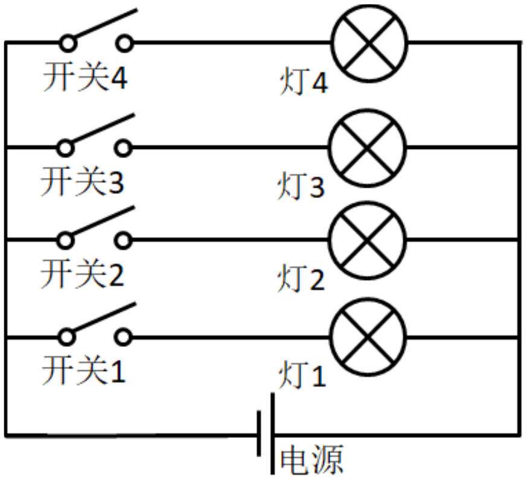

**A.** 打开的灯越多，通过各灯的电流变得越大

**B.** 打开的灯越多，各灯两端的电压变得越小

**C.** 打开的灯越多，通过电源的电流变得越大

**D.** 打开的灯越多，各灯变得越暗

**答案：C**

### 第 63 题

`GD2019-XJ-Q063` · 单选 · 原卷第 10 页

日常生活中的一些简单器械都应用了杠杆原理，根据使用杠杆时的用力情况，杠杆可以分为省力杠杆、费力杠杆和等臂杠杆。拾取垃圾使用的钳子（图1）和修剪树枝用的剪刀（图2），这两者的杠杆类型（）。

**A.** 一样，都是省力杠杆

**B.** 一样，都是费力杠杆

**C.** 不一样，前者是费力杠杆，后者是省力杠杆

**D.** 不一样，前者是省力杠杆，后者是费力杠杆

**答案：C**

### 第 64 题

`GD2019-XJ-Q064` · 单选 · 原卷第 10 页

人们在乘坐小船时，应尽量坐下，站立会降低小船的稳定性，其根本原因是（）。

**A.** 人和船的整体重量增加

**B.** 人和船的整体重心变高

**C.** 船的行驶速度增加

**D.** 水流波动幅度变大

**答案：B**

### 第 65 题

`GD2019-XJ-Q065` · 单选 · 原卷第 10 页

物质的用途与性质密切相关。下列说法正确的是（）。

**A.** 木炭能作为炼钢的原料，是利用了木炭的可燃性

**B.** 钨常用作灯丝，是因为钨在高温下化学性质稳定

**C.** 活性炭可以去除水中杂质，是因为其具有很强的吸附能力

**D.** 铝制品的表面可以不做防锈处理，是因为铝的金属活动性不强

**答案：C**

### 第 66 题

`GD2019-XJ-Q066` · 单选 · 原卷第 10、11 页

如图所示，将所点燃的一高一矮两只蜡烛放入圆筒，圆筒顶端不封闭，并从圆筒侧壁缓慢注入二氧化碳气体。则最可能发生的情况是（）。

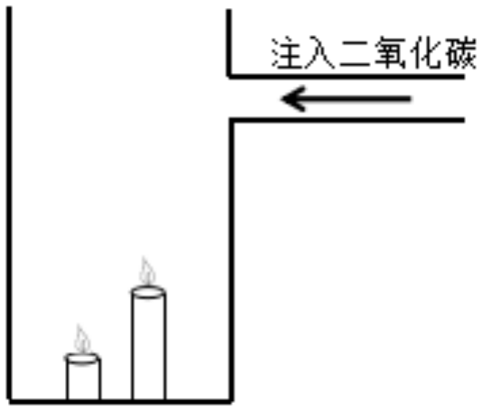

**A.** 高蜡烛先熄灭

**B.** 矮蜡烛先熄灭

**C.** 两只蜡烛的火苗没有变化

**D.** 两只蜡烛的火苗都变矮并逐渐熄灭

**答案：B**

> 转写说明：原卷题干作“将所点燃的一高一矮两只蜡烛”，多一“所”字，照录。

### 第 67 题

`GD2019-XJ-Q067` · 单选 · 原卷第 11 页

如图所示，甲、乙两个大小相同的实心金属球放置在光滑水平面上，甲球以水平向右的速度碰撞静止的乙球。已知甲球质量大于乙球，则有关碰撞后的情形，下列说法正确的是（）。

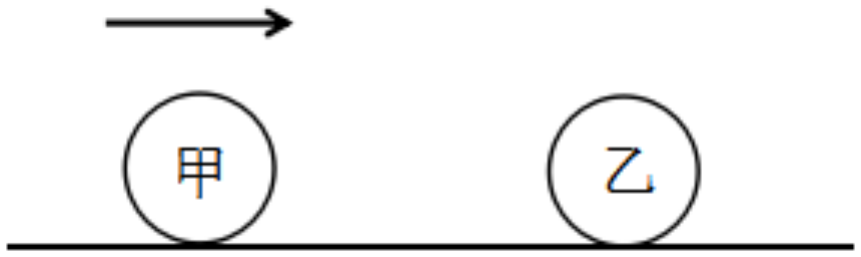

**A.** 甲球可能静止

**B.** 乙球可能静止

**C.** 甲球可能向左运动

**D.** 甲球一定向右运动

**答案：D**

### 第 68 题

`GD2019-XJ-Q068` · 单选 · 原卷第 11 页

冬天气温很低的时候往玻璃杯里倒开水，杯壁较厚的玻璃杯更容易发生炸裂，这是因为（）。

**A.** 内壁和外壁受热不均

**B.** 开水遇到玻璃后温度迅速降低

**C.** 空气对杯壁的压力超过杯壁的承受范围

**D.** 倒水时水的冲击力将玻璃杯击破

**答案：A**

### 第 69 题

`GD2019-XJ-Q069` · 单选 · 原卷第 11 页

为了整治超速，交警采用了一套系统。在某一路段，系统会自动记录车辆进入和离开的时间，从而判断该车辆是否超速。这种方法是计算车辆的（）。

**A.** 平均速率

**B.** 瞬时速率

**C.** 加速度

**D.** 位移

**答案：A**

### 第 70 题

`GD2019-XJ-Q070` · 单选 · 原卷第 11 页

“后驱”是指发动机的动力通过传动轴传递给后轮，从而推动车辆前进的一种驱动形式。当后驱车在水平公路上匀速前进时，下列说法正确的是（）。

**A.** 前轮和后轮受到的摩擦力均向前

**B.** 前轮和后轮受到的摩擦力均向后

**C.** 前轮受到的摩擦力向前，后轮受到的摩擦力向后

**D.** 前轮受到的摩擦力向后，后轮受到的摩擦力向前

**答案：D**

## 常识判断

### 第 71 题

`GD2019-XJ-Q071` · 单选 · 原卷第 11 页

习近平总书记提出“绿水青山就是金山银山”的发展理念。以下最能体现这一理念的是（）。

**A.** 精准扶贫

**B.** 共建“一带一路”

**C.** 实行“河长制”

**D.** 加强知识产权保护

**答案：C**

### 第 72 题

`GD2019-XJ-Q072` · 单选 · 原卷第 11 页

近几年，我国政府出台了一系列减税降费的举措。减税降费有利于（）。
①减轻企业负担、稳定就业
②优化经济和收入分配结构
③畅通小微企业融资渠道

**A.** ①②

**B.** ①③

**C.** ②③

**D.** ①②③

**答案：A**

### 第 73 题

`GD2019-XJ-Q073` · 单选 · 原卷第 11、12 页

粤港澳大湾区包括香港特别行政区、澳门特别行政区和珠三角九市，是我国经济活力最强的区域之一，在国家发展大局中具有重要战略地位。以下关于粤港澳大湾区发展基础的说法，错误的是（）。

**A.** 经济实力雄厚

**B.** 创新要素集聚

**C.** 内部发展差距小

**D.** 国际化水平领先

**答案：C**

### 第 74 题

`GD2019-XJ-Q074` · 单选 · 原卷第 12 页

2019年3月，习近平总书记对欧洲三国进行了国事访问，推动共建“一带一路”在亚欧大陆开辟新的空间。这三国分别是（）。

**A.** 以色列 乌克兰 英国

**B.** 墨西哥 奥地利 瑞典

**C.** 意大利 摩纳哥 法国

**D.** 新西兰 葡萄牙 德国

**答案：C**

> 答案说明：答案解析PDF第13页本题只有解析文字（“2019年3月21日至26日，国家主席习近平应邀对意大利、摩纳哥、法国进行国事访问……”），没有“故正确答案为X”；所述三国与C项“意大利 摩纳哥 法国”逐字对应，记为C。乡镇卷第62题（同题）的答案页同样只有这段文字。

### 第 75 题

`GD2019-XJ-Q075` · 单选 · 原卷第 12 页

2019年3月12日，十三届全国人大二次会议举行第三次全体会议，听取审议最高人民法院工作报告和最高人民检察院工作报告。这体现了人民代表大会的（）。

**A.** 立法权

**B.** 决定权

**C.** 任免权

**D.** 监督权

**答案：D**

### 第 76 题

`GD2019-XJ-Q076` · 单选 · 原卷第 12 页

人才是实施乡村振兴战略的关键因素。以下举措不属于推动乡村人才振兴的是（）。

**A.** 大力支持乡村休闲旅游

**B.** 实施新乡贤返乡工程

**C.** 扩大“三支一扶”计划人员招募规模

**D.** 完善农村劳动力技能培训补贴机制

**答案：A**

### 第 77 题

`GD2019-XJ-Q077` · 单选 · 原卷第 12 页

宏观调控是国家综合运用各种手段对国民经济进行的一种调节控制。国家宏观调控分为经济手段、法律手段和行政手段。下列选项中，不属于经济手段的是（）。

**A.** 央行上调存款准备金率

**B.** 全国各地发布最低工资标准

**C.** 政府下令关停整改严重污染企业

**D.** 国家实施个人所得税专项附加扣除

**答案：C**

### 第 78 题

`GD2019-XJ-Q078` · 单选 · 原卷第 12 页

全面建成小康社会，最艰巨最繁重的任务在（），特别是在贫困地区。

**A.** 城市

**B.** 城镇

**C.** 社区

**D.** 农村

**答案：D**

### 第 79 题

`GD2019-XJ-Q079` · 单选 · 原卷第 12 页

行政机关在法律的授权范围内，将一般性的原则或者条款适用于个案时，需要作出一种最适当的法律效果选择。这属于行政法的（）。

**A.** 行政效力推定原则

**B.** 行政裁量合理原则

**C.** 行政职权法定原则

**D.** 行政程序正当原则

**答案：B**

### 第 80 题

`GD2019-XJ-Q080` · 单选 · 原卷第 12 页

只要把握住历史发展大势，抓住历史变革时机，奋发有为，锐意进取，人类社会就能更好前进。这句话体现的哲学原理是（）。

**A.** 物质和意识的辩证关系

**B.** 规律是可以认识和利用的

**C.** 事物发展是前进性和曲折性的统一

**D.** 实践是检验认识正确与否的唯一标准

**答案：B**

### 第 81 题

`GD2019-XJ-Q081` · 单选 · 原卷第 12 页

地球内部具有巨大的热量，并通过不同途径由内向外散发地热能。以下现象与地热能有关的是（）。

**A.** 台风生成

**B.** 火山喷发

**C.** 山洪暴发

**D.** 岩石风化

**答案：B**

### 第 82 题

`GD2019-XJ-Q082` · 单选 · 原卷第 12 页

赤潮是指在特定的环境条件下，海水中某些浮游生物爆发性增殖，引起水体变色的一种生态现象。下列关于赤潮的说法中，正确的是（）。

**A.** 海水富营养化是赤潮爆发的基础

**B.** 赤潮爆发与人类活动关系不大

**C.** 多数赤潮对环境没有危害

**D.** 所有的赤潮都是红色的

**答案：A**

### 第 83 题

`GD2019-XJ-Q083` · 单选 · 原卷第 12 页

“山上多植物，胜似修水库，有雨它能吞，无雨它能吐”。这一谚语形象地说明了森林具有（）的功能。

**A.** 净化空气

**B.** 过滤尘埃

**C.** 减小噪音

**D.** 涵养水源

**答案：D**

### 第 84 题

`GD2019-XJ-Q084` · 单选 · 原卷第 12 页

用水银体温计依次给甲、乙、丙三人测量体温时，一直没有甩体温计。已知测量甲的体温时读数为37.8℃，乙、丙的实际体温分别为37.6℃和38℃，那么在测量乙、丙的体温时，体温计的读数分别是（）。

**A.** 37.8℃和37.8℃

**B.** 37.6℃和38℃

**C.** 37.8℃和38℃

**D.** 0℃和0℃

**答案：C**

> 转写说明：题干与选项中的温度在原卷中为图片，已转写为文字；D项原卷即作“0℃和0℃”，照录。

### 第 85 题

`GD2019-XJ-Q085` · 单选 · 原卷第 12、13 页

广东属于岭南地区，具有深厚的岭南文化。以下诗句中描写岭南风物的是（）。

**A.** 此地空余黄鹤楼

**B.** 罗浮山下四时春

**C.** 风吹草低见牛羊

**D.** 不识庐山真面目

**答案：B**

## 资料分析

### 共用材料：第 86—90 题

近年来，A省新登记市场主体保持较快增长势头。全省实有各类市场主体从2015年的775.95万户增长到2018年的1146.13万户。2018年，全省新登记市场主体229.74万户，日均新登记市场主体6294户，同比增长17.82%。
2018年，全省新登记企业最集中的三个行业分别是批发和零售业、租赁和商务服务业、制造业，新登记企业数分别为36.14万户、15.19万户、9.25万户，分别同比增长0.23%、增长22.98%、下降6.8%。

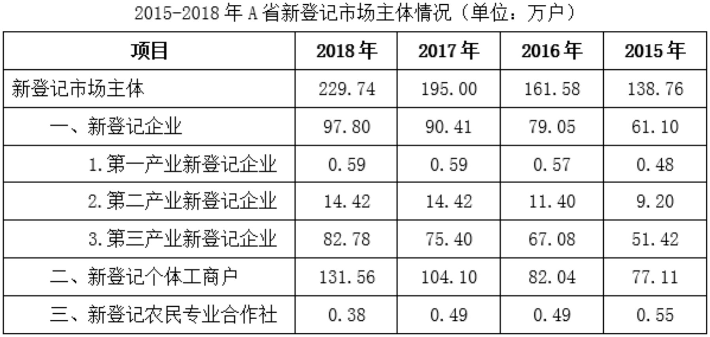

2015-2018年A省新登记市场主体情况（单位：万户）

| 项目 | 2018年 | 2017年 | 2016年 | 2015年 |
| --- | --- | --- | --- | --- |
| 新登记市场主体 | 229.74 | 195.00 | 161.58 | 138.76 |
| 一、新登记企业 | 97.80 | 90.41 | 79.05 | 61.10 |
| 1.第一产业新登记企业 | 0.59 | 0.59 | 0.57 | 0.48 |
| 2.第二产业新登记企业 | 14.42 | 14.42 | 11.40 | 9.20 |
| 3.第三产业新登记企业 | 82.78 | 75.40 | 67.08 | 51.42 |
| 二、新登记个体工商户 | 131.56 | 104.10 | 82.04 | 77.11 |
| 三、新登记农民专业合作社 | 0.38 | 0.49 | 0.49 | 0.55 |

原表“1.第一产业新登记企业”至“3.第三产业新登记企业”三行为“一、新登记企业”的分项（缩进排）。

> 材料说明：材料中的17.82%、0.23%、22.98%、6.8%在原卷中为图片，已转写为文字。

### 第 86 题

`GD2019-XJ-Q086` · 单选 · 原卷第 13 页

[共用材料](#GD2019-XJ-M1)

2015—2018，A省实有各类市场主体数增长了约（）万户。

**A.** 170.2

**B.** 270.2

**C.** 370.2

**D.** 470.2

**答案：C**

> 转写说明：原卷题干作“2015—2018，”（缺“年”字），照录。

### 第 87 题

`GD2019-XJ-Q087` · 单选 · 原卷第 13 页

[共用材料](#GD2019-XJ-M1)

2018年，A省新登记市场主体中，数量较上年增幅最大的是（）。

**A.** 第一产业新登记企业

**B.** 第二产业新登记企业

**C.** 第三产业新登记企业

**D.** 新登记个体工商户

**答案：D**

### 第 88 题

`GD2019-XJ-Q088` · 单选 · 原卷第 13 页

[共用材料](#GD2019-XJ-M1)

2015—2018年，A省新登记市场主体数年增长约（）万户。

**A.** 15.1

**B.** 23.2

**C.** 30.3

**D.** 36.4

**答案：C**

> 转写说明：原卷题干作“新登记市场主体数年增长约”，答案解析PDF转述为“年均增长约”并按年均增长量计算，照录原题。

### 第 89 题

`GD2019-XJ-Q089` · 单选 · 原卷第 13 页

[共用材料](#GD2019-XJ-M1)

2018年，租赁和商务服务业新登记企业数较上年增加约（）万户。

**A.** 2.8

**B.** 3.8

**C.** 4.8

**D.** 5.8

**答案：A**

### 第 90 题

`GD2019-XJ-Q090` · 单选 · 原卷第 13 页

[共用材料](#GD2019-XJ-M1)

根据材料，以下说法不正确的是（）。

**A.** 2015—2018年，A省新登记企业数增长超50%

**B.** 2017年，A省日均新登记市场主体少于4000户

**C.** 2017年，A省新登记企业最集中的行业是批发和零售业

**D.** 2015年，A省新登记农民专业合作社多于第一产业新登记企业

**答案：B**

> 转写说明：A项中的50%在原卷中为图片，已转写为文字。

### 共用材料：第 91—95 题

党的十八大以来，脱贫工作取得巨大成效，全国农村贫困人口大幅减少。截至2018年末，全国农村贫困人口从2012年末的9899万人减少至1660万人；农村贫困发生率从2012年的10.2%下降至1.7%，累计下降8.5个百分点。

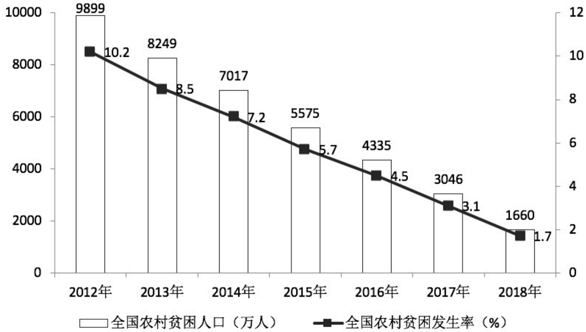

2012—2018年全国农村贫困人口和贫困发生率

| 年份 | 全国农村贫困人口（万人） | 全国农村贫困发生率（%） |
| --- | --- | --- |
| 2012年 | 9899 | 10.2 |
| 2013年 | 8249 | 8.5 |
| 2014年 | 7017 | 7.2 |
| 2015年 | 5575 | 5.7 |
| 2016年 | 4335 | 4.5 |
| 2017年 | 3046 | 3.1 |
| 2018年 | 1660 | 1.7 |

图名为图下的一行正文（见材料）；图例：柱为全国农村贫困人口（左轴，0—10000），折线为全国农村贫困发生率（右轴，0—12）。

2012—2018年全国农村贫困人口和贫困发生率
2018年，贫困地区农村居民人均可支配收入10371元，扣除价格因素，实际增长8.3%，实际增速高出全国农村居民人均可支配收入实际增速1.7个百分点，圆满完成增长幅度高于全国增速的年度目标任务。

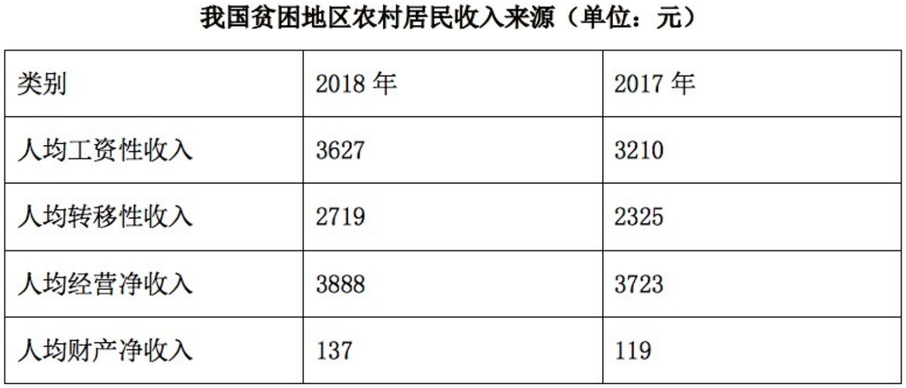

我国贫困地区农村居民收入来源（单位：元）

| 类别 | 2018年 | 2017年 |
| --- | --- | --- |
| 人均工资性收入 | 3627 | 3210 |
| 人均转移性收入 | 2719 | 2325 |
| 人均经营净收入 | 3888 | 3723 |
| 人均财产净收入 | 137 | 119 |

表中作“人均转移性收入”，第94题B项、第95题D项作“转移净收入”，均照录。2018年四项合计10371元，与正文人均可支配收入一致。

> 材料说明：材料中的10.2%、1.7%、8.3%在原卷中为图片，已转写为文字。

### 第 91 题

`GD2019-XJ-Q091` · 单选 · 原卷第 14 页

[共用材料](#GD2019-XJ-M2)

从2012年末到2018年末，全国农村贫困人口数减少了（）万人。

**A.** 6239

**B.** 7239

**C.** 8239

**D.** 9230

**答案：C**

### 第 92 题

`GD2019-XJ-Q092` · 单选 · 原卷第 14 页

[共用材料](#GD2019-XJ-M2)

2013—2018年，全国农村贫困发生率较上年下降最多的是（）年。

**A.** 2013

**B.** 2015

**C.** 2017

**D.** 2018

**答案：A**

### 第 93 题

`GD2019-XJ-Q093` · 单选 · 原卷第 14 页

[共用材料](#GD2019-XJ-M2)

2018年，我国贫困地区农村居民人均工资性收入约占人均可支配收入的（）。

**A.** 20%

**B.** 25%

**C.** 30%

**D.** 35%

**答案：D**

> 转写说明：四个选项的百分数在原卷中为图片，已转写为文字。

### 第 94 题

`GD2019-XJ-Q094` · 单选 · 原卷第 14 页

[共用材料](#GD2019-XJ-M2)

2018年，我国贫困地区农村居民收入来源中，最高的是（）。

**A.** 人均工资性收入

**B.** 人均转移净收入

**C.** 人均经营净收入

**D.** 人均财产净收入

**答案：C**

### 第 95 题

`GD2019-XJ-Q095` · 单选 · 原卷第 14、15 页

[共用材料](#GD2019-XJ-M2)

下列说法不正确的是（）。

**A.** 2012—2018年，全国农村贫困人口逐年递减

**B.** 2018年，全国农村居民人均可支配收入实际增速为6.6%

**C.** 2018年，贫困地区农村居民各来源的人均收入较上年均有提高

**D.** 2017年，贫困地区农村居民人均经营净收入比转移净收入高近1000元

**答案：D**

> 转写说明：B项中的6.6%在原卷中为图片，已转写为文字。

### 共用材料：第 96—100 题

2018年，我国全社会用电量68449亿千瓦时，同比增长8.5%，增幅同比提高1.9个百分点。具体来看，第一产业用电量728亿千瓦时，同比增长9.8%；第二产业用电量47235亿千瓦时，同比增长7.2%；第三产业用电量10801亿千瓦时，同比增长12.7%；城乡居民生活用电量9685亿千瓦时，同比增长10.4%。
2018年，我国可再生能源发电量达1.87万亿千瓦时，同比增长约1700亿千瓦时；可再生能源发电量占全年发电总量比重为26.7%，同比上升0.2个百分点。

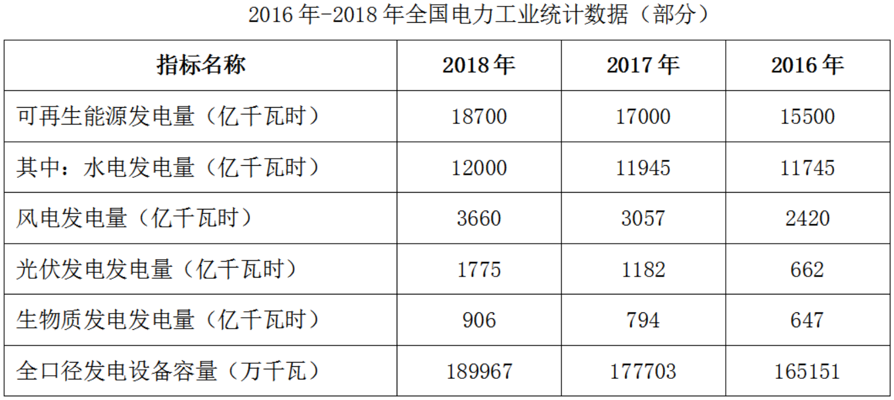

2016年-2018年全国电力工业统计数据（部分）

| 指标名称 | 2018年 | 2017年 | 2016年 |
| --- | --- | --- | --- |
| 可再生能源发电量（亿千瓦时） | 18700 | 17000 | 15500 |
| 其中：水电发电量（亿千瓦时） | 12000 | 11945 | 11745 |
| 风电发电量（亿千瓦时） | 3660 | 3057 | 2420 |
| 光伏发电发电量（亿千瓦时） | 1775 | 1182 | 662 |
| 生物质发电发电量（亿千瓦时） | 906 | 794 | 647 |
| 全口径发电设备容量（万千瓦） | 189967 | 177703 | 165151 |

> 材料说明：材料中的8.5%、9.8%、7.2%、12.7%、10.4%、26.7%在原卷中为图片，已转写为文字。

### 第 96 题

`GD2019-XJ-Q096` · 单选 · 原卷第 15 页

[共用材料](#GD2019-XJ-M3)

2018年，我国全社会用电量较2016年增加了约（）。

**A.** 13.7%

**B.** 15.7%

**C.** 17.9%

**D.** 19.9%

**答案：B**

> 转写说明：四个选项的百分数在原卷中为图片，已转写为文字。

### 第 97 题

`GD2019-XJ-Q097` · 单选 · 原卷第 15 页

[共用材料](#GD2019-XJ-M3)

2017年，我国三大产业及城乡居民生活用电量大小排序正确的是（）。

**A.** 第二产业用电>第三产业用电>城乡居民生活用电>第一产业用电

**B.** 第三产业用电>城乡居民生活用电>第一产业用电>第二产业用电

**C.** 第二产业用电>城乡居民生活用电>第三产业用电>第一产业用电

**D.** 第一产业用电>第二产业用电>第三产业用电>城乡居民生活用电

**答案：A**

> 转写说明：四个选项中的“>”在原卷中为图片，已转写为文字。

### 第 98 题

`GD2019-XJ-Q098` · 单选 · 原卷第 15 页

[共用材料](#GD2019-XJ-M3)

2018年，我国发电总量约为（）万亿千瓦时。

**A.** 1.87

**B.** 3.70

**C.** 5.84

**D.** 7.00

**答案：D**

### 第 99 题

`GD2019-XJ-Q099` · 单选 · 原卷第 15 页

[共用材料](#GD2019-XJ-M3)

2017年，下列可再生能源发电量同比增幅最大的是（）。

**A.** 水电

**B.** 风电

**C.** 光伏发电

**D.** 生物质发电

**答案：C**

### 第 100 题

`GD2019-XJ-Q100` · 单选 · 原卷第 15 页

[共用材料](#GD2019-XJ-M3)

根据以上材料，下列说法不正确的是（）。

**A.** 2018年，我国第二产业用电量是第三产业用电量的4倍多

**B.** 2017年和2018年，我国风电发电量同比增幅均超过20%

**C.** 2017年，我国可再生能源发电量占全年发电总量的26.5%

**D.** 2018年，我国全口径发电设备容量较2016年增加约2.48亿千瓦

**答案：B**

> 转写说明：B项中的20%、C项中的26.5%在原卷中为图片，已转写为文字。
