# 2019年广东行测（乡镇卷）

共 100 题，原题号完整保留。内容：题干、选项、答案（不收解析）；资料分析共用材料置于所属题组前，JSONL 每条记录完整内嵌材料。

[结构化数据](GD2019-XZ.jsonl) · [字段说明](schema.json) · [质量报告](quality/GD2019-XZ.md)

原题来源：[2019年广东公务员考试《行测》真题（乡镇级）.pdf](https://github.com/dumarstoft-ship-it/xing-ce1/blob/52f9811b22cad5410a7108dd0a07a879f1187aa5/%E7%9C%9F%E9%A2%98/2019%E5%B9%B4%E5%B9%BF%E4%B8%9C%E5%85%AC%E5%8A%A1%E5%91%98%E8%80%83%E8%AF%95%E3%80%8A%E8%A1%8C%E6%B5%8B%E3%80%8B%E7%9C%9F%E9%A2%98%EF%BC%88%E4%B9%A1%E9%95%87%E7%BA%A7%EF%BC%89.pdf)。答案来源：[2019年广东公务员考试《行测》真题（乡镇级）答案及解析.pdf](https://github.com/dumarstoft-ship-it/xing-ce1/blob/52f9811b22cad5410a7108dd0a07a879f1187aa5/%E7%AD%94%E6%A1%88%E8%A7%A3%E6%9E%90/2019%E5%B9%B4%E5%B9%BF%E4%B8%9C%E5%85%AC%E5%8A%A1%E5%91%98%E8%80%83%E8%AF%95%E3%80%8A%E8%A1%8C%E6%B5%8B%E3%80%8B%E7%9C%9F%E9%A2%98%EF%BC%88%E4%B9%A1%E9%95%87%E7%BA%A7%EF%BC%89%E7%AD%94%E6%A1%88%E5%8F%8A%E8%A7%A3%E6%9E%90.pdf)（只取答案）。

## 言语理解与表达

### 第 1 题

`GD2019-XZ-Q001` · 单选 · 原卷第 1 页

多元的发展机会和自由的成长空间，是时代给予每个追梦人的馈赠；（）每个追梦人在前进道路上迈出的每一步，（）都在推动时代的进步。

**A.** 而 也

**B.** 但 却

**C.** 如果 就

**D.** 只有 才

**答案：A**

### 第 2 题

`GD2019-XZ-Q002` · 单选 · 原卷第 1 页

只要我们迈出的步伐足够坚实，前进的意志足够（），奋斗路上的困难终将被克服，前进路上的沟壑终将被跨越。

**A.** 强硬

**B.** 奋勇

**C.** 坚定

**D.** 坚硬

**答案：C**

### 第 3 题

`GD2019-XZ-Q003` · 单选 · 原卷第 1 页

近年来，各地纷纷大刀阔斧地开展（），向不担当不作为亮剑。

**A.** 整理

**B.** 整治

**C.** 修理

**D.** 梳理

**答案：B**

### 第 4 题

`GD2019-XZ-Q004` · 单选 · 原卷第 1 页

在落实乡村振兴战略的过程中，一定要科学规划，（），才能最终实现目标，任何希望（）的想法都是不切实际的。

**A.** 循序渐进 一蹴而就

**B.** 寻根究底 一鼓作气

**C.** 蔚然成风 一劳永逸

**D.** 未雨绸缪 一马当先

**答案：A**

### 第 5 题

`GD2019-XZ-Q005` · 单选 · 原卷第 1 页

持续深入的人才发展体制机制改革，为（）、（）、（）、（）打牢了坚实基础，有力推进了新时代中国特色社会主义伟大事业不断夺取新的伟大胜利。

**A.** 引才 聚才 用才 育才

**B.** 聚才 用才 育才 引才

**C.** 用才 育才 引才 聚才

**D.** 育才 引才 聚才 用才

**答案：D**

### 第 6 题

`GD2019-XZ-Q006` · 单选 · 原卷第 1 页

回顾40年，改革开放旗帜之所以始终高高飘扬，关键得益于基层求新求变的强大意愿以及敢闯敢试的探索精神，改革再扬帆，也必须尊重基层干部群众在改革进程中的主体性作用。
对这段文字理解准确的是（）。

**A.** 实践是改革开放最关键的一环

**B.** 基层的探索精神完全决定于改革的效果

**C.** 改革必须发挥基层干部群众的主观能动性

**D.** 改革开放促使基层创新求变

**答案：C**

### 第 7 题

`GD2019-XZ-Q007` · 单选 · 原卷第 1 页

尽管从农业社会走向现代社会，是经济社会发展的必然，但这样不是促使农业农村的“消亡”，做好“三农”工作，建设好农村，发展好农业，使广大农民获得感、安全感不断提升，依然是社会主义建设的主要内容。
这段文字主要说明了（）。

**A.** 我国目前仍然处于农业社会

**B.** “三农”工作的重要性

**C.** 农业农村会随着经济社会的发展“消亡”

**D.** 广大农民的获得感、幸福感、安全感有待提升

**答案：B**

> 转写说明：原卷题干“但这样不是促使农业农村的‘消亡’”语句欠通，照录。

### 第 8 题

`GD2019-XZ-Q008` · 单选 · 原卷第 1 页

扶贫干部自掏腰包到基层扶贫，是真扶贫、扶真贫的体现。但若一味宣扬扶贫干部自掏腰包扶贫，不仅会加重扶贫干部的经济负担，还会在一定程度上让贫困群众产生依赖心理。
对这段文字理解准确的是（）。

**A.** 一味宣扬扶贫干部自掏腰包扶贫具有一定的副作用

**B.** 应该大力提倡扶贫干部自掏腰包支持贫困户

**C.** 当前存在大量扶贫干部自掏腰包扶贫的情况

**D.** 扶贫干部自掏腰包扶贫是不得已而为之的

**答案：A**

### 第 9 题

`GD2019-XZ-Q009` · 单选 · 原卷第 1、2 页

完善村民自治，应推动乡村治理重心下移，尽可能把资源、服务、管理下放到基层，培育打造服务性、公益性、互动性农村社会组织，开展农村社会工作和志愿服务，发挥新乡贤作用。
对这段文字理解准确的是（）。

**A.** 完善村民自治需要大量引进志愿者

**B.** 完善村民自治需要让乡贤发挥主要作用

**C.** 完善村民自治需要把所有资源下放到基层

**D.** 完善村民自治需要发展农村社会组织

**答案：D**

### 第 10 题

`GD2019-XZ-Q010` · 单选 · 原卷第 2 页

推动媒体融合发展，事关推进国家治理体系和治理能力现代化。在全媒体时代，媒体不仅是信息的提供者和传播者，而且在国家治理中也发挥着重要作用。因此，媒体融合不仅仅是一个传播命题，还是一个治理命题。
这段文字的主旨是（）。

**A.** 国家治理现代化需要促进媒体融合

**B.** 媒体融合发展有利于促进信息传播

**C.** 媒体融合发展是信息技术发展的需要

**D.** 媒体在国家治理中应承担主要责任

**答案：A**

## 数量关系

### 第 11 题

`GD2019-XZ-Q011` · 单选 · 原卷第 2 页

4 7 10 13（    ）

**A.** 15

**B.** 16

**C.** 17

**D.** 18

**答案：B**

### 第 12 题

`GD2019-XZ-Q012` · 单选 · 原卷第 2 页

5 9 17 33（    ）

**A.** 35

**B.** 45

**C.** 65

**D.** 85

**答案：C**

### 第 13 题

`GD2019-XZ-Q013` · 单选 · 原卷第 2 页

5 15 45 135（    ）

**A.** 185

**B.** 225

**C.** 355

**D.** 405

**答案：D**

### 第 14 题

`GD2019-XZ-Q014` · 单选 · 原卷第 2 页

64 32 16 8（    ）

**A.** 4

**B.** 5

**C.** 6

**D.** 7

**答案：A**

### 第 15 题

`GD2019-XZ-Q015` · 单选 · 原卷第 2 页

1/2 3/4 5/8 7/16（    ）

**A.** 9/32

**B.** 14/32

**C.** 32/64

**D.** 45/64

**答案：A**

> 转写说明：题干与选项的分数在原卷中为图片，已按“分子/分母”转写；B项原卷即作14/32，C项即作32/64，未约分。

### 第 16 题

`GD2019-XZ-Q016` · 单选 · 原卷第 2 页

乡镇干部小李今天有3项不同的工作要完成，则他今天完成工作的顺序共有（）种。

**A.** 3

**B.** 4

**C.** 5

**D.** 6

**答案：D**

### 第 17 题

`GD2019-XZ-Q017` · 单选 · 原卷第 2 页

某机构计划在一块边长为18米的正方形空地开展活动，需要在空地四边每隔2米插上一面彩旗，若该空地的四个角都需要插上彩旗，那么一共需要（）面彩旗。

**A.** 32

**B.** 36

**C.** 44

**D.** 48

**答案：B**

### 第 18 题

`GD2019-XZ-Q018` · 单选 · 原卷第 2 页

在一次知识竞赛中，甲、乙两单位平均分为85分，甲单位得分比乙单位高10分，则乙单位得分为（）分。

**A.** 88

**B.** 85

**C.** 80

**D.** 75

**答案：C**

### 第 19 题

`GD2019-XZ-Q019` · 单选 · 原卷第 2 页

某文印室有30袋A4纸和20袋B3纸。由于工作需要，该文印室每天都会用掉6袋A4纸和2袋B3纸，则三天后文印室的B3纸比A4纸多（）袋。

**A.** 1

**B.** 2

**C.** 3

**D.** 4

**答案：B**

### 第 20 题

`GD2019-XZ-Q020` · 单选 · 原卷第 2、3 页

某单位男女干部人数相等，男干部中60%有基层工作经历，女干部中50%有基层工作经历。则在该单位全体干部中，有基层工作经历的占（）。

**A.** 55%

**B.** 60%

**C.** 65%

**D.** 70%

**答案：A**

> 转写说明：题干与选项的百分数在原卷中为图片，已转写为文字。

### 第 21 题

`GD2019-XZ-Q021` · 单选 · 原卷第 3 页

某商场为了提高销量，以七五折销售笔记本电脑，打折后销售3600元。则该笔记本原价为每台（）元。

**A.** 4200

**B.** 4500

**C.** 4800

**D.** 5100

**答案：C**

### 第 22 题

`GD2019-XZ-Q022` · 单选 · 原卷第 3 页

某办公室有大、中、小三种型号的文件袋共200个，已知大号文件袋数量是中号文件袋的2倍，小号文件袋的数量为50个，那么大号文件袋有（）个。

**A.** 50

**B.** 60

**C.** 80

**D.** 100

**答案：D**

### 第 23 题

`GD2019-XZ-Q023` · 单选 · 原卷第 3 页

甲乙两人绕着周长为600米的环形跑道跑步，他们从相同的起点同时同向起跑。已知甲的速度为每秒4米，乙的速度为每秒3米，则当甲第一次回到起点时，乙距离起点还有（）米。

**A.** 100

**B.** 150

**C.** 200

**D.** 250

**答案：B**

### 第 24 题

`GD2019-XZ-Q024` · 单选 · 原卷第 3 页

小王距离单位1.2公里，每天步行上班。速度为每分钟100米，则他上班需要花（）分钟。

**A.** 12

**B.** 15

**C.** 18

**D.** 20

**答案：A**

### 第 25 题

`GD2019-XZ-Q025` · 单选 · 原卷第 3 页

甲施工队每天能完成某项工程的1/9，乙施工队施工效率是甲施工队的两倍，则甲、乙两队同时施工（）天就能完成该工程。

**A.** 2

**B.** 3

**C.** 4

**D.** 5

**答案：B**

> 转写说明：题干中的1/9在原卷中为图片，已按“分子/分母”转写。

## 判断推理

### 第 26 题

`GD2019-XZ-Q026` · 单选 · 图形推理 · 原卷第 3 页

下列选项中最符合所给图形规律的是（）。

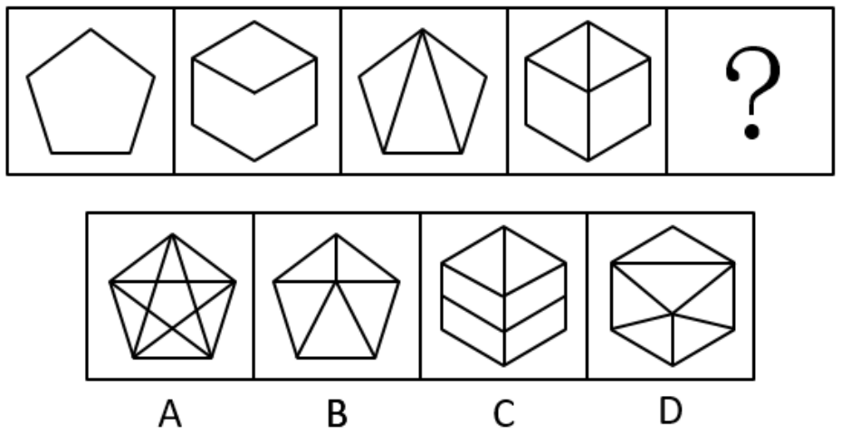

**A.** 见上方题图中 A 项。

**B.** 见上方题图中 B 项。

**C.** 见上方题图中 C 项。

**D.** 见上方题图中 D 项。

**答案：B**

### 第 27 题

`GD2019-XZ-Q027` · 单选 · 图形推理 · 原卷第 3 页

下列选项中最符合所给图形规律的是（）。

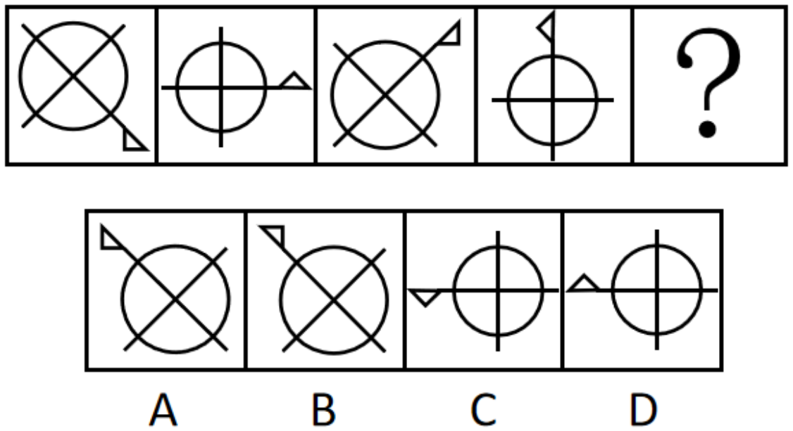

**A.** 见上方题图中 A 项。

**B.** 见上方题图中 B 项。

**C.** 见上方题图中 C 项。

**D.** 见上方题图中 D 项。

**答案：B**

### 第 28 题

`GD2019-XZ-Q028` · 单选 · 图形推理 · 原卷第 3、4 页

下列选项中最符合所给图形规律的是（）。

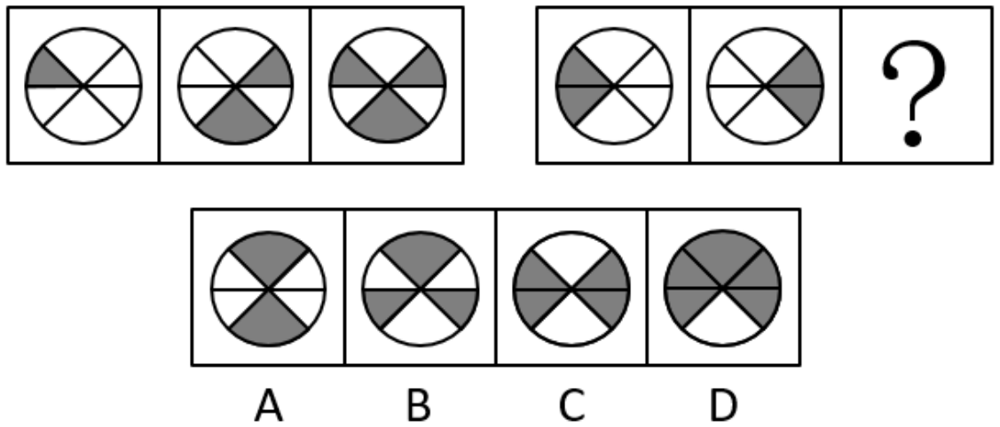

**A.** 见上方题图中 A 项。

**B.** 见上方题图中 B 项。

**C.** 见上方题图中 C 项。

**D.** 见上方题图中 D 项。

**答案：C**

### 第 29 题

`GD2019-XZ-Q029` · 单选 · 图形推理 · 原卷第 4 页

如图所示，这三个小图形可以组成的图形是（）。

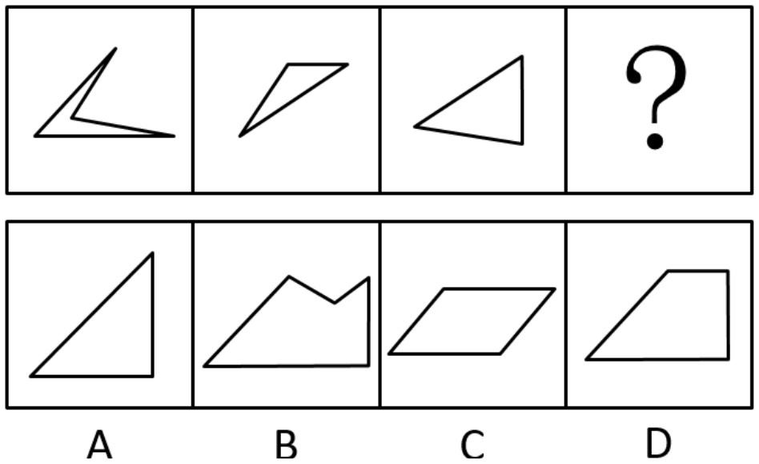

**A.** 见上方题图中 A 项。

**B.** 见上方题图中 B 项。

**C.** 见上方题图中 C 项。

**D.** 见上方题图中 D 项。

**答案：D**

### 第 30 题

`GD2019-XZ-Q030` · 单选 · 图形推理 · 原卷第 4 页

如图所示，四个相同的等腰直角三角形，不可能组成的图形是（）。

**A.** 长方形

**B.** 三角形

**C.** 直角梯形

**D.** 平行四边形

**答案：C**

### 第 31 题

`GD2019-XZ-Q031` · 单选 · 图形推理 · 原卷第 4 页

如图所示是从两个不同角度观察到的同一个正四面体的外表面，将该四面体展开，可能得到的图形是（）。

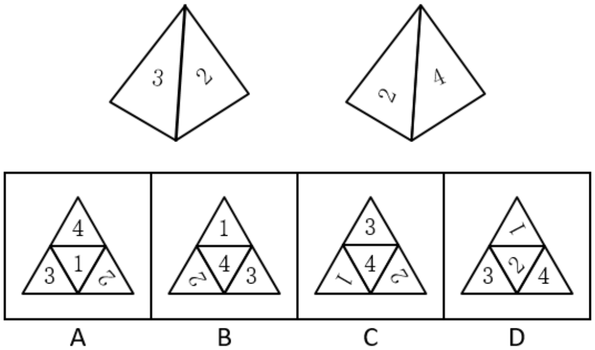

**A.** 见上方题图中 A 项。

**B.** 见上方题图中 B 项。

**C.** 见上方题图中 C 项。

**D.** 见上方题图中 D 项。

**答案：D**

### 第 32 题

`GD2019-XZ-Q032` · 单选 · 图形推理 · 原卷第 4、5 页

下列选项，与所给立体图形不同的是（）。

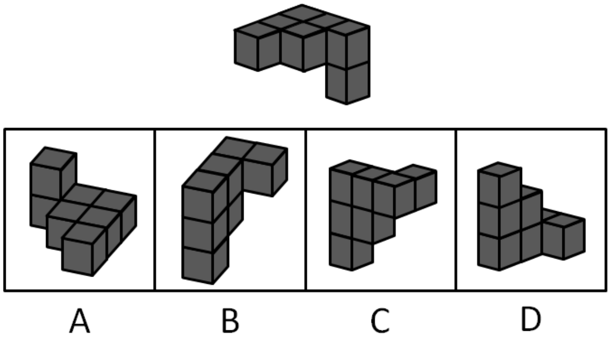

**A.** 见上方题图中 A 项。

**B.** 见上方题图中 B 项。

**C.** 见上方题图中 C 项。

**D.** 见上方题图中 D 项。

**答案：B**

### 第 33 题

`GD2019-XZ-Q033` · 单选 · 图形推理 · 原卷第 5 页

下列选项中，不可能是所给立方体展开图的是（）。

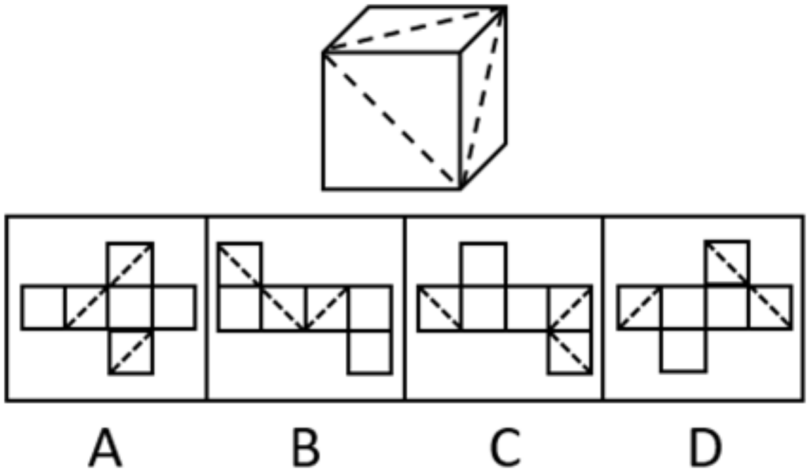

**A.** 见上方题图中 A 项。

**B.** 见上方题图中 B 项。

**C.** 见上方题图中 C 项。

**D.** 见上方题图中 D 项。

**答案：A**

### 第 34 题

`GD2019-XZ-Q034` · 单选 · 图形推理 · 原卷第 5 页

一个正方形旋转360°后，其旋转轨迹不可能形成的图形是（）。

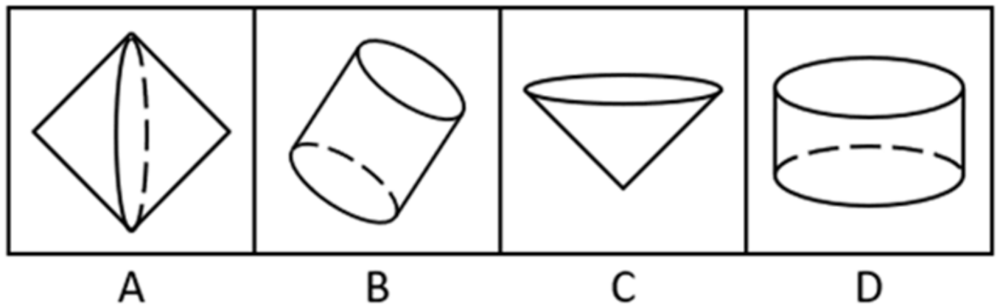

**A.** 见上方题图中 A 项。

**B.** 见上方题图中 B 项。

**C.** 见上方题图中 C 项。

**D.** 见上方题图中 D 项。

**答案：C**

> 转写说明：题干中的“360°”在原卷中为图片，已转写为文字。

### 第 35 题

`GD2019-XZ-Q035` · 单选 · 图形推理 · 原卷第 5、6 页

如图所示，所给物体的俯视图不可能是（）。

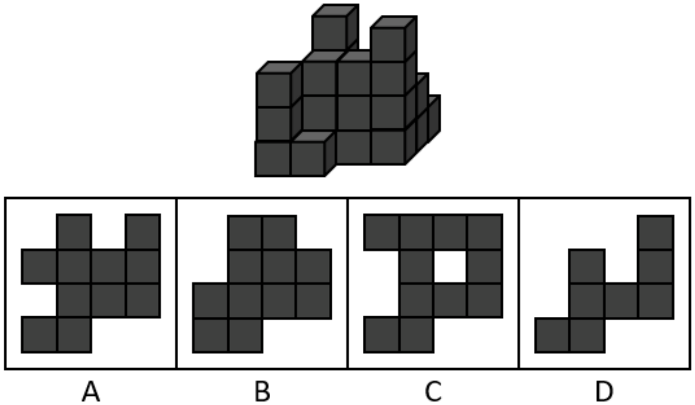

**A.** 见上方题图中 A 项。

**B.** 见上方题图中 B 项。

**C.** 见上方题图中 C 项。

**D.** 见上方题图中 D 项。

**答案：B**

### 第 36 题

`GD2019-XZ-Q036` · 单选 · 类比推理 · 原卷第 6 页

民风：淳朴（）

**A.** 阳光：灿烂

**B.** 书本：文化

**C.** 树木：开花

**D.** 喜悦：笑容

**答案：A**

### 第 37 题

`GD2019-XZ-Q037` · 单选 · 类比推理 · 原卷第 6 页

纺织：布匹（）

**A.** 矿石：金属

**B.** 努力：收获

**C.** 工作：奉献

**D.** 耕种：粮食

**答案：D**

### 第 38 题

`GD2019-XZ-Q038` · 单选 · 类比推理 · 原卷第 6 页

水稻：植物（）

**A.** 木耳：银耳

**B.** 香蕉：水果

**C.** 动物：田鼠

**D.** 米饭：面条

**答案：B**

### 第 39 题

`GD2019-XZ-Q039` · 单选 · 类比推理 · 原卷第 6 页

丰富：贫乏（）

**A.** 体贴：粗犷

**B.** 精致：丑恶

**C.** 拘束：随意

**D.** 振奋：高兴

**答案：C**

### 第 40 题

`GD2019-XZ-Q040` · 单选 · 类比推理 · 原卷第 6 页

贫困：扶贫：脱贫（）

**A.** 垃圾：清扫：整洁

**B.** 拥堵：交警：畅通

**C.** 噪音：抑制：平静

**D.** 羸弱：锻炼：健壮

**答案：D**

### 第 41 题

`GD2019-XZ-Q041` · 单选 · 逻辑判断 · 原卷第 6 页

一座城市要想发展好会展产业，就需要“筑巢引凤”——先具备软硬件基础，再吸引会展活动。拥有完备的会展设施和理想的交通条件，只是说明一座城市具备了发展会展产业的硬件基础，要想吸引足够数量的高质量会展活动，还需要提高公共服务水平、构建良好的营商环境，从而加强软实力的建设。
如果上述表述为真，则以下情况中不可能发生的是（）。

**A.** 甲市具备了发展会展产业的硬件基础，却发展不好会展产业

**B.** 乙市大力提升公共服务水平，吸引了足够数量的高质量会展活动

**C.** 丙市的会展产业非常发达，但市政设施老化的问题日渐突出

**D.** 丁市会展设施完备、交通条件理想，但未具备发展会展产业的硬件基础

**答案：D**

### 第 42 题

`GD2019-XZ-Q042` · 单选 · 逻辑判断 · 原卷第 6、7 页

G市经济发达、教育资源丰富，许多在G市就读的大学生毕业后都选择留在G市工作生活。但在今年，G市周边的几个城市都出台了一系列针对大学生落户的优惠政策，许多G市大学生因此选择将户口迁往周边城市。由此可以预测，今年留在G市的大学生将会更容易找到工作。
以下最能反驳上述论证的是（）。

**A.** G市周边的几个城市中，大学生同样不容易找到心仪的工作

**B.** 与去年相比，今年G市的几个大型工厂招收工人数量有所减少

**C.** 绝大多数将户口迁往周边城市的G市大学生仍然选择在G市工作

**D.** 有调查指出，过去几年在G市的大学生并没有面临很大的就业压力

**答案：C**

### 第 43 题

`GD2019-XZ-Q043` · 单选 · 逻辑判断 · 原卷第 7 页

在发达国家的产业结构中，服务业占了很高的比重。根据他们的经验，提高服务业占比就可以促进就业。但是，服务业具有较高的进入壁垒，这也是我国服务业发展相对滞后的一个重要原因。因此，我国可以通过打破服务业的行业壁垒进一步促进就业。
以下最可能是上述论证潜在假设的是（）。

**A.** 服务业促进就业的规律适用于我国

**B.** 我国创造就业的能力弱于发达国家

**C.** 发达国家的服务业也存在行业壁垒

**D.** 其他行业对促进就业没有显著作用

**答案：A**

### 第 44 题

`GD2019-XZ-Q044` · 单选 · 逻辑判断 · 原卷第 7 页

近年来随着大型野生动物园的兴起，有人提出，传统城市动物园已经没有存在的必要性。但传统城市动物园具有票价低、交通便利等优点，中小学组织参观十分方便，因而具有很强的教育功能，所以传统城市动物园不可或缺。
以下不属于上述论证缺陷的是（）。

**A.** 忽视了野生动物园和传统城市动物园具有并存的可能性

**B.** 默认了具有很强教育功能的传统城市动物园就应该保留

**C.** 忽视了票价低、交通便利不等同于方便中小学组织参观

**D.** 默认了方便中小学组织参观的动物园都具有很强的教育功能

**答案：A**

### 第 45 题

`GD2019-XZ-Q045` · 单选 · 逻辑判断 · 原卷第 7 页

历史经验告诉我们，世界经济危机往往伴随着巨大的世界变革：1857年世界经济危机后的电气革命，推动人类社会从蒸汽时代进入电气时代；1929年世界经济危机引发了第二次世界大战，客观上推动了科学技术的发展。由此可知，是经济危机造成了巨大的世界变革。
以下和该论证过程的逻辑最为类似的是（）。

**A.** 不正确的坐姿会加重颈部负担，因而是腰酸背痛的主要诱因

**B.** 海底地震是海啸的主要成因，因为海啸发生前往往能观测到海底地震

**C.** 宇航员的预期寿命明显高于一般人，因此太空旅行中的辐射暴露并不会危害人体

**D.** 许多体弱多病的人都不喜欢吃蔬菜，所以想保持身体健康就必须从蔬菜中摄入足量的膳食纤维

**答案：B**

## 科学推理

### 第 46 题

`GD2019-XZ-Q046` · 单选 · 原卷第 7 页

风能是一种清洁的可再生能源，很早就被人们所利用。下列关于利用风能发电的说法不正确的是（）。

**A.** 风力发电场可以建在海上

**B.** 风力发电是将风的动能转换为电能

**C.** 风力发电的能量最终来源于太阳能

**D.** 风力发电的过程中不会有能量的损失

**答案：D**

### 第 47 题

`GD2019-XZ-Q047` · 单选 · 原卷第 7 页

人在短时间内从低海拔处上升至高海拔处时，环境气压变化大，但鼓膜内的气压不变，鼓膜会感觉不适。这时，可通过做咀嚼运动或大口呼吸缓解，其原理是（）。

**A.** 通过转移人的注意力，减少不适感

**B.** 吸入更多的氧气，使机体的新陈代谢加快

**C.** 疏通咽鼓管，使外耳道与鼓室之间的气压平衡

**D.** 提高鼓膜的震动频率，缓解不适症状

**答案：C**

> 转写说明：原卷D项作“鼓膜的震动频率”（物理上一般作“振动”），照录。

### 第 48 题

`GD2019-XZ-Q048` · 单选 · 原卷第 7、8 页

下图是具有起钉功能的锤子，要使锤子起钉时更省力，最科学的做法是（）。

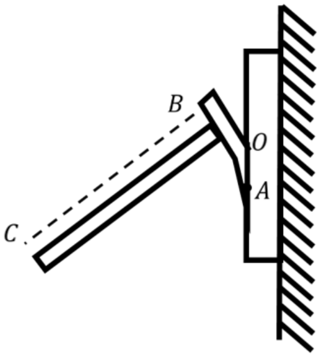

**A.** 适当延长把手BC的长度

**B.** 适当延长起钉部位OA的长度

**C.** 增加锤子的重量

**D.** 增加把手的重量

**答案：A**

### 第 49 题

`GD2019-XZ-Q049` · 单选 · 原卷第 8 页

将瘪了的乒乓球放在热水里一段时间后，乒乓球便会恢复原来的圆形状态。其原理是（）。

**A.** 乒乓球内部气体溢出，内部气体减少

**B.** 乒乓球受热后球壁变软，恢复原来形状

**C.** 乒乓球内部气体受热膨胀，挤压乒乓球内壁

**D.** 水蒸气流入乒乓球内部，乒乓球内部压强增大

**答案：C**

### 第 50 题

`GD2019-XZ-Q050` · 单选 · 原卷第 8 页

如图所示，货车停在某处卸货时货物从倾斜的货箱滑下。那么，下列关于货车车轮所受的摩擦力说法正确的是（）。

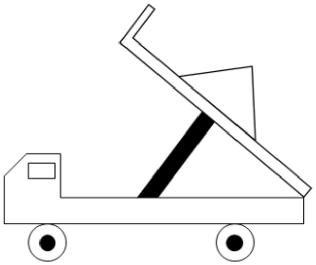

**A.** 货车车轮与地面之间没有摩擦力

**B.** 货车车轮所受摩擦力的方向水平向右

**C.** 货车车轮所受摩擦力的方向水平向左

**D.** 货车车轮与地面之间的摩力大小和方向都不确定

**答案：B**

> 转写说明：原卷D项作“货车车轮与地面之间的摩力大小和方向都不确定”，“摩力”漏“擦”字，照录。

### 第 51 题

`GD2019-XZ-Q051` · 单选 · 原卷第 8 页

如图所示，将一只充了气的密封小气球放在针筒壁内，封闭针筒孔后向外抽拉针筒推杆，忽略摩擦力的影响，则在这一过程中（）。

**A.** 小气球体积会变大

**B.** 针筒内的压强保持不变

**C.** 小气球受到的合力为零

**D.** 针筒内的气体温度会升高

**答案：A**

### 第 52 题

`GD2019-XZ-Q052` · 单选 · 原卷第 8、9 页

物质的用途与性质密切相关。下列说法正确的是（）。

**A.** 木炭能作为炼钢的原料，是利用了木炭的可燃性

**B.** 钨常用作灯丝，是因为钨在高温下化学性质稳定

**C.** 活性炭可以去除水中杂质，是因为其具有很强的吸附能力

**D.** 铝制品的表面可以不做防锈处理，是因为铝的金属活动性不强

**答案：C**

### 第 53 题

`GD2019-XZ-Q053` · 单选 · 原卷第 9 页

办公室里的四盏灯型号相同，电路如下图所示。如果逐一打开这四盏灯，在电源的输出电压不变的情况下，下列说法正确的是（）。

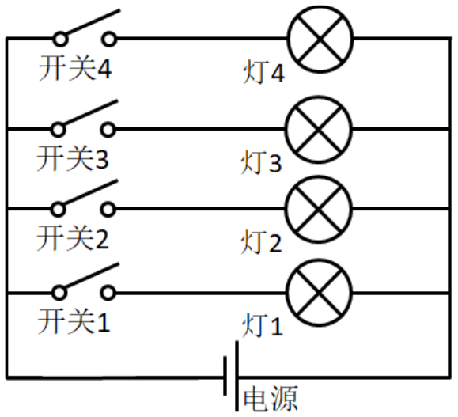

**A.** 打开的灯越多，通过各灯的电流变得越大

**B.** 打开的灯越多，各灯两端的电压变得越小

**C.** 打开的灯越多，通过电源的电流变得越大

**D.** 打开的灯越多，各灯变得越暗

**答案：C**

### 第 54 题

`GD2019-XZ-Q054` · 单选 · 原卷第 9 页

冬天气温很低的时候往玻璃杯里倒开水，杯壁较厚的玻璃杯更容易发生炸裂，这是因为（）。

**A.** 内壁和外壁受热不均

**B.** 开水遇到玻璃后温度迅速降低

**C.** 空气对杯壁的压力超过杯壁的承受范围

**D.** 倒水时水的冲击力将玻璃杯击破

**答案：A**

### 第 55 题

`GD2019-XZ-Q055` · 单选 · 原卷第 9 页

如图所示，甲、乙两个大小相同的实心金属球放置在光滑水平面上，甲球以水平向右的速度碰撞静止的乙球。已知甲球质量大于乙球，则有关碰撞后的情形，下列说法正确的是（）。

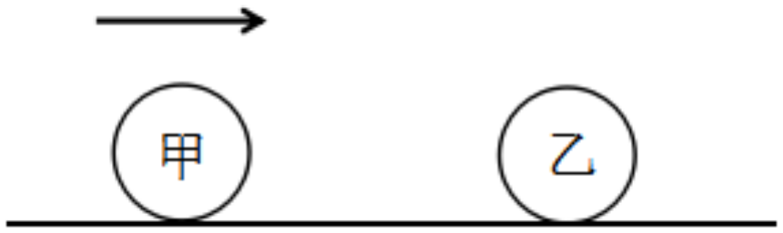

**A.** 甲球可能静止

**B.** 乙球可能静止

**C.** 甲球可能向左运动

**D.** 甲球一定向右运动

**答案：D**

### 第 56 题

`GD2019-XZ-Q056` · 单选 · 原卷第 9 页

细胞膜能够防止细胞外物质自由进入细胞，保证细胞内环境的相对稳定。这是因为（）。

**A.** 细胞膜具有流动性

**B.** 细胞膜具有选择透过性

**C.** 细胞膜主要由氨基酸构成

**D.** 细胞膜具有维持细胞形状的功能

**答案：B**

### 第 57 题

`GD2019-XZ-Q057` · 单选 · 原卷第 9 页

人们在乘坐小船时，应尽量坐下，站立会降低小船的稳定性，其根本原因是（）。

**A.** 人和船的整体重量增加

**B.** 人和船的整体重心变高

**C.** 船的行驶速度增加

**D.** 水流波动幅度变大

**答案：B**

### 第 58 题

`GD2019-XZ-Q058` · 单选 · 原卷第 9 页

“后驱”是指发动机的动力通过传动轴传递给后轮，从而推动车辆前进的一种驱动形式。当后驱车在水平公路上匀速前进时，下列说法正确的是（）。

**A.** 前轮和后轮受到的摩擦力均向前

**B.** 前轮和后轮受到的摩擦力均向后

**C.** 前轮受到的摩擦力向前，后轮受到的摩擦力向后

**D.** 前轮受到的摩擦力向后，后轮受到的摩擦力向前

**答案：D**

### 第 59 题

`GD2019-XZ-Q059` · 单选 · 原卷第 9、10 页

如图所示，将所点燃的一高一矮两只蜡烛放入圆筒，圆筒顶端不封闭，并从圆筒侧壁缓慢注入二氧化碳气体。则最可能发生的情况是（）。

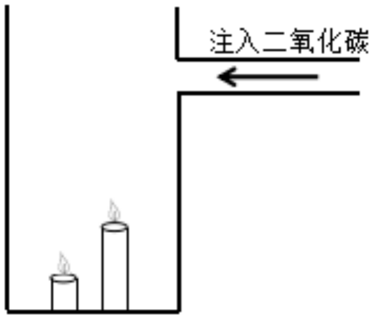

**A.** 高蜡烛先熄灭

**B.** 矮蜡烛先熄灭

**C.** 两只蜡烛的火苗没有变化

**D.** 两只蜡烛的火苗都变矮并逐渐熄灭

**答案：B**

> 转写说明：原卷题干作“将所点燃的一高一矮两只蜡烛”，多一“所”字，照录。

### 第 60 题

`GD2019-XZ-Q060` · 单选 · 原卷第 10 页

为了整治超速，交警采用了一套系统。在某一路段，系统会自动记录车辆进入和离开的时间，从而判断该车辆是否超速。这种方法是计算车辆的（）。

**A.** 平均速率

**B.** 瞬时速率

**C.** 加速度

**D.** 位移

**答案：A**

## 常识判断

### 第 61 题

`GD2019-XZ-Q061` · 单选 · 原卷第 10 页

习近平总书记在庆祝改革开放40周年大会上的重要讲话指出：（）是五四运动以来我国发生的三大历史性事件，是近代以来实现中华民族伟大复兴的三大里程碑。
①建立中国共产党
②成立中华人民共和国
③全面建成小康社会
④推进改革开放和中国特色社会主义事业

**A.** ①②③

**B.** ①②④

**C.** ①③④

**D.** ②④

**答案：B**

### 第 62 题

`GD2019-XZ-Q062` · 单选 · 原卷第 10 页

2019年3月，习近平总书记对欧洲三国进行了国事访问，推动共建“一带一路”在亚欧大陆开辟新的空间。这三国分别是（）。

**A.** 以色列 乌克兰 英国

**B.** 墨西哥 奥地利 瑞典

**C.** 意大利 摩纳哥 法国

**D.** 新西兰 葡萄牙 德国

**答案：C**

> 答案说明：答案解析PDF第9页本题只有解析文字（“2019年3月21日至26日，国家主席习近平应邀对意大利、摩纳哥、法国进行国事访问……”），没有“故正确答案为X”；所述三国与C项“意大利 摩纳哥 法国”逐字对应，记为C。县级卷第74题（同题）的答案页同样只有这段文字。

### 第 63 题

`GD2019-XZ-Q063` · 单选 · 原卷第 10 页

2019年3月12日，十三届全国人大二次会议举行第三次全体会议，听取审议最高人民法院工作报告和最高人民检察院工作报告。这体现了人民代表大会的（）。

**A.** 立法权

**B.** 决定权

**C.** 任免权

**D.** 监督权

**答案：D**

### 第 64 题

`GD2019-XZ-Q064` · 单选 · 原卷第 10 页

人才是实施乡村振兴战略的关键因素。以下举措不属于推动乡村人才振兴的是（）。

**A.** 大力支持乡村休闲旅游

**B.** 实施新乡贤返乡工程

**C.** 扩大“三支一扶”计划人员招募规模

**D.** 完善农村劳动力技能培训补贴机制

**答案：A**

### 第 65 题

`GD2019-XZ-Q065` · 单选 · 原卷第 10 页

近几年，我国政府出台了一系列减税降费的举措。减税降费有利于（）。
①减轻企业负担、稳定就业
②优化经济和收入分配结构
③畅通小微企业融资渠道

**A.** ①②

**B.** ①③

**C.** ②③

**D.** ①②③

**答案：A**

### 第 66 题

`GD2019-XZ-Q066` · 单选 · 原卷第 10 页

2018年8月，国家提出衡量贫困人口是否脱贫的标准是“两不愁、三保障”，其中“两不愁”是指不愁吃、不愁穿。以下不属于“三保障”的是（）。

**A.** 基本医疗

**B.** 义务教育

**C.** 住房安全

**D.** 环境优美

**答案：D**

### 第 67 题

`GD2019-XZ-Q067` · 单选 · 原卷第 11 页

粤港澳大湾区包括香港特别行政区、澳门特别行政区和珠三角九市，是我国经济活力最强的区域之一，在国家发展大局中具有重要战略地位。以下关于粤港澳大湾区发展基础的说法，错误的是（）。

**A.** 经济实力雄厚

**B.** 创新要素集聚

**C.** 内部发展差距小

**D.** 国际化水平领先

**答案：C**

### 第 68 题

`GD2019-XZ-Q068` · 单选 · 原卷第 11 页

只要把握住历史发展大势，抓住历史变革时机，奋发有为，锐意进取，人类社会就能更好前进。这句话体现的哲学原理是（）。

**A.** 物质和意识的辩证关系

**B.** 规律是可以认识和利用的

**C.** 事物发展是前进性和曲折性的统一

**D.** 实践是检验认识正确与否的唯一标准

**答案：B**

### 第 69 题

`GD2019-XZ-Q069` · 单选 · 原卷第 11 页

2018年10月，习近平总书记在广东考察时提出“要加快形成区域协调发展新格局”，把粤东、粤西的（）作为重要发展极，打造现代化沿海经济带。

**A.** 珠海、肇庆

**B.** 深圳、清远

**C.** 广州、韶关

**D.** 汕头、湛江

**答案：D**

### 第 70 题

`GD2019-XZ-Q070` · 单选 · 原卷第 11 页

扶贫先扶智，治贫先治愚。以下扶贫举措中不属于“扶智”的是（）。

**A.** 在贫困村建设图书室

**B.** 开展农业实用技能培训

**C.** 组织大学生到贫困地区支教

**D.** 向贫困户发放现代化农业机具

**答案：D**

### 第 71 题

`GD2019-XZ-Q071` · 单选 · 原卷第 11 页

自2018年起，我国将每年农历（）定为“中国农民丰收节”，作为亿万农民庆祝丰收、享受丰收的节日。

**A.** 立春

**B.** 芒种

**C.** 秋分

**D.** 冬至

**答案：C**

### 第 72 题

`GD2019-XZ-Q072` · 单选 · 原卷第 11 页

消除贫困、改善民生、逐步实现（），是社会主义的本质要求，是我们党的重要使命。

**A.** 共同富裕

**B.** 同步富裕

**C.** 同时富裕

**D.** 全体富裕

**答案：A**

### 第 73 题

`GD2019-XZ-Q073` · 单选 · 原卷第 11 页

习近平总书记提出“绿水青山就是金山银山”的发展理念。以下最能体现这一理念的是（）。

**A.** 精准扶贫

**B.** 共建“一带一路”

**C.** 实行“河长制”

**D.** 加强知识产权保护

**答案：C**

### 第 74 题

`GD2019-XZ-Q074` · 单选 · 原卷第 11 页

广东属于岭南地区，具有深厚的岭南文化。以下诗句中描写岭南风物的是（）。

**A.** 此地空余黄鹤楼

**B.** 罗浮山下四时春

**C.** 风吹草低见牛羊

**D.** 不识庐山真面目

**答案：B**

### 第 75 题

`GD2019-XZ-Q075` · 单选 · 原卷第 11 页

港珠澳大桥跨越（），东接香港，西接广东珠海和澳门，总长约55公里，是粤港澳三地首次合作共建的超大型跨海交通工程。

**A.** 渤海

**B.** 东海

**C.** 北部湾

**D.** 伶仃洋

**答案：D**

### 第 76 题

`GD2019-XZ-Q076` · 单选 · 原卷第 11 页

“山上多植物，胜似修水库，有雨它能吞，无雨它能吐”。这一谚语形象地说明了森林具有（）的功能。

**A.** 净化空气

**B.** 过滤尘埃

**C.** 减小噪音

**D.** 涵养水源

**答案：D**

### 第 77 题

`GD2019-XZ-Q077` · 单选 · 原卷第 11 页

全面建成小康社会，最艰巨最繁重的任务在（），特别是在贫困地区。

**A.** 城市

**B.** 城镇

**C.** 社区

**D.** 农村

**答案：D**

### 第 78 题

`GD2019-XZ-Q078` · 单选 · 原卷第 11 页

俗话说：正月十五闹元宵。“闹”元宵的习俗包括张灯、观灯、舞龙、舞狮等。以下诗句与元宵节有关的是（）。

**A.** 火树银花合

**B.** 千里共婵娟

**C.** 遍插茱萸少一人

**D.** 爆竹声中一岁除

**答案：A**

### 第 79 题

`GD2019-XZ-Q079` · 单选 · 原卷第 11 页

2018年12月，中国发射的（）成为人类第一个着陆月球背面的探测器。

**A.** 神舟七号

**B.** 长征三号

**C.** 嫦娥四号

**D.** 天宫一号

**答案：C**

### 第 80 题

`GD2019-XZ-Q080` · 单选 · 原卷第 11、12 页

地球内部具有巨大的热量，并通过不同途径由内向外散发地热能。以下现象与地热能有关的是（）。

**A.** 台风生成

**B.** 火山喷发

**C.** 山洪暴发

**D.** 岩石风化

**答案：B**

## 资料分析

### 共用材料：第 81—85 题

过去5年，我国统筹开展交通扶贫和“四好农村路工作”，农村基础设施更加完善，服务乡村振兴成效显著。

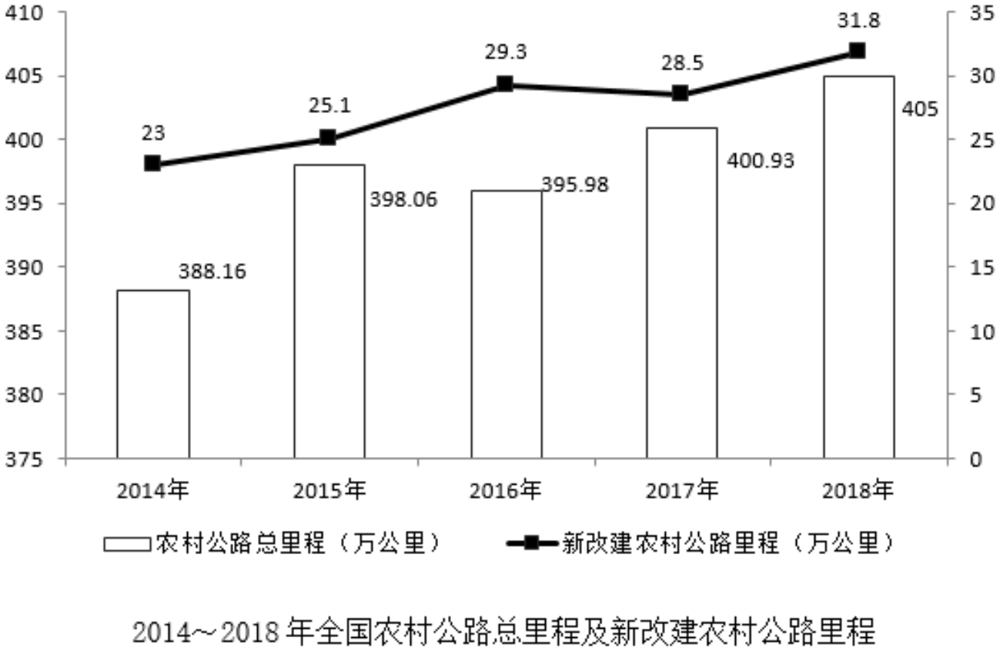

2014～2018年全国农村公路总里程及新改建农村公路里程

| 年份 | 农村公路总里程（万公里） | 新改建农村公路里程（万公里） |
| --- | --- | --- |
| 2014年 | 388.16 | 23 |
| 2015年 | 398.06 | 25.1 |
| 2016年 | 395.98 | 29.3 |
| 2017年 | 400.93 | 28.5 |
| 2018年 | 405 | 31.8 |

图例：柱为农村公路总里程（左轴，375—410），折线为新改建农村公路里程（右轴，0—35）。

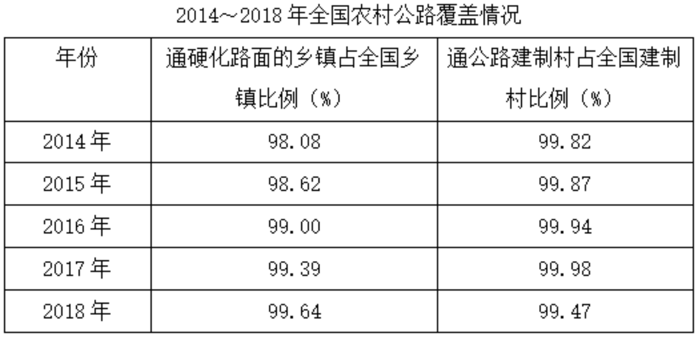

2014～2018年全国农村公路覆盖情况

| 年份 | 通硬化路面的乡镇占全国乡镇比例（%） | 通公路建制村占全国建制村比例（%） |
| --- | --- | --- |
| 2014年 | 98.08 | 99.82 |
| 2015年 | 98.62 | 99.87 |
| 2016年 | 99.00 | 99.94 |
| 2017年 | 99.39 | 99.98 |
| 2018年 | 99.64 | 99.47 |

### 第 81 题

`GD2019-XZ-Q081` · 单选 · 原卷第 12 页

[共用材料](#GD2019-XZ-M1)

2014~2018年，全国新改建农村公路里程共计（）万公里。

**A.** 77.5

**B.** 97.4

**C.** 117.2

**D.** 137.7

**答案：D**

### 第 82 题

`GD2019-XZ-Q082` · 单选 · 原卷第 12 页

[共用材料](#GD2019-XZ-M1)

2015~2018年，全国新改建农村公路里程较上年增加最多的一年是（）。

**A.** 2015

**B.** 2016

**C.** 2017

**D.** 2018

**答案：B**

### 第 83 题

`GD2019-XZ-Q083` · 单选 · 原卷第 12 页

[共用材料](#GD2019-XZ-M1)

与2014年相比，我国农村公路总里程增加了（）万公里。

**A.** 9.83

**B.** 12.87

**C.** 16.84

**D.** 22.59

**答案：C**

### 第 84 题

`GD2019-XZ-Q084` · 单选 · 原卷第 12 页

[共用材料](#GD2019-XZ-M1)

2018年，全国通硬化路面的乡镇占全国乡镇比例与2014年相比（）个百分点。

**A.** 增加1.56

**B.** 增加0.25

**C.** 减少1.56

**D.** 减少0.25

**答案：A**

### 第 85 题

`GD2019-XZ-Q085` · 单选 · 原卷第 12、13 页

[共用材料](#GD2019-XZ-M1)

下列说法正确的是：

**A.** 2014~2018年，我国新改建农村公路里程逐年增加

**B.** 2014~2018年，我国农村公路总里程逐年增加

**C.** 2014~2018年，通硬化路面的乡镇占全国乡镇的比例逐年提高

**D.** 2014~2018年，通公路的建制村占全国建制村的比例逐年提高

**答案：C**

> 转写说明：原卷题干以冒号结尾（“下列说法正确的是：”），没有括号，照录。

### 共用材料：第 86—90 题

党的十八大以来，脱贫工作取得巨大成效，全国农村贫困人口大幅减少。截至2018年末，全国农村贫困人口从2012年末的9899万人减少至1660万人；农村贫困发生率从2012年的10.2%下降至1.7%，累计下降8.5个百分点。

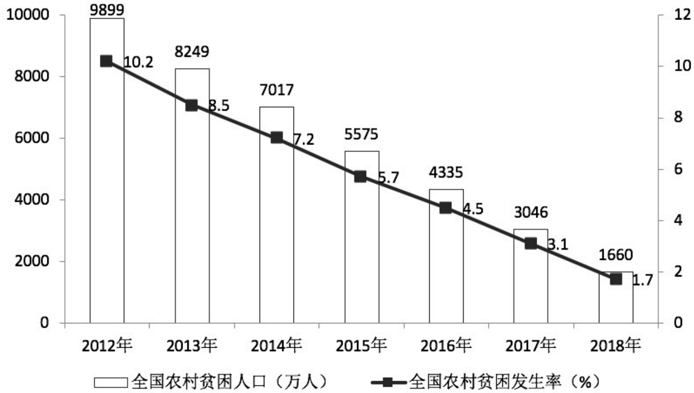

2012—2018年全国农村贫困人口和贫困发生率

| 年份 | 全国农村贫困人口（万人） | 全国农村贫困发生率（%） |
| --- | --- | --- |
| 2012年 | 9899 | 10.2 |
| 2013年 | 8249 | 8.5 |
| 2014年 | 7017 | 7.2 |
| 2015年 | 5575 | 5.7 |
| 2016年 | 4335 | 4.5 |
| 2017年 | 3046 | 3.1 |
| 2018年 | 1660 | 1.7 |

图名为图下的一行正文（见材料）；图例：柱为全国农村贫困人口（左轴，0—10000），折线为全国农村贫困发生率（右轴，0—12）。

2012—2018年全国农村贫困人口和贫困发生率
2018年，贫困地区农村居民人均可支配收入10371元，扣除价格因素，实际增长8.3%，实际增速高出全国农村居民人均可支配收入实际增速1.7个百分点，圆满完成增长幅度高于全国增速的年度目标任务。

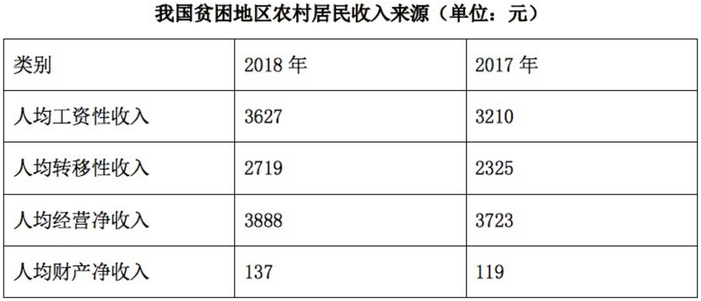

我国贫困地区农村居民收入来源（单位：元）

| 类别 | 2018年 | 2017年 |
| --- | --- | --- |
| 人均工资性收入 | 3627 | 3210 |
| 人均转移性收入 | 2719 | 2325 |
| 人均经营净收入 | 3888 | 3723 |
| 人均财产净收入 | 137 | 119 |

表中作“人均转移性收入”，第89题B项、第90题D项作“转移净收入”，均照录。2018年四项合计10371元，与正文人均可支配收入一致。

> 材料说明：材料中的10.2%、1.7%、8.3%在原卷中为图片，已转写为文字。

### 第 86 题

`GD2019-XZ-Q086` · 单选 · 原卷第 13 页

[共用材料](#GD2019-XZ-M2)

从2012年末到2018年末，全国农村贫困人口数减少了（）万人。

**A.** 6239

**B.** 7239

**C.** 8239

**D.** 9230

**答案：C**

### 第 87 题

`GD2019-XZ-Q087` · 单选 · 原卷第 13 页

[共用材料](#GD2019-XZ-M2)

2013—2018年，全国农村贫困发生率较上年下降最多的是（）年。

**A.** 2013

**B.** 2015

**C.** 2017

**D.** 2018

**答案：A**

### 第 88 题

`GD2019-XZ-Q088` · 单选 · 原卷第 13、14 页

[共用材料](#GD2019-XZ-M2)

2018年，我国贫困地区农村居民人均工资性收入约占人均可支配收入的（）。

**A.** 20%

**B.** 25%

**C.** 30%

**D.** 35%

**答案：D**

> 转写说明：四个选项的百分数在原卷中为图片，已转写为文字。

### 第 89 题

`GD2019-XZ-Q089` · 单选 · 原卷第 14 页

[共用材料](#GD2019-XZ-M2)

2018年，我国贫困地区农村居民收入来源中，最高的是（）。

**A.** 人均工资性收入

**B.** 人均转移净收入

**C.** 人均经营净收入

**D.** 人均财产净收入

**答案：C**

### 第 90 题

`GD2019-XZ-Q090` · 单选 · 原卷第 14 页

[共用材料](#GD2019-XZ-M2)

下列说法不正确的是（）。

**A.** 2012—2018年，全国农村贫困人口逐年递减

**B.** 2018年，全国农村居民人均可支配收入实际增速为6.6%

**C.** 2018年，贫困地区农村居民各来源的人均收入较上年均有提高

**D.** 2017年，贫困地区农村居民人均经营净收入比转移净收入高近1000元

**答案：D**

> 转写说明：B项中的6.6%在原卷中为图片，已转写为文字。

### 共用材料：第 91—95 题

近年来，B省营商环境不断优化，市场活力不断增强，新登记市场主体都保持较快增长势头。2018年，全省新登记市场主体229.74万户，日均新登记市场主体6294户，同比增长17.82%。
全省产业结构也进一步调整优化，新登记市场主体主要集中在第三产业。2018年，全省三大产业新登记市场主体分别为第一产业2.02万户，第二产业24.01万户，第三产业203.71万户。截止2018年12月末，全省三大产业的实有各类市场主体户数分别为9.83万户，157.38万户，978.92万户。
2018年，全省新登记企业最集中的三个行业分别是批发和零售业、租赁和商务服务业、制造业，新登记企业数分别为36.14万户、15.19万户、9.25万户，分别同比增长0.23%、增长22.98%、下降6.8%。

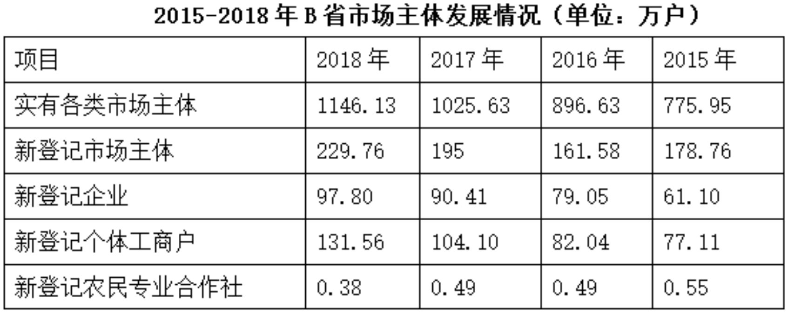

2015-2018年B省市场主体发展情况（单位：万户）

| 项目 | 2018年 | 2017年 | 2016年 | 2015年 |
| --- | --- | --- | --- | --- |
| 实有各类市场主体 | 1146.13 | 1025.63 | 896.63 | 775.95 |
| 新登记市场主体 | 229.76 | 195 | 161.58 | 178.76 |
| 新登记企业 | 97.80 | 90.41 | 79.05 | 61.10 |
| 新登记个体工商户 | 131.56 | 104.10 | 82.04 | 77.11 |
| 新登记农民专业合作社 | 0.38 | 0.49 | 0.49 | 0.55 |

照原表转写。“新登记市场主体”一行与分项不符：2018年原表作229.76，正文作229.74万户，企业、个体工商户、农民专业合作社三项之和为229.74；2015年原表作178.76，三项之和为138.76（县级卷同一数据作138.76）；2017年原表作195，未写小数。

> 材料说明：材料中的17.82%、0.23%、22.98%、6.8%在原卷中为图片，已转写为文字。

> 材料说明：材料第二段“截止2018年12月末”（规范写法为“截至”），照录。

> 材料说明：材料表格“新登记市场主体”一行与正文、分项不符：2018年原表作229.76（正文作229.74万户，分项之和229.74），2015年原表作178.76（分项之和138.76）；照原表转写。

### 第 91 题

`GD2019-XZ-Q091` · 单选 · 原卷第 14 页

[共用材料](#GD2019-XZ-M3)

2015-2018年，B省实有各类市场主体数增长了约（）万户。

**A.** 170

**B.** 270

**C.** 370

**D.** 470

**答案：C**

### 第 92 题

`GD2019-XZ-Q092` · 单选 · 原卷第 14 页

[共用材料](#GD2019-XZ-M3)

2018年，B省第三产业新登记市场主体约占全省实有各类市场主体的（）。

**A.** 12%

**B.** 18%

**C.** 26%

**D.** 30%

**答案：B**

> 转写说明：四个选项的百分数在原卷中为图片，已转写为文字。

### 第 93 题

`GD2019-XZ-Q093` · 单选 · 原卷第 14 页

[共用材料](#GD2019-XZ-M3)

2015-2018年，B省新登记个体工商户最多的是（）年。

**A.** 2015

**B.** 2016

**C.** 2017

**D.** 2018

**答案：D**

### 第 94 题

`GD2019-XZ-Q094` · 单选 · 原卷第 14 页

[共用材料](#GD2019-XZ-M3)

2018年，B省租赁和商务服务业新登记企业数较上年增加约（）万户。

**A.** 2.8

**B.** 3.8

**C.** 4.8

**D.** 5.8

**答案：A**

### 第 95 题

`GD2019-XZ-Q095` · 单选 · 原卷第 14、15 页

[共用材料](#GD2019-XZ-M3)

下列说法正确的是（）。

**A.** 2015-2018年，B省新登记农民专业合作社数量逐年增加

**B.** 2015-2018年，B省新登记个体工商户均多于新登记企业数

**C.** 选项缺失

**D.** 选项缺失

**答案：B**

> 转写说明：原卷（题本PDF）C、D两项均印作“选项缺失”，照录；答案解析PDF对本题另有C、D两项的分析（C项关于2017年日均新登记市场主体户数，D项关于第三产业与第二产业新登记市场主体的倍数），可知原卷有这两项，但题本未收其原文。答案B为现存选项。组卷时不宜直接使用。

### 共用材料：第 96—100 题

近年来，A省大力发展绿色无公害农业。2017年，A省农药使用总量580万吨，与2016年相比减少5.69%；单位耕地面积农药使用量为1.47千克/亩。
全省新增申报无公害农产品产地认定221个，产品362个，新增绿色食品33个，认证有机食品60个。全省“三品一标”总数达2570个，其中：无公害农产品1710个，绿色食品745个，有机农产品87个，农产品地理标志28个，无公害农产品种植面积总计达1050万亩，生产总量970多万吨。
2014-2017年A省无公害农产品生产情况

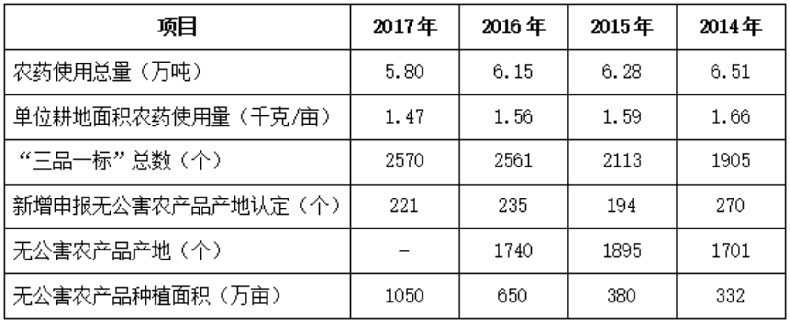

2014-2017年A省无公害农产品生产情况

| 项目 | 2017年 | 2016年 | 2015年 | 2014年 |
| --- | --- | --- | --- | --- |
| 农药使用总量（万吨） | 5.80 | 6.15 | 6.28 | 6.51 |
| 单位耕地面积农药使用量（千克/亩） | 1.47 | 1.56 | 1.59 | 1.66 |
| “三品一标”总数（个） | 2570 | 2561 | 2113 | 1905 |
| 新增申报无公害农产品产地认定（个） | 221 | 235 | 194 | 270 |
| 无公害农产品产地（个） | - | 1740 | 1895 | 1701 |
| 无公害农产品种植面积（万亩） | 1050 | 650 | 380 | 332 |

表名为表上方的一行正文（见材料）；2017年“无公害农产品产地”原表为“-”。

> 材料说明：材料中的5.69%在原卷中为图片，已转写为文字。

> 材料说明：材料正文“2017年，A省农药使用总量580万吨”与表中5.80（万吨）不符，按“与2016年相比减少5.69%”复算，表中6.15→5.80万吨相符，正文疑为“5.80万吨”之误；照录。

### 第 96 题

`GD2019-XZ-Q096` · 单选 · 原卷第 15 页

[共用材料](#GD2019-XZ-M4)

2017年，A省“三品一标”总数较上年增加了（）个。

**A.** 8

**B.** 9

**C.** 10

**D.** 11

**答案：B**

### 第 97 题

`GD2019-XZ-Q097` · 单选 · 原卷第 15 页

[共用材料](#GD2019-XZ-M4)

2017年，A省农药使用总量比2016年减少了（）万吨。

**A.** 0.25

**B.** 0.3

**C.** 0.35

**D.** 0.4

**答案：C**

### 第 98 题

`GD2019-XZ-Q098` · 单选 · 原卷第 15 页

[共用材料](#GD2019-XZ-M4)

2017年，A省单位耕地面积农药使用量比2015年约（）。

**A.** 增加7.5%

**B.** 下降7.5%

**C.** 增加13.57%

**D.** 下降13.59%

**答案：B**

> 转写说明：四个选项中的百分数在原卷中为图片，已转写为文字。

### 第 99 题

`GD2019-XZ-Q099` · 单选 · 原卷第 15 页

[共用材料](#GD2019-XZ-M4)

2014-2017年，A省平均每年新增申报无公害农产品产地认定（）个。

**A.** 184

**B.** 202

**C.** 221

**D.** 230

**答案：D**

### 第 100 题

`GD2019-XZ-Q100` · 单选 · 原卷第 15 页

[共用材料](#GD2019-XZ-M4)

下列说法不正确的是（）。

**A.** 2016年，A省有绿色食品712个

**B.** 2017年，A省无公害农产品种植面积是2014年的3倍多

**C.** 2014-2017年，A省单位耕地面积农药使用量逐年下降

**D.** 2017年，A省无公害农产品平均亩产超1吨

**答案：D**
