# 2020年广东行测（县级以上卷）

共 93 题，原题号完整保留。内容：题干、选项、答案（不收解析）；资料分析共用材料置于所属题组前，JSONL 每条记录完整内嵌材料。

[结构化数据](GD2020-XJ.jsonl) · [字段说明](schema.json) · [质量报告](quality/GD2020-XJ.md)

原题来源：[2020年0809广东公务员考试《行测》真题（县级以上）（7道题暂缺）.pdf](https://github.com/dumarstoft-ship-it/xing-ce1/blob/52f9811b22cad5410a7108dd0a07a879f1187aa5/%E7%9C%9F%E9%A2%98/2020%E5%B9%B40809%E5%B9%BF%E4%B8%9C%E5%85%AC%E5%8A%A1%E5%91%98%E8%80%83%E8%AF%95%E3%80%8A%E8%A1%8C%E6%B5%8B%E3%80%8B%E7%9C%9F%E9%A2%98%EF%BC%88%E5%8E%BF%E7%BA%A7%E4%BB%A5%E4%B8%8A%EF%BC%89%EF%BC%887%E9%81%93%E9%A2%98%E6%9A%82%E7%BC%BA%EF%BC%89.pdf)。答案来源：[2020年0809广东公务员考试《行测》真题（县级以上）参考答案及解析.pdf](https://github.com/dumarstoft-ship-it/xing-ce1/blob/52f9811b22cad5410a7108dd0a07a879f1187aa5/%E7%AD%94%E6%A1%88%E8%A7%A3%E6%9E%90/2020%E5%B9%B40809%E5%B9%BF%E4%B8%9C%E5%85%AC%E5%8A%A1%E5%91%98%E8%80%83%E8%AF%95%E3%80%8A%E8%A1%8C%E6%B5%8B%E3%80%8B%E7%9C%9F%E9%A2%98%EF%BC%88%E5%8E%BF%E7%BA%A7%E4%BB%A5%E4%B8%8A%EF%BC%89%E5%8F%82%E8%80%83%E7%AD%94%E6%A1%88%E5%8F%8A%E8%A7%A3%E6%9E%90.pdf)（只取答案）。

## 言语理解与表达

### 第 1 题

`GD2020-XJ-Q001` · 单选 · 原卷第 1 页

千百年来，中华民族正是在与各种疫病、自然灾害，侵略等艰难困苦的斗争中，练就了________、众志成城的精神禀赋。
填入横线部分最恰当的一项是：

**A.** 可歌可泣

**B.** 百折不挠

**C.** 坚定不移

**D.** 不卑不亢

**答案：B**

### 第 2 题

`GD2020-XJ-Q002` · 单选 · 原卷第 1 页

在政务公开中，公众本身________是被动的接受者，________是主动的参与者。只有公众不断地广泛参与，政务公开才有不断深入的动力。
填入横线部分最恰当的一项是：

**A.** 既 又

**B.** 不仅 更

**C.** 即使 也

**D.** 因为 所以

**答案：B**

### 第 3 题

`GD2020-XJ-Q003` · 单选 · 原卷第 1 页

作为人间最________、最________的情感，爱国是流淌在中华民族血脉之中，去不掉、打不破、灭不了的情感，是中国人民和中华民族维护民族独立和民族尊严的强大精神动力。
填入横线部分最恰当的一项是：

**A.** 深层 持久

**B.** 真挚 复杂

**C.** 特殊 难忘

**D.** 强烈 丰富

**答案：A**

### 第 4 题

`GD2020-XJ-Q004` · 单选 · 原卷第 1 页

党的十八大以来，反腐败与改作风________、既________毒瘤更净化生态，既治病救人更强身健体，共同汇聚成全面从严治党的强劲脉动。
填入划横线部分最恰当的一组是：

**A.** 齐头并进 扫除

**B.** 相辅相成 驱除

**C.** 一脉相承 去除

**D.** 双管齐下 剜除

**答案：D**

> 转写说明：原卷题干“反腐败与改作风________、既________毒瘤更净化生态”在第一空后用顿号，照录。

### 第 5 题

`GD2020-XJ-Q005` · 单选 · 原卷第 1 页

伟大的成就与变革，往往是前所未有的，是________的，是惊心动魄的，却没有一个是________，是信手拈来的，是一蹴而就的。
填入划横线部分最恰当的一组是：

**A.** 空前绝后 一帆风顺

**B.** 开天辟地 空中楼阁

**C.** 荡气回肠 轻而易举

**D.** 振聋发聩 日行千里

**答案：C**

### 第 6 题

`GD2020-XJ-Q006` · 单选 · 原卷第 1 页

坚守初心和使命，就能坚定理想信念，做到_____________，始终从容应对前进道路上的各种风险与挑战。共产党人的理想信念是党的初心和使命的最集中体现，是共产党人践行初心和使命的精神之钙。在我们党近百年的征程中，一代又一代共产党人英勇奋斗、流血牺牲，靠的就是为人民谋幸福、为民族谋复兴的初心和使命的激励。
填入横线部分最恰当的一项是：

**A.** “要留清白在人间”

**B.** “心底无私天地宽”

**C.** “栉风沐雨自担当”

**D.** “千磨万击还坚劲”

**答案：D**

### 第 7 题

`GD2020-XJ-Q007` · 单选 · 原卷第 1 页

为应对疫情给企业经营带来的不利影响，广东省政府近期出台支持企业复工复产的20项政策措施，实打实解决企业面临的用工成本、经营负担、疫情防控、现金流压力等方面问题。广东各地各部门也打出“减负”“暖企”政策组合拳，力求精准解决企业难题。除此之外，有关部门还梳理出102家制造业重点企业名单，建立复工复产“一对一”跟踪服务机制，准确摸排问题，提出解决方案。
下列选项最适合作为这段文字标题的是：

**A.** 应对疫情，“暖”字当头

**B.** 广东：打通复工复产堵点

**C.** 广东经济：挑战与机遇并存

**D.** “减负暖企”，实现经济腾飞

**答案：B**

### 第 8 题

`GD2020-XJ-Q008` · 单选 · 原卷第 1 页

衡量一座城市的治理水平，往往不在于建了多少高楼大厦，更要看弱势群体有多大程度的尊严，生活能否得到基本保障。平时如此，疫情防控期间同样如此。防控任务艰巨，要照顾到方方面面，兼顾每一个群体，实属不易，但越是如此，越要关注最需关注的人：大众的生活越是被按下暂停键，越要关注那些生活无以为继的群体，为他们输送温暖和信心。
通过这段文字，作者意在强调：

**A.** 城市的硬件设施水平对城市治理而言处于次要地位

**B.** 保障弱势群体的基本生活对城市治理尤为重要

**C.** 疫情防控期间更要关注社会中的弱势群体

**D.** 疫情防控期间保障民生尤为关键

**答案：C**

### 第 9 题

`GD2020-XJ-Q009` · 单选 · 原卷第 1、2 页

让中国标准走向世界，是实现技术、产品和服务输出的最有效方式。但必须看到，标准竞争仍是核心技术硬实力的体现，美、日、欧等标准有其历史优势，在市场上已形成体系优势，我国标准制定和输出想要追赶发达国家的脚步还需要不断努力，一方面质量和技术含量不断提升，成果的转化欠缺动力，另一方面，技术之外的配套工作也有待持续完善。
这段文字主要说明了：

**A.** 中国标准走向全世界仍然任重道远

**B.** 需要加强技术创新推动中国标准走向世界

**C.** 中国标准与现行国际标准还有一定差距

**D.** 核心技术硬实力不足阻碍了中国标准的输出

**答案：A**

### 第 10 题

`GD2020-XJ-Q010` · 单选 · 原卷第 2 页

在互联网时代，每个人都是“价值出口”；在地球村时代，每个人都是“国家名片”，更重要的是，大时代、大变迁，让中国人有着无比丰富的生命的可能，有着更为多彩的生活体验。梦想与奋斗、成功与挫折、欢笑与泪水，正是最能打动人心的故事。学会发现故事、讲述故事、讲述自己的故事、身边的故事、我们就能向世界更好地展现一个真实、立体、生动的中国。
对这段文字理解准确的是:

**A.** 人人都要学会讲故事

**B.** 每个人都是国家形象的组成部分

**C.** 平凡的点滴重构了“中国故事”

**D.** 世界对改革开放的中国故事感兴趣

**答案：C**

> 转写说明：原卷题干“讲述自己的故事、身边的故事、我们就能……”在“我们”前用顿号，“理解准确的是:”用半角冒号，照录。

> 转写说明：原卷C项折行，D项排在C项的续行上（“了“中国故事”    D、世界……”），已按选项字母拆开。

## 常识判断

### 第 11 题

`GD2020-XJ-Q011` · 单选 · 原卷第 2 页

中国特色社会主义制度是一个严密完整的科学制度体系，起四梁八柱作用的是根本制度、基本制度、重要制度，其中具有统领地位的是：

**A.** 党的领导制度

**B.** 协商民主制度

**C.** 国家监察制度

**D.** 人民代表大会制度

**答案：A**

### 第 12 题

`GD2020-XJ-Q012` · 单选 · 原卷第 2 页

新冠肺炎疫情发生以来，中国始终同国际社会开展交流合作，并提出（）的新理念：倡导团结合作共同抗疫。

**A.** 构建人类命运共同体

**B.** 建立疫苗协作开发机制

**C.** 构建人类卫生健康共同体

**D.** 建立全球治理体系

**答案：C**

### 第 13 题

`GD2020-XJ-Q013` · 单选 · 原卷第 2 页

2020年4月，经国务院批准，海南省三沙市设立南沙区，南沙区人民政府驻永暑礁。以下对永暑礁的描述有误的是：

**A.** 永暑礁位于海南省东南部

**B.** 永暑礁位于西沙群岛

**C.** 永暑礁的气候为热带季风气候

**D.** 永暑礁拥有丰富的渔业和矿产资源

**答案：B**

### 第 14 题

`GD2020-XJ-Q014` · 单选 · 原卷第 2 页

2020年6月30日颁布的《中华人民共和国香港特别行政区维护国家安全法》是保持香港特别行政区繁荣和稳定的重要法律。以下属于该法规定处罚的罪行有：
①分裂国家罪
②颠覆国家政权罪
③恐怖活动罪
④勾结外国或者境外势力危害国家安全罪

**A.** ①④

**B.** ①②③

**C.** ②③④

**D.** ①②③④

**答案：D**

### 第 15 题

`GD2020-XJ-Q015` · 单选 · 原卷第 2 页

2020年7月23日，“天问一号”深空探测器在海南文昌发射成功，大约9个月后，“天问一号”将在（）表面着陆，标志着我国正式开启行星探测时代。

**A.** 月球

**B.** 火星

**C.** 金星

**D.** 木星

**答案：B**

### 第 16 题

`GD2020-XJ-Q016` · 单选 · 原卷第 2 页

在中国史、亚洲史上，（）有着深远的意义和影响，它大大地拓宽了古人的地理视野，改变了汉朝的地域观念，有历史学家甚至将它与哥伦布“发现”美洲相提并论。

**A.** 昭君出塞

**B.** 蒙古西征

**C.** 张骞凿空

**D.** 鉴真东渡

**答案：C**

### 第 17 题

`GD2020-XJ-Q017` · 单选 · 原卷第 2 页

岭南地区盛产甜美可口的荔枝，自古就有“日啖荔枝三百颗，不辞长作岭南人”的美誉。以下最有可能为岭南地区适合荔枝生长主要原因的是：

**A.** 日照时间长，光合作用充分

**B.** 昼夜温差小，易于糖分聚集

**C.** 土壤粘，强碱性，利于中和果酸

**D.** 气温高，降水多，适宜果实生长

**答案：D**

### 第 18 题

`GD2020-XJ-Q018` · 单选 · 原卷第 2 页

在日常生活中，下列说法符合科学原理的是：

**A.** 使用碳酸饮料可以有效溶解水壶内的水垢

**B.** 成年人体内的水分大约能占到体重的40%—50%

**C.** 烧开的水放置一个晚上后，亚硝酸盐含量会显著增加

**D.** 剧烈运动后，人们应当避免摄入电解质，以免增加肾脏负担

**答案：A**

### 第 19 题

`GD2020-XJ-Q019` · 单选 · 原卷第 2 页

针对我国疫情防控工作，习近平总书记指出“要变压力为动力，善于化危为机”。以下典故与“善于化危为机”所蕴含的哲学原理一致的是：

**A.** 塞翁失马，焉知非福

**B.** 绳锯木断，水滴石穿

**C.** 千里之堤，溃于蚁穴

**D.** 南橘北枳，便分两等

**答案：A**

### 第 20 题

`GD2020-XJ-Q020` · 单选 · 原卷第 2、3 页

为有效应对新冠疫情对我国经济的影响，相关部门出台了一系列举措帮助企业复工复产。以下属于金融政策举措的是：

**A.** 降低政府定价的货物港务费和港口设施保安费收费标准，显著降低物流运输成本

**B.** 对中小微企业生产经营场所的用电、用水、用气实施阶段性缓缴费用，缓缴期“欠费不停供”

**C.** 免征中小微企业三项社保的单位缴费，降低企业负担

**D.** 引导银行加大对民营和小微企业支持的力度，保持贷款额合理增加

**答案：D**

### 第 21 题

`GD2020-XJ-Q021` · 单选 · 原卷第 3 页

党的十九届四中全会首次提出要“重视发挥第三次分配作用，发展慈善等社会公益事业”。以下属于第三次分配的是：

**A.** 企业员工获取加班劳动报酬

**B.** 政府向困难家庭发放低保

**C.** 银行为家庭困难学生办理助学贷款

**D.** 中国红十字会出资救助患病儿童

**答案：D**

### 第 22 题

`GD2020-XJ-Q022` · 单选 · 原卷第 3 页

（单选题）煤燃烧后的产物主要是CO2，也含有一定量的SO2，还可能含有CO。某市环保部门监测发现，该市郊区的火力发电厂（以煤为燃料）周围的树木枯萎情况比上一年严重。造成树木枯萎的最主要原因可能是：

**A.** CO的超标排放

**B.** CO2的超标排放

**C.** 排放SO2导致的酸雨

**D.** 排放CO2导致的酸雨

**答案：C**

> 转写说明：题干开头的“（单选题）”为原卷文字；CO2、SO2、CO在原卷文字中不是下标，照录。

### 第 23 题

`GD2020-XJ-Q023` · 单选 · 原卷第 3 页

消费者权利是消费者在购买、使用商品或者接受服务中所享有的权利。下列消费者权利与侵犯该权利的事件对应正确的是：

**A.** 知情权——某线上服装店为快速清仓，推出低价“福袋”商品，并注明“福袋”内服装的款式、颜色等随机搭配

**B.** 自主选择权——某餐厅推出外卖8折活动，但是消费者点外卖时只有选择套餐才享受折扣，自由搭配时无法享受8折优惠

**C.** 安全保障权——王某的轿车已达到报废标准，但是他依旧照常使用，在一次高速行驶中刹车失灵造成事故

**D.** 公平交易权——李某在车行订购汽车后，车行要求李某购买“车辆维护套餐”，否则汽车不予交付

**答案：D**

### 第 24 题

`GD2020-XJ-Q024` · 单选 · 原卷第 3 页

“逆经济风向调节”是指当经济萎缩时要采取扩张的经济政策，当经济过热时要采用紧缩的经济政策。据此，当一个国家经济过热时，应当采取的政策措施是：

**A.** 减少政府支出，提高利率

**B.** 减少政府支出，降低利率

**C.** 增加政府支出，提高利率

**D.** 增加政府支出，降低利率

**答案：A**

### 第 25 题

`GD2020-XJ-Q025` · 单选 · 原卷第 3 页

民法典对我国现行的、制定于不同时期的民事法律规范进行全面系统地编订纂修，以下法律规范不属于民法典范围的是：

**A.** 物权法

**B.** 婚姻法

**C.** 公务员法

**D.** 侵权责任法

**答案：C**

## 数量关系

### 第 26 题

`GD2020-XJ-Q026` · 单选 · 原卷第 3 页

2，12，30，56，90，（    ）

**A.** 132

**B.** 138

**C.** 144

**D.** 150

**答案：A**

### 第 27 题

`GD2020-XJ-Q027` · 单选 · 原卷第 3 页

23 34 58 93 152（    ）

**A.** 176

**B.** 206

**C.** 246

**D.** 296

**答案：C**

### 第 28 题

`GD2020-XJ-Q028` · 单选 · 原卷第 3 页

9.19 4.27 5.35 2.43（    ）

**A.** 3.51

**B.** 5.51

**C.** 5.60

**D.** 8.60

**答案：B**

### 第 29 题

`GD2020-XJ-Q029` · 单选 · 原卷第 3 页

0 6 24 60 120（    ）

**A.** 200

**B.** 210

**C.** 220

**D.** 230

**答案：B**

### 第 30 题

`GD2020-XJ-Q030` · 单选 · 原卷第 3 页

（见题图）

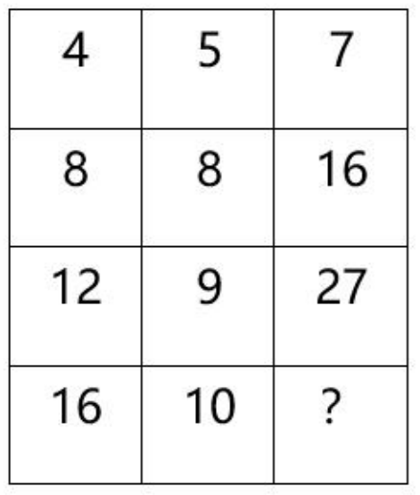

题图数字矩阵（按原图行列）

| 第1列 | 第2列 | 第3列 |
| --- | --- | --- |
| 4 | 5 | 7 |
| 8 | 8 | 16 |
| 12 | 9 | 27 |
| 16 | 10 | ? |

**A.** 16

**B.** 27

**C.** 38

**D.** 49

**答案：C**

> 转写说明：原卷第30题没有题干文字，只有数字矩阵图；题干记作“（见题图）”，矩阵按原图行列转写在题图 transcription 中。

### 第 31 题

`GD2020-XJ-Q031` · 单选 · 原卷第 3 页

中秋节前夕，某商店采购了一批月饼礼盒，此后第一周售出了总数的一半多10份，第二周售出了剩下的一半多5份，若此时还剩下20份月饼礼盒，则商品最初采购了（）份月饼礼盒。

**A.** 60

**B.** 80

**C.** 100

**D.** 120

**答案：D**

> 转写说明：原卷题干作“则商品最初采购了（ ）份月饼礼盒”，“商品”疑为“商店”之误，照录。

### 第 32 题

`GD2020-XJ-Q032` · 单选 · 原卷第 4 页

某文具厂计划每周生产A、B两款文件夹共9000个，其中A款文件夹每个生产成本为1.6元，售价为2.3元，B款文件夹每个生产成本为2元，售价为3元。假设该厂每周在两款文件夹上投入的总生产成本不高于15000元，则要使利润最大，该厂每周应生产A款文件夹（）个。

**A.** 0

**B.** 6000

**C.** 7500

**D.** 9000

**答案：C**

### 第 33 题

`GD2020-XJ-Q033` · 单选 · 原卷第 4 页

某单位后勤部门采购了一批大米，并将其平均分给了甲、乙两个饭堂。5周后，甲饭堂只剩余大米7千克；又过了1周，乙饭堂也只剩余大米6干克，已知甲乙饭堂的就餐人数固定，前往甲饭堂就餐的人数比乙饭堂多1人。如果每人每周消耗大米1千克，则这批大米共有（）千克。

**A.** 72

**B.** 84

**C.** 96

**D.** 108

**答案：B**

> 转写说明：原卷题干作“乙饭堂也只剩余大米6干克”，“干克”应为“千克”，照录。

### 第 34 题

`GD2020-XJ-Q034` · 单选 · 原卷第 4 页

某政务服务大厅开始办理业务前，已经有部分人在排队等候领取证书，且每分钟新增的人数一样多。从开始办理业务到排队等候的人全部领到证书，若同时开5个发证窗口就需要1个小时，若同时开6个发证窗口就需要40分钟。按照每个窗口给每个人发证需要1分钟计算，如果想要在20分钟内将排队等候的人的证书全部发完，则需同时开（）个发证窗口。

**A.** 7

**B.** 8

**C.** 9

**D.** 10

**答案：C**

### 第 35 题

`GD2020-XJ-Q035` · 单选 · 原卷第 4 页

在针对一家小型超市的调查中发现，某生鲜商品的售价与销量之间呈现以下规律：售价每降低1元，销量便会增加2千克，对应的表格如下：
若该商品的成本是15元/千克，售价不得高于25元且必须为整数，如果某天该商品的销售利润为200元，则售价是（）元/千克。

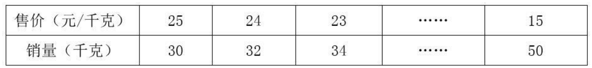

售价与销量对应表

| 售价（元/千克） | 25 | 24 | 23 | …… | 15 |
| --- | --- | --- | --- | --- | --- |
| 销量（千克） | 30 | 32 | 34 | …… | 50 |

**A.** 22

**B.** 20

**C.** 18

**D.** 16

**答案：B**

### 第 36 题

`GD2020-XJ-Q036` · 单选 · 原卷第 4 页

为加强治安防控，现计划在一段L形的围墙（如下图）上安装治安摄像头，其中A点到B点长度为750米，B点到C点长度为1350米。按要求ABC三个位置必须安装一个摄像头，且相邻两个摄像头之间的距离要保持一致，则整段围墙至少需要安装（）个摄像头。

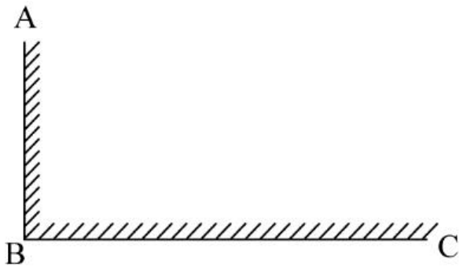

**A.** 14

**B.** 15

**C.** 16

**D.** 17

**答案：B**

### 第 37 题

`GD2020-XJ-Q037` · 单选 · 原卷第 4 页

某单位的两个部门计划订阅报纸。每个部门需要在指定的5种报纸中选择其中的3种，且这两个部门在选择时应做好沟通，做到5种报纸都有部门订阅，则订阅报纸的方案共有（）种。

**A.** 20

**B.** 30

**C.** 60

**D.** 100

**答案：B**

### 第 38 题

`GD2020-XJ-Q038` · 单选 · 原卷第 4 页

一个纸箱里装有大小及材质完全相同的10个小球，其中3个黑色，2个白色，1个红色，2个黄色，1个绿色，1个紫色。如果不放回地依次随机取出3个小球，则取出的小球依次是黑色，红色，白色的概率为：

**A.** 1/120

**B.** 1/240

**C.** 1/250

**D.** 3/500

**答案：A**

> 转写说明：四个选项的分数在原卷中为图片，已按“分子/分母”转写。

### 第 39 题

`GD2020-XJ-Q039` · 单选 · 原卷第 4 页

某部门正在准备会议材料，共有153份相同的文件，需要装到大小两种文件袋里送至会场，大的每个能装24份文件，小的每个能装15份文件。如果要使每个文件袋都正好装满，则需要大文件袋（）个。

**A.** 2

**B.** 3

**C.** 5

**D.** 7

**答案：A**

### 第 40 题

`GD2020-XJ-Q040` · 单选 · 原卷第 4 页

A、B两座港口相距300公里且仅有1条固定航道，在某一时刻甲船从A港顺流而下前往B港，同时乙船从B港逆流而上前往A港，甲船在5小时之后抵达了B港，停留了1小时后开始返回A港，又过了6小时追上了乙船。则乙船在静水中的时速为（）公里。

**A.** 20

**B.** 25

**C.** 30

**D.** 40

**答案：C**

## 判断推理

### 第 41 题

`GD2020-XJ-Q041` · 单选 · 图形推理 · 原卷第 4、5 页

下列选项中，不能在裁剪或覆盖后折成如图所示立方体的是（）。

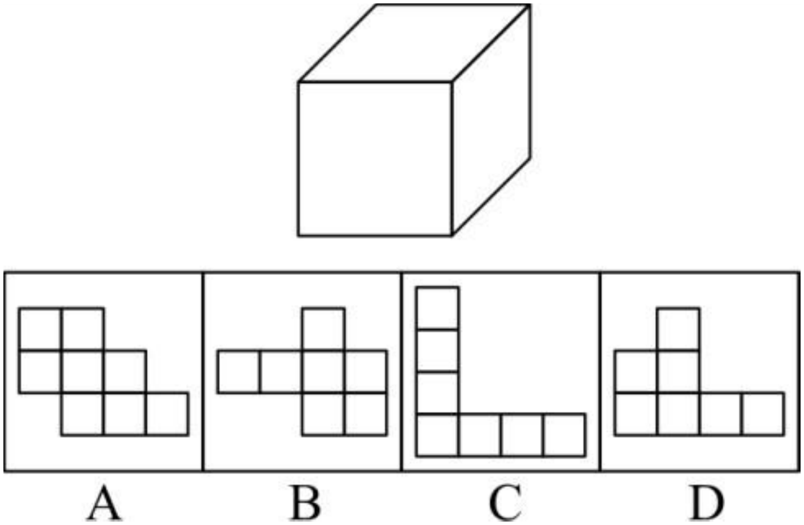

**A.** 见上方题图中 A 项。

**B.** 见上方题图中 B 项。

**C.** 见上方题图中 C 项。

**D.** 见上方题图中 D 项。

**答案：D**

### 第 42 题

`GD2020-XJ-Q042` · 单选 · 图形推理 · 原卷第 5 页

下列选项中最符合所给图形规律的是（）。

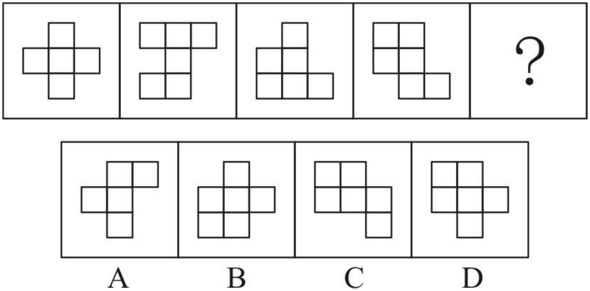

**A.** 见上方题图中 A 项。

**B.** 见上方题图中 B 项。

**C.** 见上方题图中 C 项。

**D.** 见上方题图中 D 项。

**答案：D**

### 第 43 题

`GD2020-XJ-Q043` · 单选 · 图形推理 · 原卷第 5 页

下列选项中，能与所给图形组合成立方体的是（）。

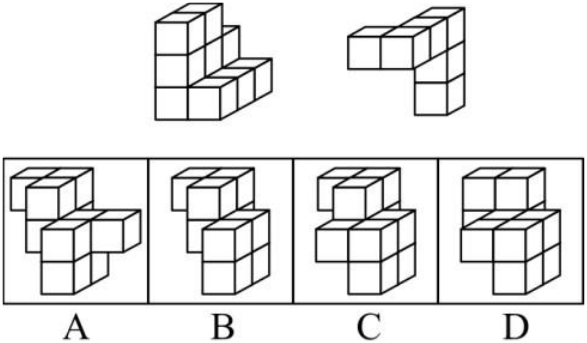

**A.** 见上方题图中 A 项。

**B.** 见上方题图中 B 项。

**C.** 见上方题图中 C 项。

**D.** 见上方题图中 D 项。

**答案：C**

### 第 44 题

`GD2020-XJ-Q044` · 单选 · 图形推理 · 原卷第 5 页

使用所给的四个图形能够组合成（）。

**A.** 矩形

**B.** 三角形

**C.** 等腰梯形

**D.** 直角梯形

**答案：D**

### 第 45 题

`GD2020-XJ-Q045` · 单选 · 图形推理 · 原卷第 6 页

下列4张纸条，沿折痕能够折出如图所示图形的是（）。

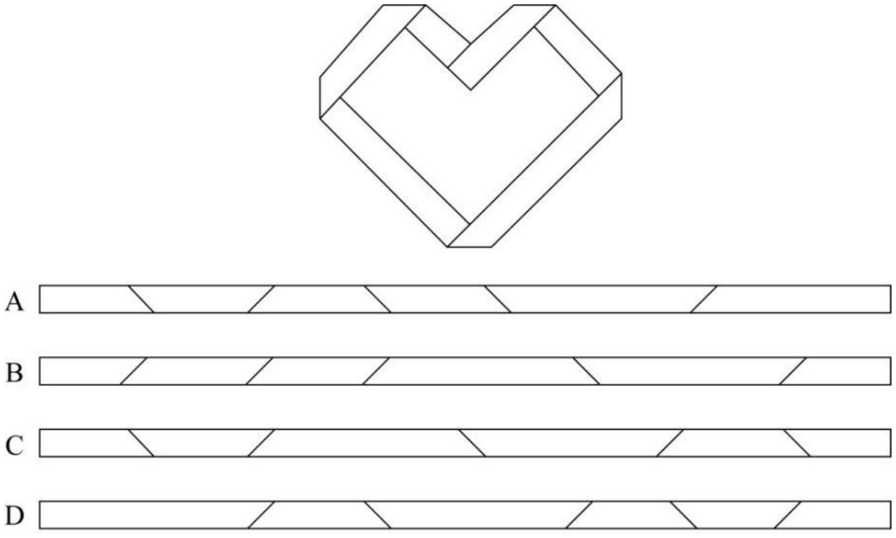

**A.** 见上方题图中 A 项。

**B.** 见上方题图中 B 项。

**C.** 见上方题图中 C 项。

**D.** 见上方题图中 D 项。

**答案：C**

### 第 46 题

`GD2020-XJ-Q046` · 单选 · 图形推理 · 原卷第 6 页

下列选项中最符合所给图形规律的是（）。

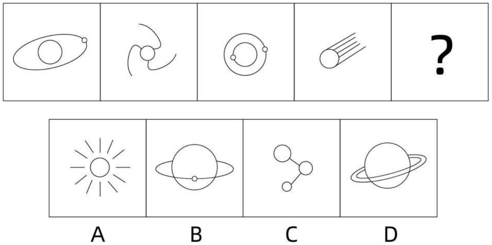

**A.** 见上方题图中 A 项。

**B.** 见上方题图中 B 项。

**C.** 见上方题图中 C 项。

**D.** 见上方题图中 D 项。

**答案：B**

### 第 47 题

`GD2020-XJ-Q047` · 单选 · 图形推理 · 原卷第 6 页

下列选项中最符合所给图形规律的是（）。

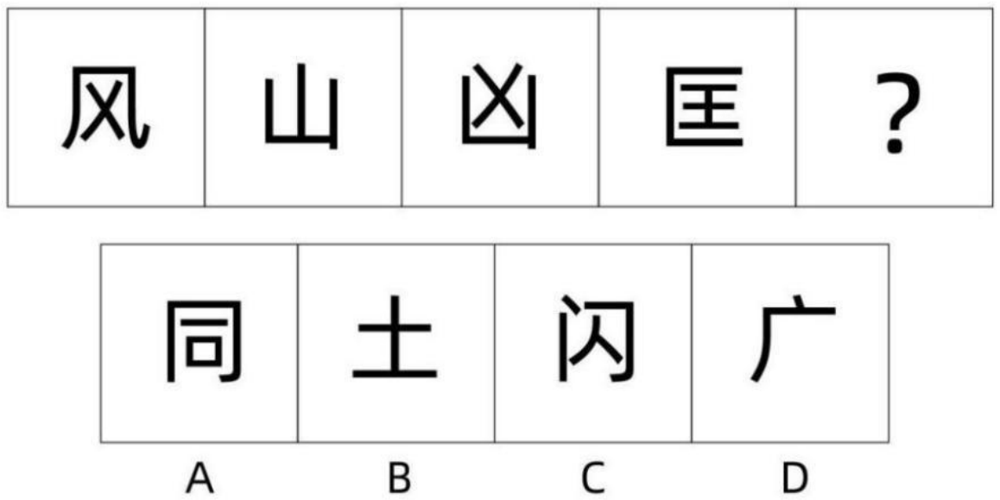

题干：风、山、凶、匡、？
选项：A 同；B 土；C 闪；D 广

**A.** 见上方题图中 A 项。

**B.** 见上方题图中 B 项。

**C.** 见上方题图中 C 项。

**D.** 见上方题图中 D 项。

**答案：A**

### 第 48 题

`GD2020-XJ-Q048` · 单选 · 图形推理 · 原卷第 6 页

下列选项中最符合所给图形规律的是（）。

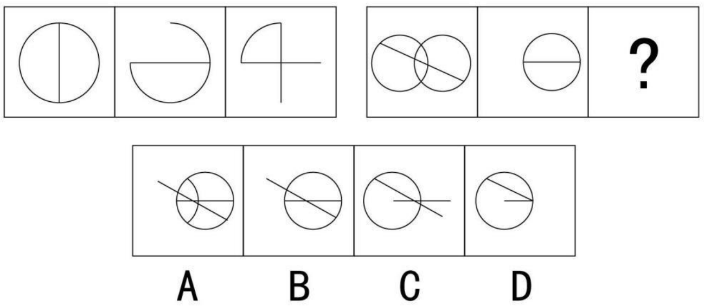

**A.** 见上方题图中 A 项。

**B.** 见上方题图中 B 项。

**C.** 见上方题图中 C 项。

**D.** 见上方题图中 D 项。

**答案：C**

### 第 49 题

`GD2020-XJ-Q049` · 单选 · 图形推理 · 原卷第 6、7 页

下列的三个视图是观察某一多面体得到的，则该立体图形不可能是（）。

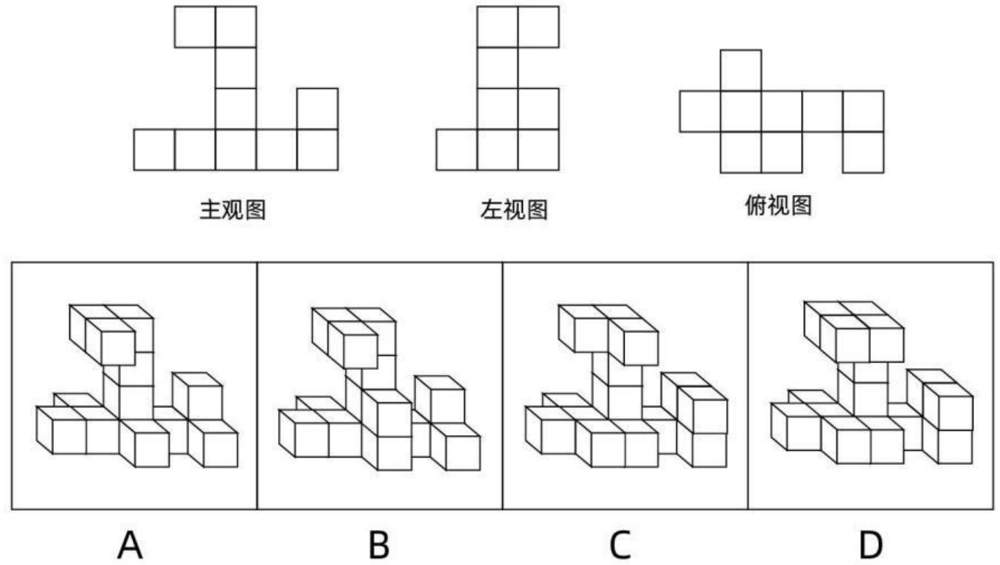

**A.** 见上方题图中 A 项。

**B.** 见上方题图中 B 项。

**C.** 见上方题图中 C 项。

**D.** 见上方题图中 D 项。

**答案：A**

> 转写说明：题图中三个视图的标注原图作“主观图”“左视图”“俯视图”，“主观图”应为“主视图”；图片未改动。

### 第 50 题

`GD2020-XJ-Q050` · 单选 · 图形推理 · 原卷第 7 页

下列选项中最符合所给图形规律的是（）。

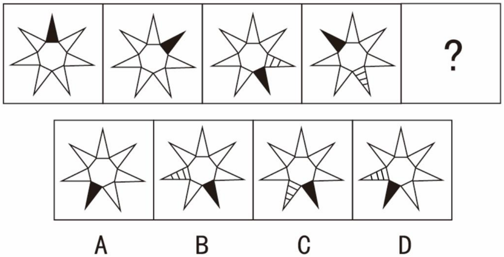

**A.** 见上方题图中 A 项。

**B.** 见上方题图中 B 项。

**C.** 见上方题图中 C 项。

**D.** 见上方题图中 D 项。

**答案：C**

### 第 51 题

`GD2020-XJ-Q051` · 单选 · 类比推理 · 原卷第 7 页

清风∶朗月

**A.** 钢墙∶铁壁

**B.** 斗转∶星移

**C.** 惊涛∶骇浪

**D.** 高山∶流水

**答案：D**

> 转写说明：原卷A项作“钢墙∶铁壁”，成语为“铜墙铁壁”，疑为“铜墙”之误，照录。

### 第 52 题

`GD2020-XJ-Q052` · 单选 · 类比推理 · 原卷第 7 页

油田∶汽油

**A.** 伐木场∶家具

**B.** 商场∶服装

**C.** 农田∶稻谷

**D.** 水库∶水

**答案：A**

### 第 53 题

`GD2020-XJ-Q053` · 单选 · 类比推理 · 原卷第 7 页

夜晚∶路灯

**A.** 孤舟∶灯塔

**B.** 站台∶路标

**C.** 春节∶春联

**D.** 黄昏∶道别

**答案：C**

### 第 54 题

`GD2020-XJ-Q054` · 单选 · 类比推理 · 原卷第 7 页

人∶成年人∶未成年人

**A.** 门∶开门∶关门

**B.** 手∶左手∶右手

**C.** 天气∶晴天∶阴天

**D.** 车祸∶幸存者∶遇难者

**答案：B**

### 第 55 题

`GD2020-XJ-Q055` · 单选 · 类比推理 · 原卷第 7 页

瓜熟蒂落∶水到渠成

**A.** 朝三暮四∶朝秦暮楚

**B.** 翻云覆雨∶翻天覆地

**C.** 耳濡目染∶耳熟能详

**D.** 大功告成∶功败垂成

**答案：A**

### 第 56 题

`GD2020-XJ-Q056` · 单选 · 逻辑判断 · 原卷第 7 页

某工作组计划开展实地调研，初步确定只选择粤东、粤西或粤北中的一个地区。对此，工作组中的甲、乙、丙三人提出了以下意见：
甲：在此次调研中粤东更具有代表性，应该前往粤东地区。
乙：上一轮调研已经去过粤北了，这一次应该选择其他地区。
丙：我认为选择粤西或粤北地区开展实地调研更合适。
最终工作组只采纳了其中一个人的意见，则下列陈述一定正确的是（）。

**A.** 工作组前往了粤东地区

**B.** 工作组前往了粤西地区

**C.** 工作组采纳了乙的意见

**D.** 工作组采纳了丙的意见

**答案：D**

### 第 57 题

`GD2020-XJ-Q057` · 单选 · 逻辑判断 · 原卷第 7、8 页

有人认为，十二生肖起源于动物崇拜。这是因为在原始社会中，人类的生产力水平很低，猪、牛、羊等牲畜与农事活动关系密切，动物崇拜也就随之而生。除此之外，虎、蛇等动物可能威胁到人类的自身安全，往往被视为强大的象征，人们也会因为感到恐惧而形成动物崇拜。
以下选项如果为真，最能反驳上述判断的是（）。

**A.** 十二生肖中只有龙不是现实中存在的动物

**B.** “过街老鼠人人喊打”，但它是十二生肖之首

**C.** 鸡、鸭、鹅与农事活动关系密切，但只有鸡属于十二生肖

**D.** 牛和猪都与农事相关，但他们在十二生肖中的位置相距很远

**答案：B**

> 转写说明：原卷“生产力”的“力”在文字层和印出的字形上都是日文片假名“カ”（U+30AB），属录入错误，已改为“力”（与2020年乡镇卷第62题同题同处理）；这是本卷唯一改动的字。

### 第 58 题

`GD2020-XJ-Q058` · 单选 · 逻辑判断 · 原卷第 8 页

某扶贫产业基地计划种植紫薯、红薯、南瓜以及玉米四种农作物。四种农作物的种植面积大小不一，且需要满足以下条件：
①要么紫薯种植面积最大，要么南瓜种植面积最大；
②如果紫薯的种植面积最大，红薯的种植面积便最小。
如果红薯的种植面积大于玉米，可以推出的是（）。

**A.** 南瓜种植面积大于玉米种植面积

**B.** 紫薯种植面积大于玉米种植面积

**C.** 紫薯种植面积小于红薯种植面积

**D.** 玉米种植面积大于南瓜种植面积

**答案：A**

### 第 59 题

`GD2020-XJ-Q059` · 单选 · 逻辑判断 · 原卷第 8 页

国内有研究发现，在小学阶段，春季出生的孩子比冬季出生的孩子学习成绩更好，在学业上获得成功的概率也更高。有人据此推测，这是由于春季出生的孩子年纪更大一些，而年纪大的孩于往往更成熟，更容易获得老师的关注。
以下选项如果为真，最能反驳上述判断的是（）。

**A.** 得到老师更多关注并不意味着一定有更多在学业上取得成就的机会

**B.** 教育部门规定，小学生必须在当年9月1日前年满6周岁才能入学

**C.** 老师也会倾向于关注成绩不理想的学生

**D.** 其他研究发现，成绩好的孩子普遍善于独立思考

**答案：A**

> 答案说明：本题与2020年乡镇卷第64题为同一道题（题干、选项相同），乡镇卷答案PDF作B；本卷答案PDF的答案行与解析结论（“因此，选择A选项”，解析称B项为“不明确项”）均作A。按本卷答案PDF记A，不自行裁定。

> 转写说明：原卷题干作“年纪大的孩于往往更成熟”，“孩于”疑为“孩子”之误，照录。

### 第 60 题

`GD2020-XJ-Q060` · 单选 · 逻辑判断 · 原卷第 8 页

某市实现高质量发展的关键在于，通过推动当地制造业的发展，建立健全现代化产业体系。该市产业园区的建设发展对建立健全现代化产业体系至关重要，因此也是推动实现高质量发展的关键。
下列选项中，与上述推论过程结构最为类似的是（）。

**A.** 打好三大攻坚战是全面建成小康社会的前提条件，也是实现高质量发展的必备基础。所以，打好三大攻坚战才能实现经济社会的全面发展

**B.** 所有战略性新兴领域的产品均为高尖端产品。某公司的产品广泛应用于新型材料等战略性新兴领域。因此，该公司是一家高尖端制造企业

**C.** 公路网络不发达会导致交通落后，而交通落后已经成为制约乡镇加快发展的最大瓶颈。因此，乡镇要加快发展，必须加强路网建设

**D.** 与传统育苗方式相比，组织育苗是一种更为高效的组织快繁方式。因此，引进组织育苗技术很有意义

**答案：A**

### 第 61 题

`GD2020-XJ-Q061` · 单选 · 逻辑判断 · 原卷第 8 页

某全国连锁餐饮企业在北方部分城市新推出了一款糕点，销量与口碑极佳，因此该公司管理层认为，如果在南方地区推出该产品一定也能受到顾客的喜爱。
下列选项最能指出上述论证缺陷的是（）。

**A.** 默认了该款产品在北方市场的销量与口碑信息可以用于预测南方市场

**B.** 忽视了国内的其它餐饮企业也可能会推出同款糕点

**C.** 默认了该连锁餐饮企业在南方地区开设有分店

**D.** 忽视了许多南方城市有自己的特色糕点

**答案：A**

### 第 62 题

`GD2020-XJ-Q062` · 单选 · 逻辑判断 · 原卷第 8 页

有研究表明，长期使用酒精洗手液会对手部皮肤造成损伤，而某品牌免洗洗手液所有成分均从天然植物提取，不含酒精。因此不会对手部皮肤产生损害。
下列选项最能指出上述论证缺陷的是（）。

**A.** 默认了洗手液中只有酒精对手部皮肤产生损害

**B.** 默认了从天然植物中不会提炼出酒精

**C.** 忽视了酒精会提升洗手液的清洁效果

**D.** 忽视了从天然植物中提取的成分可能对人体其它部位造成损伤

**答案：A**

### 第 63 题

`GD2020-XJ-Q063` · 单选 · 逻辑判断 · 原卷第 8、9 页

没有游子不思乡，思乡之人皆惆怅，故游子无不惆怅。
下列选项，与上述论证逻辑不一致的是（）。

**A.** 没有人不热爱生命，不热爱生命的人会轻生，因此没有人会轻生

**B.** 没有国家不希望富强，而要想富强必须发展经济，因此没有国家不希望发展经济

**C.** 没有哪一场战争不会带来死亡，没有哪一死亡不令人悲伤，因此没有战争不令人感到悲伤

**D.** 没有人不渴望幸福生活，而幸福生活都是奋斗出来的，因此努力奋斗的人都能获得幸福生活

**答案：D**

### 第 64 题

`GD2020-XJ-Q064` · 单选 · 逻辑判断 · 原卷第 9 页

受影视资本”寒冬”和政策收紧的影响，原创剧集整体规模在2019年出现缩水，有影视数据显示，2019年剧集播出数量整体下降16.6%，从452部缩减至377部，不过某权威影视网站的评分显示，热度前30名剧集的评分均值由2018年的5.96分升至2019年的6.51分。这在一定程度上表明，剧集数量大幅减少后，排名前列的精品剧并未受到太大影响，市场淘汰的是一批非精品类型的剧集。
以下哪项为真，最能加强以上论证（）？

**A.** 有很多原创剧集的拍摄成本非常低，而且还有进一步的压缩空间

**B.** 针对影视行业的政策主要集中在限制低俗有害的影视作品

**C.** 2018-2019年，该权威影视网站的评分流程和标准保持一致

**D.** 2018年该权威影视网站对所有原创剧集都有评分

**答案：C**

> 转写说明：原卷题干作“受影视资本”寒冬”和政策收紧的影响”，“寒冬”前的引号方向印反（两个都是右引号），照录。

### 第 65 题

`GD2020-XJ-Q065` · 单选 · 逻辑判断 · 原卷第 9 页

信息时代似乎给人们提供了前所未有的多样选择。但实际上，社交媒体的兴起和智能算法的应用，使人们逐渐变得只会选择性接触自己感兴趣的信息，如同春蚕吐丝一样，渐渐形成“信息茧房”。显然，只接触到自己感兴趣的信息是不全面的。因此，信息时代的到来并不意味着人们能够更为全面地看待社会问题。
下列选项，与上述论证过程最为类似的是（）。

**A.** 专业人士在科答中容易过分倚重“用数据说话”而忽视了讲故事的技巧，往往导致了科普难以吸引眼球。这或许正是专业科普常常收效甚微的原因

**B.** 人们对未经证实的信息不加分辨地转发，成为了谣言层出不穷的重要原因。因此，只有提升个人的信息鉴别能力，才能有效切断谣言的传播环节

**C.** 消费者的环保态度很难转化为实际的购物选择，而且常常会默认所谓的绿色环保产品缺少加工。因此，以绿色环保为卖点的产品并不容易获得成功

**D.** 经济社会是个动态循环过程，只有结束停摆，让人流、物流、资金有序转动起来，整个循环才能畅通，经济社会秩序才能尽快恢复

**答案：C**

> 转写说明：原卷A项作“专业人士在科答中容易……”，“科答”疑为“科普”之误，照录。

### 第 66 题

`GD2020-XJ-Q066` · 单选 · 逻辑判断 · 原卷第 9 页

某市的志愿者管理采用注册制，其中活跃志愿者约占20%。为进一步增强志愿者服务力量，提高活跃志愿者数量，该市管理部门制定了以下政策：鼓励所有政府部门及公益组织的工作人员注册成为志愿者。
以下属于该部门制定政策时的假设的是（）。

**A.** 该城市还有大量的社会活动没有得到足够的志愿者支持

**B.** 政府部门及公益组织的工作人员的志愿服务意愿都很强

**C.** 一直以来该市制定的各项政策都得到了市民的积极响应

**D.** 活跃志愿者的数量会随着注册志愿者人数的增加而增加

**答案：B**

### 第 67 题

`GD2020-XJ-Q067` · 单选 · 逻辑判断 · 原卷第 9 页

某省开展了新高考改革，考试科目按“3+1+2”模式设置，“3”为全国统一高考的语文、数学、外语，“1”由考生在物理、历史2门学科中选择1门，“2”由考生在政治、地理、化学、生物学4门学科中选择2门。某校选了化学的同学大多数都选了物理，选了政治的同学都选了历史。
如果以上描述为真，则下列关于该校的断定必然为真的是（）。
l.有的同学选了化学和政治
Ⅱ.选了化学的同学都没有选政治
Ⅲ.有的同学选了化学却没有选政治
IV.有的同学选了政治却没有选化学

**A.** l和Ⅱ

**B.** Ⅲ和IV

**C.** 只有Ⅲ

**D.** I和Ⅲ

**答案：C**

> 转写说明：原卷四个列项的序号写法不一：第一项作小写字母“l.”，第二、三项为罗马数字符号“Ⅱ.”“Ⅲ.”，第四项作拉丁字母“IV.”；选项A作“l和Ⅱ”（小写字母l），D项作“I和Ⅲ”（拉丁字母I），B项作“Ⅲ和IV”；均照录。

### 第 68 题

`GD2020-XJ-Q068` · 单选 · 逻辑判断 · 原卷第 9 页

对于城市街头小摊贩占道经营影响交通的问题，有学者认为应当在不影响城市交通的特定区域设置面向小摊贩的集中营业区，这样就能够缓解小摊贩随意占道经营产生的交通堵塞问题。
要使上述论证成立，必须补充的前提是（）。

**A.** 集中营业区不会向入驻的小摊贩收取管理费用

**B.** 集中营业区不会产生噪音、环境污染等其它城市问题

**C.** 设置集中营业区后占道经营的小摊贩会前往该处摆设摊位

**D.** 集中营业区的交通位置便利，小摊贩能够在该处获得更高利润

**答案：C**

> 转写说明：原卷本题之后有一行“69——75题暂缺，各机构题库均缺，后期将根据机构题库更新情况，进行更新。”，不属于试题内容，未收录；第69—75题原卷缺失。

## 科学推理

> 说明：原卷第76—85题排在第四部分“判断推理”下，未单列部分；按题型并与2022—2026题库一致，记为科学推理（原卷第69—75题缺失，题型不明）。

### 第 76 题

`GD2020-XJ-Q076` · 单选 · 原卷第 9、10 页

在生活中，我们可以用紫色的蝴蝶兰花溶液作为酸碱指示剂，其遇酸性溶液显红色，遇碱性溶液则显黄色。
下列说法正确的是（）。

**A.** 在盐水中滴入蝴蝶兰花溶液，溶液呈红色

**B.** 在纯净水中滴入蝴蝶兰花溶液，溶液呈无色

**C.** 在苏打水中滴入蝴蝶兰花溶液，溶液呈黄色

**D.** 在酸或碱性溶液滴入蝴蝶兰花溶液后，变色的过程属于物理变化

**答案：C**

### 第 77 题

`GD2020-XJ-Q077` · 单选 · 原卷第 10 页

一般而言，在北半球地转偏向力会使风向右偏离其原始的路线。图中显示的是位于北半球的甲地的等压线分布情况，则甲地的风向最可能是（）。

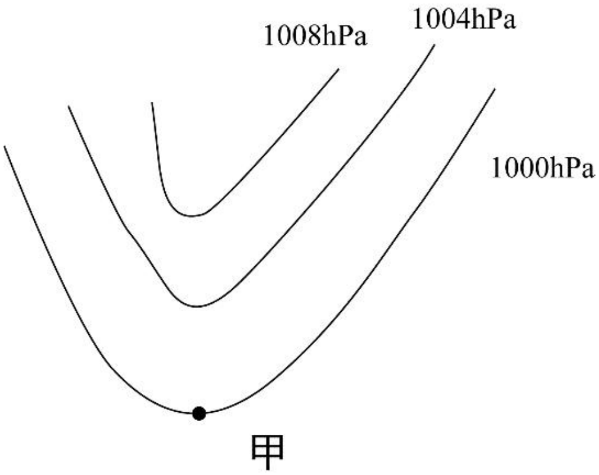

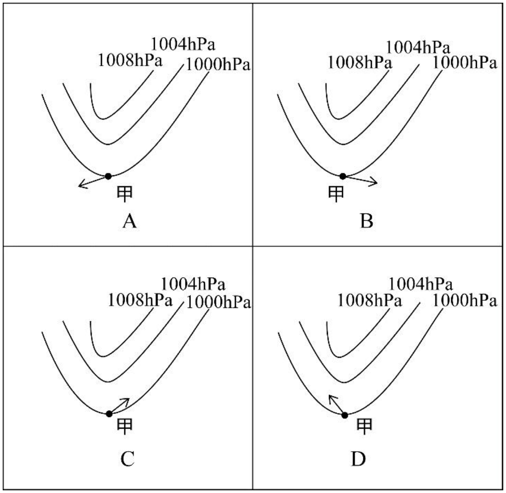

**A.** 见上方题图中 A 项。

**B.** 见上方题图中 B 项。

**C.** 见上方题图中 C 项。

**D.** 见上方题图中 D 项。

**答案：A**

> 转写说明：题图分两张：上为甲地等压线图，下为A—D四个选项图。

### 第 78 题

`GD2020-XJ-Q078` · 单选 · 原卷第 10 页

夏季，从冰箱内拿出一个装有冰块的杯子，则在杯内物体变为常温的过程中，杯壁温度随着时间变化的图像最有可能接近（）。

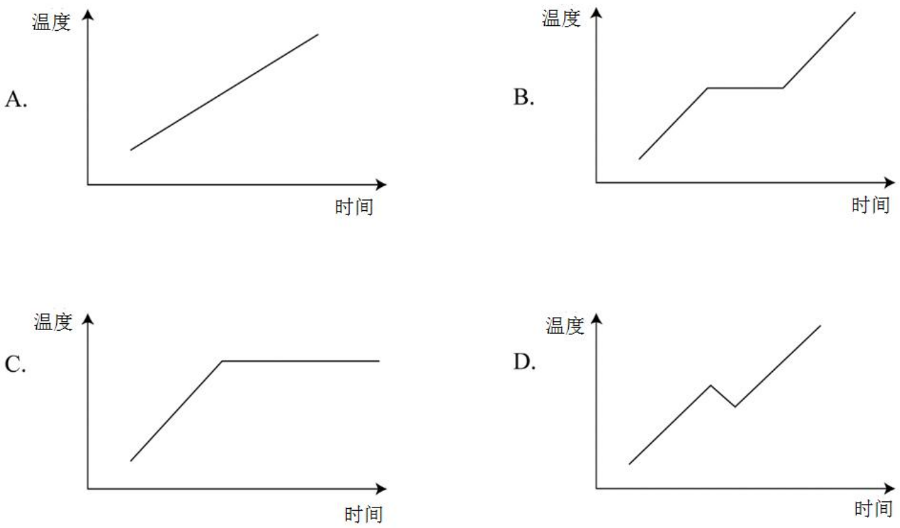

**A.** 见上方题图中 A 项。

**B.** 见上方题图中 B 项。

**C.** 见上方题图中 C 项。

**D.** 见上方题图中 D 项。

**答案：D**

### 第 79 题

`GD2020-XJ-Q079` · 单选 · 原卷第 11 页

实验员小张计划配制浓度为8%的氯化钠溶液，在配制过程中，他使用托盘天平称量氯化钠的质量，使用量筒称量水的体积。但由于操作失误，最终配制的溶液浓度偏小，则以下可能导致这一结果的是（）。

**A.** 称量前未调平衡，天平指针偏右

**B.** 称量时，使用了已生锈的砝码

**C.** 用量筒取水时，仰视读数

**D.** 将水倒入烧杯时，一部分洒在外面

**答案：C**

### 第 80 题

`GD2020-XJ-Q080` · 单选 · 原卷第 11 页

如果将等量的氧气和氮气混合，注入一个密闭容器，则静置较长一段时间后，容器内氧元素（用O代表）和氮元素（用N代表）的分布最可能接近（）。

选项图字母分布（每项4行，按原图行序）

| 选项 | 第1行 | 第2行 | 第3行 | 第4行 |
| --- | --- | --- | --- | --- |
| A | NONONO | ONONON | NONONO | ONONON |
| B | OOOOOO | ONOONO | NONNON | NNNNNN |
| C | NNNNNN | NONNON | ONOONO | OOOOOO |
| D | NNNNNN | NNNNNN | OOOOOO | OOOOOO |

**A.** 见上方题图中 A 项。

**B.** 见上方题图中 B 项。

**C.** 见上方题图中 C 项。

**D.** 见上方题图中 D 项。

**答案：A**

### 第 81 题

`GD2020-XJ-Q081` · 单选 · 原卷第 11 页

如图所示，乙、丙两个正方体漂浮在装有溶液的容器内保持静止状态，且上表面与液面持平，正方体甲下表面与乙物体的上表面密切接触，球体丁与丙之间用细绳牵连，则下列说法正确的是（）。

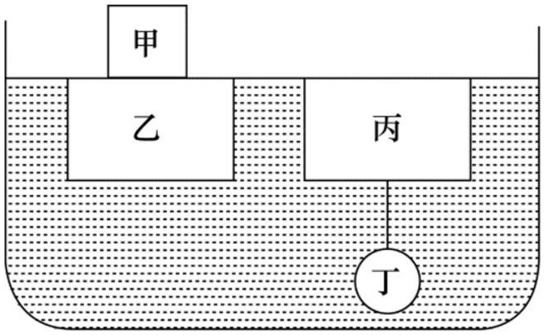

**A.** 液体对物体甲有浮力作用

**B.** 丙受到的浮力大于丁受到的浮力

**C.** 乙受到的浮力大于甲乙两物体的重力之和

**D.** 细绳的牵引力等于丙受到的浮力减去丁的重力

**答案：B**

### 第 82 题

`GD2020-XJ-Q082` · 单选 · 原卷第 11 页

某可燃物的着火点为t，如图所示，则该物质燃烧火势从大到小的点依次是（）。

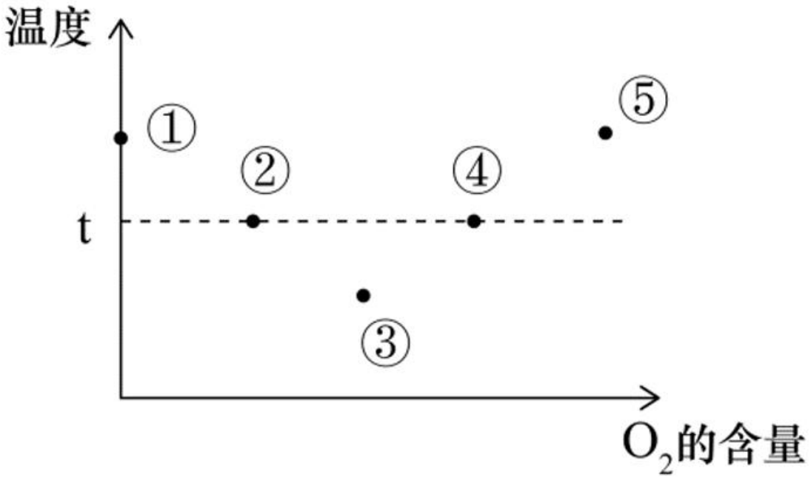

**A.** ①②③

**B.** ②④⑤

**C.** ③④⑤

**D.** ⑤④②

**答案：D**

> 转写说明：题图横轴“O2的含量”在图内，未另行转写。

### 第 83 题

`GD2020-XJ-Q083` · 单选 · 原卷第 11 页

如图所示，仓库工人计划用小车运送三箱货物，第一次先用大小为F的力将一箱货物从A仓库推到B仓库，第二次用同样大小的力将两箱货物从A仓库拉到B仓库。则在货物的移动过程中，关于两次做功的情况下列说法正确的是（）。

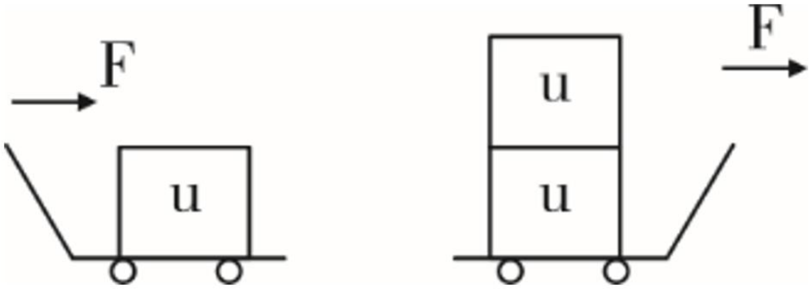

**A.** 工人第一次做的功比第二次多

**B.** 工人第一次做的功比第二次少

**C.** 工人第一次做的功与第二次一样多

**D.** 无法确定

**答案：C**

### 第 84 题

`GD2020-XJ-Q084` · 单选 · 原卷第 12 页

如图所示是一辆公交车在平直道路上行驶的位移（s）-时间（t）图像，则下列选项中最能准确反映公交车速度（v）-时间（t）图像的是（）。

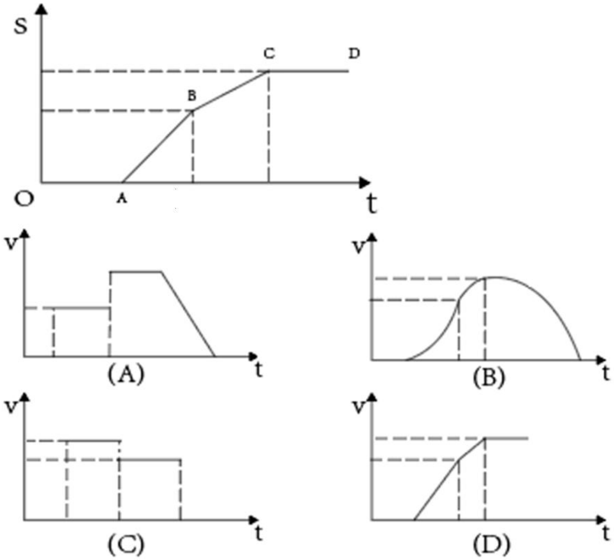

**A.** 见上方题图中 A 项。

**B.** 见上方题图中 B 项。

**C.** 见上方题图中 C 项。

**D.** 见上方题图中 D 项。

**答案：C**

### 第 85 题

`GD2020-XJ-Q085` · 单选 · 原卷第 12 页

下列关于生活现象的说法，正确的是（）。

**A.** 不锈钢容器比铁容器更持久耐用是因为所用合金材料永远不会生锈

**B.** 氮气常用作食品防腐剂是因为其不与食品反应，无毒且容易获得

**C.** 小苏打可使面团蓬松多孔是因为其在面团发酵过程中会汽化

**D.** 洗洁精能除去油污是因为洗洁精与油污发生了化学反应，使油粒分解

**答案：B**

## 资料分析

### 共用材料：第 86—90 题

社会保险包括了养老保险，工伤保险，医疗生育保险等，是社会保障体系的重要组成部分。其在整个社会保障体系中居于核心地位，社会保险是一种缴费型的社会保障，资金主要由用人单位和劳动者缴纳（一般而言，各类社会保险的缴纳费用=缴费基数×缴纳比例），政府财政给予补贴并承担最终责任。
在经历了一段时间的摸索后，我国的社会保障制度在上世纪90年代进入了创新式的改革、发展时期。1995年3月1日，国务院发出《关于深化企业职工养老保险制度改革的通知》，确定了社会统筹与个人账户相结合的养老保险制度，职工基本养老保险制度在全国范围内正式实行统账结合模式。
近年来，随着我国经济发展出现一系列新形式新情况，企业对进一步降低社保费率的呼声较强，党中央、国务院提出新的要求。2019年《政府工作报告》明确提出，各地可将养老保险单位缴费比例降至16%。2019年，B市率先降低养老保险单位缴费比例。预计今后每年可减轻该市企业社保费缴费负担超百亿元。

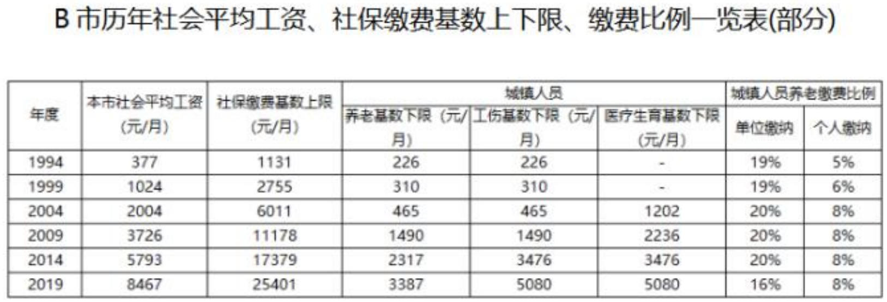

B市历年社会平均工资、社保缴费基数上下限、缴费比例一览表(部分)

| 年度 | 本市社会平均工资（元/月） | 社保缴费基数上限（元/月） | 城镇人员养老基数下限（元/月） | 城镇人员工伤基数下限（元/月） | 城镇人员医疗生育基数下限（元/月） | 城镇人员养老缴费比例：单位缴纳 | 城镇人员养老缴费比例：个人缴纳 |
| --- | --- | --- | --- | --- | --- | --- | --- |
| 1994 | 377 | 1131 | 226 | 226 | - | 19% | 5% |
| 1999 | 1024 | 2755 | 310 | 310 | - | 19% | 6% |
| 2004 | 2004 | 6011 | 465 | 465 | 1202 | 20% | 8% |
| 2009 | 3726 | 11178 | 1490 | 1490 | 2236 | 20% | 8% |
| 2014 | 5793 | 17379 | 2317 | 3476 | 3476 | 20% | 8% |
| 2019 | 8467 | 25401 | 3387 | 5080 | 5080 | 16% | 8% |

原表表头分两层：“城镇人员”下分养老、工伤、医疗生育三列基数下限，“城镇人员养老缴费比例”下分单位缴纳、个人缴纳两列；转写时合成一格。1994、1999年医疗生育基数下限原表作“-”。

> 材料说明：材料1第一段“缴纳费用=缴费基数×缴纳比例”中的“=”“×”在原卷中为图片，已转写为文字；第三段“新形式新情况”疑为“新形势”之误，照录。

### 第 86 题

`GD2020-XJ-Q086` · 单选 · 原卷第 12、13 页

[共用材料](#GD2020-XJ-M1)

一般来说，社保管理部门会根据当地上一年社会平均工资来确定当年的社保缴费基数上限，两者比值相对固定。下列选项中，B市这一比值与其他年份差别最大的是（）。

**A.** 1999年

**B.** 2004年

**C.** 2014年

**D.** 2019年

**答案：A**

### 第 87 题

`GD2020-XJ-Q087` · 单选 · 原卷第 13 页

[共用材料](#GD2020-XJ-M1)

根据行业的风险性质不同，工伤保险缴费的比例也不同。假如B市某企业所属行业类别的工伤保险缴费比例一直为0.5%（职工个人不缴纳工伤保险费用），在按照工伤基数下限为其员工缴纳工伤保险的情况下，2019年每名员工缴纳的工伤保险金额约为10年前的（）倍。

**A.** 1.46

**B.** 2.27

**C.** 3.41

**D.** 4.23

**答案：C**

> 转写说明：题干中的“0.5%”在原卷中为图片，已转写为文字。

### 第 88 题

`GD2020-XJ-Q088` · 单选 · 原卷第 13 页

[共用材料](#GD2020-XJ-M1)

在B市某企业工作的小王，2019年月平均工资为10161元，如果该企业将养老保险缴费基数下限调整为小王的实际月平均工资，则该企业全年将增加支出约（）元。

**A.** 1084

**B.** 5058

**C.** 9032

**D.** 13006

**答案：D**

### 第 89 题

`GD2020-XJ-Q089` · 单选 · 原卷第 13 页

[共用材料](#GD2020-XJ-M1)

以下最有可能符合B市1998-2018年社会平均工资增长率变化情况的曲线是（）。

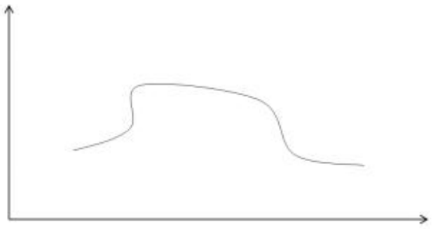

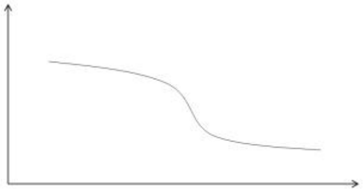

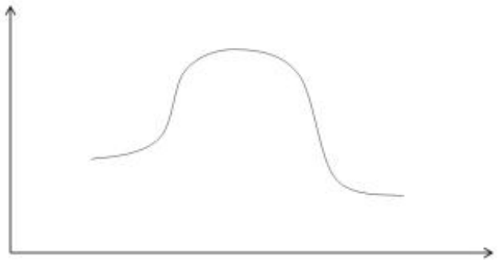

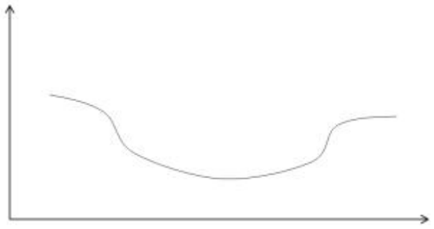

**A.** 见上方题图中 A 项。

**B.** 见上方题图中 B 项。

**C.** 见上方题图中 C 项。

**D.** 见上方题图中 D 项。

**答案：B**

> 转写说明：四个选项均为单独的曲线图（原卷以“A、”“B、”“C、”“D、”标注在各图左下方），每个选项指向各自的选项图。

### 第 90 题

`GD2020-XJ-Q090` · 单选 · 原卷第 13 页

[共用材料](#GD2020-XJ-M1)

如果B市社保缴费基数，每5年调整一次，则根据上述资料，以下说法正确的是（）。

**A.** 1994-2019年，B市城镇人员养老保险缴纳基数下限与上年社会平均工资的比值逐渐缩小

**B.** 1994-2019年，B市城镇人员养老保险的企业缴纳比例和个人缴纳比例逐渐降低

**C.** 2004-2019年，B市城镇人员的工伤和医疗生育保险缴纳基数下限始终不低于养老基数下限

**D.** 2009-2019年，B市城镇人员与农业户口人员的各项保险缴纳差距逐渐缩小

**答案：C**

### 共用材料：第 91—95 题

2019年我国农民工规模继续扩大，总量达到29077万人，同比增长0.8%。其中，本地农民工11652万人，比上年增加82万人；外出农民工17425万人，比上年增加159万人。外出农民工中，在省内就业的农民工9917万人，比上年增加245万人；跨省流动农民工7508万人，比上年减少86万人。

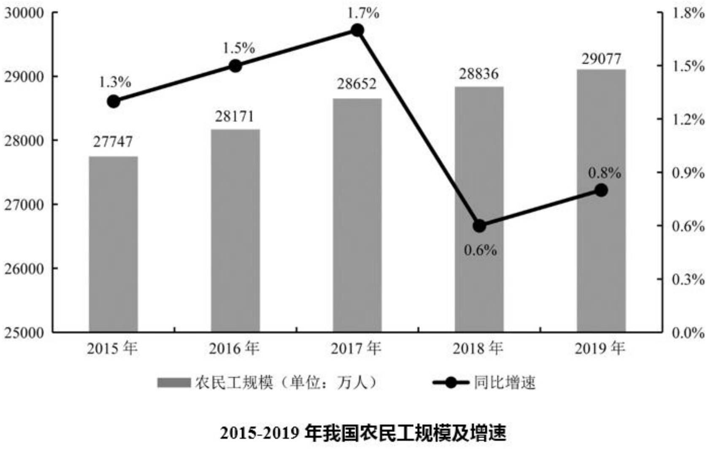

2015-2019年我国农民工规模及增速

| 年份 | 农民工规模（万人） | 同比增速 |
| --- | --- | --- |
| 2015年 | 27747 | 1.3% |
| 2016年 | 28171 | 1.5% |
| 2017年 | 28652 | 1.7% |
| 2018年 | 28836 | 0.6% |
| 2019年 | 29077 | 0.8% |

从收入看，农民工集中就业的六大行业月均收入均稳定增长。2019年农民工月均收入约4000元，其中外出农民工月均收入4427元，比上年增加320元；本地农民工月均收入3500元，比上年增加160元。分区域看，在东部地区就业的农民工月均收入4222元，比上年增长6.8%；在中部地区就业的农民工月均收入3794元，比上年增长6.3%；在西部地区就业的农民工月均收入3723元，比上年增长5.7%；在东北地区就业的农民工月均收入3469元，同比增长5.2%。

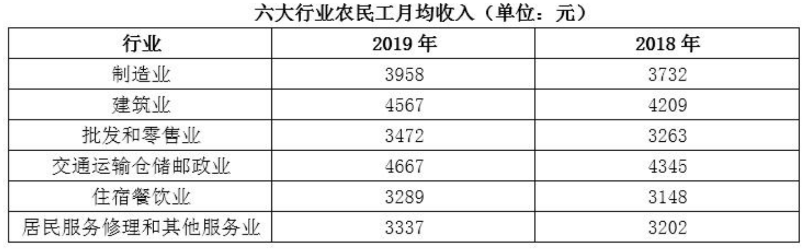

六大行业农民工月均收入（单位：元）

| 行业 | 2019年 | 2018年 |
| --- | --- | --- |
| 制造业 | 3958 | 3732 |
| 建筑业 | 4567 | 4209 |
| 批发和零售业 | 3472 | 3263 |
| 交通运输仓储邮政业 | 4667 | 4345 |
| 住宿餐饮业 | 3289 | 3148 |
| 居民服务修理和其他服务业 | 3337 | 3202 |

### 第 91 题

`GD2020-XJ-Q091` · 单选 · 原卷第 14 页

[共用材料](#GD2020-XJ-M2)

2014—2019年，我国农民工规模增加了约：

**A.** 3.2%

**B.** 4.8%

**C.** 6.2%

**D.** 7.8%

**答案：C**

### 第 92 题

`GD2020-XJ-Q092` · 单选 · 原卷第 14 页

[共用材料](#GD2020-XJ-M2)

2018年，省内就业农民工的数量约占外出农民工的：

**A.** 36%

**B.** 46%

**C.** 56%

**D.** 66%

**答案：C**

### 第 93 题

`GD2020-XJ-Q093` · 单选 · 原卷第 14 页

[共用材料](#GD2020-XJ-M2)

2019年，下列行业中农民工月均收入同比增加最多的是：

**A.** 制造业

**B.** 建筑业

**C.** 批发和零售业

**D.** 交通运输仓储邮政业

**答案：B**

### 第 94 题

`GD2020-XJ-Q094` · 单选 · 原卷第 14 页

[共用材料](#GD2020-XJ-M2)

2018年，我国农民工在各区域的月均收入从高到低是：

**A.** 西部地区>中部地区>东北地区>东部地区

**B.** 中部地区>东部地区>东北地区>西部地区

**C.** 东部地区>西部地区>东北地区>中部地区

**D.** 东部地区>中部地区>西部地区>东北地区

**答案：D**

### 第 95 题

`GD2020-XJ-Q095` · 单选 · 原卷第 14 页

[共用材料](#GD2020-XJ-M2)

根据以上资料，下面说法不正确的是：

**A.** 2018年农民工月均收入达4100元

**B.** 2019年，不同行业的农民工的年收入差距可能在1.2万元以上

**C.** 2019年，外出农民工月均收入同比增速高于本地农民工

**D.** 2015—2019年间，农民工规模同比增速最小的是2018年

**答案：A**

### 共用材料：第 96—100 题

2019年，广东规模以上工业企业用水量39.54亿立方米，分水种看，自来水用水量最大，达35.67亿立方米，占全部用水量的90.2%；地表淡水用水量2.52亿立方米，地下淡水0.03亿立方米，其他水1.32亿立方米。分地区看，珠三角地区用水量达29.85亿立方米，占比超75%。

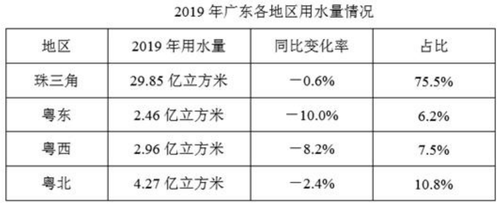

2019年广东各地区用水量情况

| 地区 | 2019年用水量 | 同比变化率 | 占比 |
| --- | --- | --- | --- |
| 珠三角 | 29.85亿立方米 | -0.6% | 75.5% |
| 粤东 | 2.46亿立方米 | -10.0% | 6.2% |
| 粤西 | 2.96亿立方米 | -8.2% | 7.5% |
| 粤北 | 4.27亿立方米 | -2.4% | 10.8% |

原表负号印作较长的横线，转写为“-”。

2019年，广东规模以上工业企业重复用水量为147.10亿立方米，比上年增长2.5%，重复用水率提高到78.8%（注：重复用水率=重复用水量/（用水量+重复用水量））。分行业看，重复用水量主要集中在电力、冶金和石油石化行业。其中，电力行业重复用水量为50.72亿立方米，比上年下降1.3%，占全省规模以上工业企业全部重复用水量的34.5%；冶金行业重复用水量为40.82亿立方米，增长3.9%，占全部重复用水量的27.8%；石油石化行业重复用水量为32.12亿立方米，增长3.5%，占全部重复用水量的21.8%。
整体而言，在全省规模以上工业企业中，重复用水量普及面窄且重复用水率较低的问题值得关注。有重复用水的企业只有3573家，只占全省规模以上工业企业的7.0%，说明九成多企业无重复用水。重复用水量超过1000万立方米以上的企业88家，仅占重复用水量的96.2%，主要集中在石油化工、电厂和钢铁厂等少数大型企业中，重复用水应用领域明显较窄。

### 第 96 题

`GD2020-XJ-Q096` · 单选 · 原卷第 15 页

[共用材料](#GD2020-XJ-M3)

2019年广东规模以上工业企业用水量中，地表与地下淡水量约占：

**A.** 4.7%

**B.** 6.4%

**C.** 8.1%

**D.** 9.8%

**答案：B**

### 第 97 题

`GD2020-XJ-Q097` · 单选 · 原卷第 15 页

[共用材料](#GD2020-XJ-M3)

与2018年相比，2019年广东规模以上工业企业用水量：

**A.** 减少了约0.8亿立方米

**B.** 增加了约1.8亿立方米

**C.** 减少了约2.8亿立方米

**D.** 增加了约3.8亿立方米

**答案：A**

### 第 98 题

`GD2020-XJ-Q098` · 单选 · 原卷第 15 页

[共用材料](#GD2020-XJ-M3)

2018年广东规模以上企业重复用水率约为：

**A.** 78.0%

**B.** 78.8%

**C.** 79.6%

**D.** 无法判断

**答案：A**

### 第 99 题

`GD2020-XJ-Q099` · 单选 · 原卷第 15 页

[共用材料](#GD2020-XJ-M3)

2018年电力、冶金和石油石化行业以外的其他行业的重复用水量约占广东规模以上工业企业重复用水量的：

**A.** 10%

**B.** 15%

**C.** 20%

**D.** 25%

**答案：B**

### 第 100 题

`GD2020-XJ-Q100` · 单选 · 原卷第 15 页

[共用材料](#GD2020-XJ-M3)

根据以上资料，下列有关2019年广东省规模以上工业企业重复用水情况正确的是：

**A.** 全省约有规模以上工业企业4.3万家

**B.** 有重复用水的企业的平均重复用水量约为41.2万立方米

**C.** 重复用水量超过1000万立方米的企业的平均重复用水量约为1.8亿立方米

**D.** 电力行业的重复用水率不可能低于50%

**答案：D**
