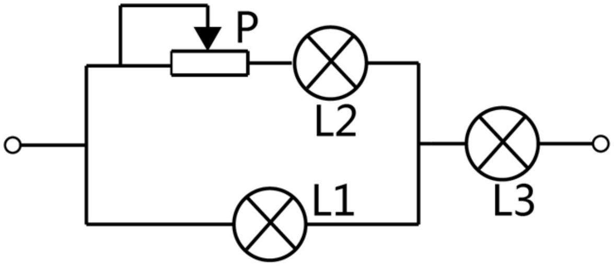
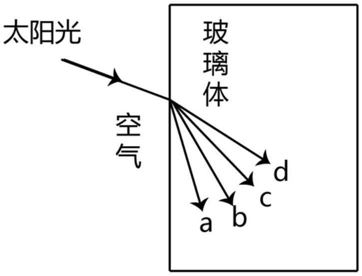
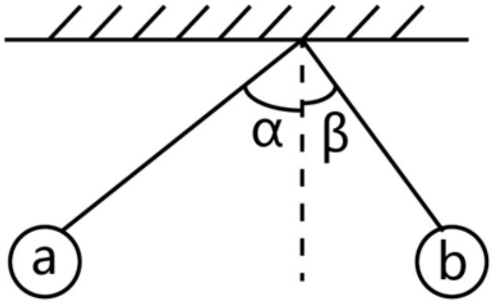
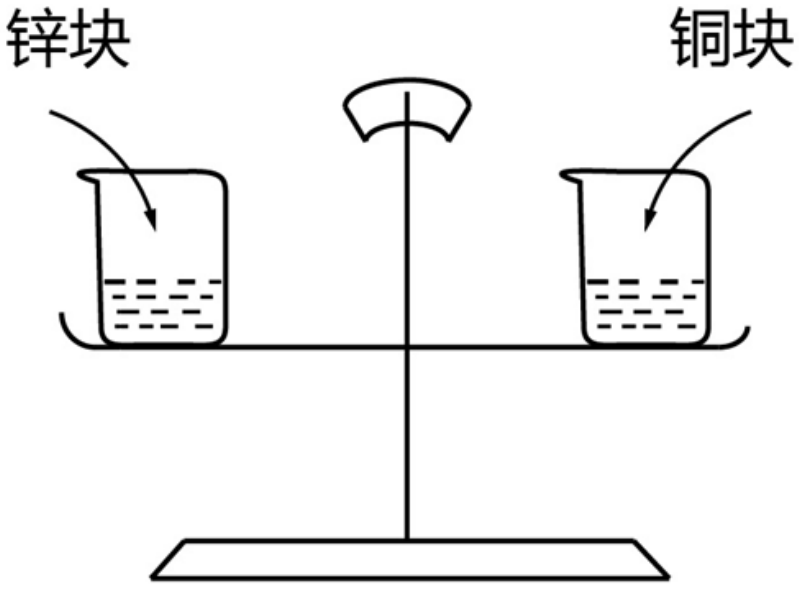
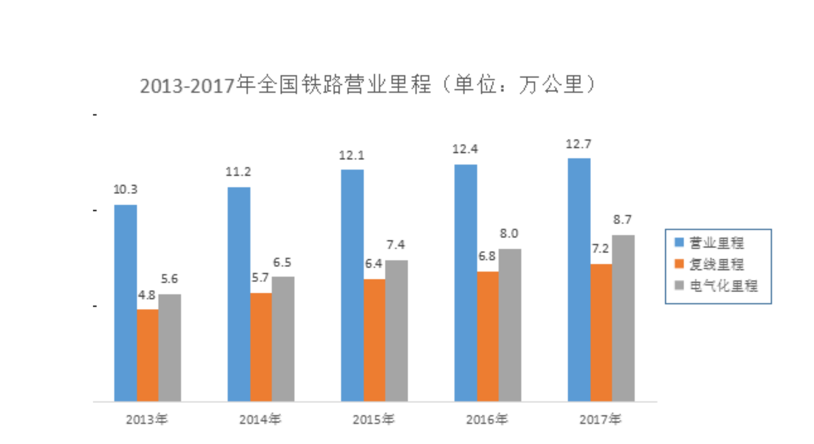
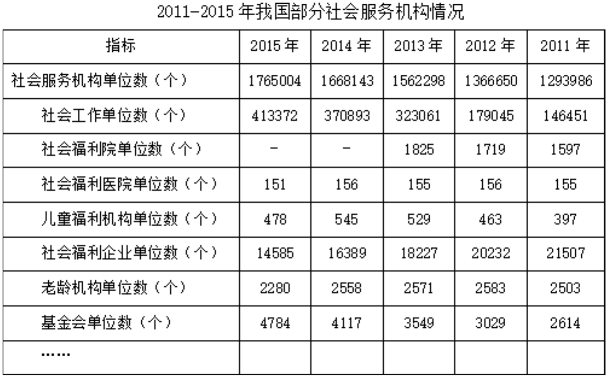
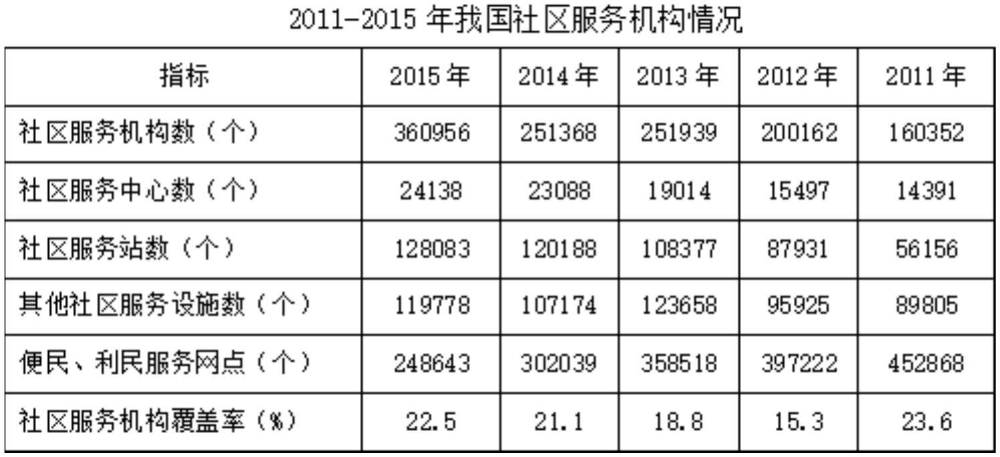

# 2019年广东选调优秀大学毕业生笔试《行测》

共 80 题，原题号完整保留。内容：题干、选项、答案（不收解析）；资料分析共用材料置于所属题组前，JSONL 每条记录完整内嵌材料。

[结构化数据](GDXD2019-XC.jsonl) · [字段说明](schema.json) · [质量报告](quality/GDXD2019-XC.md)

原题来源：[2019年广东省选调优秀大学毕业生笔试《行测》真题.pdf](https://github.com/dumarstoft-ship-it/xing-ce1/blob/52f9811b22cad5410a7108dd0a07a879f1187aa5/%E7%9C%9F%E9%A2%98/2019%E5%B9%B4%E5%B9%BF%E4%B8%9C%E7%9C%81%E9%80%89%E8%B0%83%E4%BC%98%E7%A7%80%E5%A4%A7%E5%AD%A6%E6%AF%95%E4%B8%9A%E7%94%9F%E7%AC%94%E8%AF%95%E3%80%8A%E8%A1%8C%E6%B5%8B%E3%80%8B%E7%9C%9F%E9%A2%98.pdf)。答案来源：[2019年广东省选调优秀大学毕业生笔试《行测》答案及解析.pdf](https://github.com/dumarstoft-ship-it/xing-ce1/blob/52f9811b22cad5410a7108dd0a07a879f1187aa5/%E7%AD%94%E6%A1%88%E8%A7%A3%E6%9E%90/2019%E5%B9%B4%E5%B9%BF%E4%B8%9C%E7%9C%81%E9%80%89%E8%B0%83%E4%BC%98%E7%A7%80%E5%A4%A7%E5%AD%A6%E6%AF%95%E4%B8%9A%E7%94%9F%E7%AC%94%E8%AF%95%E3%80%8A%E8%A1%8C%E6%B5%8B%E3%80%8B%E7%AD%94%E6%A1%88%E5%8F%8A%E8%A7%A3%E6%9E%90.pdf)（只取答案）。

## 常识判断

### 第 1 题

`GDXD2019-XC-Q001` · 单选 · 原卷第 1 页

中国特色社会主义进入了新时代，我国社会主要矛盾已转化为（）。

**A.** 人民日益增长的美好生活需要和不平衡不充分的发展之间的矛盾

**B.** 人民日益增长的物质文化需求同落后的社会生产之间的矛盾

**C.** 建立现代化工业强国的要求同落后的农业国的现实之间的矛盾

**D.** 生产力发展水平与生产关系发展现实之间的矛盾

**答案：A**

### 第 2 题

`GDXD2019-XC-Q002` · 单选 · 原卷第 1 页

（）是党和人民大踏步赶上时代的重要法宝，是坚持和发展中国特色社会主义的必由之路，是决定当代中国命运的关键一招，也是决定实现“两个一百年”奋斗目标，实现中华民族伟大复兴的关键一招。

**A.** 无产阶级专政

**B.** 党的领导

**C.** 改革开放

**D.** 从严治党

**答案：C**

### 第 3 题

`GDXD2019-XC-Q003` · 单选 · 原卷第 1 页

推进供给侧结构性改革，要从（）入手，重点是促进产能过剩有效化解，促进产业优化重组，降低企业成本，发展战略性新兴产业和现代服务业，增加公共产品和服务供给，提高供给结构对需求变化的适应性和灵活性。

**A.** 生产端

**B.** 需求端

**C.** 销售端

**D.** 消费端

**答案：A**

### 第 4 题

`GDXD2019-XC-Q004` · 单选 · 原卷第 1 页

我国是世界上最大的发展中国家，改善民生不能脱离（）这个最大实际提出过高目标，只能根据经济发展和财力状况逐步提高人民生活水平。

**A.** 人均国民生产总值不高

**B.** 人口多，资源相对匮乏

**C.** 社会主义市场经济体制有待进一步完善

**D.** 我国仍处于并将长期处于社会主义初级阶段

**答案：D**

### 第 5 题

`GDXD2019-XC-Q005` · 单选 · 原卷第 1 页

当前，我国经济已由（）阶段转向（）阶段，正处在转变发展方式，优化经济结构，转化增长动力的攻关期。

**A.** 高质量发展 高速增长

**B.** 高速增长 高质量发展

**C.** 快速增长 高速发展

**D.** 高速发展 快速增长

**答案：B**

### 第 6 题

`GDXD2019-XC-Q006` · 单选 · 原卷第 1 页

“治天下也，必先公，公则天下平矣”符合新发展理念的（）。

**A.** 协调发展

**B.** 绿色发展

**C.** 共享发展

**D.** 创新发展

**答案：C**

### 第 7 题

`GDXD2019-XC-Q007` · 单选 · 原卷第 1 页

（）是中华民族永续发展的千年大计，必须树立和践行绿水青山就是金山银山的理念，像对待生命一样对待生态环境。

**A.** 建设生态文明

**B.** 形成绿色发展方式

**C.** 节约资源和保护环境

**D.** 实行最严格的生态环境保护制度

**答案：A**

### 第 8 题

`GDXD2019-XC-Q008` · 单选 · 原卷第 1 页

一个国家，一个民族发展中更基本、更深沉、更持久的力量是（）。

**A.** 道路自信

**B.** 理论自信

**C.** 制度自信

**D.** 文化自信

**答案：D**

### 第 9 题

`GDXD2019-XC-Q009` · 单选 · 原卷第 2 页

在建设现代经济体系过程中，要弘扬劳模精神和（），营造劳动光荣的社会风尚和精益求精的敬业风气。

**A.** 奉献精神

**B.** 工匠精神

**C.** 开拓精神

**D.** 时代精神

**答案：B**

### 第 10 题

`GDXD2019-XC-Q010` · 单选 · 原卷第 2 页

坚持在发展中保障和改善民生，（）是发展的根本目的，必须多谋民生之利、多解民生之忧，在发展中补齐民生短板。

**A.** 提高获得感

**B.** 加大民生投入

**C.** 实现共同富裕

**D.** 增进民生福祉

**答案：D**

### 第 11 题

`GDXD2019-XC-Q011` · 单选 · 原卷第 2 页

我国已明确脱贫攻坚目标，即到2020年，稳定实现农村贫困人口不愁吃、不愁穿、（）、基本医疗和住房安全有保障，使贫困地区的基本公共服务主要领域指标接近全国平均水平。

**A.** 就业水平

**B.** 农业设施

**C.** 义务教育

**D.** 卫生条件

**答案：C**

### 第 12 题

`GDXD2019-XC-Q012` · 单选 · 原卷第 2 页

中国特色社会主义事业总体布局是“五位一体”。关于“五位一体”，下列说法错误的是（）。

**A.** “五位一体”总体布局强调促进现代化建设各方面相协调

**B.** “五位一体”总体布局包括经济建设、政治建设、文化建设、社会建设、思想建设

**C.** “五位一体”总体布局促进生产关系和生产力、上层建筑和经济基础相协调

**D.** 只有坚持“五位一体”总体布局，才能把我国建设成为富强民主文明和谐美丽的社会主义现代化强国

**答案：B**

### 第 13 题

`GDXD2019-XC-Q013` · 单选 · 原卷第 2 页

2018年10月，习近平总书记考察广东时指出，要加快推动（），建立健全促进城乡融合发展的体制机制和政策体系，带动乡村产业、人才、文化、生态和组织振兴。

**A.** 乡村振兴

**B.** 城乡一体化

**C.** 农村综合改革

**D.** 精准扶贫、精准脱贫

**答案：A**

### 第 14 题

`GDXD2019-XC-Q014` · 单选 · 原卷第 2 页

下列关于我国公民基本权利和义务的表述，正确的是（）。

**A.** 依法纳税不是公民的基本义务

**B.** 国家机关无权限制公民的人身自由

**C.** 劳动是公民的基本义务，也是公民的基本权利

**D.** 公民的政治权利包括科学研究和文艺创作的自由

**答案：C**

### 第 15 题

`GDXD2019-XC-Q015` · 单选 · 原卷第 2 页

下列选项不违反法律规定的是（）。

**A.** 某网店标示：本店商品一经售出，概不退货

**B.** 某酒楼声明：请保管好随身物品，丢失概不负责

**C.** 某商场厕所门口告示：地滑小心摔倒，否则概不负责

**D.** 某洗衣店告示：衣物丢失，赔付金额不超过洗衣费的两倍

**答案：B**

### 第 16 题

`GDXD2019-XC-Q016` · 单选 · 原卷第 2 页

关于法律与道德的区别，下列说法正确的是（）。

**A.** 法律规范的内容只关注义务

**B.** 道德规范的内容只关注权利

**C.** 法律调整的范围比道德要广泛得多

**D.** 道德调整的范围比法律要广泛得多

**答案：D**

### 第 17 题

`GDXD2019-XC-Q017` · 单选 · 原卷第 2 页

“人不能两次踏进同一条河流”反映了（）的哲学关系。

**A.** 现象和本质

**B.** 量变和质变

**C.** 运动和静止

**D.** 社会存在和社会意识

**答案：C**

### 第 18 题

`GDXD2019-XC-Q018` · 单选 · 原卷第 2 页

“他说你行你就行，不行也行；他说你不行你就不行，行也不行。”在哲学上属于（）。

**A.** 唯物辩证法

**B.** 辩证唯物主义

**C.** 客观唯心主义

**D.** 主观唯心主义

**答案：D**

### 第 19 题

`GDXD2019-XC-Q019` · 单选 · 原卷第 3 页

国际上常用恩格尔系数来衡量一个国家和地区人民生活水平的状况，系数值越小越富裕。有关这一系数，以下说法正确的是（）。

**A.** 食品支出比重越高的家庭，生活水平一般越低

**B.** 居民之间收入分配差距越大，恩格尔系数越高

**C.** 一般来说，发达国家居民的恩格尔系数高于发展中国家

**D.** 国家越富裕，国民的平均支出中用于购买食物的支出所占比例越大

**答案：A**

### 第 20 题

`GDXD2019-XC-Q020` · 单选 · 原卷第 3 页

可再生能源是指不会随它本身的转化或人类的利用而越来越少的能源。下列属于可再生能源的是（）。
①风能②天然气③潮汐能④太阳能⑤核燃料

**A.** ①②③

**B.** ①③④

**C.** ②④⑤

**D.** ③④⑤

**答案：B**

## 言语理解与表达

### 第 21 题

`GDXD2019-XC-Q021` · 单选 · 原卷第 3 页

传统美德，是一片（）的土地，生长着本真的人生体验，孕育着鲜活的道德追求。

**A.** 丰收

**B.** 丰饶

**C.** 丰产

**D.** 丰盛

**答案：B**

### 第 22 题

`GDXD2019-XC-Q022` · 单选 · 原卷第 3 页

党和政府与人民群众的关系问题，直接（）党风、政风。党员干部为谁代言，直接决定人心向背，也决定着党和人民的事业能否长盛不衰。

**A.** 反映

**B.** 显现

**C.** 确定

**D.** 联系

**答案：A**

### 第 23 题

`GDXD2019-XC-Q023` · 单选 · 原卷第 3 页

近年来，“提倡开短会、讲短话，讲管用的话，力戒空话套话”的要求，自上而下（）全党，形成了一种改文风、转作风的鲜明导向和浩大声势。

**A.** 激励

**B.** 勉励

**C.** 培育

**D.** 教育

**答案：B**

### 第 24 题

`GDXD2019-XC-Q024` · 单选 · 原卷第 3 页

“进去，只留下脚印；出来，只带走照片”，这句话直观地提示我们，依托生态发展旅游，必须遵循自然规律，（）保护生态环境。

**A.** 坚守

**B.** 强调

**C.** 注重

**D.** 重点

**答案：C**

### 第 25 题

`GDXD2019-XC-Q025` · 单选 · 原卷第 3 页

浩瀚而宝贵的历史知识，既是人类总结昨天的（），也是人类把握今天，创造明天的向导。

**A.** 记录

**B.** 经历

**C.** 方式

**D.** 回忆

**答案：A**

### 第 26 题

`GDXD2019-XC-Q026` · 单选 · 原卷第 3 页

规范旅游市场的秩序，仅靠主管部门是远远不够的。夯实旅游业发展的长远之基，需要加强行业（），以此推进经营行为的规范化。

**A.** 管理

**B.** 自律

**C.** 管辖

**D.** 自强

**答案：B**

### 第 27 题

`GDXD2019-XC-Q027` · 单选 · 原卷第 3 页

港珠澳大桥必将推动粤港澳大湾区的建设，从而成为内地和港澳经济转型升级的（）。

**A.** 引擎

**B.** 契机

**C.** 平台

**D.** 纽带

**答案：A**

### 第 28 题

`GDXD2019-XC-Q028` · 单选 · 原卷第 3 页

或许一个人的力量（），但如果全国人民同心同德，和衷共济，心往一处想，劲往一处使，那便能积沙成塔，集腋成裘，为民族复兴注入不竭动力。

**A.** 差强人意

**B.** 沧海一粟

**C.** 微不足道

**D.** 轻如鸿毛

**答案：C**

### 第 29 题

`GDXD2019-XC-Q029` · 单选 · 原卷第 4 页

随着经济和文化加速（），文化产业逐步成为国民经济的支柱性产业，对（）经济增长，推动经济发展方式转变发挥着重要作用。

**A.** 结合 提升

**B.** 融合 提升

**C.** 结合 促进

**D.** 融合 促进

**答案：D**

### 第 30 题

`GDXD2019-XC-Q030` · 单选 · 原卷第 4 页

中国提出的构建人类命运共同体倡议，（）“自由人联合体”“天下观”与“和文化”的思想精华，将攸关中国前途命运的中国梦与攸关世界各国前途命运的世界梦紧密连接在一起，让世界各国（）中国智慧、中国方案。

**A.** 吸收 享有

**B.** 汲取 共享

**C.** 吸收 独享

**D.** 汲取 享受

**答案：B**

### 第 31 题

`GDXD2019-XC-Q031` · 单选 · 原卷第 4 页

我国多地正（）以企业纳税情况为重要参考，为企业提供融资服务，（）企业融资难、融资贵等状况，实现对实体经济的支持。

**A.** 尝试 缓和

**B.** 尝试 缓解

**C.** 试图 缓解

**D.** 试图 缓和

**答案：B**

### 第 32 题

`GDXD2019-XC-Q032` · 单选 · 原卷第 4 页

互联网大大拓展了思想和行动的（），但网络空间总会有阳光照射不到的（）角落，缺乏辨别能力的孩子极有可能被“暗箭”所伤。

**A.** 维度 偏僻

**B.** 界限 阴冷

**C.** 边界 阴暗

**D.** 空间 偏远

**答案：C**

### 第 33 题

`GDXD2019-XC-Q033` · 单选 · 原卷第 4 页

文化类综艺节目要走出同质化、低收视的（），首先还是要在内容和形式创新上有所突破，让人们印象中“高冷”的文化真正具有观赏（），让观众产生共鸣和参与感。比如，《国家宝藏》就用大众喜闻乐见的形式解读国宝，做到了既有史有据，又生动有趣。

**A.** 光环 乐趣

**B.** 怪圈 价值

**C.** 窘境 价值

**D.** 困境 乐趣

**答案：D**

### 第 34 题

`GDXD2019-XC-Q034` · 单选 · 原卷第 4 页

当前，党在形势下的强军目标（）确立，政治建军深入推进，练兵备战紧锣密鼓，改革攻坚大刀阔斧，正风肃纪（）。

**A.** 鲜明 雷霆万钧

**B.** 明显 雷霆万钧

**C.** 鲜明 千钧一发

**D.** 明显 千钧一发

**答案：A**

> 转写说明：原卷题干作“党在形势下的强军目标”（疑脱“新”字），照录。

### 第 35 题

`GDXD2019-XC-Q035` · 单选 · 原卷第 4 页

没有人能够完全知道中国何以为“中国”，（）我们可以尽力去认识人们所选择的社会机制、文化决策和自然环境，（）我们对于那些影响历史进程的诸多因素会有更深入的了解，（）它们使得中国文明与众不同。

**A.** 因为 而且 所以

**B.** 所以 因为 就是

**C.** 尽管 但是 所以

**D.** 但是 由此 正是

**答案：D**

### 第 36 题

`GDXD2019-XC-Q036` · 单选 · 原卷第 4 页

理想信念是事业和人生的灯塔，决定我们的方向和立场。理想信念不是拿来说、拿来唱的，更不是用来装点门面的，只有见诸行动才有说服力。领导干部将理想信念内化于心、外化于行、知行合一，自觉肩负起为民谋幸福、为中华民族谋复兴的重托才能步稳力沉。
这段文字主要论述了（）。

**A.** 理想信念的重要性

**B.** 理想信念应落实到行动

**C.** 理想信念与民族复兴的关系

**D.** 理想信念应当成为我们的奋斗方向

**答案：B**

### 第 37 题

`GDXD2019-XC-Q037` · 单选 · 原卷第 4、5 页

此次政府机构改革再次强调了“要坚决破除制约市场在资源配置中起决定性作用，更好发挥政府作用的体制机制弊端”，“提高行政效率，全面提高政府效能，建设人民满意的服务型政府”。这突出了政府机构改革要服务于市场经济转型发展、服务于人民获得感的目标。
这段文字主要论述了（）。

**A.** 政府机构改革的方向

**B.** 政府机构改革的对象

**C.** 政府机构改革的原因

**D.** 政府机构改革的意义

**答案：A**

### 第 38 题

`GDXD2019-XC-Q038` · 单选 · 原卷第 5 页

强大的国家必须拥有一支热血满腔，视荣誉为生命的军队。军人之所以视荣誉为生命，源于崇高的使命感，源于社会的厚植培育。然而，在市场经济条件下，利益杠杆、个人价值在人才流动中的驱动作用更加明显，军营的吸引力有所下降，______。
以下最适合填在划线处的是（）。

**A.** 迫切需要提高军人的待遇水平

**B.** 必须发挥纪律的约束和法制的保障作用

**C.** 迫切需要在全社会重塑军人职业的荣誉感

**D.** 必须以强军梦为引领，打造一支热血满腔的军队

**答案：C**

### 第 39 题

`GDXD2019-XC-Q039` · 单选 · 原卷第 5 页

艺术是民众创造的，离不开民众的生活。而在民众的社会生活中，经济因素又是一个非常重要的因子。具体到戏曲而言，它在宋代形成，和当时的演艺市场日益商品化有密切关系。可以说，这是戏曲赖以形成、生存和发展的重要原因。
最后一句话中的“这”指的是（）。

**A.** 民众的社会生活

**B.** 宋代的艺术环境

**C.** 演艺市场的商品化

**D.** 戏曲艺术的大众化

**答案：C**

### 第 40 题

`GDXD2019-XC-Q040` · 单选 · 原卷第 5 页

所谓荒野，是指未受人类活动干扰或者人工改造较少的自然环境。在传统观念中，荒野是没有多少价值的。然而，在生态经济日益发展的今天，荒野显得越来越重要。荒野具有原生性、多样性、开放性等特点，有很高的经济价值、休闲价值和审美价值。
这段文字强调了（）。

**A.** 人们对荒野的认识不准确

**B.** 应保护荒野不受破坏

**C.** 应该大力开发荒野

**D.** 荒野有巨大的价值

**答案：D**

### 第 41 题

`GDXD2019-XC-Q041` · 单选 · 原卷第 5 页

一部影视作品的品质好不好，表演是重要因素，位居“声台形表”第一位的声音表演是重中之重。台词功底本是演员安身立命的基本素养，但在快餐式文化的背景下，却被许多人轻视，很多人动辄说“颜值就是正义”“流量就是一切”，配音和替身泛滥让一些演员俨然成了刷脸的机器。长此以往，受到伤害的只能是艺术和观众。
这段文字主要说明了（）。

**A.** 演员需要通过作品不断提升艺术水准

**B.** 表演的质量决定了作品的受欢迎程度

**C.** 影视作品的品质是由演员的表演决定的

**D.** 观众对好内容、好演员是有鉴赏能力的

**答案：C**

### 第 42 题

`GDXD2019-XC-Q042` · 单选 · 原卷第 5 页

如果手机一整天没有响，你会不会觉得不习惯？遇到什么难以解决的问题，不求助网络你是不是不知该怎么办？坐在地铁上，没有手机，时光会不会流逝得格外缓慢？不知从什么时候开始，我们身边的电子产品越来越多，电脑、手机、掌上游戏机，还有最新的平板……
这段文字主要说明了（）。

**A.** 电子产品在生活中的重要作用

**B.** 现代人对电子产品的依赖

**C.** 如何合理使用电子产品

**D.** 电子产品的不断发展

**答案：B**

### 第 43 题

`GDXD2019-XC-Q043` · 单选 · 原卷第 5、6 页

中小企业是我国经济发展和社会稳定的重要支撑。近年来，国家出台了一些针对中小企业的税收优惠政策，但中小企业的税负依然不轻。税收负担削弱了中小企业的竞争能力、盈利能力和工资增长能力，也进一步拉大了中小企业员工与国有大企业、三资企业员工之间的收入差距。
以下对上述文字概括最准确的一项是（）。

**A.** 中小企业对经济发展和社会稳定具有重要作用

**B.** 当前中小企业的税负对其发展造成影响

**C.** 国家对中小企业采取了税收优惠政策

**D.** 应该进一步减轻对中小企业的税负

**答案：D**

### 第 44 题

`GDXD2019-XC-Q044` · 单选 · 原卷第 6 页

当今社会，坐车逃票、论文抄袭、伪造个人信息等现象屡见不鲜。过去，人们以道德号召、舆论谴责为主来维系诚信，“这样做，我在村里还怎么呆下去？”“邻居要是知道了，我还有什么脸见人？”然而现在，对许多人来说类似的顾虑越来越少，如果谁也不认识谁，单纯的舆论谴责，杀伤力是微乎其微的。
这段文字主要说明了（）。

**A.** 随着社会发展，个人失信成本降低

**B.** 传统诚信体系的基础已经动摇

**C.** 传统的诚信体系优于现代

**D.** 诚信建设需要转型

**答案：D**

### 第 45 题

`GDXD2019-XC-Q045` · 单选 · 原卷第 6 页

当前，新闻媒体正在深入推进融合发展。新闻作品版权是媒体的核心资产，但目前加剧的侵权现实让人无奈。作为新闻媒体，一般乐见自己的作品被广泛传播，但前提是尊重原创劳动，并得到授权方能使用。如果对未经授权擅自使用、传播新闻作品的行为置之不理，传统产业的发展将受到严重影响，媒体的融合发展也会面临严重困难。
这段文字意在强调（）。

**A.** 新闻媒体的融合有利于版权保护

**B.** 新闻媒体的融合发展面临严重困难

**C.** 新闻媒体应避免自己的作品被随意转载

**D.** 推动新闻媒体融合发展，必须做好版权保护

**答案：D**

### 第 46 题

`GDXD2019-XC-Q046` · 单选 · 原卷第 6 页

当前，乡贤回归让一批在外精英，通过依法选举加入村干部队伍，参与乡村治理，有利于构建现代化乡村善治体系。不仅如此，乡贤的回归还可以打破乡村原有的利益格局。本地村民竞选村干部，难免有自身的利益考量。而回归的乡贤或出于家乡情绪，或应乡镇干部的动员和鼓励，一般与村中利益没有瓜葛。
这段文字旨在说明（）。

**A.** 乡贤回归有利于推进乡村治理现代化

**B.** 乡贤回归能直接带动乡村经济社会发展

**C.** 畅通乡贤返乡之路，还需要完善相应政策措施

**D.** 乡贤既是本乡本土的贤者，更是在外发展的能人

**答案：A**

### 第 47 题

`GDXD2019-XC-Q047` · 单选 · 原卷第 6 页

参加旅行团的旅行，犹如流水线上的产品生产。参加旅行团的游客，往往是在规定时间与明确路线的要求下，在几天之内，完成心理上对“旅行”符号的消费。难得的旅行本是人们在“朝九晚五”之外的放松，但似乎又使人们陷入另一种“工作律令”之中，体验着对体力与精力的“假期式消耗”。
这段材料表达的主要观点是（）。

**A.** 旅行与上班已经没有区别

**B.** 旅行不应规定时间与明确线路

**C.** 参加旅行团使旅行失去了原本的意义

**D.** 旅行团的出游方式无法让游客得到放松

**答案：D**

### 第 48 题

`GDXD2019-XC-Q048` · 单选 · 原卷第 6 页

由于基层政府普遍人手不足，承担的任务十分繁杂，很难完成上级部门制定的“创新事项”考核。一些地方为了达成“工作创新”，便忙着到处参观取经，将别人的方案“依葫芦画瓢”盲目照搬过来。殊不知，______。可以想见，这种“创新”会有什么样的结果。
以下最适合填在划线处的是（）。

**A.** 种瓜得瓜，种豆得豆

**B.** 橘生淮南为橘，生于淮北则为枳

**C.** 一方水土养一方人，创新方案亦是如此

**D.** 这些形形色色的纸面创新往往并不符合实际

**答案：B**

### 第 49 题

`GDXD2019-XC-Q049` · 单选 · 原卷第 6、7 页

在某种意义上说，中国传统文化的复兴正当其时：现代化建设已见成效，但也面临着一些难题。然而，一些传统文化的“复兴者”认为：传统文化与现代化是矛盾的，至少与现代性和启蒙是矛盾的，于是以反现代性和反启蒙为其定位。
下列说法中，符合作者观点的是（）。

**A.** 中国已实现了现代化

**B.** 中国亟需复兴传统文化

**C.** 传统文化与现代化无法融合

**D.** 一些人对传统文化复兴的定位有误

**答案：D**

### 第 50 题

`GDXD2019-XC-Q050` · 单选 · 原卷第 7 页

国产纪录片的成长与蜕变，最核心的力量来自纪录片在内容和形式上的突破。时下，越来越多的纪录片开始告别昔日高大上的形象，注重观照现实生活。剖析社会问题，描述普通人的日常，让观众感受到更多人文关怀，获得了更多情感共鸣，其中不少题材紧跟当下热点，富有强烈的时代感。
这段文字主要说明了（）。

**A.** 国产纪录片通过内容和形式上的突破取得了进步

**B.** 富有强烈的时代感是国产纪录片成功的必备条件

**C.** 过去的国产纪录片往往具有高大上的形象

**D.** 国产纪录片应体现更多的人文关怀

**答案：A**

### 第 51 题

`GDXD2019-XC-Q051` · 单选 · 原卷第 7 页

我们要提醒自己不要向生活提太多的要求，因为如果这样做，我们幸福所依靠的基础就变得太广大了。依靠如此广大的基础才可以建立起来的幸福是很容易倒塌的，因为遭遇变故的机会增多了，而变故无时不在发生，______。
以下最适合填在划线处的是（）。

**A.** 因此，我们应当根据自身条件，适当降低对生活的要求

**B.** 因此，我们应当尽量简化生活中的各种关系

**C.** 因此，我们往往在目标实现的时候，对生活又有了新的要求

**D.** 因此，我们在生活中应该谨慎小心，未雨绸缪

**答案：A**

### 第 52 题

`GDXD2019-XC-Q052` · 单选 · 原卷第 7 页

一个时代有一个时代的审美趣味，古人以为美的东西，未必符合今人的审美需求，今天人们认为的美，也未必是后人审美的准则。世殊事异，环境在变，社会在变，生活不同，审美自然存在差异性。
通过这段文字，可以得知（）。

**A.** 古人认为美的东西今人觉得都不美

**B.** 每个时代的审美完全不同

**C.** 不同国家地区的审美并不一样

**D.** 一个时代的审美受到多种因素影响

**答案：D**

### 第 53 题

`GDXD2019-XC-Q053` · 单选 · 原卷第 7 页

当前流行各式各样的“知识付费”产品。“知识付费”表面上是有针对性地满足了人们对特定知识的需求，可是这些知识产品制造的过程都是标准化操作，而制造者的首要目的，是通过它来赚钱。所以，“知识付费”里的知识到底有多少能够解决你本身的困惑，可能就要打一个问号了。
这段文字意在说明（）。

**A.** “知识付费”产品的本质

**B.** 人们购买“知识付费”产品的真实原因

**C.** “知识付费”产品实际价值有待商榷

**D.** “知识付费”产品与人们购买本意可能存在差距

**答案：C**

### 第 54 题

`GDXD2019-XC-Q054` · 单选 · 原卷第 7、8 页

我国是一个多煤、少气的国家。进入供暖季以来，国内天然气供应十分紧张。事实上，我国燃煤供暖技术成熟稳定，通过普及清洁煤技术可以实现煤炭的清洁化利用。改善空气质量，控制散煤是关键。但控制散煤后选择哪种方式实现清洁供暖，必须______，统筹规划，稳妥推进。
以下最适合填在划线处的是（）。

**A.** 建立天然气战略储备制度

**B.** 推广清洁煤技术，采用成熟稳定的燃煤供暖技术

**C.** 因地制宜，因时制宜，以保障群众生活供暖为前提

**D.** 尽可能利用清洁能源，加快提高清洁供暖比重

**答案：C**

### 第 55 题

`GDXD2019-XC-Q055` · 单选 · 原卷第 8 页

秉承着艰苦奋斗精神，中国共产党带领全国人民赢得了新民主主义革命的胜利，让中国在20世纪发生了一次又一次划时代的历史巨变。而今，中国实现了从“赶上时代”到“引领时代”的伟大跨越。让“中国号”巨轮在新的时代浪潮中行稳致远，更需要继续发扬艰苦奋斗精神，励志笃行，以身践行。
最适合作为这段文字标题的是（）。

**A.** 新时代更需坚持艰苦奋斗

**B.** 成功的秘诀——艰苦奋斗

**C.** 大力践行艰苦奋斗精神

**D.** 艰苦奋斗造就革命胜利

**答案：A**

## 科学推理

> 说明：原卷第四部分为“推理判断”（说明为“请运用基本科学知识推理判断”），第56—65题为物理、化学题，按题型记为科学推理。

### 第 56 题

`GDXD2019-XC-Q056` · 单选 · 原卷第 8 页

如图所示，一个杯中放有石蜡做的空心圆球和正方体，圆球的质量和直径，与正方体的质量、边长相间，如果在杯中缓慢倒入纯净水，则先漂浮起来的是（）。

**A.** 圆球

**B.** 正方体

**C.** 二者同时

**D.** 无法判断

**答案：B**

> 转写说明：原卷题干作“与正方体的质量、边长相间”（“相间”疑为“相同”之误），照录。

### 第 57 题

`GDXD2019-XC-Q057` · 单选 · 原卷第 8 页

已知一个30度的斜坡，摩擦系数为0.5。甲乙两人一起冲到斜坡上同一位置，甲比乙重。如果没有任何外力扶持，之后可能发生的情况是（）。

**A.** 两人均开始下滑，两人下滑速度一样

**B.** 两人均开始下滑，甲下滑速度比乙快

**C.** 两人均开始下滑，甲下滑速度比乙慢

**D.** 两人可以在斜坡上保持静止

**答案：A**

### 第 58 题

`GDXD2019-XC-Q058` · 单选 · 原卷第 8 页

某人利用石英砂、活性炭、蓬松棉和纱布制作了一个简易净水器。下列说法正确的是（）。

**A.** 该净水器可以有效去除重金属元素

**B.** 该净水器可以将自来水变为纯净水

**C.** 该净水器可以降低自来水的硬度

**D.** 蓬松棉应置于离出水口最近的地方

**答案：D**

### 第 59 题

`GDXD2019-XC-Q059` · 单选 · 原卷第 8、9 页

如图所示，电路两端的电压保持不变，当滑动变阻器的滑动触头P向左移动，电阻变大时，三个灯泡亮度的变化情况是（）。

**A.** L1变亮，L2变亮，L3变暗

**B.** L1变亮，L2变暗，L3变暗

**C.** L1变暗，L2变暗，L3变暗

**D.** L1变暗，L2变暗，L3变亮

**答案：B**

### 第 60 题

`GDXD2019-XC-Q060` · 单选 · 原卷第 9 页

桌面上有三个相同的烧杯，第一个是空烧杯，第二个烧杯内装有100ml的水，第三个烧杯内装有200ml的水。用玻璃棒敲击烧杯的边沿，发现三个烧杯被敲击的声音都不相同。则下列说法正确的是（）。

**A.** 敲击第一个烧杯的音调最高

**B.** 敲击第二个烧杯的音调最高

**C.** 敲击第三个烧杯的音调最高

**D.** 敲击三烧杯的音调是一样的

**答案：A**

### 第 61 题

`GDXD2019-XC-Q061` · 单选 · 原卷第 9 页

物质的用途与性质密切相关。下列说法正确的是（）。

**A.** 铝能用作电线，是因为它的化学性质不活泼

**B.** 液氧可用于火箭发射，是因为氧气具有可燃性

**C.** 生石灰可作干燥剂，是因为其具有很强的吸附能力

**D.** 汽油可以去除衣服上的油污，是因为汽油可以溶解油污

**答案：D**

### 第 62 题

`GDXD2019-XC-Q062` · 单选 · 原卷第 9 页

如图所示，一束太阳光从空气中倾斜射入玻璃体，玻璃体实心无色，a、b、c、d代表四条不同颜色的光线，则它们可能依次是（）。

**A.** 红光、紫光、蓝光、绿光

**B.** 绿光、红光、蓝光、紫光

**C.** 紫光、蓝光、绿光、红光

**D.** 绿光、紫光、红光、蓝光

**答案：C**

### 第 63 题

`GDXD2019-XC-Q063` · 单选 · 原卷第 9、10 页

如图所示，两根绝缘细线悬挂着带有同种电荷的小球a和b。因静电力，两根绝缘细线张开，分别与垂直方向成夹角α和β，且静止时两球处于同一水平面。如果夹角α大于夹角β，则下列结论正确的是（）。

**A.** 小球a带电荷量比小球b多

**B.** 小球b受到拉力比小球a小

**C.** 小球b的质量比小球a大

**D.** 同时剪断两根细线，小球a先落地

**答案：C**

### 第 64 题

`GDXD2019-XC-Q064` · 单选 · 原卷第 10 页

如图所示，天平左右两端的烧杯中有等量稀盐酸，并处于平衡状态。现在天平左右两端的烧杯中，分别加入相同质量的锌块与铜块，结果发现天平右侧缓缓下降，主要的原因是（）。

**A.** 相同质量的铜块与锌块大小不同

**B.** 铜块与稀盐酸反应产生了氯化铜

**C.** 锌块与稀盐酸反应产生了氢气

**D.** 化学反应产生了大量水蒸气

**答案：C**

### 第 65 题

`GDXD2019-XC-Q065` · 单选 · 原卷第 10 页

一个小球在竖直平面内的光滑圆环轨道上做圆周运动，小球经过圆环最高点时刚好不脱离圆环。通过最高点时，小球（）。

**A.** 没有受到向心力

**B.** 向心力等于重力

**C.** 没有向心加速度

**D.** 线速度为0

**答案：B**

## 资料分析

### 共用材料：第 66—70 题

2017年末，全国铁路营业里程达到12.7万公里，比上年增长2.4%，其中高铁营业里程2.5万公里。全国铁路路网密度132.2公里/万平方公里，比上年增加3.0公里/万平方公里。其中复线里程7.2万公里，复线率（铁路复线里程占铁路营业里程的比重）56.7%，电气化里程8.7万公里，电化率（铁路电气化里程占铁路营业里程的比重）68.5%。西部地区铁路营业里程5.2万公里，比上年增长3.3%。

2013-2017年全国铁路营业里程（单位：万公里）

| 年份 | 营业里程 | 复线里程 | 电气化里程 |
| --- | --- | --- | --- |
| 2013年 | 10.3 | 4.8 | 5.6 |
| 2014年 | 11.2 | 5.7 | 6.5 |
| 2015年 | 12.1 | 6.4 | 7.4 |
| 2016年 | 12.4 | 6.8 | 8.0 |
| 2017年 | 12.7 | 7.2 | 8.7 |

每年三根柱（蓝：营业里程，橙：复线里程，灰：电气化里程），数值按柱顶标注转写；纵轴没有刻度数字。图在第11页页首、第66题之前，属材料1。

### 第 66 题

`GDXD2019-XC-Q066` · 单选 · 原卷第 11 页

[共用材料](#GDXD2019-XC-M1)

2016年末，我国铁路路网密度是（）公里/万平方公里。

**A.** 126.2

**B.** 129.2

**C.** 130.2

**D.** 135.2

**答案：B**

### 第 67 题

`GDXD2019-XC-Q067` · 单选 · 原卷第 11 页

[共用材料](#GDXD2019-XC-M1)

2017年，西部地区铁路营业里程比2016年增加约（）公里。

**A.** 1661

**B.** 1761

**C.** 1861

**D.** 1961

**答案：A**

### 第 68 题

`GDXD2019-XC-Q068` · 单选 · 原卷第 11 页

[共用材料](#GDXD2019-XC-M1)

2017年我国铁路复线率约比2016年（）。

**A.** 提高4个百分点

**B.** 降低4个百分点

**C.** 提高2个百分点

**D.** 降低2个百分点

**答案：C**

### 第 69 题

`GDXD2019-XC-Q069` · 单选 · 原卷第 11 页

[共用材料](#GDXD2019-XC-M1)

2014—2017年，我国电气化里程同比增速最快的是（）。

**A.** 2014年

**B.** 2015年

**C.** 2016年

**D.** 2017年

**答案：A**

### 第 70 题

`GDXD2019-XC-Q070` · 单选 · 原卷第 11 页

[共用材料](#GDXD2019-XC-M1)

以下说法不正确的是（）。

**A.** 2013年，我国铁路复线里程不到铁路营业里程一半

**B.** 2014—2017年，我国铁路电化率逐年增加

**C.** 2017年，我国铁路营业里程比2013年约增加了23.3%

**D.** 2017年，我国高铁营业里程占全国铁路营业里程三成以上

**答案：D**

### 共用材料：第 71—75 题

对全国规模以上文化及相关产业5.9万家企业的调查显示，2018年上半年，上述企业实现营业收入42227亿元，比上年同期增长9.9%，继续保持较快增长。
文化及相关产业9个行业的营业收入均实现增长。其中，新闻信息服务营业收入3744亿元，比上年同期增长29.4%；创意设计服务5143亿元，增长15.1%；内容创作生产8820亿元，增长11.9%；文化传播渠道4501亿元，增长10.0%；文化辅助生产和中介服务7783亿元，增长8.2%；文化消费终端生产7911亿元，增长4.2%；文化投资运营349亿元，增长3.5%；文化装备生产3313亿元，增长0.7%；文化休闲娱乐服务663亿元，增长0.2%。
分区域看，东部地区规模以上文化及相关产业企业实现营业收入32443亿元；中部、西部和东北地区分别为5828亿元、3509亿元和447亿元。从增长速度看，西部地区比上年同期增长13.4%；东部地区增长9.7%；中部地区增长9.6%；东北地区增长2.4%，与上年同期下降2.5%相比，实现了正增长。

### 第 71 题

`GDXD2019-XC-Q071` · 单选 · 原卷第 12 页

[共用材料](#GDXD2019-XC-M2)

2016年上半年，东北地区规模以上文化及相关产业企业实现营业收入约（）亿元。

**A.** 425.9

**B.** 435.9

**C.** 437.7

**D.** 447.7

**答案：D**

### 第 72 题

`GDXD2019-XC-Q072` · 单选 · 原卷第 12 页

[共用材料](#GDXD2019-XC-M2)

2018年上半年，文化传播渠道营业收入比上年同期增加了约（）亿元。

**A.** 410

**B.** 409

**C.** 408

**D.** 407

**答案：B**

### 第 73 题

`GDXD2019-XC-Q073` · 单选 · 原卷第 12 页

[共用材料](#GDXD2019-XC-M2)

与上年同期相比，2018年上半年我国规模以上文化及相关产业企业营业收入增速最快的是（）。

**A.** 东部地区

**B.** 中部地区

**C.** 西部地区

**D.** 东北地区

**答案：C**

### 第 74 题

`GDXD2019-XC-Q074` · 单选 · 原卷第 12 页

[共用材料](#GDXD2019-XC-M2)

2017年上半年，我国文化及相关产业营业收入最高的行业是（）。

**A.** 内容创作生产

**B.** 创意设计服务

**C.** 文化休闲娱乐服务

**D.** 文化消费终端生产

**答案：A**

### 第 75 题

`GDXD2019-XC-Q075` · 单选 · 原卷第 12 页

[共用材料](#GDXD2019-XC-M2)

以下说法不正确的是（）。

**A.** 2018年上半年，东部地区规模以上文化及相关文化产业企业营业收入总额超过中部、西部、东北地区的总和

**B.** 2017年上半年，新闻信息服务营业收入占我国规模以上文化及相关产业总营业收入不到一成

**C.** 2018年上半年，文化装备生产营业收入达到文化投资运营收入的10倍

**D.** 2017年上半年，东部地区规模以上文化及相关文化产业企业营业收入占全国比重七成以上

**答案：C**

### 共用材料：第 76—80 题

2011-2015年我国部分社会服务机构情况

| 指标 | 2015年 | 2014年 | 2013年 | 2012年 | 2011年 |
| --- | --- | --- | --- | --- | --- |
| 社会服务机构单位数（个） | 1765004 | 1668143 | 1562298 | 1366650 | 1293986 |
| 社会工作单位数（个） | 413372 | 370893 | 323061 | 179045 | 146451 |
| 社会福利院单位数（个） | - | - | 1825 | 1719 | 1597 |
| 社会福利医院单位数（个） | 151 | 156 | 155 | 156 | 155 |
| 儿童福利机构单位数（个） | 478 | 545 | 529 | 463 | 397 |
| 社会福利企业单位数（个） | 14585 | 16389 | 18227 | 20232 | 21507 |
| 老龄机构单位数（个） | 2280 | 2558 | 2571 | 2583 | 2503 |
| 基金会单位数（个） | 4784 | 4117 | 3549 | 3029 | 2614 |
| …… |  |  |  |  |  |

表题在图片内；原表“社会服务机构单位数”以下各行缩进排列；2014、2015年“社会福利院单位数”原表为“-”，照录；末行“……”为原表省略行。

2011-2015年我国社区服务机构情况

| 指标 | 2015年 | 2014年 | 2013年 | 2012年 | 2011年 |
| --- | --- | --- | --- | --- | --- |
| 社区服务机构数（个） | 360956 | 251368 | 251939 | 200162 | 160352 |
| 社区服务中心数（个） | 24138 | 23088 | 19014 | 15497 | 14391 |
| 社区服务站数（个） | 128083 | 120188 | 108377 | 87931 | 56156 |
| 其他社区服务设施数（个） | 119778 | 107174 | 123658 | 95925 | 89805 |
| 便民、利民服务网点（个） | 248643 | 302039 | 358518 | 397222 | 452868 |
| 社区服务机构覆盖率（%） | 22.5 | 21.1 | 18.8 | 15.3 | 23.6 |

表题在图片内。

### 第 76 题

`GDXD2019-XC-Q076` · 单选 · 原卷第 13 页

[共用材料](#GDXD2019-XC-M3)

与2012年相比，2013年下列社会服务机构中单位数增加最多的是（）。

**A.** 社会福利院

**B.** 儿童福利机构

**C.** 老龄机构

**D.** 基金会

**答案：D**

### 第 77 题

`GDXD2019-XC-Q077` · 单选 · 原卷第 13 页

[共用材料](#GDXD2019-XC-M3)

2015年，社会服务机构单位数比2011年增加约（）万个。

**A.** 46

**B.** 47

**C.** 48

**D.** 49

**答案：B**

### 第 78 题

`GDXD2019-XC-Q078` · 单选 · 原卷第 13 页

[共用材料](#GDXD2019-XC-M3)

2012—2015年，老龄机构单位数占社会服务机构单位数的比重最大的是（）。

**A.** 2012年

**B.** 2013年

**C.** 2014年

**D.** 2015年

**答案：A**

### 第 79 题

`GDXD2019-XC-Q079` · 单选 · 原卷第 13 页

[共用材料](#GDXD2019-XC-M3)

2012—2015年，社区服务中心数量同比增加最多的年份是（）。

**A.** 2012年

**B.** 2013年

**C.** 2014年

**D.** 2015年

**答案：C**

### 第 80 题

`GDXD2019-XC-Q080` · 单选 · 原卷第 13 页

[共用材料](#GDXD2019-XC-M3)

以下说法不正确的是（）。

**A.** 2015年，社会福利企业单位数较2014年有所减少

**B.** 2011—2014年，社会福利医院单位数变化不大

**C.** 2015年，社区服务机构数、社区服务站数较2013年均有所增加

**D.** 2011—2015年，每年的社区服务机构覆盖率逐年提高

**答案：D**
