# 2020年广东选调生和急需紧缺专业公务员招录笔试《思维能力测验》

共 100 题，原题号完整保留。内容：题干、选项、答案（不收解析）；资料分析共用材料置于所属题组前，JSONL 每条记录完整内嵌材料。

[结构化数据](GDXD2020-SW.jsonl) · [字段说明](schema.json) · [质量报告](quality/GDXD2020-SW.md)

原题来源：[2020年广东选调生和急需紧缺专业公务员招录笔试《思维能力测验》真题.pdf](https://github.com/dumarstoft-ship-it/xing-ce1/blob/52f9811b22cad5410a7108dd0a07a879f1187aa5/%E7%9C%9F%E9%A2%98/2020%E5%B9%B4%E5%B9%BF%E4%B8%9C%E9%80%89%E8%B0%83%E7%94%9F%E5%92%8C%E6%80%A5%E9%9C%80%E7%B4%A7%E7%BC%BA%E4%B8%93%E4%B8%9A%E5%85%AC%E5%8A%A1%E5%91%98%E6%8B%9B%E5%BD%95%E7%AC%94%E8%AF%95%E3%80%8A%E6%80%9D%E7%BB%B4%E8%83%BD%E5%8A%9B%E6%B5%8B%E9%AA%8C%E3%80%8B%E7%9C%9F%E9%A2%98.pdf)。答案来源：[2020年广东选调生和急需紧缺专业公务员招录笔试《思维能力测验》真题答案及解析.pdf](https://github.com/dumarstoft-ship-it/xing-ce1/blob/52f9811b22cad5410a7108dd0a07a879f1187aa5/%E7%AD%94%E6%A1%88%E8%A7%A3%E6%9E%90/2020%E5%B9%B4%E5%B9%BF%E4%B8%9C%E9%80%89%E8%B0%83%E7%94%9F%E5%92%8C%E6%80%A5%E9%9C%80%E7%B4%A7%E7%BC%BA%E4%B8%93%E4%B8%9A%E5%85%AC%E5%8A%A1%E5%91%98%E6%8B%9B%E5%BD%95%E7%AC%94%E8%AF%95%E3%80%8A%E6%80%9D%E7%BB%B4%E8%83%BD%E5%8A%9B%E6%B5%8B%E9%AA%8C%E3%80%8B%E7%9C%9F%E9%A2%98%E7%AD%94%E6%A1%88%E5%8F%8A%E8%A7%A3%E6%9E%90.pdf)（只取答案）。

## 判断推理

> 说明：原卷只有一个部分“思维能力测验”（第1—100题），本题按题型记为判断推理。

### 第 1 题

`GDXD2020-SW-Q001` · 单选 · 逻辑判断 · 原卷第 1 页

建设一流大学、一流学科，离不开一流校舍、一流教师，更离不开一流学生。然而当前国内许多高校“严进宽出”的培养观念导致许多大学生放松了自我管理，严重降低了高校毕业生质量。因此把牢毕业“出口”是大学必然的选择。
下列选项中，与上述推理结构最为相似的是（）。

**A.** 好的书籍能够增进人的知识、陶冶人的性情，由于诗歌既能增进人的知识，又能陶冶人的性情，因此诗歌是好的书籍

**B.** 现代主义建筑强调建筑的功能性，反对毫无功用的纯美学装饰，然而缺乏美学装饰的建筑反而会令人感到单调，因此许多现代主义建筑并不受人喜爱

**C.** 预防近视必须适度用眼，尤其要避免长时间近距离用眼，但当前许多学生的学业压力过大，难以避免长时间伏案用眼，因此许多学生都会近视

**D.** 想拥有高超的钢琴技艺必须积累丰富的经验，而“三天打鱼两天晒网”式的练习是无法积累足够的经验的，因此要获得高超的钢琴技艺必须勤加苦练

**答案：D**

### 第 2 题

`GDXD2020-SW-Q002` · 单选 · 逻辑判断 · 原卷第 1 页

一个企业形象如何，取决于它的经济效益和社会效益。企业管理者需要明确的是，只有不断提高企业的经济效益，才能不断提高企业的社会效益。
由此可知，下列关系必然正确的是（）。
①企业的经济效益好，其社会效益必然好
②企业的经济效益差，其社会效益必然差
③企业的社会效益好，其经济效益必然好
④企业的社会效益差，其经济效益必然差

**A.** ①③

**B.** ②③

**C.** ①④

**D.** ②④

**答案：B**

### 第 3 题

`GDXD2020-SW-Q003` · 单选 · 逻辑判断 · 原卷第 1 页

传承中华传统文化，既要合理创新，又要保留其精华而不失本色，对京剧、昆曲来说亦是如此。
下列选项中，与上述推理结构最为相似的是（）。

**A.** 老师必须有教师资格证才能上岗，小朱是老师，所以小朱有教师资格证

**B.** 注射某种药物后，实验室小白鼠失眠情况大大改善，所以给其他动物注射这种药物也能改善其睡眠状况

**C.** 运动员的身体素质都很好，小吴身体强健，所以小吴很可能是运动员

**D.** 水是无色无味的，空气是无色无味的，所以空气和水极其相似

**答案：A**

### 第 4 题

`GDXD2020-SW-Q004` · 单选 · 逻辑判断 · 原卷第 1 页

为了提高国内青少年的身体素质，有人建议增加义务教育阶段体育课的课时。因为体育课课时越多，中小学生进行体育锻炼的时间越长，他们的身体素质就会越好。
要使上述论证成立，必须补充的前提是（）。

**A.** 中小学生会在体育课上进行体育锻炼

**B.** 体育课课时越少，中小学生体育锻炼时间也越短

**C.** 体育课是中小学生提升身体素质的唯一途径

**D.** 增加体育锻炼时间有利于提高身体素质

**答案：A**

### 第 5 题

`GDXD2020-SW-Q005` · 单选 · 逻辑判断 · 原卷第 1、2 页

许多城市都实行了垃圾分类，但不少市民在丢垃圾时仍然没有正确地分类投放。有专家建议对没有正确垃圾分类的人罚款，这样人们为避免罚款就可能会正确地分类投放垃圾。
上述论证若成立，则必须补充的前提是（）。

**A.** 与正确进行垃圾分类相比，人们更加不愿意被罚款

**B.** 每一个没有正确进行垃圾分类的人都一定会被抓到并罚款

**C.** 罚款金额的大小不会影响到垃圾分类政策的效果

**D.** 对没正确垃圾分类的人罚款是改变其行为的唯一有效方法

**答案：A**

### 第 6 题

`GDXD2020-SW-Q006` · 单选 · 逻辑判断 · 原卷第 2 页

甲乙丙丁四人参加象棋比赛，根据比赛规定每两人之间要比试一次，胜者计2分，平者计1分，负者计0分。已知全部比赛结束后，只出现了1次平局，且甲获得4分，乙获得3分，丙获得0分，丁获得5分。
则下列陈述不正确的是（）。

**A.** 甲胜过了乙

**B.** 乙胜过了丁

**C.** 丁胜过了甲

**D.** 乙获得一胜一平一负

**答案：B**

### 第 7 题

`GDXD2020-SW-Q007` · 单选 · 逻辑判断 · 原卷第 2 页

有研究者发现，一个国家的国民识字率水平与其社会稳定程度息息相关。识字率水平在10%以下的国家中，不安定国家占了大约一半；而识字率水平高于90%的国家中，不安定国家只有大约五分之一。因此该研究者得出结论，识字率的提升能够有效降低国家不安定的可能性。
下列最能指出上述论断缺陷的是（）。

**A.** 忽视了很多国家的识字率水平处在10%和90%之间

**B.** 忽视了不存在识字率水平接近零的国家

**C.** 忽视了识字率水平相近的国家社会稳定程度也可能具有很大的差异

**D.** 忽视了可能存在同时导致识字率提升和社会稳定程度下降的因素

**答案：D**

### 第 8 题

`GDXD2020-SW-Q008` · 单选 · 逻辑判断 · 原卷第 2 页

集训队教练宣称，只要集训队全体队员都在承诺书上签名，那么，如果发生训练迟到的情况，则全部队员都要接受惩罚。结果训练时仍然有人迟到，但是队长没有接受惩罚。
根据以上情况可以得知（）。

**A.** 迟到的人是队长本人

**B.** 集训队多数人没有迟到

**C.** 集训队有人没在承诺书上签名

**D.** 集训队没有人在承诺书上签名

**答案：C**

### 第 9 题

`GDXD2020-SW-Q009` · 单选 · 逻辑判断 · 原卷第 2 页

某单位计划外出调研，在人员的安排上，需要综合考虑以下因素：
（1）甲或乙至少要派一人。
（2）如果派了乙，还要派丙才合适。
（3）甲和丙至多派一人。
（4）若派了甲，还必须派丁一起去。
（5）乙和丁是多年的搭档，应该一起去。
则参与此次调研的至少有（）人。

**A.** 1

**B.** 2

**C.** 3

**D.** 4

**答案：C**

### 第 10 题

`GDXD2020-SW-Q010` · 单选 · 逻辑判断 · 原卷第 2 页

荨麻疹属于过敏性疾病，有不少人认为，牛奶海鲜等食品是诱发荨麻疹的主要原因。但如果我们让荨麻疹患者停止食用牛奶、海鲜等食品，他们的荨麻疹症状并不会立即好转。因此，牛奶、海鲜等食品并不是荨麻疹的主要诱因。
以下最能指出上述论断存在的逻辑错误的是（）。

**A.** 假设了在停止接触过敏源后，过敏性疾病的症状应当立即好转

**B.** 默认了绝大多数荨麻疹患者都曾食用过牛奶、海鲜等食品

**C.** 忽视了许多其他的过敏性疾病的症状可能与荨麻疹非常接近

**D.** 默认了牛奶、海鲜诱发荨麻疹的可能性远高于其他食物

**答案：A**

### 第 11 题

`GDXD2020-SW-Q011` · 单选 · 逻辑判断 · 原卷第 2、3 页

城市比乡村人口密度更高，而高人口密度会导致犯罪率的上升，因此城市比乡村有着更高的犯罪率。
下列选项中，与上述推理结构最为相似的是（）。

**A.** 酶是一种蛋白质，而蛋白质是由氨基酸组成的，因此酶也是由氨基酸组成的

**B.** 县比市辖区拥有更高的自主权，而更高的自主权会带来更高的审批效率，因此县比市辖区的审批效率更高

**C.** 猫科动物拥有敏锐的听力，老虎、猎豹和家猫都属于猫科动物，因此它们的听力都很敏锐

**D.** 相比农村的孩子，城市的孩子能够接触到更加优质的教育资源，同时城市的孩子升学率更高，因此优质的教育资源会提高升学率

**答案：B**

### 第 12 题

`GDXD2020-SW-Q012` · 单选 · 逻辑判断 · 原卷第 3 页

某外贸公司中有许多懂英语的人不懂法语，但是所有懂法语的人都懂英语。
由此，不能推出该公司中（）。

**A.** 有些懂英语的人也懂法语

**B.** 有些懂法语的人不懂英语

**C.** 没有一个懂法语的人不懂英语

**D.** 有些不懂法语的人懂英语

**答案：B**

### 第 13 题

`GDXD2020-SW-Q013` · 单选 · 逻辑判断 · 原卷第 3 页

对于减肥的人来说，最痛苦的事情是控制不住的饥饿感使他们总是想进食，导致热量摄入增加。而燕麦含有丰富的膳食纤维，这能让人在较长的一段时间内感觉不到饿。因此，选择用燕麦代替米饭做主食是减肥人士的上佳选择。
以下最能够质疑上述推论的是（）。

**A.** 荞麦等粗粮的膳食纤维并不比燕麦少

**B.** 燕麦的营养成分不如米饭全面

**C.** 膳食纤维能够加速胃肠蠕动

**D.** 相同重量的燕麦比大米热量更高

**答案：D**

### 第 14 题

`GDXD2020-SW-Q014` · 单选 · 逻辑判断 · 原卷第 3 页

A型血和AB型血的红细胞表面具有a抗原，B型血和O型血的血清内含有抗a抗体。在输血过程中，输入的带有a抗原的红细胞遭遇大量抗a抗体时，就会产生输血反应，甚至可能危及受血者的生命。小王接受了小李（A型血）的输血后，没有产生输血反应。
根据以上表述，下列判断必然正确的是（）。

**A.** 小王是A型血

**B.** 小王的血液中不含抗a抗体

**C.** 小李的血液中不含a抗原

**D.** 小李也可以接受小王的输血

**答案：B**

### 第 15 题

`GDXD2020-SW-Q015` · 单选 · 逻辑判断 · 原卷第 3 页

某高档住宅小区远离市中心，小区附近开往市中心的公共交通线路很少。为此，开发商提供了免费穿梭巴士服务，在每天的上下班高峰期，免费接送业主往返于小区和市中心。但一段时间后发现，免费巴士的空座率很高。
以下最无法解释这一现象的是（）。

**A.** 不少业主只会在周末住在该小区

**B.** 楼巴经常出现故障

**C.** 楼巴残旧不舒适

**D.** 楼巴的班次并不多

**答案：D**

### 第 16 题

`GDXD2020-SW-Q016` · 单选 · 逻辑判断 · 原卷第 3 页

羚羊是短跑能手，它们的代谢系统无法维持长时间的持续奔跑。因此即使羚羊是世界上跑得最快的哺乳动物之一，原始人类依然能捕获它们。办法就是，一直追逐，直到羚羊耗尽体能而无法逃跑。
根据以上表述，下列判断一定正确的是（）。

**A.** 羚羊的代谢能力比原始人类差

**B.** 原始人类的耐力跑能力优于羚羊

**C.** 原始人类是比羚羊跑得更快的哺乳动物

**D.** 奔跑中人类的体能消耗一定比羚羊少

**答案：B**

### 第 17 题

`GDXD2020-SW-Q017` · 单选 · 逻辑判断 · 原卷第 3 页

统计数据显示，G市的餐饮企业数量从5年前的20000个，逐年下降至今年的8000个。但是，该市餐饮企业的经营资本在整个服务行业中所占的比例却大幅增加了。
以下对解释上述现象最没有帮助的是（）。

**A.** 5年来，G市每年的餐饮业的经营资本总额逐年增加

**B.** G市餐饮企业今年的平均经营资本额比5年前有显著增长

**C.** 5年来，由于竞争激烈，G市部分餐饮企业扩大了经营规模

**D.** 5年来，G市服务行业经营资本占全市产业经营总资本的比例逐年下降

**答案：D**

### 第 18 题

`GDXD2020-SW-Q018` · 单选 · 逻辑判断 · 原卷第 3、4 页

如果全球变暖的趋势持续下去，主要粮食作物的害虫会变得更为活跃。对于绝大多数害虫而言，温带地区是其主要栖息地，因此在全球变暖背景下，温带粮食产区受到的虫害影响将会更为严重。
上述论证最可能基于的潜在假设是（）。

**A.** 全球变暖是当今各国正面临的主要气候问题

**B.** 绝大多数害虫在生长繁殖过程中不会进行大的迁移活动

**C.** 现代农业科技手段始终难以消除各种虫害的影响

**D.** 全球变暖不会直接导致主要粮食作物的生长状况发生变化

**答案：B**

### 第 19 题

`GDXD2020-SW-Q019` · 单选 · 逻辑判断 · 原卷第 4 页

某地为抑制高房价，实施了严格的商品房限购政策，限制本地户籍家庭只能购买两套住房、外地户籍家庭只能购买一套住房，并且预测商品房价格会下降。但实际上，限购政策推行后，预期效果并未出现。
下列最有助于解释上述结果的是（）。

**A.** 流入当地的外来人口不断增加

**B.** 多数本地户籍家庭已经拥有两套住房

**C.** 当地的教育资源较好

**D.** 当地人均收入水平较高

**答案：A**

### 第 20 题

`GDXD2020-SW-Q020` · 单选 · 逻辑判断 · 原卷第 4 页

现在研究生毕业的难度比十年前要高得多。因为现在大部分学校都要求研究生毕业前必须在期刊上发表论文，而众所周知，现在各类期刊的退稿率比十年前提高了好几倍。
以下最能够质疑上述观点的是（）。

**A.** 各类期刊对投稿论文的审核标准比十年前严格了很多

**B.** 各类期刊的种类、数量比十年前均略有增长

**C.** 现在的研究生倾向于重复投稿，这会导致被退稿

**D.** 部分专业的研究生不需要在期刊上发表论文也能毕业

**答案：C**

### 第 21 题

`GDXD2020-SW-Q021` · 单选 · 逻辑判断 · 原卷第 4 页

有研究指出，智商高的人更容易在某个专业领域取得成绩，而情商高的人，通常有较完满的婚姻和家庭，有良好的人际关系。专家指出，为了孩子的幸福，父母应该更加注重对孩子情商的培养。
以下最能支持上述专家观点的是（）。

**A.** 相比于社会环境因素，遗传因素对智商的影响更大

**B.** 许多成功的专业人士的智商并不是很高，但情商很高

**C.** 一个人的情商水平，与其童年时期接受的教育培养关系密切

**D.** 良好的人际关系和家庭状况比专业成就更能让人获得幸福感

**答案：D**

### 第 22 题

`GDXD2020-SW-Q022` · 单选 · 逻辑判断 · 原卷第 4 页

某中学地处山区，每年暑假时都会有高校学生前来开展一个月左右的支教活动。该中学有教师对此提出质疑，认为尽管高校学生受教育程度高，但他们没有教师资格证，因此无法开展专业有效的教学。
要使上述论证成立，必须补充的前提是（）。

**A.** 只有专业有效的教学才是学生们喜爱的教学

**B.** 高校学生不具备考取教师资格证的能力

**C.** 受教育程度高的人未必能开展专业有效的教学

**D.** 只有拥有教师资格证的人才能够开展专业有效的教学

**答案：D**

### 第 23 题

`GDXD2020-SW-Q023` · 单选 · 逻辑判断 · 原卷第 4 页

近年来，不少地方政府热衷于参与“国家卫生城市”“国家园林城市”等荣誉称号的评比，并为此投入了大量的资金。有市民认为，与其为了获得这些城市荣誉称号投入大笔资金，不如把钱花在招商引资等促进经济发展的领域，这才更加符合广大市民的切身利益。
以下最能削弱该市民的论断的是（）。

**A.** 招商引资短期内并不会显著提高市民的生活水平

**B.** 与环境卫生相比，多数市民同样看重城市经济发展

**C.** 获得城市荣誉称号有助于开展招商引资工作

**D.** 城市荣誉称号有助于激发市民的城市认同感与自豪感

**答案：C**

### 第 24 题

`GDXD2020-SW-Q024` · 单选 · 逻辑判断 · 原卷第 4、5 页

某公司今年定下了三个生产目标，甲乙丙丁分别做了如下预测：
甲：公司不能实现第一个生产目标。
乙：公司只能实现其中一个生产目标。
丙：公司能实现所有的生产目标。
丁：公司不能实现任何一个生产目标。
最终结果表明，4人中只有一人的预测正确，则公司实现的生产目标数量不可能是（）个。

**A.** 0

**B.** 1

**C.** 2

**D.** 3

**答案：A**

### 第 25 题

`GDXD2020-SW-Q025` · 单选 · 逻辑判断 · 原卷第 5 页

破坏森林会导致土地沙漠化，危害是深重的，对人类生存来说是一个极其重大的威胁，目前还没有任何灾害能达到如此严重的程度。近年来，不少国家的森林都遭受严重破坏，可以预见，全球沙漠化问题将会越来越严重。
以下最能削弱上述论证的是（）。

**A.** 多国启动生态保护工程，全球的森林面积逐年增加

**B.** 沙漠化更多由自然灾害或人类纵火导致森林面积减少而造成

**C.** 多国启动了防沙治沙工程，地球沙漠化的速度正在逐年降低

**D.** 经过多年的探讨与实践，人类已经找到了治理沙漠化的办法

**答案：D**

### 第 26 题

`GDXD2020-SW-Q026` · 单选 · 逻辑判断 · 原卷第 5 页

所有电竞专业的毕业生都支持举办电竞赛事，所有支持举办电竞赛事的人都喜欢打游戏。有的电竞专业的毕业生在电视台体育频道工作，电视台体育频道有50岁以上的工作人员。所有50岁以上的人都不喜欢打游戏。
由此不能推出的结论是（）。

**A.** 没有一个50岁以上的人支持举办电竞赛事

**B.** 电视台体育频道中有工作人员喜欢打游戏

**C.** 有的电竞专业的毕业生年龄在50岁以上

**D.** 所有电竞专业的毕业生都喜欢打游戏

**答案：C**

### 第 27 题

`GDXD2020-SW-Q027` · 单选 · 逻辑判断 · 原卷第 5 页

天天公司将生产线由A县搬至B县，这对两个县来说都是好事，因为这一做法提高了两县企业的平均生产效率。
若上述论断成立，则必须补充的前提是（）。
①天天公司的生产效率比A县其他企业都低
②天天公司的生产效率低于A县企业的平均生产效率
③B县企业的平均生产效率低于A县企业
④B县企业的生产效率普遍低于A县企业

**A.** ①④

**B.** ①③

**C.** ②③

**D.** ②④

**答案：C**

### 第 28 题

`GDXD2020-SW-Q028` · 单选 · 逻辑判断 · 原卷第 5 页

今年暑假，小林去了高原地区旅游。为了防止被晒黑，小林在旅游期间每天都会按照说明来使用某品牌防晒霜，但在旅游结束后，小林发现自己还是被晒黑了。因此，小林认为该品牌防晒霜是不合格产品。
下列各项最好地总结了上述论证缺陷的是（）。

**A.** 忽视了每款防晒霜在销售之前都需要通过质量检测

**B.** 假设了小林在旅游期间并没有使用其他的美白产品

**C.** 默认了对于防晒霜而言，防止皮肤被晒伤的效果并不重要

**D.** 假设了合格的防晒霜必须起到完全防止皮肤被晒黑的效果

**答案：D**

### 第 29 题

`GDXD2020-SW-Q029` · 单选 · 逻辑判断 · 原卷第 5 页

有研究显示，学生在课堂学习时大脑内部活动较少，但在做实验、做作业、自学和考试时，学生的大脑内部活动相对活跃，因此要改变传统的学校教育方式。
要使上述论断成立，需补充的前提不包括（）。

**A.** 可以用思维活跃度判断课堂学习效果

**B.** 提升学习效果是学校教育的重要目标

**C.** 大脑内部活动活跃能够促进学生学习

**D.** 传统的学校教育方式以课堂学习为主

**答案：B**

### 第 30 题

`GDXD2020-SW-Q030` · 单选 · 逻辑判断 · 原卷第 5 页

某运动会有跳高、跳远、铅球和长跑四个项目，甲乙丙丁四人报名参加了其中一个项目，且四人参加的项目各不相同，四人并不知道其他人参加的项目。
甲猜测：乙参加的是跳高。
乙猜测：丙没参加跳远。
丙猜测：丁没参加跳远。
丁猜测：甲没参加长跑。
结果表明，只有跳高和长跑项目的参加者猜对了。下列陈述正确的是（）。

**A.** 甲参加的是跳远

**B.** 乙参加的是长跑

**C.** 丙参加的是铅球

**D.** 丁参加的是跳高

**答案：C**

### 第 31 题

`GDXD2020-SW-Q031` · 单选 · 逻辑判断 · 原卷第 6 页

为改变世界钢铁市场供过于求的局面，保护本国钢铁生产商，多个国家开始对进口钢材征收高额关税，以期促使全球钢铁生产大国控制产能。但关税实施后，国际钢铁价格虽然大跌，全球钢铁产量却并没有显著下降。
以下能够最好地解释这一情况的是（）。

**A.** 钢铁生产企业难以在短时间内降低产能

**B.** 部分发展中国家对钢材的需求量依然比较高

**C.** 世界钢铁生产大国本身也是钢铁消费大国

**D.** 大宗钢铁产品订单的生产需要一定周期

**答案：C**

### 第 32 题

`GDXD2020-SW-Q032` · 单选 · 逻辑判断 · 原卷第 6 页

没有东西是永恒的。机器用久了就会发生故障，天上的星星最终也会熄灭。人在一生中也难免会生一两场大病，所以每个人都必须购买重大疾病保险。
下列各项最好地总结了上述论证缺陷的是（）。

**A.** 暗含了身体的健康也不是永恒的

**B.** 忽视了购买保险后也无法控制疾病的发生

**C.** 忽视了不少机器在出现故障之前已经被淘汰

**D.** 默认了只有购买重大疾病保险才能抵御大病风险

**答案：D**

### 第 33 题

`GDXD2020-SW-Q033` · 单选 · 逻辑判断 · 原卷第 6 页

中国戏曲具有丰富的表现力。粤剧是我国著名的戏曲剧种，所以粤剧具有丰富的表现力。
下列选项中，与上述推理结构最为相似的是（）。

**A.** 公共交通很便捷。地铁是公共交通，所以地铁很便捷

**B.** 护士是白衣天使。小舟是白衣天使，所以小舟是护士

**C.** 杜甫是诗人。杜甫是唐朝人，所以唐朝人擅写诗

**D.** 鸟儿都会飞。鸵鸟不会飞，所以鸵鸟不是鸟

**答案：A**

### 第 34 题

`GDXD2020-SW-Q034` · 单选 · 逻辑判断 · 原卷第 6 页

虽然已经有人指出纯电动车的电池生产和回收处理过程仍然很不环保，但对消费者个人而言，纯电动车比传统燃油车更加经济，毕竟相同公里数的花费是传统燃油车的一半。所以，消费者个人使用纯电动车仍然是较优选择。
下列各项最好地总结了上述论证缺陷的是（）。

**A.** 忽视了传统燃油车排放出的尾气也是一种污染

**B.** 假设了经济性是消费者选择用车类型的决定性因素

**C.** 暗含了电池生产和回收处理的环保技术在短时间内难以改进

**D.** 忽视了纯电动车和传统燃油车的经济性差异程度是因品牌而异的

**答案：B**

### 第 35 题

`GDXD2020-SW-Q035` · 单选 · 逻辑判断 · 原卷第 6 页

有研究显示，中国脑卒中（俗称中风）的患者数量正迅速上升，但对于中风防治效果好、费用低的颈动脉内膜剥脱手术（CEA）却尚未得到普及，该研究进而建议要培养大量能够熟练施行CEA手术的医生以应对严峻形势。
上述论证最可能基于的潜在假设是（）。

**A.** CEA手术的普及能够使患者、医生双赢

**B.** CEA手术的难度极高

**C.** CEA手术普及的瓶颈在于熟练施行该手术的人才缺乏

**D.** CEA手术的尚未普及使脑卒中患者数量上升

**答案：C**

### 第 36 题

`GDXD2020-SW-Q036` · 单选 · 逻辑判断 · 原卷第 6 页

工业革命的历史表明，技术进步固然会使一些产品、细分行业、工作岗位消失，从而造成失业，但同时也会创造出许多新的就业岗位。由此可见，人们完全不必担忧新兴技术对人类社会产生威胁。
下列最不能说明上述论证缺陷的是（）。

**A.** 默认了技术进步创造的就业岗位数量多于它造成的失业人数

**B.** 暗含了造成失业是技术进步对人类社会的唯一威胁

**C.** 假设了新兴技术的发展将会符合工业时代的规律

**D.** 忽视了普通大众缺乏工业时代历史常识的可能性

**答案：D**

### 第 37 题

`GDXD2020-SW-Q037` · 单选 · 逻辑判断 · 原卷第 6、7 页

近些年来，电视剧的资本投入越来越大了，数量和类型越来越丰富了，真正能够走入并留存于观众内心的荧屏形象却越来越少了，并未能如以前一样对观众产生较为深刻的影响。这种现象背后的根本原因是电视剧的质量不如以往。
上述论证所隐含的前提是（）。

**A.** 电视剧的高资本投入不能带来高质量

**B.** 观众对于电视剧的要求越来越高

**C.** 经典电视剧难以超越

**D.** 质量上乘的电视剧才能对观众产生深刻影响

**答案：D**

### 第 38 题

`GDXD2020-SW-Q038` · 单选 · 逻辑判断 · 原卷第 7 页

某城市的中心区域车流量大、道路较窄，常年交通拥堵。对此，有市民建议，既然交通拥堵是由于车多路窄引起的，那么拓宽道路就可以有效解决这一问题。
以下最能削弱上述论证的是（）。

**A.** 一般来说，遇到下雨天交通拥堵情况会更加严重

**B.** 道路拓宽施工会加剧该路段的交通拥堵问题

**C.** 发展公共交通同样有助于减缓道路拥堵

**D.** 道路拓宽后，行驶的车辆也会相应增加

**答案：D**

### 第 39 题

`GDXD2020-SW-Q039` · 单选 · 逻辑判断 · 原卷第 7 页

某公益性消费投诉媒体平台发布了2018年消费投诉报告，该报告指出，2018年电商行业有效投诉量最高的前五位如下：A商城——2999件，B商城——2708件，C商城——2167件，D商城——2026件，E商城——815件。由此可见，在以上五大电商中，E商城服务质量和用户满意度最高。
下列最不能说明上述论证缺陷的是（）。

**A.** 忽视了电商用户规模的基数差异

**B.** 忽视了五大电商的客源之间存在一定的重叠

**C.** 忽视了各电商对投诉的实际处理效果可能存在差异

**D.** 忽视了对不同电商进行投诉的便利程度可能存在差异

**答案：B**

### 第 40 题

`GDXD2020-SW-Q040` · 单选 · 逻辑判断 · 原卷第 7 页

随着移动终端的发展，个人偏好的数据变得更加容易收集了。有专家认为，这能够形成一种双赢局面：媒体能够有效地找到自己的信息受众，而个人也能更便捷地获得符合自己偏好的信息。由于减少了无关信息的干扰，这对于社会创新将是一个重大利好。
下列能够最有力地质疑上述结论的是（）。

**A.** 创新更有赖于接收个人偏好以外的信息

**B.** 个人会根据自己的偏好主动选择一些信息提供渠道

**C.** 当前移动终端与互联网的发展尚未能充分收集个人偏好

**D.** 媒体向个人输送符合其偏好信息的同时也发送了更多广告

**答案：A**

### 第 41 题

`GDXD2020-SW-Q041` · 单选 · 逻辑判断 · 原卷第 7 页

对于国家投入大量人力物力保护野生动物的做法，有网民认为：野生动物和家养的猪、牛、羊等都是动物，既然国家不保护家养的动物，也就没有必要去保护野生动物。
下列最能指出上述论证缺陷的是（）。

**A.** 默认了保护野生动物所花费的人力物力更多

**B.** 默认了所有动物拥有相同的受保护价值

**C.** 忽视了家养动物的数量远多于野生动物

**D.** 忽视了野生动物对人类生存的重要性

**答案：B**

### 第 42 题

`GDXD2020-SW-Q042` · 单选 · 逻辑判断 · 原卷第 7 页

通常来说，我国食源性汞摄入主要来自大米和鱼。而某地区人们几乎不吃鱼类，也不喜食大米，所以该地区不可能发生汞中毒。
下列选项中，与上述推理结构最为相似的是（）。

**A.** 某地区不可能成功种植脐橙树，因为该地区土壤盐碱度高，且年降雨量只有400毫米，而脐橙树适宜生长在弱酸性土壤和年降雨量在1000毫米以上的环境中

**B.** 曾国藩曾说天下古今之庸人，皆以一惰字致败，天下古今之才人，皆以一傲字致败。小贾既不懒惰，也不骄傲，所以他一定会成功

**C.** 中国电影金鸡奖准确反映了本年度电影创作的最高水平。《湄公河行动》获得了第31届中国电影金鸡奖最佳故事片奖，因此，《湄公河行动》是本年度艺术水准最高的电影

**D.** 西汉南越王墓是岭南地区所发现的规模最大的汉代彩绘石室墓，并出土了文物一万余件。因此，西汉南越王墓很值得参观

**答案：A**

### 第 43 题

`GDXD2020-SW-Q043` · 单选 · 逻辑判断 · 原卷第 8 页

某研究人员为了解企业家进行企业选址的决策心理，从高校学生中寻找到30名志愿者，让其扮演某种类型企业的总经理，并为其提供了企业的相关信息资料以及8个不同地区的相关信息资料，要求志愿者从8个地区中选择一个作为企业驻地并阐述原因。实验结束后，该研究者得出结论，交通状况和地区经济发展水平是影响企业选址最重要的两个因素。
下列最不能指出上述论证缺陷的是（）。

**A.** 默认了这些志愿者与现实中的企业家有着相同的思维方式

**B.** 假设了提供的8个地区能代表现实中企业选址面临的情况

**C.** 假设了这些志愿者获得的相关信息资料是真实可靠的

**D.** 默认了现实中企业家的选址决策仅取决于企业信息和地区信息

**答案：C**

### 第 44 题

`GDXD2020-SW-Q044` · 单选 · 逻辑判断 · 原卷第 8 页

节日期间，某商场开展了减价促销活动，许多商品较活动前降价了10%～30%，结果发现促销并没有达到预期的效果，销量和平常相比并无明显变化。
以下最能解释这一结果的是（）。

**A.** 商品的降价幅度太小

**B.** 该商场曾经进行过类似的促销活动

**C.** 促销时间太短，降价带来的收益无法在总收益中体现出来

**D.** 促销商品为电视、冰箱等较耐用的家电，价格对销量影响不大

**答案：D**

### 第 45 题

`GDXD2020-SW-Q045` · 单选 · 逻辑判断 · 原卷第 8 页

“限塑令”实施以来取得了一定成效。但随着快递、外卖行业的蓬勃发展，我国的塑料制品使用量反而增加了。因此有人认为，只有实行更为严格的“禁塑”规定：全面禁止使用一次性餐具、塑料袋、吸管等不可降解塑料制品，才能从根本上降低塑料制品的使用量，保护生态环境。
下列各项最好地总结了上述论证缺陷的是（）。

**A.** 假设了不可降解塑料制品是塑料制品的主要类别

**B.** 忽视了塑料制品生产成本低廉，短时间内难以被替代

**C.** 忽视了随着科技发展，越来越多的塑料制品具有了可降解性

**D.** 默认了除“禁塑”外的其他方法都不能有效降低塑料制品的使用量

**答案：A**

### 第 46 题

`GDXD2020-SW-Q046` · 单选 · 逻辑判断 · 原卷第 8 页

某教育机构在选拔学生的时候提出：我们录取学生，不看他的学习成绩，而是看他的潜力。有的同学各科成绩都很好，但是我们仍要怀疑他未来的发展空间。
以下和该教育机构选拔学生的逻辑最不一样的是（）。

**A.** 投资公司在评价项目的时候，主要看行业的发展前景

**B.** 小王在交朋友的时候，主要看对方的家庭条件好不好

**C.** 某专业就业相对困难，小张很感兴趣但是并没有选择报考

**D.** 老王判断某地房价将会持续上涨，在该地投资买了一栋房子

**答案：B**

### 第 47 题

`GDXD2020-SW-Q047` · 单选 · 逻辑判断 · 原卷第 8 页

为了探究居住环境对流动人口融入城市的影响，某研究小组对居住在商品房小区和出租房社区的部分流动人口进行了问卷调查，结果发现居住在商品房小区的流动人口表现出了更高的城市融入水平。据此该研究小组认为，相比出租房社区，居住在商品房小区能够显著提升流动人口的城市融入水平。
下列最能指出上述论断缺陷的是（）。

**A.** 忽视了流动人口在选择居住环境时可能存在同乡聚居的现象

**B.** 忽视了调查的商品房小区和出租房社区之间相隔很远

**C.** 忽视了对两组流动人口进行调查的可能并非同一批调查员

**D.** 忽视了居住在这两类小区的流动人口本身的社会经济地位不同

**答案：D**

### 第 48 题

`GDXD2020-SW-Q048` · 单选 · 逻辑判断 · 原卷第 8、9 页

某健身房如果在同一天既开设瑜伽课程又开设动感单车课程，则该健身房一定也开设了形体芭蕾课程。该健身房只在每星期一开设形体芭蕾课程，王女士只有在开设瑜伽课程时才会去健身房。
根据以上表述，下列判断不一定正确的是（）。

**A.** 如果王女士在星期一参加了瑜伽课程，则当天该健身房一定开设了动感单车课程

**B.** 如果该健身房在星期二开设了动感单车课程，则王女士星期二必定不会去该健身房

**C.** 如果王女士在该健身房参加了形体芭蕾课程那么她不可能是在星期三去的

**D.** 如果王女士这周四去了该健身房，那么王女士并没有参加该健身房的动感单车课程

**答案：A**

### 第 49 题

`GDXD2020-SW-Q049` · 单选 · 逻辑判断 · 原卷第 9 页

随着互联网的发展，人们越来越喜欢选择网约车出行。这是因为网约车能通过网络下单，司机准时定点接送，具有高效便捷的优点。有人因此认为，出租车行业将会受到网约车的严重冲击，在不远的将来，会有更多的网约车取代出租车。
下列最能削弱上述论证的是（）。

**A.** 网约车虽然便利，但容易导致个人信息被不法分子利用

**B.** 网约车的司机入门门槛低，存在安全隐患

**C.** 越来越多的出租车公司开通了网上约车服务

**D.** 出租车能够即走即停，对一些人而言这种用车方式更方便

**答案：C**

### 第 50 题

`GDXD2020-SW-Q050` · 单选 · 逻辑判断 · 原卷第 9 页

我国的省会城市都通铁路，然而有的省会城市没有高铁站，因此通铁路的城市不一定有高铁站。
下列选项，与上述论证方式最相似的是（）。

**A.** 所有的大跨度桥梁都是悬索桥，而有的悬索桥未必用铁索作为主要承重构件，因此有的大跨度桥梁的承重构件不是铁索

**B.** 大多数公交车都采用了无人售票系统，然而无人售票公交车并不一定支持电子支付，因此有的公交车尚不支持电子支付

**C.** 有的出租车并非采用燃油驱动，而出租车都是四轮驱动的，因此四轮驱动的车辆未必采用燃油驱动

**D.** 现役民用客机都无法实现垂直起降，但有的民用客机能够实现洲际飞行，因此能够实现洲际飞行的飞机不一定能做到垂直起降

**答案：C**

### 第 51 题

`GDXD2020-SW-Q051` · 单选 · 逻辑判断 · 原卷第 9 页

近日，一则关于某品牌婴幼儿爽身粉含有某种有害物质的新闻，在朋友圈流传开来。但据调查，该新闻似乎对婴幼儿家长的影响很小，因为几乎没有婴幼儿家长表示将不再使用该品牌婴幼儿爽身粉。尽管如此，在新闻出现两个月后的10月份，该品牌婴幼儿爽身粉的销量却显著下降了。
下列各项能够最为合理地解释以上陈述的是（）。

**A.** 针对新生儿家长的调查出自某母婴杂志，调查结果可能并不真实

**B.** 在10月份，为了显示维护产品质量的决心，一些大型超市主动下架了该品牌婴幼儿爽身粉

**C.** 市场监管部门表示，该有害物质只低于国家标准，不会对婴幼儿健康产生任何影响

**D.** 爽身粉主要功能为吸收汗液，滑爽皮肤，因此当气温降低时，其需求量将有所减少

**答案：B**

### 第 52 题

`GDXD2020-SW-Q052` · 单选 · 逻辑判断 · 原卷第 9 页

由于人类的生存和发展极大地依赖自然资源，可以预测，人类的生存和发展将会受制于自然资源短缺。
以下最能削弱上述论证的是（）。

**A.** 虽然自然资源终将枯竭，但进程比我们预想的要慢

**B.** 自然资源开发技术不断发展，让人类有了更多可利用的资源

**C.** 人类节约自然资源的意识提高，浪费资源的现象减少

**D.** 自然资源的结构方式发生变化，人类开始利用清洁能源

**答案：D**

### 第 53 题

`GDXD2020-SW-Q053` · 单选 · 逻辑判断 · 原卷第 9、10 页

将各类医疗用品的采购权限由地方上升到国家集中采购显然是很有必要的，采购的金额大了，相对来说就能够拥有更大的市场话语权，也就能让百姓用上价格更低的医疗用品。
以下最能够质疑上述论证的是（）。

**A.** 国家集中采购降低了地方选用不同医疗用品的灵活性

**B.** 中小型医疗用品企业难以在集中采购中中标，反而会加剧市场垄断

**C.** 医疗用品成本估算未建立统一标准，医疗用品的价格以市场报价为主

**D.** 国家难以精确地估算各个地方的医疗用品种类和用量

**答案：C**

### 第 54 题

`GDXD2020-SW-Q054` · 单选 · 逻辑判断 · 原卷第 10 页

电话手表越来越受家长和小朋友的青睐，它能让孩子随时随地与家长进行通话，并且带有GPS定位功能，能够让家长很方便地知道孩子的位置。但是，电话手表还是应该被禁用，这是因为一些电话手表带有游戏功能，可能会对孩子的学习造成影响。
下列选项，与上述论证过程最为类似的是（）。

**A.** 大多数电动汽车都存在续航问题，所以我不会买电动汽车

**B.** 小张的经济收入并不稳定，这导致了他很容易出现入不敷出的情况

**C.** 小赵工作很勤奋，但这并不意味着他能高效地完成工作

**D.** 虽然同样具有节能功能，但另一个品牌空调的节能效果要比您选的这一款更好，所以我建议您购买另一款

**答案：A**

### 第 55 题

`GDXD2020-SW-Q055` · 单选 · 逻辑判断 · 原卷第 10 页

有研究人员分析发现，那些在公共交通领域财政支出更多的城市空气质量也更好，因此，该研究人员得出结论：增加城市公共交通财政支出有利于提升城市空气质量。
以下最能削弱上述论断的是（）。

**A.** 城市空气质量可能会受到短期内天气变化的影响

**B.** 公共交通财政支出高的城市，也有更多的资金用于改善空气质量

**C.** 随着公共交通财政支出的增加，公共交通工具的数量也会相应增加

**D.** 公共交通财政支出的增加并不一定带来公共交通质量的提升

**答案：C**

### 第 56 题

`GDXD2020-SW-Q056` · 单选 · 逻辑判断 · 原卷第 10 页

学校社团负责人要从动漫社、舞蹈社团、新闻社、球类社团、健美操社团和书法协会这6个社团中选择3个社团送教下乡。已知：
（1）动漫社和新闻社这两个社团至少要去1个
（2）舞蹈社团和健美操社团这两个社团至少要去1个
（3）新闻社和健美操社团都不能与舞蹈社团同时去
根据以上条件，若健美操社团未被选上，则必然同时入选的有（）。

**A.** 动漫社和书法协会

**B.** 舞蹈社团和球类杜团

**C.** 舞蹈社团和新闻社

**D.** 动漫社和舞蹈社团

**答案：D**

> 转写说明：原卷B项作“舞蹈社团和球类杜团”（“杜团”应为“社团”），照录。

### 第 57 题

`GDXD2020-SW-Q057` · 单选 · 逻辑判断 · 原卷第 10 页

某广告宣称，甲、乙两个品牌美白爽肤水的主要卖点都是其美白功效，而甲品牌的美白爽肤水有超过70%成分与知名乙品牌产品成分一样，但甲品牌爽肤水的售价却不到乙品牌的五分之一。如果上述广告不存在虚假成分，则消费者可以据此认为甲品牌爽肤水性价比远远高于知名乙品牌。
下列最能削弱上述论点的是（）。

**A.** 两个品牌的爽肤水的相同成分为基础成分，不具美白效果

**B.** 使用者反映，两个品牌爽肤水的使用感受有一定差异

**C.** 产品组成成分是决定产品性能的关键因素

**D.** 爽肤水还可以具有其他功效

**答案：A**

### 第 58 题

`GDXD2020-SW-Q058` · 单选 · 逻辑判断 · 原卷第 10、11 页

对患有某严重疾病的10位患者的研究表明，虽然他们都生活在某县的不同地方，有着不同的生活习惯、饮食爱好及病史，但他们都在同一家石棉厂工作。由此可以得出结论：长期接触石棉是导致他们患该严重疾病的原因。
下列选项中，与上述推理结构最为相似的是（）。

**A.** 调查了上千名中小学生后发现，他们在智力测验上的表现与其考试成绩存在显著正相关。故智力水平能够在一定程度上预测考试成绩

**B.** 牛顿、法拉第与爱因斯坦所处时代及成长经历大不相同，但他们都渴望发现这个世界的规律。因此，正是这种渴望使他们成为了伟大的物理学家

**C.** 光伏发电和水力发电的发电机制虽然大不相同，所需条件也有很大区别，但他们都使用可再生资源进行发电，显然也都属于低碳环保的发电方式

**D.** 我们虽然来自不同的地方，有着不同的性格特点，但我们有着共同的理想。所以，我们能够齐心协力，共同奋斗

**答案：B**

### 第 59 题

`GDXD2020-SW-Q059` · 单选 · 逻辑判断 · 原卷第 11 页

某地为提高医疗服务水平，加大了对社区医院的建设力度。社区医院可以为居民提供免费疫苗接种、输液及普通病情诊断等服务。但社区医院开始运营以来，前来看病的居民很少。有人推断这是因为社区医院不能满足居民的基本医疗需求。
以下最不能有效反驳上述结论的是（）。

**A.** 该社区内有一家三级甲等医院，居民习惯去大医院看病

**B.** 该社区医院位置较偏僻，大部分居民不知道如何前往

**C.** 由于经费等问题，该社区医院未能聘请到国内知名专家

**D.** 由于宣传力度不足，许多居民不知道社区医院已经开始运营

**答案：C**

### 第 60 题

`GDXD2020-SW-Q060` · 单选 · 逻辑判断 · 原卷第 11 页

古典经济学的基本假设是所有人都是理性的，然而现实中并没有人能够做到完全理性，因此建立在理性人假设之上的古典经济学理论无法真正有效地解释现实的经济问题。
下列选项中，与上述推理结构最为相似的是（）。

**A.** 蛇属于爬行动物，靠腹部的鳞片爬行，因此爬行动物并不都用脚爬行

**B.** 冰是由水形成的，雪花同样是由水形成的，因此雪花也属于冰

**C.** 煤炭是一种不可再生能源，而所有的不可再生能源都必将耗尽，因此对人类而言煤炭并非是无穷无尽的

**D.** 钻石是一种由碳元素组成的单质晶体，而珍珠的主要构成成分为碳酸钙和碳酸镁，因此珍珠并不属于钻石

**答案：C**

### 第 61 题

`GDXD2020-SW-Q061` · 单选 · 图形推理 · 原卷第 11 页

下图问号处最适合填入的一项是（）。

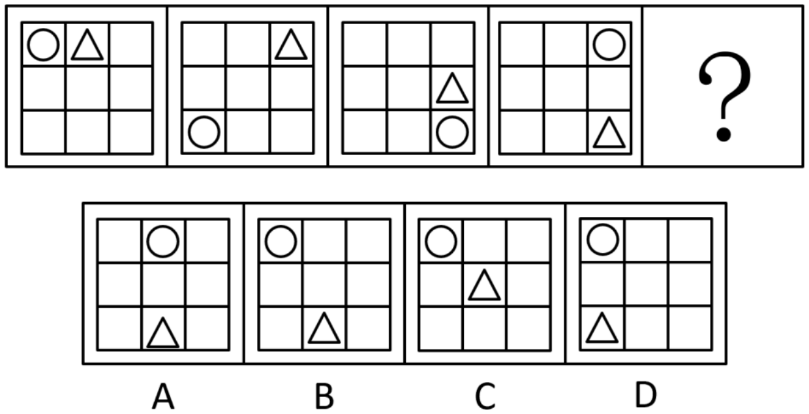

**A.** 见上方题图中 A 项。

**B.** 见上方题图中 B 项。

**C.** 见上方题图中 C 项。

**D.** 见上方题图中 D 项。

**答案：B**

### 第 62 题

`GDXD2020-SW-Q062` · 单选 · 图形推理 · 原卷第 11 页

下图问号处最适合填入的一项是（）。

**A.** 见上方题图中 A 项。

**B.** 见上方题图中 B 项。

**C.** 见上方题图中 C 项。

**D.** 见上方题图中 D 项。

**答案：C**

> 转写说明：四个选项各为一张图，原卷图左下方印“A、”“B、”“C、”“D、”（从左到右）；选项 image_refs 各指向对应的图。

### 第 63 题

`GDXD2020-SW-Q063` · 单选 · 图形推理 · 原卷第 11、12 页

下图问号处最适合填入的一项是（）。

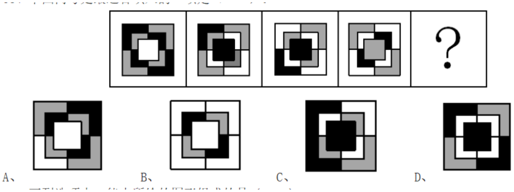

**A.** 见上方题图中 A 项。

**B.** 见上方题图中 B 项。

**C.** 见上方题图中 C 项。

**D.** 见上方题图中 D 项。

**答案：A**

> 转写说明：题图上沿带有一行被裁去大半的题干文字残边（原卷图片本身如此），选项A—D在题图中。

### 第 64 题

`GDXD2020-SW-Q064` · 单选 · 图形推理 · 原卷第 12 页

下列选项中，能由所给的图形组成的是（）。

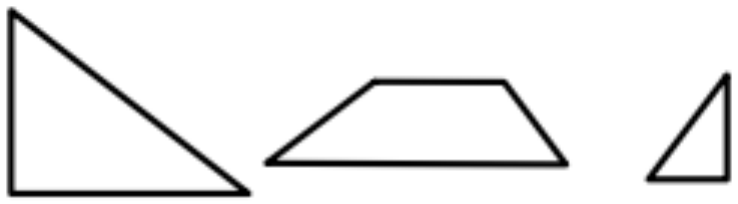

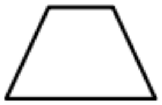

**A.** 见上方题图中 A 项。

**B.** 见上方题图中 B 项。

**C.** 见上方题图中 C 项。

**D.** 见上方题图中 D 项。

**答案：C**

> 转写说明：四个选项各为一张图，原卷图左下方印“A、”“B、”“C、”“D、”（从左到右）；选项 image_refs 各指向对应的图。

### 第 65 题

`GDXD2020-SW-Q065` · 单选 · 图形推理 · 原卷第 12 页

下图是由两个相同的三棱锥组合而成的物体。下列选项中，不可能从该物体的切面观察到的图形是。

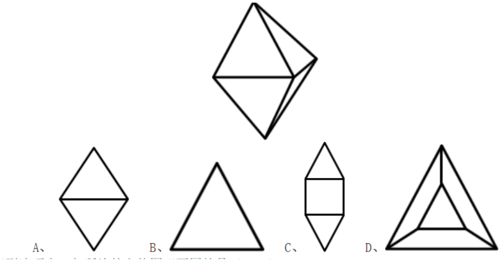

**A.** 见上方题图中 A 项。

**B.** 见上方题图中 B 项。

**C.** 见上方题图中 C 项。

**D.** 见上方题图中 D 项。

**答案：C**

> 转写说明：原卷题干末尾作“……观察到的图形是。”，没有“（ ）”，照录。

### 第 66 题

`GDXD2020-SW-Q066` · 单选 · 图形推理 · 原卷第 12 页

下列选项中，与所给的立体图形不同的是（）。

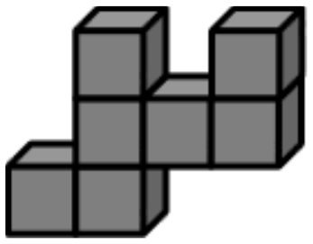

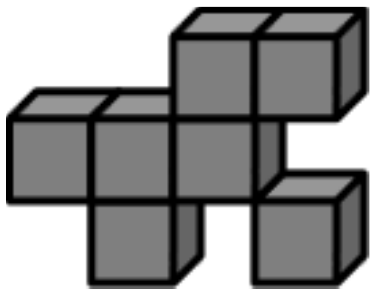

**A.** 见上方题图中 A 项。

**B.** 见上方题图中 B 项。

**C.** 见上方题图中 C 项。

**D.** 见上方题图中 D 项。

**答案：B**

> 转写说明：四个选项各为一张图，原卷图左下方印“A、”“B、”“C、”“D、”（从左到右）；选项 image_refs 各指向对应的图。

### 第 67 题

`GDXD2020-SW-Q067` · 单选 · 图形推理 · 原卷第 12、13 页

以下选项均是由四个三角形和三个正方形组成，无法折叠成左图所示立体图形的是（）。

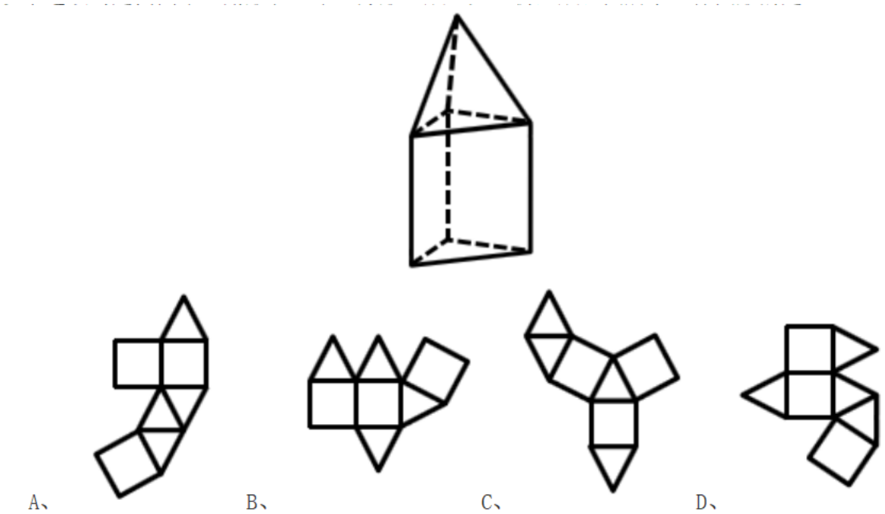

**A.** 见上方题图中 A 项。

**B.** 见上方题图中 B 项。

**C.** 见上方题图中 C 项。

**D.** 见上方题图中 D 项。

**答案：B**

> 转写说明：题图上沿带有一行被裁去大半的题干文字残边（原卷图片本身如此），选项A—D在题图中。

### 第 68 题

`GDXD2020-SW-Q068` · 单选 · 图形推理 · 原卷第 13 页

下列各项中不可能是如左图所示立方体组成部分的是（）。

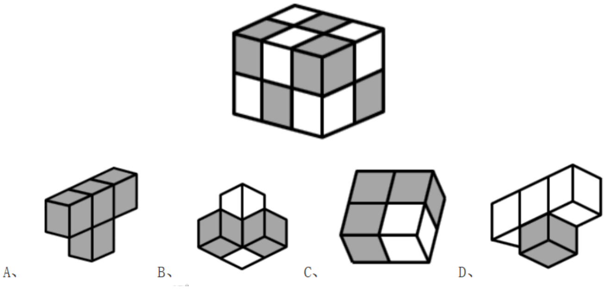

**A.** 见上方题图中 A 项。

**B.** 见上方题图中 B 项。

**C.** 见上方题图中 C 项。

**D.** 见上方题图中 D 项。

**答案：D**

### 第 69 题

`GDXD2020-SW-Q069` · 单选 · 图形推理 · 原卷第 13 页

以下两个图形是从正面和斜45°观察某物体所得的图形，则选项中最符合这一物体俯视图的是（）。

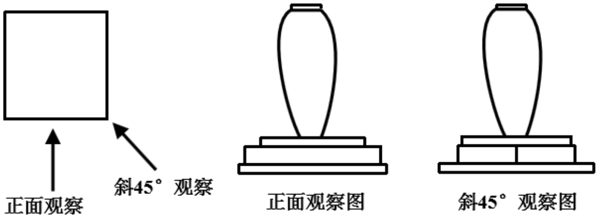

**A.** 见上方题图中 A 项。

**B.** 见上方题图中 B 项。

**C.** 见上方题图中 C 项。

**D.** 见上方题图中 D 项。

**答案：A**

> 转写说明：四个选项各为一张图，原卷图左下方印“A、”“B、”“C、”“D、”（从左到右）；选项 image_refs 各指向对应的图。

### 第 70 题

`GDXD2020-SW-Q070` · 单选 · 图形推理 · 原卷第 13、14 页

下列4张纸条中，沿折痕能够折出如图所示图形的是（）。

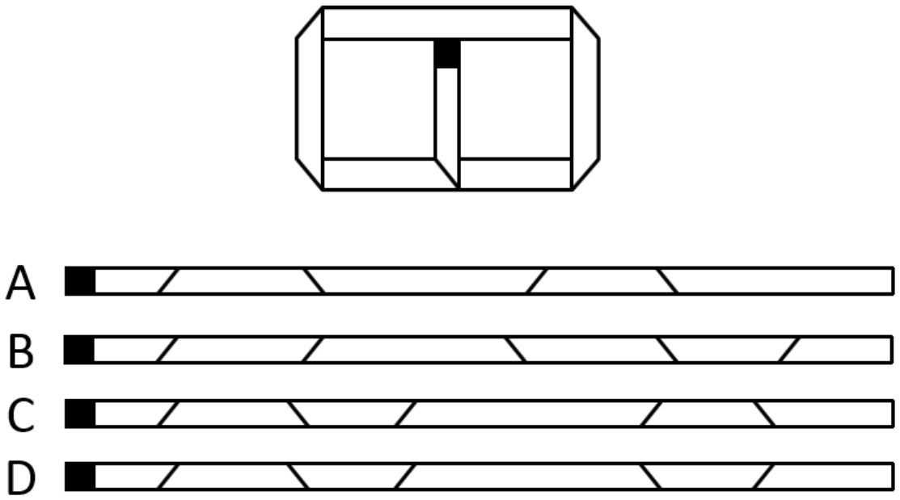

**A.** 见上方题图中 A 项。

**B.** 见上方题图中 B 项。

**C.** 见上方题图中 C 项。

**D.** 见上方题图中 D 项。

**答案：D**

## 数量关系

> 说明：原卷只有一个部分“思维能力测验”（第1—100题），本题按题型记为数量关系。

### 第 71 题

`GDXD2020-SW-Q071` · 单选 · 原卷第 14 页

某单位组织趣味运动会，运动会一共安排了8个项目，一个项目结束才进行下一个项目。如果每个项目每支队伍都要派出4人参加，同时每个队员参赛的项目不超过3个。则每支队伍至少需要（）名队员。

**A.** 11

**B.** 12

**C.** 13

**D.** 14

**答案：A**

### 第 72 题

`GDXD2020-SW-Q072` · 单选 · 原卷第 14 页

某学校对500名学生进行了一次调查，结果显示，会游泳的学生比不会游泳的学生多34人，而在会游泳的学生中，会自由泳的学生只占1/3。则在500名学生中，不会自由泳的学生比会自由泳的学生多（）人。

**A.** 322

**B.** 237

**C.** 231

**D.** 79

**答案：A**

### 第 73 题

`GDXD2020-SW-Q073` · 单选 · 原卷第 14 页

如图所示，一个边长为16厘米的大正方形，在距离角一定距离位置处与对角线平行折叠四次，得到中部小正方形的边长为4厘米。如果CB与大正方形的边平行，则三角形ABC的面积为（）。

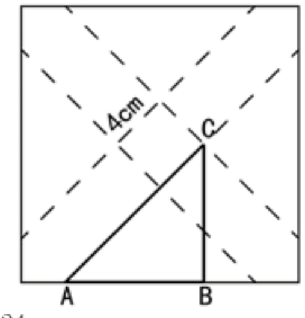

**A.** 32

**B.** 16

**C.** 16√2

**D.** 24

**答案：A**

### 第 74 题

`GDXD2020-SW-Q074` · 单选 · 原卷第 14 页

某工程队进行电线安装，第一天用去电线总长度的1/4，第二天用去余下长度的一半后，还剩下24米，则这捆电线原本长度为（）米。

**A.** 58

**B.** 64

**C.** 72

**D.** 96

**答案：B**

### 第 75 题

`GDXD2020-SW-Q075` · 单选 · 原卷第 14 页

一个大的正方体的6个面分别写有数字1～6，甲乙丙丁四人分别面对正方体的四个侧面，分别能看到正方体的一个侧面和顶部。甲乙丙三人看到的正方体侧面和顶部的点数之和分别是4、9和5，则正方体底部的点数是（）。

**A.** 4或5

**B.** 3或4

**C.** 2或3

**D.** 1或2

**答案：A**

### 第 76 题

`GDXD2020-SW-Q076` · 单选 · 原卷第 14 页

甲、乙二人绕着圆形操场跑道散步，甲顺时针走，乙逆时针走。两人在跑道A处同时出发，甲每分钟走90米，乙每分钟走60米，当甲、乙两人在跑道B处相遇时，乙加快了速度，甲在原地停留4分钟后保持原来的速度继续往前走，最后甲、乙二人仍在A处相遇。已知该操场的周长为1800米，那么相遇后，乙的速度变为每分钟（）米。

**A.** 70

**B.** 80

**C.** 90

**D.** 100

**答案：C**

### 第 77 题

`GDXD2020-SW-Q077` · 单选 · 原卷第 14 页

商场销售某种型号的冰箱，上半年的利润率为20%，由于下半年的进货价格下降10%，商场决定适当下调销售价格，但调整后下半年的利润率仍然达到了24%。则同上半年相比，下半年的销售价格降低了（）。

**A.** 5%

**B.** 6%

**C.** 7%

**D.** 8%

**答案：C**

### 第 78 题

`GDXD2020-SW-Q078` · 单选 · 原卷第 14、15 页

服务大厅每天上午8点半开始办理业务。某天8点半，已经有15位市民正在排队，并且每3分钟都会新增一位前来办理业务的市民。由于大厅只开放了3个窗口，到10点整时发现，仍有18位市民正在排队。如果每个窗口办理一项业务的时间相同，则大厅还需要至少再增开（）个窗口，才能在中午12点前办理完所有业务。

**A.** 1

**B.** 2

**C.** 3

**D.** 4

**答案：B**

### 第 79 题

`GDXD2020-SW-Q079` · 单选 · 原卷第 15 页

有一批边长为1厘米的小正方体，其中一面涂红色的有400个，相邻两面涂红色的有30个，相邻三面涂红色的有1个，其余小正方体各面都没有涂颜色。用这一批小正方体组成一个大正方体，要求这个大正方体有三个面是红色，且这三个面两两相邻，其余的三个面没有颜色。假如没有涂颜色的小正方体数量足够多，那么这个正方体的边长最大是（）厘米。

**A.** 10

**B.** 11

**C.** 12

**D.** 13

**答案：B**

### 第 80 题

`GDXD2020-SW-Q080` · 单选 · 原卷第 15 页

某展览使用了序号为1～100的100盏灯，现在有两个开关，开关A能切换所有序号为偶数的灯的开关状态，开关B能切换所有序号为3的倍数的灯的开关状态。若在100盏灯都打开的状态下，先后按下开关A和B，则还有（）盏灯处于打开状态。

**A.** 33

**B.** 34

**C.** 49

**D.** 50

**答案：C**

### 第 81 题

`GDXD2020-SW-Q081` · 单选 · 原卷第 15 页

3，4，6，10，18，（    ）

**A.** 28

**B.** 32

**C.** 34

**D.** 40

**答案：C**

### 第 82 题

`GDXD2020-SW-Q082` · 单选 · 原卷第 15 页

87，86，84，79，69，52，（    ）

**A.** 24

**B.** 25

**C.** 26

**D.** 27

**答案：C**

### 第 83 题

`GDXD2020-SW-Q083` · 单选 · 原卷第 15 页

1/3，1/2，3/5，2/3，（    ）

**A.** 5/6

**B.** 7/8

**C.** 5/7

**D.** 6/7

**答案：C**

### 第 84 题

`GDXD2020-SW-Q084` · 单选 · 原卷第 15 页

607，819，10211，12313，（    ）

**A.** 13414

**B.** 14415

**C.** 14514

**D.** 15415

**答案：B**

### 第 85 题

`GDXD2020-SW-Q085` · 单选 · 原卷第 15 页

100，7，14，（    ），100，5，20，0，100，3，33，1

**A.** 1

**B.** 2

**C.** 3

**D.** 4、

**答案：B**

> 转写说明：原卷D项末尾多印一个“、”，照录。

### 第 86 题

`GDXD2020-SW-Q086` · 单选 · 原卷第 15 页

0.02，3.13，8.24，15.35，24.46，35.57，48.68，（    ）

**A.** 63.79

**B.** 73.89

**C.** 66.79

**D.** 76.89

**答案：A**

### 第 87 题

`GDXD2020-SW-Q087` · 单选 · 原卷第 15 页

100，82，66，52，（    ）

**A.** 40

**B.** 36

**C.** 32

**D.** 26

**答案：A**

### 第 88 题

`GDXD2020-SW-Q088` · 单选 · 原卷第 15 页

521，232，172，422，（    ）

**A.** 158

**B.** 233

**C.** 397

**D.** 406

**答案：B**

### 第 89 题

`GDXD2020-SW-Q089` · 单选 · 原卷第 15 页

6，20，42，72，（    ）

**A.** 90

**B.** 100

**C.** 110

**D.** 120

**答案：C**

### 第 90 题

`GDXD2020-SW-Q090` · 单选 · 原卷第 15 页

（见题图）

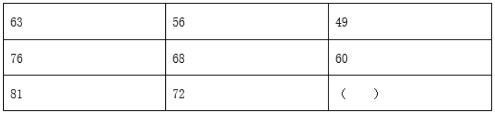

题图数字表格（按原图行列）

| 第1列 | 第2列 | 第3列 |
| --- | --- | --- |
| 63 | 56 | 49 |
| 76 | 68 | 60 |
| 81 | 72 | （ ） |

**A.** 53

**B.** 63

**C.** 73

**D.** 83

**答案：B**

> 转写说明：原卷本题只有题号（印在题图左下方）和题图（3×3数字表格），没有题干文字，题干记作“（见题图）”，题图数字另有转写。

## 判断推理

> 说明：原卷只有一个部分“思维能力测验”（第1—100题），本题按题型记为判断推理。

### 第 91 题

`GDXD2020-SW-Q091` · 单选 · 类比推理 · 原卷第 15 页

乡村：振兴（）

**A.** 西部：开发

**B.** 改革：创新

**C.** 人才：强国

**D.** 国际：合作

**答案：A**

### 第 92 题

`GDXD2020-SW-Q092` · 单选 · 类比推理 · 原卷第 15 页

计划：总结（）

**A.** 跑步：运动

**B.** 预习：复习

**C.** 授权：审批

**D.** 分析：统计

**答案：B**

### 第 93 题

`GDXD2020-SW-Q093` · 单选 · 类比推理 · 原卷第 15 页

江河：湖海（）

**A.** 名山：大川

**B.** 风吹：雨打

**C.** 日月：星辰

**D.** 湖光：山色

**答案：C**

### 第 94 题

`GDXD2020-SW-Q094` · 单选 · 类比推理 · 原卷第 16 页

电费：（）相当于重量：（）

**A.** 用电量 质量

**B.** 水费 热量

**C.** 电器 物体

**D.** 功率 密度

**答案：A**

> 转写说明：原卷选项为两词一组（不带冒号），对应题干两处“（ ）”，按题型记为类比推理。

### 第 95 题

`GDXD2020-SW-Q095` · 单选 · 类比推理 · 原卷第 16 页

行距：（）相当于品德：（）

**A.** 段落 道德

**B.** 字体 规范

**C.** 排版 教育

**D.** 缩小 高尚

**答案：C**

> 转写说明：原卷选项为两词一组（不带冒号），对应题干两处“（ ）”，按题型记为类比推理。

### 第 96 题

`GDXD2020-SW-Q096` · 单选 · 类比推理 · 原卷第 16 页

税务局：收税（）

**A.** 医院：健康

**B.** 回收站：分类

**C.** 企业：投资

**D.** 学校：教育

**答案：D**

### 第 97 题

`GDXD2020-SW-Q097` · 单选 · 类比推理 · 原卷第 16 页

鹤发童颜：敬老尊贤（）

**A.** 垂髫稚子：童言无忌

**B.** 桃李芬芳：后生可畏

**C.** 豆蔻年华：高风亮节

**D.** 窈窕淑女：君子好逑

**答案：A**

### 第 98 题

`GDXD2020-SW-Q098` · 单选 · 类比推理 · 原卷第 16 页

环保：发电：太阳能（）

**A.** 民主：选举：选票

**B.** 高效：配置：市场

**C.** 公正：审判：法官

**D.** 精准：扶贫：资金

**答案：C**

### 第 99 题

`GDXD2020-SW-Q099` · 单选 · 类比推理 · 原卷第 16 页

指纹：钥匙：密码（）

**A.** 公交：地铁：客轮

**B.** 月季：玫瑰：花朵

**C.** 现金：信用卡：手机

**D.** 宣纸：毛笔：狼毫

**答案：A**

### 第 100 题

`GDXD2020-SW-Q100` · 单选 · 类比推理 · 原卷第 16 页

工人：齿轮：机械表（）

**A.** 诗人：诗词：出版物

**B.** 老师：教材：优等生

**C.** 画家：画笔：画作

**D.** 厨师：面粉：馒头

**答案：D**
