# 2022年广东行测（县级卷）

共 100 题，原题号与重复题完整保留。内容：题干、选项、答案；资料分析共用材料置于所属题组前，JSONL 每条记录完整内嵌材料。

[结构化数据](GD2022-XJ.jsonl) · [格式说明](README.md)

原题来源：[2022年广东公务员考试行测试题（县级).pdf](https://github.com/dumarstoft-ship-it/xing-ce1/blob/4cb13da865dcef6bb6d3731f8ae2981186a1a314/%E7%9C%9F%E9%A2%98/2022%E5%B9%B4%E5%B9%BF%E4%B8%9C%E5%85%AC%E5%8A%A1%E5%91%98%E8%80%83%E8%AF%95%E8%A1%8C%E6%B5%8B%E8%AF%95%E9%A2%98%EF%BC%88%E5%8E%BF%E7%BA%A7%29.pdf)。

## 言语理解与表达

### 第 1 题

`GD2022-XJ-Q001` · 单选 · 原卷第 1 页

每一寸鲜血浸染的红色热土，每一段感人至深的红色往事，都______着艰苦卓绝的牺牲奉献，______着气吞山河的壮丽辉煌，是全党全国各族人民弥足珍贵的精神财富。
依次填入画横线部分最恰当的一项是：

**A.** 汇聚镌刻

**B.** 凝聚描绘

**C.** 汇集勾勒

**D.** 凝结铭刻

**答案：D**

### 第 2 题

`GD2022-XJ-Q002` · 单选 · 原卷第 1 页

党的百年历史，就是党与群众水乳交融、______的历史。一条扁担、一张借据、半条棉被就是党与人民血肉相连、情深似海的______。
依次填入画横线部分最恰当的一项是：

**A.** 唇齿相依印记

**B.** 相濡以沫记忆

**C.** 休戚与共见证

**D.** 众志成城证明

**答案：C**

### 第 3 题

`GD2022-XJ-Q003` · 单选 · 原卷第 1 页

一代代特区建设者_____、艰苦创业，将昔日落后的边陲小镇、荒滩渔村建成了繁华的现代化城市，在建设中国特色社会主义伟大进程中谱写了勇立潮头、______的壮丽篇章。
依次填入画横线部分最恰当的一项是：

**A.** 披荆斩棘开拓进取

**B.** 紧锣密鼓开天辟地

**C.** 一往无前开云见日

**D.** 乘风破浪开疆拓土

**答案：A**

### 第 4 题

`GD2022-XJ-Q004` · 单选 · 原卷第 1 页

新时代现实世界是如此新鲜丰富、多姿多彩，生活的______、人民的拼搏奋斗、家庭的______、百姓的爱恨喜痛，都值得作家去侧耳倾听、用心思考、挥笔书写，真正做到语出一人之口，呼出万众之声。
依次填入画横线部分最恰当的一项是：

**A.** 日新月异酸甜苦辣

**B.** 精彩纷呈跌宕起伏

**C.** 精妙绝伦悲欢离合

**D.** 一日千里喜怒哀乐

**答案：A**

### 第 5 题

`GD2022-XJ-Q005` · 单选 · 原卷第 1 页

社会是企业家施展才华的舞台。______真诚回报社会、切实履行社会责任的企业家，______能真正得到社会认可，______是符合时代要求的企业家。
依次填入画横线部分最恰当的一项是：

**A.** 只有才才

**B.** 只要就就

**C.** 如果不仅还

**D.** 因为所以就

**答案：A**

### 第 6 题

`GD2022-XJ-Q006` · 单选 · 原卷第 1 页

建设生态文明，要在形成支持绿色发展、循环发展、低碳发展的机制上下真功夫、下大气力；主动抓住新一轮科技革命和产业变革带来的新机遇，掌握革命性、关键性绿色核心技术，进而带动生态技术和生态产业交叉融合、群体跃进。换言之，从“生产力与生产关系矛盾运动规律”来看，如同“铁和犁”于农业文明、“纺纱机和蒸汽机”于工业文明一样，只有实现绿色生产力和绿色生产关系的根本性变革，生态文明才会成为真正引领人类文明的新形态。
对上述文段理解最准确的是：

**A.** 生态文明是人类文明形态中的最高级阶段

**B.** 生产力和生产关系的辩证关系决定了生态文明的发展

**C.** 实现绿色生产关系变革的关键是取得绿色核心技术突破性进展

**D.** 形成支持绿色、循环和低碳发展的机制是生态文明建成的标志

**答案：B**

### 第 7 题

`GD2022-XJ-Q007` · 单选 · 原卷第 1 页

国有企业作为中国特色社会主义经济制度重要载体，是我国经济社会发展的中坚力量。当前，国有企业改革和发展面临新问题和新挑战，特别是在全面建成小康社会，开启建设社会主义现代化国家新征程的重要历史交汇时刻，国有企业以“______”的顽强意志，把企业党建建在实处，应对好每一场重大风险挑战，提高企业效益、增强企业竞争实力，实现又好又快发展，成为改革的主力军和先行者。
下列句子填入画横线处，最恰当的是：

**A.** 踏平坎坷成大道，斗罢艰险又出发

**B.** 山重水复疑无路，柳暗花明又一村

**C.** 没有比人更高的山，没有比脚更长的路

**D.** 世上无难事，只要肯登攀

**答案：A**

### 第 8 题

`GD2022-XJ-Q008` · 单选 · 原卷第 1 页

对互联网金融加强监管，不是为了制约互联网企业，而是鼓励和保护真正有价值的金融创新，促进互联网金融规范有序健康发展。广大互联网企业只有正确认识行业监管与自身发展的关系，将监管要求内化到企业经营管理中，才能更好地走上规范健康发展的轨道。
上述文段主要讲了：

**A.** 推进互联网金融监管创新的价值

**B.** 当前互联网企业面临的机遇和挑战

**C.** 制约互联网企业健康发展的客观因素

**D.** 互联网金融监管对企业发展的重要性

**答案：D**

### 第 9 题

`GD2022-XJ-Q009` · 单选 · 原卷第 2 页

“为什么我的时间总是不够用？”我们常被这个问题困扰。我们抱怨有太多事情要做，好像永远都做不完。
于是“没有时间”成了我们的口头禅。在这种背景下，“时间管理”理念应运而生。时间管理倡导的很多方法，并不是要让人们逃离现代性境遇所构筑的牢笼，而是对其加以技术性强化。时间管理原本是要教会我们更精细、更严苛地分割利用时间，由于人们的主观感受常常不一样，有些人依然会觉得时间不够用，事情永远做不完，甚至为此心力交瘁。
对上述文段理解最准确的是：

**A.** 精细化地分割和利用时间是时间管理的本质要求

**B.** 时间管理没有完全解决人们“时间不够用”的困扰

**C.** 对时间进行技术性强化是一种有效的时间管理办法

**D.** 严格的时间管理在一定程度上会左右人们的主观感受

**答案：B**

### 第 10 题

`GD2022-XJ-Q010` · 单选 · 原卷第 2 页

①种种乱象对青少年心理、观念、行为和健康成长容易产生消极影响。
②青少年是人生“起步”阶段，他们的思想意识、价值观念和人格正处于养成过程中。
③另一方面也一定要身体力行，引导孩子形成勤俭奋斗的生活习惯，要狠下心来与包办孩子的一切说“再见”。
④为此，身为家庭教育的主角，家长一方面要注重孩子的知识教育。
⑤只有这样，才能把孩子培养成人格健全、自信自尊自强的大写的“人”。
⑥但目前对青少年的养成教育上，家庭、学校、社会和网络舆论之间，却不同程度地存在悖谬现象，言行背离、理论与实践脱节。
将以上6个句子重新排列，最恰当的是：

**A.** ②④③⑥①⑤

**B.** ②⑥①④③⑤

**C.** ①⑥④③②⑤

**D.** ①②④⑤③⑥

**答案：B**

## 常识判断

### 第 11 题

`GD2022-XJ-Q011` · 单选 · 原卷第 2 页

党的十八大以来，我们深化对民主政治发展规律的认识，提出（）的重大理念，其不仅有完整的制度程序，而且有完整的参与实践。

**A.** 全方位人民民主

**B.** 全链条人民民主

**C.** 全过程人民民主

**D.** 全覆盖人民民主

**答案：C**

### 第 12 题

`GD2022-XJ-Q012` · 单选 · 原卷第 2 页

《中共中央关于党的百年奋斗重大成就和历史经验的决议》阐明了四个历史时期党面临的主要任务，以下关于各个历史时期党面临的主要任务表述正确的是：

**A.** 新民主主义革命时期——继续探索中国建设社会主义的正确道路，解放和发展社会生产力，使人民摆脱贫困、尽快富裕起来，为实现中华民族伟大复兴提供充满新的活力的体制保证和快速发展的物质条件

**B.** 社会主义革命和建设时期——反对帝国主义、封建主义、官僚资本主义，争取民族独立、人民解放，为实现中华民族伟大复兴创造根本社会条件

**C.** 改革开放和社会主义现代化建设新时期——实现从新民主主义到社会主义的转变，进行社会主义革命，推进社会主义建设，为实现中华民族伟大复兴奠定根本政治前提和制度基础

**D.** 中国特色社会主义新时代——实现第一个百年奋斗目标，开启实现第二个百年奋斗目标新征程，朝着实现中华民族伟大复兴的宏伟目标继续前进

**答案：D**

### 第 13 题

`GD2022-XJ-Q013` · 单选 · 原卷第 2 页

近年来，我国在“大国重器”的研发上成果显著，捷报频传。以下关于“大国重器”与其宣传语的对应关系不正确的是：

**A.** “奋斗者号”——只有沉得下去，才能浮得上来

**B.** “复兴号”——暂时地降落是为了下一次更好地起飞

**C.** “北斗三号”——其实，方向比方法更重要

**D.** “中国天眼”——要仰望星空，也要脚踏实地

**答案：B**

### 第 14 题

`GD2022-XJ-Q014` · 单选 · 原卷第 2 页

在经济全球化时代，任何一个国家都不可能孤立于世界之外，团结合作是所有国家的必然选择，各国人民更需要同舟共济、共克时艰。
下列选项最符合该观点内涵的是：

**A.** 人视水见形，视民知治不

**B.** 孤举者难起，众行者易趋

**C.** 安而不忘危，存而不忘亡

**D.** 天不言而四时行，地不语而百物生

**答案：B**

### 第 15 题

`GD2022-XJ-Q015` · 单选 · 原卷第 2、3 页

马克思主义指引中国成功走上了全面建设社会主义现代化强国的康庄大道，事业越向前发展，新情况新问题势必越多，更应重视理论的作用，增强理论自信和战略定力。这主要体现了：

**A.** 认识对实践有着巨大的指导作用

**B.** 一切从实际出发，实事求是

**C.** 实践是检验真理的唯一标准

**D.** 认识是主体对客体的能动反映

**答案：A**

### 第 16 题

`GD2022-XJ-Q016` · 单选 · 原卷第 3 页

《中华人民共和国国民经济和社会发展第十四个五年规划和2035年远景目标纲要》提出“推进能源革命，建设清洁低碳、安全高效的能源体系”。以下措施有助于建设清洁低碳、安全高效的能源体系的是：
①提升光伏发电规模  ②推进以电代煤  ③推动沿海核电建设   ④有序发展海上风电

**A.** ①④

**B.** ②③

**C.** ②③④

**D.** ①②③④

**答案：D**

### 第 17 题

`GD2022-XJ-Q017` · 单选 · 原卷第 3 页

结构性就业问题是因经济结构和劳动力结构不对应，使工作岗位要求与劳动者文化技术水平不相适应而产生的就业问题。以下措施最有助于缓解结构性就业问题的是：

**A.** 鼓励创业带动就业，支持多渠道灵活就业

**B.** 持续、大规模、多层次开展职业培训

**C.** 完善就业失业统计监测调查体系

**D.** 健全覆盖城乡劳动者的社会保障体系

**答案：B**

### 第 18 题

`GD2022-XJ-Q018` · 单选 · 原卷第 3 页

推进农业绿色发展，有助于加快农业现代化，全面推进乡村振兴。关于“推进农业绿色发展”，下列说法准确的是：

**A.** 全面实行全国草原禁牧

**B.** 放开对非农建设占用耕地的限制

**C.** 发展节水农业和旱作农业

**D.** 鼓励发展各种形式规模的农业经营

**答案：C**

### 第 19 题

`GD2022-XJ-Q019` · 单选 · 原卷第 3 页

1970年4月24日，我国自行设计、制造的（）发射成功，是我国航天空间技术的一个重要里程碑。
自2016年起，我国将每年4月24日设立为“中国航天日”。

**A.** 第一颗人造地球卫星“东方红一号”

**B.** 第一艘载人航天飞船“神舟五号”

**C.** 第一颗月球探测卫星“嫦娥一号”

**D.** 第一艘无人试验飞船“神舟一号”

**答案：A**

### 第 20 题

`GD2022-XJ-Q020` · 单选 · 原卷第 3 页

第一次国共合作实现后，以（）为中心汇集全国革命力量，很快开创了反对帝国主义和封建军阀的革命新局面。

**A.** 北京

**B.** 广州

**C.** 上海

**D.** 武汉

**答案：B**

### 第 21 题

`GD2022-XJ-Q021` · 单选 · 原卷第 3 页

毛泽东一生中写下了许多脍炙人口的诗句，其中描写长征的是：

**A.** 独立寒秋，湘江北去，橘子洲头

**B.** 宜将剩勇追穷寇，不可沽名学霸王

**C.** 七百里驱十五日，赣水苍茫闽山碧

**D.** 更喜岷山千里雪，三军过后尽开颜

**答案：D**

### 第 22 题

`GD2022-XJ-Q022` · 单选 · 原卷第 3 页

根据《党政领导干部选拔任用工作条例》，党政领导干部应当逐级提拔。特别优秀或者工作特殊需要的干部，符合有关条件或情形的可以破格提拔。以下不属于可以破格提拔的条件或情形的是：

**A.** 经济发达、高新技术产业发展地区急需引进的

**B.** 在条件艰苦、环境复杂、基础差的地区或者单位工作实绩突出

**C.** 专业性较强的岗位或者重要专项工作急需的

**D.** 在关键时刻或者承担急难险重任务中经受住考验、表现突出、作出重大贡献

**答案：A**

### 第 23 题

`GD2022-XJ-Q023` · 单选 · 原卷第 3 页

以下是我国改革开放以来发生的重大事件，按时间先后顺序排列正确的是：
①脱贫攻坚战取得全面胜利②加入世界贸易组织③全面取消农业税
④香港、澳门回归祖国⑤北京举办第二十九届夏季奥运会

**A.** ④②③⑤①

**B.** ②⑤④③①

**C.** ④②⑤①③

**D.** ②①⑤③④

**答案：A**

### 第 24 题

`GD2022-XJ-Q024` · 单选 · 原卷第 3 页

以下广告宣传用语中，不存在科学性错误的是：

**A.** 矿泉水营养丰富，喝了就能满足你和家人每日的矿物质需求

**B.** 当季新鲜柑橘含有丰富的维生素 C，有助于提高人体免疫力

**C.** 本台灯采用0频闪技术，灯光不再有闪烁，更能保护眼睛

**D.** 新款无糖月饼只用果糖，不添加蔗糖，让你多吃也不发胖

**答案：B**

### 第 25 题

`GD2022-XJ-Q025` · 单选 · 原卷第 3 页

以下诗句和所描述的植物对应有误的是：

**A.** 暗淡轻黄体性柔，情疏迹远只香留——桂花

**B.** 千磨万击还坚劲，任尔东西南北风——梅花

**C.** 菡萏香销翠叶残，西风愁起绿波间——荷花

**D.** 此心生不背朝日，肯信众草能蘙之——向日葵

**答案：B**

## 数量关系

### 第 26 题

`GD2022-XJ-Q026` · 单选 · 原卷第 3 页

11，14，26，44，65，（）

**A.** 80

**B.** 83

**C.** 86

**D.** 89

**答案：C**

### 第 27 题

`GD2022-XJ-Q027` · 单选 · 原卷第 3 页

22，42，44，84，88，168，（），（）

**A.** 176，336

**B.** 236，352

**C.** 264，386

**D.** 312，412

**答案：A**

### 第 28 题

`GD2022-XJ-Q028` · 单选 · 原卷第 3、4 页

（见题图）

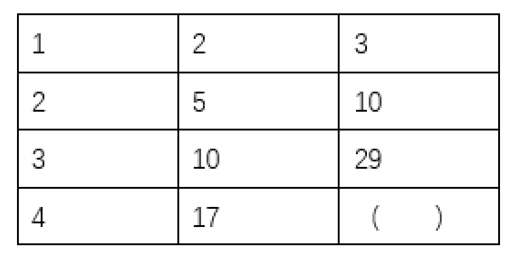

题图数字矩阵（按原图行列）

| 第1列 | 第2列 | 第3列 |
| --- | --- | --- |
| 1 | 2 | 3 |
| 2 | 5 | 10 |
| 3 | 10 | 29 |
| 4 | 17 | （    ） |

**A.** 62

**B.** 64

**C.** 66

**D.** 68

**答案：C**

### 第 29 题

`GD2022-XJ-Q029` · 单选 · 原卷第 4 页

12，25，310，417，（）

**A.** 521

**B.** 526

**C.** 632

**D.** 647

**答案：B**

### 第 30 题

`GD2022-XJ-Q030` · 单选 · 原卷第 4 页

1，0，1，5，4，5，9，（）?

**A.** 8

**B.** 9

**C.** 10

**D.** 11

**答案：A**

### 第 31 题

`GD2022-XJ-Q031` · 单选 · 原卷第 4 页

小李开车从甲市到乙市，需要走一段高速公路和一段国道。已知在高速公路上汽车油耗为0.05升/公里，在国道上油耗比在高速公路上多0.03升/公里。小李在高速公路上行驶了200公里，是在国道上行驶路程的4倍，则从甲市到乙市，小李汽车的油耗为（）升。?

**A.** 15

**B.** 14

**C.** 12

**D.** 10

**答案：B**

### 第 32 题

`GD2022-XJ-Q032` · 单选 · 原卷第 4 页

小陈计划在一定时间内完成法律常识题库中的所有练习题。如果每天做50道题，那么最后2天每天要做85道题才能完成，如果每天做55道题，恰好可以提前1天完成，则该题库共有（）道题。

**A.** 1215

**B.** 1250

**C.** 1320

**D.** 1375

**答案：C**

### 第 33 题

`GD2022-XJ-Q033` · 单选 · 原卷第 4 页

某单位计划从全部80名员工中挑选专项工作组成员，要求该组成员须同时有基层经历和计算机等级证书。
已知，单位内有40人有基层经历，有46人有计算机等级证书，既没有基层经历又未获得计算机等级证书的有10人。那么能够进入工作组的员工有（）人。

**A.** 16

**B.** 40

**C.** 46

**D.** 54

**答案：A**

### 第 34 题

`GD2022-XJ-Q034` · 单选 · 原卷第 4 页

甲、乙、丙3个单位订阅同一款报刊，已知3个单位共订了12份，其中，每个单位订阅数量不少于3份，但不超过5份，则这3个单位的报刊订阅数量可能有（）种组合?

**A.** 2

**B.** 6

**C.** 7

**D.** 9

**答案：C**

### 第 35 题

`GD2022-XJ-Q035` · 单选 · 原卷第 4 页

某街道对辖内6个社区的垃圾分类情况进行考核评估，结果显示，有2个社区的垃圾分类考核不通过。如果从6个社区中随机抽取3个进行现场检查，则抽取的社区中，既有考核通过的又有考核不通过的社区的概率为：

**A.** 1/5

**B.** 1/2

**C.** 2/3

**D.** 4/5

**答案：D**

### 第 36 题

`GD2022-XJ-Q036` · 单选 · 原卷第 4 页

有一个长方形花坛，长为10米，宽为8米。现要在花坛四周安装栅栏，要求4个顶点处各插一根木桩，除顶点处的木桩外，每边还要插若干木桩，且每两根木桩间的距离至少为3米，则最多可以插（）根木桩。?

**A.** 10

**B.** 12

**C.** 14

**D.** 16

**答案：A**

### 第 37 题

`GD2022-XJ-Q037` · 单选 · 原卷第 4 页

甲、乙两人计划分装会议材料，9点多先后开始工作，且两人每分钟完成分装的份数相同。9点38分时，甲完成的份数是乙的4倍，9点53分时，甲完成的份数是乙的1.5倍。那么，甲比乙早（）分钟开始工作。

**A.** 4

**B.** 6

**C.** 8

**D.** 9

**答案：D**

### 第 38 题

`GD2022-XJ-Q038` · 单选 · 原卷第 5 页

为鼓励员工阅读，某单位与购书中心合作，员工购书时，享受原价的7折优惠，且打折后每本书还可叠加使用单位提供的5元补贴券。员工小陈买了5本书，且每本书折后价均超过5元，扣除补贴后自己只花了48.5元，则这些书的原价一共为（）元。

**A.** 75

**B.** 85

**C.** 95

**D.** 105

**答案：D**

### 第 39 题

`GD2022-XJ-Q039` · 单选 · 原卷第 5 页

楼道上方有一盏灯，小刘径直走向这盏灯。一开始, 他发现自己影子的长度为3.2米，前进1米后，发现影子缩短为1.6米。已知小刘身高为1.6米，则这盏灯的高度约为（）米。

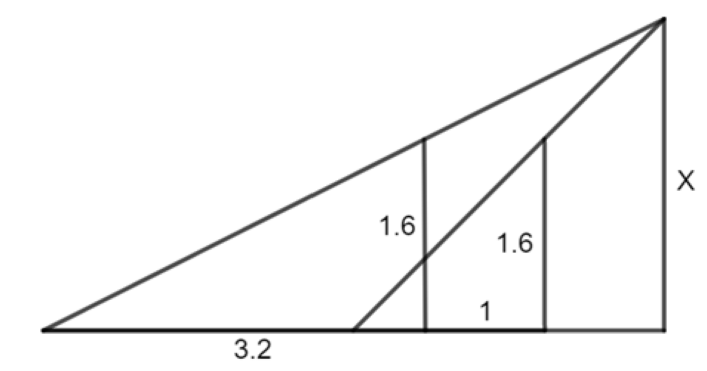

**A.** 2.6

**B.** 2.8

**C.** 3.2

**D.** 3.4

**答案：A**

### 第 40 题

`GD2022-XJ-Q040` · 单选 · 原卷第 5 页

如图，仓库有一堆管材，每一层的数量都比上一层多1根。搬运工人将管材逐根搬离，搬了99根后发现，管材堆少了3层，且剩余每层的管材数量都减少了3根。如果这堆管材刚好还剩10层，则剩下的管材共有（）根。

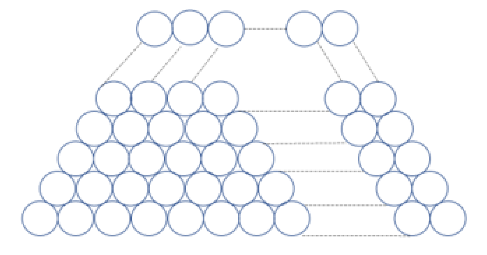

**A.** 245

**B.** 265

**C.** 305

**D.** 325

**答案：B**

## 判断推理

### 第 41 题

`GD2022-XJ-Q041` · 单选 · 原卷第 5、6 页

如图所给的3个立方体为同一立方体，若不考虑立方体表面数字的大小、方向，下列选项中，最有可能是该立方体的是：

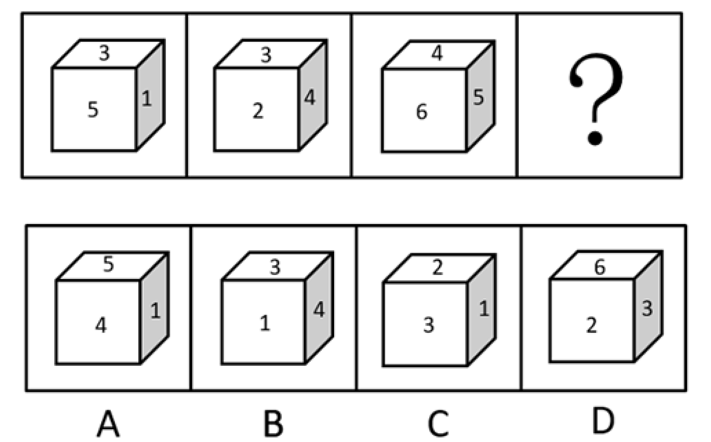

**A.** 见上方题图中 A 项。

**B.** 见上方题图中 B 项。

**C.** 见上方题图中 C 项。

**D.** 见上方题图中 D 项。

**答案：C**

### 第 42 题

`GD2022-XJ-Q042` · 单选 · 原卷第 6 页

下列选项中最符合所给图形规律的是：

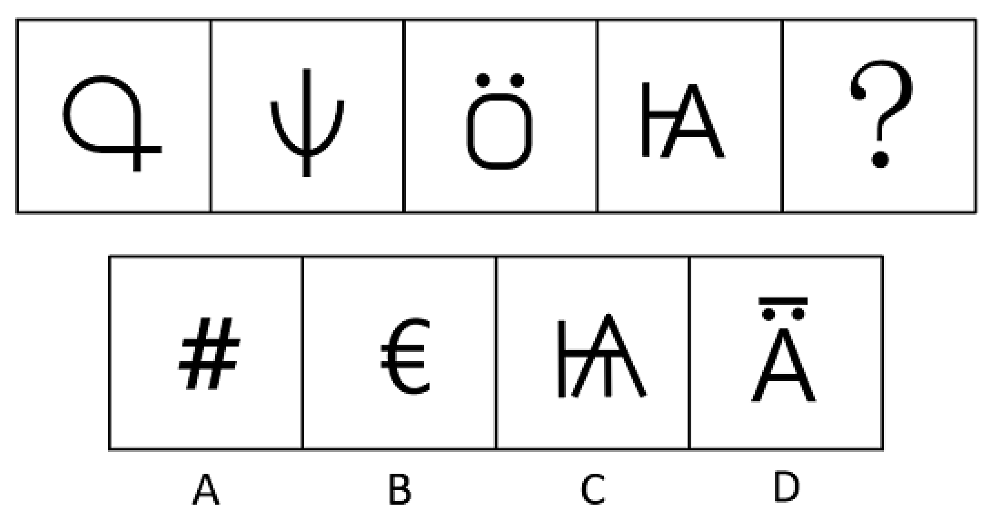

**A.** 见上方题图中 A 项。

**B.** 见上方题图中 B 项。

**C.** 见上方题图中 C 项。

**D.** 见上方题图中 D 项。

**答案：D**

### 第 43 题

`GD2022-XJ-Q043` · 单选 · 原卷第 6 页

如图是某立方体的平面展开图，则该立方体最可能是：

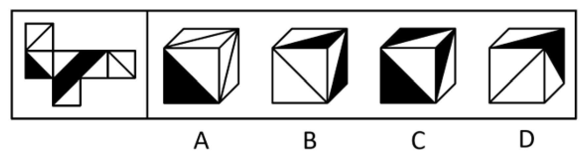

**A.** 见上方题图中 A 项。

**B.** 见上方题图中 B 项。

**C.** 见上方题图中 C 项。

**D.** 见上方题图中 D 项。

**答案：D**

### 第 44 题

`GD2022-XJ-Q044` · 单选 · 原卷第 6、7 页

如图是一个物体某两个角度的视图，则该图形最有可能是：

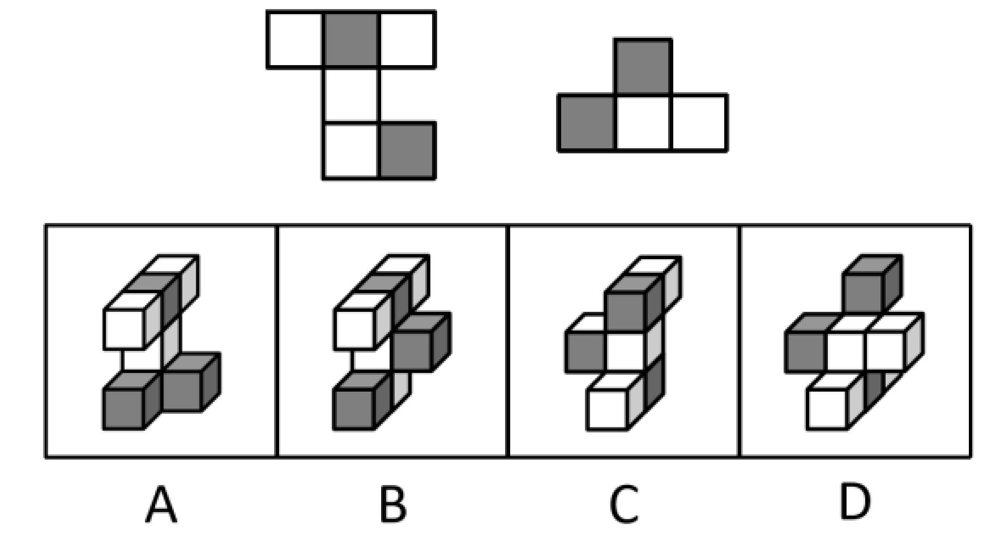

**A.** 见上方题图中 A 项。

**B.** 见上方题图中 B 项。

**C.** 见上方题图中 C 项。

**D.** 见上方题图中 D 项。

**答案：B**

### 第 45 题

`GD2022-XJ-Q045` · 单选 · 原卷第 7 页

下列选项中最符合所给图形规律的是：

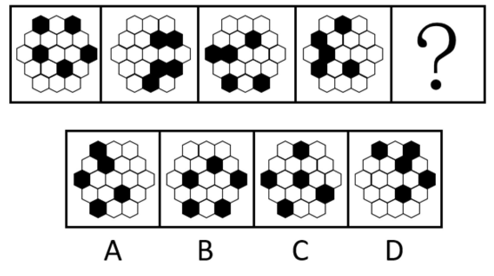

**A.** 见上方题图中 A 项。

**B.** 见上方题图中 B 项。

**C.** 见上方题图中 C 项。

**D.** 见上方题图中 D 项。

**答案：D**

### 第 46 题

`GD2022-XJ-Q046` · 单选 · 原卷第 7、8 页

从所给的四个选项中，选择最合适的一个填入问号处，使之呈现一定的规律性：

**A.** 见上方题图中 A 项。

**B.** 见上方题图中 B 项。

**C.** 见上方题图中 C 项。

**D.** 见上方题图中 D 项。

**答案：C**

### 第 47 题

`GD2022-XJ-Q047` · 单选 · 原卷第 8 页

从所给的四个选项中，选择最合适的一个填入问号处，使之呈现一定的规律性：

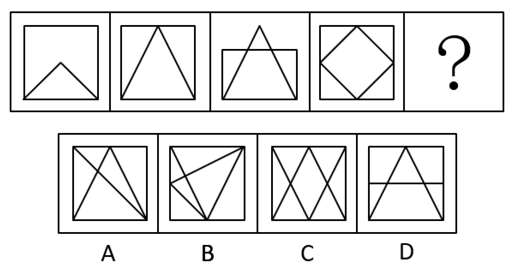

**A.** 见上方题图中 A 项。

**B.** 见上方题图中 B 项。

**C.** 见上方题图中 C 项。

**D.** 见上方题图中 D 项。

**答案：争议：D 或 B（原答案列出，不自行裁定）**

### 第 48 题

`GD2022-XJ-Q048` · 单选 · 原卷第 8、9 页

下列选项中最符合所给图形规律的是：

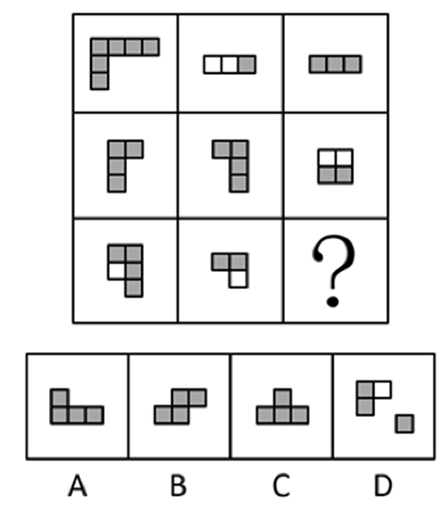

**A.** 见上方题图中 A 项。

**B.** 见上方题图中 B 项。

**C.** 见上方题图中 C 项。

**D.** 见上方题图中 D 项。

**答案：A**

### 第 49 题

`GD2022-XJ-Q049` · 单选 · 原卷第 9 页

下列选项中最符合所给图形规律的是：

**A.** 见上方题图中 A 项。

**B.** 见上方题图中 B 项。

**C.** 见上方题图中 C 项。

**D.** 见上方题图中 D 项。

**答案：A**

### 第 50 题

`GD2022-XJ-Q050` · 单选 · 原卷第 9、10 页

从所给的四个选项中，选择最合适的一个填入问号处，使之呈现一定的规律性：

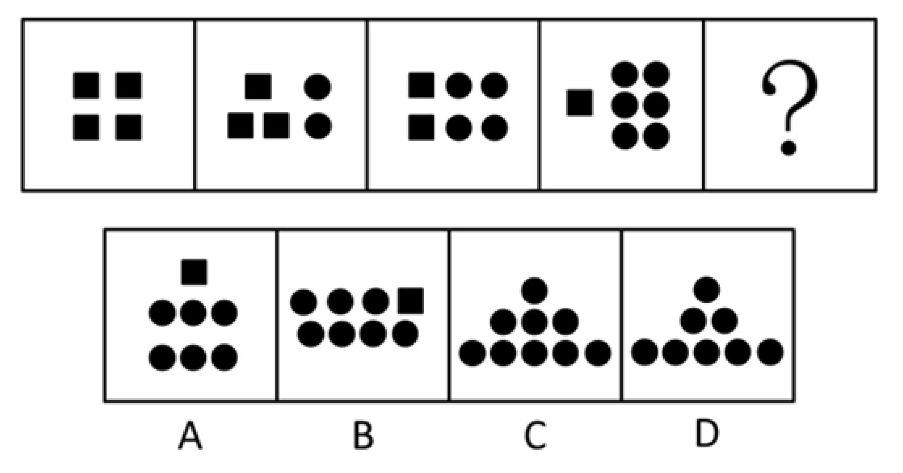

**A.** 见上方题图中 A 项。

**B.** 见上方题图中 B 项。

**C.** 见上方题图中 C 项。

**D.** 见上方题图中 D 项。

**答案：D**

### 第 51 题

`GD2022-XJ-Q051` · 单选 · 原卷第 10 页

耳塞：噪音

**A.** 书籍：知识

**B.** 蜡烛：光明

**C.** 肥皂：污渍

**D.** 风扇：低温

**答案：C**

### 第 52 题

`GD2022-XJ-Q052` · 单选 · 原卷第 10 页

洽淡：合作

**A.** 考试：成绩

**B.** 打磨：切割

**C.** 施肥：灌溉

**D.** 投资：收益

**答案：D**

### 第 53 题

`GD2022-XJ-Q053` · 单选 · 原卷第 10 页

文字：诗词：绝句

**A.** 笔画：隶书：汉字

**B.** 音符：乐谱：五线谱

**C.** 税收：财政：货币

**D.** 树木：森林：生态

**答案：B**

### 第 54 题

`GD2022-XJ-Q054` · 单选 · 原卷第 10 页

法律：诉讼：胜败

**A.** 策略：经营：盈亏

**B.** 战争：武器：存亡

**C.** 判断：事实：对错

**D.** 教师：教学：优劣

**答案：A**

### 第 55 题

`GD2022-XJ-Q055` · 单选 · 原卷第 10 页

志同道合：沆瀣一气

**A.** 居安思危：杞人忧天

**B.** 鼠目寸光：高瞻远瞩

**C.** 举棋不定：优柔寡断

**D.** 口若悬河：信口开河

**答案：A**

### 第 56 题

`GD2022-XJ-Q056` · 单选 · 原卷第 10 页

我国法律规定，用人单位由于生产经营需要，经协商，取得工会和劳动者同意后可以延长工作时间，且一般每日不超过一小时。某国有企业有员工在周五晚上延长工作时间，但并没有违法。
根据上述信息可以推知：

**A.** 该企业员工延长工作一定不超过一小时

**B.** 该企业所有员工都同意延长工作时间

**C.** 该企业工会同意延长工作时间

**D.** 该企业属于不受工作时间限制的特殊行业

**答案：C**

### 第 57 题

`GD2022-XJ-Q057` · 单选 · 原卷第 10 页

子日：“名不正，则言不顺；言不顺，则事不成；事不成，则礼乐不兴；礼乐不兴，则刑罚不中；刑罚不中，则民无所措手足。”根据以上论述，下列推断必然正确的是：
①名正则言顺  ②礼乐兴则事已成  ③名不正，则民无所措手足  ④只有名正言顺才事可成

**A.** ①②

**B.** ②③

**C.** ②③④

**D.** ①②③④

**答案：C**

### 第 58 题

`GD2022-XJ-Q058` · 单选 · 原卷第 10 页

某机构对在广州有创业、就业、实习等经历的港澳青年进行调查，结果显示，有留穗发展意愿的港澳青年比例占七成以上；九成港澳青年通过实习了解和认识广州；有超过一半的港澳青年非常看好粤港澳大湾区的发展前景。因此，来广州实习有助于港澳青年获得对粤港澳大湾区的认同感。
要使上述推论成立，可以补充的前提是：

**A.** 熟悉广州有助于港澳青年更好地适应在广州工作和生活

**B.** 港澳青年的留穗发展意愿是其对粤港澳大湾区具有认同感的重要表现

**C.** 通过实习，港澳青年对粤港澳大湾区发展前景更有信心

**D.** 超过一半的在穗实习港澳青年参与了这项调查

**答案：B**

### 第 59 题

`GD2022-XJ-Q059` · 单选 · 原卷第 10、11 页

某高校调查本校学生的兴趣爱好后发现，喜欢打羽毛球的学生中，来自体育学院的学生一定喜欢登山。
根据以上条件，下列情况必定属实的是：

**A.** 甲喜欢打羽毛球和登山，则甲是体育学院的学生

**B.** 乙是体育学院的学生，且喜欢登山，则乙喜欢打羽毛球

**C.** 丁不喜欢打羽毛球和登山，则丁不是体育学院的学生

**D.** 丙喜欢打羽毛球，不喜欢登山，则丙不是体育学院的学生

**答案：D**

### 第 60 题

`GD2022-XJ-Q060` · 单选 · 原卷第 11 页

逻辑思维能力是一个人最重要的能力之一，但大部分学校都没有开设专门培养逻辑思维能力的课程。
以下选项若为真，最能有效解释上述现象的是：

**A.** 学校内绝大多数课程的设计核心都是提高学生的逻辑思维能力

**B.** 人们的逻辑思维能力往往能随着学识和社会阅历的增长自然提高

**C.** 绝大多数大学设有关于逻辑思维能力的公共选修课程

**D.** 部分教师对于如何培养逻辑思维能力并没有清晰的认识

**答案：A**

### 第 61 题

`GD2022-XJ-Q061` · 单选 · 原卷第 11 页

某单位将《稻穗》《播种》两件乡村新风摄影作品选送参赛。关于这两件作品能否获奖，该单位员工有以下猜测：
（1）两件作品都能获奖。
（2）只有一件作品能获奖。
（3）《稻穗》不会获奖。
（4）《播种》会获奖。
结果表明，其中只有一个猜测正确。则以下判断一定正确的是：

**A.** 《稻穗》获奖了

**B.** 《稻穗》没获奖

**C.** 《播种》获奖了

**D.** 《播种》没获奖

**答案：D**

### 第 62 题

`GD2022-XJ-Q062` · 单选 · 原卷第 11 页

某青年教师学习小组需由2位七年级和1位八年级的教师组成，并且教师教授的科目各不相同。七年级的候选人有：语文老师甲，数学老师乙，英语老师丙；八年级的候选人有：数学老师丁，历史老师戊，语文老师己。
则以下人选组合能够满足条件的是：

**A.** 甲，己，戊

**B.** 甲，乙，己

**C.** 乙，丙，戊

**D.** 乙，丙，丁

**答案：C**

### 第 63 题

`GD2022-XJ-Q063` · 单选 · 原卷第 11 页

有调查发现，某镇的乡村振兴工作中，由县农业部门工作人员担任驻村工作队队长的村庄其农业产业发展速度明显快于由其他部门工作人员担任驻村工作队队长的村庄。据此有人认为，县农业部门的工作人员更重视当地的农业产业发展，而农业产业发展是增加当地农民收入的重要手段，因此县农业部门的工作人员开展乡村振兴工作成效往往较好。
以下选项中属于上述论证过程中隐含前提的是：

**A.** 农业部门工作人员往往有更多农业产业相关的专业知识

**B.** 农民收入是评价乡村振兴工作成效的重要指标

**C.** 乡村振兴工作的成效只能用农业产业发展情况来衡量

**D.** 不同村庄农民收入在乡村振兴工作开展前基本持平

**答案：C**

### 第 64 题

`GD2022-XJ-Q064` · 单选 · 原卷第 11 页

有研究表明，随着人均收入水平的提高，人民对生活的满意度也提高了。因此，政府应该大力发展经济，从而增加人民的人均收入。
上述研究的推论暗含的前提是：

**A.** 人均收入水平的提高能满足人民群众精神层面的需求

**B.** 人民对生活的满意程度取决于政府在经济建设上的投入力度

**C.** 提升人民对生活的满意度是政府工作的主要任务之一

**D.** 人均收入水平的提高对人民满意度的提升作用会不断增强

**答案：B**

### 第 65 题

`GD2022-XJ-Q065` · 单选 · 原卷第 11 页

如今越来越多企业认识到中欧班列具有时效更高、周转更快等优势，从而选择通过中欧班列发运货物。例如，在广州大朗站，2021年前9个月已开行出口中欧班列97列、发运标箱9698个、货值29.47亿元，同比分别增长25.97%、33.80%、19.94%。尽管大朗站的工作人员数量没有明显增加，但有不少企业发现，大朗站货物通关效率比去年更高了。
下列选项最能解释这一现象的是：

**A.** 珠三角地区增设了多个通关口岸

**B.** 当地海关简化了通关流程

**C.** 中欧班列的列车运行速度有所提高

**D.** 当地货物通关时间较去年有所减少

**答案：B**

### 第 66 题

`GD2022-XJ-Q066` · 单选 · 原卷第 12 页

某农村合作社购买了两台新型号收割机，这两台机器收割速度快，而且有助于减少收割过程中的粮食损失。
但该农村合作社使用这两台收割机以来，其玉米收割总损失率高达10%，较以往反而有所上升。
以下最能解释这一现象的是：

**A.** 使用收割机后，该农村合作社收割玉米的效率大幅提高

**B.** 两台收割机仅被用于收割部分田地的玉米

**C.** 操作人员培训不到位，操作收割机时常出现失误

**D.** 玉米并不是当地种植的主要粮食作物

**答案：C**

### 第 67 题

`GD2022-XJ-Q067` · 单选 · 原卷第 12 页

在新的社会发展形势下，如果医生只掌握专业理论知识和实践能力，却缺乏基本职业道德，不仅很难适应会需求，同时还容易造成医患关系紧张。因此在医学专业学生的培养过程中，不仅要注重专业理论知识的教育，更应注重提升医德医风职业素养。
以下选项若为真，最能支持上述论断的是：

**A.** 目前大多数医术水平较高的医生极少与患者产生冲突

**B.** 医生在救治过程中只顾治病不顾患者感受往往导致医患关系紧张

**C.** 医学专业学生职业素养的提升，主要依靠学校的思想道德教育

**D.** 比起专业水平，越来越多患者就医时更看重医生的道德素养

**答案：D**

### 第 68 题

`GD2022-XJ-Q068` · 单选 · 原卷第 12 页

多年来，甲国居民消耗的主要粮食中，有80%以上由本国生产；而乙国居民消耗的主要粮食中有六成以上依赖进口。但经过调查发现，当国际大米价格出现上涨时，甲国国内的大米价格涨幅明显高于乙国。
下列选项如果为真，最能解释这一现象的是：

**A.** 甲国主要粮食进口以大米为主，乙国主要粮食进口以小麦为主

**B.** 乙国居民对食物品质和口感的要求比甲国居民更高

**C.** 乙国的粮食产量比甲国更加稳定

**D.** 与甲国相比乙国人口少、收入高，粮食支出占其收入的比重更低

**答案：A**

### 第 69 题

`GD2022-XJ-Q069` · 单选 · 原卷第 12 页

每一名战士都是英雄，每一名英雄都值得被纪念，因此每一名战士都值得被纪念。
下列选项的逻辑结构与题干最相似的是：

**A.** 艺术家往往是浪漫主义者，而有些浪漫主义者会感情用事，因此艺术家常会感情用事

**B.** 所有素食主义者都是人文主义者，而所有和平主义者都是人文主义者，因此素食主义者一定是和平主义者

**C.** 所有的科学家都是理性主义者，所有的理性主义者都是天生的哲学家。因此科学家都是天生的哲学家

**D.** 利己主义者总是以自身利益最大化作为行事准则，而单纯造求自身利益的最大化必然会损害到他人利益，因此利己主义者总会和他人发生冲突

**答案：C**

### 第 70 题

`GD2022-XJ-Q070` · 单选 · 原卷第 12 页

世界科技强国必须能够在全球范围内吸引人才、留住人才、用好人才。我国要建设世界科技强国。因此，我国必须注重对国际人才的吸引与使用。
下列选项的逻辑结构与题干最相似的是：

**A.** 人才的培养培育离不开良好的环境。因此，构筑集聚全球优秀人才的科研创新高地，完善配套制度，就能面向世界汇聚一流人才

**B.** 国家科技创新力的根本源泉在于人才，国家、民族长远发展离不开科技创新力。因此，培养创新型人才是国家、民族的长远发展之计

**C.** 科技创新离不开科技人员持久的时间和精力投入。因此，要建立让科研人员把主要精力放在科研上的保障机制

**D.** 榜样的力量对科技工作者来说是无穷的。两院院士是科技成果的主要贡献者，更应做好表率，激励广大科技工作者不断攻坚克难、勇攀高峰

**答案：B**

### 第 71 题

`GD2022-XJ-Q071` · 单选 · 原卷第 12 页

某便利店销售一款牛奶，这款牛奶在店内每瓶售价8元，在店外自动售货机上的价格为每瓶10元，但依然有部分人选择在自动售货机上购买这款牛奶。
以下选项若为真，最不能解释这一现象的是：

**A.** 有些人赶时间，当店内顾客过多时不愿意进店排队结账

**B.** 有些人购买目标单一，只想买牛奶并不想购买其他商品

**C.** 有些人不愿花精力进店寻找商品，自动售货机展示商品更直观

**D.** 有些人喜欢喝冰牛奶，只有自动售货机销售冰牛奶

**答案：B**

### 第 72 题

`GD2022-XJ-Q072` · 单选 · 原卷第 13 页

某教师收集了本班学生的语文学习兴趣、每天的学习时长等信息，结合期末考试语文成绩分析后发现，与每天语文学习时长不足2小时的学生相比，学习超过2小时的学生学习兴致普遍更高，其语文期末考试平均分也更高。该教师由此得出结论，增加语文学习时长能够有效培养学习兴趣，进而提高语文成绩。
下列选项若为真，最能质疑上述结论的是：

**A.** 该班级期末考试语文成绩最好的学生每天学习语文1小时

**B.** 该班级的语文期末考试平均分高于其他班级

**C.** 语文学习兴趣高的学生拥有更好的学习习惯

**D.** 只有语文学习兴趣高的学生才乐于花更长时间学习语文

**答案：D**

### 第 73 题

`GD2022-XJ-Q073` · 单选 · 原卷第 13 页

农业得到极大发展后，农民的收入水平会显著提高，农业科技水平相对落后的地区农民收入水平不能提高。
由此可知，农业科技水平相对落后的地区，农业产业有待发展。
下列选项的逻辑结构与题干最相似的是：

**A.** 气温低于10摄氏度时，某地的滑雪场就会对外开放。每年的国庆节当地的滑雪场都不对外开放。因此，每年国庆节当地气温都在10摄氏度及以上

**B.** 景无月不美，酒缺月无味。因此，只有赏月时，才能欣赏到美景、品尝到美味

**C.** 教育水平不高的地区，往往缺乏优秀的农业生产人才。乡村振兴需要大量的农业生产人才。因此。教育水平不高的地区较难实现乡村振兴

**D.** 人在逆境中要不忘初心，才能迎难而上，克服挑战；在顺境中也要不忘初心，才能戒骄成躁，稳步前行，因此，人在任何处境下都要做到不忘初心

**答案：A**

### 第 74 题

`GD2022-XJ-Q074` · 单选 · 原卷第 13 页

某公司产品的各项性能都比竞争对手的更好。所以，如果该公司能够降低产品的市场定价，与竞争对手的价格持平，那么该公司产品一定会迅速占领市场。
下列选项若为真，最能削弱上述论断的是：

**A.** 该公司产品的生产成本较高，降低市场定价将会极大影响公司利润

**B.** 与竞争对手相比，该公司的产品宣传力度和售后服务不具显著优势

**C.** 该公司的生产规模很小，其产量仅能满足市场需求的百分之一

**D.** 该公司产品设计瞄准的是高端市场，降低价格不符合其市场定位

**答案：C**

### 第 75 题

`GD2022-XJ-Q075` · 单选 · 原卷第 13 页

重点民生领域过度金融化，将会在危及广大民众财产安全的同时给相关行业带来沉重打击。因此，为了保护重点民生领域相关行业的健康发展，应防止其过度金融化。
下列选项的逻辑结构与题干最相似的是：

**A.** 作家写作时需要持续投入时间和精力。这些作品的销量都很好，看来在写作过程中，创作者都投入了大量的时间和精力

**B.** 如果未能筑牢网络法治基础，网络上的社会矛盾将会蔓延到现实社会中。因此，为防止现实社会受到网络社会矛盾的冲击，应大力巩固网络法治基础

**C.** 中国戏剧作品主要通过翻译、演出为海外受众所熟知。近年来演出量大幅下降，而中国传统文化的国际影响力越来越大，可见翻译的作用更大

**D.** 一个企业越成熟，越能正确地看待过去的成就。某企业总是能正确地看特过去的成就，可以说它是一个成熟的企业

**答案：B**

## 科学推理

### 第 76 题

`GD2022-XJ-Q076` · 单选 · 原卷第 13 页

对下列生活中的现象或做法解释不合理的是：

**A.** 物体的热胀冷缩——分子随温度升高而变大

**B.** 油锅着火用锅盖盖灭——使可燃物与空气隔绝

**C.** 在铁制品表面刷油漆——避免铁制品氧化生锈

**D.** 利用真空袋包装食品——破坏需氧菌类的生存环境

**答案：A**

### 第 77 题

`GD2022-XJ-Q077` · 单选 · 原卷第 13、14 页

镜子前面放有一个圆球。如图是某人站在镜子前从某个角度看到的圆球和其镜像位置关系示意图，则此人在镜子前所站的位置及视角最可能是：

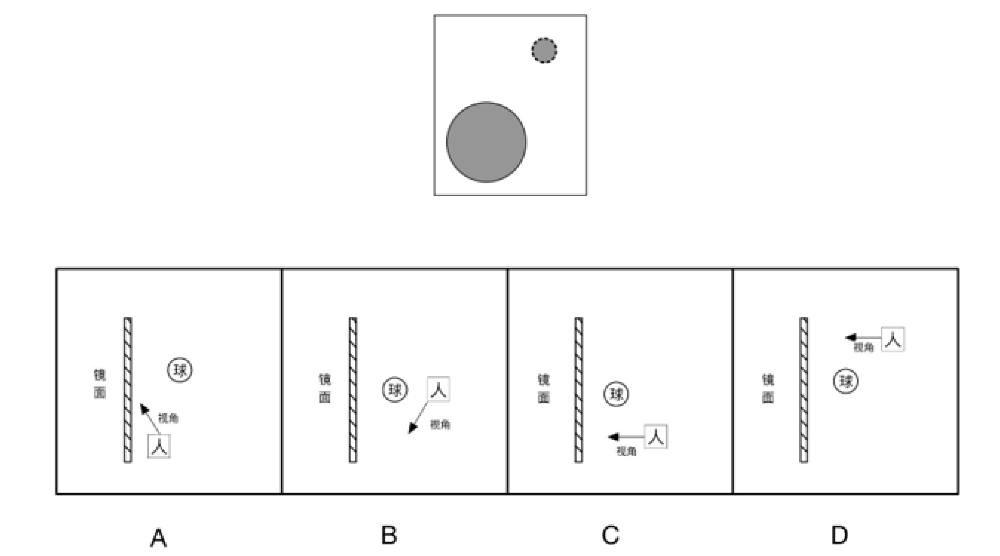

**A.** 见上方题图中 A 项。

**B.** 见上方题图中 B 项。

**C.** 见上方题图中 C 项。

**D.** 见上方题图中 D 项。

**答案：D**

### 第 78 题

`GD2022-XJ-Q078` · 单选 · 原卷第 14 页

如图是某家庭电路图的一部分，家庭内各电器均正确接入电路。则以下说法准确的是：

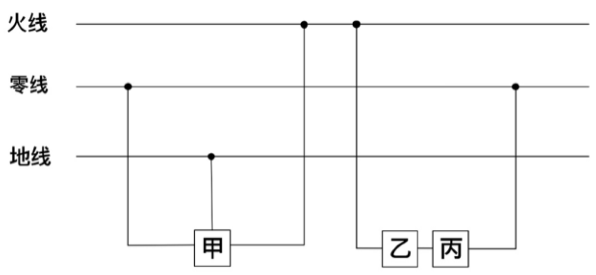

**A.** 假如乙和甲分别是电器或开关，则丙是开关

**B.** 假如电路正常，正确使用试电笔接触三孔插座的孔都会显示有电流

**C.** 假如甲是带金属外壳的用电器，则它接的是三孔插座

**D.** 假如零线被烧断，应立即关闭开关，否则会引起短路

**答案：C**

### 第 79 题

`GD2022-XJ-Q079` · 单选 · 原卷第 14 页

食物链主要反映了生产者与消费者之间的联系，下列关系中最能准确表示食物链的是：

**A.** 草→兔→狐→鹰

**B.** 阳光→草→鸡→狼

**C.** 虫→鸟→蛇

**D.** 草→羊→虎→微生物

**答案：A**

### 第 80 题

`GD2022-XJ-Q080` · 单选 · 原卷第 14、15 页

如图，甲、乙两个相同的容器中盛着不同的液体，当相同的小球漂浮在容器中并保持静止时，容器中液面的高度相同，则下列说法准确的是：

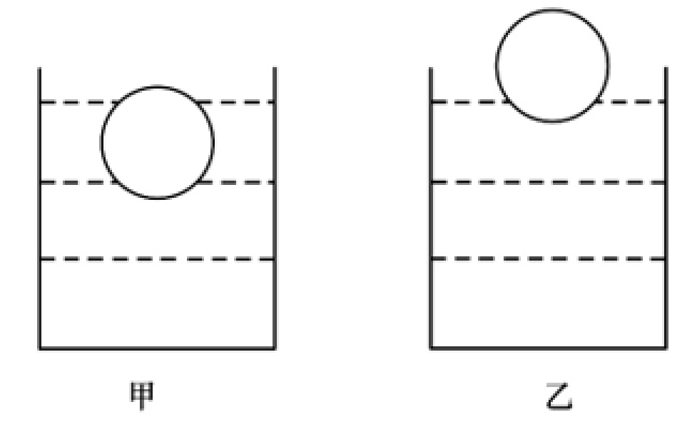

**A.** 小球在甲容器中受到浮力比在乙容器中的小

**B.** 小球在甲容器中受到浮力比在乙容器中的大

**C.** 甲容器中液体的密度比乙容器中液体的小

**D.** 甲容器中液体的密度比乙容器中液体的大

**答案：C**

### 第 81 题

`GD2022-XJ-Q081` · 单选 · 原卷第 15 页

如图是某地生态系统的蒸散示意图，下列说法最准确的是：

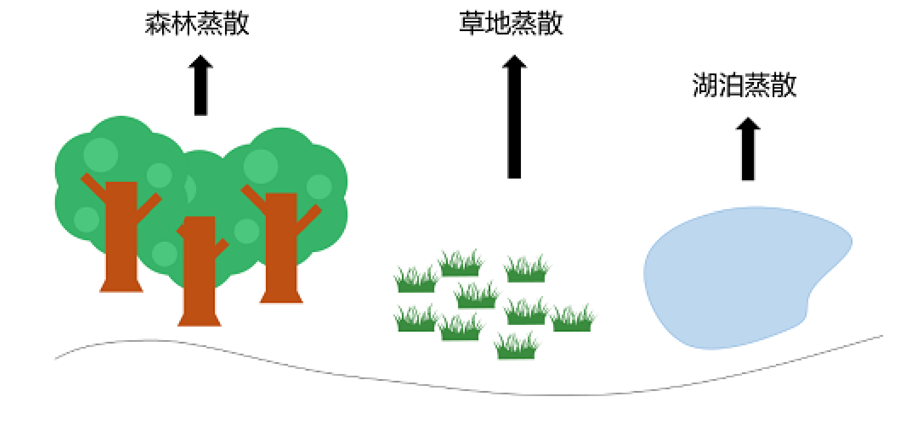

**A.** 环境温度升高，森林的蒸散作用减弱

**B.** 空气湿度越大，森林的蒸散作用越弱

**C.** 任意环境条件下，湖泊的蒸发量比森林蒸散量大

**D.** 相较于夜晚，该地生态系统在白天时蒸散作用强度明显减弱

**答案：B**

### 第 82 题

`GD2022-XJ-Q082` · 单选 · 原卷第 15、16 页

以下为甲、乙两车行驶情况的示意图，已知甲、乙同时从一起点出发，甲车在水平道路上匀速直线行驶，乙车在同一水平的道路上匀减速直线行驶，则在两车行驶的过程中，下列说法准确的是：

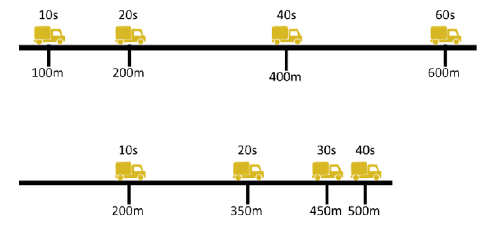

**A.** 甲车的速度为15m/s

**B.** 乙车的初始速度为25m/s

**C.** 45s 时，乙车行驶的路程更远

**D.** 50s 时，乙车仍处于行驶状态

**答案：C**

### 第 83 题

`GD2022-XJ-Q083` · 单选 · 原卷第 16 页

如图，小球在细绳的牵引下从 A 点自由摆动到 C 点，B 点是最低点。若忽略空气阻力，则下列说法不准确的是：

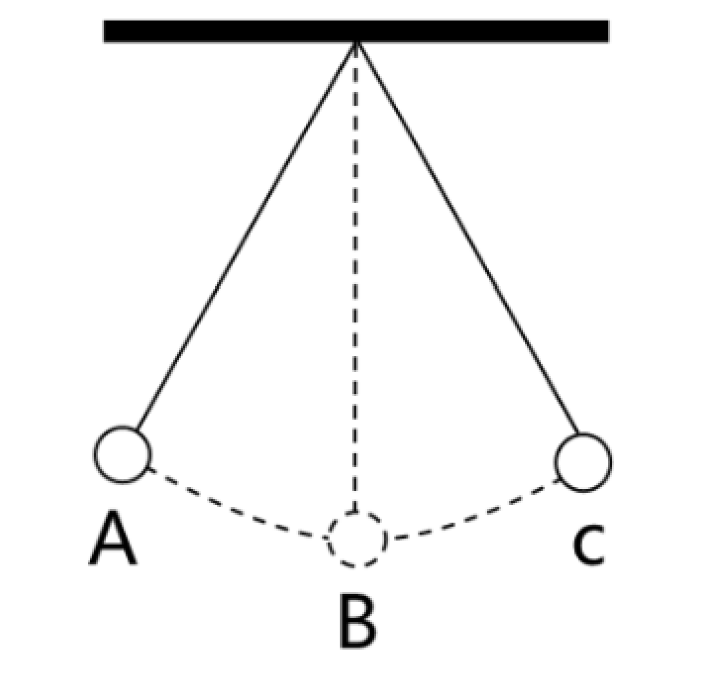

**A.** 从 A 点到 B 点小球的动能增加

**B.** 从 B 点到 C 点小球的势能增加

**C.** 在 B 点小球的动能最大

**D.** 从 A 点到 C 点小球的机械能增加

**答案：D**

### 第 84 题

`GD2022-XJ-Q084` · 单选 · 原卷第 16 页

如图，用绳子分别将两颗不同的磁力球M₁和M₂系在上、下两个平面上，M₁、M₂互相吸引，此时上平面对M₁的作用力为F₁，下平面对M₂的作用力为F₂，则以下关于F₁、F₂说法准确的是：

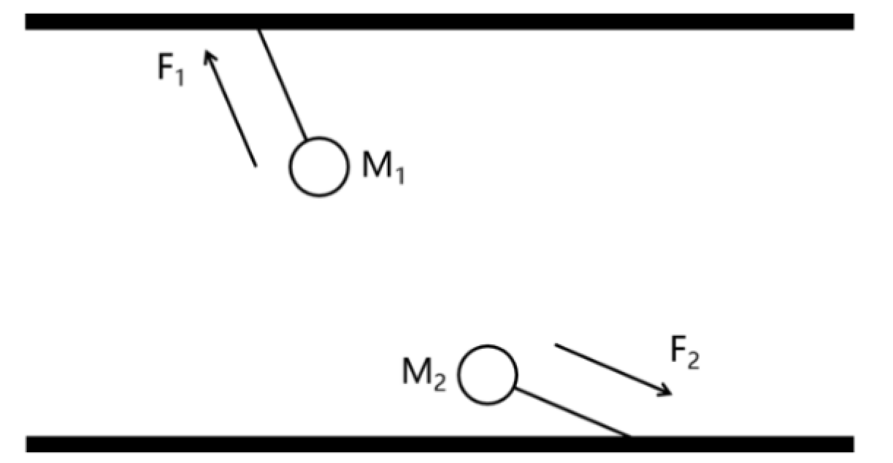

**A.** F₁大于F₂

**B.** F₁等于F₂

**C.** F₁小于F₂

**D.** 无法判断

**答案：A**

> 转写说明：原文部分符号缺失，经用户确认，按原图的M₁、M₂、F₁、F₂标记恢复；未改动数值、关系或答案。

### 第 85 题

`GD2022-XJ-Q085` · 单选 · 原卷第 16、17 页

如图是某种固态物质在加热过程中，温度随时间变化的图像。下列说法最不准确的是：

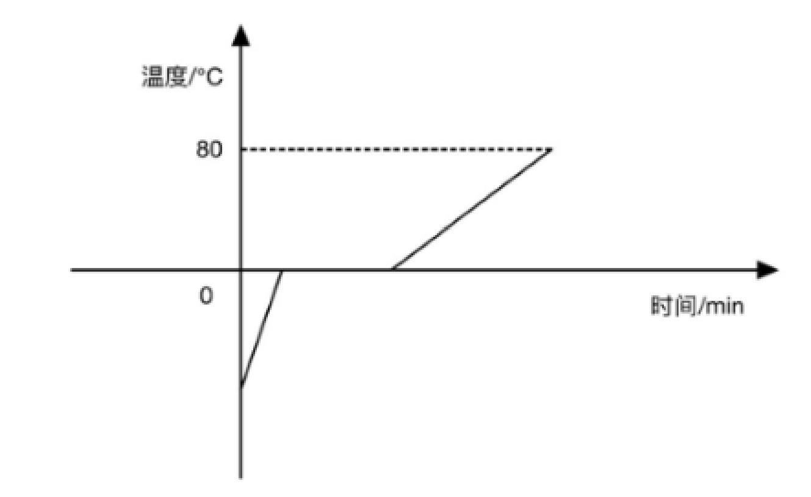

**A.** 该固态物质有固定的熔点

**B.** 该固态物质在熔化过程中，比热容增大

**C.** 温度为0℃时，该物质可能处于固液共存状态

**D.** 该固态物质在熔化时不断吸收热量，温度不断升高

**答案：D**

## 资料分析

### 共用材料：第 86—90 题

2020年，全国职工基本医疗保险（以下简称职工医保）参保人数持续增加，基金收支规模基本稳定。参加职工医保34455万人，比上年同比增加1530万人。其中在职职工25429万人，比上年增长5.0%；退休职工9026万人，比上年增长3.7%。企业、机关事业、灵活就业等其他人员三类参保人员（包括在职职工和退休人员）分别为23317万人、6387万人、4751万人，分别比上年增加1050万人、155万人、325万人。
受新冠肺炎疫情影响，2020年2-7月全国多地实施阶段性减半征收职工医保单位缴费，累计减征约1649亿元，全年职工医保基金（含生育保险）收入15732亿元，比上年减少0.7%；支出12867亿元，比上年增长1.6%。2020年，职工医保统筹基金（含生育保险）收入9145亿元，比上年减少8.6%；支出7931亿元，比上年减少0.1%；当期结存1214亿元，累计结存15327亿元。
2020年，职工医保个人账户收入6587亿元，比上年增长12.8%；支出4936亿元，比上年增长4.5%；当期结存1650亿元，累计结存10096亿元。
2020年就诊量同比有所减少。参加职工医保人员享受待遇17.9亿人次，比上年减少15.6%。职工医保参保人员住院率15.9%，比上年下降2.8个百分点。其中：在职职工住院率为8.6%，比上年下降1.5个百分点；退休职工住院率为36.0%，比上年下降6.5个百分点。

### 第 86 题

`GD2022-XJ-Q086` · 单选 · 原卷第 17 页

[共用材料](#GD2022-XJ-M1)

2020年，全国参加职工医保人数同比增长约：

**A.** 4.6%

**B.** 5.4%

**C.** 6.2%

**D.** 7.1%

**答案：A**

### 第 87 题

`GD2022-XJ-Q087` · 单选 · 原卷第 17 页

[共用材料](#GD2022-XJ-M1)

2020年，灵活就业等其他人员参保人数占职工医保参保总人数的比例约为：

**A.** 12.9%

**B.** 13.8%

**C.** 15.2%

**D.** 16.1%

**答案：B**

### 第 88 题

`GD2022-XJ-Q088` · 单选 · 原卷第 17 页

[共用材料](#GD2022-XJ-M1)

若2-7月未实施阶段性减半征收职工医保单位缴费，则2020年职工医保基金总收入（含生育保险）同比增长：

**A.** 4%

**B.** 7%

**C.** 10%

**D.** 13%

**答案：C**

### 第 89 题

`GD2022-XJ-Q089` · 单选 · 原卷第 17 页

[共用材料](#GD2022-XJ-M1)

2020年，下列指标的同比增长率从高到低排列正确的是：

**A.** 职工医保基金（含生育保险）收入>职工医保个人账户收入>职工医保统筹基金（含生育保险）收入

**B.** 职工医保个人账户支出>职工医保个人账户收入>职工医保统筹基金（含生育保险）收入

**C.** 职工医保个人账户收入>职工医保基金（含生育保险）收入>职工医保基金（含生育保险）支出

**D.** 职工医保基金（含生育保险）支出>职工医保统筹基金（含生育保险）支出>职工医保基金（含生育保险）收入

**答案：D**

### 第 90 题

`GD2022-XJ-Q090` · 单选 · 原卷第 17、18 页

[共用材料](#GD2022-XJ-M1)

根据以上资料，下列说法不准确的是：

**A.** 2020年，职工医保参保人员人均享受待遇约5次

**B.** 2019年，在职职工住院率约为退休职工住院率的四分之一

**C.** 2020年，三类职工医保参保人员中，灵活就业等其他人员参保人数同比增速最快

**D.** 若职工医保个人账户收入和支出的年同比增幅保持不变，则2021年个人账户当期结存不足2000亿元

**答案：D**

### 共用材料：第 91—95 题

增加森林面积、提高森林质量、提升生态系统碳汇增量，将为我国实现碳达峰、碳中和目标、维护全球生态安全做出巨大贡献。1973年，我国开展了第一次森林资源清查。目前已完成第9次森林资源清查，我国森林面积和森林蓄积量连续30年保持“双增长”。“十三五”时期，我国累计造林5.45亿亩，森林覆盖率达到23.04%，森林蓄积量为175.6亿立方米，森林面积达到2.2亿公顷（1公顷为15亩）。湿地保护率达到52%，治理沙化土地1.5亿亩。

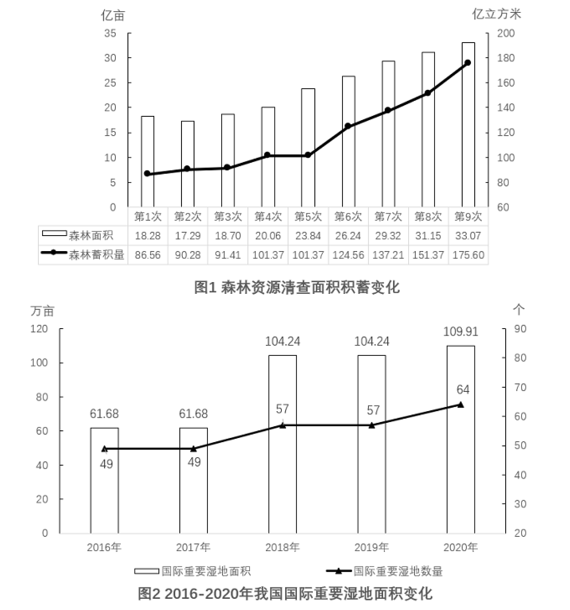

图1 森林资源清查面积和蓄积变化

| 清查次数 | 森林面积（亿亩） | 森林蓄积量（亿立方米） |
| --- | --- | --- |
| 1 | 18.28 | 86.56 |
| 2 | 17.29 | 90.28 |
| 3 | 18.70 | 91.41 |
| 4 | 20.06 | 101.37 |
| 5 | 23.84 | 101.37 |
| 6 | 26.24 | 124.56 |
| 7 | 29.32 | 137.21 |
| 8 | 31.15 | 151.37 |
| 9 | 33.07 | 175.60 |

图2 2016—2020年我国国际重要湿地面积变化

| 年份 | 国际重要湿地面积（万亩） | 国际重要湿地数量（个） |
| --- | --- | --- |
| 2016 | 61.68 | 49 |
| 2017 | 61.68 | 49 |
| 2018 | 104.24 | 57 |
| 2019 | 104.24 | 57 |
| 2020 | 109.91 | 64 |

### 第 91 题

`GD2022-XJ-Q091` · 单选 · 原卷第 18 页

[共用材料](#GD2022-XJ-M2)

“十三五”期间，我国平均每公顷森林蓄积量达到（）立方米。

**A.** 5.3

**B.** 32.2

**C.** 79.8

**D.** 98.6

**答案：C**

### 第 92 题

`GD2022-XJ-Q092` · 单选 · 原卷第 18、19 页

[共用材料](#GD2022-XJ-M2)

相比第1次森林资源清查，第9次森林资源清查时，我国森林覆盖率提高了约（）个百分点。（本材料中森林覆盖率为森林面积占国土面积的百分比）

**A.** 10

**B.** 15

**C.** 20

**D.** 25

**答案：A**

### 第 93 题

`GD2022-XJ-Q093` · 单选 · 原卷第 19 页

[共用材料](#GD2022-XJ-M2)

2016-2018年，我国国际重要湿地面积的年均增长率约为：

**A.** 25%

**B.** 30%

**C.** 35%

**D.** 40%

**答案：B**

### 第 94 题

`GD2022-XJ-Q094` · 单选 · 原卷第 19 页

[共用材料](#GD2022-XJ-M2)

以下选项中，最准确地反映了2017-2020年我国国际重要湿地面积、数量同步增速变化情况的是：

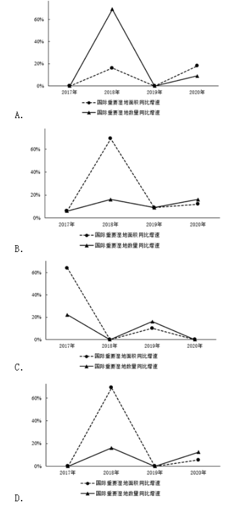

**A.** 见上方题图中 A 项。

**B.** 见上方题图中 B 项。

**C.** 见上方题图中 C 项。

**D.** 见上方题图中 D 项。

**答案：D**

### 第 95 题

`GD2022-XJ-Q095` · 单选 · 原卷第 19、20 页

[共用材料](#GD2022-XJ-M2)

根据以上资料，下列说法不准确的是：

**A.** 我国森林蓄积量较前一次森林资源清查增幅最大的是第6次森林资源清查

**B.** 第5次至第9次森林资源清查，我国森林面积和森林蓄积量的变化趋势一致

**C.** 2016-2020年，我国平均每年增加国际重要湿地超过3个

**D.** 2017-2020年，我国平均每个国际重要湿地面积同比增幅最大的年份是2020年

**答案：D**

### 共用材料：第 96—100 题

2020年，受新冠肺炎疫情影响，我国民航全行业完成旅客运输量41777.82万人次，比上年下降36.7%。国内航线完成旅客运输量40821.30万人次，比上年下降30.3%，其中港澳台航线完成旅客运输量96.13万人次，比上年下降91.3%，国际航线完成旅客运输量956.51万人次，比上年下降87.1%。尽管如此，我国国内航空运输市场在全球范围内恢复最快、运行最好。
2020年，全行业运输航空公司完成运输飞行时长876.22万小时，比上年下降28.8%。国内航线完成运输飞行时长788.22万小时，比上年下降20.5%，其中港澳台航线完成运输飞行时长3.55万小时，比上年下降82.3%，国际航线完成运输飞行时长87.99万小时，比上年下降63.3%。
2020年，全行业运输航空公司完成运输起飞371.09万架次，比上年下降25.3%。国内航线完成运输起飞357.29万架次，比上年下降20.2%，其中港澳台航线完成运输起飞1.65万架次，比上年下降80.3%，国际航线完成运输起飞13.79万架次，比上年下家71.8%。

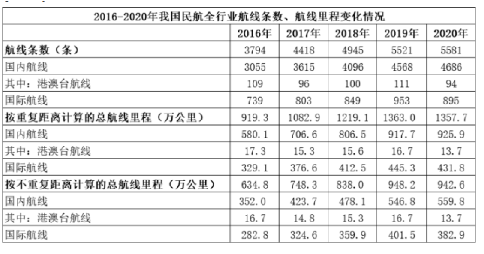

2016—2020年我国民航全行业航线条数、航线里程变化情况

| 指标 | 2016年 | 2017年 | 2018年 | 2019年 | 2020年 |
| --- | --- | --- | --- | --- | --- |
| 航线条数（条） | 3794 | 4418 | 4945 | 5521 | 5581 |
| 国内航线（条） | 3055 | 3615 | 4096 | 4568 | 4686 |
| 其中：港澳台航线（条） | 109 | 96 | 100 | 111 | 94 |
| 国际航线（条） | 739 | 803 | 849 | 953 | 895 |
| 按重复距离计算的总航线里程（万公里） | 919.3 | 1082.9 | 1219.1 | 1363.0 | 1357.7 |
| 国内航线（万公里，重复距离） | 580.1 | 706.6 | 806.5 | 917.7 | 925.9 |
| 其中：港澳台航线（万公里，重复距离） | 17.3 | 15.3 | 15.6 | 16.7 | 13.7 |
| 国际航线（万公里，重复距离） | 329.1 | 376.6 | 412.5 | 445.3 | 431.8 |
| 按不重复距离计算的总航线里程（万公里） | 634.8 | 748.3 | 838.0 | 948.2 | 942.6 |
| 国内航线（万公里，不重复距离） | 352.0 | 423.7 | 478.1 | 546.8 | 559.8 |
| 其中：港澳台航线（万公里，不重复距离） | 16.7 | 14.8 | 15.3 | 16.7 | 13.7 |
| 国际航线（万公里，不重复距离） | 282.8 | 324.6 | 359.9 | 401.5 | 382.9 |

### 第 96 题

`GD2022-XJ-Q096` · 单选 · 原卷第 20 页

[共用材料](#GD2022-XJ-M3)

相比2019年、2020年我国民航全行业完成旅客运输中，国内航线完成旅客运输总量占比约：

**A.** 降低了9%

**B.** 降低了15%

**C.** 提高了9%

**D.** 提高了15%

**答案：C**

### 第 97 题

`GD2022-XJ-Q097` · 单选 · 原卷第 20 页

[共用材料](#GD2022-XJ-M3)

2019年，平均每架次完成运输飞行时长最长的是：

**A.** 国内航线

**B.** 港澳台航线

**C.** 国际航线

**D.** 全行业运输航空公司

**答案：C**

### 第 98 题

`GD2022-XJ-Q098` · 单选 · 原卷第 20 页

[共用材料](#GD2022-XJ-M3)

2016-2020年，国内航线条数比国际航线条数多4倍以上的年份有：

**A.** 1

**B.** 2

**C.** 3

**D.** 5

**答案：A**

### 第 99 题

`GD2022-XJ-Q099` · 单选 · 原卷第 20 页

[共用材料](#GD2022-XJ-M3)

按不重复距离计算，以下年份中，国际航线里程同比增速最快的是：

**A.** 2017年

**B.** 2018年

**C.** 2019年

**D.** 2020年

**答案：A**

### 第 100 题

`GD2022-XJ-Q100` · 单选 · 原卷第 20 页

[共用材料](#GD2022-XJ-M3)

根据以上资料，下列说法准确的是：

**A.** 2019年，国内航线运输飞行时长占全行业运输航空公司运输飞行时长的9成以上

**B.** 相比2019年，2020年我国国内航线、港澳台航线、国际航线平均每条航线完成旅客运输量均有下降

**C.** 2016-2020年，按重复距离计算的总航线里程公里数年均增长不到100万

**D.** 2019年，全行业运输航空公司完成运输起飞不到400万架次

**答案：B**

