# 2022年广东行测（乡镇卷）

共 100 题，原题号与重复题完整保留。内容：题干、选项、答案；资料分析共用材料置于所属题组前，JSONL 每条记录完整内嵌材料。

[结构化数据](GD2022-XZ.jsonl) · [格式说明](README.md)

原题来源：[2022年广东公务员考试行测试题（乡镇）.pdf](https://github.com/dumarstoft-ship-it/xing-ce1/blob/4cb13da865dcef6bb6d3731f8ae2981186a1a314/%E7%9C%9F%E9%A2%98/2022%E5%B9%B4%E5%B9%BF%E4%B8%9C%E5%85%AC%E5%8A%A1%E5%91%98%E8%80%83%E8%AF%95%E8%A1%8C%E6%B5%8B%E8%AF%95%E9%A2%98%EF%BC%88%E4%B9%A1%E9%95%87%EF%BC%89.pdf)。

## 言语理解与表达

### 第 1 题

`GD2022-XZ-Q001` · 单选 · 原卷第 1 页

新时代现实世界是如此新鲜丰富、多姿多彩，生活的______、人民的拼搏奋斗、家庭的______、百姓的爱恨喜痛，都值得作家去侧耳倾听、用心思考、挥笔书写，真正做到语出一人之口，呼出万众之声。
依次填入画横线部分最恰当的一项是：

**A.** 日新月异酸甜苦辣

**B.** 精彩纷呈跌宕起伏

**C.** 精妙绝伦悲欢离合

**D.** 一日千里喜怒哀乐

**答案：A**

### 第 2 题

`GD2022-XZ-Q002` · 单选 · 原卷第 1 页

在中共一大纪念馆“真理的味道”展陈前，72种版本的《共产党宣言》作为“镇馆之宝”，吸引参观者驻足，在此 ______真理的力量。
填入横线处最恰当的是：

**A.** 感知

**B.** 感悟

**C.** 体验

**D.** 品味

**答案：B**

### 第 3 题

`GD2022-XZ-Q003` · 单选 · 原卷第 1 页

______历朝历代面临的生态问题不同，______保护环境的治理理念不变。无论在成文法典，还是在政府文件中，多有号令天下植树造林、固土防沙、兴修水利等内容。
依次填入横线处最恰当的是：

**A.** 因为所以

**B.** 不仅而且

**C.** 即使可是

**D.** 尽管但是

**答案：D**

### 第 4 题

`GD2022-XZ-Q004` · 单选 · 原卷第 1 页

党的百年历史，就是党与群众水乳交融、______的历史。一条扁担、一张借据、半条棉被就是党与人民血肉相连、情深似海的______。
依次填入画横线部分最恰当的一项是：

**A.** 唇齿相依印记

**B.** 相濡以沫记忆

**C.** 休戚与共见证

**D.** 众志成城证明

**答案：C**

### 第 5 题

`GD2022-XZ-Q005` · 单选 · 原卷第 1 页

乡村振兴，关键是产业振兴。因地制宜发展特色产业，大力推动一二三产业融合发展，不断______产业链、______供应链、______价值链，走出一条科学有效、农民受益的产业发展之路。
依次填入横线处最恰当的是：

**A.** 延伸提升打造

**B.** 延伸打造提升

**C.** 提升打造延伸

**D.** 提升延伸打造

**答案：B**

### 第 6 题

`GD2022-XZ-Q006` · 单选 · 原卷第 1 页

文化自信是更深厚的自信。“______。”中华文化扎实之根脉、醇厚之积淀，恰如有源之水，滋养着中华民族在新的历史条件下的新创造、新发展，给我们的文化自信打下了最深厚的历史根基。
下列句子填入画横线处，最恰当的是：

**A.** 海纳百川，有容乃大

**B.** 积土而为山，积水而为海

**C.** 源浚者流长，根深者叶茂

**D.** 泰山不让土壤，故能成其大

**答案：C**

### 第 7 题

`GD2022-XZ-Q007` · 单选 · 原卷第 1 页

实践证明，打赢脱贫攻坚战，关键在于对扶贫对象进行精细化管理、对扶贫资源进行精确化配置、对扶贫对象进行精准化扶持。贫有百种，困有千样。只有坚持因村因户因人施策，因贫困原因施策，因贫困类型施策，对症下药，精准滴灌，靶向治疗，才能做到真扶贫、扶真贫、真脱贫。
以下最能概括上述文段所表达的“脱贫攻坚精神”内涵的是：

**A.** 尽锐出战

**B.** 开拓创新

**C.** 攻坚克难

**D.** 精准务实

**答案：D**

### 第 8 题

`GD2022-XZ-Q008` · 单选 · 原卷第 1 页

近年来，越来越多的镇村深刻认识到“绿水青山就是金山银山”的经济和生态双重价值，积极探索发展乡村旅游、田园生态旅游。但有的地方道路、休闲空间等配套基础设施不完备，游客成过客、不愿意留下来过夜，弱化了旅游业对当地餐饮、住宿及日常消费的带动力。只有完善配套基础设施，才能留住游客、发展回头客，提升镇村旅游业的发展潜力。
上述文段主要讲了：

**A.** 改善配套基础设施对镇村旅游业发展的重要性

**B.** 乡村旅游、田园生态旅游对游客的吸引力不足

**C.** 消费带动力不强是当前镇村旅游发展面临的问题

**D.** 镇村旅游发展潜力有待进一步挖掘

**答案：A**

### 第 9 题

`GD2022-XZ-Q009` · 单选 · 原卷第 1、2 页

“为什么我的时间总是不够用？”我们常被这个问题困扰。我们抱怨有太多事情要做，好像永远都做不完。
于是“没有时间”成了我们的口头禅。在这种背景下，“时间管理”理念应运而生。时间管理倡导的很多方法，并不是要让人们逃离现代性境遇所构筑的牢笼，而是对其加以技术性强化。时间管理原本是要教会我们更精细、更严苛地分割利用时间，由于人们的主观感受常常不一样，有些人依然会觉得时间不够用，事情永远做不完，甚至为此心力交瘁。
对上述文段理解最准确的是：

**A.** 精细化地分割和利用时间是时间管理的本质要求

**B.** 时间管理没有完全解决人们“时间不够用”的困扰

**C.** 对时间进行技术性强化是一种有效的时间管理办法

**D.** 严格的时间管理在一定程度上会左右人们的主观感受

**答案：B**

### 第 10 题

`GD2022-XZ-Q010` · 单选 · 原卷第 2 页

迄今为止，国内外农业灾害史研究还未能建立一个全面记录历史时期世界各地自然灾害发生完整过程和灾情信息的综合性灾害史料数据库。在气候变化、灾害影响与适应防灾减灾应用等方面研究的资料需求无法得到满足，以致于不能全面地揭示灾害成因和环境后果。
上述文段主要讲了：

**A.** 建立综合性灾害史料数据库的紧迫性

**B.** 综合性灾害史料对于农业灾害研究的重要性

**C.** 农业灾害史研究当前面临的问题

**D.** 推动农业灾害成因和环境后果研究需加强国际合作

**答案：C**

## 常识判断

### 第 11 题

`GD2022-XZ-Q011` · 单选 · 原卷第 2 页

党的十八大以来，我们深化对民主政治发展规律的认识，提出（）的重大理念，其不仅有完整的制度程序，而且有完整的参与实践。

**A.** 全方位人民民主

**B.** 全链条人民民主

**C.** 全过程人民民主

**D.** 全覆盖人民民主

**答案：C**

### 第 12 题

`GD2022-XZ-Q012` · 单选 · 原卷第 2 页

基层治理是国家治理的基石，在打造基层治理共同体中，基层群众性自治组织发挥的是：

**A.** 主导作用

**B.** 决定作用

**C.** 引领作用

**D.** 基础作用

**答案：D**

### 第 13 题

`GD2022-XZ-Q013` · 单选 · 原卷第 2 页

《中共中央关于党的百年奋斗重大成就和历史经验的决议》阐明了四个历史时期党面临的主要任务，以下关于各个历史时期党面临的主要任务表述正确的是：

**A.** 新民主主义革命时期——继续探索中国建设社会主义的正确道路，解放和发展社会生产力，使人民摆脱贫困、尽快富裕起来，为实现中华民族伟大复兴提供充满新的活力的体制保证和快速发展的物质条件

**B.** 社会主义革命和建设时期——反对帝国主义、封建主义、官僚资本主义，争取民族独立、人民解放，为实现中华民族伟大复兴创造根本社会条件

**C.** 改革开放和社会主义现代化建设新时期——实现从新民主主义到社会主义的转变，进行社会主义革命，推进社会主义建设，为实现中华民族伟大复兴奠定根本政治前提和制度基础

**D.** 中国特色社会主义新时代——实现第一个百年奋斗目标，开启实现第二个百年奋斗目标新征程，朝着实现中华民族伟大复兴的宏伟目标继续前进

**答案：D**

### 第 14 题

`GD2022-XZ-Q014` · 单选 · 原卷第 2 页

近年来，我国在“大国重器”的研发上成果显著，捷报频传。以下关于“大国重器”与其宣传语的对应关系不正确的是：

**A.** “奋斗者号”——只有沉得下去，才能浮得上来

**B.** “复兴号”——暂时地降落是为了下一次更好地起飞

**C.** “北斗三号”——其实，方向比方法更重要

**D.** “中国天眼”——要仰望星空，也要脚踏实地

**答案：B**

### 第 15 题

`GD2022-XZ-Q015` · 单选 · 原卷第 2 页

在经济全球化时代，任何一个国家都不可能孤立于世界之外，团结合作是所有国家的必然选择，各国人民更需要同舟共济、共克时艰。
下列选项最符合该观点内涵的是：

**A.** 人视水见形，视民知治不

**B.** 孤举者难起，众行者易趋

**C.** 安而不忘危，存而不忘亡

**D.** 天不言而四时行，地不语而百物生

**答案：B**

### 第 16 题

`GD2022-XZ-Q016` · 单选 · 原卷第 2 页

马克思主义指引中国成功走上了全面建设社会主义现代化强国的康庄大道，事业越向前发展，新情况新问题势必越多，更应重视理论的作用，增强理论自信和战略定力。这主要体现了：

**A.** 认识对实践有着巨大的指导作用

**B.** 一切从实际出发，实事求是

**C.** 实践是检验真理的唯一标准

**D.** 认识是主体对客体的能动反映

**答案：A**

### 第 17 题

`GD2022-XZ-Q017` · 单选 · 原卷第 2 页

《中华人民共和国乡村振兴促进法》全面实施乡村振兴战略，应该遵循的原则不包括：

**A.** 坚持政府主体地位

**B.** 坚持人与自然和谐共生

**C.** 坚持农业农村优先发展

**D.** 坚持因地制宜、规划先行、循序渐进

**答案：A**

### 第 18 题

`GD2022-XZ-Q018` · 单选 · 原卷第 2、3 页

以下是我国改革开放以来发生的重大事件，按时间先后顺序排列正确的是：
①脱贫攻坚战取得全面胜利②加入世界贸易组织③全面取消农业税
④香港、澳门回归祖国⑤北京举办第二十九届夏季奥运会

**A.** ④②③⑤①

**B.** ②⑤④③①

**C.** ④②⑤①③

**D.** ②①⑤③④

**答案：A**

### 第 19 题

`GD2022-XZ-Q019` · 单选 · 原卷第 3 页

《中华人民共和国国民经济和社会发展第十四个五年规划和2035年远景目标纲要》提出“推进能源革命，建设清洁低碳、安全高效的能源体系”。以下措施有助于建设清洁低碳、安全高效的能源体系的是：
①提升光伏发电规模    ②推进以电代煤   ③推动沿海核电建设   ④有序发展海上风电

**A.** ①④

**B.** ②③

**C.** ②③④

**D.** ①②③④

**答案：D**

### 第 20 题

`GD2022-XZ-Q020` · 单选 · 原卷第 3 页

2020年底我国区域性整体贫困得到解决，提前实现《联合国2030年可持续发展议程》减贫目标。下列关于我国在减贫事业获得的成就与其具体表现对应不正确的是：

**A.** 贫困人口食物权得到稳定保障——实现农产品产量稳定增长，解决食物匮乏和营养不良问题，“不愁吃”问题基本解决

**B.** 贫困人口饮水安全得到有力保障——实施农村饮水安全巩固提升工程，累计解决2889万贫困人口饮水安全问题，3.82亿农村人口受益

**C.** 贫困地区义务教育得到充分保障——农村贫困家庭子女义务教育阶段辍学问题实现动态清零

**D.** 贫困人口基本医疗得到有效保障——基本形成包括疾病预防控制、健康教育、妇幼保健、精神卫生防治等各种专业机构在内的公共卫生服务体系

**答案：D**

### 第 21 题

`GD2022-XZ-Q021` · 单选 · 原卷第 3 页

根据《农村人居环境整治提升五年行动方案（2021-2025年）》，改善农村人居环境是实施乡村振兴战略的重点任务，事关广大农民根本福祉，事关农民群众健康。以下选项不符合“推动村容村貌整体提升”要求的是：

**A.** 加强传统村落和历史文化名村名镇保护

**B.** 引导鼓励村民通过栽植果蔬、花木等开展庭院绿化

**C.** 加快实现由政府全额支付农村生活垃圾处理等费用

**D.** 开展农村生活垃圾分类与资源化利用示范县创建

**答案：C**

### 第 22 题

`GD2022-XZ-Q022` · 单选 · 原卷第 3 页

第一次国共合作实现后，以（）为中心汇集全国革命力量，很快开创了反对帝国主义和封建军阀的革命新局面。

**A.** 北京

**B.** 广州

**C.** 上海

**D.** 武汉

**答案：B**

### 第 23 题

`GD2022-XZ-Q023` · 单选 · 原卷第 3 页

1970年4月24日，我国自行设计、制造的（）发射成功，是我国航天空间技术的一个重要里程碑。
自2016年起，我国将每年4月24日设立为“中国航天日”。

**A.** 第一颗人造地球卫星“东方红一号”

**B.** 第一艘载人航天飞船“神舟五号”

**C.** 第一颗月球探测卫星“嫦娥一号”

**D.** 第一艘无人试验飞船“神舟一号”

**答案：A**

### 第 24 题

`GD2022-XZ-Q024` · 单选 · 原卷第 3 页

《乡村振兴战略规划（2018－2022年）》提出，到2050年，乡村全面振兴，要全面实现的目标不包括：

**A.** 农业强

**B.** 农贸兴

**C.** 农村美

**D.** 农民富

**答案：B**

### 第 25 题

`GD2022-XZ-Q025` · 单选 · 原卷第 3 页

推进农业绿色发展，有助于加快农业现代化，全面推进乡村振兴。关于“推进农业绿色发展”，下列说法准确的是：

**A.** 全面实行全国草原禁牧

**B.** 放开对非农建设占用耕地的限制

**C.** 发展节水农业和旱作农业

**D.** 鼓励发展各种形式规模的农业经营

**答案：C**

### 第 26 题

`GD2022-XZ-Q026` · 单选 · 原卷第 3 页

以下广告宣传用语中，不存在科学性错误的是：

**A.** 矿泉水营养丰富，喝了就能满足你和家人每日的矿物质需求

**B.** 当季新鲜柑橘含有丰富的维生素 C，有助于提高人体免疫力

**C.** 本台灯采用0频闪技术，灯光不再有闪烁，更能保护眼睛

**D.** 新款无糖月饼只用果糖，不添加蔗糖，让你多吃也不发胖

**答案：B**

### 第 27 题

`GD2022-XZ-Q027` · 单选 · 原卷第 3 页

根据《党政领导干部选拔任用工作条例》，党政领导干部应当逐级提拔。特别优秀或者工作特殊需要的干部，符合有关条件或情形的可以破格提拔。以下不属于可以破格提拔的条件或情形的是：

**A.** 经济发达、高新技术产业发展地区急需引进的

**B.** 在条件艰苦、环境复杂、基础差的地区或者单位工作实绩突出

**C.** 专业性较强的岗位或者重要专项工作急需的

**D.** 在关键时刻或者承担急难险重任务中经受住考验、表现突出、作出重大贡献

**答案：A**

### 第 28 题

`GD2022-XZ-Q028` · 单选 · 原卷第 4 页

小李在乡道上驾驶汽车，为避让行人，不小心驶入道路旁的农田导致农作物受损。经协商，小李赔偿了农民的损失，则小李承担的是：

**A.** 民事责任

**B.** 刑事责任

**C.** 行政责任

**D.** 道德责任

**答案：A**

### 第 29 题

`GD2022-XZ-Q029` · 单选 · 原卷第 4 页

下列诗句中描写的季节，按春夏秋冬排序准确的是：
①枯藤老树昏鸦，小桥流水人家，古道西风瘦马
②沾衣欲湿杏花雨，吹面不寒杨柳风
③稻花香里说丰年，听取蛙声一片
④千山鸟飞绝，万径人踪灭

**A.** ②①④③

**B.** ②③①④

**C.** ③②④①

**D.** ③②①④

**答案：B**

### 第 30 题

`GD2022-XZ-Q030` · 单选 · 原卷第 4 页

台湾海峡、渤海海峡、琼州海峡是我国三大海峡。关于三大海峡的地理位置，从北到南正确的是：

**A.** 琼州海峡——渤海海峡——台湾海峡

**B.** 渤海海峡——琼州海峡——台湾海峡

**C.** 渤海海峡——台湾海峡——琼州海峡

**D.** 台湾海峡——琼州海峡——渤海海峡

**答案：C**

## 数量关系

### 第 31 题

`GD2022-XZ-Q031` · 单选 · 原卷第 4 页

17，27，39，（）

**A.** 51

**B.** 53

**C.** 56

**D.** 59

**答案：B**

### 第 32 题

`GD2022-XZ-Q032` · 单选 · 原卷第 4 页

11，14，26，44，65，（）

**A.** 80

**B.** 83

**C.** 86

**D.** 89

**答案：C**

### 第 33 题

`GD2022-XZ-Q033` · 单选 · 原卷第 4 页

1/8，1/6，3/16，1/5，（    ）

**A.** 1/3

**B.** 2/9

**C.** 5/18

**D.** 5/24

**答案：D**

### 第 34 题

`GD2022-XZ-Q034` · 单选 · 原卷第 4 页

6，12，19，32，52，（）

**A.** 84

**B.** 85

**C.** 86

**D.** 87

**答案：B**

### 第 35 题

`GD2022-XZ-Q035` · 单选 · 原卷第 4 页

123，465，987，（），456，897，231，645，789

**A.** 312

**B.** 578

**C.** 684

**D.** 738

**答案：A**

### 第 36 题

`GD2022-XZ-Q036` · 单选 · 原卷第 4 页

某单位计划从行政部的2名员工和人事部的3名员工中，随机选择2人去参加在职培训，则选出的2人都来自人事部的概率是：

**A.** 10%

**B.** 20%

**C.** 30%

**D.** 40%

**答案：C**

### 第 37 题

`GD2022-XZ-Q037` · 单选 · 原卷第 4 页

老吴从家里出发乘车到银行办理业务，回城时步行，往返共用了45分钟。如果老吴往返都乘车，则只需花30分钟。那么，如果老吴往返时都选择步行，需要花（）分钟。

**A.** 45

**B.** 50

**C.** 55

**D.** 60

**答案：D**

### 第 38 题

`GD2022-XZ-Q038` · 单选 · 原卷第 4 页

小王将新买的时钟调准使用，60天后，时钟走慢了5分钟。那么，该时钟平均每天走慢（）秒。

**A.** 5

**B.** 10

**C.** 15

**D.** 20

**答案：A**

### 第 39 题

`GD2022-XZ-Q039` · 单选 · 原卷第 4、5 页

如图阴影部分是一块由8块相同的正方形草皮围成的草坪。已知草坪的外圈均铺有一圈小石子带，小石子带的总长度是48米，则该草坪的面积为（）平方米。

**A.** 48

**B.** 72

**C.** 81

**D.** 96

**答案：B**

### 第 40 题

`GD2022-XZ-Q040` · 单选 · 原卷第 5 页

小陈计划在一定时间内完成法律常识题库中的所有练习题。如果每天做50道题，那么最后2天每天要做85道题才能完成，如果每天做55道题，恰好可以提前1天完成，则该题库共有（）道题。

**A.** 1215

**B.** 1250

**C.** 1320

**D.** 1375

**答案：C**

### 第 41 题

`GD2022-XZ-Q041` · 单选 · 原卷第 5 页

某单位计划从全部80名员工中挑选专项工作组成员，要求该组成员须同时有基层经历和计算机等级证书。
已知，单位内有40人有基层经历，有46人有计算机等级证书，既没有基层经历又未获得计算机等级证书的有10人。那么能够进入工作组的员工有（）人。

**A.** 16

**B.** 40

**C.** 46

**D.** 54

**答案：A**

### 第 42 题

`GD2022-XZ-Q042` · 单选 · 原卷第 5 页

甲、乙、丙3个单位订阅同一款报刊，已知3个单位共订了12份，其中，每个单位订阅数量不少于3份，但不超过5份，则这3个单位的报刊订阅数量可能有（）种组合。

**A.** 2

**B.** 6

**C.** 7

**D.** 9

**答案：C**

### 第 43 题

`GD2022-XZ-Q043` · 单选 · 原卷第 5 页

有一个长方形花坛，长为10米，宽为8米。现要在花坛四周安装栅栏，要求4个顶点处各插一根木桩，除顶点处的木桩外，每边还要插若干木桩，且每两根木桩间的距离至少为3米，则最多可以插（）根木桩。

**A.** 10

**B.** 12

**C.** 14

**D.** 16

**答案：A**

### 第 44 题

`GD2022-XZ-Q044` · 单选 · 原卷第 5 页

某防疫工作机构有检验人员和其他工作人员共55人，将检验人员平均分成若干个小组开展工作。近期，该机构补充了20位工作人员，其中，检验人员增加了2组，每组人数不变，其他工作人员增加了30%，则该机构原有检验人员共（）组。

**A.** 4

**B.** 5

**C.** 6

**D.** 7

**答案：B**

### 第 45 题

`GD2022-XZ-Q045` · 单选 · 原卷第 5 页

桶中装有一定量的液体，液体体积为桶容量的40%，现向桶中继续加入16升同一液体后，液体体积为原来的1.5倍，则该桶的容量为（）升。

**A.** 20

**B.** 40

**C.** 60

**D.** 80

**答案：D**

## 判断推理

### 第 46 题

`GD2022-XZ-Q046` · 单选 · 原卷第 5 页

如图是一物体某两个角度的视图，则该物体最可能是：

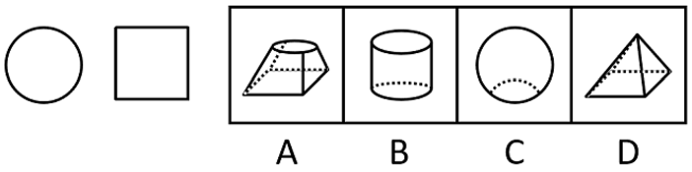

**A.** 见上方题图中 A 项。

**B.** 见上方题图中 B 项。

**C.** 见上方题图中 C 项。

**D.** 见上方题图中 D 项。

**答案：B**

### 第 47 题

`GD2022-XZ-Q047` · 单选 · 原卷第 5、6 页

下列选项中最符合所给图形规律的是：

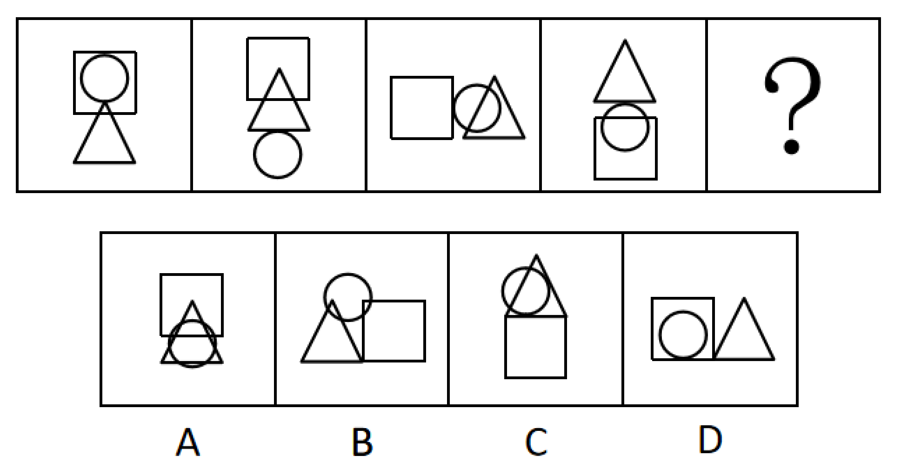

**A.** 见上方题图中 A 项。

**B.** 见上方题图中 B 项。

**C.** 见上方题图中 C 项。

**D.** 见上方题图中 D 项。

**答案：D**

### 第 48 题

`GD2022-XZ-Q048` · 单选 · 原卷第 6 页

下列选项中最符合所给图形规律的是：

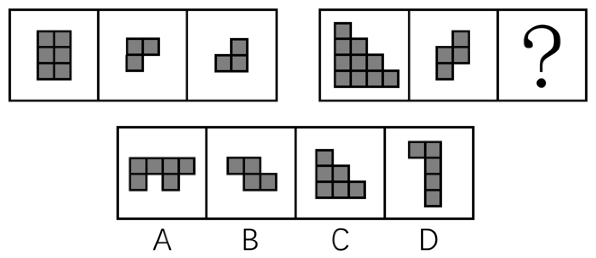

**A.** 见上方题图中 A 项。

**B.** 见上方题图中 B 项。

**C.** 见上方题图中 C 项。

**D.** 见上方题图中 D 项。

**答案：A**

### 第 49 题

`GD2022-XZ-Q049` · 单选 · 原卷第 6、7 页

如图所给的3个立方体为同一立方体，若不考虑立方体表面数字的大小、方向，下列选项中，最有可能是该立方体的是：

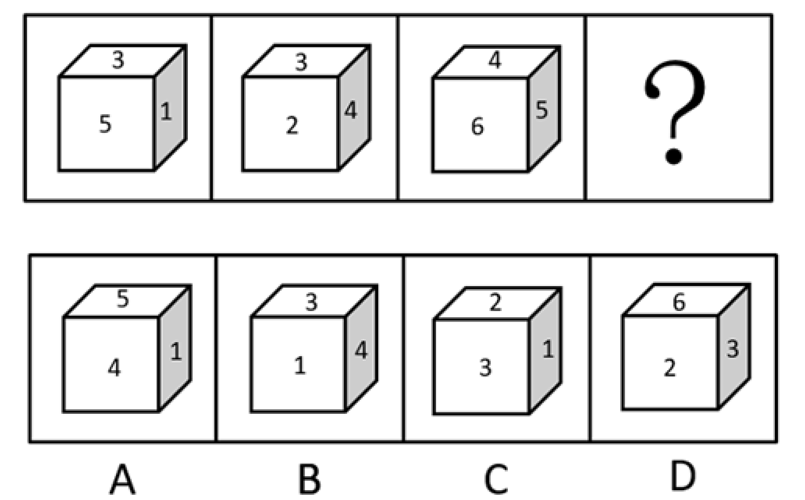

**A.** 见上方题图中 A 项。

**B.** 见上方题图中 B 项。

**C.** 见上方题图中 C 项。

**D.** 见上方题图中 D 项。

**答案：C**

### 第 50 题

`GD2022-XZ-Q050` · 单选 · 原卷第 7 页

如图是某立方体的平面展开图，则该立方体最可能是：

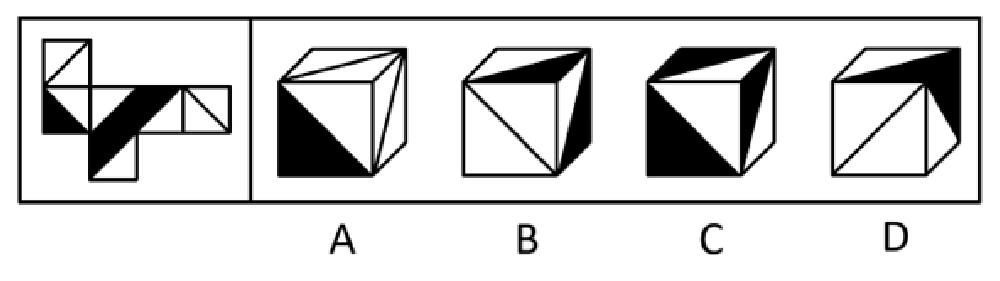

**A.** 见上方题图中 A 项。

**B.** 见上方题图中 B 项。

**C.** 见上方题图中 C 项。

**D.** 见上方题图中 D 项。

**答案：D**

### 第 51 题

`GD2022-XZ-Q051` · 单选 · 原卷第 7 页

从所给的四个选项中，选择最合适的一个填入问号处，使之呈现一定的规律性：

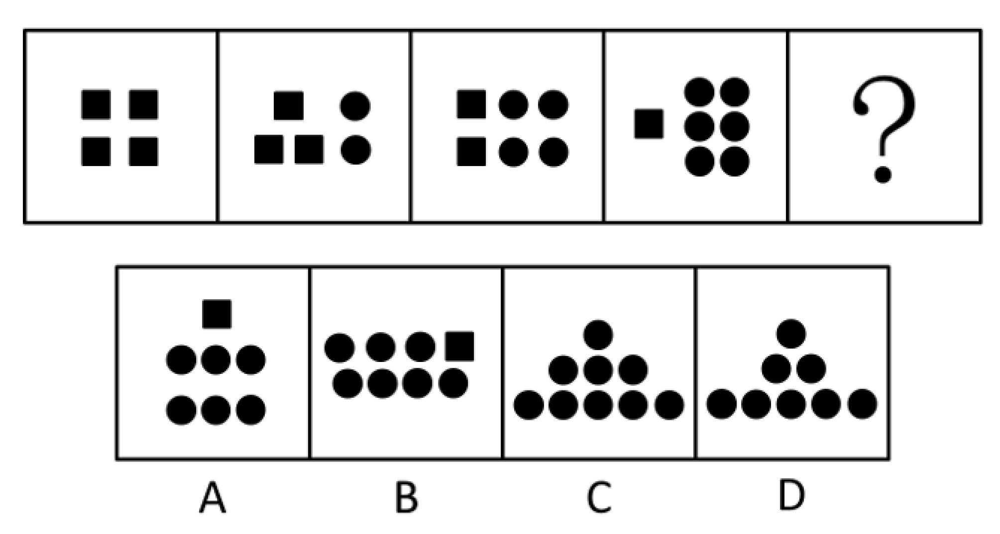

**A.** 见上方题图中 A 项。

**B.** 见上方题图中 B 项。

**C.** 见上方题图中 C 项。

**D.** 见上方题图中 D 项。

**答案：D**

### 第 52 题

`GD2022-XZ-Q052` · 单选 · 原卷第 7、8 页

从所给的四个选项中，选择最合适的一个填入问号处，使之呈现一定的规律性：

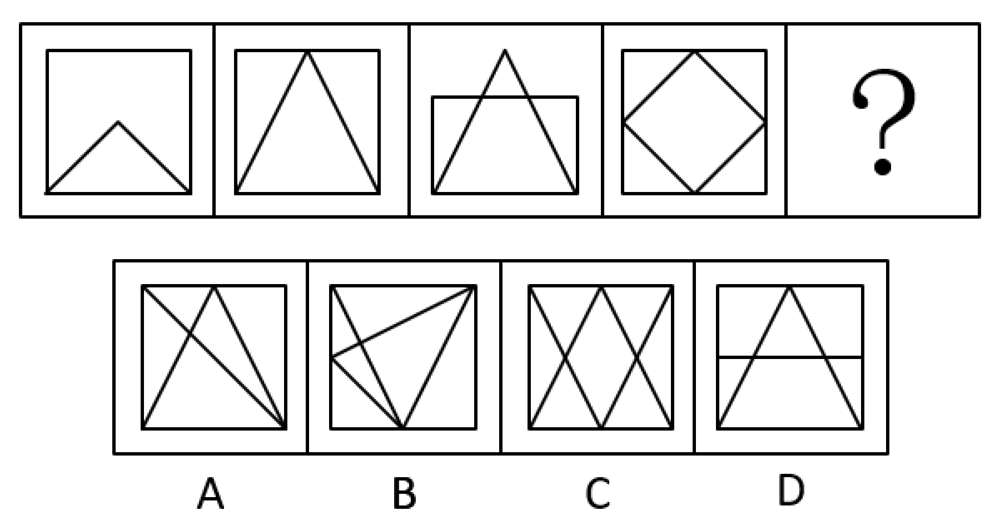

**A.** 见上方题图中 A 项。

**B.** 见上方题图中 B 项。

**C.** 见上方题图中 C 项。

**D.** 见上方题图中 D 项。

**答案：争议：D 或 B（原答案列出，不自行裁定）**

### 第 53 题

`GD2022-XZ-Q053` · 单选 · 原卷第 8 页

从所给的四个选项中，选择最合适的一个填入问号处，使之呈现一定的规律性：

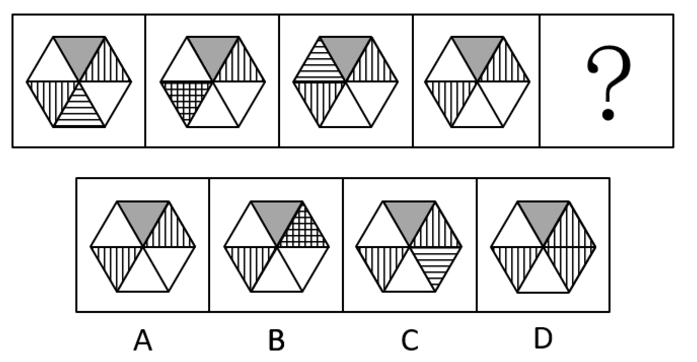

**A.** 见上方题图中 A 项。

**B.** 见上方题图中 B 项。

**C.** 见上方题图中 C 项。

**D.** 见上方题图中 D 项。

**答案：B**

### 第 54 题

`GD2022-XZ-Q054` · 单选 · 原卷第 8、9 页

下列选项中最符合所给图形规律的是：

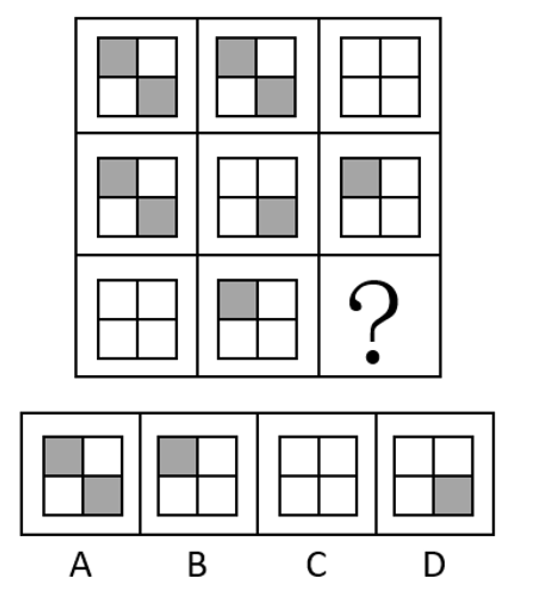

**A.** 见上方题图中 A 项。

**B.** 见上方题图中 B 项。

**C.** 见上方题图中 C 项。

**D.** 见上方题图中 D 项。

**答案：B**

### 第 55 题

`GD2022-XZ-Q055` · 单选 · 原卷第 9 页

下列选项中最符合所给图形规律的是：

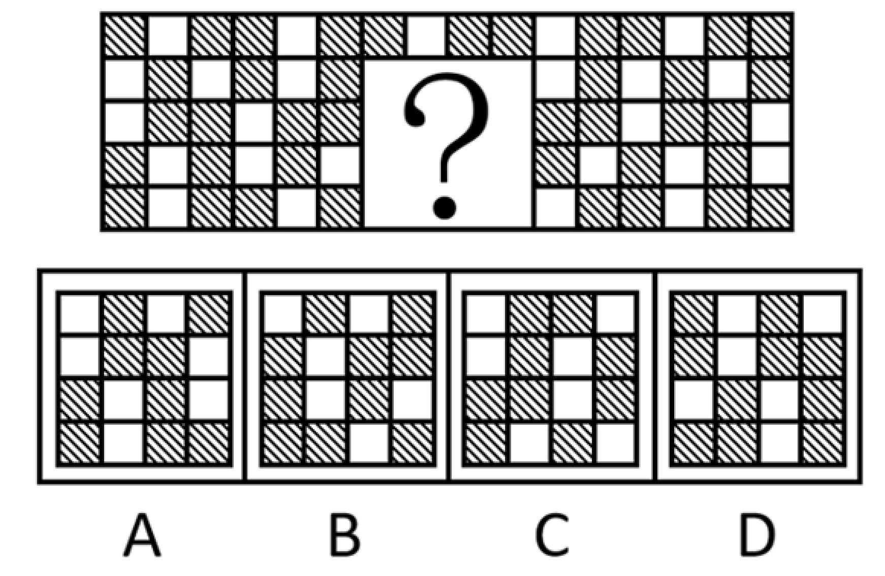

**A.** 见上方题图中 A 项。

**B.** 见上方题图中 B 项。

**C.** 见上方题图中 C 项。

**D.** 见上方题图中 D 项。

**答案：A**

### 第 56 题

`GD2022-XZ-Q056` · 单选 · 原卷第 9 页

默念：朗诵

**A.** 竞走：散步

**B.** 贩卖：赶集

**C.** 讲授：练习

**D.** 调节：管理

**答案：A**

### 第 57 题

`GD2022-XZ-Q057` · 单选 · 原卷第 10 页

书桌：椅子

**A.** 柜子：抽屉

**B.** 沙发：靠枕

**C.** 灯泡：插座

**D.** 窗户：玻璃

**答案：B**

### 第 58 题

`GD2022-XZ-Q058` · 单选 · 原卷第 10 页

航海：指南针

**A.** 粉笔：黑板报

**B.** 潜水：救生圈

**C.** 通信：屏蔽器

**D.** 驾驶：发动机

**答案：B**

### 第 59 题

`GD2022-XZ-Q059` · 单选 · 原卷第 10 页

创作：印刷：发行

**A.** 撒网：钓鱼：捕捞

**B.** 生产：研发：采购

**C.** 播种：开花：结果

**D.** 拆除：安装：维修

**答案：C**

### 第 60 题

`GD2022-XZ-Q060` · 单选 · 原卷第 10 页

法律：诉讼：胜败

**A.** 策略：经营：盈亏

**B.** 战争：武器：存亡

**C.** 判断：事实：对错

**D.** 教师：教学：优劣

**答案：A**

### 第 61 题

`GD2022-XZ-Q061` · 单选 · 原卷第 10 页

某单位将《稻穗》《播种》两件乡村新风摄影作品选送参赛。关于这两件作品能否获奖，该单位员工有以下猜测：
（1）两件作品都能获奖。
（2）只有一件作品能获奖。
（3）《稻穗》不会获奖。
（4）《播种》会获奖。
结果表明，其中只有一个猜测正确。则以下判断一定正确的是：

**A.** 《稻穗》获奖了

**B.** 《稻穗》没获奖

**C.** 《播种》获奖了

**D.** 《播种》没获奖

**答案：D**

### 第 62 题

`GD2022-XZ-Q062` · 单选 · 原卷第 10 页

某公司产品的各项性能都比竞争对手的更好。所以，如果该公司能够降低产品的市场定价，与竞争对手的价格持平，那么该公司产品一定会迅速占领市场。
下列选项若为真，最能削弱上述论断的是：

**A.** 该公司产品的生产成本较高，降低市场定价将会极大影响公司利润

**B.** 与竞争对手相比，该公司的产品宣传力度和售后服务不具显著优势

**C.** 该公司的生产规模很小，其产量仅能满足市场需求的百分之一

**D.** 该公司产品设计瞄准的是高端市场，降低价格不符合其市场定位

**答案：C**

### 第 63 题

`GD2022-XZ-Q063` · 单选 · 原卷第 10 页

有调查发现，某镇的乡村振兴工作中，由县农业部门工作人员担任驻村工作队队长的村庄其农业产业发展速度明显快于由其他部门工作人员担任驻村工作队队长的村庄。据此有人认为，县农业部门的工作人员更重视当地的农业产业发展，而农业产业发展是增加当地农民收入的重要手段，因此县农业部门的工作人员开展乡村振兴工作成效往往较好。
以下选项中属于上述论证过程中隐含前提的是：

**A.** 农业部门工作人员往往有更多农业产业相关的专业知识

**B.** 农民收入是评价乡村振兴工作成效的重要指标

**C.** 乡村振兴工作的成效只能用农业产业发展情况来衡量

**D.** 不同村庄农民收入在乡村振兴工作开展前基本持平

**答案：C**

### 第 64 题

`GD2022-XZ-Q064` · 单选 · 原卷第 10 页

某农村合作社购买了两台新型号收割机，这两台机器收割速度快，而且有助于减少收割过程中的粮食损失。
但该农村合作社使用这两台收割机以来，其玉米收割总损失率高达10%，较以往反而有所上升。
以下最能解释这一现象的是：

**A.** 使用收割机后，该农村合作社收割玉米的效率大幅提高

**B.** 两台收割机仅被用于收割部分田地的玉米

**C.** 操作人员培训不到位，操作收割机时常出现失误

**D.** 玉米并不是当地种植的主要粮食作物

**答案：C**

### 第 65 题

`GD2022-XZ-Q065` · 单选 · 原卷第 10 页

每一名战士都是英雄，每一名英雄都值得被纪念，因此每一名战士都值得被纪念。
下列选项的逻辑结构与题干最相似的是：

**A.** 艺术家往往是浪漫主义者，而有些浪漫主义者会感情用事，因此艺术家常会感情用事

**B.** 所有素食主义者都是人文主义者，而所有和平主义者都是人文主义者，因此素食主义者一定是和平主义者

**C.** 所有的科学家都是理性主义者，所有的理性主义者都是天生的哲学家。因此科学家都是天生的哲学家

**D.** 利己主义者总是以自身利益最大化作为行事准则，而单纯造求自身利益的最大化必然会损害到他人利益，因此利己主义者总会和他人发生冲突

**答案：C**

## 科学推理

### 第 66 题

`GD2022-XZ-Q066` · 单选 · 原卷第 11 页

关于水的净化方法和原理，下列说法不准确的是：

**A.** 静置沉淀可帮助去除水中大颗粒不溶性物质

**B.** 消毒剂消毒是利用化学方法杀灭水中的细菌

**C.** 蒸馏法可以去除水中的所有杂质

**D.** 过滤法可以降低水的硬度从而使硬水软化

**答案：D**

### 第 67 题

`GD2022-XZ-Q067` · 单选 · 原卷第 11 页

对下列生活中的现象或做法解释不合理的是：

**A.** 物体的热胀冷缩——分子随温度升高而变大

**B.** 油锅着火用锅盖盖灭——使可燃物与空气隔绝

**C.** 在铁制品表面刷油漆——避免铁制品氧化生锈

**D.** 利用真空袋包装食品——破坏需氧菌类的生存环境

**答案：A**

### 第 68 题

`GD2022-XZ-Q068` · 单选 · 原卷第 11 页

以下为甲、乙两车行驶情况的示意图，已知甲、乙同时从一起点出发，甲车在水平道路上匀速直线行驶，乙车在同一水平的道路上匀减速直线行驶，则在两车行驶的过程中，下列说法准确的是：

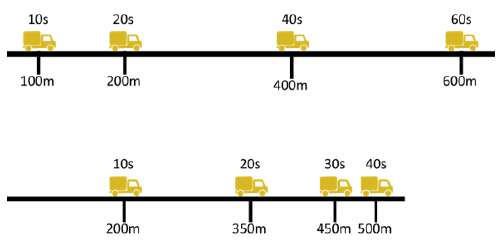

**A.** 甲车的速度为15m/s

**B.** 乙车的初始速度为25m/s

**C.** 45s 时，乙车行驶的路程更远

**D.** 50s 时，乙车仍处于行驶状态

**答案：C**

### 第 69 题

`GD2022-XZ-Q069` · 单选 · 原卷第 11 页

如图，小球在细绳的牵引下从 A 点自由摆动到 C 点，B 点是最低点。若忽略空气阻力，则下列说法不准确的是：

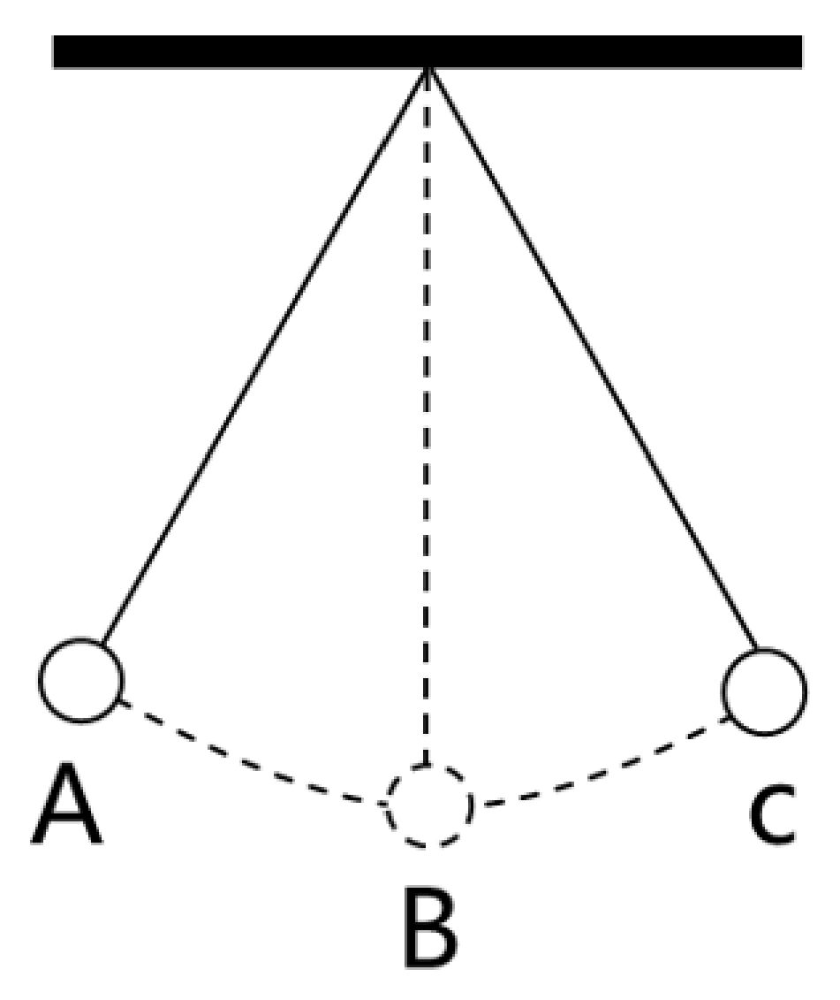

**A.** 从 A 点到 B 点小球的动能增加

**B.** 从 B 点到 C 点小球的势能增加

**C.** 在 B 点小球的动能最大

**D.** 从 A 点到 C 点小球的机械能增加

**答案：D**

### 第 70 题

`GD2022-XZ-Q070` · 单选 · 原卷第 12 页

为提升其行驶过程的稳定性，挖掘机装有履带，其原理是：

**A.** 减小挖掘机对地面的压强

**B.** 增大挖掘机对地面的压强

**C.** 减小挖掘机对地面的压力

**D.** 增大挖掘机对地面的压力

**答案：A**

### 第 71 题

`GD2022-XZ-Q071` · 单选 · 原卷第 12 页

如图，甲、乙叠放在一起，静置于地面上。此时，乙受到一个水平向右的拉力 F，但甲、乙仍然保持静止状态，在此过程中，以下说法准确的是：

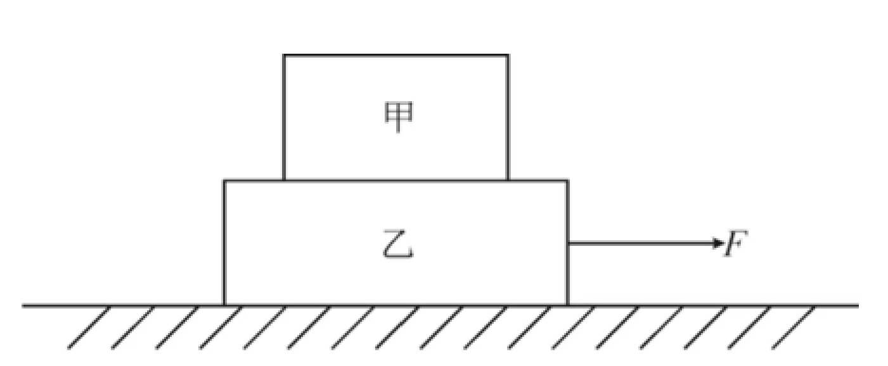

**A.** 甲和乙之间至少有2对相互作用力

**B.** 乙对甲的支持力比甲受到的重力大

**C.** 如果拉力 F 方向向左，甲、乙将不再保持静止

**D.** 乙受到的地面摩擦力等于拉力 F

**答案：D**

### 第 72 题

`GD2022-XZ-Q072` · 单选 · 原卷第 12 页

将如图所示卡片面向平面镜时，则该卡片在平面镜中的成像最可能是：

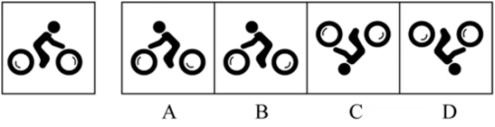

**A.** 见上方题图中 A 项。

**B.** 见上方题图中 B 项。

**C.** 见上方题图中 C 项。

**D.** 见上方题图中 D 项。

**答案：B**

### 第 73 题

`GD2022-XZ-Q073` · 单选 · 原卷第 12 页

关于常见用电器的工作情况，以下说法不准确的是：

**A.** 道路两边的路灯定时开关，晚上同时亮，早晨同时灭，则所有路灯是串联的

**B.** 抽油烟机里的照明灯和电动机，既能同时工作，又能单独工作，则照明灯和电动机是并联的

**C.** 楼道中的感应电灯是由声控开关和光控开关共同控制的，只有在没有光线且出现声音时才能亮起，则电灯和声控开关、光控开关是串联的

**D.** 电吹风里的电热丝和电动机，可以控制出风温度，则电热丝和电动机是并联的

**答案：A**

### 第 74 题

`GD2022-XZ-Q074` · 单选 · 原卷第 12、13 页

如图是某家庭电路图的一部分，家庭内各电器均正确接入电路。则以下说法准确的是：

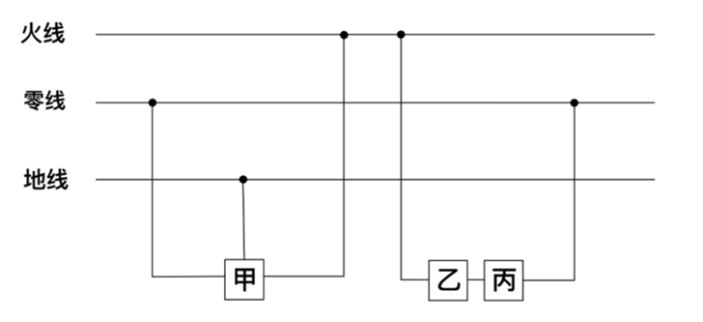

**A.** 假如乙和甲分别是电器或开关，则丙是开关

**B.** 假如电路正常，正确使用试电笔接触三孔插座的孔都会显示有电流

**C.** 假如甲是带金属外壳的用电器，则它接的是三孔插座

**D.** 假如零线被烧断，应立即关闭开关，否则会引起短路

**答案：C**

### 第 75 题

`GD2022-XZ-Q075` · 单选 · 原卷第 13 页

如图是甲、乙两车在同一道路上匀速行驶时路程 s 随时间 t 变化的曲线图，则在两车行驶的过程中，下列说法准确的是：

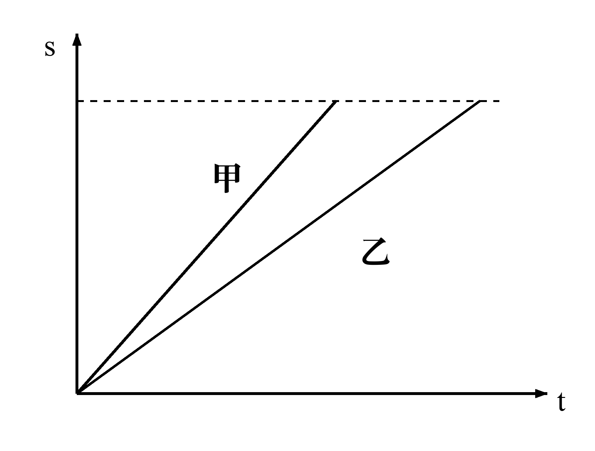

**A.** 甲车的速度比乙车大

**B.** 相同时间内，乙车行驶路程更长

**C.** 甲、乙两车均沿直线运动

**D.** 甲、乙两车间距离始终保持不变

**答案：A**

### 第 76 题

`GD2022-XZ-Q076` · 单选 · 原卷第 13、14 页

如图，甲、乙两个相同的容器中盛着不同的液体，当相同的小球漂浮在容器中并保持静止时，容器中液面的高度相同，则下列说法准确的是：

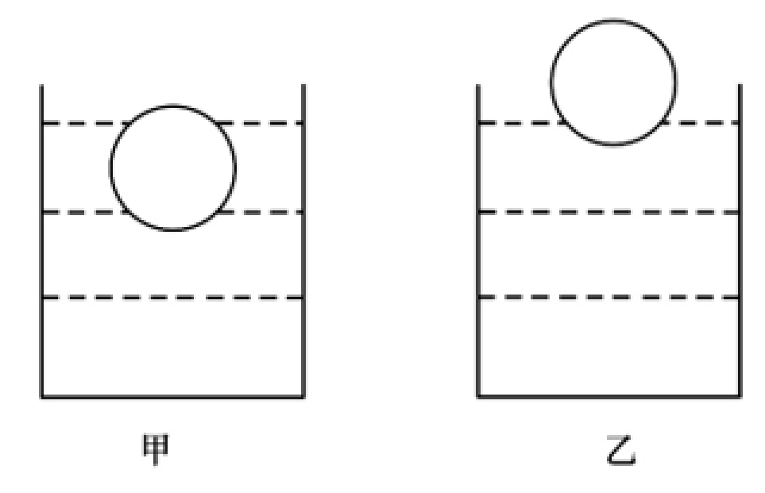

**A.** 小球在甲容器中受到浮力比在乙容器中的小

**B.** 小球在甲容器中受到浮力比在乙容器中的大

**C.** 甲容器中液体的密度比乙容器中液体的小

**D.** 甲容器中液体的密度比乙容器中液体的大

**答案：C**

### 第 77 题

`GD2022-XZ-Q077` · 单选 · 原卷第 14 页

如图，物体 A、B 分别位于木板上下方，且处于静止状态，如果将物体 B 往左移动一段距离，但仍位于木板下方，则下列说法准确的是：

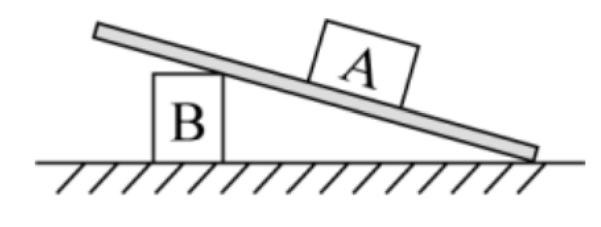

**A.** 物体 A 所受合力为零

**B.** 物体 A 所受的摩擦力增加

**C.** 木板对物体 A 的作用力减小

**D.** 木板对物体 A 的作用力增加

**答案：A**

### 第 78 题

`GD2022-XZ-Q078` · 单选 · 原卷第 14 页

如图是某种固态物质在加热过程中，温度随时间变化的图像。下列说法最不准确的是：

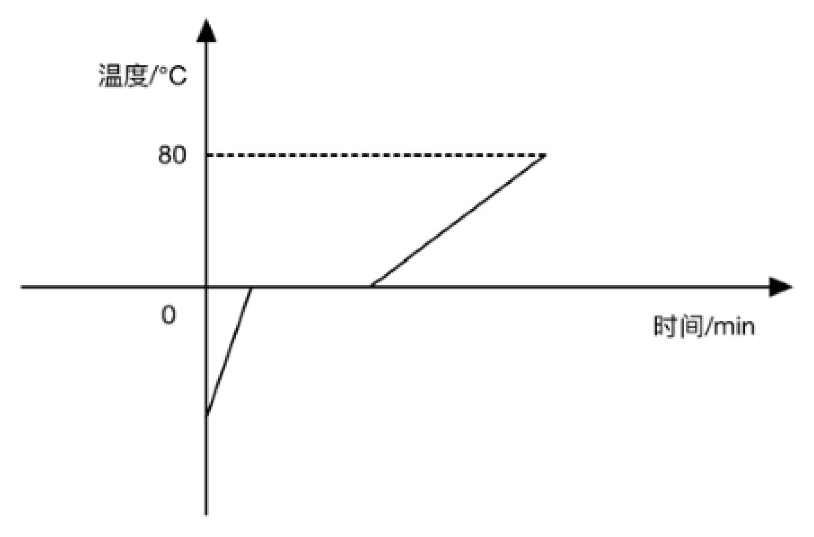

**A.** 该固态物质有固定的熔点

**B.** 该固态物质在熔化过程中，比热容增大

**C.** 温度为0℃时，该物质可能处于固液共存状态

**D.** 该固态物质在熔化时不断吸收热量，温度不断升高

**答案：D**

### 第 79 题

`GD2022-XZ-Q079` · 单选 · 原卷第 14 页

2021年9月17日，神舟十二号在甘肃酒泉东风着陆场顺利着陆。那么，酒泉当地气候和当天昼长情况最有可能是：

**A.** 干旱少雨，着陆当天昼长夜短

**B.** 干旱少雨，着陆当天昼短夜长

**C.** 湿润多雨，着陆当天昼长夜短

**D.** 湿润多雨，着陆当天昼短夜长

**答案：A**

### 第 80 题

`GD2022-XZ-Q080` · 单选 · 原卷第 14 页

食物链主要反映了生产者与消费者之间的联系，下列关系中最能准确表示食物链的是：

**A.** 草→兔→狐→鹰

**B.** 阳光→草→鸡→狼

**C.** 虫→鸟→蛇

**D.** 草→羊→虎→微生物

**答案：A**

### 第 81 题

`GD2022-XZ-Q081` · 单选 · 原卷第 14、15 页

如图，用绳子分别将两颗不同的磁力球M₁和M₂系在上、下两个平面上，M₁、M₂互相吸引，此时上平面对M₁的作用力为F₁，下平面对M₂的作用力为F₂，则以下关于F₁、F₂说法准确的是：

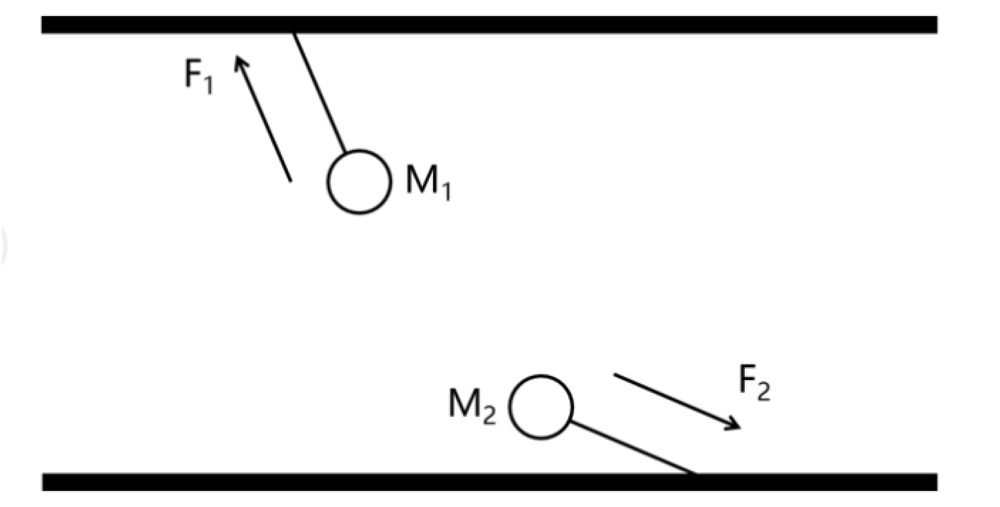

**A.** F₁大于F₂

**B.** F₁等于F₂

**C.** F₁小于F₂

**D.** 无法判断

**答案：A**

> 转写说明：原文部分符号缺失，经用户确认，按原图的M₁、M₂、F₁、F₂标记恢复；未改动数值、关系或答案。

### 第 82 题

`GD2022-XZ-Q082` · 单选 · 原卷第 15 页

果树的光合作用主要通过绿叶进行，因此绿叶被称为“食物加工厂”。关于绿叶，下列说法最不准确的是：

**A.** 通过光合作用，绿叶只能生成碳水化合物

**B.** 叶片可以通过表皮的气孔与外界进行气体交换

**C.** 叶脉可以运输水分和无机物

**D.** 光能主要在叶绿体内转化为化学能

**答案：A**

### 第 83 题

`GD2022-XZ-Q083` · 单选 · 原卷第 15 页

某蔬菜种植户在农田中种植圆白菜时，采取了以下措施。关于这些情形的解释最不准确的是：

**A.** 圆白菜和玉米间作套种——提高农田利用率

**B.** 育苗时覆盖地膜——提高地表温度、保持土壤湿度

**C.** 长期使用化肥——可就地取材，并能改良土壤结构

**D.** 移栽圆白菜幼苗时带着土坨——保护幼根和根毛

**答案：C**

### 第 84 题

`GD2022-XZ-Q084` · 单选 · 原卷第 15 页

为了缓解或者降低行驶车辆发出的噪音对居民的影响，常在离民居较近的高架桥两旁修建隔音墙。对此，下列关于隔音墙说法最不准确的是：

**A.** 可以吸收汽车产生的噪音

**B.** 可以反射汽车产生的噪音

**C.** 出现破裂会影响隔音效果

**D.** 可以从源头上减少噪音

**答案：D**

### 第 85 题

`GD2022-XZ-Q085` · 单选 · 原卷第 15、16 页

如图是某地生态系统的蒸散示意图，下列说法最准确的是：

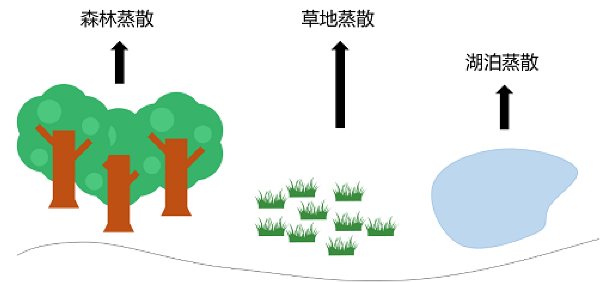

**A.** 环境温度升高，森林的蒸散作用减弱

**B.** 空气湿度越大，森林的蒸散作用越弱

**C.** 任意环境条件下，湖泊的蒸发量比森林蒸散量大

**D.** 相较于夜晚，该地生态系统在白天时蒸散作用强度明显减弱

**答案：B**

## 资料分析

### 共用材料：第 86—90 题

基层群众性自治组织是我国在城市和农村按居民的居住地区建立起来的居民委员会或村民委员会，是城市居民或农村村民自我管理、自我教育、自我服务的组织。
截止2020年底，全国基层群众性自治组织共计61.5万个，同比减少4.35%。其中，村委会50.2万个，占基层群众性自治组织的81.63%，村民小组376.1万个，村委会成员207.3万人；居委会11.3万个，占基层群众性自治组织的18.37%，居民小组123.6万个，居委会成员61.6万人。2016-2020年，我国村（居）委会完成选举数分别为9.7万个、18.2万个、27.6万个、8.8万个、6.1万个，其中，2020年村（居）委会登记选民数为1.1亿人，参与投票人数为0.65亿人。

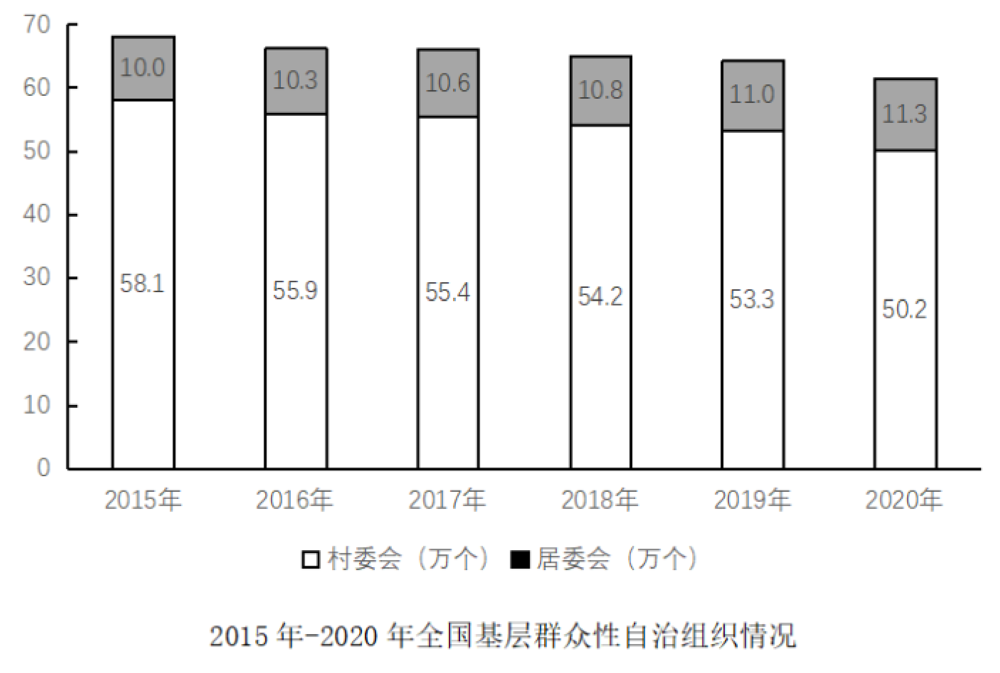

2015—2020年全国基层群众性自治组织情况

| 年份 | 村委会（万个） | 居委会（万个） |
| --- | --- | --- |
| 2015 | 58.1 | 10.0 |
| 2016 | 55.9 | 10.3 |
| 2017 | 55.4 | 10.6 |
| 2018 | 54.2 | 10.8 |
| 2019 | 53.3 | 11.0 |
| 2020 | 50.2 | 11.3 |

### 第 86 题

`GD2022-XZ-Q086` · 单选 · 原卷第 17 页

[共用材料](#GD2022-XZ-M1)

2020年，全国基层群众性自治组织较上年减少（）万个。

**A.** 1.4

**B.** 2.8

**C.** 4.2

**D.** 5.6

**答案：B**

### 第 87 题

`GD2022-XZ-Q087` · 单选 · 原卷第 17 页

[共用材料](#GD2022-XZ-M1)

相较2019年，2020年村委会占基层群众性自治组织的比重：

**A.** 降低了约1.26个百分点

**B.** 提高了约1.26个百分点

**C.** 降低了约12.6个百分点

**D.** 提高了约12.6个百分点

**答案：A**

### 第 88 题

`GD2022-XZ-Q088` · 单选 · 原卷第 17 页

[共用材料](#GD2022-XZ-M1)

以下年份中，我国村(居)委会完成选举数同比增幅最大的是：

**A.** 2017年

**B.** 2018年

**C.** 2019年

**D.** 2020年

**答案：A**

### 第 89 题

`GD2022-XZ-Q089` · 单选 · 原卷第 17 页

[共用材料](#GD2022-XZ-M1)

2020年，平均每个村委会下辖的村民小组约（）个。

**A.** 3.5

**B.** 5.5

**C.** 7.5

**D.** 9.5

**答案：C**

### 第 90 题

`GD2022-XZ-Q090` · 单选 · 原卷第 17 页

[共用材料](#GD2022-XZ-M1)

根据所给材料，下列说法最准确的是：

**A.** 2020年，村民小组数量是居民小组数量的5倍

**B.** 2020年，平均每个村委会的成员数量超过4人

**C.** 2020年，超过60%的登记选民参与了投票

**D.** 2015-2020年，村委会数量与居委会数量的变化趋势一致

**答案：B**

### 共用材料：第 91—95 题

增加森林面积、提高森林质量、提升生态系统碳汇增量，将为我国实现碳达峰、碳中和目标、维护全球生态安全做出巨大贡献。1973年，我国开展了第一次森林资源清查。目前已完成第9次森林资源清查，我国森林面积和森林蓄积量连续30年保持“双增长”。“十三五”时期，我国累计造林5.45亿亩，森林覆盖率达到23.04%，森林蓄积量为175.6亿立方米，森林面积达到2.2亿公顷（1公顷为15亩）。湿地保护率达到52%，治理沙化土地1.5亿亩。

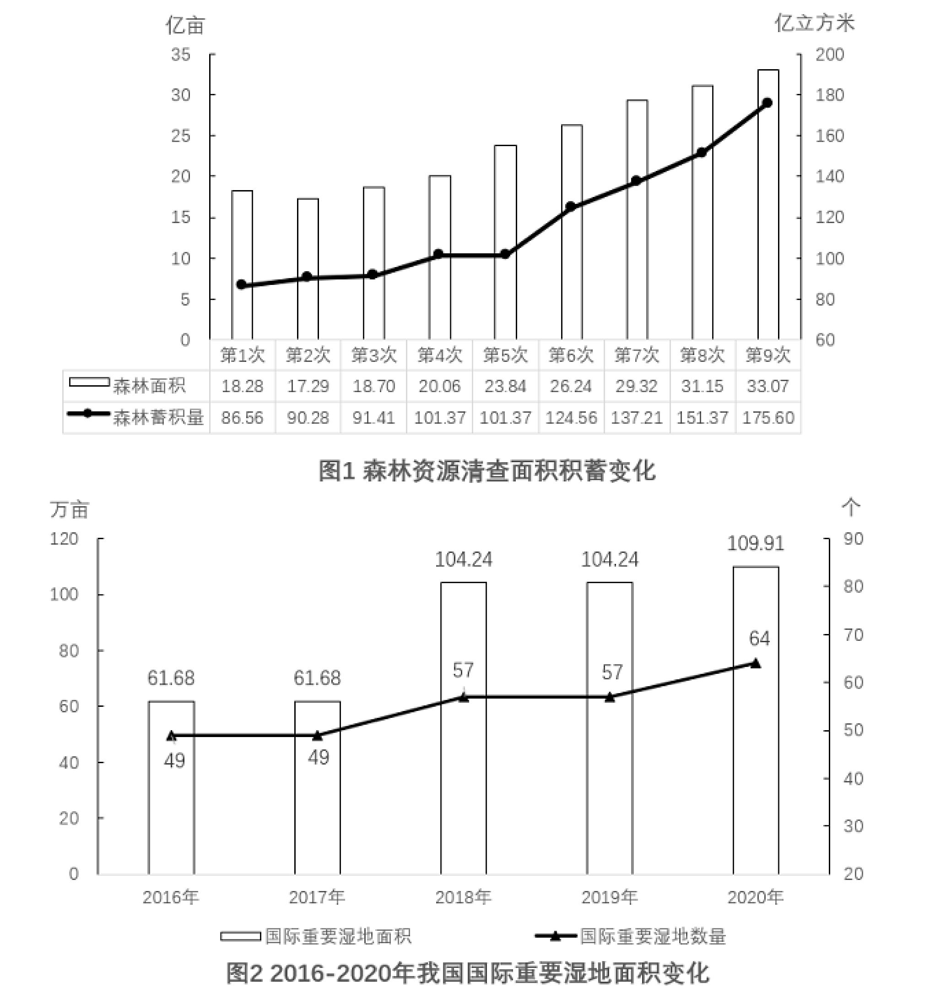

图1 森林资源清查面积和蓄积变化

| 清查次数 | 森林面积（亿亩） | 森林蓄积量（亿立方米） |
| --- | --- | --- |
| 1 | 18.28 | 86.56 |
| 2 | 17.29 | 90.28 |
| 3 | 18.70 | 91.41 |
| 4 | 20.06 | 101.37 |
| 5 | 23.84 | 101.37 |
| 6 | 26.24 | 124.56 |
| 7 | 29.32 | 137.21 |
| 8 | 31.15 | 151.37 |
| 9 | 33.07 | 175.60 |

图2 2016—2020年我国国际重要湿地面积变化

| 年份 | 国际重要湿地面积（万亩） | 国际重要湿地数量（个） |
| --- | --- | --- |
| 2016 | 61.68 | 49 |
| 2017 | 61.68 | 49 |
| 2018 | 104.24 | 57 |
| 2019 | 104.24 | 57 |
| 2020 | 109.91 | 64 |

### 第 91 题

`GD2022-XZ-Q091` · 单选 · 原卷第 18 页

[共用材料](#GD2022-XZ-M2)

“十三五”期间，我国平均每公顷森林蓄积量达到（）立方米。

**A.** 5.3

**B.** 32.2

**C.** 79.8

**D.** 98.6

**答案：C**

### 第 92 题

`GD2022-XZ-Q092` · 单选 · 原卷第 18 页

[共用材料](#GD2022-XZ-M2)

相比第1次森林资源清查，第9次森林资源清查时，我国森林覆盖率提高了约（）个百分点。（本材料中森林覆盖率为森林面积占国土面积的百分比）

**A.** 10

**B.** 15

**C.** 20

**D.** 25

**答案：A**

### 第 93 题

`GD2022-XZ-Q093` · 单选 · 原卷第 18 页

[共用材料](#GD2022-XZ-M2)

2016-2018年，我国国际重要湿地面积的年均增长率约为：

**A.** 25%

**B.** 30%

**C.** 35%

**D.** 40%

**答案：B**

### 第 94 题

`GD2022-XZ-Q094` · 单选 · 原卷第 18、19 页

[共用材料](#GD2022-XZ-M2)

以下选项中，最准确地反映了2017-2020年我国国际重要湿地面积、数量同步增速变化情况的是：

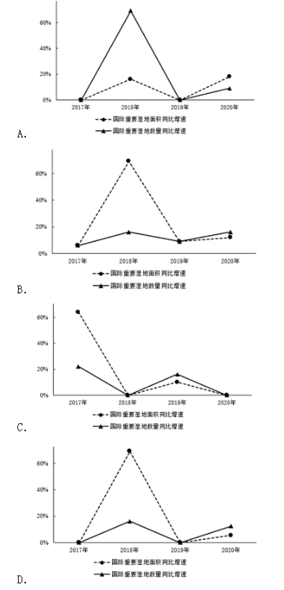

**A.** 见上方题图中 A 项。

**B.** 见上方题图中 B 项。

**C.** 见上方题图中 C 项。

**D.** 见上方题图中 D 项。

**答案：D**

### 第 95 题

`GD2022-XZ-Q095` · 单选 · 原卷第 19 页

[共用材料](#GD2022-XZ-M2)

根据以上资料，下列说法不准确的是：

**A.** 我国森林蓄积量较前一次森林资源清查增幅最大的是第6次森林资源清查

**B.** 第5次至第9次森林资源清查，我国森林面积和森林蓄积量的变化趋势一致

**C.** 2016-2020年，我国平均每年增加国际重要湿地超过3个

**D.** 2017-2020年，我国平均每个国际重要湿地面积同比增幅最大的年份是2020年

**答案：D**

### 共用材料：第 96—100 题

近年来，全国基层卫生服务能力稳步提升，居民健康水平进一步提高。2020年，我国农村乡镇卫生院卫生人员数达148.1万人，比上年增加3.6万人，社区卫生人员数达52.1万人，比上年增加3.3万人。

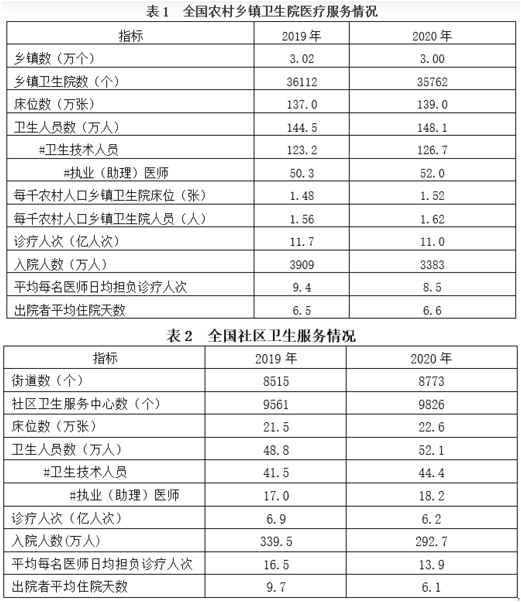

表1 全国农村乡镇卫生院医疗服务情况

| 指标 | 2019年 | 2020年 |
| --- | --- | --- |
| 乡镇数（万个） | 3.02 | 3.00 |
| 乡镇卫生院数（个） | 36112 | 35762 |
| 床位数（万张） | 137.0 | 139.0 |
| 卫生人员数（万人） | 144.5 | 148.1 |
| 其中：卫生技术人员（万人） | 123.2 | 126.7 |
| 其中：执业（助理）医师（万人） | 50.3 | 52.0 |
| 每千农村人口乡镇卫生院床位（张） | 1.48 | 1.52 |
| 每千农村人口乡镇卫生院人员（人） | 1.56 | 1.62 |
| 诊疗人次（亿人次） | 11.7 | 11.0 |
| 入院人数（万人） | 3909 | 3383 |
| 平均每名医师日均担负诊疗人次 | 9.4 | 8.5 |
| 出院者平均住院天数 | 6.5 | 6.6 |

表2 全国社区卫生服务情况

| 指标 | 2019年 | 2020年 |
| --- | --- | --- |
| 街道数（个） | 8515 | 8773 |
| 社区卫生服务中心数（个） | 9561 | 9826 |
| 床位数（万张） | 21.5 | 22.6 |
| 卫生人员数（万人） | 48.8 | 52.1 |
| 其中：卫生技术人员（万人） | 41.5 | 44.4 |
| 其中：执业（助理）医师（万人） | 17.0 | 18.2 |
| 诊疗人次（亿人次） | 6.9 | 6.2 |
| 入院人数（万人） | 339.5 | 292.7 |
| 平均每名医师日均担负诊疗人次 | 16.5 | 13.9 |
| 出院者平均住院天数 | 9.7 | 6.1 |

### 第 96 题

`GD2022-XZ-Q096` · 单选 · 原卷第 20 页

[共用材料](#GD2022-XZ-M3)

2020年，全国农村乡镇卫生院中，卫生人员数同比增长约：

**A.** 1.4%

**B.** 2.5%

**C.** 3.6%

**D.** 4.7%

**答案：B**

### 第 97 题

`GD2022-XZ-Q097` · 单选 · 原卷第 20 页

[共用材料](#GD2022-XZ-M3)

2020年，全国社区卫生服务中心平均每名医师全年担负诊疗人次比全国农村乡镇卫生院的约多（）人次。

**A.** 1576

**B.** 1976

**C.** 2376

**D.** 2776

**答案：B**

### 第 98 题

`GD2022-XZ-Q098` · 单选 · 原卷第 20、21 页

[共用材料](#GD2022-XZ-M3)

2020年，平均每个乡镇床位数约为每个街道床位数的（）倍。

**A.** 0.5

**B.** 2

**C.** 3

**D.** 4

**答案：B**

### 第 99 题

`GD2022-XZ-Q099` · 单选 · 原卷第 21 页

[共用材料](#GD2022-XZ-M3)

2020年，全国农村乡镇卫生院卫生人员中，执业（助理）医师占比约为：

**A.** 25%

**B.** 30%

**C.** 35%

**D.** 40%

**答案：C**

### 第 100 题

`GD2022-XZ-Q100` · 单选 · 原卷第 21 页

[共用材料](#GD2022-XZ-M3)

根据所给材料，下列说法最不准确的是：

**A.** 与2019年相比，2020年全国乡镇卫生院卫生技术人员和社区卫生服务中心卫生技术人员均有所增加

**B.** 2020年，平均每个街道社区卫生服务中心数与2019年基本持平

**C.** 2019-2020年，全国乡镇卫生院年平均入院人数是全国社区服务中心的十倍以上

**D.** 2019年，全国农村人口约为8亿

**答案：D**

