# 2026年广东行测（网友回忆版）

共 90 题，原题号与重复题完整保留。内容：题干、选项、答案；资料分析共用材料置于所属题组前，JSONL 每条记录完整内嵌材料。

[结构化数据](GD2026.jsonl) · [格式说明](README.md)

原题来源：[2026年广东省公务员录用考试《行测》题（网友回忆版）(1).pdf](https://github.com/dumarstoft-ship-it/xing-ce1/blob/4cb13da865dcef6bb6d3731f8ae2981186a1a314/%E7%9C%9F%E9%A2%98/2026%E5%B9%B4%E5%B9%BF%E4%B8%9C%E7%9C%81%E5%85%AC%E5%8A%A1%E5%91%98%E5%BD%95%E7%94%A8%E8%80%83%E8%AF%95%E3%80%8A%E8%A1%8C%E6%B5%8B%E3%80%8B%E9%A2%98%EF%BC%88%E7%BD%91%E5%8F%8B%E5%9B%9E%E5%BF%86%E7%89%88%EF%BC%89%281%29.pdf)。

## 政治理论

### 第 1 题

`GD2026-Q001` · 判断 · 原卷第 2 页

（判断题）广东增创新优势、实现新突破，必须大力弘扬改革开放精神、特区精神，以全面深化改革开放推动高质量发展。（）

**答案：缺失（仓库未提供配套答案）**

### 第 2 题

`GD2026-Q002` · 判断 · 原卷第 2 页

（判断题）农业农村现代化关系中国式现代化全局和成色。（）

**答案：缺失（仓库未提供配套答案）**

### 第 3 题

`GD2026-Q003` · 判断 · 原卷第 2 页

（判断题）现代化产业体系是中国式现代化的物质技术基础。（）

**答案：缺失（仓库未提供配套答案）**

### 第 4 题

`GD2026-Q004` · 判断 · 原卷第 2 页

（判断题）生产关系是人类社会发展的根本动力，也是一切社会变迁和政治变革的终极原因。（）

**答案：缺失（仓库未提供配套答案）**

### 第 5 题

`GD2026-Q005` · 单选 · 原卷第 2 页

习近平总书记指出：“必须坚持守正创新。我们从事的是前无古人的伟大事业，守正才能不迷失方向，不犯颠覆性错误，创新才能把握时代、引领时代。”关于守正创新，以下说法有误的是（）。

**A.** 创新是守正的基础和前提

**B.** 创新是守正的目的和路径

**C.** 守正创新揭示了“变”与“不变”、继承与发展的辩证统一

**D.** 守正就是坚持实事求是，坚持真理性认识，坚持正确的政治方向

**答案：缺失（仓库未提供配套答案）**

### 第 6 题

`GD2026-Q006` · 单选 · 原卷第 2 页

推进碳达峰碳中和是党中央作出的重大战略决策，是我们对国际社会的庄严承诺，也是推动经济结构转型升级、形成绿色低碳产业竞争优势，实现高质量发展的内在要求。以下有关推进碳达峰碳中和的表述，最准确的是（）。

**A.** 实现碳达峰碳中和，时间紧任务重，各地应加快步调，通过“碳冲锋”“运动式减碳”尽快实现目标

**B.** 对于碳排放较高的传统行业，应优先关停、清退，确有较高经济价值的，逐步引导实现绿色低碳转型

**C.** 积极落实《联合国气候变化框架公约》，与世界各国协商确定达到“双碳”目标的路径和方式、节奏和力度

**D.** 要优化调整产业结构，大力发展绿色低碳产业，使发展建立在高效利用资源、严格保护生态环境、有效控制温室气体排放的基础上

**答案：缺失（仓库未提供配套答案）**

### 第 7 题

`GD2026-Q007` · 单选 · 原卷第 2 页

习近平总书记指出：“宪法作为上层建筑，一定要适应经济基础的变化而变化。任何国家都不可能制定一部永远适用的宪法。”下列古语与这一观点最为契合的是（）。

**A.** 理国要道，在于公平正直

**B.** 法与时转则治，治与世宜则有功

**C.** 盖天下之事，不难于立法，而难于法之必行

**D.** 举直错诸枉，则民服；举枉错诸直，则民不服

**答案：缺失（仓库未提供配套答案）**

### 第 8 题

`GD2026-Q008` · 单选 · 原卷第 2 页

水是生存之本、文明之源，水安全是涉及国家长治久安的大事。为了解决好水安全问题，下列说法有误的是（）。

**A.** 要按照“节水优先、空间均衡、系统治理、两手发力”的方针治水

**B.** 要统筹做好水灾害防治、水资源节约、水生态保护修复、水环境治理

**C.** 要树立节约用水就是保护生态、保护水源就是保护家园的意识，坚决抑制不合理用水需求

**D.** 要根据人口、城市和产业发展规划，因地制宜发掘更多水资源，避免水资源成为发展的约束条件

**答案：缺失（仓库未提供配套答案）**

### 第 9 题

`GD2026-Q009` · 多选 · 原卷第 2 页

（多选题）中国共产党在领导人民进行革命、建设、改革的长期实践中，逐步形成和确定了一条正确的思想路线······这条思想路线是中国共产党对马克思主义理论发展作出的重大贡献，其核心是实事求是。关于“实事求是”，以下表述正确的有（）。

**A.** 想问题、做决策、办事情，应当从本本出发

**B.** 实事求是是中国共产党人的基本思想方法、工作方法和领导方法

**C.** 坚持实事求是，最基础的工作在于“求是”，关键在于搞清楚“事实”

**D.** 实事求是是党领导人民推动中国革命、建设、改革事业不断取得胜利的重要法宝

**答案：缺失（仓库未提供配套答案）**

### 第 10 题

`GD2026-Q010` · 多选 · 原卷第 2、3 页

（多选题）物质范畴是一切唯物主义哲学的理论基石。马克思主义的物质范畴是一个高度抽象的哲学概念，是对世界上客观存在的各种事物共同本质的概括。关于马克思主义的物质范畴，下列选项正确的有（）。

**A.** 物质的根本属性是运动

**B.** 世界的本原是多种物质的集合

**C.** 物质是标志客观实在的哲学范畴

**D.** 物质资料的生产方式构成了人类社会存在的基础

**答案：缺失（仓库未提供配套答案）**

## 常识判断

### 第 11 题

`GD2026-Q011` · 单选 · 原卷第 3 页

科学制定和接续实施五年规划，是我们党治国理政一条重要经验。下列有关五年规划（计划）的表述，正确的是（）。

**A.** 2024年是“十四五”规划收官之年

**B.** 1949年起，我国实施第一个五年计划

**C.** 从“十三五”开始，“五年计划”更名为“五年规划”

**D.** 一以贯之的主题是把我国建设成为社会主义现代化国家

**答案：缺失（仓库未提供配套答案）**

### 第 12 题

`GD2026-Q012` · 单选 · 原卷第 3 页

“十四五”时期，我国经济社会发展取得了非凡成就。下列有关“十四五”时期我国取得的成就，说法不准确的是（）。

**A.** 建成了全球数量最多的5G基站

**B.** 成为全球“增绿”最多最快的国家

**C.** 拥有世界上规模最大的高等收入群体

**D.** 制造业增加值连续15年稳居世界第一

**答案：缺失（仓库未提供配套答案）**

### 第 13 题

`GD2026-Q013` · 单选 · 原卷第 3 页

近年来，港珠澳大桥、深中通道等粤港澳大湾区跨江跨海通道相继开通，推动形成大湾区“路相连、人相通、心相融”的融合面貌。关于粤港澳大湾区跨江跨海通道，以下说法有误的是（）。

**A.** 黄茅海大桥是珠江口首座跨江大桥

**B.** 港珠澳大桥是连接粤港澳三地的超大型跨海交通工程

**C.** 虎门大桥是中国自行设计建造的第一座特大型悬索桥

**D.** 深中通道是集“桥、岛、隧、水下互通”为一体的跨海集群工程

**答案：缺失（仓库未提供配套答案）**

### 第 14 题

`GD2026-Q014` · 单选 · 原卷第 3 页

根据《中华人民共和国国歌法》，中华人民共和国国歌是中华人民共和国的象征和标志。一切公民和组织都应当尊重国歌，维护国歌的尊严。下列场合对国歌的使用，违反我国国歌法的是（）。

**A.** 某小学每周举行升国旗仪式时奏唱国歌

**B.** 某省级重大综合体育赛事开幕式奏唱国歌

**C.** 某市中心广场将国歌用作公共场所的背景音乐

**D.** 某市级机关举行先进工作者表彰仪式时奏唱国歌

**答案：缺失（仓库未提供配套答案）**

### 第 15 题

`GD2026-Q015` · 单选 · 原卷第 3 页

党的二十届四中全会通过的《中共中央关于制定国民经济和社会发展第十五个五年规划的建议》提出“培育壮大新兴产业和未来产业”。以下不属于新兴产业的是（）。

**A.** 船舶

**B.** 新材料

**C.** 低空经济

**D.** 航空航天

**答案：缺失（仓库未提供配套答案）**

## 言语理解与表达

### 第 16 题

`GD2026-Q016` · 单选 · 原卷第 3 页

创新从来都是九死一生，但我们必须有“亦余心之所善兮，虽九死其犹未悔”的豪情。我国广大科技工作者要有强烈的创新信心和决心，既不____，也不妄自尊大，勇于攻坚克难、追求卓越、赢得胜利，积极抢占科技竞争和未来发展制高点。
填入画横线部分最恰当的一项是：

**A.** 固步自封

**B.** 骄傲自满

**C.** 妄自菲薄

**D.** 甘居人后

**答案：缺失（仓库未提供配套答案）**

### 第 17 题

`GD2026-Q017` · 单选 · 原卷第 3 页

从广袤的海洋到无垠的天空，从复杂的陆地战场到神秘的电磁空间，每一个角落都____着高科技的较量。其中，数据链宛如一条无形却坚韧的纽带，将各个作战单元紧密相连，成为现代战争中____的关键要素，深刻地影响甚至决定着战争的走向与胜负。
依次填入画横线处最正确的一项是：

**A.** 弥漫举足轻重

**B.** 交织毋庸置疑

**C.** 充斥当之无愧

**D.** 遍布不可偏废

**答案：缺失（仓库未提供配套答案）**

### 第 18 题

`GD2026-Q018` · 单选 · 原卷第 4 页

星间链路技术，让北斗系统实现了“一星通，星星通”。从一片空白、奋力追赶，再到和世界领先的全球导航系统____，一代代科研人员自立自强、自主创新、拼搏超越，蹚出了一条____的卫星导航探索之路。
依次填入画横线处最恰当的一项是：

**A.** 不分伯仲别无二致

**B.** 不期而遇独具匠心

**C.** 并行不悖别开生面

**D.** 并驾齐驱独具一格

**答案：缺失（仓库未提供配套答案）**

### 第 19 题

`GD2026-Q019` · 单选 · 原卷第 4 页

树立正确的政绩观，既要以“立说立行”的锐气抢抓机遇，又要以“久久为功”的韧劲夯实发展根基。“立说立行”强调机遇____的紧迫感，“久久为功”则注重____的战略定力，二者看似矛盾，实则统一于高质量发展的实践逻辑中。
依次填入画横线部分最恰当的一项是：

**A.** 白驹过隙稳扎稳打

**B.** 稍纵即逝持之以恒

**C.** 千载难逢坚如磐石

**D.** 时不我待安之若素

**答案：缺失（仓库未提供配套答案）**

### 第 20 题

`GD2026-Q020` · 单选 · 原卷第 4 页

全球发展倡议提出以来，理念内涵不断____，落实机制不断健全，推进路径更加____，务实合作逐步落地，推动国际社会聚焦发展问题，培育面向未来的高质量发展动能，为全球南方国家____发展鸿沟、共建美好世界提供中国方案。
依次填入画横线部分最恰当的一项是：

**A.** 升华明确修补

**B.** 丰富清晰弥合

**C.** 扩展宽阔跨越

**D.** 深化通达消弭

**答案：缺失（仓库未提供配套答案）**

### 第 21 题

`GD2026-Q021` · 单选 · 原卷第 4 页

当前，中国经济已转向高质量发展阶段，旧的生产函数组合方式已经难以持续，不可能像高速增长阶段那样主要依靠要素投入驱动经济增长，必须转向更多依靠科技创新和全要素生产率的提高。面对新一轮科技革命和产业变革深入发展，中国既要摆脱传统增长方式下粗放扩张、低效发展的生产力发展路径，又要拓展先进生产力发展空间。以科技创新为核心，培育和发展新质生产力，才能为高质量发展开辟新路径、注入新动力。
这段文字主要讲了（）。

**A.** 重大技术变革驱动中国经济高速增长

**B.** 高质量发展离不开培育和发展新质生产力

**C.** 每一次科技革命都会带来生产力质的飞跃

**D.** 科技创新是培育和发展新质生产力的核心

**答案：缺失（仓库未提供配套答案）**

### 第 22 题

`GD2026-Q022` · 单选 · 原卷第 4 页

服务群众，用“家常话”将政策解释清楚只是第一步，更需要读懂群众“家常话”背后的喜怒哀乐。“家常话”里，有群众的关切点，也有推动政策落地的发力点，在这里，“社会救助”不是抽象名词，而是张大爷的医药费有着落；“产业振兴”不只是报告里的概念，而是李大姐柑橘园里的累累硕果。____，服务群众才会更加精准、更有实效。
填入上文画横线处的语句，最恰当的一句是（）。

**A.** 找准大家的关切事

**B.** 将群众的需求装心里

**C.** 多下笨功夫、多啃硬骨头

**D.** 常进老乡门、常聊家里事

**答案：缺失（仓库未提供配套答案）**

### 第 23 题

`GD2026-Q023` · 单选 · 原卷第 4 页

改革不可能一蹴而就，特别是许多重大改革任务需要一年接着一年推进。党员干部特别是领导干部对于前任领导推进的改革任务，只要是贯彻党中央精神的、切合实践要求的、符合人民群众愿望的，就要坚持一张蓝图绘到底，一茬接着一茬干。对于改革任务的落实，不能“新官不理旧账”，这是确保干一件成一件的内在要求。
新时代，许许多多改革任务的落实，都是一茬接着一茬干的结果。
以下干事创业精神，最贴合上文要求的是（）。

**A.** 时不我待、只争朝夕

**B.** 抓铁有痕、踏石留印

**C.** 功成不必在我、功成必定有我

**D.** 踏平坎坷成大道，斗罢艰险又出发

**答案：缺失（仓库未提供配套答案）**

### 第 24 题

`GD2026-Q024` · 单选 · 原卷第 4、5 页

近年来，多地鼓励市民通过“随手拍”反映市政设施损坏、不文明行为等城市治理问题。作为庞大复杂的有机体，城市运转涉及经济、文化、民生等多个领域和部门，规划、政策、制度等即便再完善细密也难以穷尽城市治理的每一个细节、每一处角落。城市理想蓝图与现实场景之间的微小“空白”，特别需要广大市民主动作为、共同“填补”。看似简单的市民“随手拍”，反映出市民变被动接受公共服务为主动参与城市治理的积极意识。
上述文字意在说明（）。

**A.** 城市文明建设人人有责

**B.** 城市运转体系庞大且复杂

**C.** 城市治理需要市民主动参与

**D.** 城市理想蓝图需要全民共绘

**答案：缺失（仓库未提供配套答案）**

### 第 25 题

`GD2026-Q025` · 单选 · 原卷第 5 页

从“村BA”到“村超”，从乡村博物馆到美术馆、音乐会，一批乡村文体活动开展得有声有色。这些乡村公共文化服务衍生出的新业态，正在成为推动乡村全面振兴的重要动力。乡村公共文化服务提升和乡村文化产业发展要充分考虑乡土特征，聚焦乡村资源优势和文化特色，提炼乡村的文化主题和品牌定位，打造集村史馆、乡村书屋等功能于一体的复合体空间，采用多元化、艺术化和高新技术的场景营造手段，建设乡土美学生活体验中心，注重乡村本土节日的挖掘，从而推动文化创意赋能乡村可持续发展。
根据这段文字，作者最有可能认同（）。

**A.** 乡村公共文化服务是推动乡村全面振兴的重要动力

**B.** 村字头的文体活动是乡村公共文化服务的典型代表

**C.** 复合体空间的主要价值在于合理利用乡村空间资源

**D.** 挖掘乡村本土文化资源有利于推动乡村可持续发展

**答案：缺失（仓库未提供配套答案）**

### 第 26 题

`GD2026-Q026` · 单选 · 原卷第 5 页

“发展是人类社会永恒的主题”“贫穷是实现人权的最大障碍”······这些朴素而深刻的论断，构成了中国人权观的重要认知基础。正如习近平主席所强调的，对于发展中国家来说，“生存权、发展权是首要的基本人权”，要“在发展中保障和改善民生，保护和促进人权”。离开了发展，其他一切权利的实现便如同空中楼阁、无源之水。正是基于这一根本遵循，中国走出了一条将人权的普遍性原则与本国实际相结合、以发展促进和保障人权的特色道路。
以下选项中，最适合作为这段文字标题的是（）。

**A.** 以发展之钥，启人权之门

**B.** 发展：人权治理的全球方案

**C.** 生存和发展——人类的基本权利

**D.** 发展权优先：人权保障的基本共识

**答案：缺失（仓库未提供配套答案）**

### 第 27 题

`GD2026-Q027` · 单选 · 原卷第 5 页

文化重在化人，但能否真正用文化引导人们坚定理想、塑造灵魂、涵养品德、砥砺人格等，要看“化”的水平。如何使以文化人“化”得合情理、“化”得受欢迎、“化”得效果好，考验着我们的文化工作水平。习近平总书记强调：“要润物细无声，运用各类文化形式，生动具体地表现社会主义核心价值观，用高质量高水平的作品形象地告诉人们什么是真善美，什么是假恶丑，什么是值得肯定和赞扬的，什么是必须反对和否定的。”根据这段文字，作者意在强调：

**A.** 文化工作的目的和意义

**B.** 文化工作水平的重要性

**C.** 以文化人要注重文化传播的方式方法

**D.** 以文化人要坚持社会主义核心价值观

**答案：缺失（仓库未提供配套答案）**

### 第 28 题

`GD2026-Q028` · 单选 · 原卷第 5 页

在中华文明滋养的神州大地上，____。袁隆平院士一生扎根稻田，用“粒粒皆辛苦”的执着培育出杂交水稻；“时代楷模”张玉滚坚守深山小学二十余载，以“桃李不言”的奉献点亮山村孩子的未来；“大国工匠”高凤林焊接火箭发动机，用“毫厘不差”的精准诠释工匠精神；“人民楷模”王继才32年坚守开山岛，用“孤岛不孤”的信念诠释守岛人的担当······一位位先进典型、一次次精神洗礼，不断激发全社会的思想认同、情感共鸣和效仿意愿，营造出崇德向善、见贤思齐、德行天下的浓厚氛围。
据材料内容，填入横线处最合适的句子是（）。

**A.** 处处可见光彩绽放的职业道德之花

**B.** 职业道德建设开创新局面、展现新气象

**C.** “敬事而信”“鞠躬尽瘁”的敬业精神代代相传

**D.** 每个行业都践行着用心钻研、追求极致的工匠精神

**答案：缺失（仓库未提供配套答案）**

### 第 29 题

`GD2026-Q029` · 单选 · 原卷第 5、6 页

造纸术和印刷术的发明，为文学提供了物质载体与传播媒介，催生了图书出版业，电气技术使得记录影像和声音成为可能，带动广播、电影、电视等的发展，在新一轮科技革命和产业变革加快孕育的今天，人工智能、5G、区块链等新技术得到普及应用，科技进步对文化创新的驱动作用日益显著，极大地激发文化创新创造活力，为文化繁荣发展提供了新的载体和机遇。
对上述文段内容概括最准确的是（）。

**A.** 文化创新与科技革命始终深度融合

**B.** 文化产业发展为科技创新带来澎湃动力

**C.** 文化领域的发展变革与科技进步息息相关

**D.** 科技进步充分激发大众文化创新创造活力

**答案：缺失（仓库未提供配套答案）**

### 第 30 题

`GD2026-Q030` · 单选 · 原卷第 6 页

将以下句子重新排列，顺序最恰当的是（）。
①中国倡导平等有序的世界多极化和普惠包容的经济全球化，这两大主张有着极强的现实针对性和战略指导性。
②世界多极化是历史发展的大势，也是历史进步的方向。
③这两大主张契合大多数国家和各国民众的普遍诉求，为国际社会从变乱交织走向长治久安指明了方向，为推动构建人类命运共同体注入源源不断的动力。
④经济全球化是生产力发展的客观要求，也是人类社会前进的必由之路。
⑤平等有序的世界多极化强调坚持大小国家一律平等，并确保多极化进程总体稳定和具有建设性，为推动构建更加公正合理的全球治理体系提供了重要路径。
⑥普惠包容的经济全球化强调解决好资源全球配置造成的国家间和各国内部发展失衡问题，并支持各国走出符合自身国情的发展道路，携手推进全人类的共同发展。

**A.** ①④⑥②③⑤

**B.** ①③②⑤④⑥

**C.** ①③⑤⑥②④

**D.** ①②⑤④⑥③

**答案：缺失（仓库未提供配套答案）**

## 数量关系

### 第 31 题

`GD2026-Q031` · 单选 · 原卷第 6 页

1231，2311，3112，1123，（）

**A.** 1132

**B.** 1231

**C.** 2113

**D.** 3212

**答案：缺失（仓库未提供配套答案）**

### 第 32 题

`GD2026-Q032` · 单选 · 原卷第 6 页

38，6，22，14，（），16

**A.** 10

**B.** 12

**C.** 18

**D.** 20

**答案：缺失（仓库未提供配套答案）**

### 第 33 题

`GD2026-Q033` · 单选 · 原卷第 6 页

82，68，142，208，342，548，（）

**A.** 882

**B.** 888

**C.** 902

**D.** 908

**答案：缺失（仓库未提供配套答案）**

### 第 34 题

`GD2026-Q034` · 单选 · 原卷第 6 页

3，5，20，4，6，30，7，9，72，12，14，（）

**A.** 143

**B.** 168

**C.** 177

**D.** 182

**答案：缺失（仓库未提供配套答案）**

### 第 35 题

`GD2026-Q035` · 单选 · 原卷第 6 页

99/75，67/49，38/25，29/20，17/11，10/6，（    ）

**A.** 1

**B.** 80/79

**C.** 23/21

**D.** 53/50

**答案：缺失（仓库未提供配套答案）**

### 第 36 题

`GD2026-Q036` · 单选 · 原卷第 6 页

未来五年，某市计划新增风电装机容量占新能源总装机容量的40%，光伏装机容量占新能源总装机容量的35%，其余为生物质能，已知光伏装机容量比生物质能多120兆瓦，则未来五年，该市新能源总装机容量为（）兆瓦。

**A.** 600

**B.** 800

**C.** 1000

**D.** 1200

**答案：缺失（仓库未提供配套答案）**

### 第 37 题

`GD2026-Q037` · 单选 · 原卷第 6 页

某厂家在广交会期间获得了大量的订单，其中，周六签约的客户数量是周日的1.5倍，签约总金额是周日的80%，如果周六、周日共与40家客户定成了签约，订单总金额为720万元（没有重复签约的客户），则周日平均每家客户的签约金额为（）万元。

**A.** 15

**B.** 20

**C.** 25

**D.** 10

**答案：缺失（仓库未提供配套答案）**

### 第 38 题

`GD2026-Q038` · 单选 · 原卷第 7 页

某蓄电池可以同时供20台设备运行5天，在供20台设备运行12小时后，又新增了5台设备。如果所有设备每天的耗电量相等，则该蓄电池还可以供这些设备运行（）天。

**A.** 3.5

**B.** 3.6

**C.** 3.8

**D.** 4.0

**答案：缺失（仓库未提供配套答案）**

### 第 39 题

`GD2026-Q039` · 单选 · 原卷第 7 页

某企业每生产一台能耗高的服务器，能获得5万元的利润，但要扣除4单位碳配额；每生产一台能耗低的终端，能获得2万元的利润，并增加1单位碳配额。若该企业每月最多生产服务器和终端共2000台，且每月的碳配额总量不低于零，则该企业每月最大利润为（）万元。

**A.** 4800

**B.** 5000

**C.** 5200

**D.** 6000

**答案：缺失（仓库未提供配套答案）**

### 第 40 题

`GD2026-Q040` · 单选 · 原卷第 7 页

雨季期间，某市单日的暴雨发生率为30%，暴雨出现时当地市区主干道拥堵的概率为70%，其余时间拥堵的概率为20%，则雨季期间当地市区主干道拥堵的平均概率为（）。

**A.** 25%

**B.** 35%

**C.** 45%

**D.** 55%

**答案：缺失（仓库未提供配套答案）**

### 第 41 题

`GD2026-Q041` · 单选 · 原卷第 7 页

某块不规则的四边形菜地被沿着对角线分为四个区域，分别种上青菜、毛豆、番茄和茄子。已知青菜的种植面积比毛豆多40%，番茄的种植面积比茄子多40平方米，比青菜少了140平方米。则毛豆的种植面积比茄子多了（）平方米。

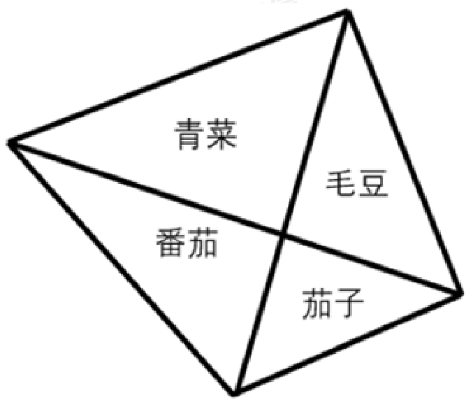

**A.** 60

**B.** 70

**C.** 90

**D.** 100

**答案：缺失（仓库未提供配套答案）**

### 第 42 题

`GD2026-Q042` · 单选 · 原卷第 7 页

某街道计划在本周的周一至周日中选取3天开展社区活动。如果要求每次活动之间至少间隔1天，则可行的活动时间安排有（）种。

**A.** 3

**B.** 5

**C.** 10

**D.** 15

**答案：缺失（仓库未提供配套答案）**

### 第 43 题

`GD2026-Q043` · 单选 · 原卷第 7 页

甲、乙、丙、丁四人参加知识竞赛，得分均为正整数，得分从高到低依次是甲、乙、丙、丁。如果甲和乙的总得分为100分，乙和丙的总得分为96分，丙和丁的总得分为80分，则丁的得分为：

**A.** 33

**B.** 36

**C.** 39

**D.** 不能确定

**答案：缺失（仓库未提供配套答案）**

### 第 44 题

`GD2026-Q044` · 单选 · 原卷第 7 页

有4批原材料存放在同一个仓库，工厂每次会从仓库中运出一整批原材料进行加工，加工完成后才能从仓库提取下一批原材料。已知一批原材料在仓库内每存放满1小时需要支付100元的费用，且工厂加工这4批原材料需要的时间分别为4、6、7、8小时，则工厂为这些原材料支付的仓库存放费用至少为（）元。

**A.** 2800

**B.** 3100

**C.** 3300

**D.** 3500

**答案：缺失（仓库未提供配套答案）**

### 第 45 题

`GD2026-Q045` · 单选 · 原卷第 7 页

甲、乙两人在小区内晨跑，速度分别是140米/分钟和100米/分钟。他们同时从小区跑道的起点向终点匀速跑步，各自不停地在起点和终点往返。如果该跑道的长度为200米，则当甲第二次追上乙时，距离起点（）米。

**A.** 0

**B.** 50

**C.** 100

**D.** 200

**答案：缺失（仓库未提供配套答案）**

## 判断推理

### 第 46 题

`GD2026-Q046` · 单选 · 原卷第 7、8 页

下列选项中最符合所给图形规律的是（）。

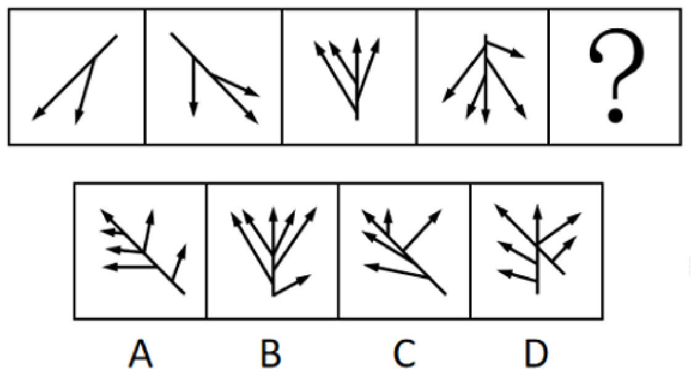

**A.** 见上方题图中 A 项。

**B.** 见上方题图中 B 项。

**C.** 见上方题图中 C 项。

**D.** 见上方题图中 D 项。

**答案：缺失（仓库未提供配套答案）**

### 第 47 题

`GD2026-Q047` · 单选 · 原卷第 8 页

下列选项中最符合所给图形规律的是（）。

**A.** 见上方题图中 A 项。

**B.** 见上方题图中 B 项。

**C.** 见上方题图中 C 项。

**D.** 见上方题图中 D 项。

**答案：缺失（仓库未提供配套答案）**

### 第 48 题

`GD2026-Q048` · 单选 · 原卷第 8、9 页

下列4个所给图形不经过旋转或翻转，可以拼接构成（）。

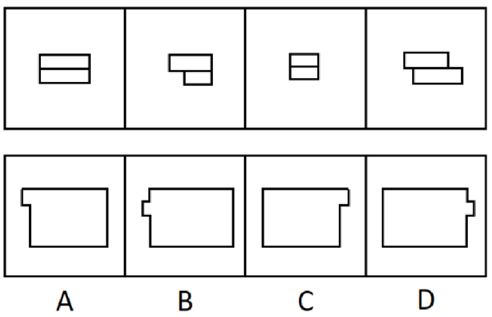

**A.** 见上方题图中 A 项。

**B.** 见上方题图中 B 项。

**C.** 见上方题图中 C 项。

**D.** 见上方题图中 D 项。

**答案：缺失（仓库未提供配套答案）**

### 第 49 题

`GD2026-Q049` · 单选 · 原卷第 9 页

下列选项中最符合所给图形规律的是（）。

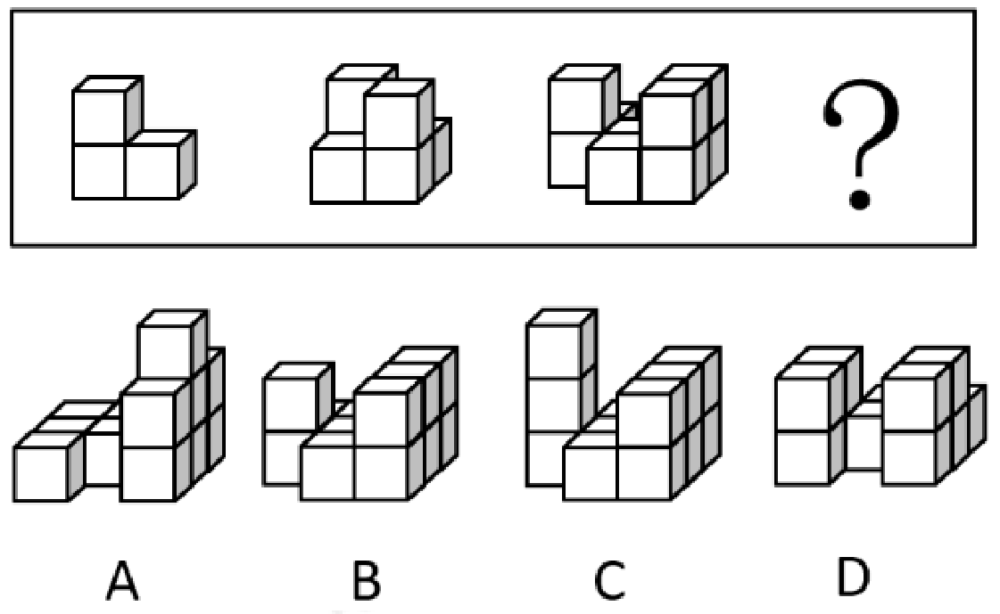

**A.** 见上方题图中 A 项。

**B.** 见上方题图中 B 项。

**C.** 见上方题图中 C 项。

**D.** 见上方题图中 D 项。

**答案：缺失（仓库未提供配套答案）**

### 第 50 题

`GD2026-Q050` · 单选 · 原卷第 9 页

下列选项中，可以由给定平面图折叠而成的是（）。

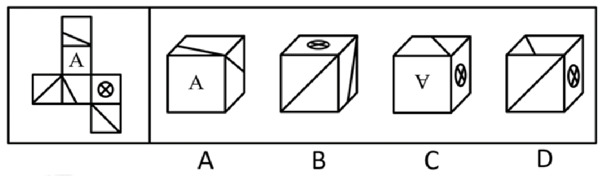

**A.** 见上方题图中 A 项。

**B.** 见上方题图中 B 项。

**C.** 见上方题图中 C 项。

**D.** 见上方题图中 D 项。

**答案：缺失（仓库未提供配套答案）**

### 第 51 题

`GD2026-Q051` · 单选 · 原卷第 9 页

如果一座城市采用集约高效的发展方式，那么其资源消耗量必然会减少。只要这种减少速度非常缓慢，就不会对城市经济发展造成负面影响。
由此可以推出：

**A.** 如果资源消耗量没有减少，说明该城市没有采用集约高效的发展方式

**B.** 如果城市没有采用集约高效的发展方式，其资源消耗量必然没有减少

**C.** 如果资源消耗量减少，说明该城市采用了集约高效的发展方式

**D.** 如果资源消耗量减少的速度很快，必然会对该城市的经济发展造成负面影响

**答案：缺失（仓库未提供配套答案）**

### 第 52 题

`GD2026-Q052` · 单选 · 原卷第 9 页

甘蔗是生产加工食糖的重要原料。近年来，世界范围内甘蔗种植面积不断扩大，在一定程度上改变了土地利用的格局。由于全球食糖需求不断增长，有人因此认为，随着食糖的生产加工规模进一步扩大，甘蔗种植会进一步改变土地利用的格局。
要使上述推论成立，需要补充的前提是（）。

**A.** 甘蔗种植用水量较大，会给当地水资源造成压力

**B.** 甘蔗的种植周期较短，能够为食糖的生产快速提供原料

**C.** 随着全球食糖需求的增长，种植者会扩大甘蔗的种植面积

**D.** 适宜种植甘蔗的区域，其土壤条件也适合种植其他富含糖分的作物

**答案：缺失（仓库未提供配套答案）**

### 第 53 题

`GD2026-Q053` · 单选 · 原卷第 9、10 页

某种水毛茛是A市特有的野生植物，对水质要求极高，其仅生长于清澈、流动的水体中，因此被誉为优良水质的“指示物种”。2023年受特大暴雨影响，A市某自然保护区内的水毛茛大面积消失，其所依赖的自然条件难以自行恢复，因而面临灭绝的风险。但在今年春季，有人发现，该自然保护区内重新出现了这种水毛茛，且群落规模远超以往。
下列选项如果为真，最能解释上述现象的是（）。

**A.** 这种水毛茛的分布范围已扩展至与自然保护区相邻的多处水域

**B.** 即使经历了暴雨，该自然保护区的水质仍然优于周边河流水域

**C.** 这种水毛茛同时具备有性繁殖和无性繁殖的能力，繁殖能力较强

**D.** 近两年，通过水系修复等人工措施，该自然保护区的水质大幅提高了

**答案：缺失（仓库未提供配套答案）**

### 第 54 题

`GD2026-Q054` · 单选 · 原卷第 10 页

某单位计划组织职工参观科技馆、文化馆、博物馆和美术馆。但由于时间有限，这4个场馆不能都去。有职工提出了如下建议并被采纳：
（1）由于相距较远，不建议既去文化馆又去博物馆；
（2）美术馆和文化馆的展览都很有吸引力，至少参观其中的一个；
（3）去年已经去过美术馆，今年就不去了。
补充下列选项中的（），可以得出“该单位一定会去科技馆”的结论。

**A.** 如果不去科技馆，就去博物馆

**B.** 只有不去科技馆，才去博物馆

**C.** 只有不去博物馆，才不去科技馆

**D.** 如果要去博物馆，不去科技馆

**答案：缺失（仓库未提供配套答案）**

### 第 55 题

`GD2026-Q055` · 单选 · 原卷第 10 页

太空环境具有高真空、高辐射、微重力、极端温度变化等特点，对人造卫星的材料和电子元件提出了极高的要求。近日，我国成功发射了太空计算卫星。由于太空计算卫星具备强大的数据实时处理能力，有专家据此认为，未来太空计算卫星将广泛应用于应急安全、城市治理等领域。
下列选项最有可能是上述推论暗含前提的是（）。

**A.** 太空计算卫星能够同时适应地面环境和太空环境

**B.** 太空计算卫星在太空中的数据处理速度显著快于地面

**C.** 我国目前亟需采集应急安全、城市治理等领域的实时数据

**D.** 应急安全、城市治理等领域存在大量需要实时处理的数据

**答案：缺失（仓库未提供配套答案）**

### 第 56 题

`GD2026-Q056` · 单选 · 原卷第 10 页

针对某款即将上市的新产品，商家开展了预售活动，预订的人数远超预期。但在产品正式发货前，许多顾客却取消了该产品的预订。
下列选项如果为真，最不能解释上述现象的是（）。

**A.** 因为产能问题，该产品发货日期一再延后

**B.** 收到货后，许多顾客反映该产品质量欠佳

**C.** 预售还未结束，商家就对新预订的用户给予了更大的优惠

**D.** 产品预售期间，其他商家推出了多款设计接近但价格更低的竞品

**答案：缺失（仓库未提供配套答案）**

### 第 57 题

`GD2026-Q057` · 单选 · 原卷第 10 页

不建立主体明确、要求清晰的责任体系，就不能压紧压实安全生产责任。当前主体明确、要求清晰的责任体系已经建立，因此安全生产责任已经压紧压实。
下列选项与题干逻辑结构最为相似的是（）。

**A.** 只有实行多元共治，才能构建和谐社区。某社区建成了和谐社区，因此该社区实行了多元共治

**B.** 不实现教育资源的公平分配，就无法提高全民素质。当前全民素质还有待提高，所以教育资源的公平分配还未实现

**C.** 如果某地区深入推进生态文明建设，那么该地区已经实现了资源循环利用。这是因为不深入推进生态文明建设，就无法实现资源循环利用

**D.** 如果合理开采资源，就能实现自然资源的可持续利用。多地政府已经出台法律法规禁止过度开采，因此许多地区已经实现了自然资源的可持续利用

**答案：缺失（仓库未提供配套答案）**

### 第 58 题

`GD2026-Q058` · 单选 · 原卷第 10、11 页

湖泊在北极的面积占比达到四成，为动植物生存提供了不可或缺的淡水资源。近年来，全球变暖使得北极的永冻土层逐渐融化，融化的水随之流入湖泊和海洋。有人据此推测，北极现存的湖泊面积应该扩张，然而观测数据显示，大部分北极湖泊面积都有所缩减。
下列选项如果为真，最能解释上述现象的是（）。

**A.** 据统计，大部分处于逐渐融化状态的冰山位于海洋中

**B.** 近年来北极动植物数量不断增加，淡水资源的需求量不断增大

**C.** 由于冰川消融，北极地区的部分湖泊相互连接成了一个更大的湖泊

**D.** 永冻土层消融使北极地区的湖泊底部出现大量孔隙，湖水从孔隙渗漏

**答案：缺失（仓库未提供配套答案）**

### 第 59 题

`GD2026-Q059` · 单选 · 原卷第 11 页

对于研发型企业来说，获得突破性的研发成果至关重要。某研发型企业在回顾其发展历程后发现，企业大多数突破性的研发成果都源自新手研发人员。该企业因此认为，要想获得更多的突破性研发成果，在组建新的研发团队时应当只考虑新手研发人员。
以下选项如果为真，最能反驳这一结论的是（）。

**A.** 该企业现有的多数重要研发成果尚未成功转化应用

**B.** 对于大多数的新手研发人员，该企业目前的薪资吸引力不高

**C.** 突破性的研究设想都需要经过经验丰富的研发人员改进才能实现

**D.** 将新手研发人员培养成经验丰富的研发人员需要投入大量的资源

**答案：缺失（仓库未提供配套答案）**

### 第 60 题

`GD2026-Q060` · 单选 · 原卷第 11 页

研究团队开发了一种新型抗衰老水凝胶材料，为了验证这一材料的实际效果，研究团队开展了系列实验。结果发现，与未注入该材料的实验鼠相比，注入该材料的实验鼠肌肉组织中细胞的代谢水平显著提高，细胞端粒长度平均延长15%，且肌肉再生能力提升40%。由此可以推断，该材料能在一定程度上抗衰老。
以下选项如果为真，最不能支持这一结论的是（）。

**A.** 细胞的代谢水平往往与其衰老程度呈负相关

**B.** 老年动物的肌肉再生能力显著低于青壮年动物

**C.** 将该材料注入小鼠体内后，小鼠未产生明显的免疫反应

**D.** 端粒长度延长是细胞分裂激活的伴随现象，表明细胞恢复了“年轻”

**答案：缺失（仓库未提供配套答案）**

### 第 61 题

`GD2026-Q061` · 单选 · 原卷第 11 页

绿化率高的小区，居民幸福感强。居民幸福感强的小区，环境卫生状况好。因此，绿化率高的小区环境卫生状况好。
下列选项与上述推理的逻辑结构最为相似的是（）。

**A.** 粉尘浓度高的区域遇明火易发生爆炸，易发生爆炸的区域都应严禁烟火。因此粉尘浓度不高的区域无需禁止烟火

**B.** 员工满意度较高的公司离职率较低，而绩效考核合理的公司员工满意度较高。因此绩效考核合理的公司离职率较低

**C.** 利润增长快的企业都进行了技术创新，这是因为企业通过技术创新可以提高生产效率，而生产效率的提高可以促进利润增长

**D.** 双减政策的落实减轻了学生的学习压力，课外活动时间的增加也减轻了学生的学习压力。因此，课外活动时间的增加体现了双减政策的落实

**答案：缺失（仓库未提供配套答案）**

### 第 62 题

`GD2026-Q062` · 单选 · 原卷第 11 页

某市召开年度经济工作会议，根据安排，某一排是教育局、住建局、交通局、农业局、人社局、财政局6个职能局的座位。已知：
①财政局在人社局的右手边并与之相邻，在住建局的左手边但与之不相邻；
②教育局与交通局之间隔着一个职能局。
如果农业局和财政局相邻，则下列选项必然正确的是（）。

**A.** 教育局在从右到左第三位

**B.** 住建局在从右到左第二位

**C.** 交通局在从左到右第三位

**D.** 人社局在从左到右第二位

**答案：缺失（仓库未提供配套答案）**

### 第 63 题

`GD2026-Q063` · 单选 · 原卷第 11、12 页

某次“特色示范村”评选活动设立了文化旅游、非遗传承、生态农业、数字农业示范村4个奖项，甲、乙、丙、丁4个村庄各获其中之一。已知：
①文化旅游示范村的经济收入高于丙村；
②甲村和数字农业示范村的经济收入相当，且都不是最高的；
③生态农业示范村的经济收入比丁村高；
④丙村的经济收入高于非遗传承示范村。
根据上述条件，下列选项必然正确的是（）。

**A.** 甲村的经济收入在4个村庄中位列第二

**B.** 乙村获评文化旅游示范村

**C.** 丙村获评数字农业示范村

**D.** 丁村获评非遗传承示范村

**答案：缺失（仓库未提供配套答案）**

### 第 64 题

`GD2026-Q064` · 单选 · 原卷第 12 页

某古生物学研究小组在一处白垩纪晚期地层中发现了保存完整的恐龙皮肤化石。通过高分辨率显微镜，研究人员发现该恐龙皮肤表面存在大量微小的中空管状结构。由于这些结构类似于现代鸟类羽毛中用于体温调节的羽茎，研究人员推测，这些微小的中空管状结构是恐龙用于调节体温的特殊结构。
以下选项如果为真，最能支持上述推测的是（）。

**A.** 这些中空管状结构能够增强生物体表的散热能力

**B.** 其他恐龙化石之中也发现了类似的中空管状结构

**C.** 现代爬行类动物的皮肤表面不存在类似的中空管状结构

**D.** 由于白垩纪晚期气候异常，恐龙需要体温调节机制维持生存

**答案：缺失（仓库未提供配套答案）**

### 第 65 题

`GD2026-Q065` · 单选 · 原卷第 12 页

企业节能减排必须通过购买碳配额或自主开发减排项目实现。某企业未购买碳配额，因此该企业要节能减排需自主开发减排项目。
下列选项与题干逻辑结构最为相似的是（）。

**A.** 申请绿色产品认证的公司需通过专家评审或提交检测报告。某公司未提交过检测报告，因此该公司应当组织开展专家评审

**B.** 有的地区支持企业购买碳汇，有的地区则支持企业使用清洁能源。某地区支持企业使用清洁能源，因此该地区不支持企业购买碳汇

**C.** 企业申请创业补贴或者通过线上申请，或者通过线下窗口办理。某企业已经通过线上渠道提交了申请，因此无需前往线下窗口办理

**D.** 重点排放单位应通过安装监测设备或委托第三方核查排放情况。某企业属重点排放单位且未委托第三方核查排放情况，因此该企业需安装监测设备核查排放情况

**答案：缺失（仓库未提供配套答案）**

## 科学推理

### 第 66 题

`GD2026-Q066` · 单选 · 原卷第 12、13 页

如图所示，几颗棋子叠放在一起，其中一颗突然被水平方向的外力击打，飞了出去。忽略空气阻力，则以下判断正确的有（）项。
①棋子飞出的一瞬间，上方棋子所受合外力为0；
②下方棋子所受的合外力始终为0；
③棋子飞出的一瞬间，上方最下面的棋子受到了向下的压力；
④在落地前，飞出去的棋子在水平方向上的速度恒定。

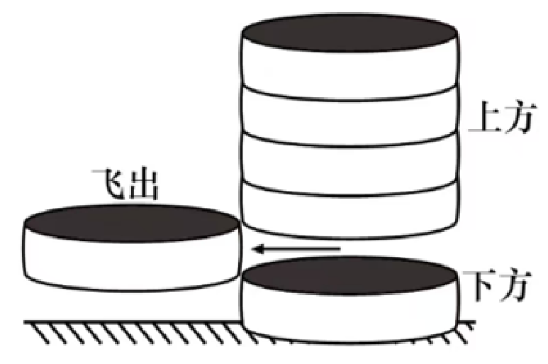

**A.** 1

**B.** 2

**C.** 3

**D.** 4

**答案：缺失（仓库未提供配套答案）**

### 第 67 题

`GD2026-Q067` · 单选 · 原卷第 13 页

如图所示，实心铜方块放置在容器底部，沿容器内壁往容器内加入水，直至杯中完全装满水。下列选项中，最有可能正确反映方块对容器底部压力（p）随水深（h）变化情况的是（）。

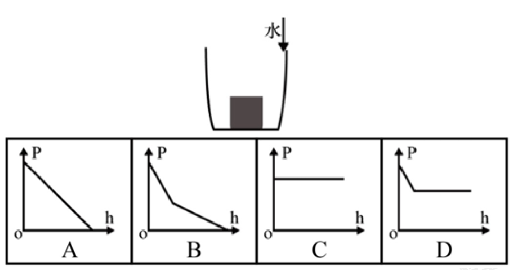

**A.** 见上方题图中 A 项。

**B.** 见上方题图中 B 项。

**C.** 见上方题图中 C 项。

**D.** 见上方题图中 D 项。

**答案：缺失（仓库未提供配套答案）**

### 第 68 题

`GD2026-Q068` · 单选 · 原卷第 13 页

某款电热毯有3个档位，由一个开关控制。其中，0档为关机，1档为低功率加热，2档为高功率加热，则以下选项最可能是该款电热毯电路示意图的是（）。

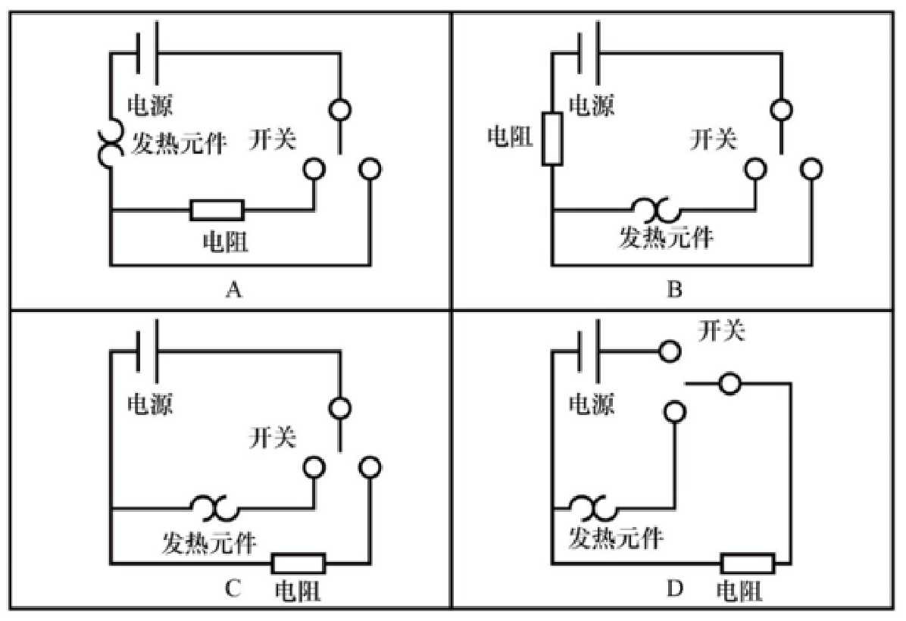

**A.** 见上方题图中 A 项。

**B.** 见上方题图中 B 项。

**C.** 见上方题图中 C 项。

**D.** 见上方题图中 D 项。

**答案：缺失（仓库未提供配套答案）**

### 第 69 题

`GD2026-Q069` · 单选 · 原卷第 13、14 页

锋面雨的形成与夏季风的暖湿气流和冬季风干冷气流相遇有关，是冷暖空气交汇形成的降雨现象，主要在每年的4到5月影响我国华南地区。下列示意图最有可能正确反映锋面雨形成原理的是（）。

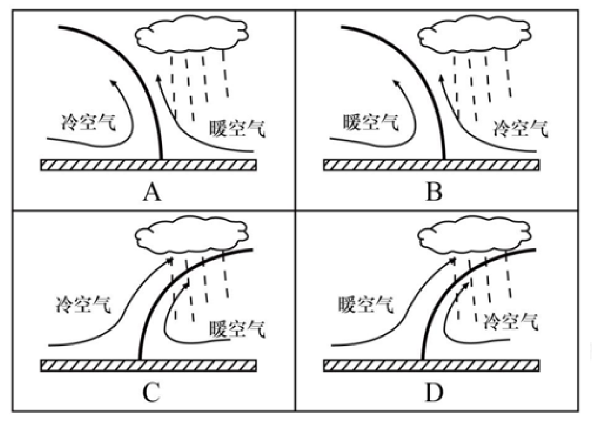

**A.** 见上方题图中 A 项。

**B.** 见上方题图中 B 项。

**C.** 见上方题图中 C 项。

**D.** 见上方题图中 D 项。

**答案：缺失（仓库未提供配套答案）**

### 第 70 题

`GD2026-Q070` · 单选 · 原卷第 14 页

下图为海洋生态系统中部分生物之间的捕食关系，则以下有关说法正确的是（）。

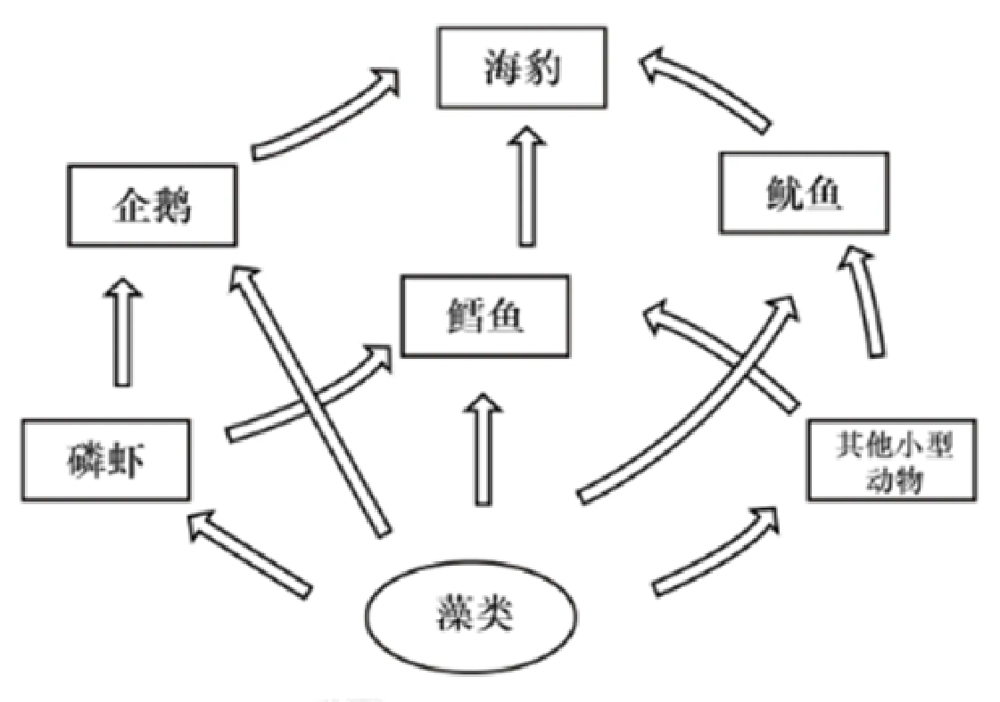

**A.** 磷虾大量减少会对该系统产生毁灭性的影响

**B.** 该食物网中包括了生产者、消费者以及分解者

**C.** 图中最短的食物链有3个营养级

**D.** 该食物网共涉及6条食物链

**答案：缺失（仓库未提供配套答案）**

## 资料分析

### 共用材料：第 71—75 题

广东既是经济大省，也是人口大省、就业大省，数据显示，2024年广东净增74万人，新出生113.3万人；城镇新增就业超143万人，超额完成国家下达的110万人的年度就业任务，并且实现4386万异地务工人员稳定就业，是名副其实的就业超级“蓄水池”。
今年以来，广东按照省委、省政府关于实施“百万英才汇南粤”行动计划的部署安排，围绕“粤聚英才、粤见未来”主题，广泛募集岗位、强化精准对接、提升优质服务、持续扩大声势。截至7月中旬，全省已吸纳超过100万应届高校毕业生留粤来粤就业创业，进一步夯实广东现代化产业体系的人才基座，充分彰显经济大省挑大梁的责任担当。
“百万英才汇南粤”行动计划紧紧围绕广东现代化产业体系建设需要，聚焦20个战略性产业集群，突出新兴产业未来产业，充分发动知名科技企业拿出大量优质岗位，组织发动各类企事业单位动态募集120多万优质岗位，以具有竞争力的薪酬和岗位吸纳优秀高校毕业生，今年3至7月，累计组织2.1万家重点企业在“粤就业”小程序发布62.5万个岗位。其中，面向博士、硕士的8.6万个，面向本科生25.6万个，面向大专和各类技工学校学生28.3万个，年薪10万元以上岗位约26万个，年薪20万元以上岗位超6.5万个，年薪50万元以上甚至百万年薪的岗位超5000个。
从留粤就业的省内应届高校毕业生情况看，今年1至7月，制造业吸纳毕业生约10万人，人数占比从2020年的14.72%提升到2025年的19.21%。其中，人工智能、机器人、半导体与集成电路、高端装备制造、新能源汽车、低空经济相关专业毕业生占四分之一，对发展新质生产力、建设现代化产业体系的人才支撑作用明显提升。

### 第 71 题

`GD2026-Q071` · 单选 · 原卷第 15 页

[共用材料](#GD2026-M1)

“百万英才汇南粤”行动计划围绕的主题是（）。

**A.** “好岗配优才”

**B.** “粤聚英才、粤见未来”

**C.** “魅力大湾区，活力新广东”

**D.** “经济大省挑大梁，再造一个新广东”

**答案：缺失（仓库未提供配套答案）**

### 第 72 题

`GD2026-Q072` · 单选 · 原卷第 15 页

[共用材料](#GD2026-M1)

关于“百万英才汇南粤”行动计划，资料未提及（）。

**A.** 紧紧围绕广东现代化产业体系建设需要

**B.** 突出新兴产业未来产业

**C.** 鼓励应届毕业生跨省就业创业

**D.** 充分发动知名科技企业拿出大量优质岗位

**答案：缺失（仓库未提供配套答案）**

### 第 73 题

`GD2026-Q073` · 单选 · 原卷第 15 页

[共用材料](#GD2026-M1)

2025年3至7月“粤就业”小程序发布的62.5万个岗位中，年薪10万元以上岗位占比（）。

**A.** 在1成到2成之间

**B.** 在2成到3成之间

**C.** 在3成到4成之间

**D.** 在4成到5成之间

**答案：缺失（仓库未提供配套答案）**

### 第 74 题

`GD2026-Q074` · 单选 · 原卷第 15 页

[共用材料](#GD2026-M1)

2025年1至7月，留粤就业的人工智能、机器人、半导体与集成电路、高端装备制造、新能源汽车、低空经济相关专业省内应届高校毕业生约有（）万人。

**A.** 2.5

**B.** 5

**C.** 7.5

**D.** 10

**答案：缺失（仓库未提供配套答案）**

### 第 75 题

`GD2026-Q075` · 单选 · 原卷第 15 页

[共用材料](#GD2026-M1)

根据资料，以下说法可以判断属实的是（）。

**A.** 2024年，广东新出生人口超百万

**B.** 2024年，广东省内应届高校毕业生中，本科生占比超40%

**C.** 2025年上半年，广东超额完成国家下达的年度就业任务

**D.** 2025年上半年，广东吸纳超百万应届高校毕业生留粤来粤就业创业

**答案：缺失（仓库未提供配套答案）**

### 共用材料：第 76—80 题

标准物质与尺子、砝码一样，是测量中必不可少的参照工具。它是已提前获得准确测量结果、均匀稳定的样品，待测样品以其为标准，确保不同时间、人员、实验室的测量结果可比。标准物质研制生产机构在开展具体品种标准物质的生产供应前，须通过技术审评并取得定级证书，这些取得定级证书的标准物质，统称为“国家标准物质”。根据计量溯源性、准确度和用途等，国家标准物质目前分为两类，即一级标准物质和二级标准物质。
国家标准物质数量快速增长的原因有四个方面：一是用途广泛、涉及经济、社会发展的各个领域；二是需求大幅增加，检测部门和行业主管部门日益重视测量结果的准确性；三是产业发展迅速，除了中国计量科学研究院等机构之外，越来越多的企业积极申报国家标准物质；四是政策支持，国家市场监管总局出台了一系列措施，比如将国家标准物质纳入国务院计量发展规划、发布建设和管理指导意见，并优化审评制度，提高审批效率。
截至2025年上半年，市场监管总局累计批准建立国家标准物质18982项。2025年上半年，我国新批准建立国家标准物质524项，同比增长78.8%，涉及研制单位51家。从研制单位类型看，企业申报标准物质379项，同比增长86.7%；科研事业单位申报145项，同比增长61.1%。从地域分布看，华北地区新建标准物质234项，华东地区新建标准物质124项，东北地区新建标准物质62项，西北地区新建标准物质48项，华南地区新建标准物质32项，西南地区新建标准物质24项，华中地区未新建标准物质。

### 第 76 题

`GD2026-Q076` · 单选 · 原卷第 16 页

[共用材料](#GD2026-M2)

根据计量溯源性、准确度和用途等，国家标准物质目前分为（）类。

**A.** 两

**B.** 三

**C.** 四

**D.** 五

**答案：缺失（仓库未提供配套答案）**

### 第 77 题

`GD2026-Q077` · 单选 · 原卷第 16 页

[共用材料](#GD2026-M2)

根据资料，国家标准物质数量快速增长的原因不包括（）。

**A.** 用途广泛

**B.** 需求大幅增加

**C.** 产业链完整

**D.** 政策支持

**答案：缺失（仓库未提供配套答案）**

### 第 78 题

`GD2026-Q078` · 单选 · 原卷第 16 页

[共用材料](#GD2026-M2)

截至2024年末，市场监管总局累计批准建立国家标准物质（）项。

**A.** 17934

**B.** 18458

**C.** 18982

**D.** 19506

**答案：缺失（仓库未提供配套答案）**

### 第 79 题

`GD2026-Q079` · 单选 · 原卷第 16 页

[共用材料](#GD2026-M2)

2024年上半年，我国新批准建立的国家标准物质中，企业申报的标准物质项目数约占（）。

**A.** 40%

**B.** 50%

**C.** 60%

**D.** 70%

**答案：缺失（仓库未提供配套答案）**

### 第 80 题

`GD2026-Q080` · 单选 · 原卷第 16 页

[共用材料](#GD2026-M2)

下列选项中，最有可能准确反映2025年上半年我国新建标准物质地域分布情况的是（）。

**A.** 

**B.** 

**C.** 

**D.** 

**答案：缺失（仓库未提供配套答案）**

### 共用材料：第 81—85 题

截至2024年末，广东省共有体育场地35.3万个，较上年增长3.58%；体育场地面积3.72亿平方米，较上年增长4.49%；人均体育场地面积2.91平方米（按常住人口计算），较上年增长3.93%。

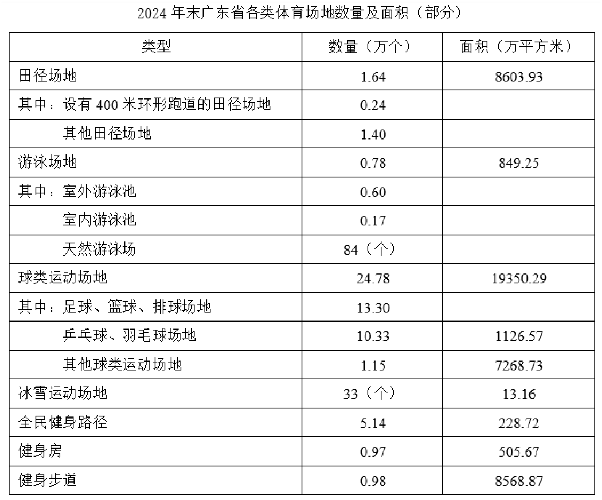

2024年末广东省各类体育场地数量及面积（部分）；原表空白项保留为空白。

| 类型 | 数量（万个；另标“个”者除外） | 面积（万平方米） |
| --- | --- | --- |
| 田径场地 | 1.64 | 8603.93 |
| 其中：设有400米环形跑道的田径场地 | 0.24 |  |
| 其他田径场地 | 1.40 |  |
| 游泳场地 | 0.78 | 849.25 |
| 其中：室外游泳池 | 0.60 |  |
| 室内游泳池 | 0.17 |  |
| 天然游泳场 | 84（个） |  |
| 球类运动场地 | 24.78 | 19350.29 |
| 其中：足球、篮球、排球场地 | 13.30 |  |
| 乒乓球、羽毛球场地 | 10.33 | 1126.57 |
| 其他球类运动场地 | 1.15 | 7268.73 |
| 冰雪运动场地 | 33（个） | 13.16 |
| 全民健身路径 | 5.14 | 228.72 |
| 健身房 | 0.97 | 505.67 |
| 健身步道 | 0.98 | 8568.87 |

### 第 81 题

`GD2026-Q081` · 单选 · 原卷第 17 页

[共用材料](#GD2026-M3)

2024年，广东省体育场地数量增加约（）万个。

**A.** 0.1

**B.** 1.2

**C.** 2.3

**D.** 3.4

**答案：缺失（仓库未提供配套答案）**

### 第 82 题

`GD2026-Q082` · 单选 · 原卷第 17 页

[共用材料](#GD2026-M3)

2024年末，广东省田径场地中，设有400米环形跑道的田径场地数量占比（）。

**A.** 不到15%

**B.** 在15%-20%之间

**C.** 在20%-25%之间

**D.** 超过25%

**答案：缺失（仓库未提供配套答案）**

### 第 83 题

`GD2026-Q083` · 单选 · 原卷第 17 页

[共用材料](#GD2026-M3)

2024年末，广东省足球、篮球、排球“三大球”场地面积约为（）亿平方米。

**A.** 0.10

**B.** 0.11

**C.** 1.04

**D.** 1.10

**答案：缺失（仓库未提供配套答案）**

### 第 84 题

`GD2026-Q084` · 单选 · 原卷第 17 页

[共用材料](#GD2026-M3)

2024年末，广东省下列运动场地单位面积排序正确的是：

**A.** 冰雪运动场地>田径场地>游泳场地>健身房

**B.** 田径场地>冰雪运动场地>健身房>游泳场地

**C.** 田径场地>游泳场地>健身房>冰雪运动场地

**D.** 田径场地>冰雪运动场地>游泳场地>健身房

**答案：缺失（仓库未提供配套答案）**

### 第 85 题

`GD2026-Q085` · 单选 · 原卷第 17 页

[共用材料](#GD2026-M3)

根据材料，以下说法不正确的是（）。

**A.** 2023年末，广东省体育场地面积超过了3亿平方米

**B.** 2024年末，广东省常住人口超过1亿

**C.** 2024年末，广东省天然游泳场数量在游泳场地数量中的占比不到1%

**D.** 2024年末，广东省球类运动场地面积在全省体育场地面积中的占比超过50%

**答案：缺失（仓库未提供配套答案）**

### 共用材料：第 86—90 题

新中国成立以来，我国的城镇化建设不断推进，城市规模不断扩大，综合实力显著增强，基础设施持续改善，城市更加宜业宜居。
从城市数量看，1948年末，我国城市共有58个，新中国成立后，大批县城改设为城市。1949年末，全国城市共有129个，其中，地级以上城市68个，县级市61个，建制镇2000个左右。改革开放前，我国的城镇化经历了一段比较曲折的发展历程，小城市和小城镇发展缓慢。1978年末，全国城市共有193个，其中，地级以上城市101个，县级市92个，建制镇2173个。改革开放以来，城市数量快速增加。2023年末，城市个数达到694个，其中，地级以上城市297个，县级市397个，建制镇21421个。
从城市人口规模看，1949年末，城市人口共3949万人，百万人口以上城市仅5个，九成的城市人口在50万以下。改革开放后，城市人口规模不断扩大，人口集聚效应更加明显。2023年末，我国地级以上城市常住人口达到67313万人，常住人口超过500万的城市有29个，超过1000万的城市有11个。

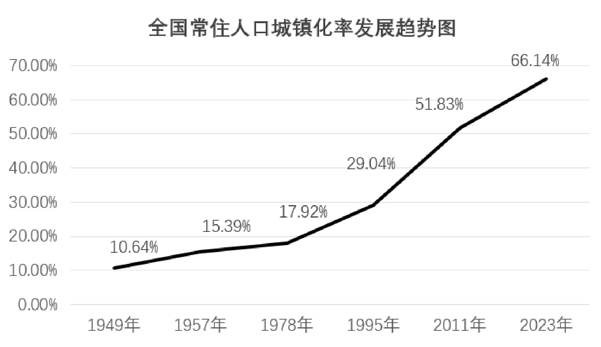

全国常住人口城镇化率发展趋势图

| 年份 | 城镇化率 |
| --- | --- |
| 1949 | 10.64% |
| 1957 | 15.39% |
| 1978 | 17.92% |
| 1995 | 29.04% |
| 2011 | 51.83% |
| 2023 | 66.14% |

### 第 86 题

`GD2026-Q086` · 单选 · 原卷第 18 页

[共用材料](#GD2026-M4)

根据材料，下列时间段我国常住人口城镇化率增加最多的是：

**A.** 1957—1978年

**B.** 1978—1995年

**C.** 1995—2011年

**D.** 2011—2023年

**答案：缺失（仓库未提供配套答案）**

### 第 87 题

`GD2026-Q087` · 单选 · 原卷第 18 页

[共用材料](#GD2026-M4)

2023年末，我国地级以上城市的常住人口规模平均约为（）。

**A.** 216.6万人

**B.** 226.6万人

**C.** 236.6万人

**D.** 246.6万人

**答案：缺失（仓库未提供配套答案）**

### 第 88 题

`GD2026-Q088` · 单选 · 原卷第 18 页

[共用材料](#GD2026-M4)

与1949年末相比，2023年末我国城市中，地级以上城市数量占比（）。

**A.** 减少了约10个百分点

**B.** 增加了约10个百分点

**C.** 减少了约1个百分点

**D.** 增加了约1个百分点

**答案：缺失（仓库未提供配套答案）**

### 第 89 题

`GD2026-Q089` · 单选 · 原卷第 18 页

[共用材料](#GD2026-M4)

与1978年末相比，2023年末我国各类型城镇数量增幅排序正确的是（）。

**A.** 地级以上城市>县级市>建制镇

**B.** 建制镇>地级以上城市>县级市

**C.** 地级以上城市>建制镇>县级市

**D.** 建制镇>县级市>地级以上城市

**答案：缺失（仓库未提供配套答案）**

### 第 90 题

`GD2026-Q090` · 单选 · 原卷第 18 页

[共用材料](#GD2026-M4)

根据资料，以下说法错误的是（）。

**A.** 1949年末，我国非城镇常住人口数量不超过4亿

**B.** 1978年末，我国县级市的数量在全国城市中的占比不到一半

**C.** 2023年末，我国有5%以上的城市达到常住人口超500万的规模

**D.** 2023年末，我国常住人口超1000万的地级以上的城市共容纳了超过15%的地级以上城市常住人口

**答案：缺失（仓库未提供配套答案）**

