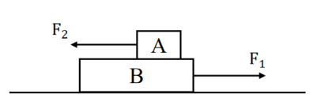
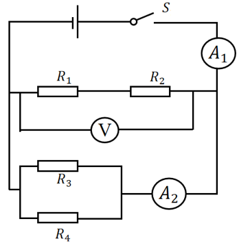
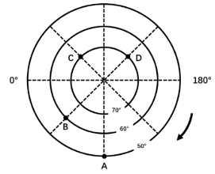

# M01｜科学推理第66—70题（待审题面）

答案与解析另册；这是重新选编稿，不是此前丢失清单的恢复。

### 66.

如图所示，外力 $F_1$ 大小为10N，作用于物块B上，外力 $F_2$ 大小为5N，作用于物块A上。物块B静止于粗糙程度均匀的水平地面上，物块A在物块B上向左做匀速直线运动，假设物块B足够长，下列说法不正确的是（    ）。

**A.** 物块A共受到4个力的作用

**B.** 物块B共受到6个力的作用

**C.** 地面对物块B的摩擦力一定小于10N

**D.** 物块A对物块B的摩擦力一定小于5N

### 67.

如图为某用电器的电路图， $R_1$ 、 $R_4$ 是定值电阻， $R_2$ 是温敏电阻，随着环境温度的升高， $R_2$的阻值会变大； $R_3$ 是光敏电阻，随着环境光照强度的增大， $R_3$ 的阻值会变小；V表示电压表， $A_1$ 、 $A_2$ 均表示电流表，电源电压保持不变，闭合开关S后，下列说法正确的是（    ）。

**A.** 若环境温度下降，则V的示数变小， $A_1$ 的示数变大

**B.** 若环境温度下降，则V的示数不变， $A_1$ 的示数变大

**C.** 若环境光照强度增大，则 $A_1$ 的示数变大， $A_2$ 的示数变小

**D.** 若环境光照强度减弱，则 $A_1$ 的示数不变， $A_2$ 的示数变大

### 68.

小明在学习完与金属活动性相关的知识后，想自己动手验证Fe、Cu、Ag三种金属活动性的强弱，下列实验方案的组合不能达到其目的的是（    ）。
①将Fe放入 $\mathrm{CuSO_4}$ 溶液
②将Cu放入 $\mathrm{AgNO_3}$ 溶液
③将Ag放入 $\mathrm{CuSO_4}$ 溶液
④将Fe、Cu分别放入稀盐酸

**A.** ①③

**B.** ①④

**C.** ②④

**D.** ③④

### 69.

在ABO血型系统中，下列关于血型遗传的说法正确的是（    ）。

**A.** 若父母一方为A型血，另一方为B型血，则子女只可能是A型血或者B型血

**B.** 若子女出现O型血，则父母双方至少有一人一定是O型血

**C.** 若父母分别为AB型血与O型血，则子女不可能是O型血

**D.** 若子女为AB型血，则父母一方必定是A型血，另一方必定是B型血

### 70.

根据下图所示的经纬网，说法正确的是（    ）。

①A、B、C、D四个地区全部位于南半球
②A、B、C、D四个地区全部位于中纬度地区
③A、B、C、D四个地区全部位于温带
④A、D两个地区的经纬度分别是（ $50^{\circ}\mathrm{S}$ ， $90^{\circ}\mathrm{W}$ ）、（ $70^{\circ}\mathrm{S}$ ， $135^{\circ}\mathrm{E}$ ）
⑤B、C两个地区的经纬度分别是（ $60^{\circ}\mathrm{S}$ ， $45^{\circ}\mathrm{E}$ ）、（ $70^{\circ}\mathrm{S}$ ， $45^{\circ}\mathrm{W}$ ）
⑥A、B两个地区位于西半球，C、D两个地区位于东半球

**A.** ①③⑤

**B.** ①⑤⑥

**C.** ②④⑥

**D.** ①④⑥
