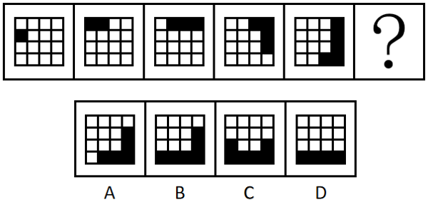
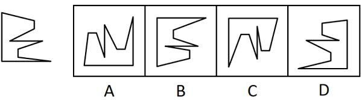
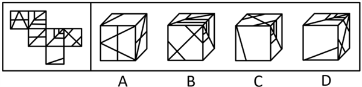
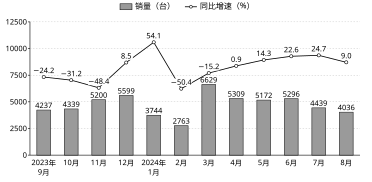
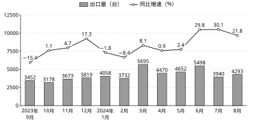

# M01　广东省考行测模拟卷（题本）

## 第一部分　政治理论

**1.** 增强党性是全面从严治党的根本性任务，要把学习、领悟、运用党的创新理论作为加强党性修养的根本途径。

A. 正确　　B. 错误

**2.** 维护国家主权、安全、发展利益是“一国两制”方针的最高原则，在这个前提下，香港、澳门保持原有的资本主义制度长期不变，享有高度自治权。

A. 正确　　B. 错误

**3.** 习近平总书记2025年11月在广东考察时指出，建设粤港澳大湾区，对广东来说既是重大责任，也是难得的发展机遇，广东要发挥主力军和火车头作用。

A. 正确　　B. 错误

**4.** 在认识过程的两次飞跃中，由感性认识上升到理性认识是更为重要的一次飞跃。

A. 正确　　B. 错误

**5.** 坚持底线思维和极限思维，要从最坏处着眼，做最充分的准备，朝好的方向努力，争取最好的结果，下好先手棋、打好主动仗，力争把风险化解在源头。下列古语与这一要求最为契合的是（　）。

A. 苟日新，日日新，又日新
B. 安而不忘危，存而不忘亡，治而不忘乱
C. 民惟邦本，本固邦宁
D. 不积跬步，无以至千里；不积小流，无以成江海

**6.** 党的二十大报告指出：“今天我们所面临问题的复杂程度、解决问题的艰巨程度明显加大，给理论创新提出了全新要求。我们要增强问题意识，聚焦实践遇到的新问题、改革发展稳定存在的深层次问题、人民群众急难愁盼问题、国际变局中的重大问题、党的建设面临的突出问题，不断提出真正解决问题的新理念新思路新办法。”这段话最能体现习近平新时代中国特色社会主义思想（　）的立场观点方法。

A. 必须坚持人民至上
B. 必须坚持守正创新
C. 必须坚持问题导向
D. 必须坚持胸怀天下

**7.** 二十届五中全会《决定》指出，民主集中制是党的根本组织原则和领导制度。关于严格执行领导班子决策议事规则、规范“一把手”履职用权，下列表述有误的是（　）。

A. 坚持集体领导和个人分工负责相结合
B. 重要议题出现较大意见分歧时不得强行作出决策
C. 讨论决定重要事项时执行“一把手”率先表态制
D. 书记专题会议不得代替党委常委会会议作出决策

**8.** 习近平总书记指出：“全面依法治国是国家治理的一场深刻革命，关系党执政兴国，关系人民幸福安康，关系党和国家长治久安。”关于全面依法治国，下列说法有误的是（　）。

A. 党的领导是中国特色社会主义最本质的特征，是社会主义法治最根本的保证
B. 全面推进依法治国的总目标是实现法治国家、法治政府、法治社会全面建成
C. 中国特色社会主义制度是中国特色社会主义法治体系的根本制度基础
D. 中国特色社会主义法治理论是中国特色社会主义法治体系的理论指导和学理支撑

**9.** 建党之初和大革命时期，党召开了多次全国代表大会，领导了多次工人罢工。以下有关这一时期的表述，符合历史事实的有（　）。

A. 中共二大通过了党关于统一战线的第一个专门文件
B. 安源路矿工人大罢工是中国共产党领导的第一次工人运动高潮的顶点
C. 中共四大明确提出了无产阶级在民主革命中的领导权和工农联盟问题
D. 省港大罢工是中国第一次工人运动高潮的起点

**10.** 我国古代思想家对世界的本原问题作过许多探索。下列古语中，体现唯物主义观点的有（　）。

A. 心外无物
B. 形存则神存，形谢则神灭
C. 道生一，一生二，二生三，三生万物
D. 气者，理之依也

## 第二部分　常识判断

**11.** 中共中央政治局就前瞻布局和发展未来产业进行第二十四次集体学习。下列表述与此次集体学习精神不符的是（　）。

A. 未来产业具有前瞻性、战略性、颠覆性等特点，需要科学谋划、全局统筹
B. 要充分发挥新型举国体制优势，坚持“科技出题、产业答题”
C. 很多未来产业的兴起靠企业一步步突破带动，要发挥企业主体作用
D. 未来产业培育周期长、市场风险大，政策上要支持，政府要做好服务

**12.** 广东省2026年政府工作报告回顾了“十四五”时期广东经济社会发展取得的成就。下列表述不准确的是（　）。

A. 数字经济规模稳居全国首位
B. 年实际使用外资保持在千亿元以上
C. 第一产业增加值跃居全国首位
D. 常住人口城镇化率居各省区首位

**13.** 近年来，我国在载人航天、量子科学、核电等领域取得一系列重大科技成就。下列表述有误的是（　）。

A. 天舟货运飞船负责运送航天员往返空间站
B. 天宫空间站由天和、问天、梦天三舱组成，呈T字构型
C. 墨子号是世界首颗量子科学实验卫星，开展空间量子通信
D. 华龙一号是我国自主研发的三代核电技术

**14.** 新修订的《中华人民共和国治安管理处罚法》自2026年1月1日起施行。根据该法，下列做法符合规定的是（　）。

A. 一名人民警察在规范设置、严格管理的执法办案场所进行询问，并全程同步录音录像
B. 依法查询被封存违法记录的单位，将所查询到的违法记录情况向社会公开
C. 对事实清楚、证据确凿的违反治安管理行为，由人民警察当场作出罚款一千元的决定
D. 公安机关进行勘验等调查取证工作时，由一名人民警察进行并全程同步录音录像

**15.** 2026年召开的广东省高质量发展大会以制造业与服务业协同发展为主题。会议强调，要以制造业之强牵引服务业之优，以服务业之优增进制造业之强，在（　）相互成就中打开产业发展新天地。

A. “制造大省”与“服务强省”
B. “智造高地”与“服务强省”
C. “制造强省”与“服务大省”
D. “制造强省”与“服务高地”

## 第三部分　言语理解与表达

**16.** 我们想问题、作决策、办事情，首先要考虑人口基数问题，考虑我国城乡区域发展水平差异大等实际，既不能____，也不能因循守旧，要保持历史耐心，坚持稳中求进、循序渐进、持续推进。
填入画横线部分最恰当的一项是：

A. 朝令夕改
B. 寅吃卯粮
C. 好高骛远
D. 一厢情愿

**17.** 红树林的地下部分长期处于厌氧环境，减缓了根系和凋落物的分解速率，加速了碳埋藏速率。此外，红树林大多分布于沉积型海岸河口，由上游河流和海洋潮汐共同作用带来的大量外源性碳，被它们固定并快速沉积下来。这“____”的组合拳使得红树林成为海岸带蓝碳碳汇的主要贡献者。
填入画横线部分最恰当的一项是：

A. 取长补短
B. 标本兼治
C. 开源节流
D. 一举两得

**18.** 打造文化软实力要提升讲好中国故事的能力，传播者不仅要熟悉外国人会感兴趣的中国故事，还要能跨越文化
差异障碍，了解占据主导地位的西方媒体的运行规则， ____ ，方有胜算。
填入画横线部分最恰当的一项是：

A. 知己知彼
B. 别出心裁
C. 胸有成竹
D. 兼收并蓄

**19.** 时至今日，互联网上不断刷新的信息与碎片化的记忆，让那种足以令一代人 ____ 的宏大事件越来越少了。信息
变得高度密集，却又彼此孤立，而且 ____ ，快速的信息流动击穿一切时间和空间的边界，那种因为同在一个
时代或同处一个地方而形成的群体意识也愈加淡薄。
依次填入画横线部分最恰当的一项是：

A. 回忆 纷繁复杂
B. 铭记 无迹可循
C. 见证 如出一辙
D. 共享 稍纵即逝

**20.** 能量的产生和使用不一定____。可再生能源发电如风力发电、太阳能发电等，会因为天气、季节、地理位置的不同，存在不同时间尺度的间歇性，而用电需求也有____，时多时少。低成本大规模的储能系统可以突破可再生能源“即发即用、不能存储”的瓶颈，显著提高风、光等可再生能源的消纳水平。
依次填入画横线部分最恰当的一项是：

A. 同步 波动性
B. 协调 机动性
C. 平衡 规律性
D. 匹配 差异性

**21.** 在一些科幻影片中，大质量黑洞周身的光环令人印象深刻。事实上，这并不是黑洞在发光，而是由宇宙中的气体物质构成的吸积盘所辐射的光芒。当黑洞附近有物质靠近时，这些物质并不会立刻被黑洞吞噬，而是被吸引到一个叫做吸积盘的结构中。当吸积盘受黑洞引力和摩擦的作用不断向内旋进时，内层的气体和尘埃被挤压导致温度上升从而发射出电磁辐射，这就形成了黑洞周身的光环。不过，由于黑洞强大的引力对光的扭曲效应，我们所能看到的吸积盘并不是一个扁平的圆盘，而是圆盘的远端被折起来，如同给黑洞戴了个“帽子”。
这段文字主要介绍：

A. 黑洞周身产生光环的原因
B. 吸积盘的形成及物质构成
C. 吸积盘与黑洞作用的方式
D. 黑洞吞噬宇宙物质的过程

**22.** 经济是肌体，金融是血脉，两者共生共荣。银行利润建立在企业发展的基础上，实体经济如果没有足够的利润率或者盈利能力，银行是没有办法获得持续发展和盈利空间的。而当前净息差的降低，使企业从银行获得了低成本贷款，能够极大减轻企业经营发展负担，把更多资金投入科研创新、转型升级、设备更新等领域，进而实现高质量发展。唯有实体经济规模扩大、效益改善、质量提升，银行才能获得自身高质量发展的坚实基础。
这段文字意在说明：

A. 银行的盈利空间与企业盈利能力相辅相成
B. 经济的稳定与繁荣是金融持续发展的根基
C. 银行要稳健发展须保持合理的净息差水平
D. 降低净息差有助于促进企业和银行的共赢

**23.** 我国在改革开放后逐渐认识到保护民间文学艺术作品的重要性，并在1990年著作权法规定保护办法另行规定。但时隔三十余年，保护办法仍未出台。尽管如此，在著作权法颁布后，学界就民间文学艺术作品法律保护展开研究讨论，提出多种保护方案，涉及权利客体、权利主体、权利内容、保护期限、权利限制等方面的问题。当然，也有个别学者反对用著作权法保护民间文学艺术作品，主张通过公法加以保护。与此同时，国家版权局也加快推进相关立法，但因质疑声音过大而夭折。
作者可能赞同下列哪一观点？

A. 通过公法保护民间文学艺术作品是最可行的路径
B. 围绕民间文学艺术作品法律保护的争议流于表面
C. 国家版权局应就民间文学保护倾听多方面意见
D. 民间文学艺术作品法律保护缺位状态亟需改变

**24.** ____ ，这是诗歌鉴赏和审美体验对诗歌创作提出的要求。钱钟书在《谈艺录》中说：“夫言情写景，贵
有余不尽。然所谓有余不尽，如万绿丛中之着点红，作者举一隅而读者以三隅反。见点红而知嫣红姹紫正无限
在。”诗作里的一点“红”，透露了春天的气息；读者在鉴赏中举一反三，自然会在脑海中浮现出万紫千红的
春色。
填入画横线部分最恰当的一项是：

A. 诗以简约含蓄为贵
B. 诗以言辞优美为贵
C. 诗以情感真挚为贵
D. 诗以浑然天成为贵

**25.** 无论导演还是监制，都是非常复杂的工种，经验的积累非常重要。没有经历过片场的摸爬滚打，在现场的执行能力就会有问题。因此，在一些电影产业成熟的国家，新人从学校毕业之后，要先在制片厂当学徒，从写剧本开始，再经过副导演、执行导演等环节，在各方面技能掌握齐全之后，最终成长为一名合格的导演，此后再“导而优则监”。
下列哪句话最能概括这段文字所包含的道理？

A. 纸上得来终觉浅，绝知此事要躬行
B. 书山有路勤为径，学海无涯苦作舟
C. 天才是1％的天赋加99％的努力
D. 不想当将军的士兵不是好士兵

**26.** 我们常说，雨水会将空气中的污染物、颗粒物冲刷下来，变成近似污水的“初期雨水”。其实，只有降雨达到
天气预报所说的“中雨”，才有这种效果。如果只是微微细雨，不足以将颗粒物沉降。空气湿度增大，颗粒物
尤其细颗粒物的吸湿性会增长，就是说PM2.5遇到湿气会膨胀，导致浓度不降反升。即使在强降雨时，前两个
小时PM2.5浓度也有可能出现不降反升的情况。另外，湿度大的时候，近地面大气一般比较稳定，扩散能力
弱，许多污染物易溶于水并发生化学反应，产生新的污染物，导致空气更浑浊。
最适合做这段文字标题的是：

A. 雨后的空气质量
B. 当PM2.5遇到雨水
C. 雨后空气就会清新吗
D. 为何雨后空气质量会变差

**27.** 研究发现，人体存在一种细胞清洁过程，被称为分子伴侣介导的自噬（CMA）。CMA和阿尔兹海默症之间存在动态的相互作用。CMA的效率会随着人类年龄的增长而下降，导致人体内有害蛋白质积累成不溶性团块，形成有毒蛋白质聚集体，从而损害细胞，导致阿尔兹海默症症状的出现。而早期的阿尔兹海默症也会损害CMA，使CMA活性显著降低。为此，研究人员开发出了一种新药，该药物通过提高CMA关键成分的受体水平来重振CMA效率，从而改善小鼠记忆力，显示出治疗阿尔兹海默症的潜力。
根据这段文字，以下说法正确的是：

A. 新药物能够减缓阿尔兹海默症的发展
B. 新药物的功效是通过提高CMA效率来实现的
C. 阿尔兹海默症抑制了CMA的发生
D. 抑制有害蛋白质积累能够提高记忆力

**28.** 在互联网社交化、移动化背景下，算法应用使广告的个性化、强互动和精准性特征变得非常突
出， ____ 。一方面，广告效果归因变得更加复杂。用户在多个社交平台中积极互动，消费者跨设备、跨
媒体、线上线下行为交叉的情况也越来越多，如何精确测量单一平台的广告效果成为现实问题。另一方面，目
前互联网广告常用的方法都无法追踪用户在其他渠道中的转化。以视频信息流广告为代表的一类广告存在着极
强的推荐、分享等性质，用户与之相关的消费行为可能是在其他渠道中完成的。
填入画横线部分最恰当的一项是：

A. 广告效果转化呈现跨界的特性
B. 传统的广告测量方法面临挑战
C. 广告从投放到获得收益存在诸多环节
D. 算法应用在广告效果归因上具有局限性

**29.** 哥本哈根大学对来自整个欧洲和格陵兰的442例古人类的基因组进行了测序，时间跨度从青铜时代（约公元前
2400年）一直到近代早期（约公元1600年）。研究发现，在“维京时代”，来自南部和东部的外源基因流入了
斯堪的纳维亚。研究还发现有证据证实维京人曾在斯堪的纳维亚以外的国家移动：丹麦的维京人向英格兰移
动；瑞典的维京人朝着波罗的海国家向东航行；挪威的维京人迁移至爱尔兰、冰岛和格陵兰。此外，他们的基
因分析中还包含了与现代瑞典人群及现代丹麦人群具有亲缘关系的血统样本。
根据这段文字，可以推出的是：

A. 波罗的海位于瑞典的东北侧
B. 冰岛不属于斯堪的纳维亚国家
C. 维京时代开始于十五世纪之前
D. 现代瑞典人与现代丹麦人基因同源

**30.** ①摊贩有生存需求，且能便利百姓生活，但城市运行需要合理的秩序，经营占道、噪声扰民、环境污染等问题
也亟待破解
②事实上，许多城市对街头摊贩的管理，都经历了从绝对禁止到逐步开放、分类管理的过程
③如何求取最大公约数
④结合城市发展和百姓需求实际，引导小商小贩依法依规经营，是城市治理精细化的题中应有之义
⑤实践告诉我们，倾听百姓心声，做到统筹兼顾很关键
⑥摊贩是城市商业的组成部分，对摊贩的服务与监管，是一道需要同时破解“几难”的必答题
将以上6个句子重新排列，语序正确的一项是：

A. ⑤④③①⑥②
B. ⑤③④⑥①②
C. ⑥⑤③④②①
D. ⑥①③⑤②④

## 第四部分　数量关系

**31.** 19，-15，24，1，48，（    ）

A. 63
B. 73
C. 81
D. 92

**32.** 8，12，23，44，78，（    ）

A. 99
B. 106
C. 128
D. 169

**33.** 180，56，146，174，247，（    ）

A. 289
B. 334
C. 376
D. 412

**34.** 63，5，58，12，46，8，38，20，（    ）

A. 19
B. 16
C. 21
D. 18

**35.** **题目数表**

| 第1列 | 第2列 | 第3列 |
|---|---|---|
| 12 | 4 | 64 |
| 25 | 19 | 36 |
| 40 | 31 | 81 |
| 17 | 12 | ？ |

四行三列，保持原图行列位置；列名为转写时添加。

A. 121
B. 49
C. 25
D. 9

**36.** 一个圆形花坛的周长为62.8米，现要在花坛外围修一条宽1米的石子路，问石子路的面积是多少平方米？（ $\pi$ 取3.14）

A. 65.94
B. 70.65
C. 75.36
D. 80.38

**37.** 今年小明一家四口的年龄之和为100岁，其中爸爸的年龄比妈妈大9岁，且恰好是小明的4倍；若明年妈妈的年龄是小明的3倍，问今年妹妹的年龄为多少岁？

A. 9
B. 10
C. 11
D. 12

**38.** 小明开车出行，原计划以50千米/小时的速度匀速行驶，刚好准时到达目的地。实际出发后，前半段路程他以60千米/小时的速度匀速行驶，后半段路程速度降至原计划的一半，且中途等红灯额外停留了10分钟。已知原计划全程行驶时间为2小时（中途不用等红灯），问小明实际到达时间比原计划晚了多少分钟？

A. 50
B. 60
C. 70
D. 80

**39.** 现有一项绿化工程，甲工程队单独完成需要24天，乙工程队单独完成需要36天。实际施工时，甲工程队先单独施工6天，之后乙工程队加入施工，两队合作期间，乙工程队因设备调试效率降低了 $\frac{1}{3}$ 。问完成该项工程总共需要多少天？（不足一天按一天算）

A. 12
B. 13
C. 18
D. 19

**40.** 某化妆品店销售一款口红，每支的利润率为25%。由于原料价格上涨，成本提高了15%，于是该店将售价提高了50%，再打八折出售。问该款口红每支的利润率比原来：

A. 高5个百分点以上
B. 高不到5个百分点
C. 低5个百分点以上
D. 低不到5个百分点

**41.** 某班级要从4名男生和3名女生中选出3人参加校园辩论赛，要求选出的3人中至少有1名男生和1名女生，且男生中的小李和女生中的小张仅有1人入选。问共有多少种不同的选法？

A. 16
B. 17
C. 18
D. 19

**42.** 有甲、乙、丙、丁和另外4人在某窗口排队等待付款，已知甲、乙二人均不在队首或队尾且二人必须相邻，丙和丁均不与甲和乙相邻。问该付款队伍共有多少种不同的排列方式？

A. 5760
B. 4210
C. 2880
D. 1440

**43.** 某年级从A、B、C、D四个班招募96名志愿者，其中A班志愿者人数占总数的1/3，B班志愿者人数比C班多4人，
D班志愿者人数比其他三个班都少。问D班最多能有多少名志愿者？

A. 18
B. 19
C. 20
D. 21

**44.** 某校园内有一个环形跑道，周长为400米，现计划在跑道外侧每隔8米种植一棵香樟树，已知东侧跑道有一段长度为24米的区域因设置宣传栏无法植树。问实际最多可以种植多少棵香樟树？（跑道宽度和树木宽度均忽略不计）

A. 46
B. 47
C. 48
D. 49

**45.** 某企业有甲、乙、丙三个销售部门，要求部门员工每人每月销售业绩不得低于20万元。已知本月甲、乙、丙三个部门的总销售额分别为78万元、104万元和130万元，且本月每名员工达成的销售额均相同。若三个部门都想在下个月完成150万元的总销售额任务，则甲部门平均每名员工的销售额比丙部门多多少万元？（每人的销售额均为整数，且均完成了最低业绩要求）

A. 25
B. 20
C. 15
D. 10

## 第五部分　判断推理

**46.** 从所给的四个选项中，选择最合适的一个填入问号处，使之呈现一定的规律性：

**47.** 从所给的四个选项中，选择最合适的一个填入问号处，使之呈现一定的规律性：

**48.** 右侧选项能与左侧图形组成一个完整正方形的是（    ）。

**49.** 左边为由13个白色正方体和3个灰色正方体组合而成的多面体前后两面的直观图，问其可以由除哪项外的三个多面体组合而成？

**50.** 左边给定的是纸盒外表面的展开图，右边哪一项能由它折叠而成？请把它找出来。

**51.** 每逢节假日亲友聚餐时，鲜榨果汁往往成为餐桌上的热门饮品。有相关研究表明，相较于需要反复咀嚼的完整水果，鲜榨果汁不仅口感更顺滑，还能完整浓缩水果中的核心营养成分，无需经过咀嚼消化就能被人体更高效地吸收。据此有观点认为，日常饮用鲜榨果汁会比直接食用完整水果起到更好的养生效果。
以下哪项如果为真，最不能削弱上述观点？

A. 鲜榨果汁会导致维生素C等易氧化营养物质大量流失，养生作用远低于完整水果
B. 鲜榨果汁将糖分高度浓缩，被人体快速吸收后易造成血糖波动、热量超标，有损健康
C. 鲜榨果汁口感更佳，能让人们更愿意摄入水果相关营养，间接提升身体代谢能力
D. 膳食纤维是水果的核心营养成分之一，榨汁后绝大部分膳食纤维都会随果渣一起被丢弃

**52.** 某科研团队利用从柑橘皮废料中提取的果胶，研发出新型复合纳米水凝胶材料。实验显示，该材料对糖尿病患者伤口常见的耐甲氧西林金黄色葡萄球菌（MRSA）杀伤率高达99.8%，在糖尿病小鼠感染模型中也展现出优异的抗菌效果。据此有观点认为，这种新型材料能显著加快糖尿病患者伤口的愈合速度。
以下哪项如果为真，最能支持上述结论？

A. 柑橘皮提取物可绿色还原纳米银颗粒，对多种常见细菌均具有较强的杀伤作用
B. 该新型材料具有良好的生物相容性，可保护正常细胞并促进皮肤组织修复再生
C. 我国柑橘加工产业每年产生的果皮废渣数量巨大，该新型材料原料充足且成本低廉
D. 有效抑制并清除伤口处的MRSA感染，是促进糖尿病患者伤口快速愈合的关键条件

**53.** 为掌握市民对健身运动的参与情况，某市体育局连续三年开展线上抽样调查。调查结果显示，近三年来，宣称自己每周至少进行2次线下健身的市民人数占受访市民总数的比例稳步提升，由12%攀升至30%。但调查该市各健身房的登记数据却发现，近三年来，实际来健身房锻炼的人数其实是下降的。
以下哪项如果为真，最能解释上述现象？

A. 近三年该市健身房的数量未出现明显增加，且健身房均维持原有规模，未新增任何健身场地和设施
B. 近三年该市部分健身房迫于市场竞争和经营压力，陆续推出了一些优惠活动以吸引客源
C. 近三年该市受访市民中，声称每周至少进行2次线下健身的主要群体是青少年，且大多无固定收入，难以承担到健身房锻炼的费用
D. 近三年该市户外健身条件改善，更多市民倾向选择户外健身，分流健身房客源的同时提升了健身参与率

**54.** 市售瓶装矿泉水在密封状态下依靠臭氧灭菌技术能达到12个月保质期，但一旦瓶盖被拧开，这层保护膜便彻底瓦解。实验数据显示，开封后的瓶装矿泉水在常温环境下，24小时内菌落总数即可突破安全阈值。据此有人认为，这主要是由开封过程中接触空气导致外界细菌进入瓶内引发的。
以下各项如果为真，除哪项外均能削弱上述结论？

A. 检测发现，部分瓶装矿泉水在生产灌装时内部已存在少量未被完全杀灭的细菌，这些细菌在开封后会快速繁殖
B. 实验表明，瓶装矿泉水的瓶盖密封结构存在缺陷，即使未开封，少量细菌也能缓慢渗入，只是开封后细菌繁殖速度加快
C. 对比实验显示，将开封后的瓶装矿泉水置于无菌环境中，72小时内细菌数量仍会超过标准，且增长趋势与在普通环境下相似
D. 研究发现，瓶装矿泉水本身含有细菌生长所需的丰富营养物质，这为细菌滋生提供了必要条件

**55.** 静态的认知活动，的确能让部分大脑区域“活跃”起来，却不是保持大脑整体健康的最佳途径。研究发现，相比长期久坐的成年人，连续12周保持规律有氧运动的受试者，其工作记忆、认知控制等大脑的执行功能显著提升。据此有研究者认为，规律有氧运动能够有效改善成年人大脑的执行功能。
以下哪项如果为真，最能支持上述研究者的观点？

A. 运动频率高的人群出现焦虑、抑郁等情绪障碍的几率更低
B. 有氧活动能不断刺激身体释放内啡肽、5-羟色胺等“快乐激素”
C. 有氧运动能促进大脑神经元的生长、修复和重建，从而提升认知控制能力
D. 大脑的执行功能是衡量成年人认知健康的核心指标，直接影响其工作与学习效率

**56.** 现有甲、乙、丙、丁、戊5名工作人员，需分配到综合岗、执法岗、服务岗3个岗位工作，每人只能去1个岗位。已知：
（1）每个岗位至少分配1人、至多分配2人；
（2）若甲不在综合岗，则乙在执法岗；
（3）丙和戊不在同一个岗位；
（4）执法岗分配人数比服务岗多。
如果丁在服务岗，则以下哪项一定为真？

A. 甲在综合岗
B. 乙不在执法岗
C. 丙在执法岗
D. 戊不在综合岗

**57.** 农为邦本，本固邦宁。中国式现代化离不开农业农村现代化，和美乡村建设是乡村振兴的生动载体，因地制宜与精准施策是工作方法。从“千万工程”到各地实践，都印证着尊重规律、实事求是才能行稳致远。坚守因地制宜导向、秉持精准施策方法，就能筑牢防返贫底线，让农业更强、农村更美、农民更富。
由此可以推出：

A. 只要坚守因地制宜导向，就能筑牢防返贫底线
B. 如果不能做到实事求是，就无法行稳致远
C. 中国式现代化是农业农村现代化的必要条件
D. 只有因地制宜、精准施策，才能建设和美乡村

**58.** 双黑洞并合是重要的引力波源，其最后阶段的铃宕信号蕴含黑洞的关键物理信息，是研究黑洞理论的重要载体。下一代引力波观测设备能够从铃宕信号中提取更多准简正模式，但会造成参数空间迅速膨胀、计算开销大幅增加，严重制约对铃宕信号的深入分析。研究团队开发出“FIREFLY”贝叶斯分析算法，通过引入辅助推断及分步重要性采样策略，将参数空间降维处理，实现了铃宕信号分析的高效加速。因此，该成果为铃宕信号的多准简正模式分析提供了可行方案，为未来引力波观测研究提供了新算法，助力黑洞物理和引力理论的前沿探索。
以下哪项如果为真，不能支持上述结论？

A. FIREFLY算法能兼容爱因斯坦望远镜、LISA等下一代引力波观测设备的数据格式并满足其分析需求
B. 在下一代地面引力波探测器的背景下，FIREFLY算法相比传统贝叶斯方法可实现数十倍至上百倍的算力压缩
C. FIREFLY算法的分析代码已面向全球科研领域开源，被20多个国家和地区的引力波研究团队引入使用
D. FIREFLY算法在分析铃宕信号多准简正模式时，在实现数量级加速的同时，仍能获得高保真度的后验样本

**59.** 银价上涨后，很多博主教大家用硫磺皂检验银饰真假——用硫磺皂一擦，变黑就是真的，不变色就是假的。实际上，这种检验方式无法判断银饰的真假，因为虽然硫磺皂中单质形态的硫和银接触时，确实会发生化学反应生成硫化银，使银饰变黑，但这只能证明该银饰表面含有银。
要使上述观点成立，必须补充的前提是（    ）。

A. 硫磺皂会对银饰造成一定的损伤
B. 硫与锡发生反应后也会生成黑色硫化物
C. 判断银饰真假需要考虑银饰中银的含量
D. 硫化银是一种无机化合物，外观为灰黑色粉末

**60.** 某小学举行投篮比赛，从大、中、小三种篮球中任选5颗进行投篮，且三种篮球数量充足。投篮规则如下：
（1）投中小球得1分，投中中球得2分，投中大球得3分；
（2）第一次投不中得0分，其他次数投不中给予鼓励分1分。
若最终小明得分为9分，则以下除了哪项外均可能是小明的选球方式？

A. 三次大球，两次中球
B. 两次大球，三次小球
C. 一次大球，四次中球
D. 一次大球，四次小球

**61.** 有人认为，使用某护肤品有利于提升皮肤状态，因为很多皮肤不好的人使用该护肤品一段时间后皮肤状态都有所改善。
下列选项的逻辑结构与题干最为相似的是（    ）。

A. 很多记忆力不错的青少年都有运动的习惯，所以运动可以帮助青少年提升记忆力
B. 食用某保健品可以增强体质，因为不少食用该保健品的人体质都比其他人好
C. 大多数使用某品牌洗发水的消费者发量都增加了，所以该品牌洗发水可帮助生发
D. 接触大自然有利于减轻精神压力，因为很多逛完自然公园的人都面带笑容

**62.** 某地资源枯竭，常住居民较少，夜间亮灯率较低，难以吸引外来投资。但两年后，当地的经济发展水平非但没有持续下降，反而明显提升。
下列选项如果为真，最能解释上述现象的是（    ）。

A. 当地自然景观独特，每年都能吸引游客前来游玩
B. 当地因地制宜建立暗夜星空保护区，发展天文经济
C. 扶贫政策使当地居民可以维持基本生活水平
D. 两年间当地外出务工人数明显增多，且很少回乡

**63.** 如果持续深化整治形式主义为基层减负，那么基层工作人员就会有更多时间和精力干实事。如果不持续深化整治形式主义为基层减负，就无法杜绝“形象工程”“政绩工程”。只有杜绝“形象工程”“政绩工程”，才能真正满足人民群众的切实需求。
由此可以推出（    ）。

A. 如果真正满足了人民群众的切实需求，那么基层工作人员就会有更多时间和精力干实事
B. 如果基层工作人员有更多时间和精力干实事，那么就能杜绝“形象工程”“政绩工程”
C. 如果不能真正满足人民群众的切实需求，那么就没有持续深化整治形式主义为基层减负
D. 如果持续深化整治形式主义为基层减负，那么就能杜绝“形象工程”“政绩工程”

**64.** 必须加强种业创新、建设好高标准农田，才能解决中国人的吃饭问题。建设好高标准农田离不开政策支持，因此，如果缺乏政策支持就不能解决中国人的吃饭问题。
下列选项与题干逻辑结构最为相似的是（    ）。

A. 坚持家庭教育、学校教育的有机融合与协同是教育发展的必然要求。学校教育离不开高素质教育工作者，因此，如果高素质教育工作者匮乏，那么教育就不能发展
B. 要想更大程度激发市场活力，必须营造安全高效的营商环境。而没有政府的宏观调控，或没有市场的生产要素有序流动，就没有安全高效的营商环境。因此，市场的生产要素有序流动是更大程度激发市场活力的前提
C. 因地制宜种植绿化树种、不盲目砍伐本地树种对做好城市绿化来说缺一不可。而不盲目砍伐本地树种就要求当地对网红树种祛魅，因此，如果盲目砍伐本地树种就做不好城市绿化
D. 社区保持友好互助氛围的前提有两个，一是多样化的邻里活动，二是完善的组织体系。信任是完善的组织体系的基础，因此，若邻里互不信任，社区就无法保持友好互助的氛围

**65.** 雄性清白招潮蟹左右螯大小悬殊，大螯约占其体重的一半，它们用大螯做出不同的运动，比如侧向环绕运动、侧向弹击运动、快速垂直运动和环绕运动，而这四种运动分别在特定的情景下频繁出现。因此，有学者推测雄性清白招潮蟹通过挥舞大螯进行沟通与交流。
以下属于上述推测暗含前提的是（    ）。

A. 雄性清白招潮蟹仅用小螯进食
B. 雄性清白招潮蟹拥有一定的视力和视野
C. 肢体语言是大多数沙蟹科动物的主要沟通方式
D. 雄性清白招潮蟹的活动始终以它的洞穴为中心

## 第六部分　科学推理

**66.** 小明在一次跑步比赛中获得了一枚奖牌，奖牌材质仅有三种：纯铁、纯铜、铜铁均匀合金，为了验证奖牌的材质，小明将奖牌放入烧杯，向烧杯中滴加稀盐酸进行验证，并对实验对应的情况作出推测，下列说法不正确的是（    ）。

A. 若加入稀盐酸后，奖牌表面有气泡冒出，则奖牌中一定不含铜
B. 若加入稀盐酸后，奖牌表面无气泡冒出，则奖牌中一定不含铁
C. 若加入过量稀盐酸后，有固体未溶解，则奖牌中一定含有铜
D. 若加入稀盐酸后，溶液变为浅绿色，则奖牌中一定含有铁

**67.** 如图，沿着薄纸片的上表面吹气，薄纸片（    ），可知吹气过程中，空气对薄纸片上表面的压力（    ）下表面的压力。

A. 落下、大于
B. 落下、小于
C. 升起、大于
D. 升起、小于

**68.** 暑假的某一天，生活在大连的小甄与两位网友视频聊天时发现了两个有趣的现象：
①晚上21点，喀什的网友A说：“我这里天还没有黑”；
②生活在悉尼的网友B说：“我这里现在是冬季”。造成这两种现象的地理原因分别是（    ）。

A. ①地球公转；②海陆分布
B. ①地球自转；②海陆分布
C. ①纬度差异；②地球自转
D. ①地球自转；②地球公转

**69.** 在家庭电路中，有如下操作及现象，其中说法正确的是（    ）。

A. 家庭电路中需要安装漏电保护器，并定期进行检测
B. 用试电笔检测插座时，若氖管发光，说明所测插孔与零线相连
C. 家庭电路中空气开关跳闸，一定是因为电路中的总功率过大
D. 发现有人触电时，应立即用手将触电者拉开，再切断电源

**70.** 在对某山区人群进行遗传病筛查时发现，一种常染色体隐性遗传病在人群中的发病率为 $\frac{1}{20000}$。若一对不患病的夫妇生育了一个患病孩子，则他们再生一个患病孩子的概率为（    ）。

A. $\frac{1}{2}$
B. $\frac{1}{4}$
C. $\frac{1}{20000}$
D. $\frac{1}{40000}$

## 第七部分　资料分析

2024年，广东省落细落实外汇领域深层次改革，优化外汇管理服务，持续提升贸易投融资便利化水平，助力广东省打好外贸外资“组合拳”。2024年，广东省外贸进出口9.1万亿元，同比增长9.8%，对全国增长贡献率达38.7%；跨境资金流动规模突破2万亿美元大关、达到2.3万亿美元，同比增长16.1%。
2024年，广东省在稳外贸方面，一是取消外贸企业名录登记行政许可，改为在境内银行直接办理。二是积极支持跨境电商、新型离岸国际贸易等贸易新业态发展，全年广东省网络购物跨境收支折合1215亿美元，同比增长26.4%；新型离岸国际贸易跨境收支154亿美元，同比增长18.2%。三是持续推进跨境贸易高水平开放，重点加大优质中小企业和“专精特新”企业的推荐力度。四是进一步扩大跨境金融服务平台的应用，便利外贸企业融资结算。五是大力提升汇率风险管理服务水平，加强汇率避险宣传，完善企业汇率避险服务清单式管理。
2024年，广东省在稳外资方面，一是将“外商投资境内再投资免登记”等8项跨境贸易投资高水平开放试点政策由南沙自贸区扩围至广东省全辖。二是在广州开展“科汇通”试点，鼓励外资在广州市设立非企业科研机构，支持境外科研开办资金直接汇入外资非企业科研机构，促进科技创新要素跨境流动。三是积极推进“本外币一体、高低版本搭配”的跨境资金池试点。截至2024年末，广东省辖内已有103家主办企业开展跨国公司本外币跨境资金池试点业务，惠及境内外企业1213家，集中外债、境外放款额度合计3002亿美元。四是有序开展私募股权跨境投资（QDLP/QFLP）试点。累计10家企业取得QFLP试点资格，5家企业取得QDLP试点资格。

**71.** 以下不属于2024年广东省打好外贸外资“组合拳”核心举措的是（    ）。

A. 优化外汇管理服务
B. 持续提升贸易投融资便利化水平
C. 落细落实外汇领域深层次改革
D. 大规模降低出口商品关税来提升外贸竞争力

**72.** 2024年，广东省在广州开展“科汇通”试点的主要内容是（    ）。

A. 鼓励外资在广州市设立非企业科研机构，支持境外科研开办资金直接汇入外资非企业科研机构，促进科技创新要素跨境流动
B. 持续推进跨境贸易高水平开放，重点加大优质中小企业和“专精特新”企业的推荐力度
C. 扩大跨境金融服务平台的应用，便利外贸企业融资结算
D. 简化外资企业工商登记流程，吸引更多外资制造业项目落地

**73.** 2024年，全国外贸进出口同比增长约（    ）。

A. 1.8万亿元
B. 2.1万亿元
C. 2.4万亿元
D. 2.7万亿元

**74.** 2023年，广东省新型离岸国际贸易跨境收支约为（    ）亿美元。

A. 125
B. 130
C. 135
D. 140

**75.** 根据资料，以下说法正确的是（    ）。

A. 2024年，广东省跨境资金流动规模首次突破2万亿美元大关
B. 截至2024年末，广东省辖内开展跨国公司本外币跨境资金池试点业务的主办企业数量超过惠及境内外企业数量的10%
C. 2024年，广东省将8项跨境贸易投资高水平开放试点政策由南沙自贸区推广至全国范围
D. 2024年，广东省取得QFLP试点资格的累计企业数量是取得QDLP试点资格累计企业数量的2倍

**2023年末全国水上运输船舶构成**

| 航区 | 指标 | 单位 | 年末数 | 比上年末增长（%） |
|---|---|---|---|---|
| 合计 | 运输船舶数量 | 万艘 | — | −2.9 |
| 合计 | 净载重量 | 万吨 | 30052.07 | 0.9 |
| 合计 | 载客量 | 万客位 | 81.25 | −5.7 |
| 合计 | 集装箱箱位 | 万标准箱 | 304.24 | 1.8 |
| 内河 | 运输船舶数量 | 万艘 | 10.66 | −2.6 |
| 内河 | 净载重量 | 万吨 | 15433.11 | 1.2 |
| 内河 | 载客量 | 万客位 | 55.76 | −2.6 |
| 内河 | 集装箱箱位 | 万标准箱 | 62.40 | 13.1 |
| 沿海 | 运输船舶数量 | 艘 | 10672 | −3.0 |
| 沿海 | 净载重量 | 万吨 | 9792.75 | 4.5 |
| 沿海 | 载客量 | 万客位 | 24.22 | −9.8 |
| 沿海 | 集装箱箱位 | 万标准箱 | 68.83 | 14.9 |
| 远洋 | 运输船舶数量 | 艘 | 972 | −29.9 |
| 远洋 | 净载重量 | 万吨 | 4826.20 | −6.4 |
| 远洋 | 载客量 | 万客位 | 1.27 | −38.4 |
| 远洋 | 集装箱箱位 | 万标准箱 | 173.01 | −5.8 |

部分数据因四舍五入，存在总计与分项合计不等的情况。“—”为原表未给出的数据。

**76.** 2023年末，内河运输船舶载客量占全国总量的比重比上年末约：

A. 上升2.2个百分点
B. 下降2.2个百分点
C. 上升1.1个百分点
D. 下降1.1个百分点

**77.** 2023年末，下列航区按全国运输船舶集装箱箱位同比变化量排序，正确的是：

A. 内河>沿海>远洋
B. 沿海>内河>远洋
C. 远洋>内河>沿海
D. 远洋>沿海>内河

**78.** 2023年末，全国平均每艘内河运输船舶的净载重量比上年末：

A. 减少了不到3.8%
B. 减少了3.8%以上
C. 增长了不到3.8%
D. 增长了3.8%以上

**79.** 2023年末，全国远洋运输船舶平均载客量与沿海运输船舶平均载客量的比值约为：

A. 5：3
B. 3：5
C. 5：4
D. 4：5

**80.** 根据上述资料，下列说法正确的是：

A. 2023年末，沿海运输船舶集装箱箱位数拉动全国运输船舶集装箱箱位总量增长超过5%
B. 2023年末，全国内河、沿海、远洋运输船舶平均每艘的载客量较上年末均有所下降
C. 2023年末，全国运输船舶总量为11655艘
D. 2023年末，远洋运输船舶净载重量占全国总量的比重超过15%

2023年，我国企业发明专利产业化平均收益金额为829.6万元/件，较上年增长3.8%，自2021年以来连续两年提高。其中，内资企业发明专利产业化平均收益金额为811.4万元/件，分别较港澳台投资企业以及外商投资企业低20.9%和26.4%。内资企业中，民营企业发明专利产业化平均收益金额相对更高，较内资企业整体平均水平高6.8%，较其他内资企业高22.7%。
2023年，我国企业发明专利产业化率达到51.3%，较上年提高3.2个百分点。
2023年，从规模上看，我国大型企业数量占全国的比重为18.2%，中型企业数量占比为23.9%，小型企业数量占比为37.9%。

**2019—2023年我国不同规模企业发明专利产业化率**

| 企业规模 | 2019年 | 2020年 | 2021年 | 2022年 | 2023年 |
|---|---|---|---|---|---|
| 大型企业 | 45.8% | 45.9% | 47.1% | 50.9% | 51.0% |
| 中型企业 | 47.2% | 46.8% | 54.6% | 55.4% | 57.9% |
| 小型企业 | 42.1% | 46.1% | 47.7% | 45.3% | 53.9% |
| 微型企业 | 27.4% | 32.4% | 26.6% | 22.0% | 33.8% |

**81.** 若保持2023年同比增速不变，则2024年我国企业发明专利产业化平均收益金额约为多少万元/件？

A. 861.1
B. 865.7
C. 870.2
D. 874.5

**82.** 若2022年我国企业发明专利产业化平均收益金额较上年增长2.9%，则2023年我国企业发明专利产业化平均收益金额较两年前约增长：

A. 6.5%
B. 6.7%
C. 6.8%
D. 7.0%

**83.** 2023年，我国港澳台投资企业发明专利产业化平均收益金额比外商投资企业：

A. 低不到70万元/件
B. 低70万元/件以上
C. 高不到70万元/件
D. 高70万元/件以上

**84.** 2023年，我国除民营企业外的其他内资企业发明专利产业化平均收益金额约为多少万元/件？

A. 661.3
B. 689.2
C. 706.3
D. 721.5

**85.** 根据上述资料，下列表述不正确的是：

A. 2023年，我国各类型规模企业发明专利产业化率均达到2019年的1.2倍
B. 2023年，我国小型企业和微型企业发明专利产业化率分别较上年提高8.6个和11.8个百分点
C. 2022年，我国企业发明专利产业化率为48.1%
D. 2020-2022年，我国中型企业和小型企业发明专利产业化率的差值逐年增大

**图1：2023年9月—2024年8月中国装载机国内销量统计情况**

**图2：2023年9月—2024年8月中国装载机出口量统计情况**

**86.** 2024年8月，中国装载机国内外总销量比上年同期约增长：

A. 15.2%
B. 15.6%
C. 19.2%
D. 22.6%

**87.** 2024年第二季度，中国装载机国内销量比出口量：

A. 多1399台
B. 少1399台
C. 多1157台
D. 少1157台

**88.** 2023年9-12月，中国装载机国内销量月均增长率约为：

A. 13%
B. 10%
C. 7%
D. 4%

**89.** 2024年5—8月，中国装载机国内销量同比增量从多到少排列，正确的是：

A. 7月、6月、5月、8月
B. 6月、7月、5月、8月
C. 6月、5月、7月、8月
D. 7月、5月、6月、8月

**90.** 根据上述资料，下列表述正确的是：

A. 2024年1-8月，中国装载机国内销量大于出口量的月份有5个
B. 2024年上半年，中国装载机出口量同比变化趋势与环比变化趋势相同的月份有5个
C. 2023年9月-2024年8月，中国装载机出口量同比增速最快的月份，其同比增量也最大
D. 2023年第四季度，中国装载机国内销量与出口量的月均差值超过1400台
