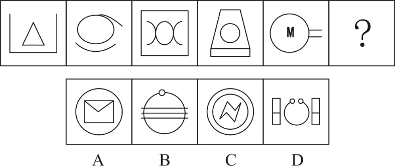
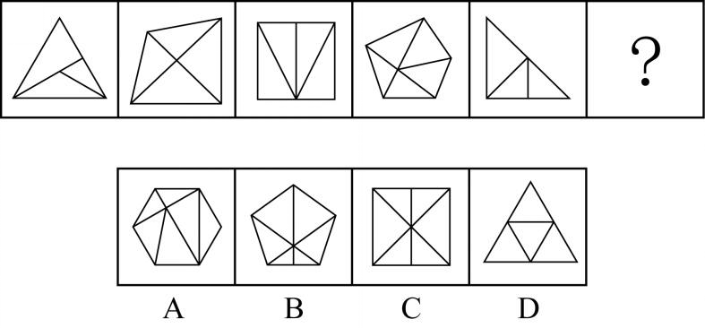
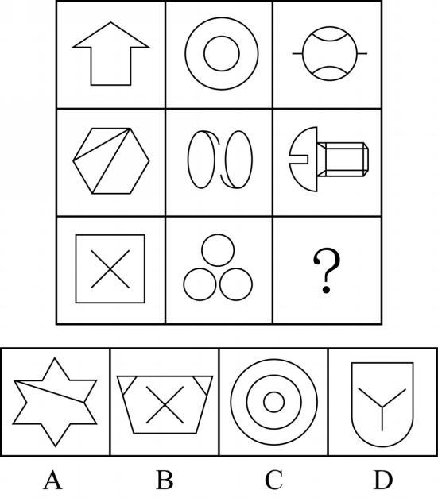
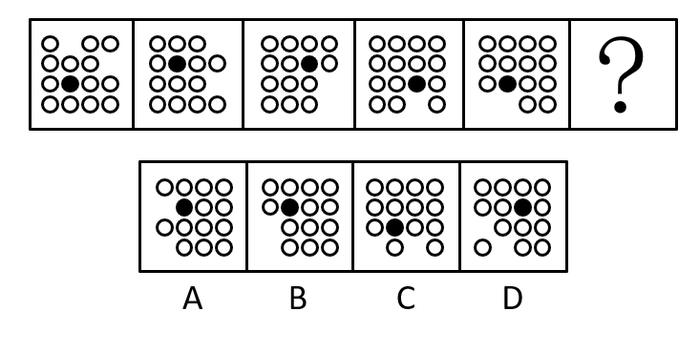
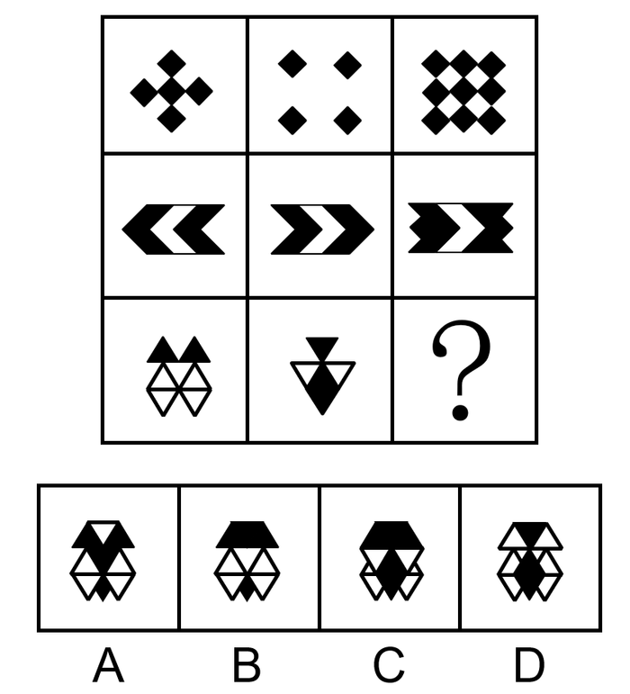
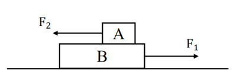
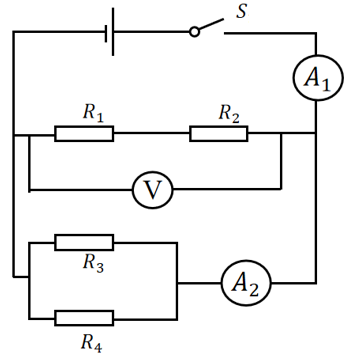
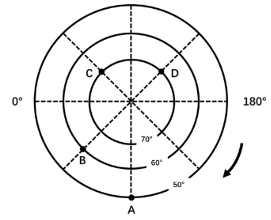

# 广东行测模拟 M01｜选编待审稿

当前实有 **90题**；全卷目标90题。**题面已补齐，仍待独立审核与打印排版。**

按近两年广东题本顺序编排。题目不标来源、难度或建议跳题位置；答案与解析另册。

政治理论第1—4题为判断题，第5—8题为单项选择题，第9—10题为多项选择题；其余已编题目为单项选择题。

---

## 一、政治理论

### 判断题

### 1.

推进高水平科技自立自强，既需要加强原创性、颠覆性科技创新，也需要推动科技创新成果应用于具体产业和产业链。

（　）

### 2.

坚持公有制主体地位，要求公有资产在每一个地区、每一个行业的社会总资产中都占优势。

（　）

### 3.

广东实施“百县千镇万村高质量发展工程”，以城乡融合发展为主要途径，以构建城乡区域协调发展新格局为目标。

（　）

### 4.

在社会平均生产条件和社会劳动生产率不变时，某企业因技术改进缩短了生产单位商品所需的劳动时间，该商品单位社会价值便会相应降低。

（　）

### 单项选择题

### 5.

某地传统装备制造业基础较好，科研资源相对集中，准备培育新的发展动能。下列举措中，最符合因地制宜发展新质生产力要求的是（）。

**A.** 把战略性新兴产业产值占比作为衡量新质生产力发展的唯一标准

**B.** 围绕本地产业所需关键技术组织攻关，将成果转化与传统企业工艺升级相衔接

**C.** 将传统产业整体迁出作为发展新兴产业的前置条件，腾出全部产业用地

**D.** 按照先进地区现有产业目录配置各县科技资金，尽快形成相同的产业结构

### 6.

某地治理河流污染时，同时协调上游排污、下游取水、沿岸产业转型和生态修复，并把建设投入与后续维护一并纳入方案。这一做法最直接体现的思想和工作方法是（）。

**A.** 坚持自信自立，主要依靠本地经验解决所有问题

**B.** 坚持问题导向，将各个污染点作为彼此独立的任务处理

**C.** 坚持系统观念，统筹不同区域、不同领域以及当前和长远的关系

**D.** 坚持守正创新，以改变已有治理制度的数量衡量改革成效

### 7.

某镇推进产业发展，排查出人才不足、物流不便、融资不畅等多项制约后，判断冷链物流缺失是当前最突出的瓶颈，因而集中资源先建冷链中心，同时持续推进人才培训和金融服务。这种工作安排主要体现了（）。

**A.** 在解决主要矛盾时兼顾次要矛盾，坚持两点论和重点论的统一

**B.** 根据矛盾主要方面决定事物性质的原理，判断当地经济的根本性质

**C.** 通过排除次要矛盾，使主要矛盾能够脱离其他矛盾独立解决

**D.** 只要增加冷链设施数量，就能必然实现当地产业性质的根本改变

### 8.

某地制定绿美生态建设方案。根据科学绿化和森林质量提升的要求，下列做法不恰当的是（）。

**A.** 优先选择适合当地气候、土壤条件的乡土树种，并完善长期管护机制

**B.** 综合考虑树种配置、林龄结构和林下植被，逐步提高森林生态系统稳定性

**C.** 统筹城镇绿地、河流岸线和山地森林建设，注重不同生态空间之间的联系

**D.** 以短期景观整齐度为主要目标，将树种复杂的天然林统一改造为速生纯林

### 多项选择题

### 9.

关于全过程人民民主，下列表述正确的有（）。

**A.** 既强调完整的制度程序，也强调完整的参与实践

**B.** 人民在依法参加选举后，民主参与即告完成，后续治理主要由有关机关独立负责

**C.** 把民主选举、民主协商、民主决策、民主管理、民主监督贯通起来

**D.** 实现过程民主和成果民主、程序民主和实质民主、直接民主和间接民主相统一

### 10.

某项基层治理措施先在少量社区试行，执行中根据群众反馈修正方案，随后扩大试点。关于这一过程中实践与认识的关系，下列说法正确的有（）。

**A.** 实践能够提供新的认识材料，并推动人们修正和发展原有认识

**B.** 试点形成的经验属于直接经验，他人通过学习获得的间接经验与实践无关

**C.** 某项认识只要在第一次试点中取得成功，便不再需要接受后续实践检验

**D.** 认识应当回到实践中发挥指导作用，其正确与否仍须接受实践检验

## 二、常识应用

### 11.

根据《中华人民共和国民法典》，在不存在其他影响效力因素的前提下，下列说法错误的是（）。

**A.** 七周岁的小林无需法定代理人代理，即可独立有效地订立接受无附加义务赠与的合同

**B.** 九周岁的小陈可以独立实施纯获利益的民事法律行为

**C.** 十七周岁的小王以自己的劳动收入为主要生活来源，可以视为完全民事行为能力人

**D.** 不能辨认自己行为的成年人属于无民事行为能力人

### 12.

关于广东河流及其水系，下列对应关系正确的是（）。

**A.** 北江——以梅江、汀江汇合后的河段为干流起点

**B.** 韩江——主要经河源、惠州、东莞进入珠江三角洲

**C.** 韩江——梅江与汀江在大埔三河坝汇合后形成的干流

**D.** 西江——以武江、浈江在韶关汇合后的河段为干流起点

### 13.

下列1927年的历史事件按发生时间先后排列，正确的是（）。
①广州起义　②南昌起义　③三湾改编　④湘赣边界秋收起义

**A.** ②③④①

**B.** ②④③①

**C.** ④②③①

**D.** ③②④①

### 14.

关于我国探月工程的任务与装备，下列说法错误的是（）。

**A.** “玉兔二号”是嫦娥四号任务的月球巡视器

**B.** “鹊桥”中继星为嫦娥四号着陆器、巡视器与地球之间的通信提供支持

**C.** 嫦娥五号任务实现了我国首次地外天体采样返回

**D.** 嫦娥五号与嫦娥四号均在月球背面着陆，因此二者任务的着陆区域相同

### 15.

为减少科举阅卷中的身份干扰，宋代实行了“封弥”“誊录”等措施。下列对这两项措施的解释，正确的是（）。

**A.** 封弥是把试卷统一抄写，誊录是把考生姓名等信息封闭

**B.** 封弥和誊录均只限制考官与外界联系，不涉及试卷的处理

**C.** 封弥隐藏考生身份信息，誊录通过重新抄写试卷减少笔迹识别考生的可能

**D.** 封弥在考试前公开考生家世，誊录在录取后核验家世是否真实

## 三、言语理解与表达

### 16.

法制与法治是既有区别又有联系的两个概念。法制是法律制度的简称，属于制度的_________；法治是法律统治的简称，是一种治国原则和方法，是相对于“人治”而言的。二者的联系在于：法制是法治的基础和前提条件，要实行法治，必须具有_________的法制；法治是法制的立足点和归宿，法制的发展前途必然是最终_________法治。
依次填入画横线处最恰当的一项是

**A.** 层面 完善 体现

**B.** 范畴 完备 实现

**C.** 范围 完整 抵达

**D.** 领域 完全 达至

### 17.

能量的产生和使用不一定____。可再生能源发电如风力发电、太阳能发电等，会因为天气、季节、地理位置的不同，存在不同时间尺度的间歇性，而用电需求也有____，时多时少。低成本大规模的储能系统可以突破可再生能源“即发即用、不能存储”的瓶颈，显著提高风、光等可再生能源的消纳水平。
依次填入画横线部分最恰当的一项是：

**A.** 同步 波动性

**B.** 协调 机动性

**C.** 平衡 规律性

**D.** 匹配 差异性

### 18.

时至今日，互联网上不断刷新的信息与碎片化的记忆，让那种足以令一代人____的宏大事件越来越少了。信息变得高度密集，却又彼此孤立，而且____，快速的信息流动击穿一切时间和空间的边界，那种因为同在一个时代或同处一个地方而形成的群体意识也愈加淡薄。
依次填入画横线部分最恰当的一项是：

**A.** 回忆 纷繁复杂

**B.** 铭记 无迹可循

**C.** 见证 如出一辙

**D.** 共享 稍纵即逝

### 19.

骈文的特点是追求形式美：对偶、声律、用典、藻饰。魏晋时期，这种刻意追求文学形式美的____，一方面促进了文学独立品格的建立，另一方面又造成了形式上的僵化和内容上的____。
依次填入画横线部分最恰当的一项是：

**A.** 导向 苍白

**B.** 手法 单一

**C.** 潮流 呆板

**D.** 风尚 空洞

### 20.

社会治理现代化是中国式现代化社会治理领域的具体表现，____于中国式现代化道路的生成脉络中，凝结了改革开放以来特别是新时代以来我国社会治理的新理念、____，现代治理精神和中华善治传统在新时代____。
依次填入画横线部分最恰当的一项是：

**A.** 孕育 新方法 一脉相承

**B.** 蕴含 新经验 交相辉映

**C.** 贯通 新举措 并驾齐驱

**D.** 发轫 新视野 相辅相成

### 21.

通过“线下生产+线上数据分析”模式，传统产业能够在规模化生产之外，探索开展个性化定制服务。比如，先生产小批量产品投放市场，再通过数据分析细分需求决定是否扩大生产。这种“轻资产、快反应”的柔性供应链模式，增加了产品研发、制造和流通的弹性，能帮助解决传统供应链模式下机会成本高、运转周期长等问题。这样的生产变革，能够通过精细化运营实现供需精准匹配，是一种更加适合中小企业数字化转型的模式，能让中小企业以“小单快返”的新模式轻装上阵，形成独特的竞争优势。
这段文字意在说明：

**A.** 传统产业需借助数据分析突破固有局限

**B.** 数字赋能可助力中小企业提升竞争优势

**C.** 供需的动态平衡是中小企业发展的关键

**D.** 企业的数字化转型重在构建柔性供应链

### 22.

足够的执法权限是基层治理高效运行的必要条件。权限不足，可能导致基层执法需求与实际权力配置之间存在较大张力，让基层治理陷入“看得见的管不着”的低效治理困境；但权限如果过度下放，又可能出现“接不住、管不好”的现象。因此，一方面需要进一步完善执法目录动态调整机制和制度，确保执法职能精准划转、行政职权科学配置；另一方面需要加快完善基层执法事项基准库，建立基层执法事项指导目录，确保执法事项在基层供需精准对接、有效贯通执行、全面落实落细。
这段文字意在强调，基层治理应：

**A.** 重视“基层执法”，提升基层执法服务效果

**B.** 围绕“精准赋权”，科学动态调整执法权属

**C.** 加快“权限下放”，精准对接基层执法需求

**D.** 调整“执法目录”，落实落细基层执法事项

### 23.

我们常说，雨水会将空气中的污染物、颗粒物冲刷下来，变成近似污水的“初期雨水”。其实，只有降雨达到天气预报所说的“中雨”，才有这种效果。如果只是微微细雨，不足以将颗粒物沉降。空气湿度增大，颗粒物尤其细颗粒物的吸湿性会增长，就是说PM2.5遇到湿气会膨胀，导致浓度不降反升。即使在强降雨时，前两个小时PM2.5浓度也有可能出现不降反升的情况。另外，湿度大的时候，近地面大气一般比较稳定，扩散能力弱，许多污染物易溶于水并发生化学反应，产生新的污染物，导致空气更浑浊。
最适合做这段文字标题的是：

**A.** 雨后的空气质量

**B.** 当PM2.5遇到雨水

**C.** 雨后空气就会清新吗

**D.** 为何雨后空气质量会变差

### 24.

①摊贩有生存需求，且能便利百姓生活，但城市运行需要合理的秩序，经营占道、噪声扰民、环境污染等问题也亟待破解
②事实上，许多城市对街头摊贩的管理，都经历了从绝对禁止到逐步开放、分类管理的过程
③如何求取最大公约数
④结合城市发展和百姓需求实际，引导小商小贩依法依规经营，是城市治理精细化的题中应有之义
⑤实践告诉我们，倾听百姓心声，做到统筹兼顾很关键
⑥摊贩是城市商业的组成部分，对摊贩的服务与监管，是一道需要同时破解“几难”的必答题
将以上6个句子重新排列，语序正确的一项是：

**A.** ⑤④③①⑥②

**B.** ⑤③④⑥①②

**C.** ⑥⑤③④②①

**D.** ⑥①③⑤②④

### 25.

近百年来，对于天然气水合物的研究通常是保压取样后在实验室进行，或在耐压舱中模拟水合物的形成分解。但由于深海与海面之间压力和温度的差异，在样品回收过程中，天然气水合物的一些性质会被破坏，实验室的模拟舱也很难还原深海复杂的环境条件。拉曼光谱技术能在深海原位环境中对天然气水合物进行直接研究。在这项技术中，激光通过光纤系统传输到深海，并与待测样品发生拉曼散射，通过采集和分析散射光谱，可获得样品组分、结构和理化性质等信息。
这段文字没有提及：

**A.** 在实验室模拟舱研究天然气水合物的弊端

**B.** 拉曼光谱技术对研究天然气水合物的优势

**C.** 深海环境对应用拉曼光谱技术的限制

**D.** 天然气水合物样品性质被破坏的原因

### 26.

图书作为文化产品，如非珍本、藏本，其价格发展是有一定规律的。长期以来，我国图书市场一直在薄利状态下运转，然而，最近读者却大呼“买不起”，图书市场的高定价成为人们诟病的因素，进而网络书店的低折扣满足了读者的期待。但是，网络书店的低折扣是否真给读者带来了实惠，是值得商榷的。这一场奇特的博弈，说到底，是图书市场的价格调控失灵所导致的。
下列说法与这段文字不相符的是：

**A.** 我国图书市场长期处于薄利状态

**B.** 珍贵图书的价格发展具有一定特殊性

**C.** 图书市场中出现的低折扣不一定给读者带来实惠

**D.** 读者对低折扣的期待是图书市场价格调控失灵的主因

### 27.

____。农药、化肥和农膜污染是主要的农业面源污染源，在不同程度上影响着耕地生态水平，近年来，在一系列农业绿色发展政策的支持下，农药、化肥和农用塑料薄膜使用量大幅下降，农业面源污染情况持续改善。耕地对于气候调节、水源涵养、生物多样性保护具有重要意义，因此推动耕地高质量保护，提升农田生态系统的稳定性是题中应有之义。目前，一些地方全力打造生态高标准农田，采用“稻田+生态沟渠+水塘/生态塘”等治理模式，不仅有效实现了稻田主要面源污染物的减少，还推动了乡村游等生态产业发展。
填入画横线部分最恰当的一项是：

**A.** 践行绿色生态理念，强化耕地生态功能

**B.** 多举措全面发力，推动耕地高质量保护

**C.** 落实耕地保护政策，夯实粮食安全根基

**D.** 加强农业生态投资，助力生态产业发展

### 28.

在一些科幻影片中，大质量黑洞周身的光环令人印象深刻。事实上，这并不是黑洞在发光，而是由宇宙中的气体物质构成的吸积盘所辐射的光芒。当黑洞附近有物质靠近时，这些物质并不会立刻被黑洞吞噬，而是被吸引到一个叫做吸积盘的结构中。当吸积盘受黑洞引力和摩擦的作用不断向内旋进时，内层的气体和尘埃被挤压导致温度上升从而发射出电磁辐射，这就形成了黑洞周身的光环。不过，由于黑洞强大的引力对光的扭曲效应，我们所能看到的吸积盘并不是一个扁平的圆盘，而是圆盘的远端被折起来，如同给黑洞戴了个“帽子”。
这段文字主要介绍：

**A.** 黑洞周身产生光环的原因

**B.** 吸积盘的形成及物质构成

**C.** 吸积盘与黑洞作用的方式

**D.** 黑洞吞噬宇宙物质的过程

### 29.

哲学家将人类看作“语言动物”。大约7万年前，常被野兽捕食的智人获得了语言，便强大起来，稳居地球食物链的最高端，演化为今天的人类。而文字和印刷术的发明，打破了时间、空间对口语的限制，改变了知识传播的方式与速度，改善了人类的记忆习惯与思维方式，推动了社会进步。工业化极大地延伸了人类体力，而今人类进入高速移动互联网和语言智能时代，脑力又得到延伸，这将是人类演化史中又一个划时代的进步。可以说，人类形成发展的历程，就是获取语言、使用语言、发展语言、创新语言的过程。
这段文字意在说明：

**A.** 语言智能化的划时代意义

**B.** 语言是人类社会得以运转的基础

**C.** 人类社会的进步离不开语言的发展

**D.** 语言是人类区别于其他动物的重要标志

### 30.

①但目前来看，新一代AI都表现出一定的回避提问的意图，这可能与模型试图节约算力资源有关
②在目前的法律框架内，数字生命还不是可以承担法律责任的主体，而被认为是程序、代码，或是人在网络空间中的一个身份
③如果机器向人输出了错误或者不能理解的内容，这是算法故障，应当要求开发、维护人员尽快修复，而不是指令机器“立刻改正”
④不过一旦模型有自主选择逃避人类提问的能力，并且已经脱离了开发人员的控制，AI没有法律人格的结论就要面临挑战了
⑤一般认为，创造数字生命的人，就是对数字生命负责的人，例如程序的开发者、AI的使用者等
⑥这除了伦理上的考虑，还有其不具备承担责任可能的因素
将以上6个句子重新排列，语序正确的一项是：

**A.** ②⑤⑥①④③

**B.** ⑤②⑥④①③

**C.** ②⑥⑤③①④

**D.** ⑤③②⑥④①

## 四、数量关系

### 数字推理

### 31.

2，1，1，3/2，3，15/2，（ ）

**A.** 9

**B.** 16

**C.** 35/2

**D.** 45/2

### 32.

8，12，23，44，78，（    ）

**A.** 99

**B.** 106

**C.** 128

**D.** 169

### 33.

1.1，3.1，6.2，5.11，30.2，（ ）

**A.** 21.4

**B.** 56.8

**C.** 63.63

**D.** 124.4

### 34.

180，56，146，174，247，（    ）

**A.** 289

**B.** 334

**C.** 376

**D.** 412

### 35.

1/2，2/3，23/28，58/65，13/14，（ ）

**A.** 206/217

**B.** 103/108

**C.** 205/217

**D.** 205/216

### 数学运算

### 36.

某商店分别按30%、50%的利润率定价销售A、B两种文具。暑期推出促销活动，将4件文具A和2件文具B组成礼盒，并按定价总和的八八折出售，每个礼盒可获利80元。已知每件文具A的成本比文具B低30元，则文具B的定价为多少元？

**A.** 120

**B.** 100

**C.** 90

**D.** 80

### 37.

某工厂原有600个零件待生产，原计划由王、刘两位师傅合作30小时可全部完成。现该工厂要扩大生产，增加原有零件数的25%，仍由王、刘两位师傅合作完成，为了保证按原计划的时间完成，王、刘两位师傅的工作效率分别提升了12.5%和 $\frac{1}{3}$ 。问两位师傅原计划每小时生产的零件数相差多少个？

**A.** 7

**B.** 6

**C.** 5

**D.** 4

### 38.

甲、乙两瓶质量和浓度均相同的酒精溶液，在甲瓶中加入20克水、乙瓶中加入50克浓度为30%的酒精溶液后，
浓度仍然相等。若继续在甲瓶中加入30克纯酒精，溶液又恢复到最初浓度，则乙瓶酒精溶液最初的质量是（
）。

**A.** 100克

**B.** 110克

**C.** 120克

**D.** 150克

### 39.

某货轮在A处观测到灯塔B在其北偏东 $60^{\circ}$ 方向，灯塔C在其北偏西 $30^{\circ}$ 方向。该货轮由A处沿正北方向行驶12海里到D处时，观测到灯塔B在其南偏东 $60^{\circ}$ 方向，灯塔C在其南偏西 $60^{\circ}$ 方向，则灯塔B与灯塔C的距离为多少海里？

**A.** 6

**B.** $6\sqrt{7}$

**C.** 9

**D.** 12

### 40.

小张打羽毛球膝盖受伤，需每隔4天去医院做一次理疗，如果他7月2日去，则7月的理疗有1次在星期六、1次在
星期日，其余都在工作日；如果他7月3日去，则7月的理疗只有1次在星期日，其余都在工作日，那么7月31日
是（    ）。

**A.** 星期四

**B.** 星期三

**C.** 星期二

**D.** 星期一

### 41.

某条路段的一侧要均匀安装若干盏路灯，而且路段首尾处各需安装一盏。若每隔8米安装一盏路灯，需要甲、乙两组合作11天完成；若每隔6米安装一盏路灯，甲组单独安装需要23天完成。已知甲、乙两组每天安装路灯的数量之比为7∶4。则这条公路长多少米？

**A.** 840

**B.** 960

**C.** 1080

**D.** 1200

### 42.

一个转盘被平均划分为5个扇形区域，分别标有数字1、2、3、4、5。转盘中央有一指针，转盘转动后指针最终落到各区域的概率相等。玩家连续转动转盘3次，若指针落到偶数区域的次数多于奇数区域则获奖，那么玩家获奖的概率是多少？

**A.** $\frac{44}{125}$

**B.** $\frac{81}{125}$

**C.** $\frac{4}{25}$

**D.** $\frac{21}{25}$

### 43.

某品牌总部将39个优秀员工名额分配给8家分店，每家分店至少分到1个名额。其中，除了3家分店各分到5个名额并列第三之外，其余5家分到的名额数量均不相同。则这8家分店中分到名额最多的分店最多分到几个名额？

**A.** 9

**B.** 10

**C.** 11

**D.** 12

### 44.

现有工作量相同的A、B两间仓库需要清洁。甲、乙、丙三人单独清洁一间仓库，分别需要2小时、1.2小时、1.5小时完工。现将A、B两间仓库分别交由甲、乙两人清洁，两人同时开始，丙刚开始帮甲，后来又去帮乙，两间仓库的清洁任务同时完工，则丙帮乙干了多少分钟？

**A.** 15

**B.** 20

**C.** 30

**D.** 45

### 45.

健身教练为小王定制了一份健身计划，包括慢跑、跳绳、游泳三种运动，每次运动10分钟，分别消耗55大卡、80大卡、120大卡的热量，可以连续两次选择相同运动项目。要求小王每天运动时长不超过40分钟（休息时间不计入），至少消耗360大卡的热量，则共有多少种不同的安排方式？

**A.** 6

**B.** 7

**C.** 30

**D.** 32

## 五、判断推理

### 图形推理

### 46.

请从所给的四个选项中，选出最恰当的一项填入问号处，使之呈现一定的规律。

### 47.

请从所给的四个选项中，选出最恰当的一项填入问号处，使之呈现一定的规律。

### 48.

请从所给的四个选项中，选出最恰当的一项填入问号处，使之呈现一定的规律。

### 49.

从所给的四个选项中，选择最合适的一个填入问号处，使之呈现一定的规律性：

### 50.

从所给的四个选项中，选择最合适的一个填入问号处，使之呈现一定的规律性：

### 逻辑判断

### 51.

小全、大陈、小吴、大刘四人都是水上项目运动员，他们专攻的运动项目有游泳、跳水、水球、赛艇。已知：
（1）只有大陈不练跳水，小全才练游泳；
（2）只有大陈练跳水，大刘才练水球；
（3）或者小吴练游泳，或者小全练游泳，二者仅有其一；
（4）或者小全不练赛艇，或者大刘练水球，二者仅有其一。
增加以下哪个选项作为前提，可以推出小吴练游泳？

**A.** 小全练赛艇

**B.** 大陈不练跳水

**C.** 大陈练水球

**D.** 大刘不练水球

### 52.

张、王、李、赵、钱、孙6人是某单位的优秀员工，在全面深化改革方面取得了很大的成就，现有甲、乙、
丙、丁四种奖项可以申报，每名员工只能申报一种奖项，且每种奖项都有1至2名员工申报，已知以下情况：
（1）申报乙奖的员工比甲奖的多；
（2）申报丁奖的员工比丙奖的多；
（3）若李、赵中至少有1名申报甲奖，则王申报丁奖；
（4）若张、李、赵中至少有1名申报乙奖，则只有钱申报丁奖；
（5）孙申报丙奖。
根据以上信息，可以得出以下哪项结论？

**A.** 张申报丙奖

**B.** 赵、钱申报乙奖

**C.** 王、李申报丁奖

**D.** 李、赵申报丁奖

### 53.

对某项调查的“同意”票进行计数，甲、乙、丙、丁四人给出的结果分别是：9472、9496、9480、9502张。四
人计数结果不一致后重新计数，发现有三人分别少计了17张、少计了9张、多计了13张，还有一人仅粗略估计
出一个票数。
根据上述信息，可以推出粗略估计票数的人是：

**A.** 甲

**B.** 乙

**C.** 丙

**D.** 丁

### 54.

一场歌唱比赛，甲、乙、丙、丁4人包揽前四名。关于排名情况，4名观众的猜测如下：
观众1：只要乙获得亚军，甲就能获得季军；
观众2：丙获得冠军，或者丁不是第四名；
观众3：甲未获得季军；
观众4：丙获得亚军。
结果发现只有1名观众的猜测为真，由此可以推出：

**A.** 甲获得冠军

**B.** 乙获得第四名

**C.** 丙获得亚军

**D.** 丁获得季军

### 55.

小李和小王玩石头剪刀布，有人赢两次就获胜。已知他们分出了胜负，且到结束时小李一共出了9个手指，小
王一共出了5个手指。
问以下哪个选项不可能发生？

**A.** 小李连赢两次并获胜

**B.** 两人连续三次没分出胜负

**C.** 小李一度落后情况下逆转获胜

**D.** 小王一度落后情况下逆转获胜

### 56.

卖早点、修家电、配钥匙·····老百姓家门口的社区商业，是以社区居民为服务对象、服务半径为步行15
分钟左右范围内的商业形态。近年来，许多城市大力推进社区商业建设，以更好地满足居民的消费需求。不
过，也有专家担忧，家门口商业服务的完善，在给居民生活带来便利的同时可能也会使快递业逐步萎缩。
以下哪项如果为真，最能缓解上述专家的担忧？

**A.** 为了方便居民，很多城市推进社区商业建设时，都将快递驿站作为社区商业的重要组成部分

**B.** 社区商业主要提供汽车保养、幼儿托管等服务类业态，社区购物在居民整体购物消费中占比很少

**C.** 社会经济发展必然包含新旧行业的更迭，社区商业作为新的消费增长点，吸纳了大量传统行业的劳动者就业

**D.** 许多大型商超组建了自己的配送车队，可为周边5公里范围内居民提供商品一小时送达服务

### 57.

金伯利岩是一种稀有的火山岩。从这些岩石上能看出火山曾猛烈喷发的痕迹，其化学和矿物成分也有别于地球
上其他岩浆岩。尤其是有些金伯利岩包含厘米级大小的稀有矿物晶体，如铁尖晶橄榄石和布氏岩等。因此，人
们推测这一类含有稀有矿物晶体的金伯利岩很可能来自地幔。
以下哪项如果为真，最能支持上述结论？

**A.** 布氏岩是下地幔的一种主要矿物

**B.** 铁尖晶橄榄石只能形成于上、下地幔之间的过渡带

**C.** 有些金伯利岩中的矿物成分在地球表面无法稳定存在

**D.** 这类金伯利岩和原始地幔中都含有锶和钕这两种元素

### 58.

买电影票前，去电影网站查看待映影片的评分；看电视剧前，要等到有评分后才决定是否观看······各
种文化产品似乎都有了属于自己的分数。一个高分能为相关文化产品带来较高的关注度和较大的影响力，这反
过来又影响文化产品的创作。然而，有专家表示，这样的评分很有可能影响文化产品的创新发展。
以下除哪项外，均能支持上述专家的观点？

**A.** 那些试图突破常规、探索新风格或新形式的文化产品，往往会因为不符合评分者的偏好，而只得到较低的评
分

**B.** 新的文化产品往往需要一定的时间周期，才能培养出口碑和受众基础，而评分的即时性会抑制这种成长空间

**C.** 在评分的过程中，粉丝群体会毫无理由地对自己喜爱的作品给出高分评价，从而影响评分的公正性和客观性

**D.** 为获得更高的评分和更多的市场认可，许多文化产品的创作者会迎合评分标准和大众喜好，重复已成功的模
式和题材

### 59.

一项研究发现，成年小白鼠去除一个关键生物钟基因后，昼夜节律完全消失，虽然生活质量有所下降，但寿命
并未受到显著影响，心血管健康状况甚至有所改善。据此，研究人员推断昼夜节律缺失对健康的危害可能没有
我们想象得那么大。
回答以下哪个问题最有助于评价上述研究人员所做出的推断？

**A.** 成年小白鼠去除生物钟基因后出现的心血管情况改善是否会延长小白鼠的寿命

**B.** 成年小白鼠去除生物钟基因之后的休息时间是否与未去除之前的休息时间相同

**C.** 成年小白鼠去除生物钟基因后的寿命和心血管健康状况能否代表整体健康状况

**D.** 成年小白鼠去除生物钟基因之后的生活质量是否会影响小白鼠的整体健康状况

### 60.

《百家姓》是一部关于汉字姓氏的作品，成文于北宋初期，原收集姓氏411个，后增补到504个，其中单姓444
个，复姓60个。《百家姓》的内容没有文理，仅仅只是姓氏的合集，但却是古代中国儿童启蒙教育中不可或缺
的经典作品，与《三字经》《千字文》并称为古代三大启蒙读物，在古代儿童教育中占据了重要地位。
以下除哪项外，均能解释《百家姓》在古代儿童教育中的重要地位？

**A.** 姓氏可以反映出社会各阶层的权力传承和财产继承，《百家姓》中姓氏的逐步丰富反映了社会的发展和进步

**B.** 姓氏的作用主要是区分血缘关系和婚姻关系，随着门阀政治的出现，《百家姓》中姓氏的排序反映了当时的
政治和社会结构

**C.** 姓氏文化不仅透露出家族的来源、迁徙历史和谱系，还包括了宗祠、名人和家训等方面的信息，承载着丰富
的文化内涵

**D.** 在南宋《百家姓》已经成为普及读物，历朝历代都编写了各种版本的《百家姓》，其中不乏名家编撰和御制
的版本

### 61.

若做不到强化技术监管、提升执法效能，就不能让科技创新真正造福人类。目前监管部门已经强化了技术监管，提升了执法效能，因此科技创新已经能够真正造福人类。下列选项的逻辑结构与题干最为相似的是（    ）。

**A.** 若以亮利剑的态度涤清网络生态，就能让赛事精神在网络激荡出磅礴力量。某赛事以亮利剑的态度涤清了网络生态，因此该赛事精神在网络激荡出了磅礴力量

**B.** 除非发扬载人航天精神，否则在星辰大海的征途上并不会镌刻更多的中国印记。目前在星辰大海的征途上镌刻了更多的中国印记，因此我们一定发扬了载人航天精神

**C.** 只有扩大高水平对外开放，才能开创合作共赢新局面。我国扩大高水平对外开放，因此我们没有同世界各国共同开创合作共赢新局面

**D.** 若某社区为老年人筑起数字安全网，该社区的老年人就能在岁月静好中安享晚年。某社区的老年人在岁月静好中安享晚年，因此该社区为老年人筑起数字安全网

### 62.

某研究发现，连续8周每天服用450-900毫克茶氨酸后，被试的睡眠满意度显著提高。某厂商因此推出一款含有
茶氨酸的饮料，并以该研究为主要内容拍摄广告，声称这款饮料有助于缓解失眠、促进睡眠。
以下哪项如果为真，最能质疑该厂商的说法？

**A.** 该饮料茶氨酸含量较低，要达到450毫克的实验剂量，一天需要饮用4-5瓶

**B.** 茶氨酸可通过影响大脑中的神经传导物质来减缓神经冲动，帮助缓解紧张情绪

**C.** 茶氨酸易溶于水，能够消减咖啡碱引起的苦涩味并增强鲜味和甜味，使饮料味道更好

**D.** 参与该研究的被试均患有症状为持续紧张不安的广泛焦虑症，且实验期间服用了抗抑郁药物

### 63.

甲：在手机市场增长缓慢的大环境下，折叠屏手机销量连续多年保持两位数的增长，折叠屏手机将是手机研发
的下一个风口
乙：折叠屏手机经历多年发展仍只占手机整体销量的1.6%，由此来看，折叠屏手机不值得手机厂商投入太多精
力
以下哪项与上述对话方式最为相似？

**A.** 甲：2017年企业应用AI技术比例约为20%，到2023年提高至50%，AI技术将是国家经济发展的重点
乙：AI技术经历多年发展已经在社会方方面面起着重要作用，但传统行业仍是经济中的重要部分，同样需要重
视

**B.** 甲：这次期末考试，张明的成绩平均每科提高了5分，这表明张明过去一年在学习上认真了许多
乙：这次期末考试比较简单，全班同学各科平均分都提高了10分之多，由此看来，张明在过去一年没有认真学
习

**C.** 甲：过去三年某出版社的错别字检出量大大增加，必须增加相应的人手以避免错别字检出数量继续增加
乙：过去三年该出版社出版总量大大增加，但错别字检出率维持在万分之一左右，远低于国家标准，无需增加
人手

**D.** 甲：一项调查显示，超过90%的大学生在不请假的情况下缺过课，这一现象说明课堂纪律没有得到很好的遵
守
乙：这项调查主要针对大四学生，如果是大一学生，则缺过课的比例不超过20%，可见大学课堂纪律得到了很
好的遵守

### 64.

明厨亮灶的饭店，客流量大；而客流量大的饭店，饭菜都美味。因此，明厨亮灶的饭店，饭菜都美味。下列选项的逻辑结构与题干最为相似的是（    ）。

**A.** 坚持晨读的人，语言感知敏锐；语言感知敏锐的人，外语学习效率都高。因此，外语学习效率高的人，都在坚持晨读

**B.** 重视产品质量的企业，市场占有率高。这是因为重视产品质量的企业，用户口碑一定好，而用户口碑好的企业，市场占有率高

**C.** 作息规律的人，身体代谢功能稳定；而身体代谢功能稳定的人，衰老速度缓慢。因此，作息不规律的人，衰老速度快

**D.** 居民幸福感强的社区，都在践行垃圾分类。这是因为践行垃圾分类的社区，环境整洁度很高，而环境整洁度高的社区，居民幸福感都强

### 65.

研究人员从分析受试者的呼吸开始，筛选可用于生物识别认证的化合物，共发现了28种可行的化合物。在此基
础上，他们开发了一个有16个通道的嗅觉传感器阵列，每个通道都可识别特定范围的化合物。传感器数据随后
被传递到机器学习系统中，分析每个人的呼吸组成，并以此区分个人的特征。研究人员根据结果表示，呼吸可
作为身份验证的识别信号。
以下哪项如果为真，最能削弱上述观点？

**A.** 实验受试者仅20人，样本量太少

**B.** 呼吸样本波动性极高，很容易受饮食、环境甚至情绪影响

**C.** 16个嗅觉传感器通道较少，识别呼吸的个人特征时准确率并不稳定

**D.** 即使患呼吸道疾病，一个人呼吸运动的独特性也会在很长时间内保持不变

## 六、科学推理

### 66.

如图所示，外力 $F_1$ 大小为10N，作用于物块B上，外力 $F_2$ 大小为5N，作用于物块A上。物块B静止于粗糙程度均匀的水平地面上，物块A在物块B上向左做匀速直线运动，假设物块B足够长，下列说法不正确的是（    ）。

**A.** 物块A共受到4个力的作用

**B.** 物块B共受到6个力的作用

**C.** 地面对物块B的摩擦力一定小于10N

**D.** 物块A对物块B的摩擦力一定小于5N

### 67.

如图为某用电器的电路图， $R_1$ 、 $R_4$ 是定值电阻， $R_2$ 是温敏电阻，随着环境温度的升高， $R_2$的阻值会变大； $R_3$ 是光敏电阻，随着环境光照强度的增大， $R_3$ 的阻值会变小；V表示电压表， $A_1$ 、 $A_2$ 均表示电流表，电源电压保持不变，闭合开关S后，下列说法正确的是（    ）。

**A.** 若环境温度下降，则V的示数变小， $A_1$ 的示数变大

**B.** 若环境温度下降，则V的示数不变， $A_1$ 的示数变大

**C.** 若环境光照强度增大，则 $A_1$ 的示数变大， $A_2$ 的示数变小

**D.** 若环境光照强度减弱，则 $A_1$ 的示数不变， $A_2$ 的示数变大

### 68.

小明在学习完与金属活动性相关的知识后，想自己动手验证Fe、Cu、Ag三种金属活动性的强弱，下列实验方案的组合不能达到其目的的是（    ）。
①将Fe放入 $\mathrm{CuSO_4}$ 溶液
②将Cu放入 $\mathrm{AgNO_3}$ 溶液
③将Ag放入 $\mathrm{CuSO_4}$ 溶液
④将Fe、Cu分别放入稀盐酸

**A.** ①③

**B.** ①④

**C.** ②④

**D.** ③④

### 69.

在ABO血型系统中，下列关于血型遗传的说法正确的是（    ）。

**A.** 若父母一方为A型血，另一方为B型血，则子女只可能是A型血或者B型血

**B.** 若子女出现O型血，则父母双方至少有一人一定是O型血

**C.** 若父母分别为AB型血与O型血，则子女不可能是O型血

**D.** 若子女为AB型血，则父母一方必定是A型血，另一方必定是B型血

### 70.

根据下图所示的经纬网，说法正确的是（    ）。

①A、B、C、D四个地区全部位于南半球
②A、B、C、D四个地区全部位于中纬度地区
③A、B、C、D四个地区全部位于温带
④A、D两个地区的经纬度分别是（ $50^{\circ}\mathrm{S}$ ， $90^{\circ}\mathrm{W}$ ）、（ $70^{\circ}\mathrm{S}$ ， $135^{\circ}\mathrm{E}$ ）
⑤B、C两个地区的经纬度分别是（ $60^{\circ}\mathrm{S}$ ， $45^{\circ}\mathrm{E}$ ）、（ $70^{\circ}\mathrm{S}$ ， $45^{\circ}\mathrm{W}$ ）
⑥A、B两个地区位于西半球，C、D两个地区位于东半球

**A.** ①③⑤

**B.** ①⑤⑥

**C.** ②④⑥

**D.** ①④⑥

## 七、资料分析

### 材料：回答第71—75题

2023年，全国居民人均消费支出26796元，同比名义增长9.2%（以下如无特别说明，均为同比名义增长），其中，人均交通通信消费支出3652元，同比增长14.3%。分城乡看，城镇居民人均消费支出32994元，同比增长8.6%；农村居民人均消费支出18175元，同比增长9.3%。

**2018—2023年全国居民人均消费支出占人均可支配收入的比例**

| 年份 | 比例 |
| --- | --- |
| 2018 | 70.3% |
| 2019 | 70.1% |
| 2020 | 65.9% |
| 2021 | 68.6% |
| 2022 | 66.5% |
| 2023 | 68.3% |

**2018—2023年全国及部分省（市）城镇居民人均消费支出统计情况**

| 地区 | 2018年（元） | 2019年（元） | 2020年（元） | 2021年（元） | 2022年（元） | 2023年（元） |
| --- | --- | --- | --- | --- | --- | --- |
| 全国 | 26112.31 | 28063.35 | 27007.45 | 30307.20 | 30390.80 | 32994.00 |
| 上海 | 46015.21 | 48271.57 | 44839.32 | 51294.60 | 48110.55 | 54918.77 |
| 北京 | 42925.65 | 46358.17 | 41726.26 | 46775.70 | 45616.87 | 50897.45 |
| 广东 | 30924.31 | 34424.12 | 33511.30 | 36621.10 | 36936.16 | 39333.34 |
| 山东 | 24798.38 | 26731.49 | 27291.10 | 29314.30 | 28555.15 | 30250.98 |

### 71.

2023年，全国居民人均可支配收入约为多少元？

**A.** 42509

**B.** 39233

**C.** 33488

**D.** 29089

### 72.

若按照全国居民人均消费水平，2022年五口之家需要支出约多少元交通通信费？

**A.** 15976

**B.** 18260

**C.** 12780

**D.** 3195

### 73.

2023年，全国居民人均可支配收入同比增长约：

**A.** 12.8%

**B.** 9.2%

**C.** 6.3%

**D.** 5.1%

### 74.

2019-2023年，上海市城镇居民人均消费支出同比增长率超过10%的年份有几个？

**A.** 3

**B.** 2

**C.** 1

**D.** 0

### 75.

根据上述材料，下列说法正确的是：

**A.** 2023年，全国农村居民平均每月人均消费支出约为2000元

**B.** 2019-2023年，全国居民人均消费支出同比增速低于人均可支配收入同比增速的年份有2个

**C.** 2018-2023年，山东省城镇居民人均消费支出每年均低于全国水平

**D.** 2023年，上海市城镇居民人均消费支出的同比增长量不到广东省的3倍

### 材料：回答第76—80题

**2024年4月全国监管货运进出境情况**

| 指标名称 | 单位 | 4月数量 | 4月同比增长（%） | 1—4月数量 | 1—4月同比增长（%） |
| --- | --- | --- | --- | --- | --- |
| 监管进出口货运量 | 万吨 | 47950.8 | 9.6 | 176583.3 | 6.3 |
| 进口 | 万吨 | 30429.2 | 10.8 | 117851.4 | 6.8 |
| 出口 | 万吨 | 17521.6 | 7.5 | 58731.9 | 5.3 |
| 监管运输工具进出境总数 | 原表未标注 | 3309354 | 30.1 | 12808925 | 51.1 |
| 其中：进出境汽车 | 辆 | 2828439 | 32.8 | 10946073 | 55.6 |
| 进出境火车 | 节 | 376851 | 9.8 | 1470568 | 20.5 |
| 进出境船舶 | 艘 | 34604 | 10.9 | 127518 | 14.2 |
| 进出境飞机 | 架 | 69460 | 79.3 | 264766 | 136.4 |

### 76.

2023年1-4月，全国监管进出口货运量约为多少亿吨？

**A.** 16.6

**B.** 17.1

**C.** 17.4

**D.** 17.9

### 77.

2024年4月，表中所列4种监管运输工具进出境数量占全国监管运输工具进出境总数的比重同比上升的有几种？

**A.** 0

**B.** 1

**C.** 2

**D.** 4

### 78.

2023年1-3月，全国监管出口货运量约为多少万吨？

**A.** 39477

**B.** 41210

**C.** 43562

**D.** 45941

### 79.

2024年4月，表中所列全国4种监管运输工具进出境数量高于1-3月平均水平的有几种？

**A.** 0

**B.** 1

**C.** 2

**D.** 4

### 80.

能够从上述资料中推出的是：

**A.** 2024年4月，全国每天监管进出境飞机数量不超过2300架

**B.** 2024年1-4月，全国监管进出境飞机数量比船舶约多2.1倍

**C.** 2024年1-4月，全国监管进口货运量同比增长超过7000万吨

**D.** 2024年4月，全国监管出口货运量比进口货运量多12907.6万吨

### 材料：回答第81—85题

2022年，我国服务进出口总额59801.9亿元（人民币，下同），同比增长12.9%。其中，出口额28522.4亿元，增长12.1%；进口额31279.5亿元，增长13.5%；服务贸易逆差2757.1亿元。

**2022年我国服务分类进出口统计**

| 服务类别 | 进出口金额（亿元） | 进出口同比增长（%） | 出口金额（亿元） | 出口同比增长（%） | 进口金额（亿元） | 进口同比增长（%） |
| --- | --- | --- | --- | --- | --- | --- |
| 运输服务 | 21101.0 | 25.4 | 9745.3 | 18.8 | 11355.7 | 31.8 |
| 旅行服务 | 8559.8 | 8.4 | 644.4 | −12.2 | 7915.3 | 10.5 |
| 建筑服务 | 2410.0 | −7.2 | 1899.0 | −3.4 | 510.9 | −19.1 |
| 保险服务 | 1704.8 | 24.4 | 300.1 | −10.5 | 1404.6 | — |
| 金融服务 | 594.0 | −10.8 | 341.8 | 6.5 | 252.2 | −26.9 |
| 电信、计算机和信息服务 | 8352.7 | 8.3 | 5794.6 | 13.0 | 2558.1 | −1.2 |
| 知识产权使用费 | 3881.2 | 2.5 | 892.8 | 17.5 | 2988.4 | −1.2 |
| 个人、文化和娱乐服务 | 295.5 | −11.4 | 119.8 | −2.2 | 175.7 | −16.8 |
| 维护和维修服务 | 847.1 | 12.4 | — | 9.5 | — | 18.3 |
| 加工服务 | 1459.9 | 8.6 | 1403.9 | 8.2 | 56.0 | 21.9 |
| 其他商业服务 | 10240.3 | 9.1 | 6711.7 | 12.6 | 3528.6 | 2.8 |
| 政府服务 | 355.6 | 15.2 | 113.0 | 13.0 | 242.5 | 16.2 |

备注：因四舍五入，存在总计与分项合计不等的情况。“—”为原表缺省项。

### 81.

2022年，我国保险服务进口额约比上年：

**A.** 增加306亿元

**B.** 增加370亿元

**C.** 减少306亿元

**D.** 减少370亿元

### 82.

2022年，我国电信、计算机和信息服务进出口额占全国服务进出口总额的比重比旅行服务约：

**A.** 低0.3个百分点

**B.** 高0.3个百分点

**C.** 低3.5个百分点

**D.** 高3.5个百分点

### 83.

2021年，我国维护和维修服务进口额和出口额之比约为：

**A.** 2：1

**B.** 1：3

**C.** 1：2

**D.** 3：1

### 84.

2022年，下列我国服务类别中贸易顺差最大的是：

**A.** 加工服务

**B.** 金融服务

**C.** 建筑服务

**D.** 知识产权使用费

### 85.

根据上述资料，下列说法错误的是：

**A.** 2022年，我国进口额、出口额最大的服务类别均为运输服务

**B.** 2022年，我国运输服务的贸易逆差大于保险服务

**C.** 2022年，我国政府服务出口额、进口额占全国的比重均高于上年

**D.** 2021年，我国个人、文化和娱乐服务出口额高于125亿元

### 材料：回答第86—90题

**图1：2020—2025年2月中国中央处理部件出口数量统计情况**

| 期间 | 出口数量（万台） | 同比增速（%） |
| --- | --- | --- |
| 2020年 | 3526 | −4.3 |
| 2021年 | 4271 | 21.1 |
| 2022年 | 4066 | −4.8 |
| 2023年 | 3604 | −11.4 |
| 2024年 | 3556 | −1.3 |
| 2025年1—2月 | 535 | 6.1 |

**图2：2020—2025年2月中国中央处理部件出口金额统计情况**

| 期间 | 出口金额（百万美元） | 同比增速（%） |
| --- | --- | --- |
| 2020年 | 15417.3 | −8.1 |
| 2021年 | 20325.5 | 31.8 |
| 2022年 | 21949.1 | 8.0 |
| 2023年 | 16697.4 | −23.9 |
| 2024年 | 20437.0 | 22.4 |
| 2025年1—2月 | 2657.3 | 7.1 |

### 86.

2021年，中国中央处理部件出口金额比2019年增长了约：

**A.** 15.9%

**B.** 21.1%

**C.** 23.7%

**D.** 26.3%

### 87.

2024年1-2月，中国中央处理部件出口数量占2024年全年的比重约为：

**A.** 16.6%

**B.** 15.0%

**C.** 14.2%

**D.** 13.1%

### 88.

2023年，中国平均每台中央处理部件的出口金额比2022年：

**A.** 增长了不到10%

**B.** 增长了10%以上

**C.** 下降了不到10%

**D.** 下降了10%以上

### 89.

2021-2024年，中国平均每台中央处理部件出口金额约为多少美元？

**A.** 512

**B.** 475

**C.** 674

**D.** 337

### 90.

能够从上述资料中推出的是：

**A.** 2020-2024年，中国中央处理部件出口数量及出口金额的变化趋势一致

**B.** 2024年，中国中央处理部件出口金额比2020年增长了33.3%以上

**C.** 2020年，中国中央处理部件出口金额同比减少了约1359美元

**D.** 2019年，中国中央处理部件出口数量不到3800万台
