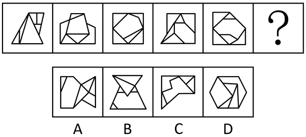
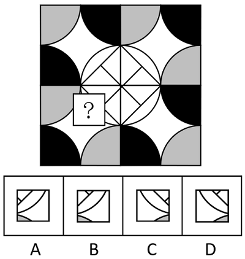
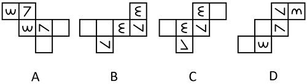
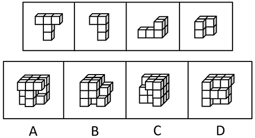
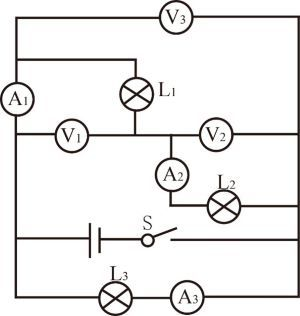
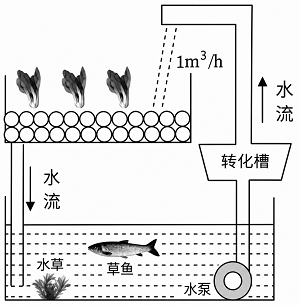
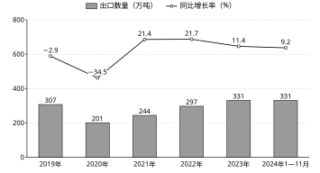
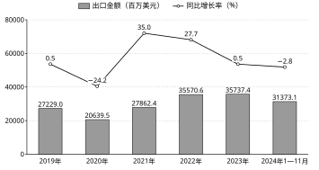

# M02　广东省考行测模拟卷（题本）

## 第一部分　政治理论

**1.** 党的各级纪律检查委员会是全面从严治党的主体，承担管党治党主体责任。

A. 正确　　B. 错误

**2.** 建设听党指挥、能打胜仗、作风优良的人民军队，能打胜仗是灵魂，决定军队建设的政治方向。

A. 正确　　B. 错误

**3.** 党的历史上第二份历史决议《关于建国以来党的若干历史问题的决议》，是在党的十一届六中全会上通过的。

A. 正确　　B. 错误

**4.** 物质和运动不可分割，脱离物质谈运动将导致唯心主义，脱离运动谈物质将导致形而上学。

A. 正确　　B. 错误

**5.** 习近平总书记指出：“调查研究是谋事之基、成事之道。没有调查，就没有发言权，更没有决策权。”下列古语与这一论述最为契合的是（　）。

A. 天下难事，必作于易；天下大事，必作于细
B. 法者，治之端也；君子者，法之原也
C. 天时不如地利，地利不如人和
D. 知屋漏者在宇下，知政失者在草野

**6.** 党的二十大报告指出：“我们要以科学的态度对待科学、以真理的精神追求真理，坚持马克思主义基本原理不动摇，坚持党的全面领导不动摇，坚持中国特色社会主义不动摇，紧跟时代步伐，顺应实践发展，以满腔热忱对待一切新生事物，不断拓展认识的广度和深度，敢于说前人没有说过的新话，敢于干前人没有干过的事情，以新的理论指导新的实践。”这段话最能体现习近平新时代中国特色社会主义思想（　）的立场观点方法。

A. 必须坚持自信自立
B. 必须坚持守正创新
C. 必须坚持系统观念
D. 必须坚持问题导向

**7.** 二十届五中全会《决定》指出，正风肃纪是全面从严治党的有力举措。关于强化从严执纪、发挥纪律教育约束作用，下列表述有误的是（　）。

A. 严格执行党的组织纪律，带动政治纪律、廉洁纪律等全面从严
B. 坚持纪严于法、纪在法前，执纪执法贯通、有效衔接司法
C. 坚持抓早抓小、防微杜渐，对苗头性、倾向性问题及时提醒纠正
D. 深化运用监督执纪“四种形态”，注重用好“第一种形态”

**8.** 国家安全是民族复兴的根基，社会稳定是国家强盛的前提。关于贯彻总体国家安全观，下列说法有误的是（　）。

A. 坚持以人民安全为宗旨、以政治安全为根本、以经济安全为基础
B. 把维护政治安全作为应对各领域安全风险挑战的首要任务
C. 统筹维护和塑造国家安全，以新发展格局保障新安全格局
D. 推动公共安全治理模式由以事后处置为主向以事前预防为主转型

**9.** 1927年，中国共产党领导了南昌起义、秋收起义、广州起义三大起义。以下关于土地革命战争时期党的历史的表述，正确的有（　）。

A. 古田会议是党第一次独立自主地运用马克思列宁主义基本原理解决自己的革命问题
B. 八七会议确定了土地革命和武装斗争的总方针
C. 三湾改编标志着党的工作重心开始逐渐由城市向乡村转移
D. 党对军队的绝对领导发端于南昌起义、奠基于三湾改编、定型于古田会议

**10.** 唯物辩证法有内容和形式、现象和本质、原因和结果、可能和现实、必然和偶然等基本范畴。关于这些范畴，下列说法正确的有（　）。

A. 现象是事物的外部联系和表面特征，本质是事物的内在联系和根本性质
B. 形式决定内容，内容对形式具有反作用
C. 必然在事物发展中居于支配地位，偶然对发展的必然过程起促进或延缓作用
D. 前后相继的两个现象之间必然存在因果联系

## 第二部分　常识判断

**11.** 习近平新时代中国特色社会主义思想明确，必须坚持和完善社会主义基本经济制度。关于社会主义市场经济，下列表述有误的是（　）。

A. 构建高水平社会主义市场经济体制，关键是处理好政府和市场的关系
B. 公有制经济和非公有制经济都是我国经济社会发展的重要基础
C. 要使市场在资源配置中起基础性作用，更好发挥政府作用
D. 要毫不动摇鼓励、支持、引导非公有制经济发展

**12.** 2026年7月，习近平在国家科学技术奖励大会、两院院士大会、中国科协第十一次全国代表大会上发表重要讲话，总结了近年来我国科技事业取得的重大成就。下列表述与讲话内容不符的是（　）。

A. 创新药物实现从模仿、跟进开发到首创的跨越
B. 我国已完成从全球科技参与者向开拓者、引领者的转变
C. 农作物自主选育品种面积超过95%
D. 智能机器人、无人机等科技攻关和产业发展亮点纷呈

**13.** 广东省2026年政府工作报告提出，“十五五”时期要抓好“五外联动”。“五外联动”是指通过协同联动五个方面，打造一套推进高水平对外开放的“组合拳”。下列不属于这五个方面的是（　）。

A. 外包
B. 外智
C. 外经
D. 外汇

**14.** 监护是对未成年人和无民事行为能力或者限制民事行为能力的成年人，设定专人保护其利益，监督其行为，并且管理其财产的法律制度。根据《中华人民共和国民法典》，下列关于监护的说法正确的是（　）。

A. 未成年人的父母已经死亡的，由其兄、姐优先于祖父母、外祖父母担任监护人
B. 具有完全民事行为能力的成年人可以与其近亲属事先协商，以书面形式确定自己的监护人
C. 无民事行为能力或者限制民事行为能力的成年人，由其父母、子女优先于配偶担任监护人
D. 其他愿意担任未成年人监护人的个人，须经未成年人住所地的人民法院同意

**15.** 横琴地处广东珠海南端，与澳门一水之隔。2024年12月，习近平总书记考察横琴粤澳深度合作区时作出重要指示。下列表述与总书记重要指示精神不符的是（　）。

A. 开发横琴的初心是以琴澳一体化推进粤港澳大湾区市场一体化
B. “澳门+横琴”正在成为丰富“一国两制”实践的新示范
C. 要不断加强琴澳居民“心联通”，把琴澳一体化提升到更高水平
D. 广东、珠海、澳门都是合作区建设的贡献者和受益者

## 第三部分　言语理解与表达

**16.** 借鉴各地耕保的好经验、好做法，可以少走弯路，但不可将借鉴当作____。比如，平原地区的耕地恢复方法不一定适合山区，粮食主产区与主销区可能____。有些经验做法依托的是当地经济基础和民风社情，外地可能“借”不来也“学”不好，盲目推广可能导致____、劳民伤财。
依次填入画横线部分最恰当的一项是：

A. 套用 背道而驰 功亏一篑
B. 照搬 大相径庭 水土不服
C. 复制 截然不同 物极必反
D. 效仿 天差地别 弄巧成拙

**17.** 《营造法式》刊行之后，两浙一带的建筑技术借助官方的推广完全融入了中国古典木构建筑技术的主流。以抬梁式为梁柱结构，屋面重量通过椽、檩、梁、斗栱、柱传递至基础的方案，形成此后中国官式建筑____的发展路径。这种结构开间大，立柱少，气势恢宏，可细分为殿堂式与厅堂式，满足不同礼制等级的需要。
填入画横线部分最恰当的一项是：

A. 源远流长
B. 标新立异
C. 一枝独秀
D. 一以贯之

**18.** 信息匮乏的年代，决策水平与信息量成正相关，但当信息从匮乏走向过载甚至爆炸时，决策质量与信息量间的函数曲线便开始下滑，利用繁杂信息形成____判断变得难上加难，此时，智能化就可以大显身手。计算智能未必能在逻辑能力上逾越人类，但其强大的处理速度却恰好使信息过载带来的决策困境____。
依次填入画横线部分最恰当的一项是：

A. 理性 烟消云散
B. 准确 迎刃而解
C. 科学 不复存在
D. 有效 无影无踪

**19.** 现在，我国经济金融领域风险隐患很多，但总体可控。要坚持底线思维。古人说：“祸几始作，当杜其萌；疾证方形，当绝其根。”我们要发挥好党的领导和我国社会主义制度优势，____，抓早抓小，着力避免发生重大风险或危机。
填入画横线部分最恰当的一项是：

A. 对症下药
B. 审时度势
C. 见微知著
D. 当机立断

**20.** 在历史研究中，实证主义强调____，认为史学家是反映历史的镜子，其职责仅限于对史料进行严格考证、挑选和排列，让史料自身去制造历史，而自己则要____，这种观点忽视了史学家的主观能动性，过于绝对和冷漠，在后续的发展中受到很大质疑。
依次填入画横线部分最恰当的一项是：

A. 公正性 秉笔直书
B. 独立性 冷眼旁观
C. 真实性 不动声色
D. 客观性 置身事外

**21.** 在江苏，自动驾驶已成为创新技术重塑物流运输产业的重要载体。搭载多类型传感器的智慧重型卡车，一旦切
换到智能辅助驾驶状态，驾驶员就变身为安全员，只需坐在车上监管，智慧重型卡车会根据实时路况减速、避
让或变道。除了智慧重型卡车，应用于港口的自动驾驶集装箱卡车也已完成技术验证的初始阶段，驶入了大规
模商业应用的快车道。行驶在物流园区与制造业企业之间的自动驾驶物流车，则在智驾系统助力下，实现了物
流业与制造业的深度融合。
这段文字重在说明：

A. 自动驾驶在江苏的应用场景已经越来越广阔
B. 物流车应用智能技术使得驾驶员获得了解放
C. 自动驾驶促进了江苏物流运输业的发展升级
D. 物流车因智能技术的加持应用范围不断扩大

**22.** 在电影表现的技术层面，数字技术事实上已代替了同源成像技术，出现了由电脑生产影像所构造的故事
片。电脑生产的影像已经不再局限于单纯的特技效果，它们构成了影片全部蒙太奇中的镜头，主要角色都是完全
或部分由电脑合成。在电影的发行和放映环节，具有质感的胶片卷，放映机吵闹的声音，抑或是影像剪辑表，还
有流动于影院之间装胶片的金属盒，正在一个个地消失于我们的视线，成为历史。
下列对文意的概括最恰当的是：

A. 数字技术已经颠覆了以往电影生产发行全过程
B. 当前电影艺术表现完全离不开数字技术的辅助
C. 数字合成技术取代了电影制作中各种拍摄手法
D. 同源成像技术在电影拍摄技术层面已成为历史

**23.** “____。”人民代表大会制度之所以具有强大生命力和显著优越性，关键在于深深植根于人民之中。一切国家机关和国家工作人员必须牢固树立人民公仆意识，把人民放在心中最高位置，保持同人民的密切联系，倾听人民意见和建议，接受人民监督，努力为人民服务。要丰富人大代表联系人民群众的内容和形式，拓宽联系渠道，积极回应社会关切，更好接地气、察民情、聚民智、惠民生。各级人大常委会要加强代表工作能力建设，支持和保障代表更好依法履职，使发挥各级人大代表作用成为人民当家作主的重要体现。
填入画横线部分最恰当的一项是：

A. 人视水见形，视民知治不
B. 为政之要，以顺民心为本
C. 善为政者，弊则补之，决则塞之
D. 苟利于民，不必法古；苟周于事，不必循俗

**24.** 在数字经济时代，因为用工关系的多样化、灵活化、去组织体化、去劳动关系化等特征，市场配置劳动力资源的一面更加凸显，就更需要回到市场经济的一般法律体系，从数字经济协同治理的角度考虑新就业形态劳动者权益保护的问题。劳动法的制度和思路处于兜底保障的位置，是一种末端解决问题的思路；其他市场经济的法律处于优化产业和市场秩序的位置，是一种前端解决问题的思路。源头治理与兜底保障相结合，才能更好实现产业有序发展与新就业形态劳动者权益维护的平衡。
这段文字意在说明：

A. 劳动法与市场经济的其他法律是相辅相成的
B. 新就业形态下劳动者权益维护思路亟待更新
C. 数字经济时代劳动保障需加强法律体系协同
D. 维护劳动者权益才能更好促进数字经济发展

**25.** 哲学家将人类看作“语言动物”。大约7万年前，常被野兽捕食的智人获得了语言，便强大起来，稳居地球食
物链的最高端，演化为今天的人类。而文字和印刷术的发明，打破了时间、空间对口语的限制，改变了知识传
播的方式与速度，改善了人类的记忆习惯与思维方式，推动了社会进步。工业化极大地延伸了人类体力，而今
人类进入高速移动互联网和语言智能时代，脑力又得到延伸，这将是人类演化史中又一个划时代的进步。可以
说，人类形成发展的历程，就是获取语言、使用语言、发展语言、创新语言的过程。
这段文字意在说明：

A. 语言智能化的划时代意义
B. 语言是人类社会得以运转的基础
C. 人类社会的进步离不开语言的发展
D. 语言是人类区别于其他动物的重要标志

**26.** 武夷茶农原先遵循江南炒青绿茶的风尚，后来改为品赏发酵陈茶的浓郁口感。明清两代，一直以江南炒青或蒸
青的新茶为尚，讲究的是早春新出的茶芽，在清明与谷雨期间采摘制作，如虎丘茶、龙井茶、松萝茶等，成为
茶人的新宠。比较例外的是蒸青的罗岕茶，但也是初夏的新茶，保有新鲜的春天气息。到了清初的武夷山地
区，却在全国流行鲜嫩新茶的氛围中，产生影响近现代流行的饮茶方式，开始喝陈茶，饮用发酵过后的茶叶，
有的是轻微发酵，有的是重发酵，有的则是完全发酵。
下列说法与这段文字不相符的是：

A. 明清两代江南地区一直流行饮用绿茶
B. 江南炒青或蒸青都用早春新茶作原料
C. 明代武夷山地区饮茶风尚受江南影响
D. 饮用发酵茶是清初出现的一种新方式

**27.** 绝大多数私家车辆平均充电频率约为每年50次。按照汽车10年寿命测算，全周期内车主使用的充电次数约为
500次。而目前，动力电池的实际使用寿命至少为2000次，每辆新能源汽车在全周期内仍有超过1000次的电池
充电次数可参与车网互动给电网送电。经过相关验证，车辆以小倍率进行充放电，在浅充浅放的工况下，经过
数千天的使用，在完成200余次V2G（电动汽车给电网送电）充放电循环后，电池容量仍保持在93%以上。此
外，虽然V2G技术会增加新能源汽车电池的充放电次数，但合理的充放电管理策略可优化电池的使用效率，减
少电池的老化和降解。
这段文字讨论的核心问题是：

A. 新能源汽车参与车网互动有何必要性和优越性
B. V2G技术对新能源汽车电池使用效率有无影响
C. 适当地充放电与优化汽车电池使用效率有何关系
D. 参与车网互动是否会影响到汽车电池的使用寿命

**28.** 从本质上看，量子雷达成像的原理与传统雷达一致，都是对电磁场携带信息的提取，但二者获取物体信息的物理机制不同，传统成像技术建立在电磁场的确定性理论模型之上，利用电磁场的一阶关联信息，通过记录辐射场的光强或相位分布获取物体的图像信息；而量子成像技术则建立在电磁场的量子统计不确定性理论之上，利用了电磁场的高阶关联信息，通过辐射场分布的强度、相位的空间统计特性获得物体图像信息，因而量子雷达可以获得超越传统雷达系统衍射极限的成像分辨能力。
这段文字无法解释下列哪一问题?

A. 量子成像技术是如何获得物体图像信息的
B. 传统成像技术与电磁场的确定性理论模型有何关系
C. 量子雷达成像分辨能力为何可以超越传统雷达
D. 量子雷达与传统雷达的发射信息载体有何不同

**29.** ①城镇化意味着对人口自由发展需求的满足，本质上要服务于人民
②据统计，2010年到2020年十年间，全国农村总流出人口中跨省进城人口增加2657万人，省内进城人口增长近
1.12亿人
③事实上，近年来“人口回流促进区域内城市发展，城市发展进一步吸引人口回流”的循环互动在各地不断上
演
④人口往哪里流动，城镇化的方向就应当往哪里延伸，随着人口省内流动日益频繁，作为城乡融合的重要载
体，县域的城镇化是大势所趋
⑤这表明，省内城市务工成为近年来人口流动的趋势
⑥近年来，人口流动呈现出“跨省区人口流动趋缓、近域化流动趋势加强”的新趋势
将以上6个句子重新排序，语序正确的一项是：

A. ①②③④⑥⑤
B. ②⑥⑤③①④
C. ④③⑥①②⑤
D. ⑥②⑤③①④

**30.** 市场交易是市场机制有效配置资源的主要形式，而价格信号则是市场交易的指挥棒。国际资源配置最有效率的
方式无疑是自由贸易。贸易保护主义旨在通过提高关税、设置贸易壁垒、采用反倾销反补贴等手段提高进口商
品价格，阻止国外生产效率高且物美价廉的商品或服务进入本国市场。从表面上看，贸易保护主义保护了国内
产业与就业安全，但实际上保护的是低效率生产，会造成商品或服务价格信号失真，使资源配置到没有比较优
势的产业，而真正具有比较优势的产业却因得不到足够资源而难以持续发展。贸易保护主义还会对被保护产业
的上下游关联产业产生影响，引起系统性的价格信号失真与资源配置扭曲。
这段文字主要介绍：

A. 实施贸易保护主义的消极影响
B. 贸易保护主义得以实现的基本手段
C. 自由贸易与贸易保护主义的主要区别
D. 国际市场中资源有效配置的最佳方式

## 第四部分　数量关系

**31.** 3，16，43，88，155，（    ）

A. 186
B. 209
C. 248
D. 261

**32.** 16，4，36，64，196，（    ）

A. 441
B. 484
C. 576
D. 625

**33.** 37，25，87，199，485，（    ）

A. 1901
B. 1836
C. 1685
D. 1169

**34.** $\frac{5}{12}$ ， $\frac{43}{96}$ ， $\frac{1}{2}$ ， $\frac{55}{96}$ ， $\frac{2}{3}$ ，（    ）

A. $\frac{29}{32}$
B. $\frac{25}{32}$
C. $\frac{11}{16}$
D. $\frac{11}{12}$

**35.** 1015，1816，2221，1933，（    ）

A. 2977
B. 5831
C. 3726
D. 4615

**36.** 小王计划6月每天背诵英语单词，前15天每天都比前1天多背诵5个单词；从第16天开始至月底，小王每天背诵的单词数量相同，且比第1天多背诵45个单词。经统计，小王6月共背诵1500个单词，那么他第1天背诵了多少个单词？

A. 8
B. 9
C. 10
D. 11

**37.** 某乡镇接到一批手工编织品的订单，分给A、B、C三个村完成。其中A、B两村的编织量之和是C村的2倍，A、C两村的编织量之和是B村的3倍。那么这批订单的总量可能有多少个？

A. 38
B. 57
C. 64
D. 84

**38.** 某机构暑期开设编程课程，线下报名人数是线上的3倍，且线下报名收入是线上的1.5倍。已知该编程课程线上线下共有80人报名，报名总收入为12万元，则线上单人报名费为多少元？

A. 2400
B. 3600
C. 4000
D. 4800

**39.** 甲、乙两地相距500米，小吴和小赵两人分别从甲、乙两地同时出发，相向匀速运动，一段时间后两人在丙地相遇。相遇后小赵立即掉头并提速60%继续匀速运动，于4分钟后返回乙地。若小吴的速度为0.5米/秒，则小吴从丙地到达乙地用时：

A. 在11分钟之内
B. 在11-13分钟之间
C. 在13-15分钟之间
D. 在15分钟以上

**40.** 某电商平台在售的4款数码产品配置、定价及优惠折扣信息如下表所示。根据平台规则：Pro版产品可享受售价（售价=定价×优惠折扣）15%的消费补贴，标准版产品可享受售价12%的消费补贴。则4款产品中享受消费补贴最多的是（    ）。

**产品价格与折扣**

| 产品 | 配置 | 定价（元） | 优惠折扣 |
|---|---|---|---|
| 平板 | 标准版 | 3500 | 八折 |
| 耳机 | Pro版 | 1200 | 九折 |
| 笔记本 | 标准版 | 4000 | 七五折 |
| 智能手表 | Pro版 | 1800 | 八八折 |

A. 平板
B. 耳机
C. 笔记本
D. 智能手表

**41.** 某面包店的早餐盲盒中共装有10个面包，其中红豆面包4个、肉松面包3个、全麦面包3个，所有面包外观完全相同。现从10个面包中不放回地连续抽取3个面包，则恰好抽到2个红豆面包和1个肉松面包的概率是多少？

A. $\frac{9}{50}$
B. $\frac{3}{20}$
C. $\frac{7}{40}$
D. $\frac{11}{60}$

**42.** 一个快递分发点的快递员某天人均送件量为220 件，最少的送了200 件。已知有一名快
递员送了260 件，除他之外的快递员人均送件量为218 件。当天该快递分发点的一名快递
员送件量最多为

A. 542 件
B. 560 件
C. 582 件
D. 596 件

**43.** 某工厂收到一批螺丝（一个螺丝钉配一个螺丝帽）加工任务，A车间每小时可生产40个螺丝钉或者50个螺丝帽，B车间每小时可生产30个螺丝钉或者60个螺丝帽。若单独生产这批螺丝钉，A车间所需时间比B车间少20小时。那么两个车间合作完成这批任务，最少需要多少小时？（不足1小时按1小时计算）

A. 51
B. 52
C. 53
D. 54

**44.** 某影院在周日黄金档为一部新上映的电影排片，首场开场时间为18：00，末场开场时间为22：00。已知相邻两场电影的开场间隔时间相同，一共排映了9场。请问相邻两场电影的开场间隔时间为多少分钟？

A. 25
B. 30
C. 35
D. 40

**45.** 某直播销售平台助销农产品A，按照60%的利润率定价，每场直播可销售100公斤。若在原定价的基础上打九折，则每公斤利润减少9.6元，销售量可提升10%。那么打折后每场直播的总利润与原来相比：

A. 降低了15%以上
B. 降低了不到15%
C. 提高了15%以上
D. 提高了不到15%

## 第五部分　判断推理

**46.** 从所给的四个选项中，选择最合适的一个填入问号处，使之呈现一定的规律性：

**47.** 从所给的四个选项中，选择最合适的一个填入问号处，使之呈现一定的规律性：

**48.** 下列选项经过旋转后，最符合所给图形规律的是（    ）。

**49.** 以下除哪项外，都是同一正方体纸盒的外表面展开图？

**50.** 以下为4个由若干棱长为1的正方体拼成的多面体，将它们在3×3×3的空间内进行拼接，不可能拼成以下四个选项中的哪一个多面体？

**51.** 宠物的免疫力与它们的饮食息息相关。如果宠物缺乏科学的饮食结构，则会导致免疫系统功能衰退。除非同时满足均衡的营养配比和规律的喂食频率，否则无法形成科学的饮食结构。
由此可以推出：

A. 只要同时满足了均衡的营养配比和规律的喂食频率，宠物的免疫系统功能就不会衰退
B. 如果同时满足了均衡的营养配比和规律的喂食频率，那么就能形成科学的饮食结构
C. 如果宠物的免疫系统功能衰退，那么说明它们没有形成科学的饮食结构
D. 除非满足规律的喂食频率，否则宠物的免疫系统功能就会衰退

**52.** 我国科研团队成功开发出一种名为“榫卯连接系统”（MT系统）的新型基因编辑技术，其DNA片段插入与替换效率最高达59.47%，能够精准地在植物基因组目标位点插入和替换DNA片段，为植物精准育种提供了全新的编辑工具。该系统的成功研发，标志着我国在基因编辑底层工具领域取得了重大突破，打破了国外对先导编辑系统的专利垄断。据此科研人员认为，MT系统可以大规模应用于育种产业，并推动育种产业的产业化进程。
以下哪项如果为真，是上述论证成立的必要前提？

A. MT系统的编辑效率显著高于国外先导编辑系统
B. MT系统拥有完全自主知识产权且能绕开专利壁垒
C. MT系统的成本与稳定性满足大规模育种应用要求
D. 国内其他基因编辑工具尚处于不同的实验室研发阶段

**53.** 充电基础设施促进联盟发布的最新数据显示，截至2025年底，北京、上海、深圳等一线城市的新能源汽车与公共充电桩的车桩比已达到1：2.8，充电便利性显著提升。数据还显示，这些城市的充电桩利用率达到15%-18%，远高于行业平均水平。据此有研究人员表示，随着充电基础设施建设模式的成熟，预计到2027年全国范围内新能源汽车与公共充电桩的车桩比有望达到1：3的合理水平。
以下哪项如果为真，最能削弱上述论证？

A. 一线城市公共充电桩建设投入成本比二、三线城市高出40%以上
B. 中西部地区和县城的公共充电桩覆盖率不足一线城市的30%，增长速度十分缓慢
C. 2025年全国新能源汽车保有量同比增长35%，增速超过公共充电桩建设同比增速
D. 一线城市已建成的公共充电桩中，快充桩占比达到60%，而全国平均水平仅为42%

**54.** 冯、陈、楚、魏、周、吴、郑7人均向同一家公司投递了简历，对于面试的通知情况，大家预测如下：
（1）要么通知周和吴参加面试，要么通知吴和郑参加面试；
（2）只有通知冯和楚参加面试，才会通知郑参加面试或不通知吴参加面试；
（3）如果陈、吴中至少有1人被通知参加面试，则通知魏参加面试且不通知楚参加面试。收到面试通知后，发现上述预测均完全正确。
根据上述信息，一定被通知参加面试的是：

A. 周
B. 冯
C. 楚
D. 郑

**55.** 在相当长的一段时间里，通过考古证据和染色体数量，人们对于大麦的“今生”已经非常了解。科学家在今天中东地区的新月沃地发现了大量早期人类食用和驯化大麦的考古痕迹，似乎印证着大麦和小麦一样起源于新月沃地，在单一地区驯化。但有学者持相反观点，认为大麦是多地祖先栽培的产物。
以下哪项如果为真，最不能支持上述学者的观点？

A. 大麦现今在世界各地广泛栽种，它能成功转变为农作物主要得益于在人类驯化过程中发生的数次关键基因突变
B. 青稞（裸大麦）的籽粒与外壳非常容易分离，一旦离开西藏高寒、干燥的环境，其裸粒特性就不利于传播了
C. 基因测序显示，不同地区大麦的遗传特性差异明显，且各地种群的独有基因变异并非都源自新月沃地
D. 非碎穗性、六棱性以及裸粒性这三个在大麦驯化历史中起到至关重要作用的单倍型出现的时间、地点各不相同

**56.** 手机APP 为了获得一些读取信息和修改手机设置的权限，都会提供用户协议并要求使用
者同意。然而，据权威调查显示，大部分使用者很少或从没阅读过APP 提供的用户协议，
也不乐意APP 有超出其功能的某些权限，但他们都会点击“我已阅读并同意用户协议”。
以下哪项如果为真，最能解释上述现象？

A. 如果用户不同意手机APP 所提供的用户协议，就不能使用这款APP
B. 通过正规平台下载的APP 有平台审核其安全性，不需要下载者进行核查
C. 很多手机APP 的用户协议冗长复杂，用户无法在短时间内读完或读懂
D. 对于某些APP 来说，用户在使用过程中还能重新设定它获取的各种权限

**57.** 肥胖是指明显超重且脂肪层过厚，由体内脂肪尤其是甘油三酯积聚过多而导致的一种状态。某地一项针对肥胖人群的调查显示，约73%的肥胖人士食欲旺盛，尤其面对自己喜爱的食物时，很容易吃得过多。有人据此认为，食欲旺盛导致了肥胖。
以下哪项如果为真，最能削弱上述结论？

A. 一些人只食用自己喜爱的食物，但能保持体型正常，并不肥胖
B. 摄入的食物种类过于单一、运动量偏少等也会导致肥胖
C. 食欲旺盛的人很可能低估自己每天摄入的热量
D. 肥胖的人容易因受挫而郁结，进而暴饮暴食、食欲旺盛

**58.** 古人云:立善法于天下，则天下治；立善法于一国，则一国治。
以下哪项与上述古人说法的形式结构最为相似？

A. 民生在勤，勤则不匮
B. 穷则独善其身，达则兼济天下
C. 明者因时而变，知者随事而制
D. 俭则约，约则百善俱兴；侈则肆，肆则百恶俱纵

**59.** 米饭冷藏放置后会发生老化回生，使其抗性淀粉含量增加。经研究证实，抗性淀粉能够改善血脂水平，平缓血糖峰值，还可辅助调理脂肪肝。基于这一作用，有人提出观点，不必刻意食用冷藏后的米饭，通过摄入其他富含抗性淀粉的食物，可以起到相同的健康作用。
要使上述推论成立，需要补充的前提是（    ）。

A. 其他富含抗性淀粉食物的销售价格要符合普通民众的消费水平
B. 大众普遍存在高血脂、高血糖、脂肪肝等需要改善的健康问题
C. 抗性淀粉在调节血脂、血糖和改善肝脏健康方面有着显著效果
D. 冷藏后的米饭中抗性淀粉和其他食物中抗性淀粉的作用原理完全一致

**60.** 小李、小赵、小钱是街舞社的三名成员，他们来自大一、大二、大三，所学专业是文学、数学、计算机。已知：
（1）小李和来自大一数学专业的成员是好友；
（2）小钱是三人中年级最高的成员，曾和来自计算机专业的成员共同演出。
根据上述信息，可以推出小李、小赵、小钱的年级和专业分别是：

A. 大二计算机、大一数学、大三文学
B. 大二计算机、大三文学、大一数学
C. 大一数学、大二文学、大三计算机
D. 大一数学、大二计算机、大三文学

**61.** 浏览短视频会缩短人们的深度阅读时长，因为本身热爱深度阅读的人，一旦增加短视频浏览时间，就会缩短自己的深度阅读时长。
下列选项的逻辑结构与题干最为相似的是（    ）。

A. 本身牙齿抗龋能力弱的人，即使少吃甜食，也容易出现龋齿问题，所以吃甜食容易出现龋齿问题
B. 熬夜会使肝脏指标异常，因为本身肝脏状态良好的人，一旦长期熬夜，就会出现肝脏指标异常的情况
C. 刷题会提高学生的应试分数，但本身成绩较差的人，即使大量刷题，也很难提高自己的应试分数
D. 网购会减少人们线下购物的次数，但本身喜欢线下购物的人，一旦减少网购次数，就会增加线下购物的次数

**62.** 在聊天中高频出现的“当个事儿办”，在课堂讨论时突然蹦出的“我嘞个豆”，在短视频平台弹幕里刷屏的“爱你老己”······在数智技术深度渗透的今天，梗文化已成为青年群体最具代表性的话语表达，青年们热衷玩梗，对梗文化乐此不疲，家长们却对此忧心忡忡。
下列选项如果为真，最不能解释上述现象的是（    ）。

A. 青年们认为梗文化是轻松的社交工具，能快速拉近同侪距离，而家长们觉得频繁玩梗会导致孩子词汇贫乏、思维懒惰
B. 青年们不仅是梗的使用者，更乐于创作各类网络热梗，而家长们认为网络的虚拟表达行为无助于社会交往能力的提升
C. 玩梗是青年们在高竞争的社会环境下释放情绪的渠道，而家长们担忧梗的快速迭代会让孩子过度追逐潮流，影响专注力
D. 玩梗使青年们在嬉闹中实现自我表达与群体认同，而家长们因不了解梗的含义，容易对陌生的网络用语产生抵触和担忧

**63.** 某乡镇发展报告指出，有了周密的应急预案，就可成功举办乡村大型活动。乡村大型活动要成功举办，则必须确保当地有足够的承载能力。只有当主办方具备丰富的大型活动组织经验，并且当地有足够的承载能力时，乡村大型活动才能举办得安全有序。
如果上述报告的观点为真，则下列选项最不可能发生的是（    ）。

A. 某乡村大型活动没有周密的应急预案，但当地具有足够的承载能力
B. 某乡村大型活动主办方经验丰富且当地承载能力足够，但活动最终出现了混乱
C. 某乡村大型活动在当地承载能力足够的情况下，即使主办方经验不足，也举办得安全有序
D. 某乡村大型活动最终成功举办，但在活动策划初期，主办方并未预估到会有如此高的关注度

**64.** 优质教育品牌必须具备科学的课程体系和专业的师资团队。某教育机构计划打造优质教育品牌，因此，该教育机构必须着力完善科学的课程体系并引进专业师资团队。
下列选项的逻辑结构与题干最为相似的是（    ）。

A. 科学的学习方法是学生高效学习的必备条件。学生小王想要高效学习，因此，学生小王必须掌握科学的学习方法
B. 企业的核心竞争力源于优质的产品质量和售后服务。某企业想要提升核心竞争力，因此，该企业必须提升产品质量
C. 城市的宜居建设必须要有完善的基础设施。某省级城市想要完善基础设施，因此，该省级城市必须加大资金的投入
D. 非传统文化的传承不需要创新的传播方式。非遗文化的传承属于传统文化的传承范畴，因此，非遗文化传承需要创新的传播方式

**65.** 某研究团队研发出新一代裸眼3D显示技术，跟传统裸眼3D显示技术相比，该技术开创了动态模式，该模式打破了裸眼3D领域多年来大尺寸与宽视角不可兼得的局面。研究人员据此认为，该技术要比传统裸眼3D显示技术更有望在教育、医疗、娱乐等多个领域开拓创新应用。要使上述推论成立，需要补充的前提是（    ）。

A. 该技术的制造成本不会比传统裸眼3D显示技术高出太多
B. 3D显示技术在各领域的应用需要该技术开创的动态模式
C. 大尺寸与宽视角可以兼得的目标只有该技术能够实现
D. 已有企业表达了对该技术进行产业化落地的合作意向

## 第六部分　科学推理

**66.** 某博物馆曾展出过春秋时期的青铜器“云纹铜禁”。古代常以含铜矿物为原料，在高温条件下配合木炭进行冶炼后，将熔融状态的金属浇入模具中成型，从而制成青铜器，虽然青铜器相对较为耐腐蚀，但是这类器物若长期暴露在自然环境中，其表面也会逐渐发生变化，产生铜绿。下列说法正确的是（    ）。

A. “云纹铜禁”属于合成材料，因此耐腐蚀性通常强于铜
B. 青铜熔点较低，有利于其在铸造过程中成型
C. 木炭在青铜冶炼过程中只提供热量，不参与反应
D. 为防止铜制品生锈，应将其长期浸泡在水中保存

**67.** 如图所示，建筑工人正在用水平力推着平板手推车沿水平地面向右运送货物。若在工人推着手推车行走的过程中，货物始终与手推车保持相对静止，则下列说法正确的是（    ）。

A. 手推车前轮受到的摩擦力向左，后轮受到的摩擦力向右
B. 手推车前轮受到的摩擦力向右，后轮受到的摩擦力向左
C. 手推车在加速向右运动的过程中，货物受到的摩擦力向右
D. 手推车在匀速向右运动的过程中，货物受到的摩擦力向左

**68.** 下表为小明在夏至日（6月22日）这天记录的甲、乙、丙、丁四个地方的白昼时长和黑夜时长的差值（白昼时长-黑夜时长），下列说法不正确的是（    ）。

**夏至日白昼时长与黑夜时长的差值**

| 地方 | 甲 | 乙 | 丙 | 丁 |
|---|---|---|---|---|
| 差值/h | 1.5 | 0 | 3 | −2 |

差值方向依题干：白昼时长减黑夜时长。

A. 甲、丙两地位于同一半球
B. 丙地的纬度高于乙地
C. 丁地位于南半球
D. 甲地的纬度高于丁地

**69.** 在如图所示的电路图中，电源电压保持不变， $L_1$ 、 $L_2$ 、 $L_3$ 是三个完全相同的灯泡， $A_1$ 、 $A_2$、 $A_3$ 均为电流表， $V_1$ 、 $V_2$ 、 $V_3$ 均为电压表，各电表均为理想电表。闭合开关S后，下列说法不正确的是（    ）。

A. 电压表 $V_3$ 的示数最小
B. 电流表 $A_3$ 的示数最大
C. 电流表 $A_1$ 、 $A_2$ 的示数相等
D. 电压表 $V_1$ 、 $V_2$ 的示数相等

**70.** 某农业示范基地采用“鱼菜共生”系统开展循环种养：在养殖区中养鱼，鱼类排泄物和残饵随水流进入转化槽，经微生物分解转化为无机盐，再由水泵输送至种植区供植物吸收。为提高系统稳定性，研究人员引入以小虾为食的鲈鱼。下列说法正确的是（    ）。

A. 转化槽中的细菌属于消费者
B. 该生态系统中的能量可以在各营养级之间循环利用
C. 引入鲈鱼后，小虾数量先减少后趋于稳定，说明生态系统具有自我调节能力
D. 该生态系统中能量的最终来源是鱼类体内储存的化学能

## 第七部分　资料分析

2023年，全国居民人均消费支出26796元，同比名义增长9.2%（以下如无特别说明，均为同比名义增长），其中，人均交通通信消费支出3652元，同比增长14.3%。分城乡看，城镇居民人均消费支出32994元，同比增长8.6%；农村居民人均消费支出18175元，同比增长9.3%。

**2018—2023年全国居民人均消费支出占人均可支配收入的比例**

| 年份 | 比例 |
|---|---|
| 2018 | 70.3% |
| 2019 | 70.1% |
| 2020 | 65.9% |
| 2021 | 68.6% |
| 2022 | 66.5% |
| 2023 | 68.3% |

**2018—2023年全国及部分省（市）城镇居民人均消费支出统计情况**

| 地区 | 2018年（元） | 2019年（元） | 2020年（元） | 2021年（元） | 2022年（元） | 2023年（元） |
|---|---|---|---|---|---|---|
| 全国 | 26112.31 | 28063.35 | 27007.45 | 30307.20 | 30390.80 | 32994.00 |
| 上海 | 46015.21 | 48271.57 | 44839.32 | 51294.60 | 48110.55 | 54918.77 |
| 北京 | 42925.65 | 46358.17 | 41726.26 | 46775.70 | 45616.87 | 50897.45 |
| 广东 | 30924.31 | 34424.12 | 33511.30 | 36621.10 | 36936.16 | 39333.34 |
| 山东 | 24798.38 | 26731.49 | 27291.10 | 29314.30 | 28555.15 | 30250.98 |

**71.** 2023年，全国居民人均可支配收入约为多少元？

A. 42509
B. 39233
C. 33488
D. 29089

**72.** 若按照全国居民人均消费水平，2022年五口之家需要支出约多少元交通通信费？

A. 15976
B. 18260
C. 12780
D. 3195

**73.** 2023年，全国居民人均可支配收入同比增长约：

A. 12.8%
B. 9.2%
C. 6.3%
D. 5.1%

**74.** 2019—2023年，广东省城镇居民人均消费支出年均增长约多少元？

A. 982
B. 1227
C. 1682
D. 2102

**75.** 根据上述材料，下列说法正确的是：

A. 2023年，全国农村居民平均每月人均消费支出约为2000元
B. 2019-2023年，全国居民人均消费支出同比增速低于人均可支配收入同比增速的年份有2个
C. 2018-2023年，山东省城镇居民人均消费支出每年均低于全国水平
D. 2023年，上海市城镇居民人均消费支出的同比增长量不到广东省的3倍

2024年全国完成绿证交易4.46亿个，同比增长364%。其中，绿证单独交易2.77亿个，绿色电力交易绿证1.69亿个。绿证单独交易以跨省交易为主，2024年跨省绿证单独交易达2.56亿个，约占单独交易总量的92.32%。绿色电力交易以省内交易为主，2024年省内绿色电力交易绿证达1.52亿个，约占绿色电力交易绿证总量的89.64%。分省来看，2024年内蒙古自治区出售绿证规模最大、达8041万个，浙江省购买绿证规模最大、达7622万个。
2022年全国各电力交易中心累计完成绿色电力交易电量181亿千瓦时，2023年累计达697亿千瓦时。2024年，继国家电网、南方电网之后，蒙西电网获批复同意开展绿色电力交易，标志着绿色电力交易实现全覆盖。2024年，全国各电力交易中心累计完成绿色电力交易电量2336亿千瓦时，同比增长235.2％。其中，国家电网经营区累计绿色电力交易电量1358亿千瓦时，南方电网经营区累计绿色电力交易电量221亿千瓦时，蒙西电网经营区累计绿色电力交易电量757亿千瓦时。分地区来看，2024年蒙西累计绿色电力交易规模最大，冀北和辽宁次之。
2021-2024年，全国开展业务的售电公司数从1889家增长到2613家。所代理的零售用户数从31.76万增长到65.35万。售电公司平均代理零售用户数约为250个，售电公司数量与代理零售用户数保持逐年稳定增长。2021-2024年，零售市场交易电量从2.41万亿千瓦时增长到3.66万亿千瓦时，市场规模持续扩大。
2024年，我国新型储能参与电力市场呈现“政策框架统一、区域差异化探索、技术多元化应用”的特征，通过参与电能量市场、辅助服务市场等多途径实现收益。山东、广东储能以“报量报价”方式参与现货，山西储能可自主选择“报量报价”或“报量不报价”方式参与现货，甘肃储能以“报量不报价”方式参与现货，在电价高峰放电、低谷充电。广东、甘肃、山西、山东等地储能可自主选择参与现货和调频市场。

**76.** 关于2024年全国绿证交易，下列说法正确的是（    ）。

A. 跨省绿证交易占全国绿证交易的比重不足六成
B. 省内绿证交易中，绿色电力交易的占比超过90%
C. 绿证单独交易中跨省交易占比低于绿色电力交易中省内交易占比
D. 绿色电力交易绿证中，省内交易占比明显高于跨省交易占比

**77.** 2021-2024年，全国开展业务的售电公司数、所代理的零售用户数、零售市场交易电量的年均增速由高到低排序正确的是（    ）。

A. 所代理的零售用户数、零售市场交易电量、开展业务的售电公司数
B. 所代理的零售用户数、开展业务的售电公司数、零售市场交易电量
C. 零售市场交易电量、所代理的零售用户数、开展业务的售电公司数
D. 零售市场交易电量、开展业务的售电公司数、所代理的零售用户数

**78.** 2024年，全国各电力交易中心完成绿色电力交易电量约是2023年的：

A. 2.0倍
B. 3.2倍
C. 3.4倍
D. 3.9倍

**79.** 根据材料，下列不属于2024年我国新型储能参与电力市场特征的是（    ）。

A. 政策框架统一
B. 技术多元化应用
C. 区域差异化探索
D. 交易主体单一化

**80.** 根据材料，下列说法正确的是（    ）。

A. 2024年，浙江省出售绿证规模全国最大
B. 2024年，绿色电力交易仅覆盖国家电网、南方电网
C. 2024年，蒙西电网经营区累计绿色电力交易电量超过国家电网
D. 2024年，甘肃储能以“报量不报价”方式参与电力现货市场

**2013—2023年我国汽车制造业统计情况**

| 年份 | 企业数（个） | 亏损企业数（个） | 亏损总额（亿元） | 亏损总额同比增长（%） | 主营业务收入（亿元） | 收入同比增长（%） | 主营业务利润总额（亿元） | 利润同比增长（%） |
|---|---|---|---|---|---|---|---|---|
| 2013 | 11599 | 1358 | 216.5 | 17.7 | 60540 | 19.8 | 5107.7 | 25.6 |
| 2014 | 12407 | 1402 | 274.9 | 27.0 | 66677 | 10.1 | 5991.0 | 17.3 |
| 2015 | 13431 | 1751 | 339.3 | 23.4 | 70157 | 5.2 | 6071.3 | 1.3 |
| 2016 | 14133 | 1584 | 311.5 | −8.2 | 80186 | 14.3 | 6677.4 | 10.0 |
| 2017 | 14766 | 1850 | 421.2 | 35.2 | 85333 | 6.4 | 6832.9 | 2.3 |
| 2018 | 15174 | 2731 | 642.5 | 52.5 | 80485 | −5.7 | 6091.3 | −10.9 |
| 2019 | 15396 | 3288 | 1025.3 | 59.6 | — | — | 5086.8 | −16.5 |
| 2020 | 15686 | 3245 | 1088.9 | 6.2 | — | — | 5093.6 | 0.1 |
| 2021 | 16414 | 3581 | 1020.4 | −6.3 | — | — | 5305.7 | 4.2 |
| 2022 | 17517 | 4469 | 1223.9 | 19.9 | — | — | 5319.6 | 0.3 |
| 2023 | 18503 | 4283 | 1412.4 | 15.4 | — | — | 5086.3 | −4.4 |

“—”表示原表未给出数据。

注：企业亏损面  = （亏损企业数）/（企业数）

**81.** 2022年，我国汽车制造业企业亏损面比2016年约：

A. 扩大9.2个百分点
B. 收窄9.2个百分点
C. 扩大14.3个百分点
D. 收窄14.3个百分点

**82.** 2013-2023年，我国汽车制造业下列指标中年均增长最快的是：

A. 主营业务利润总额
B. 亏损总额
C. 亏损企业数
D. 企业数

**83.** 2013-2018年，我国汽车制造业主营业务利润率同比上升的年份有几个？

A. 1
B. 2
C. 3
D. 4

**84.** 2022年，我国汽车制造业平均每家亏损企业的亏损额同比约：

A. 增加880万元
B. 增加111万元
C. 减少880万元
D. 减少111万元

**85.** 根据上述材料，下列说法正确的有几项？
①“十三五”期间，我国汽车制造业亏损总额最多的年份，其亏损总额超过亏损总额最少年份的3倍
②2013年，我国汽车制造业主营业务利润总额同比增加超过1000亿元
③2023年12月，我国汽车制造业当月亏损额同比增加约188.5亿元

A. 0
B. 1
C. 2
D. 3

**图1：2019—2024年1—11月中国箱包及类似容器出口数量统计情况**

**图2：2019—2024年1—11月中国箱包及类似容器出口金额统计情况**

**86.** 2020-2023年，中国箱包及类似容器出口总金额在哪个范围内？

A. 1000亿美元以下
B. 1000-1300亿美元之间
C. 1300-1500亿美元之间
D. 1500亿美元以上

**87.** 若2024年12月中国箱包及类似容器出口金额与1-11月月均水平相同，则2024年中国箱包及类似容器出口金额比上年约：

A. 下降4.2%
B. 增长4.2%
C. 下降12.2%
D. 增长12.2%

**88.** 2019-2022年，中国箱包及类似容器出口单价的同比增长率按照从大到小排序正确的是：

A. 2021年、2022年、2019年、2020年
B. 2020年、2021年、2019年、2022年
C. 2020年、2021年、2022年、2019年
D. 2019年、2022年、2021年、2020年

**89.** 2023年12月，中国箱包及类似容器出口数量占当年的比重约为：

A. 13.5%
B. 11.3%
C. 9.6%
D. 8.4%

**90.** 根据上述材料，下列说法错误的是：

A. 2020-2023年，中国箱包及类似容器出口数量的同比增长量最多的年份是2022年
B. 2023年，中国箱包及类似容器出口单价低于2022年
C. 2019-2023年，中国箱包及类似容器年均出口数量超过270万吨
D. 2023年1-11月，中国箱包及类似容器出口金额约为323亿元
