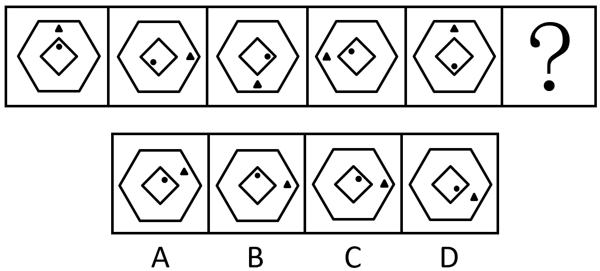
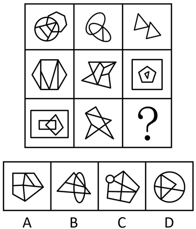
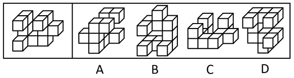
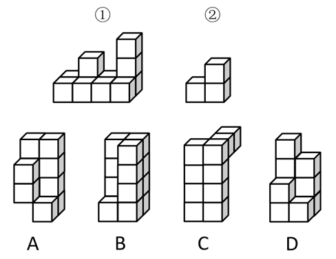
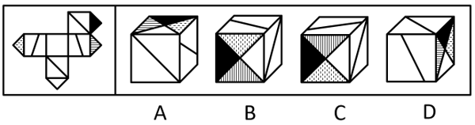
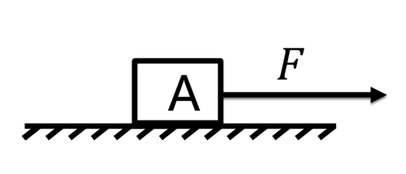
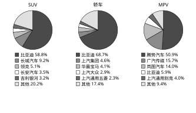

# M03　广东省考行测模拟卷（题本）

## 第一部分　政治理论

**1.** 加强党内法规制度建设是全面从严治党的长远之策、根本之策，必须坚持把党章作为全党的根本行为规范。

A. 正确　　B. 错误

**2.** 中华优秀传统文化有很多重要元素，共同塑造出中华文明连续性、创新性、统一性、包容性、和平性的突出特性。

A. 正确　　B. 错误

**3.** 唐末岭南道分设岭南东道、岭南西道，“广东”之名由此得来。

A. 正确　　B. 错误

**4.** 新事物与旧事物区别的根本标志，在于出现时间的先后。

A. 正确　　B. 错误

**5.** 古人说：“明者因时而变，知者随事而制。”下列论断与这一古语的意思最为契合的是（　）。

A. 改革开放是党和人民大踏步赶上时代的重要法宝
B. 统一战线是凝聚人心、汇聚力量的强大法宝
C. 国家安全是民族复兴的根基，社会稳定是国家强盛的前提
D. 生态文明建设是关系中华民族永续发展的根本大计

**6.** 党的二十大报告指出：“党的理论是来自人民、为了人民、造福人民的理论，人民的创造性实践是理论创新的不竭源泉。一切脱离人民的理论都是苍白无力的，一切不为人民造福的理论都是没有生命力的。”这段话最能体现习近平新时代中国特色社会主义思想（　）的立场观点方法。

A. 必须坚持守正创新
B. 必须坚持自信自立
C. 必须坚持问题导向
D. 必须坚持人民至上

**7.** 中共中央政治局第二十五次集体学习聚焦提高防灾减灾救灾能力。下列表述与此次集体学习精神不符的是（　）。

A. 健全大安全大应急框架下应急指挥机制，统筹做好综合救援
B. 降低灾害风险、减轻灾害损失，重在提升灾后救援处置能力
C. 树牢底线思维、极限思维，不断提升大灾巨灾应对处置能力
D. 基层是抵御自然灾害的第一线，要抓好群测群防群治

**8.** 宪法是规定国家的根本制度和根本任务，集中体现各种政治力量对比关系、保障公民基本权利的国家根本法。关于我国宪法，下列说法正确的是（　）。

A. 现行宪法于1982年12月4日通过，是新中国的第四部宪法
B. 1949年制定的《共同纲领》是新中国第一部社会主义类型的宪法
C. 宪法的修改须由全国人民代表大会以全体代表的过半数通过
D. 依宪治国、依宪执政，要把全面贯彻实施宪法作为根本任务

**9.** 抗日战争时期，中国共产党一面领导军民英勇抗敌，一面在延安推进党的思想理论建设。以下表述符合历史事实的有（　）。

A. 平型关大捷是全民族抗战爆发后中国军队主动对日作战取得的第一个重大胜利
B. 毛泽东在党的六届六中全会上作《论新阶段》的政治报告，最先提出了“马克思主义中国化”的命题
C. 延安整风中，反对宗派主义以整顿学风，是整风运动最主要的任务
D. 百团大战是抗日战争相持阶段八路军在华北地区发动的规模最大、持续时间最长的战役

**10.** 对立统一规律是唯物辩证法的实质和核心。关于矛盾，下列说法正确的有（　）。

A. 矛盾的斗争性是绝对的、无条件的，同一性是相对的、有条件的
B. 矛盾的普遍性寓于特殊性之中，并通过特殊性表现出来
C. 矛盾的普遍性是指具体事物包含的矛盾以及每一矛盾的各个方面都有其特点
D. 主要矛盾处于支配地位，对事物的发展起决定性作用

## 第二部分　常识判断

**11.** 实体经济是一国经济的立身之本、财富之源，是构筑未来发展战略优势的重要支撑。关于发展实体经济、建设现代化产业体系，下列表述正确的是（　）。

A. 要把扩大有效投资作为发展实体经济的主攻方向
B. 要坚持把发展经济的着力点放在实体经济上
C. 现代化产业体系是中国式现代化的根本保障
D. 要加快建设以数字经济为支撑的现代化产业体系

**12.** 近年来，我国在卫星导航、空间天文、深海探测、大飞机等领域的重大科技成果不断涌现。下列表述有误的是（　）。

A. 北斗是我国自主研发的全球卫星导航系统，提供定位授时导航
B. 慧眼是X射线天文卫星，用于观测黑洞、中子星等高能天体
C. 蛟龙号是全海深载人潜水器，在马里亚纳海沟坐底10909米
D. C919是我国首款自主研制的大型干线民用飞机

**13.** 2025年11月，习近平总书记在广东考察时强调，广东增创新优势、实现新突破，必须以全面深化改革开放推动高质量发展。下列表述与总书记此次考察时的重要指示不符的是（　）。

A. 着眼发展新质生产力，强化科技创新和金融创新深度融合
B. 完善区域协调发展、城乡融合发展体制机制，扎实推进共同富裕
C. 稳步扩大制度型开放，深入实施自贸试验区提升战略
D. 继续抓好对内开放，带动中西部地区产业发展

**14.** 《中华人民共和国网络安全法》规定，国家实行网络安全等级保护制度，并对关键信息基础设施的运营者采购网络产品和服务作出规范。根据该法，下列做法违反规定的是（　）。

A. 网络运营者采取监测、记录网络运行状态的技术措施，并将相关网络日志留存八个月
B. 网络运营者制定内部安全管理制度和操作规程，确定网络安全负责人
C. 关键信息基础设施的运营者仅经本单位评估，即采购可能影响国家安全的网络产品
D. 网络运营者采取数据分类、重要数据备份和加密等措施，防止网络数据泄露

**15.** 2025年，广东联合港澳承办十五运会和残特奥会，向全国人民奉献了一场彰显制度优势、凝聚团结力量、展示湾区特色、体现岭南风格的体育盛会。关于这一盛会，下列说法有误的是（　）。

A. 会徽由广东木棉花、香港紫荆花、澳门莲花交叠而成
B. 火爆出圈的吉祥物是“喜洋洋”“乐融融”
C. 开展了独特的源火采集和人形机器人火炬传递
D. 认真落实“简约、安全、精彩”的办赛理念

## 第三部分　言语理解与表达

**16.** 兔和羚羊等食草动物获取食物时动作敏捷，牛类有瘤胃可以囤积食物，到安全环境中再慢慢消化。大熊猫既没有敏捷度，也没有瘤胃结构，所以“____”，选择了其它动物不吃的食物种类，也出现了一些与进食、消化有关的基因突变，形成了独特的食性——将箭竹作为主食。
填入画横线部分最恰当的一项是：

A. 扬长避短
B. 顺水推舟
C. 因陋就简
D. 另辟蹊径

**17.** 应急情境下妥善治理谣言，考验的是应急处置能力的临场发挥，更是应急处置能力的建设。网络谣言治理主要有治标与治本两条路径，前者针对既成事实，____，即时奏效；后者侧重于“治未病”，____，久久为功。两条路径有机结合，方可有效遏制互联网谣言的生产与传播。
依次填入画横线部分最恰当的一项是：

A. 亡羊补牢 曲突徙薪
B. 双管齐下 未雨绸缪
C. 惩前毖后 深谋远虑
D. 补偏救弊 先发制人

**18.** 要提高“临事能断”本领，就要处理好反复权衡与适时决断的关系，既要深入考量、三思而行，又要视情而断、当机立断，不能等待观望、____、议而不决。当然，提倡在关键时刻善于决断，并不意味着可以____、我行我素，而是要善于聚民意、集众智，推动科学决策。
依次填入画横线部分最恰当的一项是：

A. 犹豫不决 泥古不化
B. 左顾右盼 听之任之
C. 举棋不定 刚愎自用
D. 见风使舵 自作主张

**19.** 降水总量增多、变率减弱可能是最让人____的变化型，这意味着未来的雨水不仅丰盈，还会以“润物细无声”的方式滋养大地。遗憾的是，全球几乎没有哪个地区的降水类型属于这一变化型。我国大部分地区的降水变化型属于“更湿润且波动更大”，意味着降水的____将增强，这须引起广泛重视。
依次填入画横线部分最恰当的一项是：

A. 望眼欲穿 偶然性
B. 翘首以盼 持续性
C. 津津乐道 集中性
D. 喜闻乐见 极端性

**20.** 访古是十分感人的经历，尤其是当我们踏上古代文献中________的地点时。亲手触摸庄重
威严的利簋，秀丽的铭文好像把我们拉回到三千年前牧野之战的场景，________中描绘的古代社会
面貌在脑海中清晰了起来，我们感受到了历史迎面扑来的强烈震颤。这种感觉，对于考古学家来说
可谓一种致命的“诱惑”。然而，身为一名严谨科学的从业者，必须对这种诱惑保持足够的警惕，维
护考古记录的________，这是一名考古学者的自警，也是整个考古学学科的自尊。
依次填入画横线处最恰当的一项是:

A. 如雷贯耳 刀光剑影 客观性
B. 如数家珍 白纸黑字 严肃性
C. 司空见惯 鼓角齐鸣 主体性
D. 耳熟能详 只言片语 独立性

**21.** 通过“线下生产+线上数据分析”模式，传统产业能够在规模化生产之外，探索开展个性化定制服务。比如，
先生产小批量产品投放市场，再通过数据分析细分需求决定是否扩大生产。这种“轻资产、快反应”的柔性供
应链模式，增加了产品研发、制造和流通的弹性，能帮助解决传统供应链模式下机会成本高、运转周期长等问
题。这样的生产变革，能够通过精细化运营实现供需精准匹配，是一种更加适合中小企业数字化转型的模式，
能让中小企业以“小单快返”的新模式轻装上阵，形成独特的竞争优势。
这段文字意在说明：

A. 传统产业需借助数据分析突破固有局限
B. 数字赋能可助力中小企业提升竞争优势
C. 供需的动态平衡是中小企业发展的关键
D. 企业的数字化转型重在构建柔性供应链

**22.** 与传统业态相比，新业态顺应多元化、多样化、个性化的产品或服务需求，实现产业与互联网、大数据、云计算、人工智能等新技术深度融合，通过采用新技术和新模式，为市场引入新元素、丰富新场景，促进新岗位、新就业形态不断涌现，创造更多就业机会。新业态既提供新的高技能岗位，扩大对高水平劳动力的需求，又通过带动传统产业转型升级，实现对传统职业和岗位的再造，释放新的就业需求。当前，我国有超2亿灵活就业人员，新就业形态____。
填入画横线部分最恰当的一项是：

A. 已经成为吸纳就业的重要“蓄水池”
B. 有助于促进区域间劳动资源的互补与共享
C. 为高技能劳动力流动提供充足机会
D. 是有效缓解重点群体就业压力的“缓冲器”

**23.** 白噪声是指功率谱密度在整个频率频域内均匀分布的，所有频率具有相同能量密度的噪
声。大自然中海浪拍打岩石的声音,风吹过树叶的声音，枝头鸟儿轻轻吟唱的声音以及雨滴落在屋檐
上的声音，都是类似于白噪声的声音，现实生活中的噪声嘈杂刺耳,令人厌烦，会影响人们的工作，
学习和休息。而白噪声，由于其均匀分布，比较“悦耳”，在白噪声环境中，人们往往能放松心情。
下列诗句与上文中论及的白噪声带来的心理感受，最接近的是：

A. 蝉噪林逾静，鸟鸣山更幽
B. 百里雷声震，鸣弦暂辍弹
C. 夜阑卧听风吹雨，铁马冰河入梦来
D. 今夜闻君琵琶语，如听仙乐耳暂明

**24.** 研究表明，患有孤独症的儿童不喜欢眼神接触，观察幼儿目光有助于预判孤独症。研究人员利用眼动追踪技
术，对1500多名幼儿展开研究。他们为幼儿播放一段视频，数百个重要的“社交线索”会在其中呈现。在此期
间，眼动追踪工具会测量幼儿的眼动，每秒捕获大约120个测量值。观看行为是儿童学习说话的基础，正常成
长的儿童会注意这些“社交线索”并随之调整目光。新的技术手段量化了被遗漏的“社交线索”的数量、程度
和时间，可实现早期诊断孤独症并判断其严重程度，尽早实施个性化治疗。
这段文字意在表明：

A. 幼儿孤独症诊断时间有望进一步缩短
B. 眼神接触数据是孤独症诊断的重要指标
C. 眼动追踪技术有助于早期诊断孤独症幼儿
D. 实现幼儿眼动行为量化观察具有重要意义

**25.** 个人信息保护案件往往涉及非法收集、获取、提供、出售、购买、使用个人信息等多个环节，责任主体除了已被追究刑事责任的犯罪者外，还可能包括下游的违法处理信息者。在民事公益诉讼案件办理中，是否可以连带追究下游违法者的赔偿责任，司法实践中存在争议。根据民法典，认定连带责任必须遵循法定或约定原则，在此原则指导下，个人信息保护法规定了共同处理者的连带责任。因此，当不同侵权主体主观具有共同过错，客观上实施了共同侵害个人信息权益的行为时，可以依法追究各侵权人的连带责任。
关于个人信息保护案件，作者认为：

A. 应该强化对犯罪者民事责任的追究
B. 应当依法追究下游违法者的赔偿责任
C. 认定连带责任须在法定原则指导下进行
D. 法律应明确案件中各侵权人的相关责任

**26.** 在众多用于建筑的保温材料中，蛭石因其良好的保温性能而广受青睐。蛭石是一种含镁的水铝硅酸盐次生变质
矿物，具有二维层状结构，受热时会失水膨胀，因形状类似水蛭而得名。经高温煅烧后，蛭石体积能瞬间膨胀
十几倍，每块膨胀蛭石里有很多毛细孔，且每个毛细孔都是微纳米级孔径。这些小空隙就是一个个保温空间。
蛭石膨胀倍数越高，空隙越发达，保温性能也就越好。更重要的是，蛭石在生产加工过程中对生态环境污染很
小，产品废弃后还能回收再利用，非常符合建筑领域十分推崇的可持续发展理念。
最适合做这段文字标题的是：

A. 蛭石为什么可以保温
B. 蛭石：一种神奇的矿石
C. 你所不知道的“蛭石”真面貌
D. 蛭石：让建筑物更加绿色节能

**27.** 个案研究的经验告诉我们，法学理论其实只是从特定维度对纷繁的生活实践的一种抽象描述，它不可能
追随、更没法规训真实生活的复杂和生动。因此，看起来再好的理论，也不应试图以其抽象的命题来规训真实生
活的生动、饱满和复杂。理论法学学者必须始终意识到自己习惯的那种话语在真实生活世界中的局限，并能不断
以对经验的考察来理解生动的法律世界。
作者通过这段文字重在强调：

A. 法学理论在应对真实世界时存在局限性
B. 个案研究能有效促进理论的发展和完善
C. 从事法律工作必须通晓个案研究的经验
D. 理论法学应重视理论与真实世界的对接

**28.** ____。农药、化肥和农膜污染是主要的农业面源污染源，在不同程度上影响着耕地生态水平，近年来，在一系列农业绿色发展政策的支持下，农药、化肥和农用塑料薄膜使用量大幅下降，农业面源污染情况持续改善。耕地对于气候调节、水源涵养、生物多样性保护具有重要意义，因此推动耕地高质量保护，提升农田生态系统的稳定性是题中应有之义。目前，一些地方全力打造生态高标准农田，采用“稻田+生态沟渠+水塘/生态塘”等治理模式，不仅有效实现了稻田主要面源污染物的减少，还推动了乡村游等生态产业发展。
填入画横线部分最恰当的一项是：

A. 践行绿色生态理念，强化耕地生态功能
B. 多举措全面发力，推动耕地高质量保护
C. 落实耕地保护政策，夯实粮食安全根基
D. 加强农业生态投资，助力生态产业发展

**29.** 在高等教育规模不断扩大的同时，竞争也在加剧。高等院校之间的竞争是永恒的主题。而最集中的竞争是生
源的竞争。大学开设特色专业项目是竞争的战略，目前国内高校竞相开设丰富多样的主修，辅修专业和证书课程
等。在此基础上，个性化专业设置作为一种极具特色的本科人才培养方式，成为独特目标开启了新通道，有效提
升了学校的吸引力和竞争力。
下列对文字的概括最恰当的一项是：

A. 高等教育竞争主要表现在如何帮助学生实现既定目标
B. 专业设置个性化是增强高校吸引力竞争力的有效途径
C. 个性化专业设置是高校之间生源竞争普遍采用的方式
D. 独特人才培养计划是各个高校竞争中的有力武器

**30.** ①例如位于我国四川的深地核天体物理实验室，其上覆盖的垂直岩石厚达2400米
②因此，旨在直接探测暗物质的实验室通常会建于极深的地下或山里，尽最大可能屏蔽掉这些干扰
③直接探测暗物质的方式类似于守株待兔
④当然，这种能量波动极其微弱，而且宇宙中的各种射线同样也有机会与这个原子核来一场亲密的邂逅，从而对实验结果产生干扰
⑤专家解释说，我们生活在一团暗物质云中，每秒钟可能有几百万甚至上千万的暗物质粒子穿过我们的身体
⑥直接探测暗物质的方法之一，就是利用精密的仪器密切观察大量的原子核，如果足够幸运，某一时刻暗物质碰撞到某个原子核，会在原子核上留下残余能量
将以上6个句子重新排列，语序正确的是：

A. ⑥②①⑤③④
B. ⑥④⑤②③①
C. ③⑤⑥④②①
D. ③⑥②⑤①④

## 第四部分　数量关系

**31.** 6，1，13，15，41，（    ）

A. 68
B. 69
C. 70
D. 71

**32.** 12，18，29，46，70，（    ）

A. 102
B. 103
C. 104
D. 105

**33.** 3，7，23，95，479，（    ）

A. 2877
B. 2879
C. 2883
D. 2885

**34.** $\frac{4}{3}$ ，1， $\frac{6}{7}$ ， $\frac{7}{9}$ ， $\frac{8}{11}$ ，（    ）

A. $\frac{3}{4}$
B. $\frac{5}{6}$
C. $\frac{9}{13}$
D. $\frac{10}{13}$

**35.** **题目数表**

| 第1列 | 第2列 | 第3列 |
|---|---|---|
| 2 | 2 | 6 |
| 3 | 6 | 21 |
| 7 | 5 | 42 |
| 5 | 18 | ？ |

四行三列，保持原图行列位置；列名为转写时添加。

A. 95
B. 96
C. 97
D. 98

**36.** 一项工程，甲单独完成所需时间是乙的一半，丙3天的工作量与甲4天、乙2天的工作量之和相等。原计划甲先工作4天，随后乙再工作2天，剩余工程由丙再工作4天刚好完成。实际施工中，甲因故无法参与，只能由乙、丙两人合作完成，问实际施工中丙至少要工作几天，才能保证完成该工程的总天数不超过原计划？

A. 2
B. 3
C. 4
D. 6

**37.** 小张进行10次射击，发现射击环数稳定在7环、8环及9环，且打中8环的次数最多，若总环数是十位与个位数字相同的两位数，则打中9环多少次？

A. 1
B. 2
C. 3
D. 4

**38.** 甲、乙两人分别从A、B两地出发匀速相向而行，甲的速度为90米/分钟，乙的速度为60米/分钟。已知甲比乙晚出发2分钟，两人相遇时甲比乙多走了360米，问A、B两地相距多少米？

A. 1080
B. 1320
C. 2400
D. 2520

**39.** 一项工程，若乙、丙两人合作需要4天完成。若甲单独工作4天，乙再单独工作5天可完成全部工作量；若先由甲单独完成 $\frac{1}{4}$ 的工作量，之后乙加入，合作2天后甲因事离开，乙还需工作3天可完成剩余工作量。问甲、丙合作完成这项工程需要多少天？（不足1天按1天计算）

A. 3
B. 4
C. 5
D. 6

**40.** 某充电站电价为0.79元/度。车位超时占用费规则如下：车辆充满电后，30分钟内离场免费；超过30分钟但不超过1小时的部分，按每10分钟1.7元计费；超过1小时的部分，按每10分钟3元计费（若不满10分钟，按10分钟计算）。小李在此充电站充了50度电，共支付了56.6元，那么他离开时车辆最多已充满电多长时间？

A. 40分钟
B. 1小时30分钟
C. 1小时40分钟
D. 1小时50分钟

**41.** 某单位年会上有3名男生和5名女生作为工作人员。现场需要安排1名女生担任主持人，3人维持现场秩序，4人颁发奖品，要求每人只负责一项工作，且颁发奖品的女生人数不少于男生，则共有多少种不同的安排方式？

A. 260
B. 155
C. 150
D. 65

**42.** 某地从A、B、C三所高校分别招聘了50名应届毕业生，并将他们分配到15个基层单位。已知每个基层单位最少
分配3人，且任意2个基层单位分配到的人数都不相同。问A校毕业生最少被分配到多少个基层单位中？

A. 3
B. 4
C. 5
D. 6

**43.** 某单位不足100人，每位员工均配有一台电脑，现根据使用程度自愿选择是否更换新版本电脑。选择更换电脑的员工人数是员工总数的 $\frac{15}{26}$ ，且选择更换电脑的员工中，女性人数是男性的1.25倍。已知该单位男女人数之比为7：6，则选择不更换电脑的男性员工有多少人？

A. 20
B. 22
C. 24
D. 26

**44.** 某步行街两侧计划每隔8米悬挂一面彩旗，起点与终点处均需悬挂彩旗。后因举办活动，终点处需搭建舞台，距终点处144米范围内不再悬挂彩旗。为保证悬挂的彩旗总数不变，该步行街决定将彩旗间距调整为6米，且调整后的起点与终点处仍悬挂彩旗。问此次调整共有多少面彩旗无需移动？

A. 19
B. 38
C. 36
D. 50

**45.** 办公室有甲、乙、丙3位员工。已知乙2年后的年龄与丙4年前的年龄相同，且2年前丙的年龄是甲的2倍，2年后3人年龄之和为131岁，则几年前乙、丙年龄之和是甲的4倍？

A. 2
B. 3
C. 4
D. 5

## 第五部分　判断推理

**46.** 从所给的四个选项中，选择最合适的一个填入问号处，使之呈现一定的规律性：

**47.** 从所给的四个选项中，选择最合适的一个填入问号处，使之呈现一定的规律性：

**48.** 下列选项最不可能与左侧立体图形是同一物体的是（    ）。

**49.** 下列哪个选项可与①和②组成一个长方体？

**50.** 左边给定的是纸盒外表面的展开图，右边哪一项不能由它折叠而成？请把它找出来。

**51.** 将人文底蕴转化为城市发展优势，既是满足人民日益增长的美好生活需要的关键，也是加快现代化人民城市建设、推动城市高质量发展的必由之路。如果不能发挥人文精神的引领作用、人文价值的导向作用、文化产业的驱动作用和文化事业的保障作用，就不能将人文底蕴转化为城市发展优势。
由此可以推出：

A. 只有加快现代化人民城市建设、推动城市高质量发展，才能满足人民日益增长的美好生活需要
B. 发挥人文精神的引领作用、人文价值的导向作用、文化产业的驱动作用和文化事业的保障作用，才能加快现代化人民城市建设、推动城市高质量发展
C. 如果发挥人文精神的引领作用、人文价值的导向作用、文化产业的驱动作用和文化事业的保障作用，就能将人文底蕴转化为城市发展优势
D. 不能加快现代化人民城市建设、推动城市高质量发展，就不能将人文底蕴转化为城市发展优势

**52.** 随着中国航天事业的不断发展，众多航天员进入太空工作和生活，而太空微重力环境会对人体多个生理系统造成损伤。一项研究显示，在微重力环境下，人体骨髓间充质干细胞更倾向于向成脂细胞分化，减少向成骨细胞分化；造血干细胞更倾向于向破骨细胞分化，减少向红系分化。该研究证明了微重力环境会导致骨骼微结构退化、骨量减少，进而引发骨质疏松症，使人体出现骨痛、骨折等不适症状。
上述论证的成立须补充以下哪项作为前提？

A. 在地面和太空实验中均可以观察到微重力环境对成骨细胞分化的消极影响以及对破骨细胞分化的积极影响
B. 破骨细胞承担骨骼分解吸收工作，成骨细胞负责生成新骨，二者的平衡是人体骨量维持正常水平的关键
C. 骨质疏松症是以骨密度和骨质量下降为特征的疾病，患者的骨骼脆性显著增高，轻微外力即可引发骨折
D. 在微重力环境中，血液更多地涌向头部，导致不同部位骨骼的血流量发生变化，其中下肢血流减少最为显著

**53.** 装配式建筑是指由工厂化生产的部品部件，在施工现场通过组装和连接而成的建筑。目前，全国装配式建筑专业人才仅有50万人，且施工人员往往缺乏操作构件吊装设备的技能，技能工人的占比不足2%。此外，与传统现浇式建筑相比，装配式建筑在预制构件的生产、运输及安装的成本居高不下。因此有人认为，传统现浇式建筑仍然是未来建筑行业的建造趋势。
以下哪项如果为真，最不能削弱上述结论？

A. 装配式建筑发展需要高经济水平作支撑，但是各地经济水平存在差异，发展不均衡现象明显，一定程度上制约了装配式建筑发展
B. 建筑质量是购房决策中的关键因素，以装配式建筑取代传统现浇式建筑，能大幅减少施工失误，解决系统性的质量通病
C. 建筑成本需综合考虑规划设计、生产运输、现场施工安装、运维管理以及拆除等环节，装配式建筑的全生命周期综合成本更低
D. 绿色建造是建筑业实现可持续发展的必然选择，与传统现浇式建筑相比，装配式建筑仅需进行简单组装与安装，更加环保节能

**54.** 某心理学家做测验时发现，一所公立学校的教师对该校部分学生有较高的积极期望后，这部分学生的成绩也明显提升，各方面表现都很优秀。因此这位心理学家认为，教师的积极期望会促使学生成绩提升。
以下哪项如果为真，最能够削弱上述观点？

A. 教师对学生的期望不仅基于客观评价也基于一部分主观评价
B. 教师的积极期望能增强学生的学习动力和愉悦感从而促进成绩提升
C. 学习成绩好或者进步明显的学生更容易让教师对其产生积极期望
D. 教师对学生的期望还受学校政策影响，并非仅基于学生个体

**55.** 某部门小王、小李、小张、小赵、小刘5人计划在周边游、看电影和做手工中选择本周末的活动安排，每人只能选择其中一项活动，且每项活动都有1-2人选择。已知：
（1）如果小张或小赵选择做手工或看电影，则小王选择周边游；
（2）如果小赵或小刘选择周边游或看电影，则小王或小李选择做手工；
（3）如果小刘选择做手工或小张选择周边游，则小李和小赵选择看电影。
根据以上条件，如果小赵选择做手工，以下除哪项外一定可以推出？

A. 小刘选择看电影
B. 小王选择周边游
C. 小李选择做手工
D. 小张选择看电影

**56.** 为探究百岁老人长寿的秘诀，某国研究人员进行了一项长期研究。他们从国家健康登记系统中选取了所有在1920-1922年间出生且在70岁时依然健在的居民，共计274108人。从他们70岁起，研究人员进行了长达30年的跟踪研究并获得了详细的健康记录，直至他们去世或年龄超过100岁。根据最终寿命，研究人员将这些老人分为两组：第一组是年龄超过100岁的百岁老人，第二组是寿龄在75至95岁之间的非百岁老人。研究人员分析他们的健康记录后发现，百岁老人组从70岁起平均疾病发生率显著低于非百岁老人组，且重大疾病（如心血管疾病等）的平均出现时间较晚。研究人员由此得出结论：百岁老人长寿的秘诀在于重大疾病的延迟发生。
以下哪项如果为真，最能削弱上述观点？

A. 非百岁老人组的人数远超于百岁老人组的人数
B. 百岁老人组中患癌人数占比高于非百岁老人组
C. 研究对象都经历了相似的社会发展和医疗进步
D. 百岁和非百岁老人组的性别比例存在显著差异

**57.** 在住宅小区中，物业公司为了保障住户的人身和财产安全，都会在电梯内、楼栋入口等处安装摄像头，这些摄像头通常不会引起住户的反感。然而，邻居为了保障自身的人身和财产安全而安装的摄像头，往往会引起其他住户的不满。
以下哪项如果为真，最不能解释上述现象？

A. 物业公司安装的摄像头都是经过业主共同授权的，而且住户还能通过投诉机制重新设定其监控范围，但邻居安装的摄像头很难干预
B. 相比邻居安装的摄像头，物业公司安装的摄像头具有更高的分辨率，能够更加清晰地记录事件，而且还能24小时不间断地稳定运行
C. 相比邻居安装的摄像头，物业公司安装的摄像头是服务于全体住户而非特定个人，在心理上不会对住户造成过大的“个人隐私压力”
D. 物业公司安装的摄像头只拍摄真正的公共区域，而邻居安装的摄像头往往会拍摄到非公共区域，有些甚至能拍摄到其他住户的客厅

**58.** 近日，某研究所对贵州发现的4.36亿年前的滤食性生物——腕足动物化石群落进行了研究。研究发现，这些腕足动物体表长有细长的刚毛，从外套膜边缘伸出，且这些腕足动物在海底的分布有序，彼此保持均匀距离。据此，研究人员认为，这些刚毛是腕足动物用来调节个体间距离的，而这种空间上的优化配置，最大限度地提高了整个群落的摄食效率。
以下除哪项外，均能支持上述的观点？

A. 空间分析表明，这些腕足动物个体间的平均距离大约是刚毛长度的1.5至2倍，说明刚毛直接决定了个体间的“舒适距离”，从而优化了群落空间分布
B. 对现代与这些腕足动物类似的滤食性生物的研究表明，它们也能通过调整个体间位置，以维持最佳距离，从而减少彼此间竞争，提高群落的摄食效率
C. 刚毛这种软体结构很难在化石记录中保存，但这批化石罕见地保留了完整的刚毛结构，为进一步研究这些腕足动物的繁衍模式和群落稳定性提供依据
D. 这些腕足动物作为滤食性生物，保持适当的距离可以避免个体间摄食水流的相互干扰，确保每个个体有独立的摄食区域，从而显著提高营养摄入效率

**59.** 某省为了成为戏曲这一文化IP的集聚地，举办了“百戏星耀”活动，推出10-30元惠民票价，联动各大剧场拓展演出场景，增设体验区拍照打卡，创新“票根+”文旅绑定模式，吸引7万余名观众观演。据此有人认为，该戏曲主题活动的开展提高了剧场场地使用率。
要使上述推论成立，需要补充的前提是（    ）。

A. 这些激增的观众使剧场的营业额得到了显著的提升
B. 剧场每天都需增加演出时长和场次以接待这些观众
C. 7万余名观演的观众中省外观众所占的比例近三成
D. 所演戏剧的精彩程度能够吸引这些观众观看到最后

**60.** 某幼儿园举办了一场动物主题的趣味竞速比赛，参赛的7个孩子需要分别化名为猎豹、兔子、狮子、马、羚羊、狼、鹿，并戴着对应动物的饰品。幼儿园将参赛选手从快到慢进行排名，且本次比赛没有并列名次。已知：
（1）猎豹在速度排行榜中位列第4名；
（2）兔子的速度比狮子慢，但比马快；
（3）猎豹的速度比羚羊慢，但比狼快；
（4）如果狮子位列第2名或羚羊位列第3名，则狼位列第1名；
（5）如果羚羊位列第2名或兔子位列第6名，则马位列第3名。
根据以上信息，关于参赛选手的速度，以下哪项是不可能的？

A. 兔子的速度比狼快
B. 猎豹的速度比兔子快
C. 狮子的速度比鹿快
D. 羚羊的速度比狮子快

**61.** 热爱户外的人一定都喜欢收藏露营装备，市民老周喜欢收藏露营装备，因此，老周一定热爱户外。
下列选项所犯逻辑错误与题干最为相似的是（    ）。

A. 只有在保质期内的商品才能被正常销售，火腿肠正在被正常销售，因此，火腿肠在保质期内
B. 浇了这款营养液的盆栽花期都会延长，这盆盆栽花期没有延长，因此，它没浇这款营养液
C. 所有正宗的蜂蜜都有自然的花香味，槐花蜜有自然的花香味，因此，槐花蜜是正宗的蜂蜜
D. 很多喜欢书法的老年人都心态平和，书法家们也喜欢书法，因此，书法家们的心态都很平和

**62.** 一段时间以来，多地西红柿价格持续走高，商超精品西红柿售价一度突破每斤10元，较之前涨幅显著，远超去年同期水平，不少市民调侃“鸡蛋都配不上西红柿了”。但近期，西红柿价格突然出现大幅回落，市场价格甚至低于涨价之前，回归亲民区间。
下列选项如果为真，最能解释上述现象的是（    ）。

A. 由于西红柿价格过高，近期很多市民选择购买黄瓜、彩椒等蔬菜
B. 近期新批次西红柿在多个产区集中上市，市场供应量远超涨价前水平
C. 物价部门发布了售价调控通知，要求商家不得随意抬高西红柿售价
D. 降雨量较多的黄淮海区域的西红柿大棚的生产能力已恢复至之前水平

**63.** 消费者在选购洗衣机时往往会关注转速这个参数。有人认为，洗衣机洗涤阶段的转速越高，衣物去污效果就越好。但实际洗涤过程中，洗衣机转速对去污效果的提升存在边际效应，当转速超过临界值后，衣物会因离心力紧贴桶壁，失去摩擦和摔打空间，去污效果反而会变差。因此，只要洗衣机洗涤时的转速较低，衣物的去污效果就不会下降。
下列选项最能指出上述论证缺陷的是（    ）。

A. 默认了洗衣机脱水转速与洗涤转速的工作原理一致
B. 忽视了洗衣机的洗涤转速会受到多重因素的影响
C. 默认不同材质的衣物对转速的适应性几乎没有差别
D. 忽视了洗涤剂用量等其他因素对去污效果的影响

**64.** 构建数字化的企业管理模式能够提升企业运营效率，企业高质量发展有利于企业管理模式数字化，因此，企业高质量发展有利于提升企业运营效率。
下列选项的逻辑结构与题干最为相似的是（    ）。

A. 传统手工业的生产模式是个性化的，个性化的生产模式缺乏标准化的生产流程，因此，传统手工业的生产模式缺乏标准化的生产流程
B. 品牌内容创作的优质度越高品牌传播效果越好，产品口碑打造的核心是品牌传播效果，因此，品牌内容创作的优质度越高越有利于产品口碑打造
C. 城市化发展能推动城市管理水平提升，改革开放的重要成果是城市化发展，因此，城市管理水平提升是改革开放的重要成果
D. 提高劳动者的专业能力有利于增强就业竞争力，职业技能培训有利于提高劳动者的专业能力，因此，职业技能培训有助于增强就业竞争力

**65.** 某市仅占某湖 $\frac{1}{3}$ 岸线、 $\frac{1}{4}$ 水域，却承担了全湖七成以上的清淤、治藻等核心治理任务，18年来该市通过系列举措实现湖水水质改善与城市发展双赢。有专家据此认为，该市持续投入治理该湖的核心目的，是为城市发展腾挪生态环境容量和空间。要使上述结论成立，需要补充的前提是（    ）。

A. 该市在过去的时间里经历过环境问题
B. 通过治理该市变得更加适合居住就业
C. 该市人均地区生产总值得到大幅提升
D. 该湖的水环境危机导致该市发展受限

## 第六部分　科学推理

**66.** 为探究X、Y、Z三种金属的活动性强弱，设计两组实验：实验1：取三份等量稀盐酸，分别加入打磨光亮的 X、Y、Z金属片，只有金属Y发生反应并产生大量气泡，X、Z均无明显现象；实验2：将金属Z放入X的硫酸盐溶液中，充分反应后，金属Z表面析出固体X。则三种金属活动性由强到弱的顺序是（    ）。

A. Y>Z>X
B. Y>X>Z
C. Z>X>Y
D. X>Z>Y

**67.** 如图所示，物块A在水平力F的作用下静止在粗糙程度均匀的地面上，将力F的大小增大至2F，若最大静摩擦力等于滑动摩擦力，则下列判断一定正确的是（    ）。

A. 物块A会向右做变加速运动
B. 物块A会向右做匀变速运动
C. 物块A仍保持静止
D. 物块A可能仍保持静止，也可能向右做加速运动

**68.** 假如地球没有自转以及公转，下列现象最有可能在地球上出现的是（    ）。

A. 全球各地将不再有昼夜交替
B. 全球各地将全年温度适宜，四季如春
C. 太阳将从西方升起
D. 地球磁场将增强

**69.** 如图所示电路，电源电压保持不变，$R_1$ 为定值电阻。闭合开关S，将滑动变阻器 $R_2$ 的滑片P由a端向b端移动的过程中（电表均为理想电表），下列说法正确的是（    ）。

A. 电流表A的示数变小，电压表 $V_1$ 的示数变大
B. 电压表 $V_2$ 的示数与电流表A的示数之比不变
C. 电压表 $V_2$ 示数的变化量与电流表A示数的变化量之比的绝对值不变
D. 电路消耗的总功率变大

**70.** 粮站收入粮食后，如果粮食不够干燥，那么堆在内部的粮食就会发霉，为了防止这种情况发生，粮站会对潮湿的粮食进行干燥处理，下列相关说法不正确的是（    ）。

A. 粮食可以进行呼吸作用，无法进行光合作用
B. 粮食含水量高时更易发霉，说明潮湿环境能提升霉菌的活性
C. 干燥处理不会对粮食的呼吸作用产生任何影响
D. 粮食堆放过密、通风差，会造成粮堆内部热量积聚

## 第七部分　资料分析

2025年，广州市外贸顶压前行、成效显著，商品进出口总额12407亿元，进出口规模迈上1.2万亿元新台阶，创历史新高，同比增长10.4%。其中出口额8257亿元，同比增长17.8%，增速居广东省首位。
广州作为国际消费中心城市，正成为汇聚全球消费的“强劲磁场”。据广州海关统计，2025年自60多个国家和地区进口实现两位数以上增长，进口消费品近1000亿元，稳居全国前列。2025年，广州市有进出口记录的外贸企业数量超3万家，创历史新高，其中民营企业进出口占全市外贸总值的六成以上，同比保持两位数增长。与此同时，国有企业科技创新成效显著，高新技术产品出口大幅增长。
面对复杂多变的国际贸易形势，外贸企业在深耕传统市场的同时，积极开拓新兴市场，构建更加多元稳固的国际市场格局。据广州海关统计，2025年，广州市对全球190多个国家和地区进出口实现正增长，贸易规模超百亿元的国家和地区增至33个。从重点贸易伙伴来看，对欧盟、东盟进出口双双突破2000亿元大关，同比分别增长19.2%和28%；对共建“一带一路”国家进出口增长22.5%，对中东、拉美、非洲等新兴市场进出口增速均快于整体水平，海外市场发展前景广阔。
市场格局的持续优化，离不开产业升级和新业态的支撑。据广州海关统计，从出口来看，2025年广州市电动汽车、锂电池、光伏产品这“新三样”产品出口262.5亿元，同比增长68.3%，其中电动汽车出口增长70.3%，绿色低碳产品出口竞争力持续提升。从进口来看，2025年广州市进口飞机及航材212.5亿元，增量超过90亿元。此外，跨境电商、市场采购贸易等新业态快速发展，其中市场采购贸易出口109.5亿元，增长39.5%，跨境电商进出口规模超2000亿元，成为外贸增长新动能。

**71.** 以下不属于广州市出口的“新三样”产品的是：

A. 无人机
B. 电动汽车
C. 锂电池
D. 光伏产品

**72.** 关于广州市外贸情况，以下表述不正确的是：

A. 展现出强劲韧性和十足活力
B. 民营企业成为主力军
C. 海外市场发展前景广阔
D. 跨境电商发展缓慢

**73.** 2025年，广州市商品出口额占进出口总额的比重比上年约：

A. 下降了4.2个百分点
B. 下降了3.2个百分点
C. 上升了4.2个百分点
D. 上升了3.2个百分点

**74.** 2025年，广州市飞机及航材进口额占商品进口额的比重约为：

A. 2%
B. 3%
C. 4%
D. 5%

**75.** 根据上述资料，以下说法正确的是：

A. 2025年，广州市商品进口额同比增长了约10.8%
B. 2025年，广州市电动汽车出口额占“新三样”产品出口额的比重高于上年
C. 2025年，广州市对共建“一带一路”国家进出口增速比欧盟低5.5个百分点
D. 2025年，广州市市场采购贸易出口额同比增长了不到30亿元

2023年，我国废钢铁、废有色金属、废塑料、废纸、废轮胎、废弃电器电子产品、报废机动车、废旧纺织品、废玻璃、废电池（铅酸电池除外）十个品种再生资源回收总重量约为3.76亿吨，同比增长1.5%，增速比上年提高4.1个百分点；回收总金额约为1.3万亿元，同比下降1.2%，降幅比上年收窄2.8个百分点。

**2020—2023年我国废弃电器电子产品回收情况**

| 年份 | 回收数量（万台） | 回收重量（万吨） | 回收金额（亿元） |
|---|---|---|---|
| 2020 | 18500 | 426 | 155.5 |
| 2021 | 20200 | 463 | 222.4 |
| 2022 | 18800 | 415 | 227.4 |
| 2023 | 19000 | 420 | 231.0 |

**76.** 2023年，我国十个品种再生资源平均每吨回收金额约比2021年：

A. 下降5.6%
B. 增长5.6%
C. 下降4.1%
D. 增长4.1%

**77.** 2022年，我国废弃电器电子产品①回收数量、②回收重量、③回收金额中，同比降幅超过10%的有：

A. 0项
B. 1项
C. 2项
D. 3项

**78.** 2021年，我国平均每台废弃电器电子产品的回收金额约比上年：

A. 高26元
B. 低26元
C. 高62元
D. 低62元

**79.** 2022年，我国十个品种再生资源回收总重量比上年约减少了多少万吨？

A. 556
B. 989
C. 1541
D. 1965

**80.** 能够从上述资料中推出的是：

A. 2020-2023年，我国废弃电器电子产品回收总重量不到1700万吨
B. 2020-2023年，我国废弃电器电子产品回收数量最少的年份，当年回收重量也最少
C. 2021年，我国十个品种再生资源回收总重量超过4亿吨
D. 2023年，我国废弃电器电子产品回收金额占十个品种再生资源回收总金额的比重较上年有所上升

**2024年我国节假日及春运期间出行情况**

| 时期 | 统计项 | 全社会跨区域客流总量（万人次） | 铁路日均客流量（万人次） | 公路日均客流量（万人次） | 民航日均客流量（万人次） | 水路日均客流量（万人次） |
|---|---|---|---|---|---|---|
| 国庆假期（7天） | 数值 | 200331.0 | 1875.0 | 26373.7 | 229.9 | 140.0 |
| 国庆假期（7天） | 同比增速 | 3.9% | 6.3% | — | 11.1% | 10.0% |
| 中秋假期（3天） | 数值 | 62956.0 | 1419.1 | 19331.3 | 169.0 | 66.0 |
| 中秋假期（3天） | 同比增速 | 31.1% | 31.0% | 31.7% | −7.0% | 1.3% |
| 端午假期（3天） | 数值 | 63762.0 | 1534.9 | 19437.0 | 184.3 | 97.6 |
| 端午假期（3天） | 同比增速 | 9.4% | 5.1% | 9.5% | 7.9% | 4.4% |
| 五一假期（5天） | 数值 | 135846.0 | 1835.3 | 24995.4 | 199.4 | 139.1 |
| 五一假期（5天） | 同比增速 | 2.1% | 1.4% | 2.1% | 8.1% | 6.0% |
| 清明假期（3天） | 数值 | 74039.0 | 1656.1 | 22764.0 | 167.8 | 91.6 |
| 清明假期（3天） | 同比增速 | 53.5% | 75.1% | 52.3% | 21.9% | 84.9% |
| 春运期间（40天） | 数值 | 842172.0 | 1208.9 | 19564.3 | 208.6 | 72.5 |
| 春运期间（40天） | 同比增速 | 9.8% | 39.0% | 8.0% | 51.1% | 29.2% |
| 元旦假期（3天） | 数值 | 12813.0 | 1473.4 | 2566.6 | 173.0 | 57.9 |
| 元旦假期（3天） | 同比增速 | 78.4% | 177.5% | 46.1% | 140.3% | 72.9% |

“—”表示原表未给出数据。总量与日均量保持原图口径，不互相替换。

注：①全社会跨区域日均客流量=铁路日均客流量+公路日均客流量+民航日均客流量+水路日均客流量；

②表格数据由于四舍五入导致分项与合计不一致。

**81.** 2024年，表中所列节假日及春运期间我国全社会跨区域客流总量约为：

A. 137亿人次
B. 139亿人次
C. 141亿人次
D. 143亿人次

**82.** 2023年，端午假期、五一假期、春运期间、元旦假期我国铁路日均客流量由低到高排序正确的是：

A. 元旦假期、春运期间、端午假期、五一假期
B. 春运期间、元旦假期、端午假期、五一假期
C. 五一假期、端午假期、春运期间、元旦假期
D. 元旦假期、端午假期、春运期间、五一假期

**83.** 2024年，表中所列节假日及春运期间我国民航日均客流量超过水路日均客流量2倍的有：

A. 1个
B. 2个
C. 3个
D. 4个

**84.** 2023年，五一假期我国公路日均客流量约比元旦假期多：

A. 16.7倍
B. 15.7倍
C. 13.9倍
D. 12.9倍

**85.** 能够从上述资料中推出的是：

A. 2024年，国庆假期我国公路日均客流量同比增速低于3.9%
B. 2024年，清明假期我国公路客流量比端午假期多3327万人次
C. 2024年，春运期间我国铁路、公路、民航和水路日均客流量均小于清明假期
D. 2024年，中秋假期我国水路日均客流量占全社会跨区域日均客流量的比重约为3%

**图1：2024年9月我国插电混动新能源汽车各车系级别活跃量**

**图2：2024年9月我国插电混动新能源汽车各车系级别厂商活跃量占比**

**图3：2024年9月我国插电混动新能源汽车车系活跃量TOP10**

**86.** 2024年9月，我国比亚迪插电混动新能源SUV活跃量约比轿车多：

A. 16.62万辆
B. 22.95万辆
C. 11.88万辆
D. 9.25万辆

**87.** 2024年8月，我国插电混动新能源SUV活跃量约比MPV多：

A. 241.62万辆
B. 259.96万辆
C. 274.27万辆
D. 282.38万辆

**88.** 2024年8月，我国比亚迪秦PLUS-DM活跃量占插电混动新能源轿车活跃量的比重约为：

A. 27.6%
B. 28.2%
C. 29.7%
D. 30.8%

**89.** 2024年9月，下列我国插电混动新能源汽车车系中活跃量环比增量最大的是：

A. 比亚迪驱逐舰05
B. 比亚迪汉DM
C. 比亚迪唐DM
D. 比亚迪宋Pro-DM

**90.** 能够从上述资料中推出的是：

A. 2024年9月，我国岚图汽车插电混动新能源MPV活跃量比上汽通用别克多3281辆
B. 2024年9月，我国上汽集团插电混动新能源轿车活跃量是上汽通用五菱的2倍
C. 2023年9月，我国腾势D9-DM活跃量大于宝马5系PHEV
D. 2024年8月，我国比亚迪秦L-DM活跃量不足8万辆
