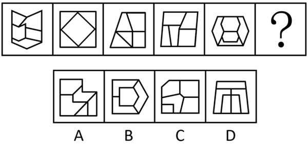
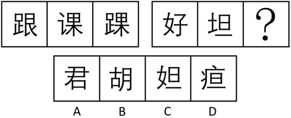
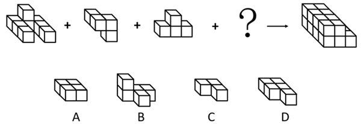
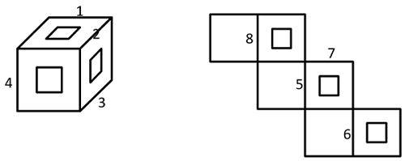
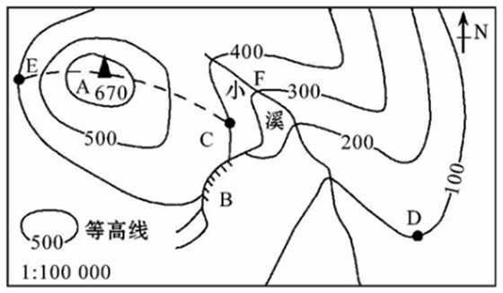
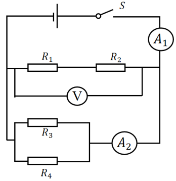
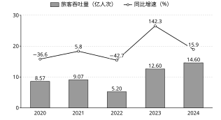
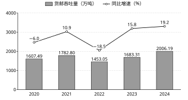
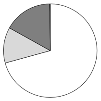

# M05　广东省考行测模拟卷（题本）

## 第一部分　政治理论

**1.** 全面从严治党关键在从严治吏，必须贯彻新时代党的组织路线，建设一支政治过硬、本领高强、作风优良、纪律严明的高素质干部队伍。

A. 正确　　B. 错误

**2.** 坚持和发展中国特色社会主义，是改革开放以来我们党全部理论和实践的鲜明主题，也是习近平新时代中国特色社会主义思想的核心要义。

A. 正确　　B. 错误

**3.** 广东省境内主要分布着粤、客、闽三大汉语方言，其中潮汕话和雷州话都属于闽方言。

A. 正确　　B. 错误

**4.** 区分量变和质变的标志，在于事物的数量是否发生了增减。

A. 正确　　B. 错误

**5.** 党的二十大报告指出：“大自然是人类赖以生存发展的基本条件。尊重自然、顺应自然、保护自然，是全面建设社会主义现代化国家的内在要求。”下列古语与这一理念最为契合的是（　）。

A. 纸上得来终觉浅，绝知此事要躬行
B. 居安思危，思则有备，有备无患
C. 万物各得其和以生，各得其养以成
D. 得众则得国，失众则失国

**6.** 党的二十大报告指出：“中国人民和中华民族从近代以后的深重苦难走向伟大复兴的光明前景，从来就没有教科书，更没有现成答案。党的百年奋斗成功道路是党领导人民独立自主探索出来的，马克思主义的中国篇章是中国共产党人依靠自身力量实践出来的，贯穿其中的一个基本点就是中国的问题必须从中国基本国情出发，由中国人自己来解答。”这段话最能体现习近平新时代中国特色社会主义思想（　）的立场观点方法。

A. 必须坚持人民至上
B. 必须坚持自信自立
C. 必须坚持问题导向
D. 必须坚持胸怀天下

**7.** 2026年6月，党中央召开全国党建工作座谈会，正式提出并系统阐述习近平党建思想。关于“十四个坚持”的科学内涵，下列表述有误的是（　）。

A. 坚持全面从严治党是新时代党的建设的战略方针
B. 坚持不忘初心、牢记使命是党的宗旨立场和价值取向
C. 坚持推进作风建设常态化长效化是党的优势所在、力量所在
D. 坚持落实管党治党政治责任是需要牢牢牵住的“牛鼻子”

**8.** 人民代表大会制度是我国的根本政治制度。根据我国宪法关于国家机构的规定，下列说法正确的是（　）。

A. 全国人大会议每年举行一次，由全国人大主席团召集
B. 全国人大根据国家主席的提名，决定国务院副总理的人选
C. 决定特赦属于全国人大常委会行使的重大事项决定权
D. 批准省、自治区和直辖市的建置属于国务院的职权

**9.** 改革开放和社会主义现代化建设时期，党作出了一系列重大理论创新和战略部署。以下表述符合历史事实的有（　）。

A. 党的十二大明确提出了建设有中国特色的社会主义的重大命题
B. 党的十六大第一次明确提出了“中国特色社会主义理论体系”的科学命题
C. 党的十四大第一次提出了“五位一体”总体布局
D. 1992年，邓小平在南方谈话中提出“发展才是硬道理”

**10.** 唯物史观揭示了人类社会发展的一般规律。下列关于唯物史观的说法，正确的有（　）。

A. 地理环境是社会存在和发展的决定性因素
B. 社会存在和社会意识的关系问题是社会历史观的基本问题
C. 生产资料所有制关系是区分不同生产方式、判定社会经济结构性质的客观依据
D. 非意识形态反映自然现象和不属于特定经济基础的某些社会现象，具有鲜明的阶级性

## 第二部分　常识判断

**11.** 纪念江泽民同志诞辰100周年大会上的讲话，回顾了江泽民同志领导推进改革发展的重大贡献。下列表述有误的是（　）。

A. 确立社会主义市场经济体制的改革目标和基本框架
B. 全面阐述正确处理社会主义现代化建设中的十大关系
C. 坚持把发展作为党执政兴国的第一要务，一心一意谋发展
D. 提出二十一世纪头20年是我国重要战略机遇期的重大判断

**12.** 我国深空探测和载人航天事业捷报频传。下列关于我国航天器的表述，正确的是（　）。

A. 天问二号是火星探测器，开展火星取样返回探测
B. 夸父一号是我国首颗太阳探测科学技术试验卫星
C. 梦舟是一次性使用的新一代载人飞船，仅面向空间站任务
D. 天问一号一次性完成火星环绕、着陆和巡视探测

**13.** 发展新质生产力是推动高质量发展的内在要求和重要着力点。关于新质生产力，下列表述有误的是（　）。

A. 是创新起主导作用、符合新发展理念的先进生产力质态
B. 以劳动者、劳动资料、劳动对象及其优化组合的跃升为基本内涵
C. 以劳动生产率大幅提升为核心标志，本质是先进生产力
D. 由技术革命性突破、生产要素创新性配置、产业深度转型升级而催生，特点是创新，关键在质优

**14.** 《中华人民共和国生态环境法典》于2026年3月12日经十四届全国人大四次会议表决通过，自2026年8月15日起施行。关于该法典，下列说法正确的是（　）。

A. 生态环境法典是我国第一部以“法典”命名的法律
B. 横向生态保护补偿由受益地区与生态保护地区协商开展
C. 自然保护地体系以自然保护区为主体、以国家公园为基础
D. 生态环境保护坚持预防为主、生态优先、政府主导、损害担责的原则

**15.** 2023年4月，习近平总书记在广东考察时强调，广东要在推进中国式现代化建设中走在前列。下列表述与总书记此次考察时的重要指示不符的是（　）。

A. 要带动和推进粤东、粤西、粤北地区更好承接港澳地区的产业有序转移
B. 解决好吃饭问题，要树立大食物观，既向陆地要食物，也向海洋要食物
C. 要把徐闻港打造成连接粤港澳大湾区和海南自由贸易港的综合枢纽
D. 推进中国式现代化，要以水定城、以水定地、以水定人、以水定产

## 第三部分　言语理解与表达

**16.** 构建新发展格局的关键在于经济循环的____，就像人们讲的要调理好统摄全身阴阳气血的任督二脉。经济活动需要各种生产要素的组合在生产、分配、流通、消费各环节有机衔接，从而实现循环流转。
填入画横线部分最恰当的一项是：

A. 行之有效
B. 环环相扣
C. 畅通无阻
D. 井然有序

**17.** 在人文领域，人文学者担负的任务首先而且主要是“传承”人类文化，是理解、解释从而
传播人文经典。评价一个人文学者学术水平的基本标准是，他熟悉多少经典著作，能在多大
程度上_______经典著作，本着当代人面临的问题开展与伟大经典的对话。至于创造性思想，
那是一种________的事情，有些才能杰出者或许可以提出富有创造性的思想，甚至提出自己
独特的理论体系，但那是人文学者“修炼”过程中________的事情，不应该是预先设立的目标。
依次填入画横线处最恰当的一项是

A. 阐释 可遇不可求 水到渠成
B. 精通 难能可贵 功到自然成
C. 诠释 可望不可即 自然而然
D. 通晓 不可多得 铁杵磨成针

**18.** 骈文的特点是追求形式美：对偶、声律、用典、藻饰。魏晋时期，这种刻意追求文学形式美的 ____ ，一方面促
进了文学独立品格的建立，另一方面又造成了形式上的僵化和内容上的 ____ 。
依次填入画横线部分最恰当的一项是：

A. 导向 苍白
B. 手法 单一
C. 潮流 呆板
D. 风尚 空洞

**19.** 有些教育者讲授思政课之所以效果不佳，一个重要的原因在于讲授的内容流于表面， ____ ，往往是从书本到
书本，从理论到理论，致使授课看似在说理，实则缺乏理论深度与厚度，难以让人真正 ____ 。
依次填入画横线部分最恰当的一项是：

A. 舍本逐末 接受
B. 走马观花 理解
C. 浅尝辄止 信服
D. 缘木求鱼 认可

**20.** 传统饱和打击战术的核心，是从不同方向、不同层次向同一目标发射超出其防御上限的导弹，以数量优势形成绝对力量优势，压迫及摧毁其防御体系，对敌重要目标进行毁灭性打击。该战术需要庞大的火力投射平台和充足的武器弹药作支撑，这让世界上大多数国家____。
填入画横线部分最恰当的一项是：

A. 望而却步
B. 无可奈何
C. 束手无策
D. 裹足不前

**21.** 足够的执法权限是基层治理高效运行的必要条件。权限不足，可能导致基层执法需求与实际权力配置之间存在较大张力，让基层治理陷入“看得见的管不着”的低效治理困境；但权限如果过度下放，又可能出现“接不住、管不好”的现象。因此，一方面需要进一步完善执法目录动态调整机制和制度，确保执法职能精准划转、行政职权科学配置；另一方面需要加快完善基层执法事项基准库，建立基层执法事项指导目录，确保执法事项在基层供需精准对接、有效贯通执行、全面落实落细。
这段文字意在强调，基层治理应：

A. 重视“基层执法”，提升基层执法服务效果
B. 围绕“精准赋权”，科学动态调整执法权属
C. 加快“权限下放”，精准对接基层执法需求
D. 调整“执法目录”，落实落细基层执法事项

**22.** “____。”要加快完善中国特色社会主义法律体系，使之更加科学完备、统一权威。党的十八大以来，全国人大及其常委会通过宪法修正案，制定法律48件，修改法律203件次，作出法律解释9件，通过有关法律问题和重大问题的决定79件次。截至目前，现行有效法律282件、行政法规608件，地方性法规12000余件。民法典为其他领域立法法典化提供了很好的范例，要总结编纂民法典的经验，适时推动条件成熟的立法领域法典编纂工作。要研究丰富立法形式，可以搞一些“大块头”，也要搞一些“小快灵”，增强立法的针对性、适用性、可操作性。
填入画横线部分最恰当的一项是：

A. 法者，天下之准绳也
B. 国皆有法，而无使法必行之法
C. 立善防恶谓之礼，禁非立是谓之法
D. 治国无其法则乱，守法而不变则衰

**23.** 传统旅游有追求“冬暖夏凉”的季节性特征，现在游客则追求极致体验性。冬季到北方体验冰雪旅游，夏季到
南方体验水上和高空项目，南北方全时段都有旺盛的体验需求。这就要求传统旅游城市从自然景观向娱乐文旅
融合等消费场景过渡，加大“非热点时段”的旅游硬件设施和软性服务的整体供给能力。许多传统旅游城市因
旅游需求旺盛而提升了“以游客为导向”的服务能级，服务更加主动、热情、精细、有活力，城市服务治理整
体提升。
这段文字意在说明：

A. 旅游市场及游客需求日益多样化
B. 传统旅游的价值仍有待进一步挖掘
C. 传统旅游城市需开发旅游消费新业态
D. 新的旅游需求推动城市服务升级优化

**24.** 相较于地球，月球上氦-3储量极为丰富。氦-3来源于太阳内部核聚变，以高能粒子形式通过太阳风向宇宙扩散。月球没有大气层，其磁场不足地球的千分之一，使得太阳风能够直射月球表面并将氦-3注入月壤层。同时，月表温度在月夜最低可达−180℃，极地永久阴影区甚至可达−250℃。极低温环境有效促进了氦-3被月壤层吸附，阻止其向太空逃逸，并在月表不断富集。据估算，全月氦-3换算储量高达110万吨，可作为清洁核原料供地球使用约1万年。
这段文字能够解释下列哪一问题？

A. 月球上的氦-3储量是如何换算的
B. 低温如何促进氦-3被月壤层吸附
C. 为何太阳风能将氦-3注入月壤层
D. 如何开采月球上丰富的氦-3资源

**25.** 村落形成是优胜劣汰、自我生长的过程。我们现在看到的村落，是经过历史“折叠”后的结果，当下呈现的只是其中一个切面。村落里的大部分遗留物中，都隐藏着不同历史阶段的痕迹，想要看清楚，需要将“折叠”展开，按照各种痕迹进行重新整理和立体化呈现。所谓“没有特色、没有传统的村落”，其实是因为信息残缺较为严重，但其中的历史印记不会完全消失。要发现这些信息，必须通过长时间的田野调查，与原住民进行深入交流，感受他们对艺术的认知与理解，找到他们能接受、认为美的形式，这才是艺术乡建最重要的切入点。
作者通过这段文字想说的是：

A. 村落中的历史文化信息亟待发掘整理
B. 艺术乡建应以复原村落特色为着力点
C. 发现历史细节是振兴传统村落的基础
D. 扎实的田野调查对艺术乡建至关重要

**26.** 如何精准评估生态产品的受益主体与范围，准确核算产品的价值量，是实现生态产品价值绕不开的问题，鼓励研发自然资源资产信息化管理平台是主要途径之一。将自然资源资产负债表所涉及的资源信息和评估核算模块录入系统，依托技术、数据，叠加功能图形信息，形成自然资源资产“一张图”信息化管理平台。还应鼓励有条件的城市建设生态系统生产总值数字化服务平台，利用大数据、云计算技术，系统反映生态资源的数量、质量、分布、权属等信息，绘制生态产品价值地图，实现精细化动态核算。
这段文字主要讲的是:

A. 开发信息化管理平台，提升生态产品监管水平
B. 利用数字技术，增强生态产品价值的核算效能
C. 建设统一的服务平台，实现生态资源系统管理
D. 整合自然资源资产，推动数字化管理平台建构

**27.** 互联网新闻业颠覆了新闻媒介和职业记者是公众与消息来源和信息准确可靠性之间权威通
道的传统理念。以往优秀的职业记者和强大公信力的媒介机构在获取消息来源、验证信息准确度方
面具有得天独厚的资源和优势，这也是职业与非职业新闻业之间的分野所在。然而今天，除了各类
消息来源都可以直接面对公众之外，遍布全球、专业高效的互联网用户，也使得信息的交叉验证变
得比以往更为便捷。简而言之，媒介机构不再是新闻事件的权威阐释主体，新闻报道的价值和意义
________________。
填入画横线处最恰当的是：

A. 已然掌握在互联网各类新媒体手中
B. 不再由传统的权威新闻媒体所定义
C. 由互联网用户的广泛参与而消解
D. 经由公众的集体参与而被重塑

**28.** 相比高校和科研机构，企业处于市场最前沿，对有市场潜力的技术感知更灵敏，对产业发展趋势的把握也更敏锐。因此，在颠覆性技术的研发、转移转化过程中，需要强化企业科技创新主体地位。在课题立项中，要加快提升企业技术创新决策的主体地位，建立企业常态化参与国家科技创新决策的机制；在创新过程中，要着力强化企业科研组织的主体地位，支持领军企业聚焦国家重大需求，牵头组建创新联合体，加快形成企业主导的产学研深度融合。同时，人才、经费等创新要素也要加快向企业特别是科技领军企业集聚。
这段文字意在说明：

A. 应着力完善国家科技创新决策的体制机制
B. 颠覆性技术创新需重视并发挥企业的作用
C. 要大力推进颠覆性技术的研发及转移转化
D. 创新要素的大量积聚有助于企业技术创新

**29.** 在社会发展和日常生活中，企业和家庭的决策不仅受到可见成本的影响，也受到各种不见于会计账本，但却实
实在在占用相关人力物力的隐形成本的制约。隐形成本就像暗物质一样，虽然本身很难观测，但可以通过它对
相关经济活动的影响推测其大小和变动趋势。从社会发展角度看，如果政策制定者希望全面降低经济活动成
本，减轻企业和家庭负担，除了在税费等可见成本方面给予优惠，降低隐形成本也是很重要的一环。
最适合做这段文字标题的是：

A. 成本决定决策
B. 掣肘发展的“暗成本”
C. 决策的关键“降低成本”
D. 不可忽视的“隐形成本”

**30.** ①绝缘问题已不是一般材料的简单组合和简单工艺所能解决，而需要有一些特定性能的材料，针对具体的绝缘要求做成特定形式的结构才能适应需要
②随着技术发展，社会对电工产品的经济效益和性能稳定性的要求不断提高，绝缘材料才从材料的大类里分离而出
③在电工技术发展初期，电工产品对绝缘的要求不高，一般天然材料如棉、麻、丝等纤维，松香、石蜡等有机物质即可满足使用要求
④这样一来，一批多功能的协和性组合绝缘结构得到了开发，绝缘技术也发展到了一个新的阶段
⑤因而，当时没有专门用于绝缘的材料，也没有绝缘工艺和绝缘结构的概念
⑥随着使用电压的不断提高，电工产品使用领域的扩展，环境因素对绝缘的影响越来越显著
将以上6个句子重新排列，语序正确的一项是：

A. ②③⑤⑥④①
B. ②③⑥⑤①④
C. ③⑤②⑥①④
D. ③⑤⑥②④①

## 第四部分　数量关系

**31.** 14，39，65，94，132，197，（    ）

A. 343
B. 313
C. 278
D. 211

**32.** 5.4，9.1，10.8，18.2，20.16，（    ）

A. 36.4
B. 36.28
C. 35.4
D. 33.15

**33.** 1， $\frac{9}{26}$ ， $\frac{4}{21}$ ， $\frac{9}{62}$ ， $\frac{29}{215}$ ，（    ）

A. $\frac{8}{57}$
B. $\frac{47}{342}$
C. $\frac{23}{114}$
D. $\frac{7}{38}$

**34.** 2，4，6，9，13，19，（    ）

A. 28
B. 29
C. 30
D. 31

**35.** $\frac{1}{35}$ ， $\frac{3}{70}$ ， $\frac{1}{14}$ ， $\frac{1}{10}$ ， $\frac{11}{70}$ ，（    ）

A. 1
B. $\frac{3}{4}$
C. $\frac{13}{70}$
D. $\frac{37}{70}$

**36.** 甲、乙、丙三人进行投篮比赛，每人投篮10次，每投中一次得3分，未投中得0分。比赛结束后，三人总得分为51分，甲的得分比乙多9分，丙的得分是乙的1.5倍。问甲比丙多投中了多少次？

A. 1
B. 2
C. 3
D. 4

**37.** 某校高一、高二两个年级若干名学生参加满分为100分的数学竞赛，平均分为82分，其中高一年级学生平均分为70分，高二年级学生平均分为90分。若将高一年级得分最低的两人分数去掉（两人平均分为50分），则两个年级的平均分相等。高一、高二两个年级参赛学生人数相差多少人？

A. 1
B. 2
C. 3
D. 4

**38.** 某超市为回馈消费者，将举办购物抽奖活动。每人只能抽奖一次，奖金有三种：一等奖888元，二等奖88元，
三等奖8元。若前100个中奖者的奖金总额为2480元，则其中获得三等奖的最少有：

A. 95人
B. 89人
C. 79人
D. 69人

**39.** 某商店分别按30%、50%的利润率定价销售A、B两种文具。暑期推出促销活动，将4件文具A和2件文具B组成礼盒，并按定价总和的八八折出售，每个礼盒可获利80元。已知每件文具A的成本比文具B低30元，则文具B的定价为多少元？

A. 120
B. 100
C. 90
D. 80

**40.** 某工厂承接一批零件生产订单，若一车间与二车间合作生产，20天可完成。现一车间先单独生产6天，随后二车间单独生产8天，此时还剩订单总数的66%未完成。已知一车间每天比二车间多生产150个零件，若全部零件由二车间单独生产，需多少天完成？

A. 30
B. 34
C. 42
D. 50

**41.** 一个转盘被平均划分为5个扇形区域，分别标有数字1、2、3、4、5。转盘中央有一指针，转盘转动后指针最终落到各区域的概率相等。玩家连续转动转盘3次，若指针落到偶数区域的次数多于奇数区域则获奖，那么玩家获奖的概率是多少？

A. $\frac{44}{125}$
B. $\frac{81}{125}$
C. $\frac{4}{25}$
D. $\frac{21}{25}$

**42.** 某市运动员组队参加全省田径联赛，联赛设跑步、跳跃、投掷三类项目。已知该市运动员在这三类项目中获得冠军的概率分别为50%、60%、70%，且各类项目能否夺冠互不影响。赛事规定：至少在两类项目中获得冠军方可获得“优秀组织奖”。则该市获得此奖项的概率为：

A. 80%以上
B. 70%-80%
C. 60%-70%
D. 60%以下

**43.** 甲、乙两人分别从A、B 两地同时出发相向而行。当两人合计走完两地间路程的1/4 时，甲距A 地的路程
是500 米；当两人合计走完两地间路程的3/4 时，乙距B 地的路程是2400 米。若两人的速度始终不变，则当速度
较快者走完全程时，速度较慢者距走完全程还剩的路程是

A. 1350 米
B. 1600 米
C. 1800 米
D. 1950 米

**44.** 某市步行街长1485米，现需在步行街两侧均安装垃圾桶，要求步行街左侧每隔15米安装一个垃圾桶，右侧每隔33米安装一个垃圾桶，且步行街起点与终点两端均需安装，中间路段若某一位置左右两侧均需安装垃圾桶，则只在左侧安装一个。问整条步行街共需安装多少个垃圾桶？

A. 136
B. 138
C. 144
D. 146

**45.** 小郑从今年3月开始背单词，每月的单词背诵量都比前一个月多10个，第四季度月均单词背诵量为95个。若明年上半年小郑的单词背诵总量要达到环比翻一番的目标，则小郑明年上半年月均单词背诵量为多少个？

A. 95
B. 320
C. 240
D. 160

## 第五部分　判断推理

**46.** 从所给的四个选项中，选择最合适的一个填入问号处，使之呈现一定的规律性：

**47.** 从所给的四个选项中，选择最合适的一个填入问号处，使之呈现一定的规律性：

**48.** 下列选项中最符合所给图形规律的是（    ）。

**49.** 箭头右侧给定的是由20个相同大小的正方体组合成的多面体，从四个选项中选择一个填入问号处，使左侧四个小多面体能组成箭头右侧立体图形的是：

**50.** 下图为给定的多面体及其外表面展开图，问数字1、2、3、4、5、6、7、8所代表的棱的对应关系为：

A. 1-7，2-5，3-6，4-8
B. 1-6，2-5，3-8，4-7
C. 1-5，2-7，3-8，4-6
D. 1-5，2-7，3-6，4-8

**51.** 传统产业是现代化产业体系的重要组成部分，优化提升传统产业是推动现代化产业体系整体升级的必然选择。只有进行技术改造、模式创新与结构优化，才能真正优化提升传统产业。如果现代化产业体系迈向智能化或锻造新优势，那么就能推动现代化产业体系整体升级。
由此可以推出：

A. 如果现代化产业体系没有锻造新优势，那么就无法优化提升传统产业
B. 进行技术改造和模式创新是现代化产业体系锻造新优势的必要条件
C. 除非推动现代化产业体系整体升级，否则没有进行技术改造、模式创新与结构优化
D. 只要优化提升传统产业，就能推动现代化产业体系整体升级

**52.** 脑机接口是一项具有变革性的人机交互技术，其核心机制是绕过外周神经与肌肉，在大脑与外部设备之间直接建立通信与控制通路，实现大脑与设备间的信息交互。“高位截瘫患者仅凭意念操控轮椅出行，用意念指挥机器狗递送物品”······这些曾只存在于科幻作品中的场景，正随着脑机接口技术的发展逐步成为现实。不过，也有不少人担忧该技术会直接读取个人思想与记忆，因而对这项新技术持谨慎态度。
以下哪项如果为真，最能削弱上述担忧？

A. 目前，脑机接口技术正驶入发展快车道，呈现出快速增长的良好态势
B. 脑机接口技术的核心功能是解析特定脑电信号指令，捕捉运动皮层信号
C. 脑机接口设备只能单向接收大脑主动发出的信号，无法检索大脑中的信息
D. 脑机接口技术研究的最初目的是有效地恢复患者因疾病或外伤丧失的运动功能

**53.** 每年夏季，雌性藏羚羊会跨越数百公里前往固定产崽地，部分母羊与幼崽不会返回原越冬地，而是在新栖息地定居。这种独特的生存策略，让藏羚羊种群始终保持高效、持续的基因交流，避免了遗传隔离。研究人员据此认为，青藏高原所有藏羚羊均属于单一遗传种群。要使上述论证成立，必须补充的前提是：

A. 有基因组证据显示，不同地区的藏羚羊确实存在着基因交流
B. 单一遗传种群与多个遗传种群最大的区别是单一遗传种群不存在遗传隔离
C. 远距离迁徙产崽可使幼崽在成长初期远离寄生虫和疾病威胁
D. 进入人类世界后，人类活动成为主导藏羚羊命运的核心力量

**54.** 保护生物学家一直认为，当种群数量骤减，即出现所谓的遗传瓶颈时，遗传多样性会下降，同时近亲繁殖与有害突变的累积会增加物种灭绝风险。然而，一项发表于《科学》的研究发现，某些经历过严重遗传瓶颈的考拉种群，近几年其有害基因突变更少、适应能力更强，显示出基因再生的早期迹象。研究人员据此认为，遗传瓶颈带来的新突变的累积和基因组合变化，使得这些考拉种群正在恢复。
以下哪项如果为真，最能削弱上述研究人员的观点？

A. 经历了遗传瓶颈的考拉种群所在地区，近年来生态环境不断改善，为考拉提供了更适宜的生存环境，食物资源也更加丰富
B. 对其他濒危物种的研究表明，仅依靠静态遗传指标判断灭绝风险，可能会错误评估物种的濒危程度与恢复状态
C. 长期以来，维多利亚州的考拉种群一直被认为存在基因缺陷，因为它们大多源自一次严重的历史遗传瓶颈
D. 澳大利亚北部的考拉种群虽然遗传多样性较高，但携带更多有害基因突变，种群数量在急剧下降

**55.** 甲、乙、丙、丁、戊5人报名学校组织的兴趣课程，每人报名绘画、书法、舞蹈、唱歌、陶艺5门兴趣课程中的2门，且每门课程恰好有2人报名。已知：
①甲不报名绘画和舞蹈；
②乙与丙报名的课程完全不同，且丙不报名陶艺；
③丁不报名书法，且丁与戊恰好有1门课程相同；
④戊不报名唱歌，且戊报名的课程与甲无任何重复；
⑤乙报名书法和绘画。
由此可以推出一定正确的是：

A. 甲会报名陶艺
B. 丙会报名绘画
C. 丁会报名舞蹈
D. 戊会报名陶艺

**56.** 2020年，我国开展五年规划编制史上首次“网络问计”，累计收到上百万条网民意见建议；2025年，“十五五”规划编制再次面向社会公开征求意见，累计收到群众建言超311.3万条；目前，“通过互联网等途径向社会公开征集意见建议”已正式写入《中华人民共和国国家发展规划法》，以法律形式保障公众参与规划编制。有学者据此认为：坚持顶层设计与问计于民相统一，是我国科学制定并有效实施五年规划的关键成功因素。
以下各项如果为真，最无法支持这一观点的是：

A. 网络征求意见拓宽了民意表达渠道，让千家万户的小事能够融入国家发展大计
B. 坚持顶层设计与问计于民相统一，能够彰显制度优势，确保国家发展的正确方向
C. “网络问计”实现常态化、法律化，能有效汇聚社会各界智慧，助力凝聚发展合力
D. 我国现代化建设覆盖面广、涉及领域众多，科学制定规划需要统筹兼顾、协调各方

**57.** “设摊”招生是指高校到指定地点摆放招生摊位，甚至有时还要向当地中介机构交纳“摊位费”，对于“设摊”这种费时费力的做法，高校领域的意见基本一致——此事高耗能，应该立即叫停。然而令人费解的是，大部分高校并没有减少每年派出“设摊”人员的人数。
以下选项若为真，最不能解释这一现象的是：

A. 有些位于偏远地区的考生信息闭塞，线下“设摊”是帮助他们了解高校信息的必要途径之一
B. 大部分高校在获得高分生源的名单后，通过“设摊”可以更有针对性地锁定心仪的招生对象
C. 只有“设摊”招生才可以让高分考生与高校“零距离”接触，缩短考生与高校之间的距离感
D. 各大高校均有专业的招生老师，学校会给这些因“设摊”招生而出差的老师发放相应的补贴

**58.** 某研究团队通过构建模拟人类长期独居状态的小鼠模型展开研究，发现被单独饲养的小鼠大脑中“腹侧海马”区（更侧重于调控情绪的海马亚区）铁含量异常升高。过量的铁会激活α-突触核蛋白分子，导致神经元过度放电。这一过程会不断向身体发出“危险”的焦虑警报。更为关键的是，这种变化精准地作用于情绪中枢，使得大脑对“社交剥夺”产生高度特异的应激反应。
据此，该研究团队认为社交隔离会触发大脑特定区域“铁聚积”，进而激活一条全新的神经可塑性通路，引发焦虑等症状。
以下哪项如果为真，最能支持上述论证？

A. 过往研究认为铁是维持神经健康的营养元素，而新研究表明，在心理压力的作用下，铁能够直接改变神经突触的结构与功能
B. 研究团队通过鼻腔给药的方式，针对铁可塑性中的关键分子铁或α-突触核蛋白进行干预，仅两周治疗后，小鼠的焦虑行为显著减轻
C. 该研究融合了神经科学、金属生物学代谢调控与转化医学等多个领域的知识，真正实现了从实验室到病床前的全链条创新
D. 在日常生活中，不少人长时间独处后，即便没有发生任何特别的事情，也会莫名心慌、坐立不安，甚至对社交产生恐惧

**59.** 创新药物如需申请上市，相关部门首先要对药物的化学结构进行确证；其次要在动物身上进行试验，研究药物在动物体内的代谢过程、作用靶点和效果；最后还要在人体上进行规范的临床试验，证实药物的安全性和有效性。因此，用于治疗原发性胆汁性胆管炎的奥贝胆酸片，虽然已进行了结构确证和动物试验，但仍暂时不能申请上市。
要使上述结论成立，需要补充的前提是（    ）。

A. 如果一款创新药没有进行过规范的人体临床试验，根据规定就无法申请上市
B. 一些创新药问世之初，有一定概率出现不良反应，需要客观看待其安全性
C. 为了让更多患者获益，我国国家药监局在持续推进药品审评审批制度改革
D. 相关部门还未筛选出奥贝胆酸片的合适受试者，故人体临床试验工作暂时受阻

**60.** 某单位准备从甲、乙、丙、丁、戊、己六人中择优录取数名技术人员，录用情况符合如下
条件：
（1）丙和丁恰有一人录取；
（2）甲和乙至少有一人录取；
（3）甲和丁恰有一人录取；
（4）录取乙当且仅当录用丙；
（5）甲、戊、己中恰有两人录用。
根据上述信息，可以推出最终录用的人数为：

A. 2
B. 3
C. 4
D. 5

**61.** 若做不到强化技术监管、提升执法效能，就不能让科技创新真正造福人类。目前监管部门已经强化了技术监管，提升了执法效能，因此科技创新已经能够真正造福人类。
下列选项的逻辑结构与题干最为相似的是（    ）。

A. 若以亮利剑的态度涤清网络生态，就能让赛事精神在网络激荡出磅礴力量。某赛事以亮利剑的态度涤清了网络生态，因此该赛事精神在网络激荡出了磅礴力量
B. 除非发扬载人航天精神，否则在星辰大海的征途上并不会镌刻更多的中国印记。目前在星辰大海的征途上镌刻了更多的中国印记，因此我们一定发扬了载人航天精神
C. 只有扩大高水平对外开放，才能开创合作共赢新局面。我国扩大高水平对外开放，因此我们没有同世界各国共同开创合作共赢新局面
D. 若某社区为老年人筑起数字安全网，该社区的老年人就能在岁月静好中安享晚年。某社区的老年人在岁月静好中安享晚年，因此该社区为老年人筑起数字安全网

**62.** 近日教育部公布了当年全国硕士研究生招生考试的相关数据。数据显示，当年考研报名人数降至388万，比前一年减少50万，降幅为11.42%，呈现下降的态势。然而令人不解的是，当年热门专业的考研分数线却纷纷上涨。
下列选项如果为真，最能解释上述现象的是（    ）。

A. 考研分数线的变化受多方面因素的影响，而当年的试卷难度较大
B. 即使总报考人数下降，热门专业的报考人数仍比冷门专业多得多
C. 当年考生仍执着于热门院校的热门专业，其报考人数同比增长了40%
D. 当年部分试卷从自命题改为全国统考，对基础扎实的考生更有利

**63.** 科技发展日新月异，若监管滞后，无人机就可能沦为伤人害物的凶器。唯有织密法治之网，才能让科技创新真正造福人类。
由此可以推出（    ）。

A. 如果没有织密法治之网，科技创新就无法真正造福人类
B. 只要织密法治之网，科技创新就可以真正造福人类
C. 如果监管不滞后，无人机就不可能沦为伤人害物的凶器
D. 唯有织密法治之网，无人机才不可能沦为伤人害物的凶器

**64.** 明厨亮灶的饭店，客流量大；而客流量大的饭店，饭菜都美味。因此，明厨亮灶的饭店，饭菜都美味。
下列选项的逻辑结构与题干最为相似的是（    ）。

A. 坚持晨读的人，语言感知敏锐；语言感知敏锐的人，外语学习效率都高。因此，外语学习效率高的人，都在坚持晨读
B. 重视产品质量的企业，市场占有率高。这是因为重视产品质量的企业，用户口碑一定好，而用户口碑好的企业，市场占有率高
C. 作息规律的人，身体代谢功能稳定；而身体代谢功能稳定的人，衰老速度缓慢。因此，作息不规律的人，衰老速度快
D. 居民幸福感强的社区，都在践行垃圾分类。这是因为践行垃圾分类的社区，环境整洁度很高，而环境整洁度高的社区，居民幸福感都强

**65.** 记者从2026中国信通院深度观察报告会上获悉：“十五五”时期将重点开展6G标准研制与产业研发，预计在2030年左右启动商业应用。由于6G通信具有极致的传输能力，其峰值传输速率可达1Tbps，有专家据此认为，未来的6G通信技术将极大地助力沉浸式扩展现实（XR）领域向前发展。
下列选项最有可能是上述推论暗含前提的是（    ）。

A. 借助6G通信技术能够在多种条件下实现360度立体影像实时传输
B. 沉浸式扩展现实需要极高的数据吞吐量，以实现完全沉浸式的体验
C. 沉浸式扩展现实的核心特征是：多感官交互、全域覆盖和智能优化
D. 未来，6G通信技术的传输能力将显著强于目前使用的5G通信技术

## 第六部分　科学推理

**66.** 小明在学习完与金属活动性相关的知识后，想自己动手验证Fe、Cu、Ag三种金属活动性的强弱，下列实验方案的组合不能达到其目的的是（    ）。
①将Fe放入 $\mathrm{CuSO_4}$ 溶液
②将Cu放入 $\mathrm{AgNO_3}$ 溶液
③将Ag放入 $\mathrm{CuSO_4}$ 溶液
④将Fe、Cu分别放入稀盐酸

A. ①③
B. ①④
C. ②④
D. ③④

**67.** 某科普馆展出了一种“潜浮小车”模型：小车内部有可进水、排水的空腔，将其放入透明水槽后，起初漂浮在水面；当向空腔内缓慢注水时，小车逐渐下沉，直至恰好悬浮在水中。下列说法正确的是（    ）。

A. 小车从漂浮到悬浮的过程中，所受浮力逐渐减小
B. 小车从漂浮到悬浮的过程中，所受重力逐渐增大
C. 小车悬浮时，所受浮力大于重力
D. 小车悬浮时，水对小车底部的压强小于对小车顶部的压强

**68.** 下图为某地的等高线地形图，下列说法正确的是（    ）。

A. 图中小溪的流向为自东北向西南
B. 图中D处的地形为山谷
C. 图中E处的气温比A处的气温低
D. 图中B处适宜发展攀岩运动

**69.** 如图为某用电器的电路图， $R_1$ 、 $R_4$ 是定值电阻， $R_2$ 是温敏电阻，随着环境温度的升高， $R_2$的阻值会变大； $R_3$ 是光敏电阻，随着环境光照强度的增大， $R_3$ 的阻值会变小；V表示电压表， $A_1$ 、 $A_2$ 均表示电流表，电源电压保持不变，电表均为理想电表，闭合开关S后，下列说法正确的是（    ）。

A. 若环境温度下降，则V的示数变小， $A_1$ 的示数变大
B. 若环境温度下降，则V的示数不变， $A_1$ 的示数变大
C. 若环境光照强度增大，则 $A_1$ 的示数变大， $A_2$ 的示数变小
D. 若环境光照强度减弱，则 $A_1$ 的示数不变， $A_2$ 的示数变大

**70.** 在进行“绿叶在光下制造有机物”实验之前，需将盆栽天竺葵放到黑暗处一昼夜，该操作的主要目的是（    ）。

A. 大量消耗叶片内的水分
B. 消耗叶片内原有的淀粉（有机物）
C. 促进叶片进行光合作用
D. 分解叶片内的叶绿素

## 第七部分　资料分析

2025年广东省常住人口12859万人，比上年增加79万人，常住人口总量和增量均居全国之首；全年出生人口100.3万人，人口出生率为7.82‰，连续6年成为全国唯一出生人口超百万的省份；死亡人口71.3万人，死亡率5.56‰，人口自然增长率2.26‰。在少子化、老龄化、区域人口增加分化的人口发展新常态下，作为全国人口第一大省的广东，人口发展表现出一定的韧性。
2025年广东省城镇常住人口9847万人，乡村常住人口3012万人；常住人口城镇化率达76.58%，较上年提高0.67个百分点。2025年全省0-15岁人口2339万人，16-59岁劳动年龄人口8527万人，占常住人口比重66.31%；60岁及以上人口1993万人，其中65岁及以上老年人口1324万人。
广东省不仅吸引普通劳动力，更通过“百万英才汇南粤”等集聚大量高端人才，通过“广东技工”等加大教育和培训力度。2025年广东省高校毕业生总数为87万人，较2024年增加3万人。全国每12名高校毕业生中，就有1名选择来广东工作，其中广州、深圳为两大核心吸纳城市。目前，广东省已建成171条“产业-教学-评价”融通的技能生态链，技工院校年均向社会输送技能人才超17万人。

**71.** 以下不属于我国人口发展新常态主要特征的是：

A. 少子化
B. 老龄化
C. 人口负增长化
D. 区域人口增加分化

**72.** 根据材料，以下说法不正确的是：

A. 2025年，广东省常住人口总量和增量均居全国首位
B. 截至2025年，广东省已连续6年成为全国唯一出生人口超百万的省份
C. 截至2025年，广东省已建成171条技能生态链
D. 2025年，广东省劳动力资源主要依靠自给自足

**73.** 2025年，广东省城镇常住人口同比增量在以下哪个范围内？

A. 超过100万人
B. 75万人-100万人之间
C. 50万人-75万人之间
D. 不到50万人

**74.** 2025年，广东省60岁及以上人口中，65岁及以上老年人口占比约为：

A. 76%
B. 66%
C. 56%
D. 46%

**75.** 根据材料，以下说法正确的是：

A. 2025年，广东省自然增长人口29万人
B. 2025年，广东省常住人口中劳动年龄人口是非劳动年龄人口的2倍多
C. 2025年，全国共有不到1000万名高校毕业生
D. 2025年，广东省乡村常住人口同比增量高于城镇常住人口

**2024年—2025年3月我国跨区域人员流动量相关情况**

| 时间 | 跨区域人员流动量（万人次） | 跨区域人员流动量同比增长（%） | 公路人员流动量（万人次） | 公路人员流动量同比增长（%） |
|---|---|---|---|---|
| 2024年1—2月 | 1171807 | — | 1086652 | 10.3 |
| 2024年1—3月 | 1671682 | 10.2 | 1547451 | 9.0 |
| 2024年1—4月 | 2189330 | 8.4 | 2021233 | 7.4 |
| 2024年1—5月 | 2736268 | 8.3 | 2523351 | 7.4 |
| 2024年1—6月 | 3241011 | 7.4 | 2983967 | 6.6 |
| 2024年1—7月 | 3799308 | 6.6 | 3489943 | 5.8 |
| 2024年1—8月 | 4396867 | 6.1 | 4029157 | 5.4 |
| 2024年1—9月 | 4909109 | 5.4 | 4499504 | 4.7 |
| 2024年1—10月 | 5492663 | 5.5 | 5036908 | 4.9 |
| 2024年1—11月 | 5972154 | 5.4 | 5478704 | 4.8 |
| 2024年1—12月 | 6459234 | 5.4 | 5929002 | 4.8 |
| 2025年1—2月 | 1229386 | 4.9 | 1139263 | 4.8 |
| 2025年1—3月 | 1738829 | 4.0 | 1607309 | 3.9 |

注：跨区域人员流动量指国际间、城际间、城乡间商务、旅游等跨区域人员流动规模。公路人员流动量指经由公路完成的跨区域人员流动规模，包括非营业性小客车人员出行量与营业性客运量。

**76.** 2024年，我国跨区域人员流动量最低的季度是：

A. 一季度
B. 二季度
C. 三季度
D. 四季度

**77.** 2023年一季度，我国跨区域人员流动量中非公路人员流动量占比约为：

A. 6.4%
B. 7.4%
C. 8.1%
D. 9.3%

**78.** 2025年一季度，我国公路人员流动量较2023年一季度约增长了：

A. 14.6%
B. 13.3%
C. 12.9%
D. 11.6%

**79.** 2024年下半年，我国跨区域人员流动量累计值同比增速最高的月份，当月公路人员流动量环比约增长：

A. -8.3%
B. 5.8%
C. 9.8%
D. 14.3%

**80.** 以下各项能从材料中推出的是：

A. 2024年，我国公路人员流动量同比增量超过30亿人次
B. 2024年，我国公路人员流动量每月均同比增长
C. 2024年上半年，我国跨区域人员流动量中非公路人员流动量占比不到一成
D. 若保持2025年一季度跨区域人员月均流动量不变，则2025年我国跨区域人员流动量超过700亿人次

2024年前7个月，全国互联网保险累计保费3663亿元，同比增长15.0%，重回了两位数的增速。从2013年至2023年十年间，互联网保险的保费规模从290亿元增加至4949亿元，年均复合增长率达到32.8%。2022年，保险业的互联网渗透率首次突破10%，具有里程碑式的历史意义。

**2016—2023年全国互联网保险保费相关数据**

| 年份 | 互联网保险保费（亿元） | 互联网保险保费占总保费收入比例（%） |
|---|---|---|
| 2016 | 2299 | 7.4 |
| 2017 | 1877 | 5.1 |
| 2018 | 1889 | 5.0 |
| 2019 | 2696 | 6.3 |
| 2020 | 2909 | 6.4 |
| 2021 | 3779 | 8.4 |
| 2022 | 4783 | 10.2 |
| 2023 | 4949 | 9.7 |

**81.** “十三五”期间，全国互联网保险累计保费为多少亿元？

A. 11670
B. 11873
C. 12396
D. 13150

**82.** 2017-2023年，全国互联网保险保费同比增长率超过总保费收入同比增长率的年份有几个？

A. 3
B. 4
C. 5
D. 6

**83.** 若保持2023年同比增量不变，则到哪一年全国互联网保险保费将首次超过2013年的20倍？

A. 2027年
B. 2028年
C. 2029年
D. 2030年

**84.** 2023年8-12月，全国互联网保险月均保费约为多少亿元？

A. 257
B. 353
C. 441
D. 523

**85.** 以下折线图最能准确反映哪一时间段内全国互联网保险保费同比增量的变化趋势？

A. 2017-2020年
B. 2018-2021年
C. 2019-2022年
D. 2020-2023年

2024年，全国民航运输机场完成旅客吞吐量14.60亿人次，比上年增长15.9%。其中，东部地区完成旅客吞吐量7.57亿人次，增长18.6%；中部地区完成旅客吞吐量1.61亿人次，增长12.8%；西部地区完成旅客吞吐量4.49亿人次，增长12.6%；东北地区完成旅客吞吐量0.93亿人次，增长15.8%。
2024年，全国民航运输机场完成货邮吞吐量2006.19万吨，比上年增长19.2%。其中，东部地区完成货邮吞吐量1376.68万吨，增长14.1%；中部地区完成货邮吞吐量240.19万吨，增长58.5%；西部地区完成货邮吞吐量325.27万吨，增长21.9%；东北地区完成货邮吞吐量64.05万吨，增长10.0%。

**图1：2020—2024年全国民航运输机场旅客吞吐量及同比增速**

**图2：2020—2024年全国民航运输机场货邮吞吐量及同比增速**

**86.** 2019-2024年，全国民航运输机场年均完成旅客吞吐量约多少亿人次？

A. 10.6
B. 10
C. 9.4
D. 8.3

**87.** 以下饼状图中，最能准确反映2024年全国各地区民航运输机场完成旅客吞吐量比例关系的是：

A. 
B. 
C. 
D. 

**88.** 2024年，我国东部地区民航运输机场完成货邮吞吐量约比中、西部地区之和多多少倍？

A. 4.2
B. 3.2
C. 2.4
D. 1.4

**89.** 2024年，四个地区民航运输机场完成货邮吞吐量同比增量从多到少排列，正确的是：

A. 东部、西部、中部、东北
B. 中部、西部、东部、东北
C. 东部、中部、西部、东北
D. 中部、东部、西部、东北

**90.** 以下各项不能从材料中推出的是：

A. 2020-2024年，全国民航运输机场完成货邮吞吐量的中位数为1683.31万吨
B. 2020-2024年，全国民航运输机场完成旅客吞吐量同比增速最高的年份，其完成货邮吞吐量同比增速也最高
C. 2021年，全国民航运输机场完成货邮吞吐量较2019年增长了不到5%
D. 2022年，全国民航运输机场完成旅客吞吐量同比增速比货邮吞吐量低24.2个百分点
