# M07　广东省考行测模拟卷（题本）

## 第一部分　政治理论

**1.** 党的十八大以来，全面从严治党从根本上扭转了管党治党宽松软状况，党内思想不纯、组织不纯、作风不纯问题已得到根本解决。

A. 正确　　B. 错误

**2.** 在道路自信、理论自信、制度自信、文化自信中，文化自信是更基础、更广泛、更深厚的自信。

A. 正确　　B. 错误

**3.** 广东省位于我国地势三级阶梯中的第三级阶梯，总体海拔较低，地势北高南低，北部为山地和高丘陵，南部以平原和台地为主。

A. 正确　　B. 错误

**4.** 唯物辩证法认为，事物的否定是由外部力量强加的，辩证否定的实质是既克服又保留。

A. 正确　　B. 错误

**5.** 二十届五中全会《决定》提出，挖掘用好中华优秀传统文化中讲忠信、尚气节、知廉耻、存戒惧、重自省等道德观念，深化政德教育。下列古语与其中“存戒惧”最为契合的是（　）。

A. 战战兢兢，如临深渊，如履薄冰
B. 人而无信，不知其可也
C. 富贵不能淫，贫贱不能移，威武不能屈
D. 见贤思齐焉，见不贤而内自省也

**6.** 二十届五中全会《决定》提出，加强纪律监督、监察监督、派驻监督、巡视监督统筹衔接，推动党内监督同人大监督、民主监督、行政监督、司法监督、审计监督、财会监督、统计监督、群众监督、舆论监督深度融合、高效联动，形成监督合力。这一要求最能体现习近平新时代中国特色社会主义思想（　）的立场观点方法。

A. 必须坚持自信自立
B. 必须坚持守正创新
C. 必须坚持系统观念
D. 必须坚持问题导向

**7.** 二十届五中全会《决定》提出，统筹推进各领域基层党组织建设，突出抓好新兴领域党的建设。下列表述不符合《决定》要求的是（　）。

A. 健全党组织领导的自治、法治、德治相结合的城乡基层治理体系
B. 强化国有企业党委（党组）对重大经营管理事项的事后审议把关
C. 深化拓展新经济组织、新社会组织、新就业群体党的组织覆盖和工作覆盖
D. 完善行业协会、学会、商会管理制度，全面落实党建工作要求写入章程

**8.** 全面依法治国是坚持和发展中国特色社会主义的本质要求和重要保障。关于社会主义法治建设，下列说法有误的是（　）。

A. 党内法规体系是中国特色社会主义法治体系的组成部分
B. 宪法和基本法共同构成特别行政区的宪制基础，依法治理是最可靠、最稳定的治理
C. 改革和法治如鸟之两翼、车之两轮，相辅相成、相伴而生
D. 依法治国是社会主义民主政治的本质特征，是党领导人民治理国家的基本方式

**9.** 党的全国代表大会记录着中国共产党团结带领人民不懈奋斗的历程。以下有关党的全国代表大会的表述，符合历史事实的有（　）。

A. 中共三大决定共产党员以党组织名义集体加入国民党
B. 中共六大是党的历史上唯一一次在国外召开的全国代表大会
C. 中共七大确立毛泽东思想为党的指导思想并写入党章
D. 中共十三大把邓小平理论确立为党的指导思想并写入党章

**10.** 认识过程是从实践到认识、再从认识到实践的辩证发展过程。关于认识的过程和规律，下列说法正确的有（　）。

A. 感性认识包括感觉、知觉和表象三种形式，其突出特点是直接性
B. 理性认识是认识的初级阶段，包括概念、判断、推理三种形式
C. 人对一个复杂事物的认识，往往要经过由感性认识到理性认识、再由理性认识到实践的多次反复才能完成
D. 人类的认识是永无止境、无限发展的，表现为“实践—认识—再实践—再认识”的无限循环，是由初级阶段向高级阶段不断推移的前进运动

## 第二部分　常识判断

**11.** “十五五”时期是基本实现社会主义现代化夯实基础、全面发力的关键时期。关于我国社会主义现代化建设的战略安排，下列表述正确的是（　）。

A. 到中国共产党成立100年时，全面建成社会主义现代化强国
B. 从2020年到2035年，在全面建成小康社会的基础上基本实现社会主义现代化
C. 到2035年，基本实现国防和军队现代化，全面建成世界一流军队
D. 从2035年到本世纪中叶，在全面建成小康社会的基础上基本实现社会主义现代化

**12.** 广东省2026年政府工作报告回顾“十四五”时期工作时指出，产业科技互促双强大力拓展，绿美广东生态建设绘就新画卷。下列表述与报告内容不符的是（　）。

A. 区域创新能力连续9年全国第一
B. 原生鸿蒙操作系统、体外膜肺氧合系统等打破国外垄断
C. 累计营造红树林4931公顷，国际红树林中心落户湛江
D. 海上风电装机规模跃居全国第一，核电装机规模占全国25.8%

**13.** 促进共同富裕，总的思路是坚持以人民为中心的发展思想，在高质量发展中促进共同富裕。关于扎实推动共同富裕，下列表述有误的是（　）。

A. 要扩大高收入群体比重，形成中间大、两头小的橄榄型分配结构
B. 共同富裕是人民群众物质生活和精神生活都富裕
C. 共同富裕不是整齐划一的平均主义，也不是所有地区同时达到一个富裕水准
D. 要加大税收、社保、转移支付等调节力度并提高精准性

**14.** 《中华人民共和国民族团结进步促进法》自2026年7月1日起施行。根据该法，下列说法有误的是（　）。

A. 该法的立法目的包括铸牢中华民族共同体意识、推进中华民族共同体建设
B. 国家把民族区域自治制度作为民族团结之本，禁止破坏民族团结和制造民族分裂的行为
C. 要引导各族人民牢固树立休戚与共、荣辱与共、生死与共、命运与共的共同体理念
D. 国家坚持增进共同性、尊重和包容差异性，促进各民族守望相助、和谐共处

**15.** 广东省2026年政府工作报告部署了2026年政府工作的重点任务。下列表述与报告内容不符的是（　）。

A. 统筹高质量发展和高水平安全，守牢安全发展底线
B. 推动海洋经济高质量发展，加快打造海上新广东
C. 推动城市高质量发展，建设现代化人民城市
D. 繁荣发展社会主义文化，高水平推进文化大省建设

## 第三部分　言语理解与表达

**16.** 战场上未解之惑、未识之物、未通之理皆可疑。战场中的善疑并非一味多疑或疑而无度，而是要从全局出发，围绕作战目的、作战对手、作战体系而“疑”，观察战场态势，分析关联要点，力求对敌方的军事行动____，对敌方的结构体系心知肚明，从而把握重心，掌握大局。
填入画横线部分最恰当的一项是（）

A. 洞若观火
B. 防患未然
C. 胸有成竹
D. 未卜先知

**17.** 不必对预制菜 ____ ，以讹传讹，但是，上班族点外卖点到预制菜，和未成年学生长期吃食堂的预制菜，其健
康影响不能 ____ 。
依次填入画横线部分最恰当的一项是：

A. 杯弓蛇影 同日而语
B. 夸大其词 置若罔闻
C. 将信将疑 混为一谈
D. 谈虎色变 视而不见

**18.** 中华传统节日的文化内涵蕴藏在人与自然、人与他人、人与自身的相处之道中，体现了中华民族的核心价值观
念，而 ____ 其中的则是对“和”的追求。
填入划横线部分最恰当的一项是：

A. 分列
B. 统贯
C. 包含
D. 纵横

**19.** 补齐公共服务短板，首先要善于发现深层次问题。要深入调研、综合分析、精准掌握，弄清问题的本质和关键，做到____。同时，补齐公共服务短板不是简单的打打补丁，也不会____。有一些短板和弱项是随着时代发展而凸显的系统性问题，只有通过推动经济社会高质量发展才能从根本上解决。
依次填入画横线部分最恰当的一项是：

A. 循序渐进 一成不变
B. 细致入微 完美无缺
C. 一针见血 水到渠成
D. 有的放矢 一劳永逸

**20.** 从全世界范围看，论文依然是学术成果主流呈现方式，仍是学术界的“ ____ ”。问题的关键在于一个“唯”
字，即论文成了学术评价的唯一依据，学术评价 ____ 成了计算论文篇数、比拼刊物级别。
依次填入画横线部分最恰当的一项是：

A. 必修课 蜕变
B. 硬通货 异化
C. 敲门砖 演绎
D. 磨刀石 沦落

**21.** 早在先秦时期，我国就逐渐形成了以炎黄华夏为凝聚核心，“五方之民”共天下的交融格局。秦国“书同文，车同轨，量同衡，行同伦”，开启了中国统一的多民族国家发展的历程。此后，无论哪个民族入主中原，都以统一天下为己任、都以中华文化的正统自居。分立如南北朝，都自诩中华正统；对峙如宋辽夏金，都被称为“桃花石”；统一如秦汉、隋唐、元明清，更是“六合同风、九州共贯”。秦汉雄风、大唐气象、康乾盛世，都是各民族共同铸就的历史。今天，我们实现中国梦，就要紧紧依靠各族人民的力量。
这段文字意在说明：

A. 我们悠久的历史是各民族共同书写的
B. 我们辽阔的疆域是各民族共同开拓的
C. 我们灿烂的文化是各民族共同创造的
D. 我们伟大的精神是各民族共同培育的

**22.** ____，最能代表一个时代的风貌，最能引领一个时代的风气。“文变染乎世情，兴废系乎时序。”在欧洲文艺复兴运动中，但丁、彼特拉克、薄伽丘、达芬奇、拉斐尔、米开朗琪罗、蒙田、塞万提斯、莎士比亚等文艺巨人，发出了新时代的啼声，开启了人们的心灵。在谈到文艺复兴运动时，恩格斯说，这“是一个需要巨人而且产生了巨人——在思维能力、热情和性格方面，在多才多艺和学识渊博方面的巨人的时代”。在我国发展史上，包括文艺在内的文化发展同样与中华民族发展紧紧联系在一起。先秦时期，我国出现了百家争鸣的兴盛局面，开创了我国古代文化的一个鼎盛期。
20世纪初，在五四新文化运动中，发端于文艺领域的创新风潮对社会变革产生了重大影响，成为全民族思想解放运动的重要引擎。
填入横线部分最恰当的一项是：

A. 文艺是铸造灵魂的工程
B. 文化是民族生存和发展的重要力量
C. 文艺是时代前进的号角
D. 文艺创新是与时代脉搏同频共振的

**23.** 目录链主要依托区块链技术进行搭建，可将政府部门、职能机构的数据共享关系和流程上链锁定，建构起数据共享的新规则。所有的政务数据共享、业务协同行为在链上共建共管，无数据的职责会被调整，未上链的系统将被关停，从而建立起部门业务、数据、履职的全新“闭环”，解决应用与数据脱节、技术与管理失控等问题。在具体技术应用上，目录链通过数据协调机制实现数据信息高效交互，通过多点共识确保数据存储不可篡改，通过交互验证对数据计算和结果的可信度审计追溯，从而实现对数据资源目录进行全面管理和监控。
这段文字主要介绍了目录链的：

A. 产生背景及共享规则
B. 数据存储及监管流程
C. 适用场景及流程体系
D. 技术依托及应用价值

**24.** 乾隆款绛州澄泥砚的设计非常单一，没有任何一方向新式的琢砚风格靠拢，其仿造的主要是文化昌隆的汉、
唐、宋泥质砚的标准款式。而同期乾隆朝内务府制造的大量松花砚则几乎抛弃了这种仿古砚式，极尽所能地去
追求甚至创造潮流——高浮雕与浅浮雕配合营造表面，器座堆叠，砚盒设计精巧。如果说，乾隆朝宫作松花砚
体现的是清宫在艺术审美领域的无往不胜，那么仿古绛州澄泥砚则意在强调它在技术领域的无所不能。
下列说法正确的是：

A. 乾隆朝制造仿古砚的成就远远超出实用和观赏的目的
B. 松花砚代表的新式琢砚风格是乾隆朝造砚的主要潮流
C. 乾隆朝的澄泥砚旨在展示当时还原古砚制作的高超技艺
D. 乾隆朝宫作砚以追求艺术创造的美感或技术极致而著称

**25.** 行政处罚不是为罚而罚，行政处罚法是为了规范行政处罚的设定和实施。依据处罚与教育相结合、过罚相当等基本原则，对于故意扰乱交通秩序、严重违法的行为，确实应该给予严厉处罚。但对于轻微、对社会没什么危害性的违法行为，若事事都处罚，会加大交通运输从业人员负担，反而不符合规范市场秩序、更好地促进社会稳定等执法理念的要求。同时，也会降低违法行为人受到行政处罚后的耻辱感，达不到处罚与教育相结合的目的。
这段文字讨论的问题是：

A. 如何让违法行为人感受到执法的温度
B. 如何科学认定轻微违法行为
C. 是否应对所有违法行为进行处罚
D. 处罚标准是否应作出调整

**26.** “藏粮于地，藏粮于技”是习近平总书记对粮食安全的战略部署，“软硬件”同时发力将助力提升农业生产率和土地产出率。随着现代科技手段的注入，农业科技创新既帮助农民不断克服疫情带来的影响，又让农业生产更加精准高效。袁隆平的超级杂交水稻、李登海的紧凑型杂交玉米……一批又一批领先国际的粮食品种不断被培育出来。从地瘠“斗笠田”到丰产“吨粮田”，从“汗滴禾下土”到“无接触式春耕”，从“灾殃难测”到“高科技防灾”，现代科技为我国农耕注入了“硬核生产力”。这就意味着粮食丰收，库存充裕，藏粮于民，才会国泰民安。
最适合做这段文字标题的是：

A. 民为国基，谷为民命
B. 粮食生产“稳”字当头
C. 藏粮于民，才能国泰民安
D. 提升科技水平，保障粮食安全

**27.** 在讨论科学与宗教作为认知方式的差异和优劣时，常常有人提出“科学不是万能的，科学也会出错”的观点。这显然很正确，但在那种讨论中，在没有人声称“科学永远正确”的情况下，主动插入这种观点，却明显是在用“所有认知方式都非完美无缺”这一事实，来故意混淆不同的认知方式。这是极具误导性的。
根据这段文字可以知道，作者想说的是：

A. 在关于认知方式的讨论中不应偏离议题
B. 任何一种认知方式都不会是完美无缺的
C. 生搬“科学会出错”的观点有时会混淆视听
D. 科学和宗教这两种认知方式并没有优劣之分

**28.** 人工智能应该以与人类智能相同的方式工作，在逻辑上是没有道理的，这也是用形容词
“人工”的一个原因。然而，这些由电子电路体现的数学结构，和神经科学家开发的大脑认知
模型有一些相似之处。因此，在人工智能和认知科学之间出现了一个创造性的反馈回路，它
们彼此借鉴对方的思路。有时候在某种程度上，我们的大脑和人造大脑似乎是利用相似的结
构原理来工作的。然而，从构成的材料和信号处理过程的方式来看，它们的差别当然是非常
大的。
下列说法与文意不符的是

A. 人工智能和人类大脑认知模式有类似之处
B. 人工智能与人类大脑利用相近的原理工作
C. 人工智能借鉴了认知科学的有关研究成果
D. 人工智能信号处理方式与人脑有很大差别

**29.** 所有生物都拥有共同的祖先，后来经过漫长的岁月才进化成了各种各样的生物，这是进化论告诉我们的答案。
过去，科学家根据生物的外表和骨骼等来推测各种生物的进化历程。但是，近年来随着DNA分析等技术的进
步，发现了一些颠覆以往观点、拥有意外亲缘关系的例子。生物世界里存在许多 ____ 。海豚、海豹和海
牛虽然具有非常相似的特征，比如它们都主要生活在水里，体型为流线型等，但实际上这3种动物彼此都不是
近亲。海豚和长颈鹿是近亲，而海牛和大象是近亲。
填入划横线处最恰当的句子是：

A. “容貌相似的亲戚”和“毫无相似之处的外人”
B. “容貌相似的外人”和“不无相似之处的亲戚”
C. “外表相似的外人”和“毫无相似之处的亲戚”
D. “外表相似的亲戚”和“不无相似之处的外人”

**30.** ①同样，市场规模更大的企业将能够更好地摊薄其供应链成本，从而在低毛利环境中生存下来，打败竞争对手
②有些生鲜平台称呼其商业模式为“自来水模式”，立志要让好的食材像自来水一样，触手可得
③在互联网领域，生鲜电商能否盈利不是问题，谁能成为最后的赢家才是问题
④由于生鲜电商平台具备很强的消费者粘性，先占据更多核心区消费者的企业便能获得先发优势，后进入者往往需要付出更高的获客成本
⑤这种现象在经济学上被称作“自然垄断”，即某些产品和服务由单个企业大规模生产经营比多个企业同时生产经营更有效率
⑥而“自来水行业”便是自然垄断最普遍出现的行业
将以上6个句子重新排列，语序正确的是：

A. ②⑤⑥①④③
B. ②④⑤①③⑥
C. ④①⑤②⑥③
D. ④⑤③①②⑥

## 第四部分　数量关系

**31.** $\frac{4}{3}$ ， $\frac{1}{2}$ ， $\frac{1}{2}$ ， $\frac{7}{10}$ ， $\frac{7}{9}$ ，（    ）

A. $\frac{2}{3}$
B. $\frac{13}{18}$
C. $\frac{12}{17}$
D. $\frac{14}{17}$

**32.** 26，61，102，151，209，277，（    ）

A. 357
B. 359
C. 361
D. 363

**33.** 28，16，30，38，53，（    ）

A. 57
B. 61
C. 65
D. 72

**34.** 51，13，2，0，1，3，（    ）

A. $\frac{16}{3}$
B. 5
C. $\frac{17}{2}$
D. 8

**35.** **题目数表**

| 第1列 | 第2列 | 第3列 |
|---|---|---|
| 2 | 2 | 5 |
| 3 | 5 | 19 |
| 4 | 7 | 37 |
| 5 | 11 | ？ |

四行三列，保持原图行列位置；列名为转写时添加。

A. 46
B. 55
C. 71
D. 83

**36.** 某公司的甲、乙两个部门共计120人。甲部门中男生占比为30%，乙部门中男女生人数相同。若将乙部门的10名男生调往甲部门，则两个部门的男生人数相同。问乙部门原来一共有多少人？

A. 50
B. 60
C. 70
D. 80

**37.** 某部门举行年会抽奖活动。抽奖箱里有80个抽奖券，共20个不同的数字，每个数字均出现4次，且分别对应一
份礼品，不同的数字对应的礼品不同。每人当天限抽1次。那么最少多少人当天参加抽奖活动，才能保证至少
有3人领取的礼品相同?

A. 41
B. 42
C. 61
D. 62

**38.** 甲车从A地出发前往B地，到达B地后立即返回。甲车出发30分钟后，乙车也从A地出发前往B地，又过了30分钟两车在C地相遇，且B、C两地相距20千米。若甲车的速度比乙车快30%，那么A、B两地相距多少千米？

A. 30
B. 35
C. 40
D. 45

**39.** 已知今年小红十多岁，5年后她的年龄与小明2年后的年龄相同。若4年后，小红年龄的2倍与小明年龄之和是一个平方数的三分之一，则今年小明的年龄为多少岁？

A. 15
B. 14
C. 13
D. 12

**40.** 一项工程甲队单独完成需要20天。在甲队开工5天后，乙队加入，计划该工程能够提前5天完工。实际在该工程完成 $\frac{2}{5}$ 时，乙队由于有其他安排退出，丙队加入，最后该工程仅能提前3天完工。则乙队和丙队的效率之比为：

A. 5：2
B. 5：3
C. 2：1
D. 3：1

**41.** 1月某商家以50%的利润率销售一批水杯，2月水杯的售价比上月降低了20%，但销量比上月多了16个。经统计，该商家1月和2月水杯的销售额均为960元，则该商家这两个月销售水杯获得的总利润为多少元？

A. 420
B. 460
C. 480
D. 500

**42.** 一个圆台形状的玻璃杯，杯口直径为8cm，底面直径为6cm，高为10cm。若想用该玻璃杯装满水去灌满一个直径为20cm，高为18.5cm的圆柱形水桶，最少需要多少杯水？（玻璃杯及水桶的厚度忽略不计）

A. 14
B. 15
C. 16
D. 17

**43.** 某研究院科研小组6名成员的年龄分别为24岁、26岁、29岁、32岁、34岁、36岁，现从这6人中选出3人依次进行汇报，每人负责1个不同课题。汇报完毕后，发现这3人的平均年龄超过了28岁，且任意2人的年龄差不超过10岁，问有多少种汇报情况？

A. 70
B. 74
C. 76
D. 78

**44.** 某种植户计划在一块矩形菜地的四周和对角线上架设木桩，先在4个顶点各架设1根，再从顶点开始每隔相同距离架设1根。如果矩形相邻两边（包含顶点）分别架设7根和9根木桩，则该菜地一共架设了多少根木桩？

A. 45
B. 46
C. 47
D. 48

**45.** 如下图所示，长方形ABCD的面积为 $36\mathrm{cm}^2$ ，点E为AB的中点。若三角形BEF的面积为 $5\mathrm{cm}^2$ ，则阴影部分的面积为：

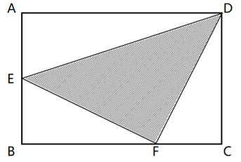

A. $15\mathrm{cm}^2$
B. $14\mathrm{cm}^2$
C. $13\mathrm{cm}^2$
D. $12\mathrm{cm}^2$

## 第五部分　判断推理

**46.** 从所给的四个选项中，选择最合适的一个填入问号处，使之呈现一定的规律性：

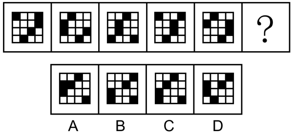

**47.** 从所给的四个选项中，选择最合适的一个填入问号处，使之呈现一定的规律性：

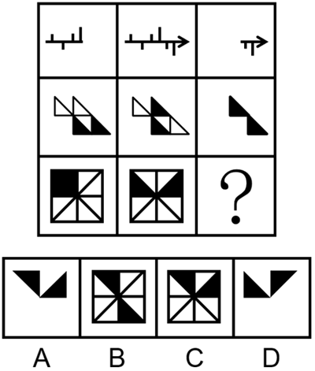

**48.** 下列选项中最符合所给图形规律的是（    ）。

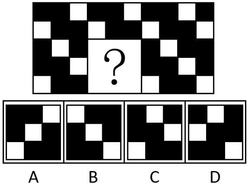

**49.** 左边为14个白色正方体和3个灰色正方体组合而成多面体的正、反两面直观图，其可以由①、②和③三个小多面体组合而成，问哪一项能填入问号处？

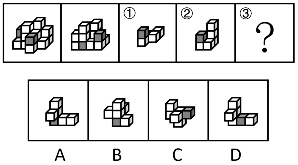

**50.** 下图为由2个正方体组合而成的长方体，问这2个正方体的外表面展开图可能分别是：

A. ②和④
B. ②和③
C. ①和④
D. ①和③

**51.** 野外徒步引发的失温事故经常登上新闻，引发大众广泛关注。野外地形复杂、天气多变，气温可能在短时间内急剧下跌。受这类野外低温场景影响，多数人产生一种固有认知：失温只会出现在极寒环境中。但专家表示，这是普遍存在的认知误区。
以下哪项如果为真，最不能加强专家的观点？

A. 在温度并不算低的环境中，如果长时间浸泡在水中、衣物潮湿或者身体虚弱、能量消耗过多也可能出现失温
B. 失温的本质是身体散热速度超过产热速度，导致核心体温降到 $35^{\circ}\mathrm{C}$ 以下，失温并非只在极寒环境中出现
C. 在春秋季节的野外，即便气温未达到寒冷标准，大风、降雨等也会加速热量流失，进而引发失温
D. 及时补充高热量食物、做好保暖措施并保持身体干燥，能够显著降低出现失温的风险，保障徒步者的生命安全

**52.** 慕尼黑啤酒节的参与者在连续五天、每天饮用约七升啤酒之后，体内GDF15激素水平均有所升高，但无法确定这种生理变化究竟是单纯由大量饮酒所致，还是与其他不健康的生活习惯有关。针对这一现象，某学者为深入探究GDF15激素水平与酒精摄入的关系，对12名丹麦医学生进行了测试，这些学生一次性摄入相当于五份标准饮酒量的酒精，结果显示受试者体内的GDF15激素水平均未出现升高。因此该学者认为，GDF15激素对酒精的反应在长期饮酒后才会显现，而非源于短期的狂饮行为。
以下哪项如果为真，最能削弱上述学者的结论？

A. 连续一周每日大量饮酒的年轻人，体内多种应激激素水平均出现上升
B. 该实验中一次性摄入的酒精总量远未达到真正意义上的“狂饮”标准
C. 酒精进入人体后代谢为乙醛，而乙醛才是刺激GDF15激素分泌的直接物质
D. 嗜酒症患者体内的GDF15激素水平与未患此症的成年人相比平均高出约五倍

**53.** 蜜蜂发现蜜源后，会在蜂巢内跳8字形“摇摆舞”，学界以往普遍认为，这套行为是固定不变的单向信号，仅由舞者向同伴传递信息，不受“观众”的影响。近期，某研究团队设计对照实验，通过控制蜂巢内“观众”数量与年龄结构，系统观测蜜蜂的“摇摆舞”行为变化。结果显示：当“有效观众”（即能读懂舞蹈蜂所表达的蜜源信息的个体）充足时，蜜蜂的“摇摆舞”角度更精准、摆动时长更稳定，食物方位信息传递误差极小；当“有效观众”稀少时，舞蹈精度会大幅降低，摇摆角度散乱、摆动时长波动明显。该团队认为，蜜蜂的“摇摆舞”是受社会反馈调控的双向互动行为，而非单向刻板信号。
要使上述论证成立，还需基于以下哪一前提？

A. 蜜蜂不是天生就有通过“摇摆舞”准确编码蜜源信息的能力
B. 蜜蜂的“摇摆舞”中所包含的信息，能够被同巢的所有蜜蜂准确接收
C. 跳“摇摆舞”的蜜蜂能够区分“有效观众”与“无效观众”
D. 蜜蜂是全球最重要的传粉昆虫，维系着生态平衡与农业生产

**54.** 大脑是人体最精密的器官，其潜力远未被完全认知。很多人一生都在探索如何让自己更聪慧、思维更敏捷，也坚信我们的大脑“不用则废，常用则强”。大脑皮层是思考、记忆、决策的核心，具备强大的神经可塑性，这有赖于神经元及其连接的动态变化。因此，专家认为学习确实能使大脑皮层得到更充分的发育，这并非错觉，而是生理上的真实改变。
以下哪项如果为真，最能支持上述结论？

A. 持续学习就是神经元之间不断建立新连接，同时强化原有通路的过程
B. 进行记忆时神经元之间的连接会变牢固，而回忆时会再把连接唤醒
C. 人的大脑重量约为1.4千克，其中包含约860亿个神经元
D. 即使停止学习，大脑中原本形成的神经元连接也不会立刻消失

**55.** “酱油吃多了，皮肤会变黑”是民间一种流传甚广的说法，许多人对此深信不疑。他们凭借日常饮食体验与直观感受，普遍认为酱油本身呈现出深褐色甚至近黑色的外观，若长期或大量食用，其所含的“黑色”物质会在人体内直接沉积，进而导致皮肤变黑。
以下哪项如果为真，最不能削弱上述观点？

A. 皮肤颜色由遗传、环境和生理因素共同决定，与酱油摄入无因果关系
B. 酱油里的“黑色”是焦糖色素，与皮肤中的黑色素在来源和结构上都不相似
C. 酱油中的酪氨酸是黑色素合成所必需的氨基酸，但酪氨酸会被胃酸分解掉
D. 目前来说，每天坚持涂防晒霜，是预防皮肤变黑最有效的方式

**56.** 某商店计划举办一场有奖竞赛活动，旨在吸引更多新顾客。该商店准备从A、B、C、D、E、F六种不同的商品中选出四种作为活动奖品，已知：
（1）如果选择A，则不选择B；
（2）C、E的被选择情况相同。
根据上述信息，共有多少种选择情况？

A. 2
B. 3
C. 4
D. 5

**57.** 某国一位经济学家指出：“除非该国采取大刀阔斧的举措来根治经济的顽疾，否则经济不可能稳健增长。没
有经济稳健增长，公共债务就会不断攀升。”
由此可以推出：

A. 如果公共债务不断攀升，则该国没有采取大刀阔斧的举措来根治经济的顽疾
B. 只有该国不采取大刀阔斧的举措来根治经济的顽疾，公共债务才会不断攀升
C. 如果该国采取大刀阔斧的举措来根治经济的顽疾，则公共债务就不会不断攀升
D. 如果公共债务没有不断攀升，说明该国采取了大刀阔斧的举措来根治经济的顽疾

**58.** 某研究团队以自然界中的线虫为灵感，创新性地制备出了直径为1毫米的血凝胶纤维机器人。为验证血凝胶纤维机器人在颅内肿瘤靶向治疗中的可行性与疗效，研究人员在18头小型猪中构建了脑胶质瘤模型，并将其分为三组：空白对照组、假手术组（植入未载药血凝胶纤维机器人）和治疗组（载阿霉素血凝胶纤维机器人）。研究人员发现，术后26天，治疗组的猪肿瘤生长受到抑制，比空白对照组肿瘤小了4倍，而且治疗组的活猪血细胞数量和生物化学标志物水平均保持在正常水平，波动较小。据此，研究人员认为，血凝胶纤维机器人是实现颅内深部及功能区邻近肿瘤的精准、无创治疗的有效手段。
以下哪项如果为真，最能加强研究人员的观点？

A. 通过模仿线虫的细长形态和自适应的波浪运动机制，研究人员利用外界控制使血凝胶纤维机器人实现了包括摆动、爬行和滚动在内的多种仿生运动模式
B. 治疗组的小型猪在实验前的平均体重显著低于空白对照组和假手术组，而体重较小的动物的肿瘤生长速度通常较慢，各种生物指标的波动幅度也低于大体重动物
C. 大脑具有高度复杂的结构，布满密集且不规则的脑沟回、脆弱的神经组织，血凝胶纤维机器人要想实现颅内远程靶向药物递送需要沿着路线穿越多级沟壑
D. 血凝胶纤维机器人保留了血液中天然纤维蛋白的网络结构，具有良好的生物相容性，可有效避免免疫排斥反应，且具有显著的弹性和柔软性，不会划伤周围组织

**59.** 2026年中考体育已圆满收官，但不难发现，北京市中考体育正在经历历史性变革，总分由50分逐步增加至70分，其中过程性考核的比重不断上升，由此，有人认为，中考体育改革后北京市中学生的体质健康水平将会明显提升。
要使上述推理成立，需要补充的前提条件是（    ）。

A. 我国学生体质健康达标率逐渐上升，学生的力量、耐力等素质出现好转
B. 过程性考核比重的上升会促使学生加强体育锻炼，提高体质健康水平
C. 中学生的家长们普遍支持提高过程性考核在中考体育中的比重
D. 学校的体育设施和师资配备能够完全满足学生们日常锻炼的需求

**60.** 小王每周去三次游泳馆和两次健身房，已知小王的习惯如下：
（1）小王不会在同一天游泳和跑步；
（2）小王不会连续两天做同一种运动；
（3）小王周末只运动一天；
（4）游泳馆每周一闭馆消毒。
小王这周五安排了聚会，不能跑步。关于小王这周的运动情况，以下哪项一定为真？

A. 小王可能在周日跑步
B. 小王一定在周一跑步
C. 小王只能在周四、周五和周日游泳
D. 若小王在周二跑步，则在周四也跑步

**61.** 一项观察实验选取了30名19岁到25岁的年轻人，给他们频繁吃巧克力，且这些人一个月后都出现不同程度的面部痤疮。因此，频繁吃巧克力会出现面部痤疮。
下列选项的论证结构与题干最为相似的是（    ）。

A. 夏季空调使用率高，同时腹泻的人数也增加，因此，使用空调是腹泻的诱因
B. 吃大量辣椒会导致胃痛，因此，胃痛的人应该避免吃大量辣椒
C. 长期熬夜往往发生在免疫力降低之前，因此，长期熬夜会导致免疫力降低
D. 许多感冒患者都喝了姜汤，因此，喝姜汤是治疗感冒的有效手段

**62.** 2025年的深秋，一枚曾估价2.8万元的“北洋造光绪34年银圆卷3旗4”钱币被藏友带进了潘家园古玩市场，在来之前藏友自行对其进行了清洗，他向大家展示着古钱币表面那层被化学试剂冲刷的“新亮”，想要卖个好价钱，然而，该古钱币的价格因为藏友的清洗骤降至1.8万元。
以下各项如果为真，最不能解释这一现象的是（    ）。

A. 古钱币的包浆往往含有铜锈、土壤微生物代谢物、人体油脂等复合层，化学清洗会溶解这层复合结构，使古钱币失去“历史指纹”
B. 化学清洗可能将稳定的碱式碳酸铜转化为活动性强的氯化亚铜，使古钱币在潮湿环境中生成“粉状锈”，这些“粉状锈”会在三年内穿透钱体
C. 化学清洗往往会使古钱币字口深度减少0.1-0.3毫米，导致关键笔画模糊，古钱币文字细节的消失直接摧毁了其版别的稀缺性
D. 古钱币做旧技术再升级，从电化学包浆到分子级氧化，“伪装术”正颠覆传统鉴定方式，使得老玩家都难辨真假

**63.** 2025年5月某网约车平台调整部分城市订单计价规则，有乘客反映“一口价”订单价格普遍上涨1至3元，但该月平台的“一口价”订单成交量不但没有因此减少，反而出现增加趋势。
以下各项如果为真，最能解释这一现象的是（    ）。

A. 价格调整后司机拒载率下降、服务变得更好，消费者愿为此买单
B. 该平台网约车的运力大幅增加，司机数量的增加使订单成交量上升
C. 该平台加大了对新用户的补贴力度，新用户实际出行成本未变化
D. 低价的“一口价”订单使司机端收入常因堵车、绕路、空驶而缩水

**64.** 坚持吃早餐的人专注力都很高。某人十多年来坚持吃早餐，因此，他的专注力会很高。
下列选项的逻辑结构与题干最为相似的是（    ）。

A. 水资源丰富的地区农业生产条件优越。某地是水资源丰富的地区，因此，该地的工业生产条件同农业生产条件一样优越
B. 过度使用化肥就会使土壤板结。某地严格按照标准控制化肥的使用，因此，该地不会出现土壤板结的情况
C. 动脉粥样硬化斑块会导致血管狭窄、弹性降低。某人的血管狭窄、弹性降低，因此，他一定有动脉粥样硬化斑块
D. 热效应高的食物在消化过程中会消耗更多能量。某食物是热效应高的食物，因此，该食物在消化过程中会消耗更多能量

**65.** 一段时间以来，网络水军有组织地刷分控评、刷量增粉、刷榜拉票、刷单炒信，严重危害网络生态，2024年以来，网信部门持续加大对网络水军的打击力度，对网络水军组织招募、推广引流、刷量控评等行为进行了严厉查处。因此，网民被虚假评论误导的情况会大幅减少。要使上述推理成立，需要补充的前提条件是（    ）。

A. 所有网民都能准确识别真实评论与“水军”评论
B. 对网络水军加大打击力度能够遏制虚假评论的产生
C. 相关方的利益链条未被斩断，滋生网络水军的土壤依然存在
D. 平台方要压紧压实主体责任，防范遏制网络水军操纵信息内容

## 第六部分　科学推理

**66.** 过氧化氢制氧气是中学实验室中比较重要的制氧气的方法，其原理是：$2\mathrm{H_2O_2}=2\mathrm{H_2O}+\mathrm{O_2}\uparrow$ ，常温下这个反应极慢，通常看不到有气泡冒出，因此实验室用此方法制备氧气时，通常加入二氧化锰（ $\mathrm{MnO_2}$ ）加快反应速率，下列相关说法不正确的是（    ）。

A. 二氧化锰是实验室制氧气时的催化剂
B. 二氧化锰在催化过程中不参与化学反应
C. 二氧化锰在化学反应前后质量和化学性质均不变
D. 过氧化氢制氧气的反应属于氧化还原反应

**67.** 汽车行驶过程中涉及多种力学现象，若忽略空气阻力，下列与汽车有关的物理原理，说法正确的是（    ）。

A. 汽车在平直路面上匀速行驶时，发动机的牵引力大于路面对车轮的摩擦阻力
B. 汽车刹车时，乘客身体会向前倾，这是因为乘客受到惯性力的作用
C. 汽车轮胎设计有凹凸花纹，主要是为了增大车轮与地面之间的摩擦力
D. 汽车在平直路面上高速行驶时对路面的压力大于其静止时对路面的压力

**68.** 地球公转时，地轴与公转轨道面的夹角始终保持约 $66.5^{\circ}$ ，且北极始终指向北极星附近。若地轴与公转轨道面的夹角变为 $90^{\circ}$ ，下列现象可能出现的是（    ）。

A. 全球各地昼夜等长
B. 地球上没有四季变化
C. 太阳直射点始终在赤道上
D. 以上都有可能

**69.** 如图所示为某温度检测电路，电源电压保持不变， $R_0$ 为定值电阻， $R_t$ 为热敏电阻，其阻值随温度升高而减小，电表均为理想电表。闭合开关S，当环境温度升高时，下列说法正确的是（    ）。

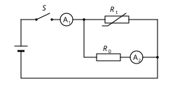

A. 电流表 $A_2$ 的示数变大
B. 电流表 $A_1$ 的示数变小
C. 电流表 $A_1$ 与 $A_2$ 示数之差变大
D. 电路消耗的总功率变小

**70.** 果蝇因生命周期短、繁育速度快、产卵量大等优点，被选为基因研究常用的实验动物。研究发现果蝇的长翅和残翅由一对位于常染色体上的基因控制，可用A和a表示；若一对长翅果蝇（亲代）生育的子代果蝇中既有长翅个体又有残翅个体，则下列说法正确的是（    ）。

A. 亲代果蝇的基因型可能是Aa和aa
B. 子代果蝇的基因型只有Aa和aa两种
C. 果蝇的残翅属于隐性性状
D. 子代果蝇中长翅个体占比约为50%

## 第七部分　资料分析

2026年一季度，广东省坚决贯彻落实党中央、国务院决策部署，认真落实省委“1310”具体部署，坚定不移贯彻新发展理念，扎实推动高质量发展，有力落实落细各项政策措施，全省经济运行总体延续回升向好态势，开局良好。
一季度，广东省实现地区生产总值34950.34亿元，同比增长（下同）4.6%。其中，第一产业增加值941.66亿元，增长3.9%；第二产业增加值12410.95亿元，增长4.7%；第三产业增加值21597.72亿元，增长4.5%。
工业生产增速较快，新质生产力加快发展。一季度，全省规模以上工业增加值增长5.4%，增速比上年全年提高2.4个百分点。分门类看，采矿业增加值（18.8%）实现两位数增长，增速比上年全年提高15.8个百分点；制造业，电力、热力、燃气及水生产和供应业增加值分别增长5.0%、5.2%，增速分别比上年全年提高1.8个、4.9个百分点。
服务业增长稳定，现代服务业增速良好。一季度，全省服务业增加值同比增长4.5%。其中，金融业、住宿和餐饮业增加值分别增长7.8%、4.0%。
市场销售平稳增长，线上消费保持快速增长。一季度，全省社会消费品零售总额同比增长2.5%，增速高于全国0.1个百分点。
固定资产投资保持增长，基础设施投资较快增长。一季度，全省固定资产投资增长0.2%，扣除房地产开发投资，全省固定资产投资增长5.8%。新建商品房销售面积下降15.6%，降幅收窄1.5个百分点。
居民消费价格涨幅扩大，工业生产者价格降幅收窄。一季度，全省居民消费价格指数（CPI）同比上涨0.5%，涨幅比上年全年扩大0.7个百分点。一季度，工业生产者出厂价格指数（PPI）同比下降1.2%，降幅比上年全年收窄0.3个百分点；工业生产者购进价格指数（IPI）同比下降0.1%，降幅比上年全年收窄2.7个百分点。

**71.** 根据材料，广东省为发展经济推行的政策主要包括：
①坚定不移贯彻新发展理念
②扎实推动高质量发展
③有力落实落细各项政策措施
④经济运行总体延续回升向好态势

A. ①②③
B. ①③④
C. ②③④
D. ①②③④

**72.** 根据材料，下列说法不正确的是：

A. 2026年一季度，广东省服务业增长稳定、市场销售平稳增长
B. 2026年一季度，广东省第一产业增加值占全省地区生产总值的比重低于3%
C. 2025年一季度，广东省新建商品房销售面积同比下降14.1%
D. 2026年一季度，广东省采矿业增加值实现两位数增长

**73.** 2026年一季度，广东省三次产业增加值同比增长量由小到大排序正确的是：

A. 第一产业、第三产业、第二产业
B. 第一产业、第二产业、第三产业
C. 第三产业、第二产业、第一产业
D. 第三产业、第一产业、第二产业

**74.** 2025年一季度，广东省第二产业增加值占全省地区生产总值的比重约为：

A. 44.5%
B. 41.5%
C. 35.5%
D. 31.5%

**75.** 根据材料，下列说法正确的是：

A. 2025年，广东省制造业增加值同比增速与电力、热力、燃气及水生产和供应业同比增速相差0.2个百分点
B. 2025年，广东省采矿业增加值占全省规模以上工业增加值的比重与上年持平
C. 2026年一季度，广东省房地产开发投资同比增速超过0.2%
D. 2025年一季度，广东省工业生产者出厂价格指数（PPI）比购进价格指数（IPI）下降得慢

**2022年8月—2023年7月中国空调累计产量及累计同比增速**

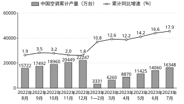

据中国海关总署统计数据显示，
2023年7月，中国空调出口量为308万台，同比增长1.3%。2023年1-7月，中国空调累计出口量达到3475万台，累计同比下降1.2%。
2023年7月，中国空调出口金额为500028千美元，同比下降15.4%。2023年1-7月，中国空调累计出口金额达到5463418千美元，累计同比下降7.4%。

**76.** 2022年下半年，中国空调产量约为：

A. 10189万台
B. 11236万台
C. 12058万台
D. 13131万台

**77.** 2022年10月，中国空调产量环比约：

A. 增长7%
B. 增长17%
C. 下降7%
D. 下降17%

**78.** 2023年6月，中国空调产量同比增速约为：

A. 16.6%
B. 20.8%
C. 23.2%
D. 28.3%

**79.** 2023年7月，中国空调出口单价较上年同期约：

A. 下降13.9%
B. 下降16.5%
C. 增长13.9%
D. 增长16.5%

**80.** 以下折线图中，最能准确反映2022年10-12月中国空调产量环比增量变化趋势的是：

A. 
B. 
C. 
D. 

**图1：2018—2023年中国移动游戏市场实际销售收入及同比增长率**

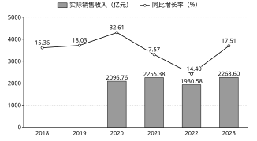

**图2：2023年中国移动游戏产品类型收入占比**

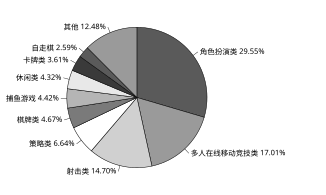

**图3：2018—2023年中国游戏市场中移动游戏实际销售收入占比**

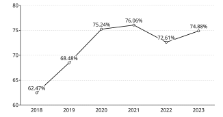

**81.** 2018年，中国移动游戏市场实际销售收入约为：

A. 962.76亿元
B. 1145.82亿元
C. 1339.62亿元
D. 1581.11亿元

**82.** 2023年，在中国移动游戏产品中，角色扮演类和多人在线移动竞技类收入之和约比棋牌类和自走棋收入之和多多少亿元？

A. 1022.4
B. 976.2
C. 915.6
D. 891.6

**83.** 2023年，中国游戏市场实际销售收入同比增长约：

A. 19.35%
B. 17.55%
C. 15.75%
D. 13.95%

**84.** 2022年，中国游戏市场实际销售收入同比：

A. 减少不到500亿元
B. 减少500亿元以上
C. 增加不到500亿元
D. 增加500亿元以上

**85.** 根据上述材料，下列说法正确的是：

A. 2021-2023年，中国移动游戏市场年均实际销售收入较2020年高不到75亿元
B. 2023年，中国角色扮演类移动游戏数量占移动游戏市场实际销量的比重最大
C. 2019-2023年，中国非移动游戏市场实际销售收入占游戏市场实际销售收入的比重低于上年的年份有1个
D. 以2020年为基期，2020-2023年，中国移动游戏市场实际销售收入年均增长60亿元以上

**2024年上半年我国规模以上互联网企业关于互联网业务运行情况**

| 期间 | 业务收入（亿元） | 实现利润总额（亿元） | 利润总额同比增速（%） |
|---|---|---|---|
| 2024年1—6月 | 8676 | 743.7 | 1.9 |
| 2024年1—5月 | 6861 | 521.4 | −12.8 |
| 2024年1—4月 | 5547 | 384.9 | −19.7 |
| 2024年1—3月 | 3840 | 278.9 | −15.3 |
| 2024年1—2月 | 2463 | 169.7 | 6.5 |

**我国规模以上互联网企业完成互联网业务收入同比增速**

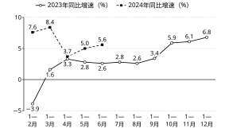

分地区看，2024年上半年，东部地区完成互联网业务收入同比增速低于全国增速0.4个百分点；中部地区完成互联网业务收入408.8亿元，同比增速高于全国增速6.4个百分点；西部地区完成互联网业务收入525.4亿元，同比增长4.6%；东北地区完成互联网业务收入20.8亿元，同比下降2.1%。

**86.** 2023年一季度，我国规模以上互联网企业完成互联网业务收入利润率约为：

A. 7.4%
B. 8.6%
C. 9.3%
D. 10.2%

**87.** 2023年下半年，我国规模以上互联网企业完成互联网业务收入当月同比增速高于当月累计同比增速的月份有几个？

A. 1
B. 2
C. 4
D. 5

**88.** 2023年1-4月，我国规模以上互联网企业完成互联网业务收入较上年同期约增长：

A. 170.9亿元
B. 182.4亿元
C. 191.9亿元
D. 160.2亿元

**89.** 2024年上半年，东部、中部、西部、东北地区完成互联网业务收入的同比增量从多到少排列，正确的是：

A. 东部、西部、中部、东北
B. 东部、中部、西部、东北
C. 中部、东部、西部、东北
D. 中部、西部、东部、东北

**90.** 根据上述材料，下列说法错误的是：

A. 2024年2-6月，我国规模以上互联网企业完成互联网累计业务收入利润率均同比下降
B. 2024年二季度，我国规模以上互联网企业实现互联网业务利润总额与一季度的比值约为1.7：1
C. 2023年4月，我国规模以上互联网企业完成互联网业务收入高于3月
D. 2024年上半年，我国完成互联网业务收入同比变化幅度最大的地区是东部地区
