# M09　广东省考行测模拟卷（题本）

## 第一部分　政治理论

**1.** 严明党的政治纪律和政治规矩，要坚决反对思想上的自由主义、政治上的宗派主义、组织上的投机主义、工作上的本位主义、履责上的好人主义。

A. 正确　　B. 错误

**2.** 党的群众路线是党和国家的生命线、人民的幸福线。

A. 正确　　B. 错误

**3.** 英歌舞是广东潮汕地区集武术、戏剧、舞蹈于一身的民间艺术，表演主要取材于《水浒传》中梁山好汉的故事，2006年入选第一批国家级非物质文化遗产名录。

A. 正确　　B. 错误

**4.** 运动是绝对的、无条件的、永恒的，静止是相对的、有条件的、暂时的，物质世界是绝对运动和相对静止的统一。

A. 正确　　B. 错误

**5.** 二十届五中全会《决定》要求增强制度执行力，强化制度刚性约束，坚持制度面前人人平等、遵守制度没有特殊、执行制度没有例外。下列古语与这一要求最为契合的是（　）。

A. 立善法于天下，则天下治
B. 法不阿贵，绳不挠曲
C. 治大国若烹小鲜
D. 为政以德，譬如北辰

**7.** 二十届五中全会《决定》要求加强干部管理监督，坚持严管厚爱结合、激励约束并重。下列表述不符合《决定》要求的是（　）。

A. 加强领导干部配偶、子女及其配偶经商办企业常态化管理
B. 规范干部兼职、挂职、离职从业行为，防止和整治“逃逸式辞职”
C. 坚持从基层干部抓起，加强干部全方位管理和经常性监督
D. 发挥职务与职级并行等制度激励效应，健全表彰奖励机制

**8.** 推进法治政府建设，要求行政机关依法行政。关于行政法的基本原则，下列说法有误的是（　）。

A. 权责统一原则要求行政机关提高行政效率，便利当事人
B. 合理行政原则要求行政机关公平公正，考虑相关因素，遵循比例原则
C. 程序正当原则包括行政公开、公众参与和回避等要求
D. 诚实守信原则要求行政信息真实，保护当事人的信赖利益

**9.** 从遵义会议到中共八大，党召开的一系列重要会议对中国革命和建设产生了深远影响。以下表述符合历史事实的有（　）。

A. 遵义会议在极端危急的历史关头挽救了党、挽救了红军、挽救了中国革命
B. 中共七大上，毛泽东作《论联合政府》的报告，提出了党的三大优良作风
C. 七届二中全会着重讨论了党的工作重心由城市转移到乡村的问题
D. 中共八大把国内的主要矛盾表述为人民日益增长的物质文化需要同落后的社会生产之间的矛盾

**12.** 我国在月球与深空探测、空间科学等领域取得一系列重大成就。下列关于我国航天器的表述，有误的是（　）。

A. 鹊桥是地月中继通信卫星，为月球背面的探测器提供通信中转
B. 悟空号是暗物质粒子探测卫星，用于探测暗物质和高能宇宙射线
C. 嫦娥五号是月球无人探测器，完成了月面采样返回
D. 祝融号是嫦娥探测器搭载的月面巡视探测车

**13.** 2026年4月，习近平在加强基础研究座谈会上指出，基础研究是整个科学体系的源头，是所有技术问题的总机关。下列表述与座谈会精神不符的是（　）。

A. 加强基础学科建设，促进应用学科与基础学科协调发展
B. 以更大力度、更实举措加强基础研究，提升我国集成创新能力
C. 优化科教协同育人机制，注重在科研一线发现和培养人才
D. 主动融入全球创新网络，深化基础研究国际交流合作

**15.** 广东省2026年政府工作报告公布了2026年省十件民生实事。下列不属于这十件民生实事的是（　）。

A. 加快建立长期护理保险制度和提升养老服务供给水平
B. 为青少年提供家校社协同的心理健康服务
C. 推进城乡供水一体化，提升农村供水保障水平
D. 提升基层医疗健康服务供给和检查检验结果互认共享水平

## 第三部分　言语理解与表达

**16.** 新时代现实世界是如此新鲜丰富、多姿多彩，生活的______、人民的拼搏奋斗、家庭的______、百姓的爱恨喜痛，都值得作家去侧耳倾听、用心思考、挥笔书写，真正做到语出一人之口，呼出万众之声。
依次填入画横线部分最恰当的一项是：

A. 日新月异 酸甜苦辣
B. 精彩纷呈 跌宕起伏
C. 精妙绝伦 悲欢离合
D. 一日千里 喜怒哀乐

**17.** 只要坚持生态优先、绿色发展，锲而不舍，__________，就一定能把绿水青山变成金山银山。

A. 点石成金
B. 水滴石穿
C. 风雨无阻
D. 久久为功

**18.** 党的十八大以来，反腐败与改作风________，既________毒瘤更净化生态，既治病救人更强身健体，共同汇聚成全面从严治党的强劲脉动。
填入划横线部分最恰当的一组是：

A. 齐头并进 扫除
B. 相辅相成 驱除
C. 一脉相承 去除
D. 双管齐下 剜除

**19.** 建设“红色村”，既要注重源于“红”、体现“红”，更要注重传承“红”、弘扬“红”，用红色文化烘托红色精神，以红色精神________红色基因。
填入横线处最恰当的词语是：

A. 发现
B. 激活
C. 激荡
D. 发掘

**20.** 历代仁人志士所处的历史时代不同，但都以自己的行为作出了这样的诠释：“忠”就是（），在国家和民族危难之时大义凛然，挺身而出；“忠”就是（），在是非曲直面前旗帜鲜明，刚直不阿；“忠”就是（），在各种诱惑面前心有定力，不为所动。

A. 担当 正直 坚持
B. 勇敢 刚正 坚守
C. 担当 刚正 坚守
D. 勇敢 正直 坚持

**21.** 让中国标准走向世界，是实现技术、产品和服务输出的最有效方式。但必须看到，标准竞争仍是核心技术硬实力的体现，美、日、欧等标准有其历史优势，在市场上已形成体系优势，我国标准制定和输出想要追赶发达国家的脚步还需要不断努力，一方面质量和技术含量不断提升，成果的转化欠缺动力，另一方面，技术之外的配套工作也有待持续完善。
这段文字主要说明了：

A. 中国标准走向全世界仍然任重道远
B. 需要加强技术创新推动中国标准走向世界
C. 中国标准与现行国际标准还有一定差距
D. 核心技术硬实力不足阻碍了中国标准的输出

**22.** 改革开放使我国走向繁荣富强，经济实力、科技实力、国防实力、综合国力快速提升。改革开放之所以能给我国带来翻天覆地的变化，一个重要原因是__________，主要体现为我们既坚持以经济建设为中心、把发展作为第一要务，又主动为发展营造安全环境。前者以改革开放解放和发展生产力，提高资源配置效率和发展水平；后者改变了我们处理自身与外部关系的方式，主动改善和发展与其他国家的关系，积极缓解外部安全威胁。
填入划线部分的句子，最恰当的是（）。

A. 它推动了经济快速发展和综合国力的提高
B. 它得到了人民群众的衷心拥护和支持
C. 它优化了政策制度体系和施政方式
D. 它带来了重大的理念和战略转变

**23.** 随着时代的发展，年轻人的婚恋观也在不断变化，从家长的“要少了会遭笑话”，到年轻人“多要了会被笑话”，再到最后“彩礼多少无所谓，不要都行”，看似是对彩礼的探讨，但实质上是摒弃了不健康的面子观和陈规陋习，展现的是时代的进步。这既需要相关部门引导，也需要家庭成员提升认知，更新观念，那些更广泛的陈规陋习在农村的生存空间才会越来越小。
上述文段意在说明：

A. 要彩礼这一风俗最终会被人们摒弃
B. 破除陈规陋习需要全社会共同努力
C. 新时代的年轻人要接纳新的思想观念
D. 陈规陋习在农村的生存空间越来越小

**24.** 网络已经渗透到生活的方方面面，语言文字正在从精英创造时代进入大众智慧时代。近日，语言文字规范类刊物《咬文嚼字》杂志社发布“2017年度十大流行语”，“不忘初心”“砥砺奋进”“流量”“尬”“怼”等入选。近年来，年度十大流行语的网络特色日益明显，2017年有超过一半的入选流行语来自于网络或由网络赋予了新的涵义。
对这段文字理解准确的是（）。

A. 网络语言的流行说明大众对语言文字发展的重要影响
B. 网络流行语逐渐成为大众语言文字的主要组成部分
C. 年度十大流行语征集范围主要以互联网用户为主
D. 精英创造的语言文字正逐渐从网络使用中减少

**25.** 火山灰是指火山爆炸性喷发形成的，直径小于2毫米的喷发碎屑。在爆炸性火山活动中，围岩和岩浆被炸碎成细小的颗粒，形成火山灰。火山灰从火山口喷发到大气中，经过大气搬运再沉降到各类环境中，整个过程通常只有数年，从地质时间尺度来看，几乎只是瞬间。所以在各种地质记录中，火山灰是一种高精度的绝对时间标志层。火山灰年代学正是利用地质记录中的火山灰层来确定地质年代的科学，该学科可以解决一些重要的科学问题，比如大型火山喷发事件与气候变化、人类演化之间的关系，以及气候快速变化的区域差异等。
这段文字主要介绍了：

A. 火山灰的形成过程与主要特点
B. 火山灰年代学的研究思路和价值
C. 火山灰在自然环境中的分布状态
D. 火山喷发对环境和人类的影响

**26.** 队伍建设和人才工作事关高校领导权归属，事关高校发展水平和一流大学建设成效，是一项必须牢牢抓在手里、丝毫不能松懈的基础性、战略性工作。高校加强党的全面领导，必须坚持党管干部和党管人才原则，着力培养忠诚干净担当的高素质干部，着力集聚爱国奉献的各方面优秀人才，团结全校师生员工抓改革、谋发展、开新局、创一流。
下列选项最适合作为这段文字标题的是（）。

A. 以改革发展促进一流大学建设
B. 以爱国奉献凝聚高校优秀人才
C. 以加强党的领导促进高校人才工作
D. 以人才强国战略作为高校发展目标

**27.** 要推动老旧小区的适老化改造和无障碍环境建设，关键是提升整个社会对适老化改造的思想认识，实现适老化改造特别是居家适老化改造“心理无障碍”。要多渠道、全方位宣传引导居家适老化改造的政策与价值，转变老人、子女和社会对居家适老化改造的认知；同时，要通过养老服务中心、居家养老服务中心等载体，打造居家适老化改造样板房，强化直观感受，转变老人的传统观念，让老人逐步形成“为养老服务买单”、让子女形成更加关注父母居家养老环境的社会意识，提升适老化改造的家庭主观能动性。
这段文字强调要：

A. 平衡主体利益，因地制宜推动适老化改造
B. 统筹各方资源，激活适老化改造的多元力量
C. 补位标准规范，提升适老化改造的品质与效率
D. 加强宣传引导，做到适老化改造“心理无障碍”

**28.** ____________________，理论学习贵在独立思考、学用结合，重在学有所悟、用有所得，在学习和实践中“众里寻他千百度”，最终“蓦然回首”，在“灯火阑珊处”领悟真谛。只有坚持学习与思考相统一，带着问题学习，养成边学习边思考的习惯，在学习中联系实际，对现实中的问题进行深入思考，才能真正将理论学深悟透。
以下句子最适合填入划横线处的是（）。

A. 学而不思则罔，思而不学则殆
B. 吾尝终日而思矣，不如须臾之所学也
C. 业精于勤，荒于嬉；行成于思，毁于随
D. 知之者不如好之者，好之者不如乐之者

**29.** 企业数字化转型并不是为了数字化而数字化，其核心在于价值创造。对企业而言，价值创造直接体现在业务端，数字化转型实质上是业务的转型，是在以技术为支点、业务为内核的新一代数字技术驱动下，进行业务、管理和商业模式的深度变革重构。因此，数字化转型不是系统和应用简单从“非数字化”到“数字化”的过程，而是着眼于解决业务问题，从业务切入，将数字化技术和工具赋能于业务，更有效地解决业务问题。
对这段文字，理解不准确的是（）。

A. 企业数字化转型离不开数字化技术和工具的支持
B. 系统和应用数字化不属于企业数字化转型的要求
C. 企业数字化转型本质是革新业务、管理和商业模式
D. 只有落脚到业务上，企业才能真正实现数字化转型

**30.** ①种种乱象对青少年心理、观念、行为和健康成长容易产生消极影响。
②青少年是人生“起步”阶段，他们的思想意识、价值观念和人格正处于养成过程中。
③另一方面也一定要身体力行，引导孩子形成勤俭奋斗的生活习惯，要狠下心来与包办孩子的一切说“再见”。
④为此，身为家庭教育的主角，家长一方面要注重孩子的知识教育。
⑤只有这样，才能把孩子培养成人格健全、自信自尊自强的大写的“人”。
⑥但目前对青少年的养成教育上，家庭、学校、社会和网络舆论之间，却不同程度地存在悖谬现象，言行背离、理论与实践脱节。
将以上6个句子重新排列，最恰当的是：

A. ②④③⑥①⑤
B. ②⑥①④③⑤
C. ①⑥④③②⑤
D. ①②④⑤③⑥

## 第四部分　数量关系

**31.** 3，9，18，30，45，（    ）

A. 69
B. 66
C. 63
D. 60

**32.** 35，71，53，17，62，（）

A. 24
B. 26
C. 36
D. 38

**33.** 6，12，19，32，52，（）

A. 84
B. 85
C. 86
D. 87

**34.** 1/8，1/6，3/16，1/5，（    ）

A. 1/3
B. 2/9
C. 5/18
D. 5/24

**35.** 

A. 14
B. 17
C. 19
D. 21

**36.** 某企业四月的营业额比三月的营业额多三分之一，五月的营业额比四月多三分之一，则三月的营业额比五月的营业额少：

A. 1/6
B. 2/3
C. 7/9
D. 7/16

**37.** 某牧场的草，匀速生长。如果20头牛来吃，20天可将草吃光；如果10头牛和10只羊来吃，30天可以恰好吃光。已知一头牛每天的吃草量是一只羊的2倍，则30只羊吃该牧场的草，多少天可以吃光？

A. 10
B. 20
C. 30
D. 40

**38.** 小明骑车从甲镇前往乙镇。如果骑车的速度为每小时20千米，那么将准时到达。如果骑车的速度为每小时24千米，那么将提早5分钟到达。则甲镇到乙镇的距离为（）千米。

A. 8
B. 10
C. 12
D. 16

**39.** 某文具厂计划每周生产A、B两款文件夹共9000个，其中A款文件夹每个生产成本为1.6元，售价为2.3元，B款文件夹每个生产成本为2元，售价为3元。假设该厂每周在两款文件夹上投入的总生产成本不高于15000元，则要使利润最大，该厂每周应生产A款文件夹（）个。

A. 0
B. 6000
C. 7500
D. 9000

**40.** 某防疫工作机构有检验人员和其他工作人员共55人，将检验人员平均分成若干个小组开展工作。近期，该机构补充了20位工作人员，其中，检验人员增加了2组，每组人数不变，其他工作人员增加了30%，则该机构原有检验人员共（）组。

A. 4
B. 5
C. 6
D. 7

**41.** 县公安局计划举办篮球比赛，6支报名参赛的队伍将平均分为上午组和下午组进行小组赛。其中甲队与乙队来自同部门，不能分在同一组，则分组情况共有（）种可能。

A. 6
B. 8
C. 10
D. 12

**42.** 某街道对辖内6个社区的垃圾分类情况进行考核评估，结果显示，有2个社区的垃圾分类考核不通过。如果从6个社区中随机抽取3个进行现场检查，则抽取的社区中，既有考核通过的又有考核不通过的社区的概率为：

A. 1/5
B. 1/2
C. 2/3
D. 4/5

**43.** 如图所示，周长为24米的平行四边形绿化地被划分为三块区域，两边为三角形的花坛，中间为矩形的草地。已知a、b、c长度之比为4∶2∶√3，则矩形草地的面积为（）平方米。

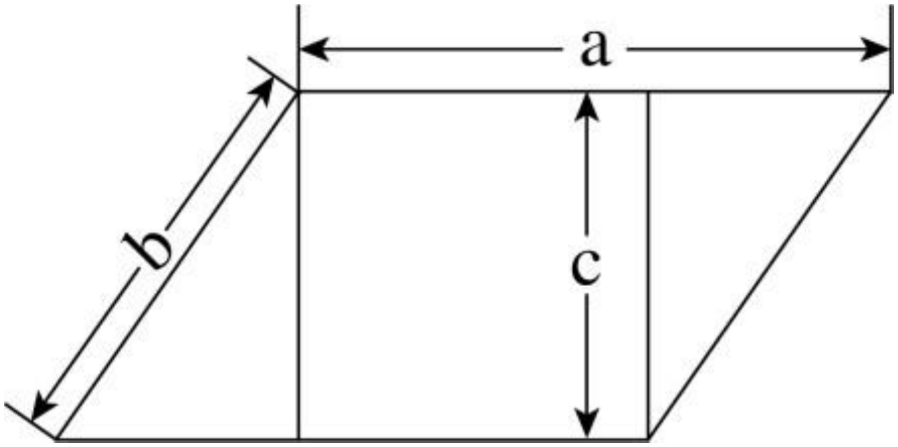

A. 6
B. 6√3
C. 12
D. 12√3

**44.** 某物业公司规定，小区大门每2天清洁一次，消防设施每3天检查一次，绿化植物每5天养护一次，如果上述3项工作刚好都在本周四完成了，那么下一次3项工作刚好同一天完成是在（）。

A. 星期一
B. 星期二
C. 星期六
D. 星期日

**45.** 一项足球比赛共有8支队伍参加，每两支队伍之间需要踢两场比赛，获胜得3分，打平得1分，落败不得分。在该项足球比赛中，获得第一名的队伍积分最多可能比第二名多（）分。

A. 40
B. 30
C. 20
D. 10

## 第五部分　判断推理

**46.** 下列选项中最符合所给图形规律的是（）。

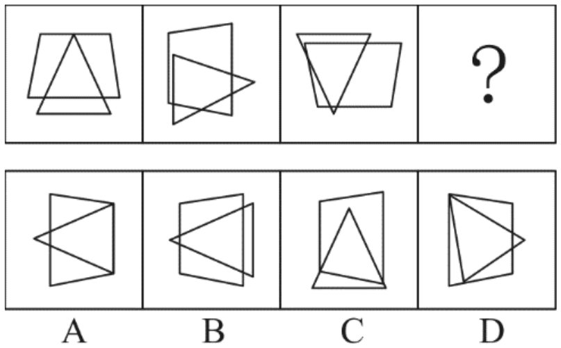

**47.** 从所给的四个选项中，选择最合适的一个填在问号处，使之呈现一定的规律性：

**48.** 下列选项中最符合所给图形规律的是（）。

**49.** 以下选项能与左侧图形组成一个完整圆形的是：

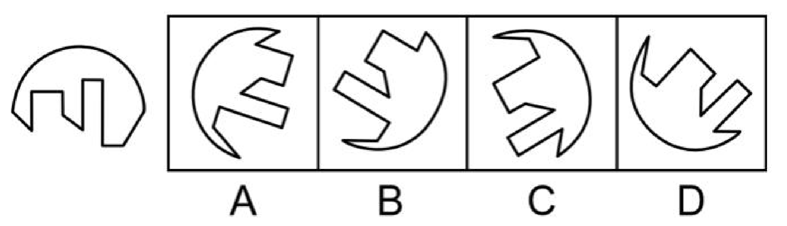

**50.** 下列选项中，能够折成如图所示立方体的是（）。

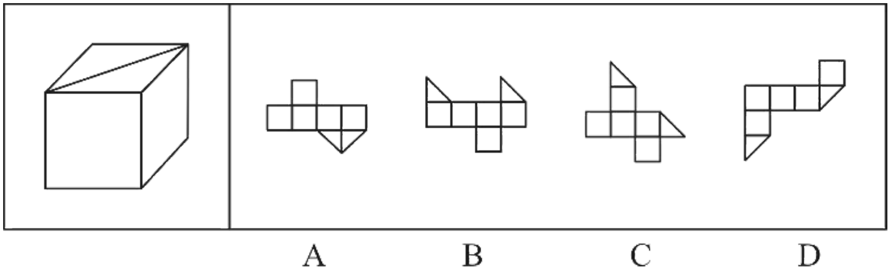

**51.** 只有不间断地练习曲目，才能在音乐比赛中获奖。小李没有在音乐比赛中获奖，那么他一定没有不间断地练习曲目。
以下选项的逻辑结构与题干最为相似的是（）。

A. 降低生产成本是实现利润上涨的必要条件。某企业今年的利润没有上涨，因此一定没有降低生产成本
B. 除非自身业务能力过硬，否则无法成为优秀的销售员。小张是优秀的销售员，因此他一定有过硬的业务能力
C. 如果要最大程度减少碳排放，那么就要践行低碳出行的绿色理念。某国并不认可低碳出行，所以无法减少碳排放
D. 如果汽车价格大幅度下降，汽车的销量就会迅速上升，当前汽车的销量没有迅速上升，因此汽车价格一定没有下降

**52.** 科学家曾研究过旁观者对运动员跑步的影响。结果发现，在同一条跑道上，没有旁观者或旁观者背对跑道时，运动员的跑步速度相近；当旁观者面对跑道时，运动员的跑步速度明显提高。因此，体育竞赛的现场一定得有观众，这有助于运动员取得更好的成绩。
以下选项如果为真，最能削弱上述论断的是（）。

A. 许多体育竞赛中运动员需要保持高度专注力，避免外界干扰
B. 其他参赛选手的关注也能让运动员在竞赛项目中发挥得更好
C. 运动员短时间内突破自己、超常发挥可能会对其身体造成伤害
D. 在没有观众的情况下，仍然有运动员在体育竞赛中打破了纪录

**53.** 某街道计划将3名男性干部甲、乙、丙和3名女性干部张、李、王下沉至各个社区开展工作，可供选择的社区有 A、B、C、D 四个。已知：
①每人只能去一个社区。
②凡是有男性去的社区就必须有女性去。
③张去 A 社区或者 B 社区，乙去 D 社区。
如果最终李去了 C 社区，则下列推论必然正确的是（）。

A. 丙去了 A 社区
B. 张去了 B 社区
C. 甲去了 C 社区
D. 王去了 D 社区

**54.** 酿酒时，蒸馏的酒液流入酒桶，会在表面荡起泡沫状的酒花，这就是古代“看花摘酒”传统的由来。此外，还可以通过用耳朵倾听酒花爆裂的声音指导酿酒工艺，也即“听花断酒”。
由于从古至今手工酿酒的工艺流程并没有大的变化，有人因此推断，如果“听花断酒”的技艺仍然存在，现在仍然可以用这一方法来判断一壶酒是否为佳酿。
以下属于上述推论暗含前提的是（）。

A. 佳酿的酒花爆裂声音与其他酒不同
B. “听花断酒”这一古老的方法早已失传多年
C. 通过“听花断酒”可以筛选出品质一般的酒
D. 通过酒花的外形和爆裂发出的声音都能判断酒的品质

**55.** 某制片公司历经数年制作了一部电影，该电影上映后得到了业内专家一致好评，在各影评网站上也得到了很高的评分，然而该电影的放映厅内观众寥寥无几，其实际票房收益也很不理想。
以下各项如果为真，最不能解释这一现象的是（）。

A. 各电影院对该电影安排的放映场次普遍较少
B. 该电影制作成本高，上映时设定了过高的票价
C. 该电影上映期间有多部更加热门优质的电影同时上映
D. 该电影题材过于小众，大部分普通观众对其缺乏兴趣

**56.** 受影视资本“寒冬”和政策收紧的影响，原创剧集整体规模在2019年出现缩水，有影视数据显示，2019年剧集播出数量整体下降16.6%，从452部缩减至377部，不过某权威影视网站的评分显示，热度前30名剧集的评分均值由2018年的5.96分升至2019年的6.51分。这在一定程度上表明，剧集数量大幅减少后，排名前列的精品剧并未受到太大影响，市场淘汰的是一批非精品类型的剧集。
以下哪项为真，最能加强以上论证（）？

A. 有很多原创剧集的拍摄成本非常低，而且还有进一步的压缩空间
B. 针对影视行业的政策主要集中在限制低俗有害的影视作品
C. 2018-2019年，该权威影视网站的评分流程和标准保持一致
D. 2018年该权威影视网站对所有原创剧集都有评分

**57.** 子曰：“名不正，则言不顺；言不顺，则事不成；事不成，则礼乐不兴；礼乐不兴，则刑罚不中；刑罚不中，则民无所措手足。”根据以上论述，下列推断必然正确的是：
①名正则言顺  ②礼乐兴则事已成  ③名不正，则民无所措手足  ④只有名正言顺才事可成

A. ①②
B. ②③
C. ②③④
D. ①②③④

**58.** 信息时代似乎给人们提供了前所未有的多样选择。但实际上，社交媒体的兴起和智能算法的应用，使人们逐渐变得只会选择性接触自己感兴趣的信息，如同春蚕吐丝一样，渐渐形成“信息茧房”。显然，只接触到自己感兴趣的信息是不全面的。因此，信息时代的到来并不意味着人们能够更为全面地看待社会问题。
下列选项，与上述论证过程最为类似的是（）。

A. 专业人士在科普中容易过分倚重“用数据说话”而忽视了讲故事的技巧，往往导致了科普难以吸引眼球。这或许正是专业科普常常收效甚微的原因
B. 人们对未经证实的信息不加分辨地转发，成为了谣言层出不穷的重要原因。因此，只有提升个人的信息鉴别能力，才能有效切断谣言的传播环节
C. 消费者的环保态度很难转化为实际的购物选择，而且常常会默认所谓的绿色环保产品缺少加工。因此，以绿色环保为卖点的产品并不容易获得成功
D. 经济社会是个动态循环过程，只有结束停摆，让人流、物流、资金有序转动起来，整个循环才能畅通，经济社会秩序才能尽快恢复

**59.** 某市实体零售店的数量由2013年的3800家，增加到了2017年的4500家。但这几年来，该市实体零售店的销售额在整个零售业中所占的比例并没有增加，反而有所下降。
以下哪项为真，最不能解释上述现象？

A. 这几年来该市实体零售店的整体销售额显著下降
B. 这几年来该市非实体零售店的整体销售额迅速增加
C. 这几年来该市零售业的整体销售额有了大幅度的提升
D. 这几年来该市非实体零售店数量的增长速度快于实体零售店

**60.** 有人认为，十二生肖起源于动物崇拜。这是因为在原始社会中，人类的生产力水平很低，猪、牛、羊等牲畜与农事活动关系密切，动物崇拜也就随之而生。除此之外，虎、蛇等动物可能威胁到人类的自身安全，往往被视为强大的象征，人们也会因为感到恐惧而形成动物崇拜。
以下选项如果为真，最能反驳上述判断的是（）。

A. 十二生肖中只有龙不是现实中存在的动物
B. “过街老鼠人人喊打”，但它是十二生肖之首
C. 鸡、鸭、鹅与农事活动关系密切，但只有鸡属于十二生肖
D. 牛和猪都与农事相关，但它们在十二生肖中的位置相距很远

**61.** 某办公室有教育学硕士、教育学学士、哲学硕士、哲学学士各一人。四人中，甲不是教育学硕士也不是哲学学士；甲和丙学习的是同一门学科；乙只获得了学士学位；丁不学哲学。
如果上述表述为真，则以下说法正确的是（）。

A. 甲是教育学学士
B. 乙是哲学学士
C. 丙是哲学学士
D. 丁是教育学学士

**62.** 近几年，“痕迹管理”在基层工作中被广泛应用。其优势在于通过保留下来的文字、图片等工作资料，有效还原服务群众的工作情况，供日后查证。某地基层单位为了强化“痕迹管理”，极大增加了工作资料在考核分值中的比重。显然，这样的做法会使当地基层干部将大量精力耗费在保留工作痕迹上。
以下最可能是上述论证潜在假设的是（）。

A. 基层干部对于考核分值十分重视
B. 有些基层干部对群众缺少服务意识
C. “痕迹管理”要求保留所有工作痕迹
D. 绝大多数基层干部缺少“留痕”条件

**63.** 重点民生领域过度金融化，将会在危及广大民众财产安全的同时给相关行业带来沉重打击。因此，为了保护重点民生领域相关行业的健康发展，应防止其过度金融化。
下列选项的逻辑结构与题干最相似的是：

A. 作家写作时需要持续投入时间和精力。这些作品的销量都很好，看来在写作过程中，创作者都投入了大量的时间和精力
B. 如果未能筑牢网络法治基础，网络上的社会矛盾将会蔓延到现实社会中。因此，为防止现实社会受到网络社会矛盾的冲击，应大力巩固网络法治基础
C. 中国戏剧作品主要通过翻译、演出为海外受众所熟知。近年来演出量大幅下降，而中国传统文化的国际影响力越来越大，可见翻译的作用更大
D. 一个企业越成熟，越能正确地看待过去的成就。某企业总是能正确地看待过去的成就，可以说它是一个成熟的企业

**64.** 农科院在一档农业电视节目中介绍了一种经济价值高的养殖动物——肉兔，强调肉兔有易于养殖、繁殖速度快等优点，节目播出后受到了大家的关注。但是，某村在养殖肉兔之后，发现肉兔在当地市场销路并不理想。
以下选项如果为真，最能解释这一现象的是（）。

A. 电视节目播出后，当地许多大型养殖企业都开始养殖肉兔
B. 该村的其他养殖企业同期推出了市场价格更高的黑毛乌骨鸡
C. 虽然当地有食用兔肉的习俗，但在全国范围内兔肉并不被广泛接受
D. 由于养殖技术成熟，肉兔养殖已成为最具经济效益的养殖产业之一

**65.** 对多个省份的调查研究发现，对于外向者而言，花大量时间用于网络社交并不会影响与他人面对面交流的意愿，而内向者即使不进行网络社交也不会变成社交达人。因此，有研究者认为，网络社交会妨碍传统社交的担忧是毫无必要的。
以下哪项为真，最有助于支持上述结论？

A. 有许多花费大量时间在网络社交上的人不愿意与他人面对面交流
B. 无论采用哪种方式，大多数人参与社会活动的总时间是相对固定的
C. 在网络社交的帮助下，许多人在传统社交中的能力和自信得到了提升
D. 该研究由某大学开展，而在该校学生中，网络社交并不是主要的社交方式

## 第六部分　科学推理

**66.** 甲酸（HCOOH）具有清洁制氢的巨大潜力，其反应前后分子种类变化的微观示意图如下图所示。则下列说法正确的是（）。

A. 反应后分子个数增多
B. 该反应类型为化合反应
C. 反应物和生成物都是有机物
D. 该反应不遵守能量守恒定律

**67.** 如图，物体 M 在恒力 F 的作用下沿粗糙的斜面匀速向上移动。下列说法不准确的是（）。

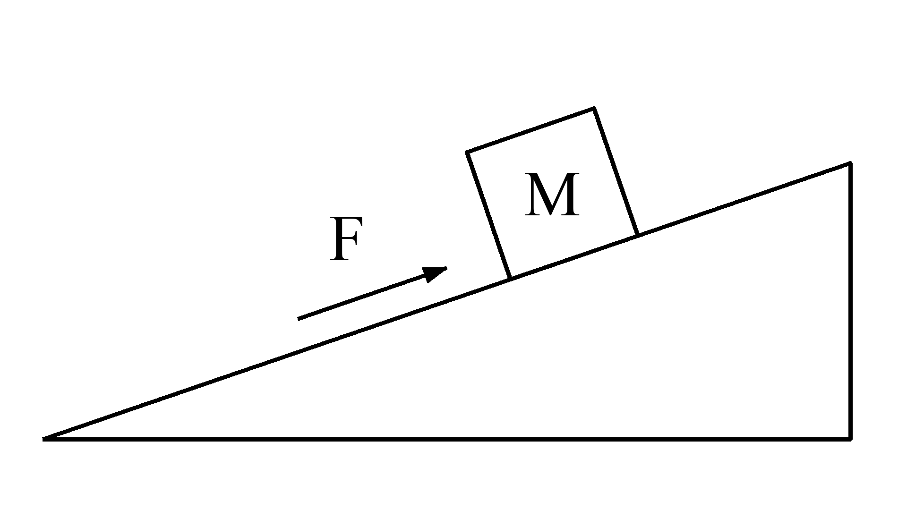

A. 恒力 F 对物体 M 做正功
B. 物体 M 的重力势能逐渐增大
C. 物体所受的摩擦力与运动方向相反
D. 斜面对物体 M 的支持力和 M 受到的重力是一对平衡力

**68.** 如图所示是某仓库报警器的电路示意图，热传感器R1安装在仓库内部，监控机A和报警电铃安装在监控室内。热传感器R1的阻值会随着温度的升高而减小，当仓库发生火情时（电源电压保持不变），下列说法正确的是（）

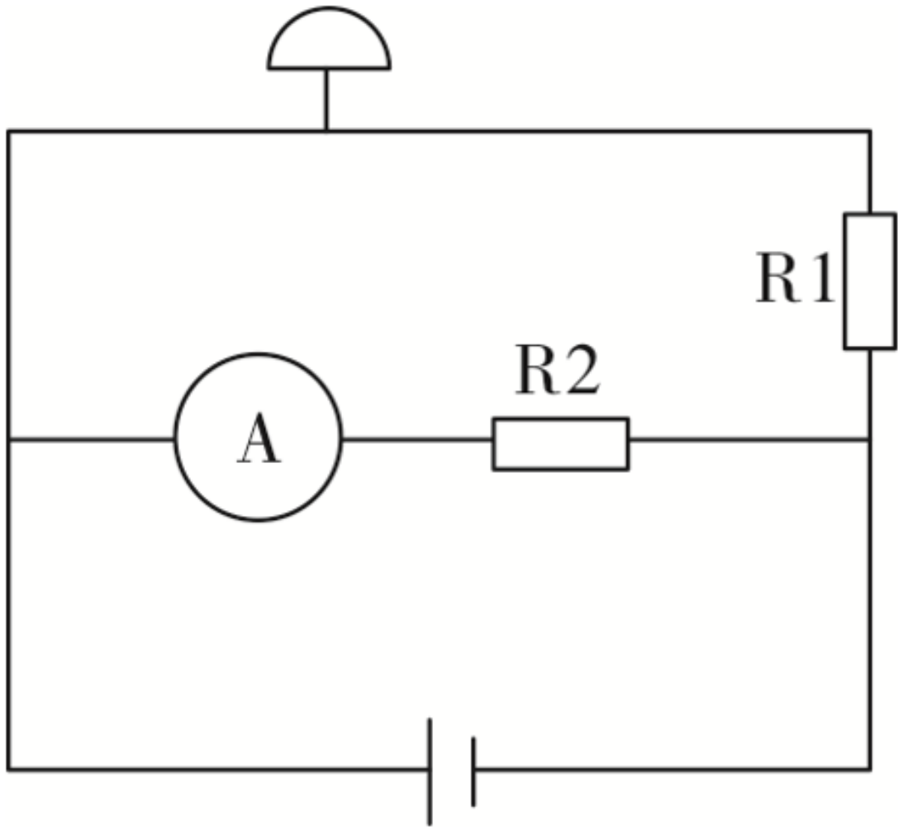

A. 监控机A两端的电流增大
B. 报警电铃两端的电压减小
C. 电阻器R2两端的电压不变
D. 电源的电压降低

**69.** 小张观察发现，自家房屋的北面在夏天能够被阳光照射，而在冬天，房屋的南面可以被阳光照射。则他家最有可能位于以下城市中的（）。

A. 海口
B. 武汉
C. 上海
D. 北京

**70.** 下面是某森林生态系统食物网的示意图，下列表述正确的是（）。

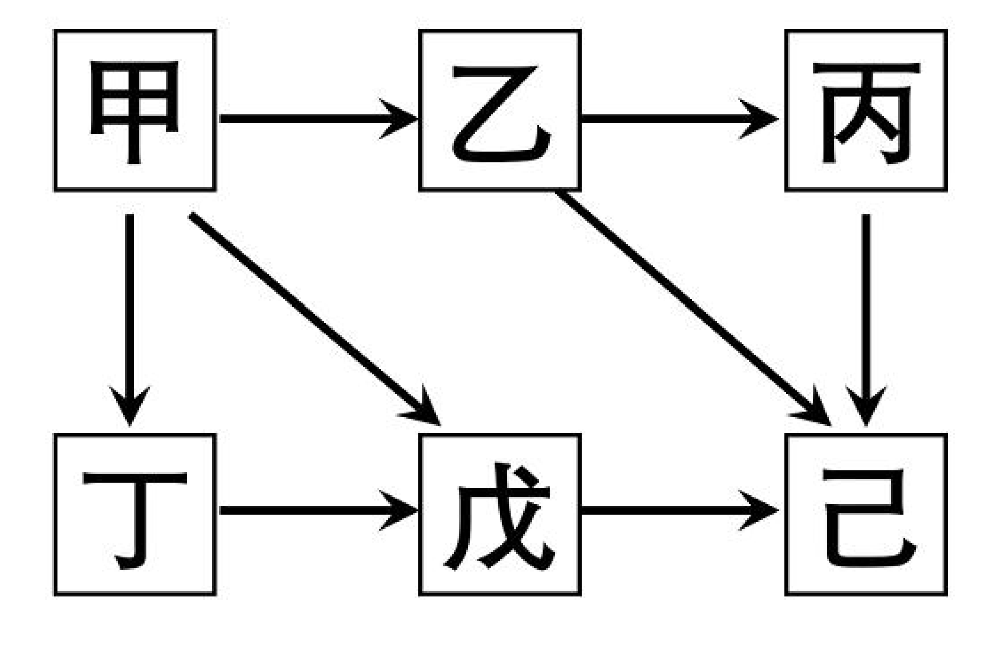

A. 该食物网中有3条食物链
B. 该食物网中，己的个体总数最多
C. 该森林生态系统的最终能量来自于甲
D. 该食物网中，丁与戊既是捕食关系，又是竞争关系

## 第七部分　资料分析

2019年G省共有农业科研和科技开发机构68个，职工人数4633人，其中1254人有高级职称，1148人有中级职称。全省共有农村科普示范基地554个、科普示范街道（乡镇）145个、科普示范社区（村）1341个。

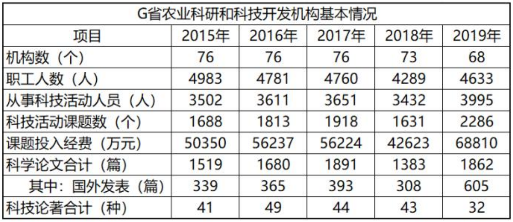

**71.** 2019年G省平均每个农业科研和科技开发机构的高级职称人数最接近（）。

A. 18.5
B. 20.5
C. 22.5
D. 24.5

**72.** 2018年，G省农业科研和科技开发机构从事科技活动人员数占职工人数比重约为（）。

A. 60%
B. 70%
C. 80%
D. 90%

**73.** 2015-2019年，G省农业科研和科技开发机构课题投入经费平均每年增加（）万元。

A. 3152
B. 4615
C. 5517
D. 7890

**74.** 2015-2019年，G省农业科研和科技开发机构发表科学论文篇数最多的一年是（）。

A. 2015年
B. 2016年
C. 2017年
D. 2019年

**75.** 根据资料，下列关于G省的说法正确的是（）。

A. 2019年科普示范社区（村）数是科普示范街道（乡镇）的十倍以上
B. 2015-2019年农业科研和科技开发机构科技活动课题数逐年增加
C. 2019年农业科研和科技开发机构国外发表科学论文比2015年多266篇
D. 2015-2019年，农业科研和科技开发机构科技论著每年都超过40种

2020年上半年，我国农产品进出口总额达1159.0亿美元。农产品进口额为807.5亿美元，同比增长13.2%。受新冠肺炎疫情影响，我国农产品出口额同比下降3.8%，为351.5亿美元。
在我国的农产品进口中，除大洋洲农产品进口额同比下降1.9个百分点外，其余各大洲的农产品进口额均有所增加；欧洲国家或地区农产品进口额增幅最大，达28.4%。农产品出口中，对亚洲国家或地区的出口额最高，达229.7亿美元，较2019年同期下降了3.7个百分点。

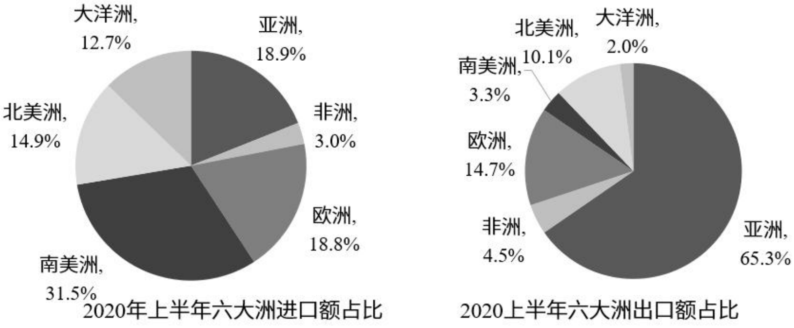

随着我国居民饮食结构的调整，居民对肉类食品的需求量逐年增加。2020年上半年畜类产品进口额同比增长43.2%，对农产品进口额的增长贡献超7成。我国农产品出口最多的两大类别分别是食用蔬菜和水、海产品，合计出口额达93.6亿美元，占农产品出口总额的26.6%。

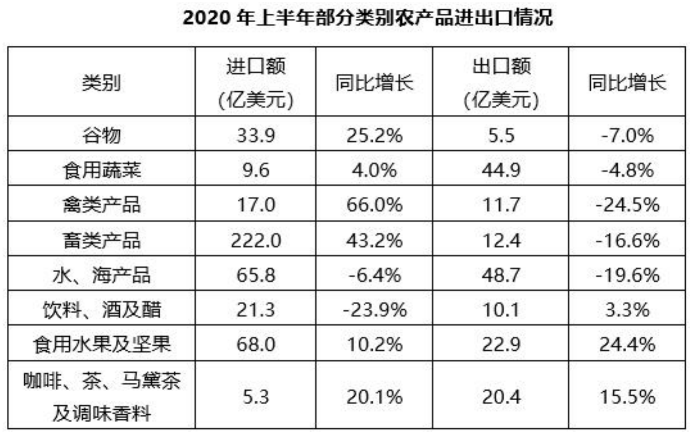

**76.** 2020年上半年，我国农产品进出口额同比增长约：

A. 2.5%
B. 5.0%
C. 7.5%
D. 10.0%

**77.** 2020年上半年，我国水、海产品出口额同比减少约（）亿美元。

A. 6
B. 8
C. 10
D. 12

**78.** 以下农产品类别中，2019年上半年我国进出口总额最高的是：

A. 食用蔬菜
B. 禽类产品
C. 饮料、酒及醋
D. 咖啡、茶、马黛茶及调味香料

**79.** 2019年上半年，我国农产品进口额中欧洲国家或地区约占：

A. 13.3%
B. 16.6%
C. 18.8%
D. 21.1%

**80.** 根据以上材料，关于我国2020年上半年农产品进出口情况，下列说法错误的是：

A. 畜类产品进口额为谷物进口额的6倍以上
B. 对亚洲国家或地区的出口额高于其农产品进口额
C. 六大洲中只有南美洲国家或地区的进口额超过160亿美元
D. 表格给出的农产品出口额合计约占我国农产品出口额的30%

近年来，广东全省医疗卫生资源总量继续增加，医疗服务能力不断增强。截至2016年底，全省医疗卫生机构4.91万个，医疗卫生机构拥有床位46.5万张，其中：医院37.2万张，卫生院5.7万张。医疗卫生机构卫生技术人员66.8万人，其中：执业（助理）医师24.4万人，注册护士28.4万人，医护比1：1.16。

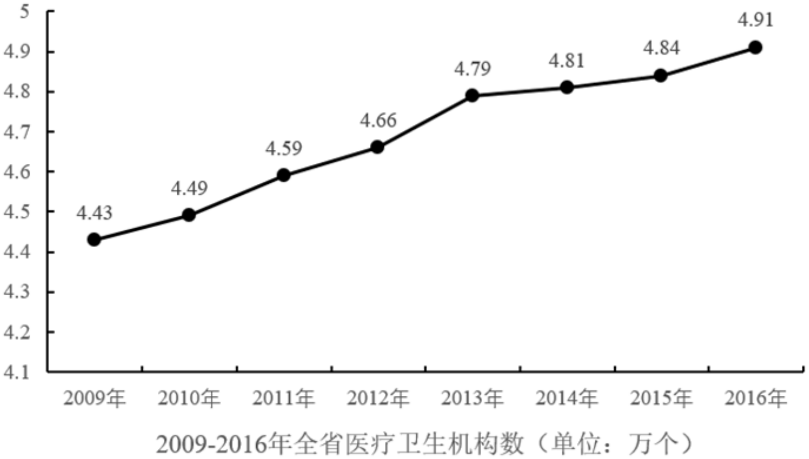

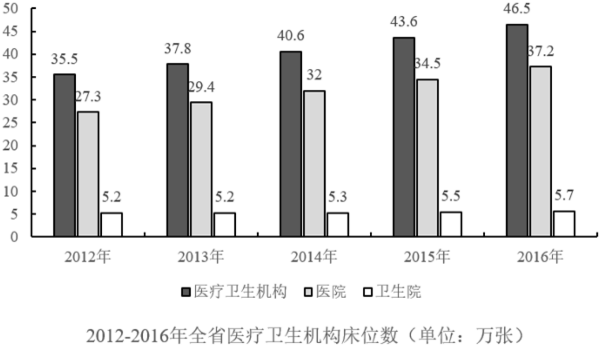

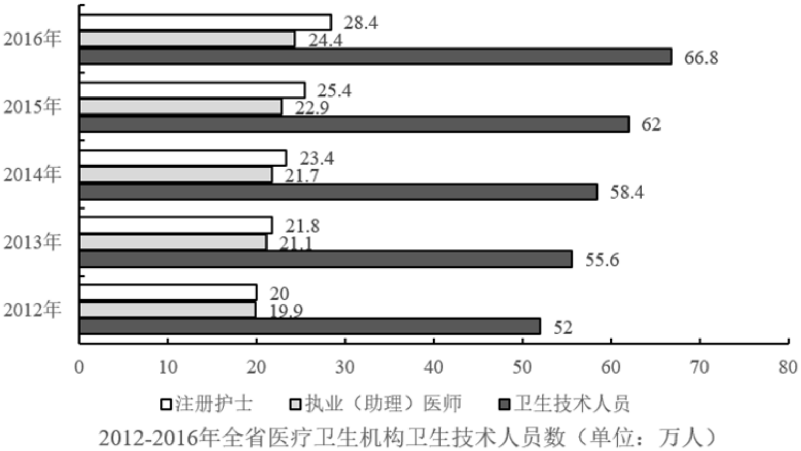

**81.** 2010—2016年，全省医疗卫生机构数同比上一年增长率最高的是（）年。

A. 2012
B. 2013
C. 2014
D. 2016

**82.** 2013—2016年，全省医疗卫生机构平均每年较上一年增加执业（助理）医师约（）万人。

A. 0.9
B. 1.1
C. 1.7
D. 2.1

**83.** 2016年全省医疗卫生机构的平均床位数约是2012年的（）倍。

A. 1.2
B. 1.5
C. 2
D. 2.3

**84.** 2012—2016年，全省医疗卫生机构卫生技术人员中注册护士所占比率最高的一年比例约为（）。

A. 38.2%
B. 40.1%
C. 42.5%
D. 48.7%

**85.** 根据材料，下列说法正确的是（）。

A. 2016年全省医疗卫生机构数量是2009年的1.5倍
B. 2012—2016年，医院床位数占全省医疗卫生机构床位数的比例均低于80%
C. 2009—2016年，全省医疗卫生机构的平均卫生技术人员数均大于10
D. 2012—2016年，全省医疗卫生机构中注册护士与执业（助理）医师人数相差最大的是2016年

五年来，我国积极推进网络强国和数字中国建设，着力深化数字经济与实体经济融合，为打造数字经济新优势、增强经济发展新动能提供有力支撑。2022年，我国电信业务收入累计完成1.58万亿元，比上年增长8%，较2018年增长超2800亿元。

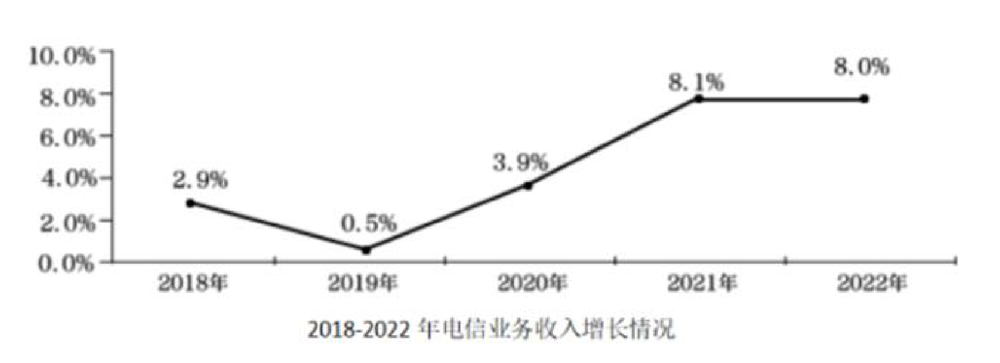

2022年移动数据流量业务收入6397亿元，比上年增长0.3%，在电信业务收入中占比约为40.5%。
数据中心、云计算、大数据、物联网等新兴业务快速发展，对我国电信业务拉动作用持续增强。2022年新兴业务收入达3072亿元，在电信业务收入中占比由上年的16.1%提升至19.4%。其中，数据中心、云计算、大数据、物联网业务比上年分别增长11.5%、118.2%、58%和24.7%。

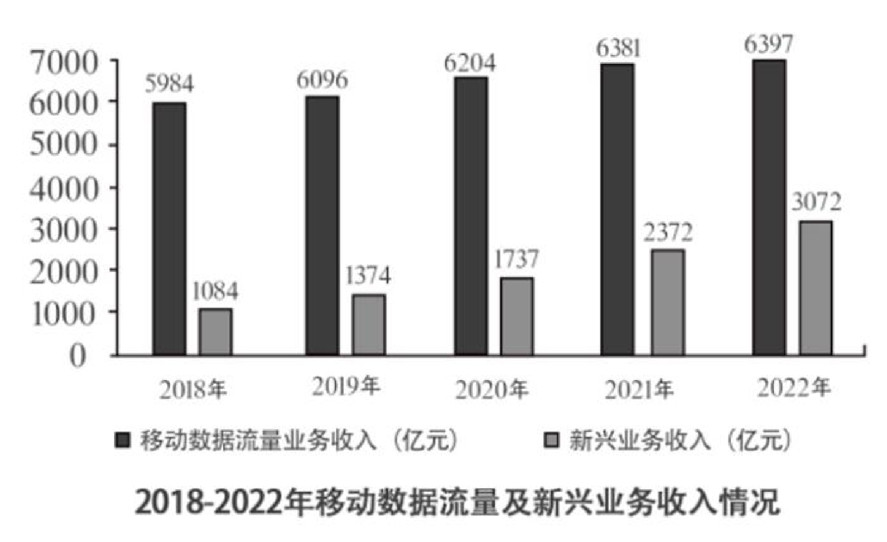

**86.** 2022年我国电信业务收入约为2018年的（）倍。

A. 1.1
B. 1.2
C. 1.3
D. 1.4

**87.** 与2021年相比，2022年我国移动数据流量业务收入在电信业务收入中的占比（）。

A. 增加了约3个百分点
B. 减少了约3个百分点
C. 增加了约13个百分点
D. 减少了约13个百分点

**88.** 2021-2022年间，我国新兴业务收入增加值约占我国电信业务收入增加值的（）。

A. 30%
B. 40%
C. 50%
D. 60%

**89.** 根据资料，下列说法正确的是（）。

A. 2018-2022年间，我国新兴业务收入年均增长超20%
B. 2018-2022年间，我国电信业务收入同比增长率始终高于1%
C. 2018-2022年间，我国移动数据流量业务收入年均增加约1000亿元
D. 与2021年相比，2022年我国云计算和大数据业务收入同比增长88.1%

**90.** 以下最有可能准确反映该年度各类业务在电信业务收入中占比的是（）。

A. 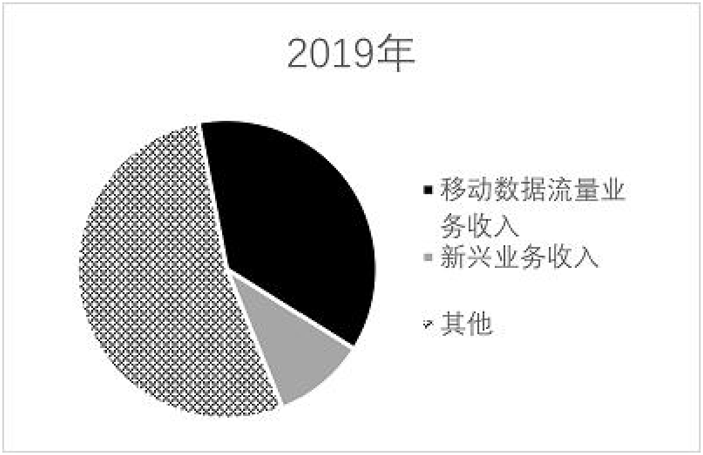
B. 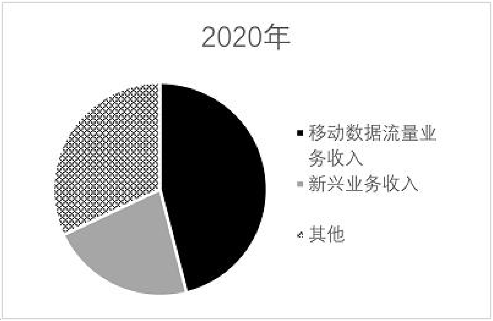
C. 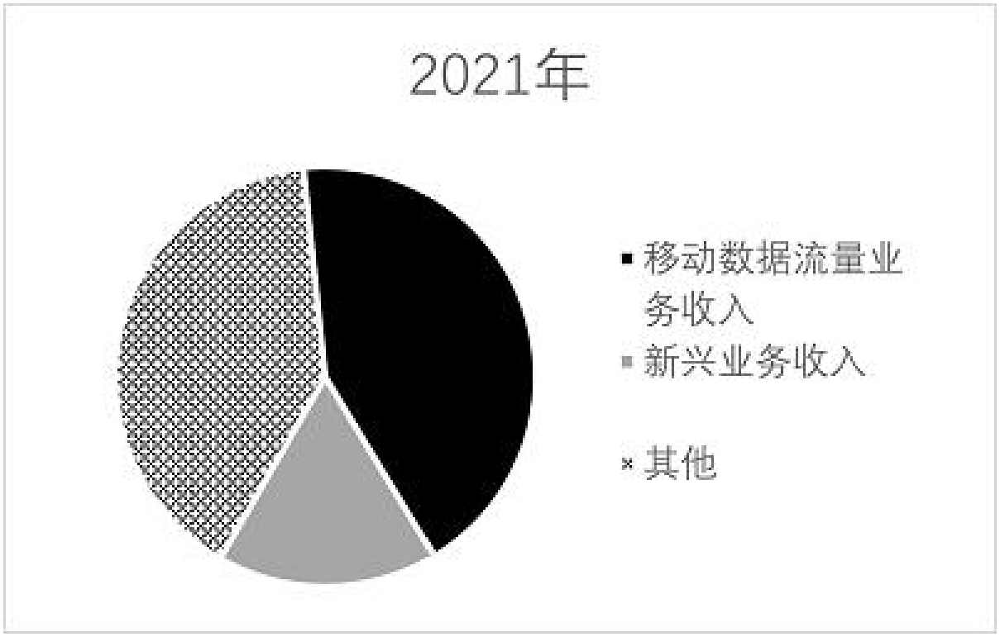
D. 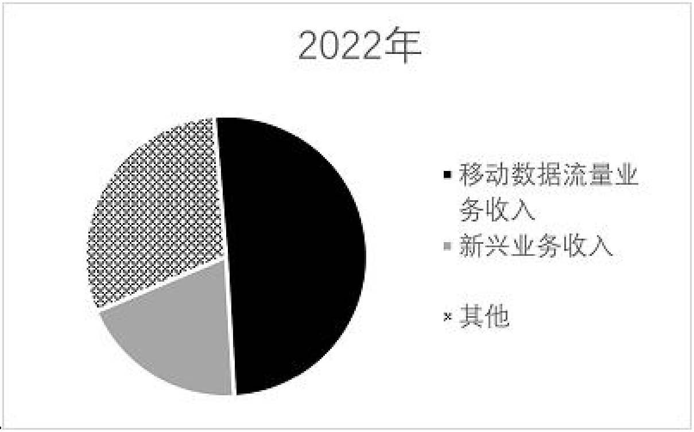
