# M10　广东省考行测模拟卷（题本）

## 第一部分　政治理论

**1.** 坚持党管干部原则，坚持德才兼备、以才为先，坚持五湖四海、任人唯贤，坚持事业为上、公道正派。

A. 正确　　B. 错误

**2.** 党的领导直接关系中国式现代化的根本方向、前途命运、最终成败，党的领导决定中国式现代化的根本性质。

A. 正确　　B. 错误

**3.** 按照新时代党的建设总要求，党的建设要以坚定理想信念宗旨为主线，以加强党的长期执政能力建设、先进性和纯洁性建设为根基，以调动全党积极性、主动性、创造性为着力点。

A. 正确　　B. 错误

**4.** 近代形而上学唯物主义把世界的本原归结为自然科学意义上的原子，其缺陷之一是用孤立、静止、片面的观点看问题。

A. 正确　　B. 错误

**5.** 二十届五中全会《决定》要求加强党性鉴别，注重从应对挑战、抵御风险、克服困难、解决矛盾的表现识别党性。下列古语与这一要求最为契合的是（　）。

A. 不识庐山真面目，只缘身在此山中
B. 终身之计，莫如树人
C. 疾风知劲草，板荡识诚臣
D. 政贵有恒，辞尚体要

**7.** 二十届五中全会《决定》要求坚持和加强党中央集中统一领导，提高党内民主质量。下列表述不符合《决定》要求的是（　）。

A. 推进政治监督具体化、精准化、常态化，把领导干部个人有关事项作为监督重点
B. 完善党中央重大决策部署落实机制，加强跟踪督办和质效评估
C. 领导干部不得把分管工作、分管领域和地方当作“私人领地”
D. 畅通党员参与讨论党内事务途径，拓展党员表达意见渠道

**8.** 中国积极践行总体国家安全观，致力于维护世界和平与安全。关于中国的安全理念和主张，下列说法有误的是（　）。

A. 统筹自身安全和共同安全，反对安全泛化，不实施安全胁迫，不接受威胁施压
B. 把解决安全难题放在自身力量的基点上，坚持中国特色国家安全道路
C. 全球安全倡议主张坚持共同、综合、合作、可持续的安全观
D. 全球安全倡议是在第七十六届联合国大会一般性辩论上提出的

**9.** 从党的十五大到党的十九大，党的全国代表大会不断推进理论创新、作出重大部署。以下表述符合历史事实的有（　）。

A. 党的十五大第一次明确提出，公有制为主体、多种所有制经济共同发展是我国社会主义初级阶段的基本经济制度
B. 党的十六大把科学发展观写入党章
C. 党的十九大作出中国特色社会主义进入新时代的重大政治论断
D. 党的十九大第一次提出全面建成小康社会的战略目标

**13.** 2026年1月，中共中央政治局就前瞻布局和发展未来产业进行集体学习。关于发展未来产业，下列表述有误的是（　）。

A. 新一轮科技革命和产业变革加速演进，前沿技术不断涌现，引领和支撑未来产业快速崛起
B. 要立足客观条件，发挥比较优势，坚持全面铺开、齐头并进
C. 要统筹发展和安全，探索科学有效的监管方式，确保既“放得活”又“管得好”
D. 要深化国际合作，积极推动各方标准共建、规则共商、产业共促

**15.** 广东省2026年政府工作报告回顾“十四五”时期工作时指出，粤港澳大湾区建设纵深推进，改革动力开放活力不断增强。下列表述与报告内容不符的是（　）。

A. 预计大湾区经济总量突破15万亿元
B. 湾区标准、湾区认证、港澳药械通、跨境理财通等落地见效
C. 大湾区主要城市间基本实现半小时通达
D. 连续4年获评全国营商环境最佳口碑省份

## 第三部分　言语理解与表达

**16.** 党的十八大以来，中国人民的创造精神前所未有地（）出来，推动我国（）向前发展，大踏步走在世界前列。

A. 迸发 日新月异
B. 激发 气象万千
C. 涌现 千变万化
D. 呈现 一日千里

**17.** 中国空间站在轨建设分为关键技术验证和建造两个阶段实施，神舟十三号任务是空间站关键技术验证阶段的决胜之战、收官之战，也是空间站在轨建设过程中________的关键之战。

A. 起承转合
B. 承前启后
C. 继往开来
D. 峰回路转

**18.** 党的百年历史，就是党与群众水乳交融、______的历史。一条扁担、一张借据、半条棉被就是党与人民血肉相连、情深似海的______。
依次填入画横线部分最恰当的一项是：

A. 唇齿相依 印记
B. 相濡以沫 记忆
C. 休戚与共 见证
D. 众志成城 证明

**19.** 文化如水，（）。它具有极强的渗透力，能够以无形的思想、特定的观念、丰富的形式，渗透到社会生活的方方面面。

A. 春风化雨
B. 水滴石穿
C. 润物无声
D. 潜移默化

**20.** 在当代中国，维护社会公平正义，就是要在现代化进程中逐步建立起以权利公平、机会公平、规则公平为主要内容的社会公平保障体系，（）公平的社会环境，让公平正义的阳光（）每一个国民，使每个社会成员都能享有平等的权利，有实现个人理想的机会，有表达利益（）的合法途径。

A. 打造 映照 诉求
B. 营造 普照 诉求
C. 创造 照射 要求
D. 制造 照耀 要求

**21.** 今年是全面打赢脱贫攻坚战的收官之年，脱贫攻坚的最后堡垒必须攻克。然而，在这最后冲刺阶段，我们却不得不面对新冠肺炎疫情带来的严峻挑战，面对疫情风险，那些刚刚脱贫或者尚未脱贫的群众具有明显的脆弱性。如果不能处理好战“疫”与战“贫”的关系，就有可能让我们来之不易的脱贫攻坚成果出现波折和变数。
上述文字旨在说明：

A. 战“疫”与战“贫”都应被重视
B. 战“疫”与战“贫”绝非易事
C. 战“疫”之后必须严防返贫
D. 战“疫”胜利有利于脱贫攻坚

**22.** 提升城市治理的水平，下好绣花功夫，提升治理精度。________。城市治理中，杂物占道、无序设摊、施工扰民、道路保洁、井盖伤人等投诉逐年增多，这些城市治理的细节问题能否解决直接关系到百姓的切身利益能否维护。老百姓诉求最集中之处，往往都是一些看似微不足道的小事，但这每一件“小事”，都是我们需要尽心尽力办好的“大事”。城市治理应从细处着手，打通堵点、理顺机制，要以绣花般的精心、细心和巧心，把城市治理的成果落实到群众切身感受上，唯此才能不断提升城市治理的精细化水平。
填入画线部分最恰当的一项是（）。

A. 民为邦本，本固邦宁
B. 为之于未有，治之于未乱
C. 不积跬步，无以至千里
D. 天下大事，必作于细

**23.** 中国古代注重礼的教化，反对“不教而诛”。“礼禁未然之前，法施已然之后”，礼法并重，隆礼重法，才是治国之良策。礼教与刑罚共同为用，所谓“礼之所去，刑之所取；失礼则入刑，相为表里者也”。
这段文字主要讲了中国古代（）。

A. 德主刑辅、明德慎罚的慎刑思想
B. 民惟邦本、本固邦宁的民本理念
C. 天下无讼、以和为贵的价值追求
D. 出礼入刑、隆礼重法的治国策略

**24.** 相较于5纳米制程芯片，3纳米制程芯片能在同样面积的芯片上集成更多晶体管。这种更高的集成度可以提高芯片的计算性能，即相同功耗下，3纳米芯片的运算速度相较于5纳米芯片可以提高10%至15%，有利于手机处理更复杂的任务，给用户带来更好的体验；同时，它也可以使设备功耗更低，提高手机续航时间；另外，更小的芯片尺寸也有助于把手机空间和重量节省出来，搭载更多其他零部件。
对上述文段理解最为准确的是（）。

A. 纳米制程越小，设备的运算速度提升效果越显著
B. 与5纳米芯片相比，3纳米芯片能进一步提升设备性能
C. 手机功耗越低，计算性能越强
D. 3纳米制程的芯片是当前性能最强的芯片

**25.** 生产力决定生产关系，生产关系对生产力具有反作用。新质生产力的发展客观上会促进形成新型生产关系；主动完善与新质生产力相适应的生产关系、发展新型生产关系，又能够激励劳动者充分发挥主观能动性、创造力，促进生产要素自由流动，使劳动资料、劳动对象能够合理配置到各类劳动者手中，进而对生产要素进行更高效率的配置，促进新质生产力发展。
上述文段意在强调（）

A. 加快发展新质生产力的紧迫性
B. 推动构建新型生产关系的重要性
C. 高效合理配置生产要素的必要性
D. 发挥劳动者主观能动性的实效性

**26.** 宋仁宗天圣五年（1027年），北宋翰林医官院的医官王惟一设计并主持铸造了两具针灸铜人，被称为“天圣针灸铜人”，这是中国历史上最早的针灸铜人。这两具铜人中空，体表标有354个穴位，所有穴位都凿成小孔。每当医官院进行针灸考试，考官会将水银注入铜人体内，再将铜人体表涂上黄蜡，完全遮盖经脉穴位。应试者一旦准确扎中穴位，水银就会从穴位中流出，医学史书把这一奇特的现象称之为“针入汞出”。天圣针灸铜人的出现，不仅开创了铜人作为人体模型进行针灸教学的先河，也是中国古代针灸文化的象征，此后历代均有铜人问世。
最适合做这段文字标题的是：

A. 从针灸铜人看中国针灸的传承
B. 北宋医官院如何进行针灸考试
C. 针灸铜人：古代针灸教学的人体模型
D. 天圣针灸铜人：中医经脉理论的结晶

**27.** 如果把“新市民”这个群体按照生命周期来划分，金融服务应贯穿新市民的整个生命周期，从最前端的到城市找工作，到后面的生活消费，再到结婚生子，以及未来孩子的教育和医疗保险。具体的金融产品应服务到每一个重要阶段：进城、落户期间租房买房需要的购房和装修贷款；安置生活购买家电产品需要的消费和车辆贷款；就业创业的启动和周转资金贷款；孩子助学贷款、自我提升的就业培训贷款；提升生活品质的消费分期贷款；赡养老人所需的医疗险等。
根据这段文字，作者最有可能赞同（）。

A. 应根据新市民生活工作阶段设计针对性强的金融服务产品
B. 金融服务应当在现阶段基础上进一步根据生命周期来细分
C. 就业生活、医疗教育应当成为当前阶段金融产品设计的重点
D. 应当进一步细分适用场景不同的新市民群体的金融服务产品

**28.** 人贵有恒。事实证明，但凡成就一番事业的人，无不是有恒心、有毅力的强者。他们聚焦主要目标，一以贯之，久久为功，在坚持中集聚力量、成就作为。“当代愚公”李保国三十五年如一日扎根太行山区，用科技为荒山带来苍翠，用产业为乡亲拔除“穷根”。古人说得好：“锲而舍之，朽木不折；锲而不舍，金石可镂。”_______________，一个人将在平凡中书写不凡。
下列句子填入横线处，最恰当的是（）。

A. 改造自我、成就自我，崇德向善、勇毅前行
B. 葆有坚持不懈的精神，蓄积水滴石穿的韧劲
C. 向上向善，将良好的品行、好的习惯贯穿始终
D. 以坚定的决心和意志不断纯洁党性、修身律己

**29.** 政务公开的目标，既要保障公众的知情权和监督权，又要畅通政府与公众之间的交流互动，以公开推动理念转变与流程再造，建设人民满意的服务型政府。没有交流互动，政务公开就成了“为公开而公开”；没有监督权和知情权的配合，政务公开就成了“稻草人”和“花架子”。在政务公开中，公众本身不仅是被动的接受者，更是主动的参与者。只有公众持续不断地广泛参与，政务公开才有不断深入的动力。
对这段文字理解不准确的是：

A. 政务公开需要公众的主动参与
B. 公众参与越广泛，政务公开才能越深入
C. 政务公开源于公众对政府工作的知情意愿
D. 政府与公众的交流互动有利于建设服务型政府

**30.** ①与以往依靠自身装甲抵御弹药不同，战车主动防护系统实施贴身或近距离防御且强调先敌主动出击、御“敌拳”于车体之外
②从第二次世界大战至今，装甲车辆尤其是坦克的性能和数量一直是影响陆战胜负的重要因素
③如果面对的是轻型反坦克武器的近距离突袭，主动防护系统甚至能使装甲车辆的生存概率提高3~4倍
④随着反坦克武器弹药的发展，装甲车辆仅靠自身装甲抗衡来袭弹药的时代已渐渐远去
⑤有关测试资料显示，加装主动防护系统后，装甲车辆的生存概率可以提高1倍以上
⑥主动防护系统是通过雷达和光电等探测装置，感知并获取来袭弹药的运动轨迹和特征，然后由计算机控制对抗装置，有针对性地进行自卫
将以上6个句子重新排列，语序正确的一项是：

A. ②④①⑥⑤③
B. ②④⑥①③⑤
C. ④⑥①②⑤③
D. ④①②③⑥⑤

## 第四部分　数量关系

**31.** 2，12，30，56，90，（    ）

A. 132
B. 138
C. 144
D. 150

**32.** 92.46，84.42，76.38，68.34，（）

A. 50.25
B. 53.26
C. 55.17
D. 56.30

**33.** 1 2 3 10 39（    ）

A. 157
B. 257
C. 390
D. 490

**34.** 6/6，4/6，3/6，2/5，（    ）

A. 1/3
B. 1/2
C. 2/5
D. 1/6

**35.** 

A. 62
B. 64
C. 66
D. 68

**36.** 桶中装有一定量的液体，液体体积为桶容量的40%，现向桶中继续加入16升同一液体后，液体体积为原来的1.5倍，则该桶的容量为（）升。

A. 20
B. 40
C. 60
D. 80

**37.** 一批零件如果全部都交由甲厂加工，正好在计划时间完成，如果全部交由乙厂加工，要超过计划时间5天才能完成，如果甲乙两厂合作加工3天，再由乙厂单独加工，正好也是在计划时间完成，则加工完这批零件计划时间是（）天

A. 5
B. 7
C. 7.5
D. 8.5

**38.** 一列货运火车和一列客运火车同向匀速行驶，货车的速度为72千米/时，客车的速度为108千米/时。已知货车的长度是客车的1.5倍，两列火车由车尾平齐到车头平齐共用了20秒，则客运火车长（）米。

A. 160
B. 240
C. 400
D. 600

**39.** 甲乙两人需托运行李。托运收费标准为10kg以下6元/kg，超出10kg部分每公斤收费标准略低一些。已知甲乙两人托运费分别为109.5元、78元，甲的行李比乙重了50%。那么，超出10kg部分每公斤收费标准比10kg以内的低了（）元。

A. 1.5
B. 2.5
C. 3.5
D. 4.5

**40.** 如图，仓库有一堆管材，每一层的数量都比上一层多1根。搬运工人将管材逐根搬离，搬了99根后发现，管材堆少了3层，且剩余每层的管材数量都减少了3根。如果这堆管材刚好还剩10层，则剩下的管材共有（）根。

A. 245
B. 265
C. 305
D. 325

**41.** 单位工会组织拔河比赛，每支参赛队都由3名男职工和3名女职工组成。假设比赛时要求3名男职工的站位不能全部连在一起，则每支队伍有几种不同的站位方式？

A. 432
B. 504
C. 576
D. 720

**42.** 一个纸箱里装有大小及材质完全相同的10个小球，其中3个黑色，2个白色，1个红色，2个黄色，1个绿色，1个紫色。如果不放回地依次随机取出3个小球，则取出的小球依次是黑色，红色，白色的概率为：

A. 1/120
B. 1/240
C. 1/250
D. 3/500

**43.** 某小区规划建设一块边长为10米的正方形绿地。如图所示，以绿地的2个顶点为圆心，边长为半径分别作扇形，把绿地划分为不同的区域。小区现准备在图中阴影部分种植杜鹃，则杜鹃种植面积为（）平方米。

A. 100-25π
B. 200-35π
C. 200-50π
D. 100π-100

**44.** 某羽毛球赛共有23支队伍报名参赛，赛事安排23支队伍抽签两两争夺下一轮的出线权，没有抽到对手的队伍轮空，直接进入下一轮。那么，本次羽毛球赛一共会出现（）次轮空的情况。

A. 2
B. 3
C. 4
D. 5

**45.** 某知识竞赛共有60人参加，其中答对第一题的有45人，答对第二题的有36人，答对第三题的有54人，答对第四题的有48人，答对第五题的有52人。如果有4人一道题都没有答对，则至少有（）人五道题都答对了。

A. 7
B. 9
C. 11
D. 13

## 第五部分　判断推理

**46.** 从所给四个选项中，选择最合适的一个填入问号处，使之呈现一定规律性：

**47.** 从所给的四个选项中，选择最合适的一个填在问号处，使之呈现一定的规律性：

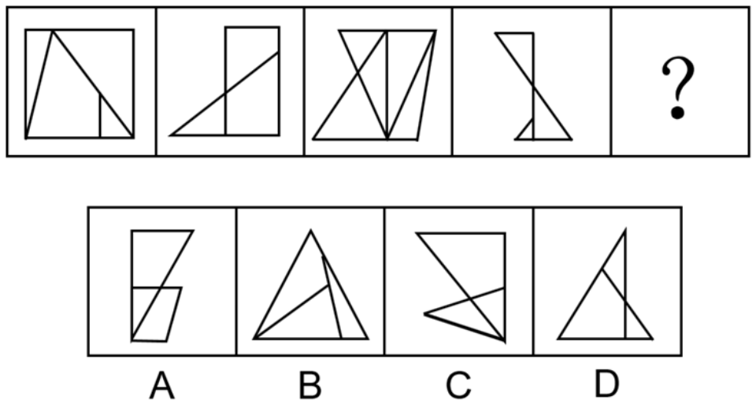

**48.** 从所给的四个选项中，选择最合适的一个填入问号处，使之呈现一定的规律性：

**49.** 下列选项中，能与所给图形组合成立方体的是（）。

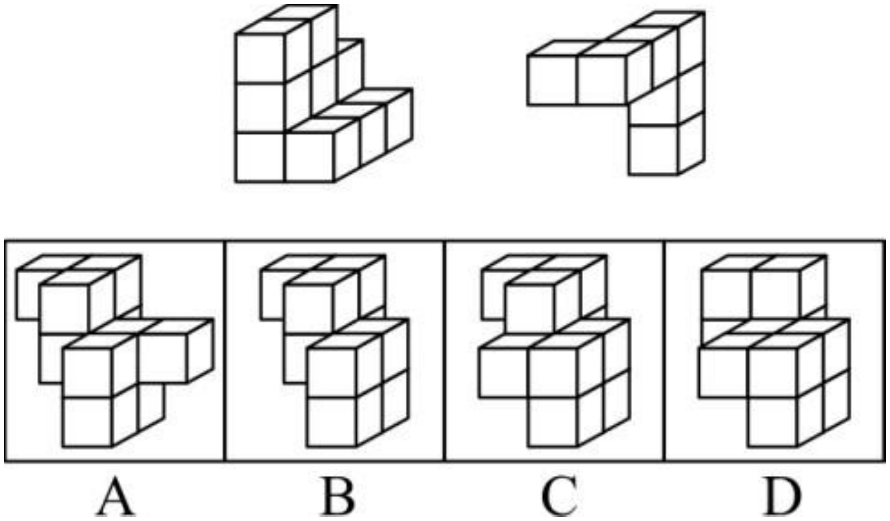

**50.** 某物体由两个相同的正三棱柱组合而成，则其侧面轮廓最不可能是（）。

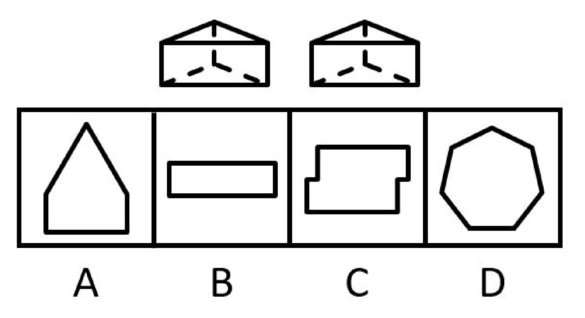

**51.** 世界科技强国必须能够在全球范围内吸引人才、留住人才、用好人才。我国要建设世界科技强国。因此，我国必须注重对国际人才的吸引与使用。
下列选项的逻辑结构与题干最相似的是：

A. 人才的培养培育离不开良好的环境。因此，构筑集聚全球优秀人才的科研创新高地，完善配套制度，就能面向世界汇聚一流人才
B. 国家科技创新力的根本源泉在于人才，国家、民族长远发展离不开科技创新力。因此，培养创新型人才是国家、民族的长远发展之计
C. 科技创新离不开科技人员持久的时间和精力投入。因此，要建立让科研人员把主要精力放在科研上的保障机制
D. 榜样的力量对科技工作者来说是无穷的。两院院士是科技成果的主要贡献者，更应做好表率，激励广大科技工作者不断攻坚克难、勇攀高峰

**52.** 为探索每周4天工作制的可行性，某集团进行了一次大规模的试验。结果表明，尽管减少了工作天数，数千名员工仍然完成了原定的工作任务，且员工的工作压力水平下降了7%，企业的办公成本如耗材、水电的消耗量也有所下降。有人因此认为，4天工作制不仅能降低企业的运营成本，还大大提高了企业员工的工作效率。
以下选项如果为真，最能质疑上述观点的是（）。

A. 实行4天工作制后，该集团一些分公司的营业收入有所降低
B. 实行4天工作制后，员工每天的工作时长从8小时变为10小时
C. 劳动法规制定的前提是保护劳动者权益，而非降低企业运营成本
D. 由于运营维护的需要，部分岗位的工作人员并不能实行4天工作制

**53.** 某镇计划安排小蒋、小陈、小刘3名干部到甲、乙、丙3个村子驻点，每村只安排1人。3人中有一人是农学专业，一人是法学专业，一人是工学专业。已知：小陈没有前往甲村，农学专业的没有前往甲村，工学专业的去了丙村，小陈不是农学专业。
根据以上表述，以下推论必然正确的是（）。

A. 小刘去了甲村
B. 小蒋去了乙村
C. 小刘是工学专业的
D. 小陈是工学专业的

**54.** 人均 GDP 可以基于常住人口计算，但算出的结果可能并不准确，因为流动人口同样会为城市创造 GDP。当一个城市的流动人口占比较高时，只用常住人口来计算人均 GDP，可能会导致对城市经济发展水平的高估。有专家因此建议，对经济发展水平相近的城市而言，用“吨均 GDP”（每吨生活垃圾所对应的 GDP）替代“人均 GDP”，更能准确比较各个城市的发展水平。
要使该建议成立，必须补充的前提是（）。

A. 所有城市都能准确统计本地区居民产生的生活垃圾数量
B. 气候条件、城市布局等因素不会影响居民的生活垃圾产生量
C. 经济发展水平相近的城市，居民的生活垃圾人均产生量相近
D. 各个城市中，流动人口和常住人口每人每天产生的垃圾数量相近

**55.** 甲市城区过去一直实行车辆限号通行。从去年开始，该市取消了车辆限号通行，一年后全市交通拥堵指数明显下降，平均车速提高了20%，实现了“车辆不限号，交通不拥堵”的双重效益。
下列选项如果为真，最能解释这一现象的是（）。

A. 甲市城区打造了多个15分钟便民生活圈，居民购物出行更加便利
B. 甲市加强了新能源汽车的配套设施建设，新能源汽车销量大幅提高
C. 甲市交通线网优化，城区主干道和重点路段交通状况得到明显改善
D. 当油价上涨时，为降低出行成本，部分市民会优先选择公共交通出行

**56.** 分散的农户经营不成规模，已经远远不能适应各个城市群规模化、批量化的农产品需求，也限制了农民收入的提高。如果不解决农户的组织化这个问题，就无法推广农业机械化、规模化，也无法降低农业的经营成本。因此，可以通过推进农户的组织化，让现有的农民实现增产增收。
以下选项如果为真，最能支持上述论断的是（）。

A. 当前分散的农户是农村的农业经营主体
B. 机械化、规模化种植能有效实现农业增产
C. 推广农业机械化、规模化不需要花费较长时间
D. 实现农业机械化生产后，劳动力投入将有所减少

**57.** 某部门有若干名干部和工勤人员。其中有多名干部是博士；并非所有的博士都是统计学专业毕业的；所有的男性都是统计学专业毕业的；由此可以推断该部门中（）。

A. 有些男性不是博士
B. 有些博士不是男性
C. 有些男性是工勤人员
D. 有些干部不是统计学专业毕业的

**58.** 液体都能够流动。水能够流动，所以水是液体。
以下与上述推理在结构上最为相似的一项是（）。

A. 哲学家都爱思考。李教授是哲学家，所以他爱思考
B. 哺乳类动物都是恒温动物。蛇不是哺乳类动物，所以蛇不是恒温动物
C. 平板电脑都有触摸屏。手机有触摸屏，所以手机是平板电脑
D. 工作态度端正就能取得好的业绩。小刘取得好业绩，所以他工作态度端正

**59.** 多年来，甲国居民消耗的主要粮食中，有80%以上由本国生产；而乙国居民消耗的主要粮食中有六成以上依赖进口。但经过调查发现，当国际大米价格出现上涨时，甲国国内的大米价格涨幅明显高于乙国。
下列选项如果为真，最能解释这一现象的是：

A. 甲国主要粮食进口以大米为主，乙国主要粮食进口以小麦为主
B. 乙国居民对食物品质和口感的要求比甲国居民更高
C. 乙国的粮食产量比甲国更加稳定
D. 与甲国相比，乙国人口少、收入高，粮食支出占其收入的比重更低

**60.** 媒体A报道称：今年以来，患季节性皮肤病的人数大幅上升，这是因为城市水污染日益严重和空气质量恶化造成的。
媒体B报道称：患季节性皮肤病的人数大幅上升与城市水污染、空气质量恶化没有关系，主要是因为人们缺乏锻炼，身体素质下降造成的。
以下哪项如果为真，最能对媒体B的观点提出质疑？

A. 目前7-12周岁儿童的身体素质比10年前普遍下降
B. 大多数春季患皮肤病的人，在秋冬季节症状会有所好转
C. 环保局承认，城市水污染和空气质量问题日益严重
D. 游泳运动员患季节性皮肤病的人数逐年增多

**61.** 根据人事部门的数据，某单位的女性员工多于男性员工。中共党员员工多于政治面貌为群众的员工。（该单位员工政治面貌只有中共党员和群众两种情况）
下列判断一定正确的是（）。

A. 政治面貌为群众的女性员工多于政治面貌为群众的男性员工
B. 政治面貌为中共党员的男性员工多于政治面貌为中共党员的女性员工
C. 政治面貌为中共党员的女性员工多于政治面貌为群众的男性员工
D. 政治面貌为群众的男性员工多于政治面貌为中共党员的男性员工

**62.** 某机构对在广州有创业、就业、实习等经历的港澳青年进行调查，结果显示，有留穗发展意愿的港澳青年比例占七成以上；九成港澳青年通过实习了解和认识广州；有超过一半的港澳青年非常看好粤港澳大湾区的发展前景。因此，来广州实习有助于港澳青年获得对粤港澳大湾区的认同感。
要使上述推论成立，可以补充的前提是：

A. 熟悉广州有助于港澳青年更好地适应在广州工作和生活
B. 港澳青年的留穗发展意愿是其对粤港澳大湾区具有认同感的重要表现
C. 通过实习，港澳青年对粤港澳大湾区发展前景更有信心
D. 超过一半的在穗实习港澳青年参与了这项调查

**63.** 自其变者而观之，则天地没有一瞬间不会发生变化。历史已经不属于这片天地，所以历史是永恒不变的。
以下选项的逻辑结构与题干最为相似的是（）。

A. 玫瑰是红色的，这朵花是白色的，所以这朵花不是玫瑰
B. 羊都是有角的，被锯掉角的羊没有角，所以被锯掉角的羊不再是羊
C. 地球是行星，有自己的卫星，火星是行星，所以火星也有自己的卫星
D. 有明确奋斗目标的人都是幸福的，他没有明确的奋斗目标，所以他不幸福

**64.** 我国以占世界7%的耕地养活了占世界22%的人口，其中年平均生产大豆1200万吨左右。同时，还利用国外的耕地、国外的农民，继续开放市场，降低关税或免除关税，年平均进口大豆5800万吨左右。更多利用国外的资源来让我国人民生活得更好。
以上论断基于下列假设，除了（）。

A. 大量进口粮食不会带来粮食安全问题
B. 政府相关部门对进口粮食严把质量关
C. 进口粮食的价格能被国内群众所接受
D. 大量进口粮食损害了国内生产者的利益

**65.** 在新的社会发展形势下，如果医生只掌握专业理论知识和实践能力，却缺乏基本职业道德，不仅很难适应社会需求，同时还容易造成医患关系紧张。因此在医学专业学生的培养过程中，不仅要注重专业理论知识的教育，更应注重提升医德医风职业素养。
以下选项若为真，最能支持上述论断的是：

A. 目前大多数医术水平较高的医生极少与患者产生冲突
B. 医生在救治过程中只顾治病不顾患者感受往往导致医患关系紧张
C. 医学专业学生职业素养的提升，主要依靠学校的思想道德教育
D. 比起专业水平，越来越多患者就医时更看重医生的道德素养

## 第六部分　科学推理

**66.** 夏日，小王调制了一杯28℃的蔗糖水，尝了一口后感觉不够甜，又加入了一些蔗糖，搅拌后蔗糖完全溶解。之后他把蔗糖水放入冰箱，一段时间后取出时发现杯子底部有少许晶体析出，则下列说法正确的有（）。
①刚放入冰箱的蔗糖溶液一定不是饱和溶液
②从冰箱中取出的蔗糖溶液一定是饱和溶液
③放入冰箱前后，蔗糖溶液中溶质的质量相等
④用加热蒸发溶剂的方法能够得到与析出晶体相同的物质

A. ①②
B. ①④
C. ②③
D. ②④

**67.** 如图，甲、乙叠放在一起，静置于地面上。此时，乙受到一个水平向右的拉力 F，但甲、乙仍然保持静止状态，在此过程中，以下说法准确的是：

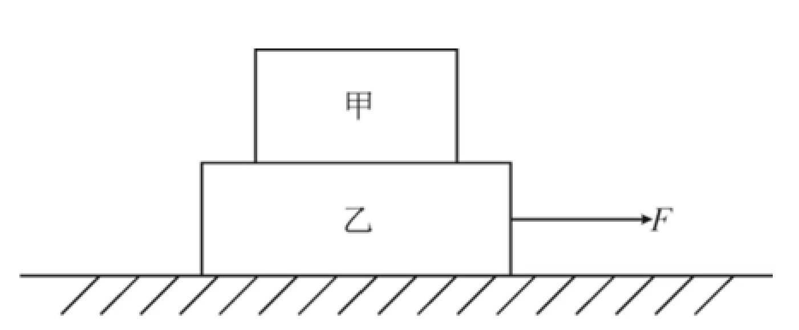

A. 甲和乙之间至少有2对相互作用力
B. 乙对甲的支持力比甲受到的重力大
C. 如果拉力 F 方向向左，甲、乙将不再保持静止
D. 乙受到的地面摩擦力等于拉力 F

**68.** 如图所示的电路中，当电路中的开关闭合时，电路中的小灯泡都能正常发光的是（）。

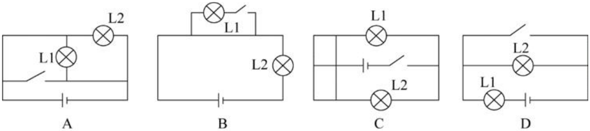

**69.** 一般来说，海水会从密度大的地方向密度小的地方流动，而海水的密度主要受到温度和盐度的影响。则以下判断正确的是（）。

A. 越热越咸的海水，密度越大
B. 越冷越咸的海水，密度越大
C. 越冷越淡的海水，密度越大
D. 越热越淡的海水，密度越大

**70.** 地表某相对独立的生态系统，其主要物种及数量如图所示，则下列说法必然正确的是（）。

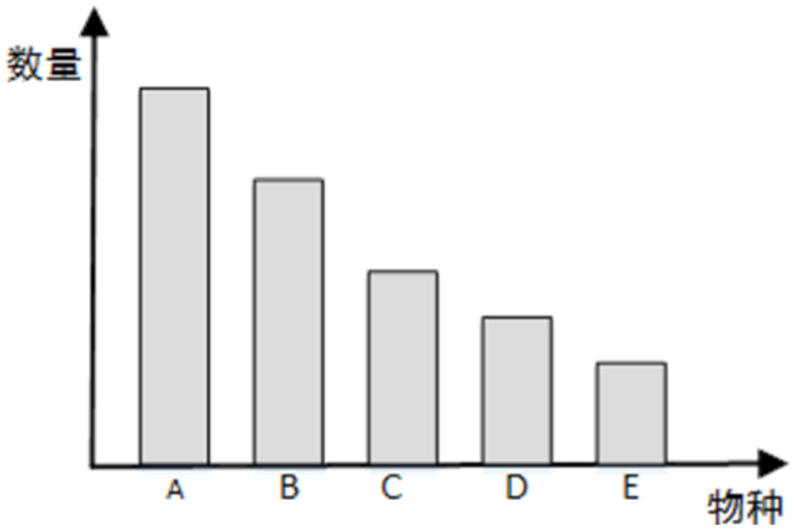

A. 物种A是该生态系统生产者
B. 物种B是该生态系统的初级消费者
C. 该生态系统的能量流动是从A到E
D. 该生态系统的最终能量来源是太阳能

## 第七部分　资料分析

2019年，广东规模以上工业企业用水量39.54亿立方米，分水种看，自来水用水量最大，达35.67亿立方米，占全部用水量的90.2%；地表淡水用水量2.52亿立方米，地下淡水0.03亿立方米，其他水1.32亿立方米。分地区看，珠三角地区用水量达29.85亿立方米，占比超75%。

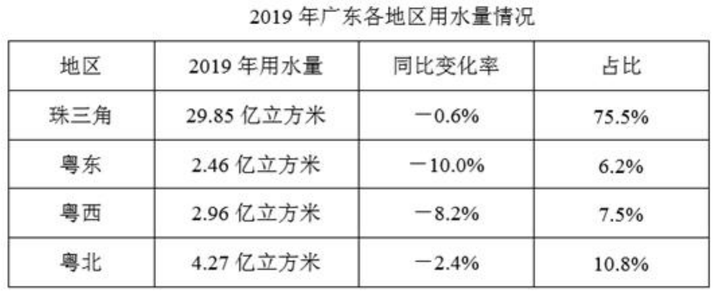

2019年，广东规模以上工业企业重复用水量为147.10亿立方米，比上年增长2.5%，重复用水率提高到78.8%（注：重复用水率=重复用水量/（用水量+重复用水量））。分行业看，重复用水量主要集中在电力、冶金和石油石化行业。其中，电力行业重复用水量为50.72亿立方米，比上年下降1.3%，占全省规模以上工业企业全部重复用水量的34.5%；冶金行业重复用水量为40.82亿立方米，增长3.9%，占全部重复用水量的27.8%；石油石化行业重复用水量为32.12亿立方米，增长3.5%，占全部重复用水量的21.8%。
整体而言，在全省规模以上工业企业中，重复用水量普及面窄且重复用水率较低的问题值得关注。有重复用水的企业只有3573家，只占全省规模以上工业企业的7.0%，说明九成多企业无重复用水。重复用水量超过1000万立方米的企业88家，其重复用水量占全部重复用水量的96.2%，主要集中在石油化工、电厂和钢铁厂等少数大型企业中，重复用水应用领域明显较窄。

**71.** 2019年广东规模以上工业企业用水量中，地表与地下淡水量约占：

A. 4.7%
B. 6.4%
C. 8.1%
D. 9.8%

**72.** 与2018年相比，2019年广东规模以上工业企业用水量：

A. 减少了约0.8亿立方米
B. 增加了约1.8亿立方米
C. 减少了约2.8亿立方米
D. 增加了约3.8亿立方米

**73.** 2018年广东规模以上企业重复用水率约为：

A. 78.0%
B. 78.8%
C. 79.6%
D. 无法判断

**74.** 2018年电力、冶金和石油石化行业以外的其他行业的重复用水量约占广东规模以上工业企业重复用水量的：

A. 10%
B. 15%
C. 20%
D. 25%

**75.** 根据以上资料，下列有关2019年广东省规模以上工业企业重复用水情况正确的是：

A. 全省约有规模以上工业企业4.3万家
B. 有重复用水的企业的平均重复用水量约为41.2万立方米
C. 重复用水量超过1000万立方米的企业的平均重复用水量约为1.8亿立方米
D. 电力行业的重复用水率不可能低于50%

2000年、2005年、2010年我国普通高中专任教师总人数分别为756850人、1299460人、1518194人。其中，女性人数分别为273110人、558625人、723566人。
从年龄结构看，2000年、2005年、2010年31-35岁普通高中专任教师总人数分别为185873人、265509人、322829人，其中，女性人数分别为68346人、117838人、164175人；36-40岁普通高中专任教师总人数分别为117242人、248837人、272313人，其中，女性人数分别为35751人、95566人、122953人；41-45岁普通高中专任教师总人数分别为55522人、137235人、239616人，其中，女性人数分别为15728人、42931人、93641人。

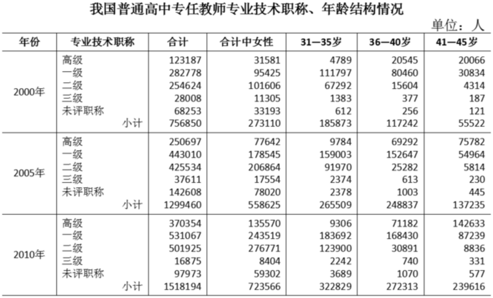

**76.** 2000年，我国31-45岁普通高中专任教师中，共有（）人未评职称。

A. 68253
B. 33193
C. 989
D. 612

**77.** 2005年，我国31-45岁的普通高中专任教师的平均年龄可能会是（）岁。

A. 34
B. 37
C. 40
D. 41

**78.** 2010年，我国41-45岁的普通高中专任教师中，至少约有（）万人在2000年还不是普通高中专任教师。

A. 5
B. 8
C. 18
D. 16

**79.** 我国普通高中专任教师中，以下年龄组女性所占比重最大的是（）。

A. 2005年的36-40岁
B. 2010年的31-35岁
C. 2010年的36-40岁
D. 2010年的41-45岁

**80.** 以下说法正确的是（）。

A. 我国普通高中专任教师中，女性教师人数在2005年达到顶峰后逐年减少。
B. 2005年我国36-40岁一级普通高中专任教师中有6万多人在2010年评上了高级教师。
C. 2000-2010年我国普通高中专任教师人数以每年约10%速度增长。
D. 2010年我国未评职称的普通高中专任教师占专任教师总人数的比重，比2000年下降了近3个百分点。

智能机器人产业是G省战略性新兴产业之一。2020年前三季度，G省智能机器人产业纳入规模以上工业统计的法人单位共140家，完成总产值306.90亿元，占全部规模以上工业产值的0.3%，同比增长29.8%，增速高于全部规模以上工业产值32.8个百分点；前三季度平均用工人数3.12万人，同比增长8.6%。

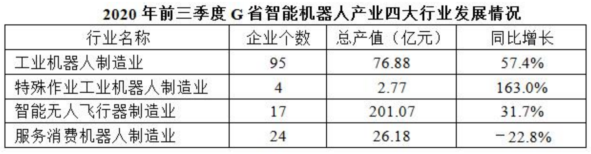

2020年前三季度，G省智能机器人产业实现营业收入326.62亿元，同比增长超40%，四大行业营业收入均实现正增长，经济效益好于全部规模以上工业企业。

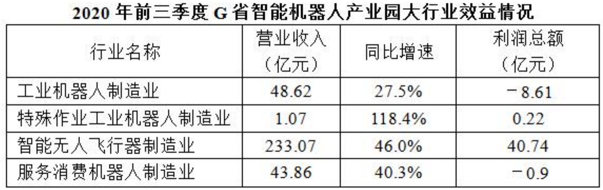

**81.** 2020年前三季度，G省智能机器人产业中，四大行业总产值的同比增量排序正确的是（）。
①工业机器人制造业
②特殊作业工业机器人制造业
③智能无人飞行器制造业
④服务消费机器人制造业

A. ①＞③＞②＞④
B. ④＞②＞①＞③
C. ③＞④＞②＞①
D. ③＞①＞②＞④

**82.** 2020年前三季度，G省下列行业中，平均每个企业产值最高的是（）。

A. 工业机器人制造业
B. 特殊作业工业机器人制造业
C. 智能无人飞行器制造业
D. 服务消费机器人制造业

**83.** 2020年前三季度，G省智能机器人产业的总体利润率（利润率=利润总额/营业收入）约为（）。

A. －0.6%
B. 4.6%
C. 9.6%
D. 14.6%

**84.** 2020年前三季度，G省工业机器人制造业营业收入同比增长约（）亿元。

A. 5
B. 10
C. 15
D. 20

**85.** 根据所给资料，下列说法不正确的是（）。

A. 2020年前三季度，G省全部规模以上工业产值同比增长3%
B. 2019年前三季度，G省智能机器人产业营业收入超200亿元
C. 2019年前三季度，G省智能机器人产业平均用工人数为2.87万人
D. 2020年前三季度，G省智能机器人产业中利润率最高的行业是特殊作业工业机器人制造业

基层群众性自治组织是我国在城市和农村按居民的居住地区建立起来的居民委员会或村民委员会，是城市居民或农村村民自我管理、自我教育、自我服务的组织。
截至2020年底，全国基层群众性自治组织共计61.5万个，同比减少4.35%。其中，村委会50.2万个，占基层群众性自治组织的81.63%，村民小组376.1万个，村委会成员207.3万人；居委会11.3万个，占基层群众性自治组织的18.37%，居民小组123.6万个，居委会成员61.6万人。2016-2020年，我国村（居）委会完成选举数分别为9.7万个、18.2万个、27.6万个、8.8万个、6.1万个，其中，2020年村（居）委会登记选民数为1.1亿人，参与投票人数为0.65亿人。

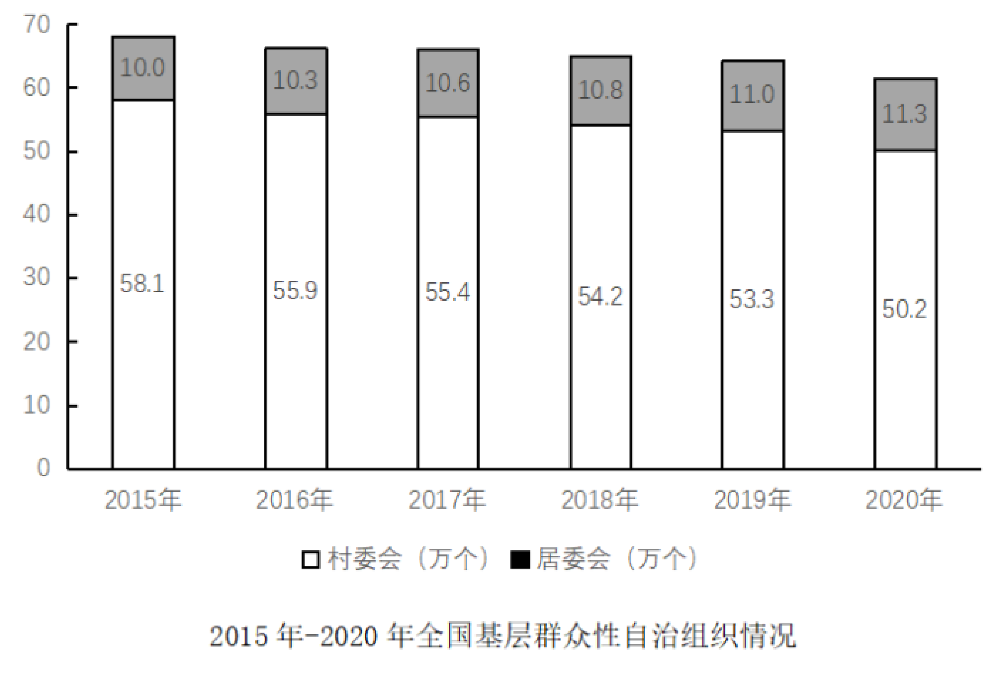

**86.** 2020年，全国基层群众性自治组织较上年减少（）万个。

A. 1.4
B. 2.8
C. 4.2
D. 5.6

**87.** 相较2019年，2020年村委会占基层群众性自治组织的比重：

A. 降低了约1.26个百分点
B. 提高了约1.26个百分点
C. 降低了约12.6个百分点
D. 提高了约12.6个百分点

**88.** 以下年份中，我国村(居)委会完成选举数同比增幅最大的是：

A. 2017年
B. 2018年
C. 2019年
D. 2020年

**89.** 2020年，平均每个村委会下辖的村民小组约（）个。

A. 3.5
B. 5.5
C. 7.5
D. 9.5

**90.** 根据所给材料，下列说法最准确的是：

A. 2020年，村民小组数量是居民小组数量的5倍
B. 2020年，平均每个村委会的成员数量超过4人
C. 2020年，超过60%的登记选民参与了投票
D. 2015-2020年，村委会数量与居委会数量的变化趋势一致
