# M11　广东省考行测模拟卷（题本）

## 第一部分　政治理论

**1.** 党面临的执政考验、改革开放考验、市场经济考验、脱离群众考验和精神懈怠危险、能力不足危险、外部环境危险、消极腐败危险是长期的、复杂的、严峻的。

A. 正确　　B. 错误

**2.** 全过程人民民主是全链条、全方位、全覆盖的民主，是最广泛、最真实、最管用的民主。

A. 正确　　B. 错误

**3.** 公元前214年，秦平定岭南，设置南海、桂林、象三郡，今广东省大部分地区属南海郡，岭南地区自此始有行政建制。

A. 正确　　B. 错误

**4.** 《资本论》的发表，标志着马克思主义的公开问世。

A. 正确　　B. 错误

**5.** 二十届五中全会《决定》要求在实践中锤炼党性，勇于揭露和纠正缺点错误，敢于同一切不良现象作斗争，反对明哲保身、当“老好人”，坚持党性原则基础上的团结，防止不讲原则的一团和气。下列古语与这一要求最为契合的是（　）。

A. 君子喻于义，小人喻于利
B. 己所不欲，勿施于人
C. 君子和而不同，小人同而不和
D. 政通人和，百废具兴

**7.** 二十届五中全会《决定》对增强干部干事创业本领、做好人才工作提出要求。下列表述不符合《决定》要求的是（　）。

A. 加强干部思想淬炼、政治历练、实践锻炼、专业训练，推动干部成为本职工作的行家里手
B. 强化人才“帽子”的激励作用，以“帽子”多少作为评价和使用人才的主要依据
C. 推动干部在实践中总结经验、把握规律，增强工作的原则性、系统性、预见性、创造性
D. 落实党委联系服务专家制度，健全领导干部直接联系服务专家工作机制

**8.** 我国宪法对国家机构的性质、地位和职权作了规定。下列说法错误的是（　）。

A. 全国人民代表大会是最高国家权力机关，有权改变或者撤销全国人大常委会不适当的决定
B. 决定特别行政区的设立及其制度，属于全国人民代表大会的重大事项决定权
C. 国务院即中央人民政府，是最高国家权力机关的执行机关，实行总理负责制
D. 规定军人和外交人员的衔级制度和其他专门衔级制度，属于国务院的职权

**9.** 从全民族抗战到改革开放，一系列重要战役和会议在党和人民的奋斗历程中留下了深刻印记。以下表述符合历史事实的有（　）。

A. 淞沪会战粉碎了日本“三个月灭亡中国”的计划，是抗战以来中国正面战场取得的最大胜利
B. 六届七中全会标志着整风运动的胜利结束，为七大召开在思想上做好了充分准备
C. 十一届三中全会重新确立了解放思想、实事求是的思想路线
D. 1992年10月召开的党的十四大，提出了依法治国的基本方略

## 第三部分　言语理解与表达

**16.** 一个人的成长成才，并不完全由其起点决定，而是看在这个过程之中个人所付出的努力。如果一味_____“出生在农村，注定样样落后”，不仅是对一些客观事实选择性地无视，而且_____了个人奋斗的价值。
依次填入画横线部分最恰当的一项是：

A. 鼓吹 漠视
B. 宣扬 肯定
C. 渲染 抹杀
D. 鼓励 否定

**17.** 凡事从坏处准备，努力争取最好的结果，这样才能________，遇事不慌，牢牢把握主动权。
填入划横线处最恰当的一项是：

A. 胸有成竹
B. 有备无患
C. 防患未然
D. 有的放矢

**18.** 无论是经验还是教训都表明，面对信任危机，主动________比逃避拖延更理性，用心________比一味堵塞更管用，未雨绸缪比应急救火更重要。
填入划横线处最恰当的一项是：

A. 应对 疏通
B. 应付 疏通
C. 应付 疏导
D. 应对 疏导

**19.** 一本好的社会科学著作，不仅应该做到于无声处听惊雷，在琐屑的生活细节中（），而且应该让读者在阅读的过程中，情不自禁地借助作者的方法去检验生活和理解社会。

A. 见微知著
B. 管中窥豹
C. 一叶知秋
D. 洞若观火

**20.** 建设现代农业，要努力在提高粮食生产能力上______新潜力，在优化农业结构上______新途径，在转变农业发展方式上______新突破。
填入划横线部分最恰当的一项是：

A. 发掘 开发 寻求
B. 挖掘 开发 寻找
C. 发掘 开辟 寻找
D. 挖掘 开辟 寻求

**21.** 中国改革开放的30多年，与经济发展相比，社会建设发展水平相对滞后，出现了一些新情况、新矛盾和新问题，收入分配差距拉大、医患纠纷、劳资纠纷、非法集资等矛盾明显增多。由于社会组织等发展滞后，我们往往习惯于用行政和经济办法解决这些问题，而实际上每个社会成员都有社会归属感和多样化的社会需求。除经济物质需求外，还有社会精神需求等诸方面，需要组织归属、社会救助、心理辅导等社会支持。很多社会问题往往由于处置不当，从而引发和积累更深的社会矛盾。
这段文字的主要意思（）。

A. 处理社会问题，不适合再使用行政和经济的手段
B. 我国经济社会发展不平衡，出现了一些新的社会问题
C. 处理社会问题不能局限于行政和经济办法，还需要社会支持
D. 社会成员的需求既有经济物质需求，也有精神心理需求

**22.** 由于基层政府普遍人手不足，承担的任务十分繁杂，很难完成上级部门制定的“创新事项”考核。一些地方为了达成“工作创新”，便忙着到处参观取经，将别人的方案“依葫芦画瓢”盲目照搬过来。殊不知，______。可以想见，这种“创新”会有什么样的结果。
以下最适合填在划线处的是（）。

A. 种瓜得瓜，种豆得豆
B. 橘生淮南为橘，生于淮北则为枳
C. 一方水土养一方人，创新方案亦是如此
D. 这些形形色色的纸面创新往往并不符合实际

**23.** 目前国内关于个人信息保护的法规分散，既缺乏对个人信息的界定，也缺乏可操作的标准，执法主体缺位，执法力度不足。对于个人信息保护的难题，业内讨论认为主要有三方面：保护程度界定，难以区别正当或非法使用个人信息；信息泄露取证，难以确定个人信息是在哪个环节发生泄露；执法力度统一，难以确保多个监管主体执法的宽严尺度一致。
因此，个人信息保护的关键在于：

A. 保障信息充分流通的同时避免滥用个人信息
B. 行业自律与政府部门监管相结合
C. 要形成一定程度的执法威慑
D. 要出台专门的法律法规保护个人信息

**24.** 汉字的产生从根源和雏形上说，来自劳动人民，汉字简化的动力主要来自民间。但经过采集、整理和加工创造而形成的汉字，则出于史卜和达官贵人之手。文明社会早期只有宫廷和贵族才有文化，他们祭天祀祖征战讨伐需要巫师神汉算命打卦占卜扶乩。商代甲骨文相对成熟，比较系统，但因一字多形，字形复杂，仅为少数人掌握和垄断，是贵族化的标志。西周末期，民间兴学，文化下移，文字走出史卜之手。越来越多的人识字用字学文化，简化文字便成为众望所归。
下列选项符合文意的一项是（）

A. 汉字由劳动人民搜集、创造而形成
B. 在周朝，一般的劳动人民都不掌握汉字
C. 汉字早期主要用于信息记录和沟通交流
D. 汉字简化是在民间文化兴起后成为趋势的

**25.** 科学素质是公民实现美好生活的前提，是实施创新驱动发展战略和全面建成小康社会的社会基础。目前我国公民科学素质还不能满足国家建设和社会发展的需要。研究表明，进入创新型国家行列的30多个发达国家，公民具备科学素质的比例最低都在10%以上，我国仅为6.2%。虽然我国公民科学素质提高很快，但发展不平衡，与世界发达国家的差距仍然很大，特别是我国科普方面的公共服务很不均衡，农民、城镇新居民、边远和少数民族地区群众获得服务的机会明显偏少。
这段文字意在说明：

A. 我国公民科学素质还需进一步提高
B. 全社会应关注公民科学素质的提高
C. 我国与发达国家在公民科学素质上存在差距
D. 我国公民科学素质不高是一个严重的问题

**26.** 当前，我国科技事业实现了重大发展，重大创新成果竞相涌现。但也应看到，我国科技领域仍存在一些亟待解决的问题，关键核心技术受制于人的局面没有得到根本性改变。现在，我们迎来了世界新一轮科技革命和产业变革同我国转变发展方式的历史性交汇期，科技创新角逐空前激烈，只有努力实现关键核心技术自主可控，才能抓住千载难逢的历史机遇，真正发挥创新引领发展的第一动力作用。
最适合做这段文字标题的是（）。

A. 从关键核心技术到创新动力
B. 关键技术核心——“大国重器”
C. 把关键核心技术握在手中
D. 掌握关键核心技术岂能只争朝夕

**27.** 科学家通过一系列的实验认为，金钱能激起人们的排他心理，这很可能是人的本能反应，就像爱情具有排他性一样。当相互合作存在金钱利益关系的时候，人们就会本能地保护自己的利益，于是会以反感的态度回应对方，并产生一定程度的厌恶心理。由此便有了金钱毁灭爱情、污染亲情和斩断友情的种种现象，显示出人情味真的难敌铜臭味。不过，实验还证实，人们在金钱面前产生排他心理的同时，独立性和创造性也明显增强了。而且金钱作为人类文明的一个重要产物还要一直存在下去，回避它显然是不现实的。
通过这段文字，可以判断作者的观点是：

A. 金钱是把双刃剑
B. 应该正视金钱的作用
C. 金钱会影响人际关系
D. 要处理好金钱与情感的关系

**28.** 强大的国家必须拥有一支热血满腔，视荣誉为生命的军队。军人之所以视荣誉为生命，源于崇高的使命感，源于社会的厚植培育。然而，在市场经济条件下，利益杠杆、个人价值在人才流动中的驱动作用更加明显，军营的吸引力有所下降，______。
以下最适合填在划线处的是（）。

A. 迫切需要提高军人的待遇水平
B. 必须发挥纪律的约束和法制的保障作用
C. 迫切需要在全社会重塑军人职业的荣誉感
D. 必须以强军梦为引领，打造一支热血满腔的军队

**29.** 大众传媒主要是通过报纸、电视、广播等平台来开展。人际传播是指举办论坛、公众开放日等活动，实现人和人之间的传播。新媒体集合了大众传媒和人际传播两者的优点，兼具广泛性和精准性，既可以同时面对数百万甚至是数千万的受众，也可以实现传播者和受众一对一的交流。受众既是传播的目标对象，也是传播的主体，可以帮助我们实现二次乃至多次再传播。
根据上述文字，对“新媒体”理解不准确的一项是：

A. 新媒体是建立在大众传媒传播和人际传播的基础之上的
B. 新媒体的受众已从传播的目标对象转变为传播的主体
C. 新媒体有助于我们实现二次乃至多次再次传播
D. 新媒体的双向互动性体现了它与传统媒体的区别和优势

**30.** ______？______，______，______，______，______。
①从科技层面来看，区块链涉及数学、密码学、互联网和计算机编程等很多科学技术问题
②什么是区块链
③这些特点保证了区块链的“诚实”与“透明”
④而从应用视角来看，区块链是一个分布式的共享账本和数据库
⑤为区块链创造信任奠定基础
⑥具有去中心化、不可篡改、全程留痕、可以追溯、集体维护、公开透明等特点
将以上句子填入划线部分，顺序最恰当的一组是（）。

A. ②④①⑥③⑤
B. ②①④⑥③⑤
C. ②④③⑥⑤①
D. ②①⑥③④⑤

## 第四部分　数量关系

**31.** 2、10、30、68、130、（    ）

A. 222
B. 272
C. 300
D. 390

**32.** 8，3，17，5，24，9，26，18，30，（    ）

A. 22
B. 25
C. 33
D. 36

**33.** -3，8，2，18，22，（    ）

A. 43
B. 58
C. 60
D. 76

**34.** $\frac{1}{2}$、$\frac{2}{6}$、$\frac{2}{8}$、$\frac{3}{15}$、（    ）

A. $\frac{3}{18}$
B. $\frac{3}{16}$
C. $\frac{5}{25}$
D. $\frac{7}{25}$

**35.** 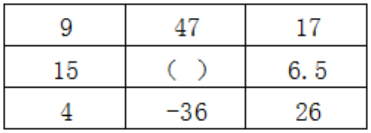

A. 55
B. 103
C. 199
D. 212

**36.** 甲乙丙三人参加一项测试，三人的平均分为80，甲乙两人的平均分为75，乙丙两人的平均分为80，那么甲丙两人的平均分为（）。

A. 70
B. 75
C. 80
D. 85

**37.** 有两箱数量相同的文件需要整理。小张单独整理好一箱文件要用4.5小时，小钱要用9小时，小周要用3小时。小周和小张一起整理第一箱文件，小钱同时开始整理第二箱文件。一段时间后，小周又转去和小钱一起整理第二箱文件，最后两箱文件同时整理完毕。则小周和小张、小钱一起整理文件的时间分别是：

A. 1小时，2小时
B. 1.5小时，1.5小时
C. 2小时，1小时
D. 1.2小时，1.8小时

**38.** 一个人骑车去工厂上班。他从家出发，用30分钟骑行一半的路程后，他加快了速度，以每分钟比原来快50米的速度，又骑行了10分钟。这时发现距离工厂还有2千米。那么他从家到工厂之间的距离为多少千米：

A. 6
B. 7.5
C. 8
D. 8.5

**39.** 某件商品如果打九折销售，利润将减少一半；如果打八五折销售，利润将减少22.5元。如果按原价销售，这件商品的利润是（）元。

A. 15
B. 22.5
C. 30
D. 45

**40.** 在某公司年终晚会上，所有员工分组表演节目。如果按7男5女搭配分组，则只剩下8名男员工；如果按9男5女搭配分组，只剩下40名女员工。该公司员工总数为：

A. 446
B. 488
C. 508
D. 576

**41.** 某单位购买了10台新电脑，计划分配给甲、乙、丙3个部门使用。已知每个部门都需要新电脑，且每个部门最多得到5台，那么电脑分配方法共有多少种：

A. 9
B. 12
C. 18
D. 27

**42.** 某单位计划从行政部的2名员工和人事部的3名员工中，随机选择2人去参加在职培训，则选出的2人都来自人事部的概率是：

A. 10%
B. 20%
C. 30%
D. 40%

**43.** 楼道上方有一盏灯，小刘径直走向这盏灯。一开始，他发现自己影子的长度为3.2米，前进1米后，发现影子缩短为1.6米。已知小刘身高为1.6米，则这盏灯的高度约为（）米。

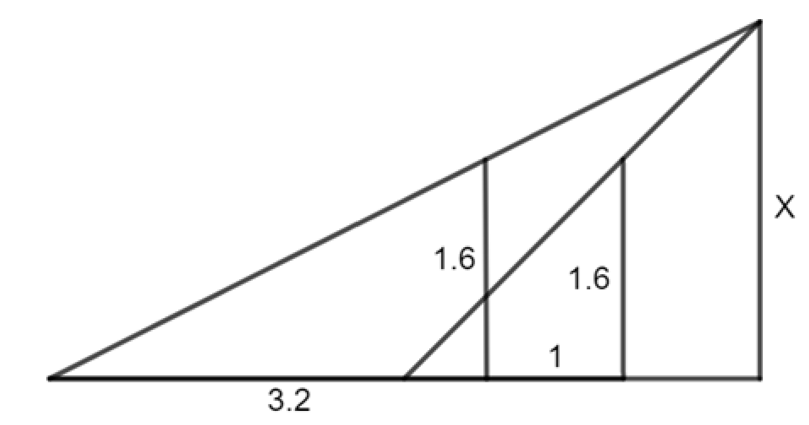

A. 2.6
B. 2.8
C. 3.2
D. 3.4

**44.** 一名顾客购买两件均低于100元的商品，售货员在收款时错将其中一件商品标价的个位数和十位数弄反了，该顾客因此少付了27元。被弄错价格的这件商品的标价不可能是（）元。

A. 42
B. 63
C. 85
D. 96

**45.** 在一次抽奖活动中，要把18个奖品分成数量不等的4份各自放进不同的抽奖箱。则一个抽奖箱最多可以放（）个奖品。

A. 6
B. 8
C. 12
D. 15

## 第五部分　判断推理

**46.** 从所给的四个选项中，选择最合适的一个填在问号处，使之呈现一定的规律性：

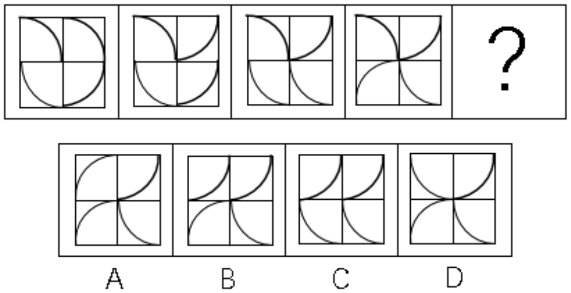

**47.** 从所给四个选项中，选择最合适的一个填入问号处，使之呈现一定规律性：

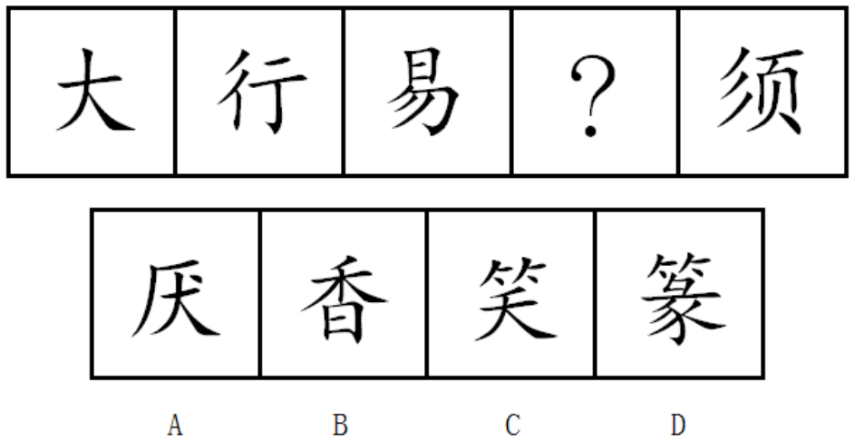

**48.** 请从所给的四个选项中，选择最合适的一项填在问号处，使之呈现一定的规律性。

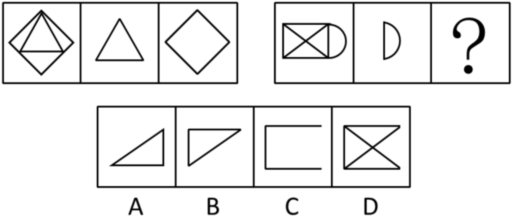

**49.** 如图所示的三个图形可以拼成的是（）。

A. 三角形
B. 梯形
C. 正方形
D. 菱形

**50.** 下列选项中，不可能是所给立方体展开图的是（）。

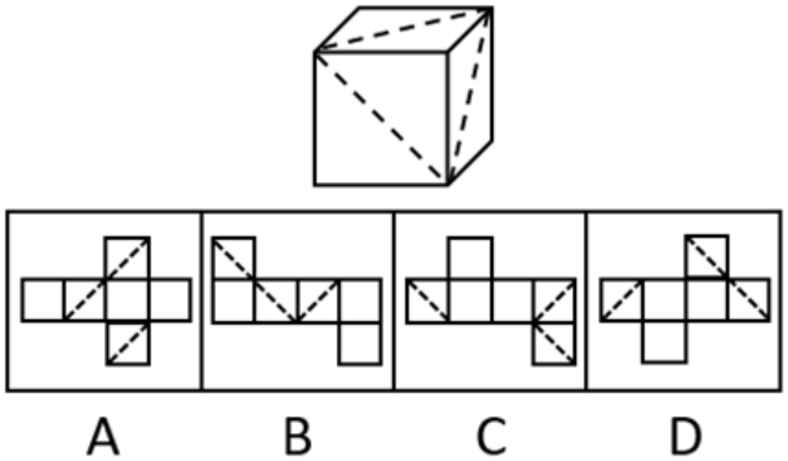

**51.** 城市比乡村人口密度更高，而高人口密度会导致犯罪率的上升，因此城市比乡村有着更高的犯罪率。
下列选项中，与上述推理结构最为相似的是（）。

A. 酶是一种蛋白质，而蛋白质是由氨基酸组成的，因此酶也是由氨基酸组成的
B. 县比市辖区拥有更高的自主权，而更高的自主权会带来更高的审批效率，因此县比市辖区的审批效率更高
C. 猫科动物拥有敏锐的听力，老虎、猎豹和家猫都属于猫科动物，因此它们的听力都很敏锐
D. 相比农村的孩子，城市的孩子能够接触到更加优质的教育资源，同时城市的孩子升学率更高，因此优质的教育资源会提高升学率

**52.** 某项科学研究发现：经常使用左手能更好地锻炼右脑，使得人的形象思维能力增强，更利于促进创造性思维的发展。但事实证明：发明家中左撇子的比例并不高。因此，这个科学研究的结论不可信。以下最能削弱上述结论的是：

A. 用右手也可以达到锻炼右脑的效果
B. 用右手的人数大大超过用左手的人数
C. 发明创造主要依靠天赋，而非后天锻炼
D. 发明创造不依靠形象思维能力

**53.** 某村有老赵、老钱、老孙、老李四个养鸡专业户，已知老赵、老钱两户养鸡的总数量与老孙、老李两户养鸡的总数量相等，老赵、老李两户养鸡的总数量比老钱、老孙两户养鸡的总数量多，而老钱养鸡的数量比老赵、老孙两户养鸡的总数量还要多。
由此可知，四个养鸡专业户养鸡数量由多到少的顺序是：

A. 老赵、老钱、老孙、老李
B. 老孙、老钱、老赵、老李
C. 老李、老钱、老赵、老孙
D. 老钱、老李、老赵、老孙

**54.** 随着技术的进步，科学家可以通过对木料的检测来确定树木被砍伐的年份。因此，通过古建筑中幸存的木料，就可以确定古建筑的建造年份。
上述论述基于的假设是：

A. 古建筑中的木料在使用前没有闲置很长时间
B. 古建筑大量使用木料作为建筑材料
C. 一栋古建筑的建造通常只使用一种木料
D. 保存完好的古建筑是使用最耐久的木料建造的

**55.** 统计数据显示，G市的餐饮企业数量从5年前的20000个，逐年下降至今年的8000个。但是，该市餐饮企业的经营资本在整个服务行业中所占的比例却大幅增加了。
以下对解释上述现象最没有帮助的是（）。

A. 5年来，G市每年的餐饮业的经营资本总额逐年增加
B. G市餐饮企业今年的平均经营资本额比5年前有显著增长
C. 5年来，由于竞争激烈，G市部分餐饮企业扩大了经营规模
D. 5年来，G市服务行业经营资本占全市产业经营总资本的比例逐年下降

**56.** 今年，某民营企业在当地政府的指导下成立了纪检监察室，将“党管监督模式”融入企业管理。预计今后，通过对企业的生产、采购等环节进行监察审计，该企业能够有效降低成本，产生更大的经济效益。
下列各项如果为真，对上述论证支持最弱的是（）。

A. 该企业的主要成本来源于生产与采购环节
B. 引入监察审计后，该企业的产品合格率进一步提升
C. 自从该企业设立举报邮箱后，检举的数量大幅增加了
D. 纪检监察室成立后，查处多起违纪违规行为，挽回大量经济损失

**57.** 所有电竞专业的毕业生都支持举办电竞赛事，所有支持举办电竞赛事的人都喜欢打游戏。有的电竞专业的毕业生在电视台体育频道工作，电视台体育频道有50岁以上的工作人员。所有50岁以上的人都不喜欢打游戏。
由此不能推出的结论是（）。

A. 没有一个50岁以上的人支持举办电竞赛事
B. 电视台体育频道中有工作人员喜欢打游戏
C. 有的电竞专业的毕业生年龄在50岁以上
D. 所有电竞专业的毕业生都喜欢打游戏

**58.** 我国的省会城市都通铁路，然而有的省会城市没有高铁站，因此通铁路的城市不一定有高铁站。
下列选项，与上述论证方式最相似的是（）。

A. 所有的大跨度桥梁都是悬索桥，而有的悬索桥未必用铁索作为主要承重构件，因此有的大跨度桥梁的承重构件不是铁索
B. 大多数公交车都采用了无人售票系统，然而无人售票公交车并不一定支持电子支付，因此有的公交车尚不支持电子支付
C. 有的出租车并非采用燃油驱动，而出租车都是四轮驱动的，因此四轮驱动的车辆未必采用燃油驱动
D. 现役民用客机都无法实现垂直起降，但有的民用客机能够实现洲际飞行，因此能够实现洲际飞行的飞机不一定能做到垂直起降

**59.** 节日期间，某商场开展了减价促销活动，许多商品较活动前降价了10%～30%，结果发现促销并没有达到预期的效果，销量和平常相比并无明显变化。
以下最能解释这一结果的是（）。

A. 商品的降价幅度太小
B. 该商场曾经进行过类似的促销活动
C. 促销时间太短，降价带来的收益无法在总收益中体现出来
D. 促销商品为电视、冰箱等较耐用的家电，价格对销量影响不大

**60.** 某地为提高医疗服务水平，加大了对社区医院的建设力度。社区医院可以为居民提供免费疫苗接种、输液及普通病情诊断等服务。但社区医院开始运营以来，前来看病的居民很少。有人推断这是因为社区医院不能满足居民的基本医疗需求。
以下最不能有效反驳上述结论的是（）。

A. 该社区内有一家三级甲等医院，居民习惯去大医院看病
B. 该社区医院位置较偏僻，大部分居民不知道如何前往
C. 由于经费等问题，该社区医院未能聘请到国内知名专家
D. 由于宣传力度不足，许多居民不知道社区医院已经开始运营

**61.** 某部门有甲、乙、丙、丁4名干部，只有一个人同时有硕士学位、注册会计师证和高级职称，有三个人有硕士学位，两个人有注册会计师证，只有一个人有高级职称，但每个人至少具备这三个条件中的一项。已知甲和丁要么都有硕士学位，要么都没有；乙和丙要么都有注册会计师证，要么都没有；丙和丁只有一个人有硕士学位。
那么，该部门同时有硕士学位、注册会计师证和高级职称的是（）。

A. 甲
B. 乙
C. 丙
D. 丁

**62.** 在过去五年中，某地所有家庭所购买衣服的平均价格增长了50%，但在平均家庭消费支出中，购买衣服支出所占比例没发生变化，因此，所有家庭的平均消费支出在这五年中也增长了50%。
以上结论基于的假设是：

A. 在这五年中，所有家庭在购买衣服上的平均花费没有变化
B. 在这五年中，所有家庭所购衣服的平均数量没有变化
C. 在这五年中，该地的家庭数量增加了50%
D. 在这五年中，该地所有家庭用于购买衣服的支出总和增长了50%

**63.** 建设一流大学、一流学科，离不开一流校舍、一流教师，更离不开一流学生。然而当前国内许多高校“严进宽出”的培养观念导致许多大学生放松了自我管理，严重降低了高校毕业生质量。因此把牢毕业“出口”是大学必然的选择。
下列选项中，与上述推理结构最为相似的是（）。

A. 好的书籍能够增进人的知识、陶冶人的性情，由于诗歌既能增进人的知识，又能陶冶人的性情，因此诗歌是好的书籍
B. 现代主义建筑强调建筑的功能性，反对毫无功用的纯美学装饰，然而缺乏美学装饰的建筑反而会令人感到单调，因此许多现代主义建筑并不受人喜爱
C. 预防近视必须适度用眼，尤其要避免长时间近距离用眼，但当前许多学生的学业压力过大，难以避免长时间伏案用眼，因此许多学生都会近视
D. 想拥有高超的钢琴技艺必须积累丰富的经验，而“三天打鱼两天晒网”式的练习是无法积累足够的经验的，因此要获得高超的钢琴技艺必须勤加苦练

**64.** 荨麻疹属于过敏性疾病，有不少人认为，牛奶、海鲜等食品是诱发荨麻疹的主要原因。但如果我们让荨麻疹患者停止食用牛奶、海鲜等食品，他们的荨麻疹症状并不会立即好转。因此，牛奶、海鲜等食品并不是荨麻疹的主要诱因。
以下最能指出上述论断存在的逻辑错误的是（）。

A. 假设了在停止接触过敏源后，过敏性疾病的症状应当立即好转
B. 默认了绝大多数荨麻疹患者都曾食用过牛奶、海鲜等食品
C. 忽视了许多其他的过敏性疾病的症状可能与荨麻疹非常接近
D. 默认了牛奶、海鲜诱发荨麻疹的可能性远高于其他食物

**65.** 某公司产品的各项性能都比竞争对手的更好。所以，如果该公司能够降低产品的市场定价，与竞争对手的价格持平，那么该公司产品一定会迅速占领市场。
下列选项若为真，最能削弱上述论断的是：

A. 该公司产品的生产成本较高，降低市场定价将会极大影响公司利润
B. 与竞争对手相比，该公司的产品宣传力度和售后服务不具显著优势
C. 该公司的生产规模很小，其产量仅能满足市场需求的百分之一
D. 该公司产品设计瞄准的是高端市场，降低价格不符合其市场定位

## 第六部分　科学推理

**66.** 某可燃物的着火点为t，如图所示，则该物质燃烧火势从大到小的点依次是（）。

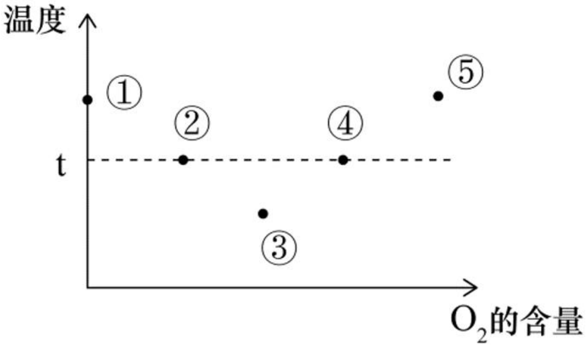

A. ①②③
B. ②④⑤
C. ③④⑤
D. ⑤④②

**67.** 如图所示，物体A在F的作用下静止在物体B的斜面上，物体B始终静止在水平面上，如果物体B的斜面完全光滑，则下列说法正确的是（）。

A. 物体B总共受到3个力的作用
B. 物体B受到的摩擦力的大小等于F
C. 物体A对物体B的作用力大小为F
D. 物体A与物体B的相互作用力大小不等

**68.** 在下图所示的电路中，电源电压保持不变，闭合开关S₁、S₂后，电路正常工作。开关S₁闭合，开关S₂由闭合到断开时，下列说法正确的是：

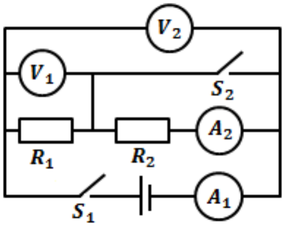

A. 电流表A₁的示数不变
B. 电流表A₂的示数不变
C. 电压表V₁的示数不变
D. 电压表V₂的示数不变

**69.** 下图为地球示意图，则每年夏至，白昼时间最长的是（）点。

A. 甲
B. 乙
C. 丙
D. 丁

**70.** 下图表示了在温度变化时，加酶洗衣粉和普通洗衣粉去污力的变化情况。曲线A表示加酶洗衣粉的变化情况，曲线B表示普通洗衣粉的变化情况。则下列说法正确的是（）。

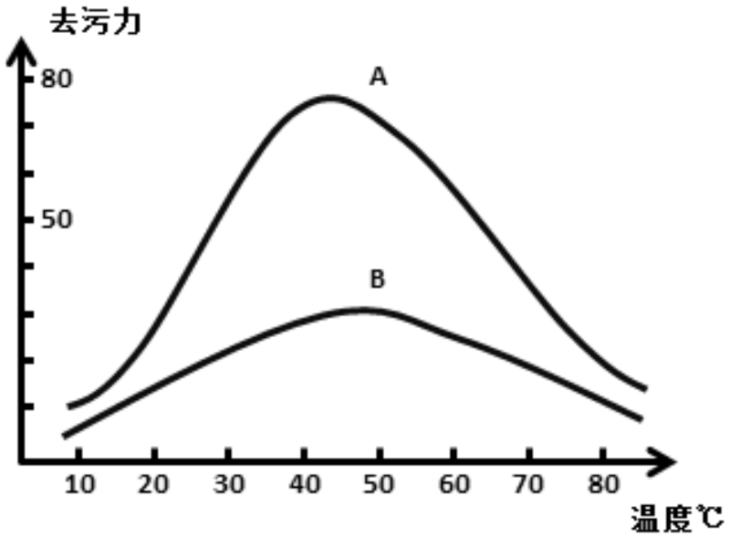

A. 加酶洗衣粉的去污力与温度成正比关系
B. 加酶洗衣粉对温度的敏感性比普通洗衣粉小
C. 在较高温度时加酶洗衣粉的去污力低于普通洗衣粉
D. 在较低温度时加酶洗衣粉中酶的活性受到抑制

## 第七部分　资料分析

改革开放三十多年以来，广东经济发展连上新台阶，综合实力不断实现大跨越。1979~2012年，世界经济年均增长速度为2.8%，中国增速为9.8%，广东增速则达13.3%。持续较快的经济增速，推动广东经济总量不断跃上新台阶。自1989年开始，广东GDP总量（国内生产总值）在全国一直保持首位，到2012年已连续24年居全国第一，占全国经济总量比重在1/10至1/8之间。
2012年，民营经济达29319.97亿元，占GDP比重为51.4%；民营经济上缴税金6467.82亿元，占全省税收总额的49.1%；民间投资10177.28亿元，占全部固定资产投资的52.7%，民营经济已成为支撑广东经济内生增长的主力。
2012年，广东铁路营业里程达到2577公里，比1978年增长1.6倍；公路通车里程19.5万公里，增长2.7倍；民用航线里程185.1万公里，增长88.1倍；管道输油（气）里程6448.01公里，增长82.7倍；沿海港口货物吞吐量14.08亿吨，增长49.5倍。改革开放之初尚无的高速公路在2011年实现通车里程5049公里，首次突破5000大关，2012年进一步提高到5524公里。
2012年，广东城镇居民人均消费性支出22396.35元，比1978年增长55.0倍；农村居民人均生活消费支出7458.56元，比1978年增长39.3倍。2012年，广东城镇居民人均住宅建筑面积34.4平方米，比1978年增加27.3平方米；农村居民人均生活住房面积31.67平方米，比1978年增加22.9平方米。

**71.** 1979~2012年，广东经济年均增速约为世界经济增速的（）倍。

A. 1.4
B. 3.5
C. 4.8
D. 10.5

**72.** 2012年，广东税收总额约为（）亿元。

A. 12273
B. 13173
C. 19312
D. 57043

**73.** 广东高速公路在2012年实现通车里程比2011年增长约：

A. 9.4%
B. 109.4%
C. 270%
D. 370%

**74.** 1978年，广东的下列四项数据由小到大排列正确的是：

A. 管道输油（气）里程＜铁路营业里程＜民用航线里程＜公路通车里程
B. 管道输油（气）里程＜铁路营业里程＜公路通车里程＜民用航线里程
C. 民用航线里程＜公路通车里程＜管道输油（气）里程＜铁路营业里程
D. 民用航线里程＜公路通车里程＜铁路营业里程＜管道输油（气）里程

**75.** 下列说法不正确的是（）。

A. 2012年广东民间投资占全部固定资产投资的一半以上
B. 2012年广东沿海港口货物吞吐量比1978年大
C. 1978年广东城镇居民人均消费性支出比农村居民人均生活消费性支出高
D. 1978年广东城镇居民人均住宅建筑面积比农村人均生活住房面积大

近年来，全国基层卫生服务能力稳步提升，居民健康水平进一步提高。2020年，我国农村乡镇卫生院卫生人员数达148.1万人，比上年增加3.6万人，社区卫生人员数达52.1万人，比上年增加3.3万人。

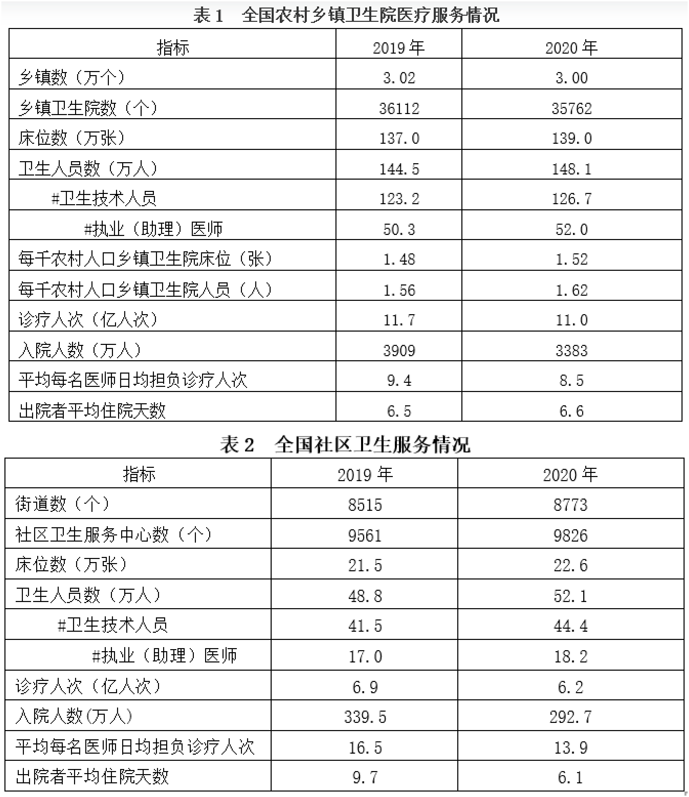

**76.** 2020年，全国农村乡镇卫生院中，卫生人员数同比增长约：

A. 1.4%
B. 2.5%
C. 3.6%
D. 4.7%

**77.** 2020年，全国社区卫生服务中心平均每名医师全年担负诊疗人次比全国农村乡镇卫生院的约多（）人次。

A. 1576
B. 1976
C. 2376
D. 2776

**78.** 2020年，平均每个乡镇床位数约为每个街道床位数的（）倍。

A. 0.5
B. 2
C. 3
D. 4

**79.** 2020年，全国农村乡镇卫生院卫生人员中，执业（助理）医师占比约为：

A. 25%
B. 30%
C. 35%
D. 40%

**80.** 根据所给材料，下列说法最不准确的是：

A. 与2019年相比，2020年全国乡镇卫生院卫生技术人员和社区卫生服务中心卫生技术人员均有所增加
B. 2020年，平均每个街道社区卫生服务中心数与2019年基本持平
C. 2019-2020年，全国乡镇卫生院年平均入院人数是全国社区服务中心的十倍以上
D. 2019年，全国农村人口约为8亿

据统计，2013年广东省城镇私营单位就业人员年平均工资为37020元，比上年增长16.0%，增幅回落3.9个百分点。

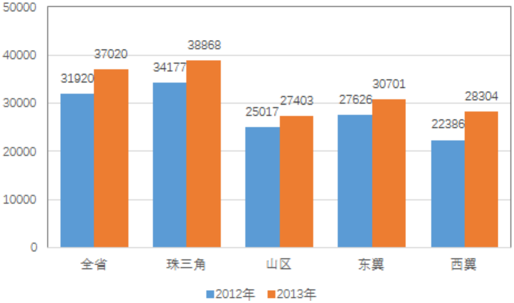

2013年广东省城镇私营单位分区域就业人员年平均工资图（单位：元）

**81.** 2013年，我省城镇私营单位就业人员年平均工资比2012年增加了（）元。

A. 5100
B. 5200
C. 5300
D. 5400

**82.** 2013年，城镇私营单位就业人员年平均工资与2012年相比，增长最慢的区域是：

A. 珠三角
B. 山区
C. 东翼
D. 西翼

**83.** 2012年，我省城镇私营单位就业人员年平均工资最高的区域约为最低区域的（）倍。

A. 1.2
B. 1.8
C. 1.5
D. 2.0

**84.** 2011年，我省城镇私营单位就业人员年平均工资约为（）元。

A. 25891
B. 26622
C. 28083
D. 31920

**85.** 如果2014年我省各区域城镇私营单位就业人员年平均工资保持2013年的增长速度，则2014年各区域年平均工资从高到低的正确排序是：

A. 珠三角>东翼>山区>西翼
B. 珠三角>山区>东翼>西翼
C. 珠三角>东翼>西翼>山区
D. 珠三角>西翼>东翼>山区

2017年末，全国铁路营业里程达到12.7万公里，比上年增长2.4%，其中高铁营业里程2.5万公里。全国铁路路网密度132.2公里/万平方公里，比上年增加3.0公里/万平方公里。其中复线里程7.2万公里，复线率（铁路复线里程占铁路营业里程的比重）56.7%，电气化里程8.7万公里，电化率（铁路电气化里程占铁路营业里程的比重）68.5%。西部地区铁路营业里程5.2万公里，比上年增长3.3%。

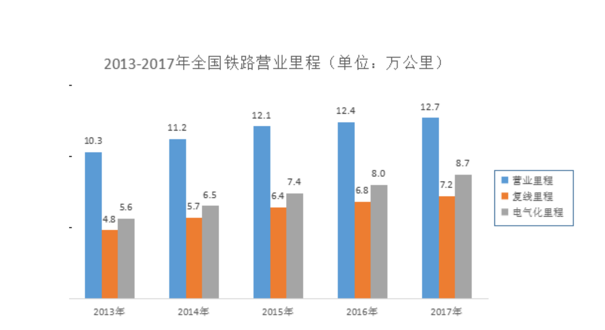

**86.** 2016年末，我国铁路路网密度是（）公里/万平方公里。

A. 126.2
B. 129.2
C. 130.2
D. 135.2

**87.** 2017年，西部地区铁路营业里程比2016年增加约（）公里。

A. 1661
B. 1761
C. 1861
D. 1961

**88.** 2017年我国铁路复线率约比2016年（）。

A. 提高4个百分点
B. 降低4个百分点
C. 提高2个百分点
D. 降低2个百分点

**89.** 2014—2017年，我国电气化里程同比增速最快的是（）。

A. 2014年
B. 2015年
C. 2016年
D. 2017年

**90.** 以下说法不正确的是（）。

A. 2013年，我国铁路复线里程不到铁路营业里程一半
B. 2014—2017年，我国铁路电化率逐年增加
C. 2017年，我国铁路营业里程比2013年约增加了23.3%
D. 2017年，我国高铁营业里程占全国铁路营业里程三成以上
