# M12　广东省考行测模拟卷（题本）

## 第一部分　政治理论

**1.** 发展党员要坚持把政治标准放在首位，防止动机不纯的人入党，注重从青年和产业工人、农民、知识分子中发展党员。

A. 正确　　B. 错误

**2.** 中国式现代化是人口规模巨大的现代化，这是中国式现代化的本质特征。

A. 正确　　B. 错误

**3.** 全面从严治党，核心是加强党的领导，基础在全面，关键在治，要害在严。

A. 正确　　B. 错误

**5.** 二十届五中全会《决定》要求大力破除潜规则，坚持立明规矩，推进党务政务公开，教育引导党员、干部讲原则、守正道，坚决纠治“原则不如关系”“章子不如条子”等乱象。下列古语与这一要求最为契合的是（　）。

A. 奉法者强则国强，奉法者弱则国弱
B. 公生明，偏生暗
C. 禁微则易，救末者难
D. 知人者智，自知者明

**7.** 二十届五中全会《决定》要求建设上下贯通、执行有力的严密组织体系。下列表述不符合《决定》要求的是（　）。

A. 推动中央和国家机关党组织走好第一方阵，力戒“机关病”和“衙门作风”，防止“灯下黑”
B. 地方党委在本地区发挥总揽全局、协调各方的领导作用，履行把方向、管大局、作决策、保落实职责
C. 做实纪委书记抓基层党建工作述职评议考核，推动党的各级组织全面进步、全面过硬
D. 健全上级部署传达落实、基层情况向上反映、矛盾问题协同解决的工作机制

**9.** 从建党之初到改革开放新时期，党召开的重要会议和开展的重大活动在党的历史上具有重要地位。以下表述符合历史事实的有（　）。

A. 中共二大制定了党的最高纲领和最低纲领
B. 1941年5月，毛泽东作《改造我们的学习》的报告，标志着延安整风运动开始
C. 延安被称为解放中国的最后一个农村指挥所，是党从农村进入城市的最后一站
D. 自党的十二大起，按照党章规定，党的全国代表大会每五年召开一次，实现了制度化

## 第三部分　言语理解与表达

**16.** 广东人大首次________用立法手段对行政审批进行管理监督，有望从源头上________地方政府增加行政审批的冲动，避免落入行政审批“越减越多”的怪圈。
填入划横线处最恰当的一项是：

A. 尝试 遏止
B. 尝试 遏制
C. 试图 遏止
D. 试图 遏制

**17.** 十年树木，百年树人，干部培养也有客观的周期规律。（）、现抓现用，破解不了“用人荒”的根本难题，只会让可选的空间越来越小。
最恰当的一项是（）。

A. 鱼目混珠
B. 江心补漏
C. 临渴掘井
D. 拔苗助长

**18.** 教育是创新的源头，需要在基础领域“深挖井”，也需主动（）产业链、创新链，为产业创新提供新知识、新技术、新理念。当“教”不再只盯着书本里的道理，而是与产业需求紧密结合，“产”与“教”就能实现（），为创新发展赋能助力。
依次填入最恰当的一项是（）。

A. 联通，同条共贯
B. 联系，合而为一
C. 对接，同频共振
D. 衔接，一举两全

**19.** 在历史使命的______下，唯有深化改革开放，才能实现广东“三个定位、两个率先”的总目标。
填入划横线部分最恰当的一项是：

A. 指引
B. 召唤
C. 指导
D. 召集

**20.** 回望我们党走过的百年，几经挫折几经考验、几经风雨几经坎坷。多少次绝处逢生、多少次（），历程波澜壮阔，成就（）。党和人民的百年奋斗，书写了中华民族几千年历史上最恢宏的（）。

A. 峰回路转，博古通今，篇章
B. 柳暗花明，震古烁今，史诗
C. 苦尽甘来，惊天动地，画卷
D. 出奇制胜，举世瞩目，传奇

**21.** 中国特色社会主义文明是人类文明的新形态。它不但注重其所包含的物质文明、政治文明、精神文明、社会文明、生态文明之间的协调发展、同步推进，更注重其创造的文明成果，是由无产阶级和全体劳动人民所享有。从本质上说，中国特色社会主义文明是马克思恩格斯创立的共产主义思想实践成果，是努力实现人的自由全面发展，致力于构建人与自然、人与人、人与社会和谐关系的新文明形态，致力于建立人与自然的生命共同体及构建人与人、民族与民族、国家与国家之间的命运共同体的新文明形态。
这段文字意在强调（）。

A. 中国特色社会主义所创造的文明是一种综合型的人类文明新形态
B. 中国特色社会主义所创造的文明是人类历史上最先进的文明形态
C. 中国特色社会主义建设五大领域的文明彼此不可分割、相辅相成
D. 中国特色社会主义建设五大领域的文明注重统筹兼顾、齐头并进

**22.** 我国是一个多煤、少气的国家。进入供暖季以来，国内天然气供应十分紧张。事实上，我国燃煤供暖技术成熟稳定，通过普及清洁煤技术可以实现煤炭的清洁化利用。改善空气质量，控制散煤是关键。但控制散煤后选择哪种方式实现清洁供暖，必须______，统筹规划，稳妥推进。
以下最适合填在划线处的是（）。

A. 建立天然气战略储备制度
B. 推广清洁煤技术，采用成熟稳定的燃煤供暖技术
C. 因地制宜，因时制宜，以保障群众生活供暖为前提
D. 尽可能利用清洁能源，加快提高清洁供暖比重

**23.** 放眼当下，人工智能正有力提高经济社会发展的智能化水平，有效增强公共服务和城市治理能力；展望未来，人工智能必将为经济社会发展持续注入新动能。但也要看到，传统人工智能主要依靠机器学习算法，这一运行模式也带来一些问题：知识引导方法长于推理，但是难以拓展；数据驱动模型擅于预测识别，但过程难以理解；策略学习手段能对未知空间进行探索，但依赖于搜索策略。
对这段文字理解最为准确的是（）。

A. 人工智能的发展既有成就，也有风险，应当谨慎对待
B. 人工智能前途光明，但依然存在着困难与挑战
C. 人工智能本质上并不能代替人类的思考
D. 人工智能必须有新的方法替代机器学习算法

**24.** 线在中国岩画中较为常见。同样是在用线表现动物的形象，西方岩画的线描更多的是着眼于表现动物结构的准确性，线只是一种手段，它的审美意义是依附于形象表现得像还是不像的基础之上的。而中国岩画的线描相对而言则更讲究“线”本身的形式感，动物的形象只是被线借用来表现理想审美状态的一种符号。
对这段文字理解准确的是（）。

A. 西方岩画的线描完善了线的审美价值
B. 中国岩画的线描提升了线的审美价值
C. 西方岩画的线具有相对独立的审美价值
D. 中国岩画的线具有相对独立的审美价值

**25.** 经济增长下滑源于人口的老龄化，果真如此吗？有结论指出：人口结构越年轻，国家越穷，而反之则越富。那么为什么要恐惧老龄化呢？人们认为衰老会让人变得脆弱，65岁以上的人是社会的负担。不过，一些人的生产力要远远高于其他人，而这并不关乎年龄。事实证明，人口老龄化需要结合人力资本，特别是教育和健康状况来综合考虑。全球大多数国家年轻人受教育程度高于年长者，他们通过提高教育程度来提高生产力水平的办法，或许可以弥补人口少的缺陷。
这段文字旨在说明：

A. 人们完全有能力应对人口老龄化问题
B. 要多角度分析人口老龄化对经济的影响
C. 人口老龄化对经济增长没有任何影响
D. 人口老龄化对经济增长造成负面影响

**26.** 科学家早就知道月球有两面：面向地球的一面较为平坦，背向地球的一面凹凸不平，遍布撞击坑，月球为何具有截然不同的两副面孔，是其众多谜团之一。近日，科学家提出一种全新解释：数十亿年前，形成月球背面盆地的巨大撞击，产生了足以传遍月球的巨大热量，促成月幔物质的熔化，其中的稀土和放射性生热元素钍以及钾、磷等被携带到与撞击区域对称的月面，形成克里普岩，分布在月球正面风暴洋及其周围，放射性生热元素的集中，产生了月球表面的熔岩流，最终形成月球正面的火山平原。
最适合做这段文字标题的是：

A. 盆地与平原：两副面孔，两种材质
B. 月球上的熔岩流：亟待开发的宝藏
C. 双面月球：一次撞击，两种结局
D. 放射性生热元素：月球的化妆师

**27.** 科学技术的发展加速了生产、贸易和消费的跨国化，从而最终导致民族国家的某些功能性变化。但是，在分析这一过程时应该防止过分地夸大民族国家的衰亡。事实上，当代世界日益全球化的经济和文化关系没有发展出与之相应的新的政治形式，全球化的经济过程仍然是以民族国家体系作为其政治保障的。
根据这段文字，作者最有可能认同（）。

A. 科学技术的发展使民族国家走向衰亡
B. 民族国家全面地介入当代世界的社会关系
C. 民族国家在全球化过程中仍具有重要作用
D. 民族国家正在以积极的姿态干预经济过程

**28.** 研究发现，人格特质会对一个人能否拥有充足、良好的睡眠产生影响。例如，一个责任心水平较低的人很难自我约束，去按照既定计划完成任务。因此他们很难形成固定、良好的睡眠习惯。内向的人更难以入睡，因为他们更喜欢在独处状态下思考问题。当他们夜晚独自躺在床上，会有意识地思考问题，导致更加难以入睡。同样，研究人员也发现，习惯早起的人更有责任心，晚上不睡的夜猫子型的人更喜欢新鲜的刺激。每个人其实有着不同的适应自身的睡眠偏好，而这些睡眠习惯，____。
填入画横线部分最恰当的一句是：

A. 很难在短时间内发生根本改变
B. 最终必然会影响你的身心健康
C. 其实也不存在绝对的评价标准
D. 实际上也反映着你的人格特质

**29.** 文化多样性可以说是人类历史上普遍恒久的特征。文化多样性，是我们所倡导的理念。在一般意义上说，文化多样性主要指人类文化在其表现形式上的丰富多样，如文化内容上的差异、文化地域上的特色等。多样性是世界文化拥有魅力的前提，无论对于世界还是一个国家，只有保持文化的多样性，其发展与进步才是真正富有意义的。
以下对上述文段的理解最不准确的是（）。

A. 文化多样性在历史上广泛存在
B. 各具特色的地域文化体现了文化多样性
C. 守护文化多样性使得世界更加精彩
D. 文化多样性离不开世界的发展和进步

**30.** ①这样经济潜能才能得到充分释放，经济增长的边界才会不断拓展
②产权制度发挥着重要作用
③能不能让各种资源都参与到经济活动中并充分发挥作用
④通过有效的组合配置充分发挥要素价值，进而产生更大的经济效益
⑤在经济发展中实现“人尽其才，物尽其用”，就是要求各种资源作为生产要素都参与到经济活动中
⑥能不能保证生产要素的组合配置以最优的方式稳定地实现进而提高全要素生产率
将以上6个句子重新排列，语序正确的是：

A. ⑤⑥②①③④
B. ⑤④①③⑥②
C. ③⑥②①⑤④
D. ③④⑤⑥①②

## 第四部分　数量关系

**31.** 87，86，84，79，69，52，（    ）

A. 24
B. 25
C. 26
D. 27

**32.** 1，$\frac{5}{6}$，$\frac{7}{10}$，$\frac{3}{5}$，$\frac{8}{15}$，（    ）

A. $\frac{1}{5}$
B. $\frac{1}{4}$
C. $\frac{1}{3}$
D. $\frac{1}{2}$

**33.** 9.19 4.27 5.35 2.43（    ）

A. 3.51
B. 5.51
C. 5.60
D. 8.60

**34.** 325 118 721 604（    ）

A. 911
B. 541
C. 431
D. 242

**35.** 

A. 16
B. 27
C. 38
D. 49

**36.** 在公司年会表演中，有甲、乙、丙、丁四个部门的员工参演。已知甲、乙两部门共有16名员工参演，乙、丙两部门共有20名员工参演，丙、丁两部门共有34名员工参演。且各部门参演人数从少到多的顺序为：甲<乙<丙<丁。由此可知，丁部门有多少人参演？

A. 16
B. 20
C. 23
D. 25

**37.** A、B两座港口相距300公里且仅有1条固定航道，在某一时刻甲船从A港顺流而下前往B港，同时乙船从B港逆流而上前往A港，甲船在5小时之后抵达了B港，停留了1小时后开始返回A港，又过了6小时追上了乙船。则乙船在静水中的时速为（）公里。

A. 20
B. 25
C. 30
D. 40

**38.** 现有一批零件，甲师傅单独加工需要4小时，乙师傅单独加工需要6小时。两人一起加工这批零件的50%需要多少个小时？

A. 0.6
B. 1
C. 1.2
D. 1.5

**39.** 如图所示，公园有一块四边形的草坪，由四块三角形的小草坪组成。已知四边形草坪的面积为480平方米，其中两个小三角形草坪的面积分别为70平方米和90平方米，则四块三角形小草坪中最大的一块面积为多少平方米？

A. 120
B. 150
C. 180
D. 210

**40.** 某单位的两个部门计划订阅报纸。每个部门需要在指定的5种报纸中选择其中的3种，且这两个部门在选择时应做好沟通，做到5种报纸都有部门订阅，则订阅报纸的方案共有（）种。

A. 20
B. 30
C. 60
D. 100

**41.** 商场销售某种型号的冰箱，上半年的利润率为20%，由于下半年的进货价格下降10%，商场决定适当下调销售价格，但调整后下半年的利润率仍然达到了24%。则同上半年相比，下半年的销售价格降低了（）。

A. 5%
B. 6%
C. 7%
D. 8%

**42.** 某学者认为，人类的体力、情绪、智力自出生日起分别以22 天、28 天、33 天为周期开始
往复循环变化，前半个周期是“高潮期”，后半个周期是“低潮期”。根据该学者的观点，我们过公历
生日时，体力、情绪和智力同时处于“高潮期”的最小年龄是：

A. 4 周岁
B. 3 周岁
C. 2 周岁
D. 1 周岁

**43.** 有5 支足球队进行单循环比赛，每场比赛胜者得3 分，负者不得分，平局双方各得1 分。
比赛结束后，若5 支球队的总得分为25 分，冠军得12 分，则亚军得

A. 5 分
B. 6 分
C. 7 分
D. 8 分

**44.** 某软件公司对旗下甲、乙、丙、丁四款手机软件进行使用情况调查，在接受调查的1000人中，有68%的人使用过甲软件，有87%的人使用过乙软件，有75%的人使用过丙软件，有82%的人使用过丁软件。那么，在这1000人中，使用过全部四款手机软件的至少有（）人。

A. 120
B. 250
C. 380
D. 430

**45.** 某社区计划组建多支社工团队，为此招募了一批社工。如果每支团队由3名社工组成，则剩余2名社工；如果每支团队由4名社工组成，同样剩余2名社工，则该社区可能招募了（）名社工。

A. 32
B. 34
C. 36
D. 38

## 第五部分　判断推理

**46.** 下列选项中最符合所给图形规律的是（）。

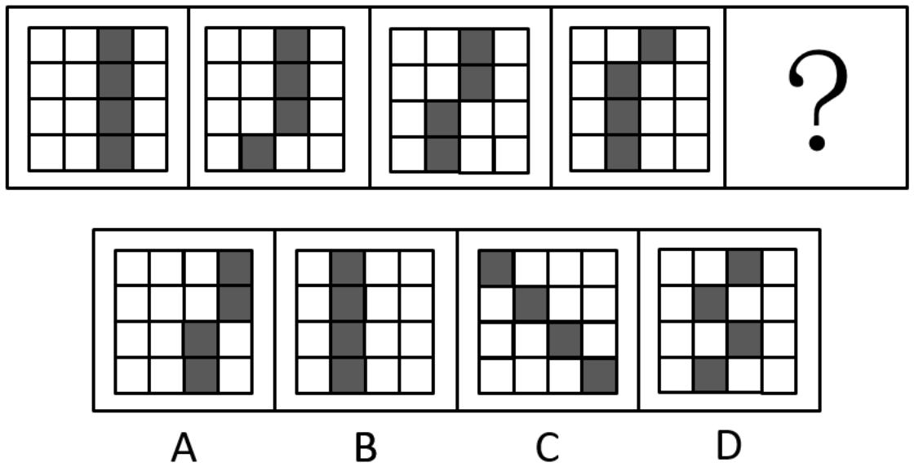

**47.** 下列选项中，与所给的立体图形不可能是同一图形的是：

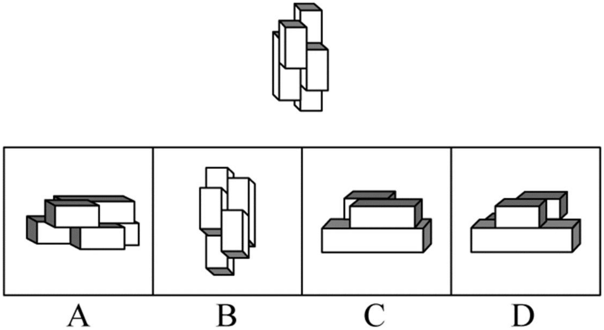

**48.** 从所给的四个选项中，选择最合适的一个填在问号处，使之呈现一定的规律性：

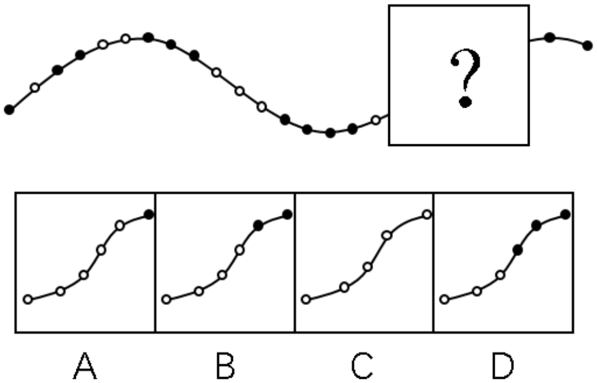

**49.** 将一个空心圆柱体斜切，得到下图所示物体。不可能是这一物体截面的是（）。

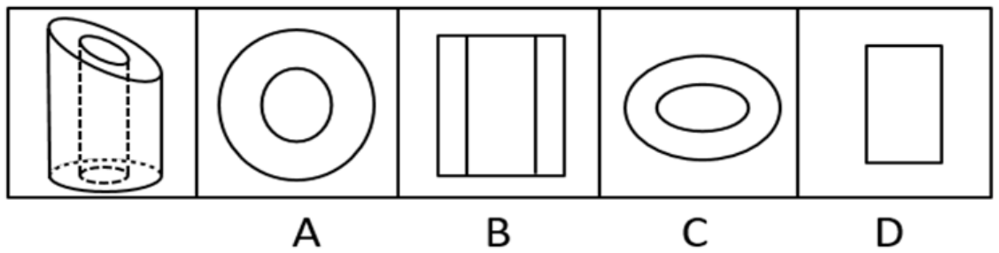

**50.** 下列选项中，不能在裁剪或覆盖后折成如图所示立方体的是（）。

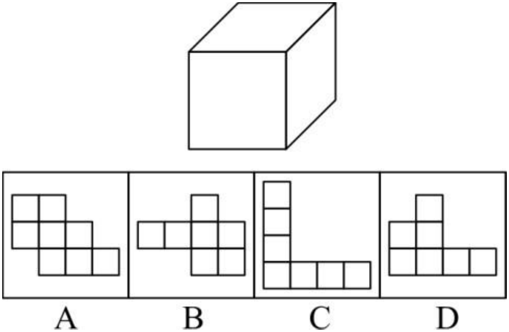

**51.** 某高校调查本校学生的兴趣爱好后发现，喜欢打羽毛球的学生中，来自体育学院的学生一定喜欢登山。
根据以上条件，下列情况必定属实的是：

A. 甲喜欢打羽毛球和登山，则甲是体育学院的学生
B. 乙是体育学院的学生，且喜欢登山，则乙喜欢打羽毛球
C. 丁不喜欢打羽毛球和登山，则丁不是体育学院的学生
D. 丙喜欢打羽毛球，不喜欢登山，则丙不是体育学院的学生

**52.** 芯片产业是全球分工合作的产业，其分布的领域非常广，不同领域面对的问题和挑战也大不相同，没有一个国家能够拥有完完整整的自主可控芯片产业链。但一国想要获得芯片产业的话语权，至少应该掌握产业链条上某些环节的关键技术，这样才能避免受制于人。
根据上述表述，下列判断一定正确的是（）。

A. 一个国家只要有了芯片产业话语权，该国就可能拥有完整的芯片产业链
B. 一个国家如果没有芯片产业的关键技术，则该国的芯片产业将受制于人
C. 一个国家的芯片产业要想不受制于人，就必须拥有完整的芯片产业链
D. 一个国家如果掌握了芯片产业的关键技术，那么该国一定具有芯片产业的话语权

**53.** 某单位每个月都要对工作人员的工作表现进行考评。去年上半年，该单位的甲、乙、丙、丁4位员工均获得了3次月度优秀奖。已知，甲和乙有2个月同时获奖，乙和丙也有2个月同时获奖，甲和丁获奖的月份完全不同。
以下说法一定正确的是：

A. 只有3个人同时获奖的月份有2个
B. 只有2个人同时获奖的月份有3个
C. 只有1个人获奖的月份有1个
D. 只有2个人同时获奖的月份少于只有1个人获奖的月份

**54.** 某单位准备派3名员工外出参加培训学习，计划从财务部的甲、乙、丙和行政部的丁、戊、己6人中选派人员。由于工作安排限制，参加培训学习的人员安排必须符合以下条件：财务部和行政部分别至少有一人参加；甲和乙不能同时参加；如果丁或戊参加，则丙不能参加。
以下人员名单符合条件的是（）。

A. 甲、丙、戊
B. 乙、丙、己
C. 甲、乙、戊
D. 丁、戊、己

**55.** 某公司今年定下了三个生产目标，甲乙丙丁分别做了如下预测：
甲：公司不能实现第一个生产目标。
乙：公司只能实现其中一个生产目标。
丙：公司能实现所有的生产目标。
丁：公司不能实现任何一个生产目标。
最终结果表明，4人中只有一人的预测正确，则公司实现的生产目标数量不可能是（）个。

A. 0
B. 1
C. 2
D. 3

**56.** 某教师收集了本班学生的语文学习兴趣、每天的学习时长等信息，结合期末考试语文成绩分析后发现，与每天语文学习时长不足2小时的学生相比，学习超过2小时的学生学习兴致普遍更高，其语文期末考试平均分也更高。该教师由此得出结论，增加语文学习时长能够有效培养学习兴趣，进而提高语文成绩。
下列选项若为真，最能质疑上述结论的是：

A. 该班级期末考试语文成绩最好的学生每天学习语文1小时
B. 该班级的语文期末考试平均分高于其他班级
C. 语文学习兴趣高的学生拥有更好的学习习惯
D. 只有语文学习兴趣高的学生才乐于花更长时间学习语文

**57.** 随着移动终端的发展，个人偏好的数据变得更加容易收集了。有专家认为，这能够形成一种双赢局面：媒体能够有效地找到自己的信息受众，而个人也能更便捷地获得符合自己偏好的信息。由于减少了无关信息的干扰，这对于社会创新将是一个重大利好。
下列能够最有力地质疑上述结论的是（）。

A. 创新更有赖于接收个人偏好以外的信息
B. 个人会根据自己的偏好主动选择一些信息提供渠道
C. 当前移动终端与互联网的发展尚未能充分收集个人偏好
D. 媒体向个人输送符合其偏好信息的同时也发送了更多广告

**58.** 有研究指出，智商高的人更容易在某个专业领域取得成绩，而情商高的人，通常有较完满的婚姻和家庭，有良好的人际关系。专家指出，为了孩子的幸福，父母应该更加注重对孩子情商的培养。
以下最能支持上述专家观点的是（）。

A. 相比于社会环境因素，遗传因素对智商的影响更大
B. 许多成功的专业人士的智商并不是很高，但情商很高
C. 一个人的情商水平，与其童年时期接受的教育培养关系密切
D. 良好的人际关系和家庭状况比专业成就更能让人获得幸福感

**59.** 天天公司将生产线由A县搬至B县，这对两个县来说都是好事，因为这一做法提高了两县企业的平均生产效率。
若上述论断成立，则必须补充的前提是（）。
①天天公司的生产效率比A县其他企业都低
②天天公司的生产效率低于A县企业的平均生产效率
③B县企业的平均生产效率低于A县企业
④B县企业的生产效率普遍低于A县企业

A. ①④
B. ①③
C. ②③
D. ②④

**60.** 有甲、乙两个品牌的电脑专卖店，甲品牌专卖店客流量略高于乙品牌专卖店，因此，甲品牌专卖店的电脑销量比乙品牌专卖店的大。
上述推论最可能基于的假设是（）。

A. 乙品牌开通了网络销售渠道
B. 甲品牌专卖店规模比乙品牌的大
C. 两个专卖店的进店购买率相当
D. 甲品牌的广告投入更大

**61.** 由于按揭贷款的利率下调，人们每月还贷压力减小，因此一家机构预测某地的商品房销售量会增长，但实际上，销售量并未出现明显增长。
下列哪项如果为真，最能解释以上现象？

A. 当地一直存在人口外流的现象
B. 本地的商品房价格没有明显下降
C. 有的开发商取消了购房优惠政策
D. 因经济环境不好，当地人均收入下降

**62.** 为推动社区养老服务建设，某社区开设了长者食堂，向社区内符合条件的老年人提供一日三餐。该食堂饭菜价格远低于市场价，且品种多样、味道极佳、分量充足，然而每天到该食堂就餐的老年人数量并不多。
以下各项如果为真，最能解释这一现象的是（）。

A. 社区内多数老年人选择送餐上门而非到食堂用餐
B. 该社区内和周边有许多深受当地居民喜爱的餐馆
C. 该长者食堂占地面积较大，食堂内就餐座位充足
D. 符合就餐条件的老年人在社区居民中的占比不高

**63.** 希望过上好日子的村民都愿意接受就业辅导。村民小王愿意接受就业辅导，因此，他希望过上好日子。
以下选项存在与题干最为相似的逻辑错误的是（）。

A. 该店所有出售的水果都通过了农药残留检测，苹果通过了农药残留检测，因此该店正在出售苹果
B. 张家苗圃在使用了这批肥料后花木长势很好，李家苗圃长势不好，因此李家苗圃没有使用这批肥料
C. 许多坚持运动的儿童身体都比较健康，许多成年人也会坚持运动，因此坚持运动的成年人身体都比较健康
D. 只有经过Ⅲ期临床试验的新药才可能被批准上市，该新药没有经过Ⅲ期临床试验，所以它没有被批准上市

**64.** 历史经验告诉我们，世界经济危机往往伴随着巨大的世界变革：1857年世界经济危机后的电气革命，推动人类社会从蒸汽时代进入电气时代；1929年世界经济危机引发了第二次世界大战，客观上推动了科学技术的发展。由此可知，是经济危机造成了巨大的世界变革。
以下和该论证过程的逻辑最为类似的是（）。

A. 不正确的坐姿会加重颈部负担，因而是腰酸背痛的主要诱因
B. 海底地震是海啸的主要成因，因为海啸发生前往往能观测到海底地震
C. 宇航员的预期寿命明显高于一般人，因此太空旅行中的辐射暴露并不会危害人体
D. 许多体弱多病的人都不喜欢吃蔬菜，所以想保持身体健康就必须从蔬菜中摄入足量的膳食纤维

**65.** 有研究表明，长期使用酒精洗手液会对手部皮肤造成损伤，而某品牌免洗洗手液所有成分均从天然植物提取，不含酒精。因此不会对手部皮肤产生损害。
下列选项最能指出上述论证缺陷的是（）。

A. 默认了洗手液中只有酒精对手部皮肤产生损害
B. 默认了从天然植物中不会提炼出酒精
C. 忽视了酒精会提升洗手液的清洁效果
D. 忽视了从天然植物中提取的成分可能对人体其它部位造成损伤

## 第六部分　科学推理

**66.** 下图是某物体做直线运动时，其速度 v 与时间 t 关系的折线图，则以下说法准确的有（）。
①在t₁~t₃，物体匀速运动
②在0~t₁和t₃~t₄，物体做同方向运动
③在t₄时，物体离出发点距离最远
④在t₁~t₂和t₃~t₄，物体的加速度方向相反
⑤在t₂时，物体改变运动方向

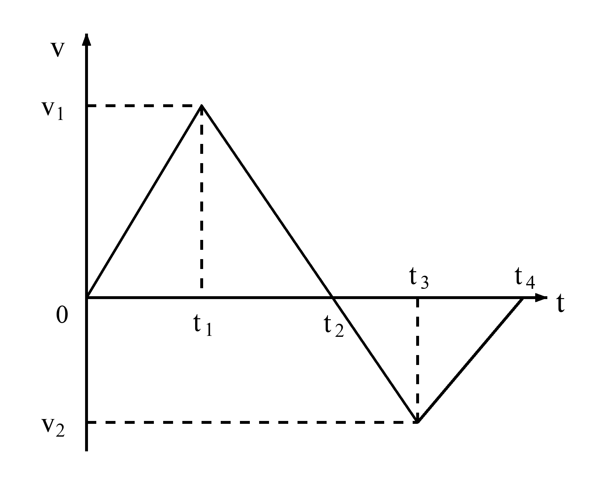

A. ①⑤
B. ③④
C. ④⑤
D. ①②④

**67.** 如图所示，质量为m的物体A在水平力F的作用下，恰好沿竖直墙壁匀速下滑，当水平力增大为2F时，物体A逐渐减速，最后保持静止。则静止时物体A所受摩擦力的大小（）。

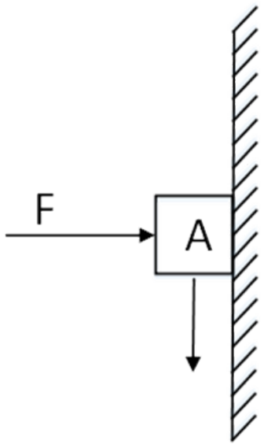

A. 为原来的2倍
B. 小于F
C. 大于mg
D. 等于2F

**68.** 某电热水器设计了两个开关。当水温低于指定温度时，两个开关自动闭合，电热丝将水加热，指示灯亮起；当水温升高到指定温度时，一个开关断开，电热丝停止加热，指示灯仍亮。该电热水器的电路图最有可能是（）。

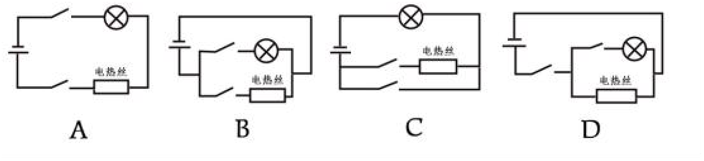

**69.** 如果将等量的氧气和氮气混合，注入一个密闭容器，则静置较长一段时间后，容器内氧元素（用O代表）和氮元素（用N代表）的分布最可能接近（）。

**70.** 如图是某地生态系统的蒸散示意图，下列说法最准确的是：

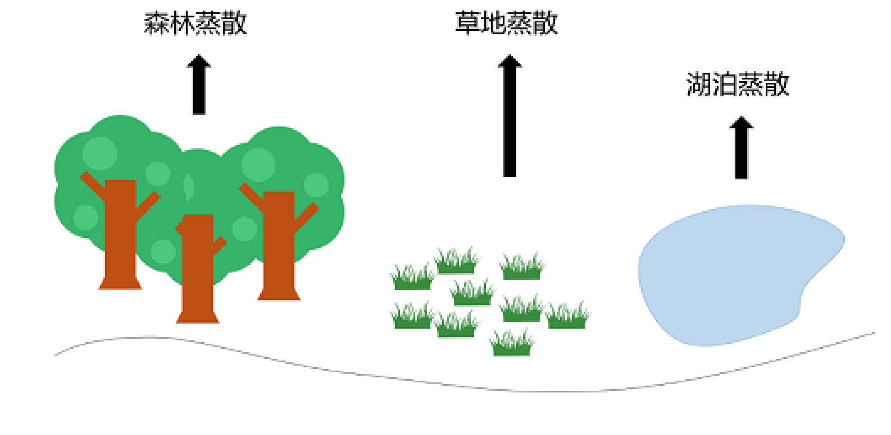

A. 环境温度升高，森林的蒸散作用减弱
B. 空气湿度越大，森林的蒸散作用越弱
C. 任意环境条件下，湖泊的蒸发量比森林蒸散量大
D. 相较于夜晚，该地生态系统在白天时蒸散作用强度明显减弱

## 第七部分　资料分析

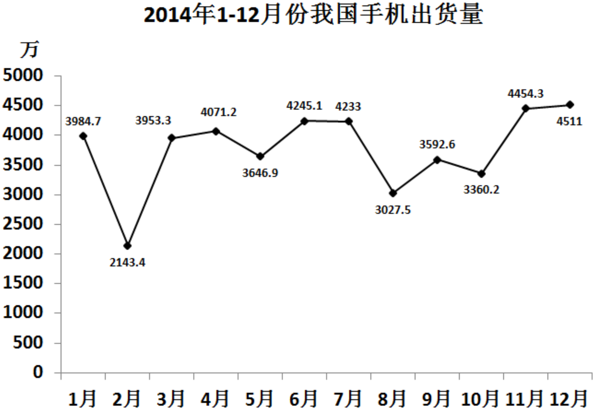

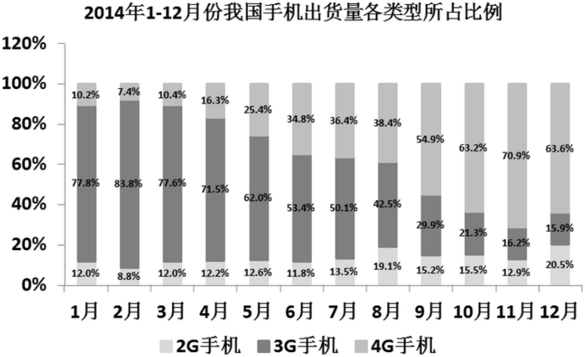

**71.** 2014年2~12月，我国手机出货量与上月相比增长率最高的月份是：

A. 2月
B. 3月
C. 6月
D. 11月

**72.** 2014年1~12月，我国3G手机和4G手机出货量相差最大，最小的月份分别是：

A. 1月、8月
B. 2月、8月
C. 1月、7月
D. 2月、7月

**73.** 2014年2~12月，我国2G手机出货量所占比例与上月相比有所上升的月份共有多少个：

A. 2
B. 4
C. 7
D. 8

**74.** 2014年1~12月，最接近我国手机出货量全年平均数的月份是：

A. 5月
B. 8月
C. 9月
D. 10月

**75.** 下列说法错误的是：

A. 2014年2-12月，我国手机出货量与上月相比有所下降的月份有5个
B. 2014年2月，我国2G手机和4G手机的出货量均为全年最低
C. 2014年7月，我国4G手机出货量首次超过了1500万
D. 2014年1-12月，我国3G手机出货量所占比例逐月下降

2012年，某省加大扶持贫困残疾人力度，财政投入扶贫资金3816.3万元，比上年大幅增长18%，扶持贫困残疾人员56561人，脱贫35110人，享受优惠政策的贫困残疾人117727人，比上年增加3%。
截至2012年底，城镇残疾人员安排就业人数共227192人，其中，集中就业25135人，按比例就业合计91384人，个体及其他形式就业110673人。农村残疾人实际就业630900人，其中，从事农业生产活动515278人，从事其他形式就业115622人。
2012年城镇残疾职工参加社会保险133546人，城镇残疾居民参加社会保险235584人。2012年有14个区县确定为中央新农保的试点县，试点地区参保新农保22717人，参保率为34.5%；其中重度残疾人参保占19.9%。
城镇纳入各类生活保障的残疾人共计147438人。其中，已经纳入最低生活保障范围87922人；集中供养3758人，临时救济22423人，定期补助33335人。农村纳入各类生活保障的残疾人共计339075人。其中，已纳入最低生活保障的残疾人共有221132人，五保供养18146人，临时救济32719人，定期补助67078人。
截至2012年底，省、市、县、乡级残联实有人员5591人，比上年增加11.8%，全省21个地级市中的3个地级市与121个县（市、区）中的61个县（市、区）配备了残疾人领导干部，全省1589个乡镇街道中已建残联1547个；全省19435个村（社区）中已建残协10537个。

**76.** 2012年，该省城镇残疾人就业形式主要为：

A. 集中就业
B. 按比例就业
C. 从事农业生产活动
D. 个体及其他形式就业

**77.** 该省每年投入的残疾人财政扶贫资金如果可以均分到每位享受优惠政策的贫困残疾人身上，则2012年享受优惠政策的贫困残疾人的人均扶贫金额要比2011年增长约（）元：

A. 30
B. 40
C. 50
D. 60

**78.** 2011年全省、市、县、乡级残联实有人员（）人：

A. 5001
B. 4931
C. 4776
D. 3758

**79.** 以下有关纳入各类生活保障范围的城镇残疾人和农村残疾人人数的说法，错误的是：

A. 无论在城镇还是在农村，领取定期补助的残疾人数量都高于领取临时救济的残疾人数量
B. 无论在城镇还是农村，最低生活保障都是当地残疾人生活保障的主要形式
C. 在所有被纳入生活保障范围的城镇残疾人群中，集中供养者的比例高于享受生活保障的农村残疾人中五保供养者的比例
D. 在所有被纳入生活保障范围的城镇残疾人群中，享受定期补助的人数比例高于农村

**80.** 根据上述资料，以下说法正确的是：

A. 全省县（市、区）配备残疾人领导干部的情况要比地级市普遍
B. 全省乡镇街道已建残联的比例要比村（社区）已建残协的比例低
C. 全省区县接近2成的重度残疾人参加了新农保
D. 全省城镇残疾人被纳入最低生活保障范围的比例低于农村

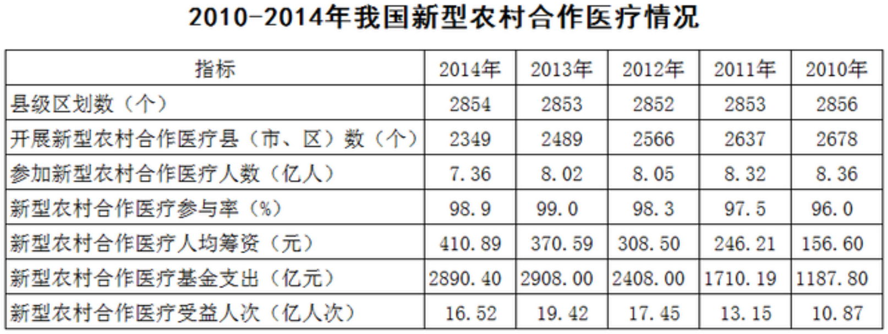

**81.** 2011—2014年，新型农村合作医疗基金支出同比增长幅度最高的是（）年。

A. 2011
B. 2012
C. 2013
D. 2014

**82.** 2010—2014年，开展新型农村合作医疗的县（市、区）数量占县级区划数90%以上的年份有（）个。

A. 1
B. 2
C. 3
D. 4

**83.** 2011—2014年，新型农村合作医疗受益人次增长率最高的是（）年。

A. 2011
B. 2012
C. 2013
D. 2014

**84.** 2010—2014年，参加新型农村合作医疗人数最多的一年比人数最少的一年多了（）亿人。

A. 0.31
B. 0.34
C. 0.65
D. 1

**85.** 下列说法有误的是（）。

A. 新型农村合作医疗基金支出逐年增加
B. 参加新型农村合作医疗人数最少的一年也是人均筹资最多的一年
C. 新型农村合作医疗参与率最高的是2013年
D. 参加新型农村合作医疗人数最多的是2010年

2016年，某省小微服务业呈现出经营平稳面、资产规模、享受税收优惠政策范围“三扩大”的特点，主要行业实现较快增长。
2016年，该省小微服务业样本企业实现营业收入80.1亿元，同比增长15.4%，高于规模以上重点服务业企业8.2个百分点，增速比上年回落0.6个百分点。经营平稳面扩大，2016年4季度，79.5%的企业认为本企业综合经营状况良好或稳定，同比提高3.3个百分点，处于历史较高水平。

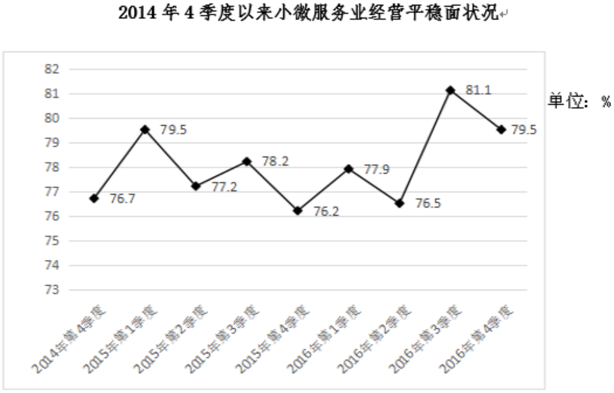

2016年，小微服务业样本企业资产总计367亿元，同比增长9.3%，户均1643.7万元。负债合计194.8亿元，同比增长8.1%，低于资产增长速度1.2个百分点。资产负债率为53.1%，处于较为合理水平。实现利润总额4.6亿元，销售利润率为5.7%。小微服务业企业的资金和盈利水平均处于平稳状态。
各主要行业中，水利、环境和公共设施管理业，信息传输、软件和信息技术服务业，租赁和商务服务业，房地产业的增速明显高于平均水平。

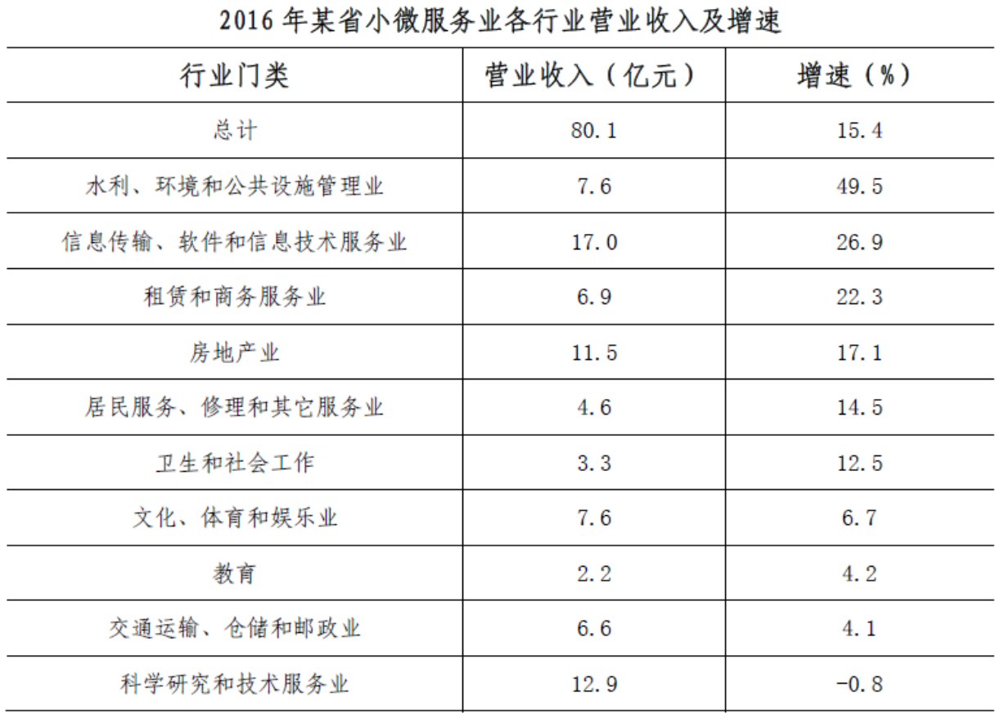

**86.** 2016年，该省小微服务业样本企业的营业收入比2015年大约多多少亿元？

A. 5.3
B. 10.7
C. 12.3
D. 23.0

**87.** 2016年，小微服务业经营平稳面同比扩大最显著的是：

A. 1季度
B. 2季度
C. 3季度
D. 4季度

**88.** 2015-2016年，平均每季度大约有百分之多少的企业认为自身综合经营状况良好或稳定？

A. 77.2%
B. 78.3%
C. 79.6%
D. 82.8%

**89.** 2016年，小微服务业的下列各行业，按营业收入同比变化量的大小排序正确的是：

A. 文化、体育和娱乐业>卫生和社会工作>科学研究和技术服务业>教育
B. 文化、体育和娱乐业>卫生和社会工作>教育>科学研究和技术服务业
C. 文化、体育和娱乐业>科学研究和技术服务业>卫生和社会工作>教育
D. 卫生和社会工作>文化、体育和娱乐业>科学研究和技术服务业>教育

**90.** 下列说法不正确的是：

A. 2016年，大多数小微服务业行业的营业收入同比有所增长
B. 2015年，小微服务业样本企业的户均资产大约为1504万元
C. 2016年，小微服务业样本企业的户均负债大约为873万元
D. 2016年，信息传输、软件和信息技术服务业的营业收入增加最多
