# M13　广东省考行测模拟卷（题本）

## 第一部分　政治理论

**1.** 中国共产党在波澜壮阔的伟大征程中，铸就了勇担历史使命、始终掌握战略主动，顺应发展潮流、始终走在时代前列，注重强健自身、始终充满生机活力等优秀特质。

A. 正确　　B. 错误

**2.** 坚持中央全面管治权和保障特别行政区高度自治权相统一，特别行政区高度自治权是中央全面管治权的前提和基础。

A. 正确　　B. 错误

**3.** 流经广东的西江、北江、东江和韩江都属于珠江水系。

A. 正确　　B. 错误

**4.** 唯物辩证法认为，量变是质变的前提和必要准备，质变是量变的必然结果。

A. 正确　　B. 错误

**5.** 保持党同人民群众的血肉联系关系到党的生死存亡、兴旺发达。我们党的最大政治优势是密切联系群众，党执政后的最大危险是脱离群众。下列古语与这一论述最为契合的是（　）。

A. 凡治国之道，必先富民
B. 民生在勤，勤则不匮
C. 水则载舟，水则覆舟
D. 民亦劳止，汔可小康

**6.** 二十届五中全会《决定》提出，持之以恒推进全面从严治党，要不回避矛盾，不讳疾忌医，在纠偏治乱、激浊扬清中提高工作水平。这一要求最能体现习近平新时代中国特色社会主义思想（　）的立场观点方法。

A. 必须坚持系统观念
B. 必须坚持问题导向
C. 必须坚持人民至上
D. 必须坚持自信自立

**7.** 2026年9月，习近平在金砖国家领导人第十八次会晤第一阶段会议上发表讲话，回顾金砖合作20年历程，提出金砖国家要勇做时代先锋。下列表述与讲话内容不符的是（　）。

A. 金砖国家作为全球南方第一方阵，成为新兴市场和发展中国家联合自强的典范
B. 金砖国家实现历史性扩员，迈入“大金砖合作”高质量发展新阶段
C. 二十年风雨兼程，团结合作始终是金砖事业发展的力量之源
D. 当今世界变和乱的一面更加突出，归根到底是世界经济增长动能不足

**8.** 我国宪法对全国人民代表大会及其常务委员会、国务院的职权作了规定。下列关于职权归属的说法，正确的是（　）。

A. 规定和决定授予国家勋章和荣誉称号，属于全国人大常委会的职权
B. 决定战争和和平的问题，属于全国人大常委会的职权
C. 决定全国或者个别省、自治区、直辖市进入紧急状态，属于国务院的职权
D. 选举国家监察委员会主任，属于全国人大常委会的职权

**9.** 从土地革命战争时期到中国特色社会主义新时代，党召开的一系列重要会议在党的历史上留下了深刻印记。以下表述符合历史事实的有（　）。

A. 遵义会议开始确立了以毛泽东为代表的新的中央的正确领导
B. 党的十一届三中全会标志着党在指导思想上的拨乱反正胜利完成
C. 党的十八大第一次提出建设“美丽中国”的目标
D. 党的十九大全面系统阐述了中国式现代化的领导力量、中国特色、本质要求和重大原则

**15.** 2026年广东省高质量发展大会以制造业与服务业协同发展为主题。关于推动两业协同发展，下列表述与会议精神不符的是（　）。

A. 制造业与服务业如同树木的主干与枝叶，根深干壮才能枝繁叶茂
B. 企业是产业体系的细胞单元，要重点培育深耕主业的“头雁”企业
C. 两业协同起于科技创新、兴于科技创新，要部署推进共性技术研发和组织模式创新
D. 要着力破解“老规矩管新质生产力”的问题，最大限度为技术创新和市场探索“松绑”

## 第三部分　言语理解与表达

**16.** 并非所有纪录片都在商业化之路上（），前方已然有许多口碑与流量并存的精品用自己的经验告诉后来者：观众的口味并非（），无论时代和观众的口味如何变迁，精耕内容、细磨品质永远是赢得观众的制胜法宝。

A. 一帆风顺 变幻莫测
B. 折戟沉沙 不可捉摸
C. 一败涂地 高深莫测
D. 披荆斩棘 耐人寻味

**17.** 外交调研是一门特殊的学问，既要善于____，又不能听风便是雨。
填入画横线部分最恰当的一项是：

A. 见微知著
B. 当机立断
C. 反躬自省
D. 触类旁通

**18.** 有家长认为，升学压力前移，竞争愈发激烈，实际上（）的是公众对优质教育资源的渴求与公共教育资源配置不均衡、不充分之间的矛盾愈发（）。

A. 展现 突出
B. 反映 突现
C. 折射 突显
D. 呈现 突兀

**19.** 随着时间的推移，新一代农民开始（）自己的打工生涯，并希望能融入城市，走出农民工这个身份模糊的地带。

A. 计划
B. 谋划
C. 策划
D. 规划

**20.** 只有____勤俭节约，____铺张浪费之歪风____，才能有效净化我们的社会风气，培育健康向上的文明风尚。
依次填入画横线部分最恰当的一项是：

A. 厉行 提防 漫延
B. 力行 防止 漫延
C. 力行 防备 蔓延
D. 厉行 防范 蔓延

**21.** 优抚安置工作要充分体现党、政府和人民对革命功臣的关爱。优抚安置的服务对象种类多，老龄化突出，服务对象有优抚和安置两大部分，共5类27种。优抚安置的工作环节和服务保障流程复杂。比如接收安置一名重点对象，需经过审定安置计划、落实住房建购经费、下达安置计划、办理移交手续等十几个环节。接收下来后还要负责落实政治待遇、生活待遇、医疗保障等服务管理内容几十项。
这段话主要说明：

A. 优抚安置工作政治性强，政策保障要求高
B. 优抚安置工作相关性强，协调沟通任务重
C. 优抚安置工作特殊性强，服务保障难度大
D. 优抚安置工作矛盾性强，形势任务适应难

**22.** 文化自信是更深厚的自信。“______。”中华文化扎实之根脉、醇厚之积淀，恰如有源之水，滋养着中华民族在新的历史条件下的新创造、新发展，给我们的文化自信打下了最深厚的历史根基。
下列句子填入画横线处，最恰当的是：

A. 海纳百川，有容乃大
B. 积土而为山，积水而为海
C. 源浚者流长，根深者叶茂
D. 泰山不让土壤，故能成其大

**23.** 建设生态文明，要在形成支持绿色发展、循环发展、低碳发展的机制上下真功夫、下大气力；主动抓住新一轮科技革命和产业变革带来的新机遇，掌握革命性、关键性绿色核心技术，进而带动生态技术和生态产业交叉融合、群体跃进。换言之，从“生产力与生产关系矛盾运动规律”来看，如同“铁和犁”于农业文明、“纺纱机和蒸汽机”于工业文明一样，只有实现绿色生产力和绿色生产关系的根本性变革，生态文明才会成为真正引领人类文明的新形态。
对上述文段理解最准确的是：

A. 生态文明是人类文明形态中的最高级阶段
B. 生产力和生产关系的辩证关系决定了生态文明的发展
C. 实现绿色生产关系变革的关键是取得绿色核心技术突破性进展
D. 形成支持绿色、循环和低碳发展的机制是生态文明建成的标志

**24.** 威慑其实是让假想敌人的内心产生恐惧，从而阻止他做出对自己不利的事情来。但是这种恐惧的根源有两个：第一，对手要认可威慑方所具备的实力，很难想象一个弱小的国家能够威慑强大的美国；第二，对手还要相信威慑方动用实力来达到目的的决心，换句话说，对手要确认威慑方的意图。如果对手认为威慑方并不具备真实的进攻性意图，那么简单的展示实力或者言语威胁就毫无意义了。
根据这段文字，以下说法正确的是：

A. 威慑方通过让潜在对手相信自己的实力以达到威慑的目的
B. 威慑的目的在于阻止强大对手的攻击并使其产生惧怕
C. 威慑方真实明确的意图更能给对手带来恐惧
D. 威慑的成功与否关键在于被威慑方的认知

**25.** 所有的经济活动并不发生在抽象的空间内，而是发生在实实在在的社会空间里，任何经济交易都是发生在人与人之间和不同社会群体之间。或者说，经济生活不能独立于社会生活，而是社会生活的一个重要组成部分。社会的正常运作是经济发展的最基本条件，基本社会正义的重要性也在这里，如果没有基本社会正义，社会运作就会出现很大的问题。
该段文字意在说明（）。

A. 经济生活与社会生活相互依存，密不可分
B. 经济活动能为基本社会正义创造经济条件
C. 经济的可持续发展要求基本社会正义
D. 社会缺少基本正义将使社会失去秩序和稳定

**26.** 最高人民法院对近年来生效裁判进行系统化、常态化梳理，深入总结提炼在审理过程中形成的价值理念、司法经验和裁判规则，推动形成体系完备、门类齐全、科学权威、便捷适用的裁判要旨提炼编撰体系。最高人民法院还出台了法律适用分歧解决机制的实施办法和统一法律适用工作实施办法，有效解决生效裁判之间存在的法律适用分歧问题，创新“点对点”法律适用分歧解决机制，推动法律适用分歧解决机制运行更加精准有效、灵活快捷，切实防止司法正义因地域、城乡、行业差异而打折扣。
最适合做这段文字标题的是：

A. 统一裁判尺度，维护社会公平
B. 以法律适用统一提升执法水平
C. 用良法善治夯实法治之基
D. 消除“同案不同判”迫在眉睫

**27.** 近年来，社会热点事件频频占据了我们的视线，从毒奶粉事件到染色馒头事件，无疑给广大民众带来了巨大的心理负担和精神困惑；曾经轰动全国的抢盐事件，更是对社会正常秩序的一种冲击。很明显，这些社会热点事件，给人们的社会生活带来了破坏性甚至是毁灭性的影响。但是最为严重的影响，莫过于这些社会热点事件所产生的负面效应的不断扩散，并由此引发的公众的困惑和不安。
根据这段文字，可以看出作者的意图是：

A. 呼吁对社会热点事件负面效应的扩散进行有效抑制
B. 批判社会热点事件的负面效应混淆了公众的视听
C. 揭示社会热点事件的负面效应不断扩散的实质
D. 提醒人们在复杂多变的环境中提高甄别社会热点事件的能力

**28.** 进行骨髓移植的前提条件是有配型成功的捐赠者。双胞胎配型成功几率最高，兄弟姐妹也有可能。但在中国，20世纪70年代到现在，大多数都是独生子女，有兄弟姐妹且能配型成功的概率也非常低。另外，父母和子女之间骨髓配型成功的概率非常低，几乎为零。因此，绝大多数患者都必须依赖不认识的志愿者配型。非亲缘关系骨髓配型成功的几率只有几十万至几百万分之一，____。
填入画横线部分最恰当的一句是：

A. 即使这样，骨髓移植仍是大多数血液疾病患者的唯一希望
B. 如果冒着风险使用不完美的配型，成功率自然会大为降低
C. 骨髓库里志愿者样本的多少，直接决定着病人找到合适配型的几率
D. 志愿者捐献固然很重要，国家相关政策的落实和执行也是当务之急

**29.** 种粮大户们认为，要真正使种粮有效益，农民种粮有积极性，一方面是要加大对种粮新主体的扶持力度，特别是要加大各类补贴力度，规范操作运行，确保各项政策不折不扣地兑现到农民手中，使种粮有效益、不吃亏、得实惠。另一方面，要对稳定多年的种粮规模经营主体优先安排基础设施建设，在国土整治、农业综合开发、粮食基础能力建设、粮食高产创建、测土配方施肥等方面向种粮大户及粮食专业合作社倾斜。
对这段文字理解不准确的一项是：

A. 加大扶持力度有助于提高种粮积极性
B. 农民种粮积极性的大小取决于种粮的收益
C. 种粮大户及粮食专业合作社应该享有政策优惠
D. 加强基础设施建设有助于提高种粮积极性

**30.** ①除萤科于白垩纪缅甸琥珀及一些新生代地层中有化石记录外，其他类群化石此前尚未被报道过
②能够生物发光的叩甲总科物种大部分归属于萤类，包括萤科、光萤科、雌光萤科及华光叩甲科
③日前，科研人员在缅甸琥珀中发现了叩甲总科的新科——白垩光萤科
④在陆生动物中，能进行生物发光的物种大都属于鞘翅目昆虫，其中叩甲总科最多见
⑤萤类分支中除华光叩甲科，其他物种身体均较为柔软，部分类群的雌性还具有幼态持续现象，也正因此其物种很难被保存为化石
⑥这一新类群的发现，对于研究叩甲总科中生物发光的起源与演化具有重要意义
将以上6个句子重新排列，语序正确的一项是：

A. ④②⑤①③⑥
B. ④⑤①②⑥③
C. ③⑥④⑤②①
D. ③⑤④①⑥②

## 第四部分　数量关系

**31.** 123，465，987，（），456，897，231，645，789

A. 312
B. 578
C. 684
D. 738

**32.** 607，819，10211，12313，（    ）

A. 13414
B. 14415
C. 14514
D. 15415

**33.** $\frac{1}{3}$，$\frac{1}{2}$，$\frac{2}{3}$，$\frac{3}{4}$，$\frac{8}{9}$，$\frac{27}{32}$，（）

A. $\frac{64}{81}$
B. $\frac{128}{81}$
C. $\frac{243}{256}$
D. $\frac{256}{243}$

**34.** 2.5，2.4，8.9，56.13，560.22，（）

A. 5600.36
B. 6140.35
C. 6720.36
D. 7280.35

**35.** 

A. 4
B. 5
C. 8
D. 10

**36.** 甲、乙两个仓库共存有340吨粮食。如果甲仓库存放的粮食是乙仓库的2倍多10吨，则甲仓库存有粮食（）吨。

A. 110
B. 120
C. 230
D. 240

**37.** 某学校对500名学生进行了一次调查，结果显示，会游泳的学生比不会游泳的学生多34人，而在会游泳的学生中，会自由泳的学生只占1/3。则在500名学生中，不会自由泳的学生比会自由泳的学生多（）人。

A. 322
B. 237
C. 231
D. 79

**38.** 甲、乙二人绕着圆形操场跑道散步，甲顺时针走，乙逆时针走。两人在跑道A处同时出发，甲每分钟走90米，乙每分钟走60米，当甲、乙两人在跑道B处相遇时，乙加快了速度，甲在原地停留4分钟后保持原来的速度继续往前走，最后甲、乙二人仍在A处相遇。已知该操场的周长为1800米，那么相遇后，乙的速度变为每分钟（）米。

A. 70
B. 80
C. 90
D. 100

**39.** 甲、乙两个工程队合作完成一项工程，甲每工作3 天休息1 天，乙每工作5 天休息2 天。
若甲先工作，2 天后乙加入，则再用21 天完工；若乙先工作，12 天后甲加入，则再用15
天完工。甲单独完成该项工程需要的天数是

A. 43
B. 44
C. 47
D. 48

**40.** 甲、乙、丙3个单位订阅同一款报刊，已知3个单位共订了12份，其中，每个单位订阅数量不少于3份，但不超过5份，则这3个单位的报刊订阅数量可能有（）种组合。

A. 2
B. 6
C. 7
D. 9

**41.** 一项考试共有35道试题，答对一题得2分，答错一题扣1分，不答则不得分。一名考生一共得了47分，那么，他最多答对（）题。

A. 26
B. 27
C. 29
D. 30

**42.** 一个箱子的底部由5块正方形纸板ABCDE和1块长方形纸板F拼接而成（如图所示），已知A、B两块纸板的面积比是1:16，假设A纸板的边长为2厘米，则该箱子底部的面积为（）平方厘米。

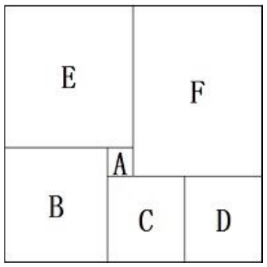

A. 200
B. 320
C. 360
D. 420

**43.** 为促进旅游业复苏，今年8 月1 日起至年底，某景区门票价格在原定价的基础上，工作日执行两折票价，双
休日及法定节假日执行五折票价。预计门票打折后，每天的游客人数均比原来翻一番，已知打折前该景区双休日
平均每天的游客人数是工作日的5 倍，则打折后，该景区一周（该周无法定节假日）的门票收入是打折前的：

A. 0.5 倍
B. 0.6 倍
C. 0.7 倍
D. 0.8 倍

**44.** 某单位计划从全部80名员工中挑选专项工作组成员，要求该组成员须同时有基层经历和计算机等级证书。
已知，单位内有40人有基层经历，有46人有计算机等级证书，既没有基层经历又未获得计算机等级证书的有10人。那么能够进入工作组的员工有（）人。

A. 16
B. 40
C. 46
D. 54

**45.** 某单位每天都会安排2人在大楼入口负责安检，安排3人负责楼层巡查。为此，单位组织了一支12人的队伍，并根据序号安排工作：第一天由队员1、2负责安检，队员3、4、5负责巡查；第二天由队员6、7负责安检，8、9、10负责巡查；第三天由队员11、12负责安检，队员1、2、3负责巡查……以此类推。如果队员1今天负责了安检，则最晚在（）天后他将再次负责安检。

A. 5
B. 6
C. 7
D. 8

## 第五部分　判断推理

**46.** 从所给的四个选项中，选择最合适的一个填在问号处，使之呈现一定的规律性：

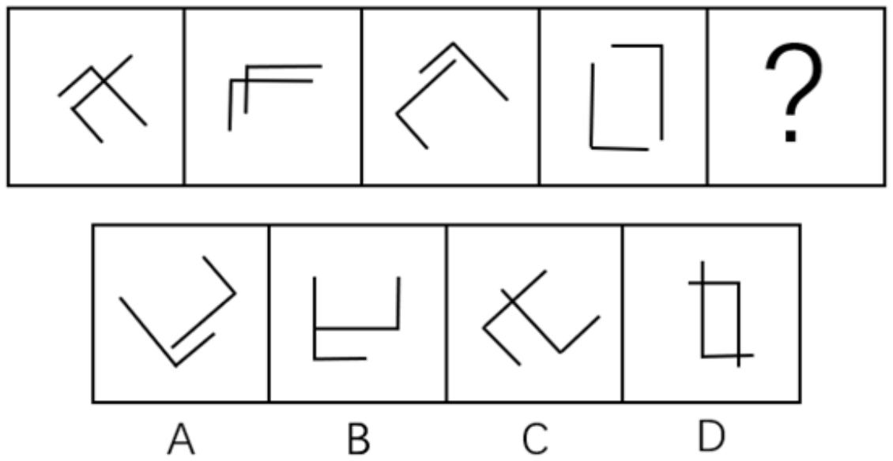

**47.** 从所给的四个选项中，选择最合适的一个填在问号处，使之呈现一定的规律性：

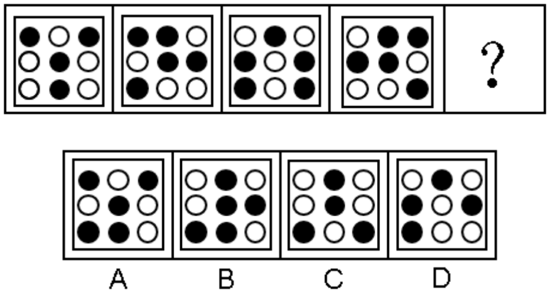

**48.** 从所给的四个选项中，选择最合适的一个填在问号处，使之呈现一定的规律性：

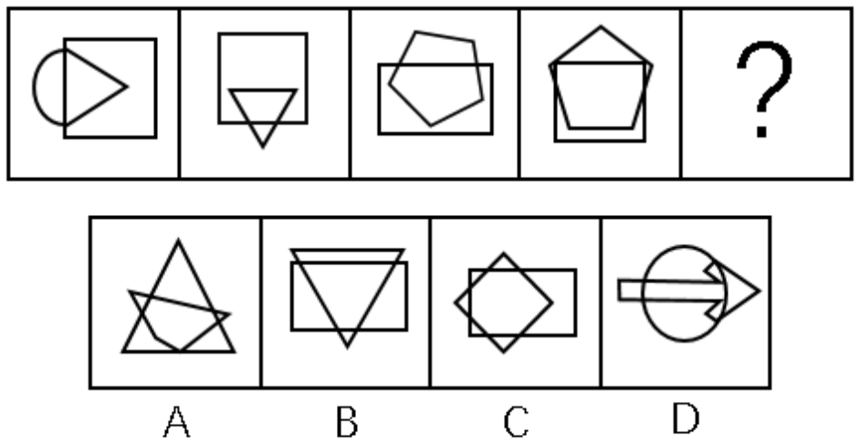

**49.** 如图所示，下列物体均由纯黑色和纯白色的小立方体组成。则物体①与物体②中，（）由5块物体③堆积而成。

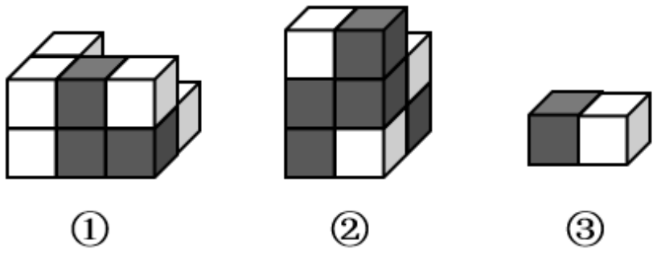

A. 只有物体①可能
B. 只有物体②可能
C. 物体①与②均可能
D. 物体①与②均不可能

**50.** 左图是一个正四面体的外表面。右边不能由它折叠而成的是（）。

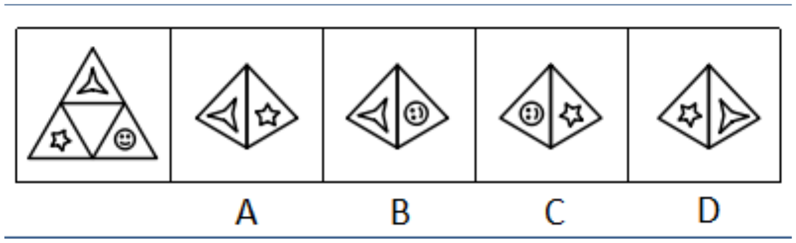

**51.** 某省开展了新高考改革，考试科目按“3+1+2”模式设置，“3”为全国统一高考的语文、数学、外语，“1”由考生在物理、历史2门学科中选择1门，“2”由考生在政治、地理、化学、生物学4门学科中选择2门。某校选了化学的同学大多数都选了物理，选了政治的同学都选了历史。
如果以上描述为真，则下列关于该校的断定必然为真的是（）。
Ⅰ.有的同学选了化学和政治
Ⅱ.选了化学的同学都没有选政治
Ⅲ.有的同学选了化学却没有选政治
Ⅳ.有的同学选了政治却没有选化学

A. Ⅰ和Ⅱ
B. Ⅲ和Ⅳ
C. 只有Ⅲ
D. Ⅰ和Ⅲ

**52.** 某围棋队有选手会在比赛时喝茶，他们或者喝红茶，或者喝绿茶。
如果以上描述为真，下列哪项一定是真的？
Ⅰ．该围棋队一名在比赛时不喝红茶的选手，一定喝绿茶。
Ⅱ．该围棋队没有选手比赛时喝黑茶。
Ⅲ．该围棋队有的选手比赛时不喝茶。

A. 只有Ⅱ
B. 只有Ⅲ
C. Ⅰ和Ⅱ
D. Ⅱ和Ⅲ

**53.** 某单位计划外出调研，在人员的安排上，需要综合考虑以下因素：
（1）甲或乙至少要派一人。
（2）如果派了乙，还要派丙才合适。
（3）甲和丙至多派一人。
（4）若派了甲，还必须派丁一起去。
（5）乙和丁是多年的搭档，应该一起去。
则参与此次调研的至少有（）人。

A. 1
B. 2
C. 3
D. 4

**54.** 甲、乙、丙、丁四人参加象棋比赛，根据比赛规定每两人之间要比试一次，胜者计2分，平者计1分，负者计0分。已知全部比赛结束后，只出现了1次平局，且甲获得4分，乙获得3分，丙获得0分，丁获得5分。
则下列陈述不正确的是（）。

A. 甲胜过了乙
B. 乙胜过了丁
C. 丁胜过了甲
D. 乙获得一胜一平一负

**55.** 现在，有些人开始质疑“全球变暖”理论。他们认为，人类活动并不是全球变暖的主要原因，放在地球气候漫长的演变背景中看，气候变化是正常现象，因此，近期的全球变暖远没有到需要“拯救地球”的地步。
以下选项如果为真，最能反驳上述论断的是（）。

A. 过去20年里，全球变暖和海平面上升的速度迅速增加
B. 工业革命以后人类排放的二氧化碳增多，全球气温也在上升
C. 按照目前的趋势，20年后将有超三分之一的生态系统濒临崩溃
D. 在地球的历史中，气候变暖多次导致了人类生活环境的巨大变化

**56.** 当前，乡村教师留不住是个大问题。对此，有人认为，只要大幅提升乡村教师待遇，就能让他们安心留下来，从而有效解决这一问题。
以下选项中无法削弱上述论断的是（）。

A. 不是所有乡村教师都看重待遇
B. 有的乡村教师收入很高
C. 乡村教师收入普遍偏低
D. 不少乡村教师由于生活环境差而辞职

**57.** 人们通常会通过阅读和学习提升自我。一项调查显示，超过一半的受访对象保持了长期的阅读习惯，接近一半的受访对象习惯通过网络扩充知识面。此外，受访对象还表示会通过购买线上课程等方式持续学习。可以看出，现代人越来越倾向在精神层面进行自我投资，非常愿意持续提升自我。
以下最无法支持上述推论的是（）。

A. 个人的自我提升方式存在较大差异
B. 精神层面的投资消费有增大的趋势
C. 市场上图书杂志等销量持续走高
D. 线上课程销量持续上升

**58.** 玻璃幕墙是一种美观新颖的建筑墙体形式，但是不少公众担心它会存在破碎隐患。其实只要选用合格的材料，就能将玻璃幕墙的破碎隐患降到微乎其微。所以，对于大部分玻璃幕墙，公众不必担心它们的破碎隐患。
上述论证最可能的潜在假设是（）。

A. 破碎隐患是玻璃幕墙最主要的安全隐患
B. 大部分的玻璃幕墙都选用了合格的材料
C. 公众能够识别制造玻璃幕墙所需的材料
D. 公众了解合格材料能减少玻璃幕墙的破碎隐患

**59.** 2017年抑郁症调查报告显示，中国约有3%的人患有抑郁症。因此，如果2030年中国人口达到15亿，届时，抑郁症患者人数约为4500万。
上述论证最可能基于的潜在假设是（）。

A. 中国人口数量将持续增加
B. 中国人口结构将保持稳定
C. 到2030年，中国人口中抑郁症患者的比例保持不变
D. 到2030年，仍未研发出能够有效防治抑郁症的药物

**60.** 某农村合作社购买了两台新型号收割机，这两台机器收割速度快，而且有助于减少收割过程中的粮食损失。但该农村合作社使用这两台收割机以来，其玉米收割总损失率高达10%，较以往反而有所上升。
以下最能解释这一现象的是：

A. 使用收割机后，该农村合作社收割玉米的效率大幅提高
B. 两台收割机仅被用于收割部分田地的玉米
C. 操作人员培训不到位，操作收割机时常出现失误
D. 玉米并不是当地种植的主要粮食作物

**61.** 某高档住宅小区远离市中心，小区附近开往市中心的公共交通线路很少。为此，开发商提供了免费穿梭巴士服务，在每天的上下班高峰期，免费接送业主往返于小区和市中心。但一段时间后发现，免费巴士的空座率很高。
以下最无法解释这一现象的是（）。

A. 不少业主只会在周末住在该小区
B. 楼巴经常出现故障
C. 楼巴残旧不舒适
D. 楼巴的班次并不多

**62.** 某投资公司在评价一个项目时说：我们挑选投资项目，主要是看项目的技术门槛和未来市场需求量，而不是当前的业务增长率。现在新的可投资项目这么多，短期内发展很迅速但很快就被其他项目追赶上来的也不少，这显然不是我们想要的。这个项目在一年内营业额就增加了5倍，倒是很有必要怀疑它将来的状况。
以下和该投资公司评价项目的逻辑最为类似的是：

A. 婚姻生活是否幸福取决于夫妻双方的和谐程度，而不是家庭收入，有些收入高的夫妻，婚姻生活反而不幸福
B. 通过票房评价一部电影并不靠谱，一部电影即使票房再高，观众的口碑也不一定好
C. 某足球队在选拔新队员时，除了关注他们的技术水平，更看重他们的训练状态和发展潜力
D. 歌手要成功，天赋和优秀的市场推广缺一不可。那些失败的歌手，要么没有天赋，要么市场推广做得不好

**63.** 有人认为，短视频时代的到来并不会减少好友相互交流的时间，因为不喜欢社交的人即使在没有短视频可以“刷”的时候也不会增加与人交流的时间。
下列选项所犯的逻辑错误与题干最相似的是（）。

A. 即便不打击犯罪，遵纪守法的人依旧很多，所以犯罪行为并不会影响人们遵纪守法
B. 某个地方节约水资源意义不大，因为无论怎样加大节约力度，世界上也会有严重缺水的地区
C. 不喜欢赚钱的人即使不买奢侈品也不会成为富翁，因此，购买奢侈品并不会妨碍人们成为富翁
D. 课外活动不会影响好学生的成绩，因为喜欢学习的人即使参加了课外活动也不会减少自己学习文化课的时间

**64.** 人才是第一资源，科技创新必须依靠人才实力。因此，谁拥有了一流创新人才，谁就能在科技创新的竞争中取得优势。
以下与上述推理在结构上最为相似的是（）。

A. 所有高楼大厦都要打好地基。只要打好地基，就能建成高楼大厦
B. 一切反动派都是纸老虎。所以，我们能够打败反动派
C. 伤心总是难免的。因此，人难免伤心
D. 个人的成长需要依靠自身的努力。只有努力才能获得个人成长

**65.** 工业革命的历史表明，技术进步固然会使一些产品、细分行业、工作岗位消失，从而造成失业，但同时也会创造出许多新的就业岗位。由此可见，人们完全不必担忧新兴技术对人类社会产生威胁。
下列最不能说明上述论证缺陷的是（）。

A. 默认了技术进步创造的就业岗位数量多于它造成的失业人数
B. 暗含了造成失业是技术进步对人类社会的唯一威胁
C. 假设了新兴技术的发展将会符合工业时代的规律
D. 忽视了普通大众缺乏工业时代历史常识的可能性

## 第六部分　科学推理

**66.** 如图所示，高尔夫球在力的作用下从水平地面的M点飞到N点。忽略高尔夫球在飞行过程中的空气阻力，下列选项能正确表示高尔夫球从M点到达N点前的动能关系的是（）。

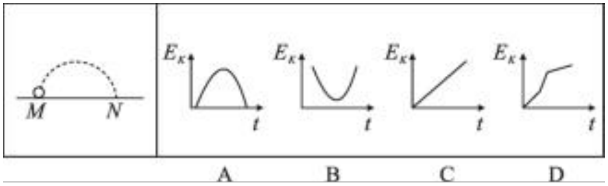

**67.** 下图是两种不同导体（R₁、R₂）的伏安特性曲线，则以下选项无法确定的是（）。

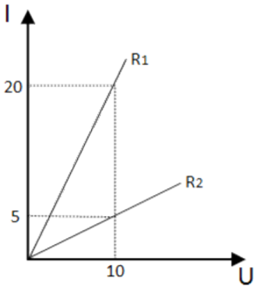

A. R₁、R₂的电阻之比为1:4
B. R₁、R₂的额定功率相同
C. 并联在电路中时，R₁、R₂电流比为4:1
D. 串联在电路中时，R₁、R₂电压比为1:4

**68.** 实验员小张计划配制浓度为8%的氯化钠溶液，在配制过程中，他使用托盘天平称量氯化钠的质量，使用量筒量取水的体积。但由于操作失误，最终配制的溶液浓度偏小，则以下可能导致这一结果的是（）。

A. 称量前未调平衡，天平指针偏右
B. 称量时，使用了已生锈的砝码
C. 用量筒取水时，仰视读数
D. 将水倒入烧杯时，一部分洒在外面

**69.** 有一家四口，包括一对夫妻和他们的两个亲生子女，四人的ABO血型各不相同。已知儿子有一次受伤时，是爸爸献的血，那么，以下信息可以确定的是：

A. 爸爸的血可以献给家里所有人使用
B. 妈妈的血不能献给家里所有人使用
C. 女儿有可能是AB型血
D. 儿子只可能是A型或B型血

**70.** 下图是某地市区与郊区之间的热力环流图。根据该图，为保证市区空气质量，下列说法正确的是：

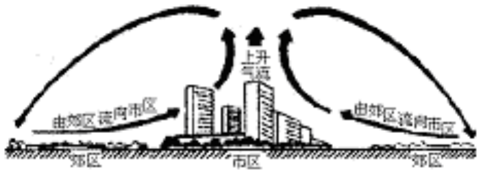

A. 化工厂可以建设在郊区
B. 绿化带应该建设在郊区外
C. 绿化带可以建设在市区内
D. 化工厂应该建设在郊区与市区之间

## 第七部分　资料分析

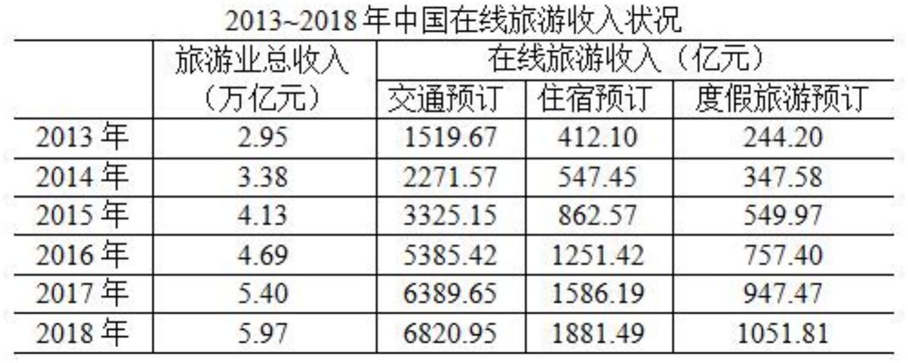

**71.** 2018年中国在线旅游收入约占旅游业总收入的：

A. 20%
B. 25%
C. 12%
D. 16%

**72.** 2017年中国在线旅游收入同比约增长多少万亿元？

A. 0.15
B. 0.20
C. 0.25
D. 0.30

**73.** 中国在线旅游收入中，2014年占中国旅游业总收入比重高于上年水平的包括：

A. 仅在线交通预订
B. 在线交通预订、在线住宿预订、在线度假旅游预订
C. 仅在线交通预订、在线住宿预订
D. 仅在线交通预订、在线度假旅游预订

**74.** 以下折线图反映了2014～2018年间哪项收入同比增量的变化趋势？

A. 在线住宿预订
B. 旅游业总体
C. 在线度假旅游预订
D. 在线交通预订

**75.** 能够从上述资料中推出的是：

A. 2014～2018年，中国旅游业总收入超过25万亿元
B. 2014～2016年，中国旅游业总收入同比增速逐年递增
C. 2016年中国在线交通预订收入同比增速快于上年水平
D. 如保持2018年同比增量，中国在线住宿预订收入将在2023年首超3000亿元

党的十八大以来，脱贫工作取得巨大成效，全国农村贫困人口大幅减少。截至2018年末，全国农村贫困人口从2012年末的9899万人减少至1660万人；农村贫困发生率从2012年的10.2%下降至1.7%，累计下降8.5个百分点。

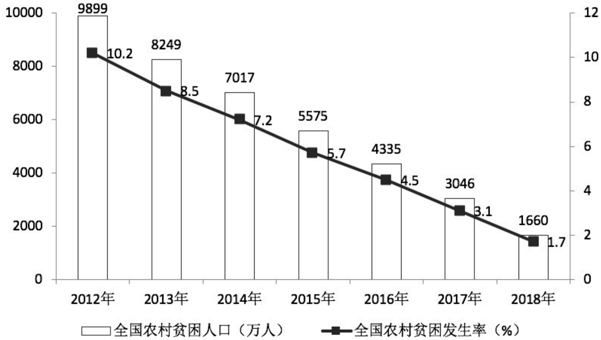

2012—2018年全国农村贫困人口和贫困发生率
2018年，贫困地区农村居民人均可支配收入10371元，扣除价格因素，实际增长8.3%，实际增速高出全国农村居民人均可支配收入实际增速1.7个百分点，圆满完成增长幅度高于全国增速的年度目标任务。

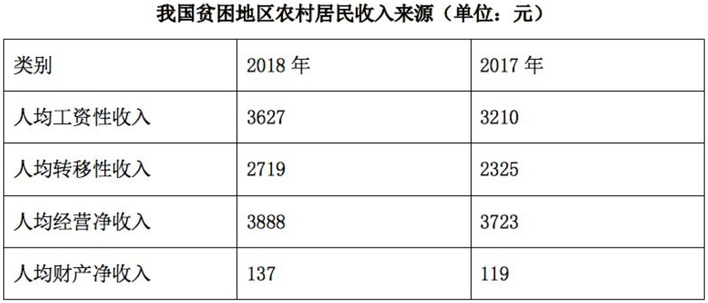

**76.** 从2012年末到2018年末，全国农村贫困人口数减少了（）万人。

A. 6239
B. 7239
C. 8239
D. 9230

**77.** 2013—2018年，全国农村贫困发生率较上年下降最多的是（）年。

A. 2013
B. 2015
C. 2017
D. 2018

**78.** 2018年，我国贫困地区农村居民人均工资性收入约占人均可支配收入的（）。

A. 20%
B. 25%
C. 30%
D. 35%

**79.** 2018年，我国贫困地区农村居民收入来源中，最高的是（）。

A. 人均工资性收入
B. 人均转移性收入
C. 人均经营净收入
D. 人均财产净收入

**80.** 下列说法不正确的是（）。

A. 2012—2018年，全国农村贫困人口逐年递减
B. 2018年，全国农村居民人均可支配收入实际增速为6.6%
C. 2018年，贫困地区农村居民各来源的人均收入较上年均有提高
D. 2017年，贫困地区农村居民人均经营净收入比转移性收入高近1000元

2020年，受新冠肺炎疫情影响，我国民航全行业完成旅客运输量41777.82万人次，比上年下降36.7%。国内航线完成旅客运输量40821.30万人次，比上年下降30.3%，其中港澳台航线完成旅客运输量96.13万人次，比上年下降91.3%，国际航线完成旅客运输量956.51万人次，比上年下降87.1%。尽管如此，我国国内航空运输市场在全球范围内恢复最快、运行最好。
2020年，全行业运输航空公司完成运输飞行时长876.22万小时，比上年下降28.8%。国内航线完成运输飞行时长788.22万小时，比上年下降20.5%，其中港澳台航线完成运输飞行时长3.55万小时，比上年下降82.3%，国际航线完成运输飞行时长87.99万小时，比上年下降63.3%。
2020年，全行业运输航空公司完成运输起飞371.09万架次，比上年下降25.3%。国内航线完成运输起飞357.29万架次，比上年下降20.2%，其中港澳台航线完成运输起飞1.65万架次，比上年下降80.3%，国际航线完成运输起飞13.79万架次，比上年下降71.8%。

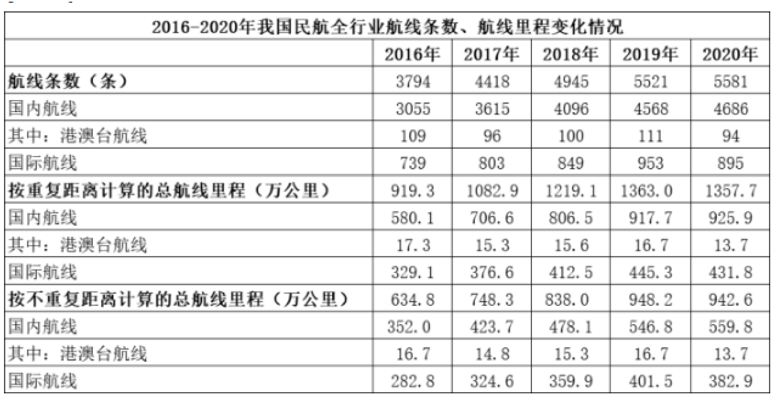

**81.** 相比2019年，2020年我国民航全行业完成旅客运输中，国内航线完成旅客运输总量占比约：

A. 降低了9个百分点
B. 降低了15个百分点
C. 提高了9个百分点
D. 提高了15个百分点

**82.** 2019年，平均每架次完成运输飞行时长最长的是：

A. 国内航线
B. 港澳台航线
C. 国际航线
D. 全行业运输航空公司

**83.** 2016-2020年，国内航线条数比国际航线条数多4倍以上的年份有：

A. 1
B. 2
C. 3
D. 5

**84.** 按不重复距离计算，以下年份中，国际航线里程同比增速最快的是：

A. 2017年
B. 2018年
C. 2019年
D. 2020年

**85.** 根据以上资料，下列说法准确的是：

A. 2019年，国内航线运输飞行时长占全行业运输航空公司运输飞行时长的9成以上
B. 相比2019年，2020年我国国内航线、港澳台航线、国际航线平均每条航线完成旅客运输量均有下降
C. 2016-2020年，按重复距离计算的总航线里程公里数年均增长不到100万
D. 2019年，全行业运输航空公司完成运输起飞不到400万架次

某市2015年全年粮食总产量4.16万吨，同比下降2.3%；甘蔗产量0.57万吨，下降23.6%；油料产量0.12万吨，增长32.4%；蔬菜产量15.79万吨，下降3.4%；水果产量7.84万吨，增长7.4%。
全年水产品产量29.16万吨，同比增长3.6%，其中海洋捕捞1.09万吨，与上年持平；海水养殖6.07万吨，增长89.5%；淡水捕捞0.18万吨，增长1.1%；淡水养殖21.81万吨，下降7.9%。

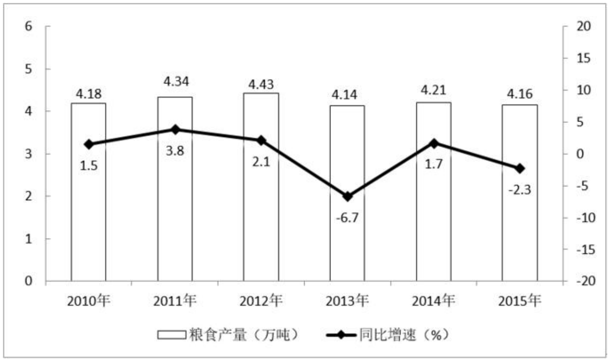

2010-2015年某市粮食产量及其增速

**86.** 2014年该市蔬菜产量比水果产量约高多少万吨？

A. 9
B. 8
C. 7
D. 6

**87.** “十二五”期间，该市粮食总产量在以下哪个范围？

A. 23-24万吨之间
B. 22-23万吨之间
C. 21-22万吨之间
D. 20-21万吨之间

**88.** 按照2015年水产品产量从多到少，以下排序正确的是：

A. 海洋捕捞、海水养殖、淡水捕捞、淡水养殖
B. 淡水养殖、海水养殖、海洋捕捞、淡水捕捞
C. 淡水捕捞、淡水养殖、海洋捕捞、海水养殖
D. 淡水养殖、海洋捕捞、海水养殖、淡水捕捞

**89.** 以下哪张折线图能准确反映2011-2015年间该市粮食生产同比增量的变化趋势？

A. 
B. 
C. 
D. 

**90.** 能够从上述资料中推出的是：

A. 2014年油料产量超过1000吨
B. 除淡水养殖之外，其余类型的水产品2015年产量占水产品总产量的比重均高于上年
C. 2014-2015年甘蔗累计产量不到1万吨
D. 2010-2015年，粮食产量同比上升的年份多于同比下降的年份
