# M14　广东省考行测模拟卷（题本）

## 第一部分　政治理论

**1.** 驰而不息正风肃纪，必须坚持党性党风党纪一起抓、正风肃纪反腐相贯通，深化运用从抓反腐入手推进全面从严治党经验。

A. 正确　　B. 错误

**2.** 习近平新时代中国特色社会主义思想明确，要以伟大自我革命引领伟大社会革命。

A. 正确　　B. 错误

**3.** 我国的社会主义初级阶段，是从1978年党的十一届三中全会实行改革开放开始的。

A. 正确　　B. 错误

**4.** 唯物辩证法认为，必然存在于偶然之中，通过大量的偶然表现出来，偶然是必然的表现形式和补充。

A. 正确　　B. 错误

**5.** 二十届五中全会《决定》要求督促领导干部带头构建亲清政商关系，加强家庭家教家风建设，严格教育管理亲属和身边工作人员。下列古语与这一要求最为契合的是（　）。

A. 欲治其国者，先齐其家
B. 工欲善其事，必先利其器
C. 敏而好学，不耻下问
D. 以铜为镜，可以正衣冠

**7.** 2026年是上海合作组织成立25周年。习近平在上海合作组织成员国元首理事会第二十六次会议上提出坚持发展优先、坚持安全为要、坚持以人为本、坚持对话协商四点主张。下列表述与讲话内容不符的是（　）。

A. 坚持安全为要，将上海合作组织打造成践行全球安全倡议的重要平台
B. 中方倡导理性、协调、并进的核安全观，支持加强核安全多边伙伴关系
C. 坚持大小国家一律平等，以对话协商妥处矛盾分歧，以双边协作应对共同挑战
D. 中方将成立中国－上海合作组织基础教育合作中心，搭建交流互鉴、民心相通的桥梁

**8.** 关于建设社会主义文化强国，下列说法有误的是（　）。

A. 马克思主义是我们立党立国、兴党兴国的根本指导思想
B. 文化软实力从根本上说取决于一个国家的经济实力和科技实力
C. 社会主义核心价值观是凝聚人心、汇聚民力的强大力量
D. 推介中华文化，要努力塑造可信、可爱、可敬的中国形象

**9.** 从新文化运动兴起到全民族抗战时期，中国共产党领导的中国革命在曲折中前进。以下表述符合历史事实的有（　）。

A. 新文化运动以五四运动为分界线，前期主要宣传马克思主义，后期主要宣传民主和科学
B. 红军长征的原因是博古、李德等执行王明错误的军事指导方针，导致第五次反“围剿”失败
C. 平型关大捷之后，聂荣臻创建了第一个敌后抗日根据地——晋察冀抗日根据地
D. 延安整风运动的方针是“惩前毖后，治病救人”

## 第二部分　常识判断

**11.** 广东省2026年政府工作报告明确“十五五”时期经济社会发展的指导思想，提出坚持以经济建设为中心，以推动高质量发展为主题，以改革创新为根本动力，以满足人民日益增长的美好生活需要为根本目的，以（　）为根本保障。

A. 深化供给侧结构性改革
B. 建设强大国内市场
C. 高水平科技自立自强
D. 全面从严治党

**15.** 2025年11月，习近平总书记在广东考察时作出一系列重要指示。下列表述与总书记此次考察时的重要指示不符的是（　）。

A. 发展乡村特色产业是推进乡村全面振兴的基础，要推动农文旅融合，延伸产业链、增加附加值
B. 要抓住人才这个决定性因素，选优配强领导班子，打造党性过硬、视野开阔的干部队伍
C. 要结合党史宣传教育，讲好老一辈无产阶级革命家的故事，教育引导青少年传承红色基因
D. 广东作为经济大省和发达地区，在编制“十五五”规划时要有高站位、大格局

## 第三部分　言语理解与表达

**16.** 政府的行为对社会行为有着重要的________和示范作用，所以，政务诚信建设必须________，并且要抓实抓好。
填入划横线处最恰当的一项是：

A. 引领 快马加鞭
B. 指导 快马加鞭
C. 指导 一马当先
D. 引领 一马当先

**17.** 沉迷短视频极易造成青少年视力下降、注意力不集中等后果，一些不良信息还会产生误导，进而影响未成年人身心健康，危害（）。防范短视频沉迷，是保护青少年身心健康的题中应有之义。
最恰当的一项是（）。

A. 司空见惯
B. 后患无穷
C. 不容小觑
D. 不一而足

**18.** 秋冬之交，全球客商云集广东，从广交会到全球招商大会。“会”聚的是人气，（）出的是全球客商对大湾区的信心，以及对广东市场化、法治化、国际化一流营商环境的（）。

A. 反射，认同
B. 反映，认识
C. 映衬，肯定
D. 折射，认可

**19.** 党和政府与人民群众的关系问题，直接（）党风、政风。党员干部为谁代言，直接决定人心向背，也决定着党和人民的事业能否长盛不衰。

A. 反映
B. 显现
C. 确定
D. 联系

**20.** ______改革开放大业是一座正在建设中的大厦，______老百姓身边细微之处的需求，就是建成这座大厦的一块砖、一片瓦，______给这座大厦添砖加瓦，则是每个党员干部义不容辞的责任。
填入划横线部分最恰当的一项是：

A. 如果 那么 而
B. 尽管 但是 也
C. 因为 所以 则
D. 假设 那么 且

**21.** 从发展趋势来看，淡化GDP（国内生产总值）增长目标是大势所趋，因为片面过度追求这一个指标，不足以满足人民群众对青山绿水、放心食品、良好教育、便捷出行、健康工作、安享晚年等美好生活方面更高水平的期待与向往。
这段文字主要谈论的是：

A. 片面追求GDP指标的不当之处
B. 淡化GDP增长目标后的发展趋势
C. 人民群众对美好生活的期待与向往
D. 淡化GDP增长目标这一趋势出现的原因

**22.** 由于缺乏现代的科学技术手段，古代的城市排水系统将依托地形、自流排水的理念贯穿在城市的规划和设计中。因此，____。元朝时期，元大都的排水系统的规划设计与城市总体布局的规划设计同时进行，排水设施的建造先于或与城市道路、宫殿、城墙的建设同步，系统设计地下管网的高度差，充分发挥“水往低处流”的概念，使城市的内涝现象和污水溢出现象得到进一步缓解。元朝后，明清首都（北京）的排水格局也基本保持了元朝的设计。
填入画横线部分最恰当的一项是：

A. 排水系统的设计也需要结合建筑的特点“量体裁衣”
B. 城市排水的运行效率非常依赖工程人员对地势的把握
C. 具备较完整的城市管网及排水体系是城市建设的关键
D. 地下管网的功能主要聚焦在供水、排污、排涝等方面

**23.** 当前意义上的人民福祉已经不同于历史上简单的温饱状态，而是包括极为丰富的内容：既包括人民的权利和尊严，也包括人民的收入和消费，同时也涉及自由、安全、社会保障和精神生活等方面。
这段文字主要说明了：

A. 人民福祉的内涵相比以往有了巨大的变化
B. 人民已经不仅仅满足于温饱状态了
C. 人民福祉的含义在历史发展过程中会不断丰富
D. 人民福祉已经从物质层面向精神层面过渡

**24.** 一项调查结果显示，那些态度最积极乐观的被调查者在研究持续期间膳食结构的改善幅度最大，而最消极悲观的被调查者不仅从一开始便更倾向于选择较不健康的饮食，而且在运用各种手段加以干预后，改善的情况也不理想。研究者指出，自控能力是令乐观者更易成功戒除抽烟、喝酒和暴饮暴食等坏习惯的关键。
对这段文字理解准确的一项是：

A. 饮食结构取决于人的情绪的好坏
B. 不健康的饮食习惯很难通过干预而改善
C. 积极乐观的人更容易改善不良饮食习惯
D. 悲观者的自控能力无法通过干预而改善

**25.** 近代以后，中华民族复兴进程曾多次被打断，给我们留下了深刻的历史警示。古人云，“天下之祸不生于逆，生于顺”。今天，我们以党和国家事业的历史性成就和变革，推动中国特色社会主义进入了新时代，但中华民族伟大复兴绝不是轻轻松松、敲锣打鼓就能实现的。前进的道路上，我们还会面临这样那样的风险挑战，如果处理不好、处理不当都会对我国发展进程产生重大冲击和干扰。
以下最符合这段文字所表达的意思的是（）。

A. 积谷防饥
B. 高瞻远瞩
C. 曲突徙薪
D. 居安思危

**26.** 隋唐盛世的形成主要得益于制度创新。东晋南朝以来，世家大族把持朝政，皇权极不稳定。隋文帝取代北周后，为防止关陇集团等势力过分强大，威胁大一统的中央集权，废除了察举制这一士族赖以维系的选举工具，打破了以门第和军功为主的选拔标准，通过考核治理国家的专门知识，选拔人才参与新政权的管理，实现了贵族官僚政治向文官政治的转变，为成就隋唐盛世打下了坚实基础，奠定了后世王朝选官的基本格局，在中国选举制史上具有重大意义。这是一篇文章的引言，文章标题应该是：

A. 科举制度在唐代政治中的利与弊
B. 贵族官僚政治瓦解的制度原因探析
C. 中国古代选官制度的变迁及启示
D. 科举制度创建对选官制度变革的影响

**27.** 我们已经目睹，那些科幻小说中原本只存在于想象之中的未来科技逐一实现，并且改变了真实的世界。也许有一天，科幻小说不再思索和模拟技术的实际作用，而把全部注意力放在叙事者的主题，人类宿命甚至宇宙命运之上，我们仍要感谢它们帮助我们幻想过未来世界。只是，但愿永远可以有人像儒勒·凡尔纳在一百多年前那样由衷地发问：难道人们真的不可能用更短的时间环游地球吗？
根据这段文字可以知道，作者希望科幻作品：

A. 尽可能想象科技发展对人类的影响
B. 更加关注科幻故事情节本身的发展
C. 能够继续激励和启发未来科技的创新
D. 应努力探讨未来科技应用的具体表现

**28.** 锂离子电池已在便携式电子设备和新能源汽车中占据主导地位。然而，锂丰度低，资源分布不均，约70%集中在南美洲，我国80%的锂资源依赖进口。另外，锂离子电池由于安全隐患，难以满足大规模储能的需求，鉴于对原材料储量以及电池安全性、稳定性的担忧，人们努力寻找能够替代锂离子电池、可大规模应用且环境友好的下一代电化学储能技术。钠与锂位于同一主族，具有很多相似的物理化学性质，且钠资源丰富，分布广泛、成本低廉，钠离子电池快速充放电时负极不易析钠，安全性高。因此，____。
填入画横线部分最恰当的一项是：

A. 物美价廉的钠离子电池或将成为中国能源超车新赛道
B. 钠离子电池被认为是极具潜力的下一代电化学储能技术
C. 新能源汽车的电池相关研究有望迈上一个新的台阶
D. 我们要积极应对电化学储能技术领域的巨大挑战与机遇

**29.** 传统成像技术都是对视域内的物体进行观测，非视域成像技术则能够对隐藏在视线外的物体进行拍照，实现“视线拐弯”“隔墙观物”，极大地拓展了人类的成像能力。这一技术的实现过程通常是将激光脉冲发射到中介墙上，利用中介墙使激光散射到被遮挡的非视域场景中，该场景中的隐藏物体再次将激光散射到中介墙上，最终由中介墙散射至接收系统，整个过程激光经历了3次漫反射，通过记录光量子的飞行时间实现对非视域场景的重构。然而，由于激光经过多次漫反射，整个光路存在巨大的衰减，使得非视域成像目前仅能在实验室内进行短距离的原理性验证。此外，多次漫反射导致的时空信息混杂，使得成像算法成为一个科研难题。
关于非视域成像技术，这段文字未提及：

A. 基本原理
B. 突出优势
C. 应用前景
D. 技术难题

**30.** ①原因就在于原子核内部的质子和中子数量越多，其状态也就越不稳定，越容易发生放射性的衰变
②当越来越多的质子和中子聚集在一起，带正电荷的质子之间的斥力就越来越大
③人们可以在实验室里通过人工方式合成自然界中不存在的元素，但却不能合成无限多的原子核
④在原子核内部，质子和中子等粒子通过强相互作用结合在一起，这几乎是宇宙中最强的相互作用
⑤中子之间也会有一些排斥，强相互作用越来越难以束缚，不足以维持原子核的稳定
⑥在人类已经发现或是制造出的3000多种原子核中，只有288种是稳定的
将以上6个句子重新排列，语序正确的一项是：

A. ②④⑤⑥③①
B. ③①④②⑤⑥
C. ④⑤⑥①②③
D. ⑥②③①④⑤

## 第四部分　数量关系

**31.** 1.24，2.48，3.612，4.816，（）

A. 5.102
B. 6.224
C. 5.1020
D. 6.1224

**32.** 521，232，172，422，（    ）

A. 158
B. 233
C. 397
D. 406

**33.** 2，3，7，10，19，26，45，60，（    ）

A. 99
B. 105
C. 113
D. 127

**34.** $\frac{1}{2}$，$\frac{2}{3}$，$\frac{23}{28}$，$\frac{58}{65}$，$\frac{13}{14}$，（ ）

A. $\frac{206}{217}$
B. $\frac{103}{108}$
C. $\frac{205}{217}$
D. $\frac{205}{216}$

**35.** 

A. 53
B. 63
C. 73
D. 83

**36.** 某办公室有大、中、小三种型号的文件袋共200个，已知大号文件袋数量是中号文件袋的2倍，小号文件袋的数量为50个，那么大号文件袋有（）个。

A. 50
B. 60
C. 80
D. 100

**37.** 某次考试中，成绩不超过30分的有153名考生，平均分为24分；成绩不低于80分的有59名考生，平均分为92分；成绩超过30分的平均分为62分；成绩低于80分的平均分为54分。那么参加这次考试的考生共有多少人：

A. 795
B. 875
C. 1007
D. 1264

**38.** 为探访诗意乡村，聆听城市脉搏，父子两人报名参加半程马拉松，已知上坡路段父亲的速度是儿子的1.2倍，下
坡路段父亲的速度是儿子的80%，其他路段两人速度相同，结果父子同时到达终点，若上、下坡路段的距离之
比为1：2，则父亲上、下坡路段的速度之比为（    ）。

A. 1：3
B. 2：5
C. 5：12
D. 1：2

**39.** 小王和小刘手工制作一种工艺品，每件工艺品由一个甲部件和一个乙部件组成，小王每天可以制作150个甲部件，或者制作75个乙部件；小刘每天可以制作60个甲部件，或者制作24个乙部件。现两人一起制作工艺品，10天时间最多可以制作该工艺品（）件。

A. 660
B. 675
C. 700
D. 900

**40.** 一个木制正方体在表面涂上颜色，将它的每条棱三等分，然后从等分点将正方体切开，得到27个小正方体，将这些小正方体充分混合后，装入一个口袋，从这个口袋中随机取出两个小正方体，其中一个正方体只有一个面涂有颜色，另一个至少有2个面涂有颜色的概率约为（）。

A. 0.05
B. 0.17
C. 0.34
D. 0.67

**41.** 某公司需要将A、B 两地的同一产品运往甲、乙两个工厂。已知A、B 两地分别有该产品500 吨和700 吨，甲、
乙两个工厂对该产品的需求量均为600 吨，若从A 地出发运往甲、乙两个工厂的运价分别为150 元／吨和130 元
／吨，从B 地出发的运价分别为160 元／吨和145 元／吨，则完成此项运输任务的运费最少是：

A. 174000 元
B. 174500 元
C. 175000 元
D. 175500 元

**42.** 如图所示，一个边长为16厘米的大正方形，在距离角一定距离位置处与对角线平行折叠四次，得到中部小正方形的边长为4厘米。如果CB与大正方形的边平行，则三角形ABC的面积为（）。

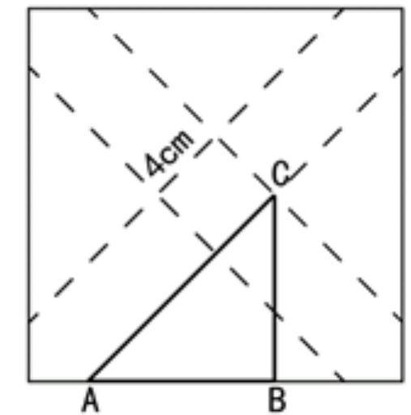

A. 32
B. 16
C. 16√2
D. 24

**43.** 在针对一家小型超市的调查中发现，某生鲜商品的售价与销量之间呈现以下规律：售价每降低1元，销量便会增加2千克，对应的表格如下：
若该商品的成本是15元/千克，售价不得高于25元且必须为整数，如果某天该商品的销售利润为200元，则售价是（）元/千克。

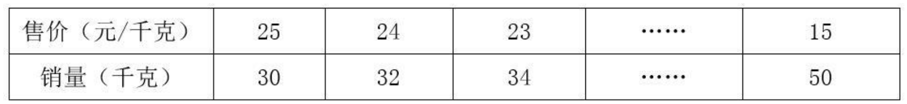

A. 22
B. 20
C. 18
D. 16

**44.** 某展览使用了序号为1～100的100盏灯，现在有两个开关，开关A能切换所有序号为偶数的灯的开关状态，开关B能切换所有序号为3的倍数的灯的开关状态。若在100盏灯都打开的状态下，先后按下开关A和B，则还有（）盏灯处于打开状态。

A. 33
B. 34
C. 49
D. 50

**45.** 工厂要对一台已经拆成6个部件的机器进行清洗，并重新组装。清洗6个部件的时间分别为10分钟、15分钟、21分钟、8分钟、5分钟、26分钟，重新组装需要15分钟。假设清洗每一个部件或重新组装时都需要甲、乙两人合作才能完成，报酬标准为每人每小时150元（不足一小时按一小时计），则工厂需要支付给甲、乙两人共（）元。

A. 300
B. 600
C. 900
D. 1200

## 第五部分　判断推理

**46.** 从所给的四个选项中，选择最合适的一个填在问号处，使之呈现一定的规律性：

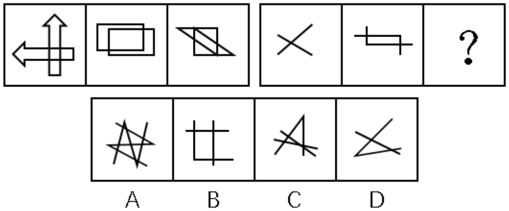

**47.** 下图问号处最适合填入的一项是（）。

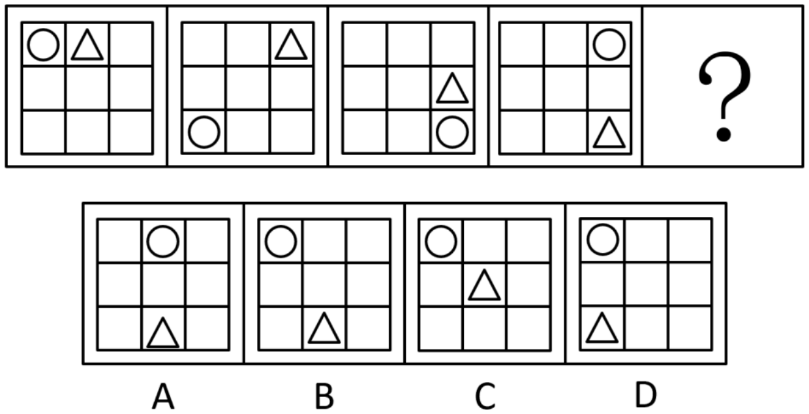

**48.** 从所给的四个选项中，选择最合适的一个填入问号处，使之呈现一定的规律性：

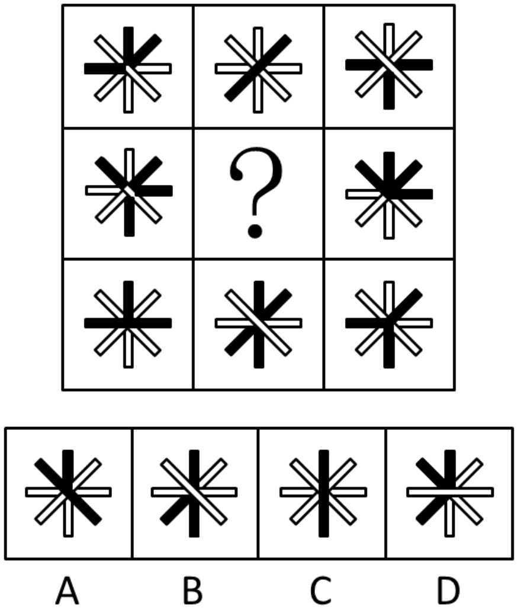

**49.** 使用所给的四个图形能够组合成（）。

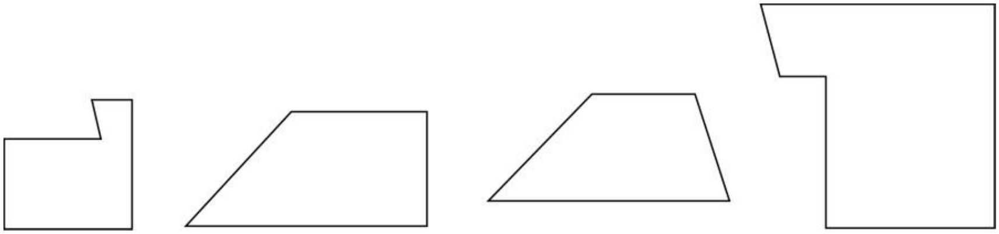

A. 矩形
B. 三角形
C. 等腰梯形
D. 直角梯形

**50.** 下列选项，与所给立体图形不同的是（）。

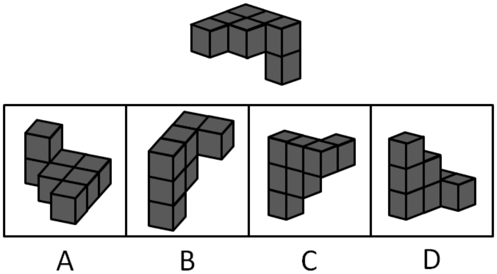

**51.** 某公司招聘业务经理，小张和小李前来应聘。小张说：“如果我做了业务经理，我会积极进取，开拓新业务。”小李说：“如果我做了经理，我会优化管理，精减人员。”最终，他们其中一人当上了业务经理，并顺利实现了自己的工作主张。
由此可知，以下说法必定为真的是：

A. 该公司不仅开拓了新业务，还精减了人员
B. 如果该公司开拓了新业务，那么肯定是小张当上了业务经理
C. 如果该公司精减了人员，那么肯定是小李当上了业务经理
D. 如果该公司没有开拓新业务，就肯定精减了人员

**52.** 基因检测能够帮助人们了解自己基因的情况，预测某些疾病的患病风险。有价值的基因检测报告至少符合三项条件：生物学描述明确、基因与疾病的对应关系明确、针对性防治要点明确。
根据上述表述，下列判断一定正确的是（）。

A. 针对性防治要点不明确的基因检测报告可能没有价值
B. 一份生物学描述不明确的基因检测报告可能是有价值的
C. 符合上述三项条件的基因检测报告大部分都是有价值的
D. 有的有价值的基因检测报告只符合上述三项条件中的两项

**53.** 学校社团负责人要从动漫社、舞蹈社团、新闻社、球类社团、健美操社团和书法协会这6个社团中选择3个社团送教下乡。已知：
（1）动漫社和新闻社这两个社团至少要去1个
（2）舞蹈社团和健美操社团这两个社团至少要去1个
（3）新闻社和健美操社团都不能与舞蹈社团同时去
根据以上条件，若健美操社团未被选上，则必然同时入选的有（）。

A. 动漫社和书法协会
B. 舞蹈社团和球类社团
C. 舞蹈社团和新闻社
D. 动漫社和舞蹈社团

**54.** 某中学计划抽调一批骨干教师前往西部地区支教，学校计划抽调2位高一老师、1位高二老师和1位高三老师，并且这4位老师所教科目应各不相同。已知各年级候选人如下：
①高一：历史老师甲、地理老师乙、政治老师丙。
②高二：地理老师丁、语文老师戊。
③高三：政治老师己、数学老师庚。
则以下人选符合要求的是（）。

A. 甲、乙、丁、庚
B. 甲、乙、戊、己
C. 乙、丙、戊、己
D. 乙、戊、己、庚

**55.** 流感病毒的变异速度相当快，即使疫苗每年更新，也不能保证疫苗接种覆盖全部的“当季流行款”。接种流感疫苗，既不能保证百分之百不得流感，还可能导致接种人群出现低烧等副作用。因此，没有必要接种流感疫苗。
以下选项如果为真，不能有效反驳上文结论的是：

A. 接种流感疫苗可以减少儿童、慢性病患者等高危人群因流感而发生严重并发症的风险
B. 接种季节性流感疫苗可以降低易感人群感染流感病毒的概率
C. 接种流感疫苗后只有极少数人会出现全身反应，且一两天可以缓解，比流感的症状要轻很多
D. 从疾病中恢复过来的人可以获得一定的免疫力，1年内不会再次被同样的流感病毒感染

**56.** 近年来，不少地方政府热衷于参与“国家卫生城市”“国家园林城市”等荣誉称号的评比，并为此投入了大量的资金。有市民认为，与其为了获得这些城市荣誉称号投入大笔资金，不如把钱花在招商引资等促进经济发展的领域，这才更加符合广大市民的切身利益。
以下最能削弱该市民的论断的是（）。

A. 招商引资短期内并不会显著提高市民的生活水平
B. 与环境卫生相比，多数市民同样看重城市经济发展
C. 获得城市荣誉称号有助于开展招商引资工作
D. 城市荣誉称号有助于激发市民的城市认同感与自豪感

**57.** 某研究机构对3个品牌的老年代步车进行安全性碰撞实验。实验表明，这3个品牌的代步车都无法在发生交通事故时保护驾驶人。该机构因此认为：老年代步车十分危险，政府应该禁止代步车上路，引导老年人驾驶普通汽车。
以下选项最无法支持上述论断的是（）。

A. 代步车的价格一般低于普通汽车
B. 这3个品牌的代步车市场占有率极高
C. 使用代步车的老人普遍拥有汽车驾驶资格
D. 安全性是决定代步车能否上路行驶的首要因素

**58.** 某中学地处山区，每年暑假时都会有高校学生前来开展一个月左右的支教活动。该中学有教师对此提出质疑，认为尽管高校学生受教育程度高，但他们没有教师资格证，因此无法开展专业有效的教学。
要使上述论证成立，必须补充的前提是（）。

A. 只有专业有效的教学才是学生们喜爱的教学
B. 高校学生不具备考取教师资格证的能力
C. 受教育程度高的人未必能开展专业有效的教学
D. 只有拥有教师资格证的人才能够开展专业有效的教学

**59.** 如果旅行车程超过3小时，选择自驾游的游客数量就会大大减少。目前，从乙市驾车前往甲市至少需要5小时。如果开通甲、乙两市间的高速公路，从乙市前往甲市的自驾游游客将会显著增加。
上述论证最可能基于的潜在假设是（）。

A. 该高速公路能够在短时间内开通使用
B. 绝大多数游客以自驾的方式前往甲市
C. 该高速公路开通后，两市车程将小于3小时
D. 很多乙市居民喜欢前往周边城市旅游

**60.** 某地为抑制高房价，实施了严格的商品房限购政策，限制本地户籍家庭只能购买两套住房、外地户籍家庭只能购买一套住房，并且预测商品房价格会下降。但实际上，限购政策推行后，预期效果并未出现。
下列最有助于解释上述结果的是（）。

A. 流入当地的外来人口不断增加
B. 多数本地户籍家庭已经拥有两套住房
C. 当地的教育资源较好
D. 当地人均收入水平较高

**61.** 某便利店销售一款牛奶，这款牛奶在店内每瓶售价8元，在店外自动售货机上的价格为每瓶10元，但依然有部分人选择在自动售货机上购买这款牛奶。
以下选项若为真，最不能解释这一现象的是：

A. 有些人赶时间，当店内顾客过多时不愿意进店排队结账
B. 有些人购买目标单一，只想买牛奶并不想购买其他商品
C. 有些人不愿花精力进店寻找商品，自动售货机展示商品更直观
D. 有些人喜欢喝冰牛奶，只有自动售货机销售冰牛奶

**62.** 文学作品的电子书会给作品带来很高的关注度，这种关注度能够拉动纸质书的销售。因此，所有想要提高纸质版文学作品销售量的出版社都会为文学作品发行电子书。
以下和该论证过程的逻辑最为类似的是（）。

A. 家庭教育可以培养孩子的见识、性格、技能，从而确保孩子的天赋得到发展。所以，家长对家庭教育的重视，是确保孩子天赋得到发展的充分条件
B. 是否掌握作品命脉是作家是否拥有自己语言体系的判断标准。这是因为，一个作家拥有了自己的语言体系，就掌握了作品的命脉，就能成为优秀的作家
C. 家风与民风交相辉映，民风与国风休戚相关。在现代社会，好的家风必然能影响好的社会风气的形成。唯有良好的家风能孕育一个文明向上的社会
D. 要传承好传统文化，就必须构建传统文化传承体系。因为一旦构建好这一体系，就可以系统性地取其精华、去其糟粕，从而确保传统文化的传承发展

**63.** 市场的力量是有限的，仅仅依靠市场，并不能生产出优质的知识产品。可以说，想要生产出优质的知识产品，还必须依靠非市场力量加大对科研的投入。
以下与上述推理在结构上最为相似的是（）。

A. 计算机专业的学生不一定会修电脑。其他专业的学生也可能会修电脑
B. 只是加强锻炼还无法拥有健康的体魄。想拥有健康体魄就不能仅靠锻炼
C. 如果只吃肉类，就不能膳食均衡。因此，想要达到膳食均衡就不能吃肉
D. 如果只注重智育，学生就无法全面发展。所以有必要对德育、体育等其他方面的教育加强重视

**64.** 优秀的企业家既要有杰出的领导能力，也必须积极承担相应的社会责任。因此，能运用出色的领导力引领企业发展却不愿承担任何社会责任的人，一定不是优秀的企业家。
以下选项的逻辑结构与题干最为相似的是（）。

A. 真正的“美丽”不仅体现在外表上，还体现在心灵上。因此，心灵美丽的人外表也一定出众
B. 设计要源于现实生活才能发挥意义而成为真正伟大的设计。因此，脱离生活的设计是不切实际的，更是毫无现实意义的
C. 优秀的学习成绩和良好的道德品质在评奖评优中缺一不可。因此，即使有优秀的学习成绩，要想评奖评优，良好的道德品质仍然不可或缺
D. 流量明星一定程度带动了经济发展，也带来了一些新的社会问题。因此，片面强调流量明星带来的经济效益，忽视其后来的社会问题并不可取

**65.** 据统计，某企业生产的所有型号空调的销量比往年均有大幅度提升。该企业由此认为，今年他们生产的空调的市场占有率也会大幅提高。
以下最能说明上述推理存在漏洞的是（）。

A. 暗含了该空调生产企业的消费者满意度有所增加
B. 忽视了其他企业空调的销量可能也有所提升
C. 暗含了消费者可能同时使用两个品牌的空调
D. 假设了空调消费市场划分将进一步细化

## 第六部分　科学推理

**66.** 用如图所示的杠杆提升物体。从B点竖直向下用力，在将物体匀速提升到一定高度的过程中，用力的大小将（）。

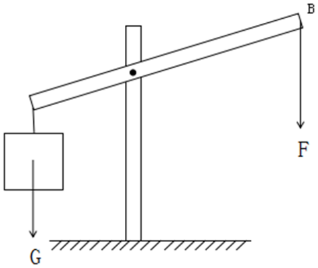

A. 保持不变
B. 逐渐变小
C. 逐渐变大
D. 先变大，后变小

**67.** 如图所示，丝绸摩擦过的玻璃棒带正电，下列说法正确的是（）。

A. 丝绸得到电子，带上负电
B. 整个摩擦过程中电荷量增加
C. 摩擦过程中热能转化为电能
D. 丝绸失去电子，带上正电

**68.** 关于水的净化方法和原理，下列说法不准确的是：

A. 静置沉淀可帮助去除水中大颗粒不溶性物质
B. 消毒剂消毒是利用化学方法杀灭水中的细菌
C. 蒸馏法可以去除水中的所有杂质
D. 过滤法可以降低水的硬度从而使硬水软化

**69.** 农技站为了贮存种子，拟采用以下做法，其中最可行的是：

A. 将种子浸泡在含水的容器中
B. 将种子置放在含氧量低于1%的干燥地窖中
C. 将种子置于15摄氏度左右的低温环境中
D. 将种子封闭在完全避光的黑暗环境中

**70.** 根据板块构造论，地球分为亚欧板块、美洲板块、非洲板块、印度洋板块、太平洋板块和南极洲板块，除太平洋板块几乎全为海洋外，其余板块既包括大陆又包括海洋。以下关于板块交界处位置关系对应正确的是（）。

A. 亚欧板块和美洲板块——冰岛
B. 非洲板块和印度洋板块——蒙古
C. 亚欧板块和太平洋板块——英国北部
D. 美洲板块和太平洋板块——美国东海岸

## 第七部分　资料分析

为了解网站对不同年龄段用户群体的吸引力，某综合网站随机调查了3000名该网站的用户，主要调查内容为用户在该网站首选阅读的频道(下简称首选频道)。

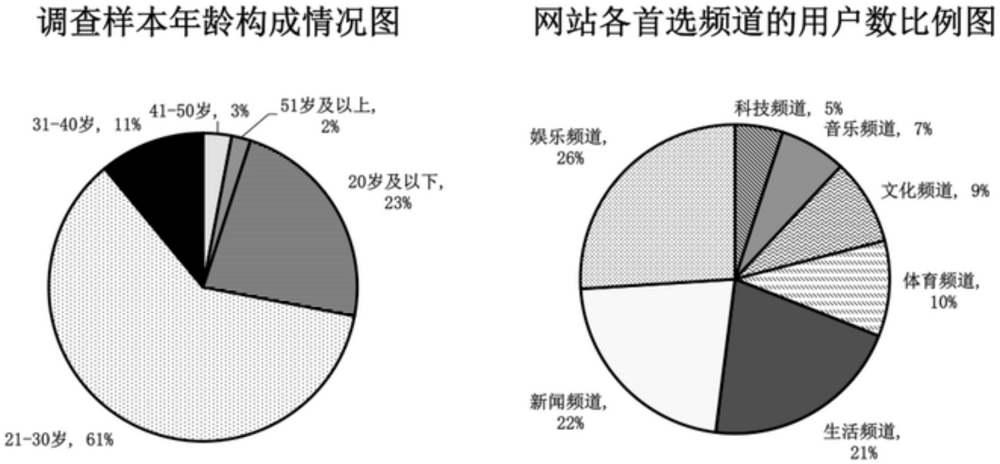

各个首选频道的用户群体中不同年龄段人数的比例(单位：%)

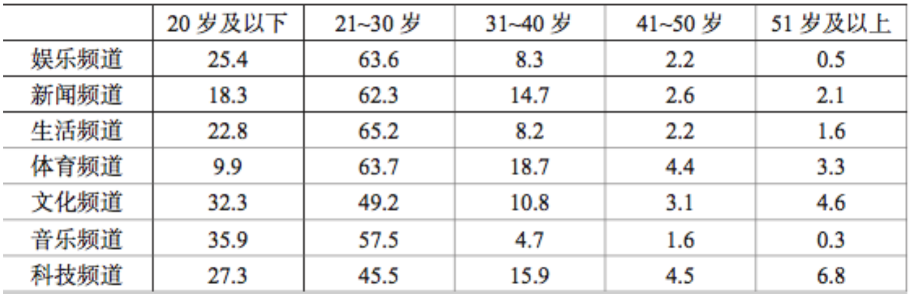

注：假设本次调查能够代表该网站用户的真实阅读情况。

**71.** 如果该网站日均登录流量为6万人，则平均每日首选生活频道的用户约为（）人（不考虑同一用户反复登录该网站的情况）。

A. 331
B. 1260
C. 3310
D. 12600

**72.** 本次调查中，首选频道为体育频道的51岁及以上用户一共约有（）名：

A. 10
B. 18
C. 47
D. 99

**73.** 与该网站21-30岁的用户相比，该网站31岁及以上用户普遍对（）更感兴趣。

A. 文化频道
B. 音乐频道
C. 新闻频道
D. 科技频道

**74.** 如果有企业在该网站上播放广告，企业产品定位是31-40岁的人群，那么它播放广告的频道应该首选：

A. 音乐频道
B. 生活频道
C. 新闻频道
D. 体育频道

**75.** 根据上述资料，下列说法正确的是：

A. 该网站科技频道对31岁及以上用户的吸引力远大于该频道的20岁及以下用户的吸引力
B. 20岁及以下用户已经成为该网站继21-30岁用户之后的第二大用户群
C. 在该网站所有频道中，41-50岁用户数量均大于51岁及以上用户数量
D. 与其他频道相比，该网站的文化频道对21-30岁用户的吸引力最低

2014年，全国汽车产销分别是2372万辆和2349万辆，同比增长7.3%和6.9%。汽车销售排名前十位的企业集团销售合计为2107.7万辆，比上年同期增长8.9%，高于全行业增速2个百分点。
2014年乘用车销售1970万辆，比上年同期增长9.89%。其中轿车增速放缓，SUV、MPV依旧保持高速增长，交叉型乘用车则继续下降。乘用车分车型看：轿车销售1238万辆，同比增长3.1%；SUV销售为408万辆，同比增长36.4%；MPV销量为191万辆，同比增长46.8%；交叉型乘用车销量为133万辆，同比下降18.1%。市场结构上，轿车占乘用车比重62.8%，比去年下降4.2个百分点；SUV占比20.7%，比去年提高4个百分点，MPV占比9.7%，比去年提高3个百分点；交叉型乘用车占比为6.8%，比去年下降2.4个百分点。
受宏观经济和相关政策法规影响，今年的商用车市场销量降幅较大。全年商用车销售完成379万辆，同比下降6.5%，分车型看，其中货车销售318万辆，同比下降8.9%，客车销售61万辆，同比增长8.4%。货车车型中，受国四排放标准执行后带来成本上升和厂家生产准备不足等原因影响，使轻型货车出现了大幅下降，全年降幅达到了12.9%。由于轻型货车占到货车的比重较高，导致货车整体出现了较高降幅。客车方面受到城市公交（含新能源车）、校车增长及轻型客车带动，使客车市场继续保持平稳增长。
随着政府全面出台支持发展新能源汽车的政策，企业对产品的升级改造和社会对新能源汽车认可度的提升，2014年新能源汽车有了较快的发展，全年新能源汽车销量为7.5万辆，同比增长324%，其中纯电动汽车销售4.5万辆，同比增长208%，插电式电动车销售3万辆，同比增长878%。
中国品牌乘用车销售757万辆，同比增长4.1%，占有率为38.4%，比去年下降2.1个百分点。其中，中国品牌轿车销售277万辆，同比下降17.4%，占有率为22.4%，比去年下降5.6个百分点。中国品牌SUV销售55万辆，同比增长50.36%，占SUV市场份额为44.76%，比去年增长4.14个百分点。德、日、美、韩、法各系乘用车分别占到今年乘用车销售的20%、16%、13%、9%、4%，其中日系车占有率下降了0.34%，其余系别都有不同程度上升。

**76.** 2014年汽车销量排名前十位的企业集团销量占汽车销售总量的：

A. 89.7%
B. 88.9%
C. 73.4%
D. 67.5%

**77.** 2013年乘用车销量约是商用车销量的多少倍？

A. 4.0
B. 4.4
C. 5.0
D. 5.2

**78.** 下列关于2014年乘用车各车型销量同比变化幅度的大小关系，正确的是：

A. MPV>SUV>交叉型>轿车
B. SUV>轿车>MPV>交叉型
C. SUV>交叉型>轿车>MPV
D. MPV>SUV>轿车>交叉型

**79.** 2014年商用车市场销量降幅较大，原因在于：

A. 受政府全面出台支持发展新能源汽车政策影响
B. 受宏观经济和相关政策法规影响
C. 受外国品牌汽车价格下降影响
D. 受中国品牌乘用车销售占有率下降影响

**80.** 下列说法正确的是：

A. 2013年，全国汽车产量低于销量
B. 2014年，商用车各车型销量均有所下降
C. 2013年，新能源汽车销量不足2万辆
D. 2013年，中国品牌乘用车销售量低于德系与日系乘用车销售量之和

2013年，我国研究生招生61.1万人。在校研究生179.4万人，毕业生51.4万人。普通本专科在校生2468.1万人，毕业生638.7万人。中等职业教育在校生1960.2万人，毕业生678.1万人。普通高中在校生2435.9万人，毕业生799.0万人。初中招生1496.1万人，在校生4440.1万人，毕业生1561.5万人。普通小学招生1695.4万人，在校生9360.5万人，毕业生1581.1万人。特殊教育招生6.6万人，在校生36.8万人，毕业生5.1万人。幼儿园在园幼儿3894.7万人。

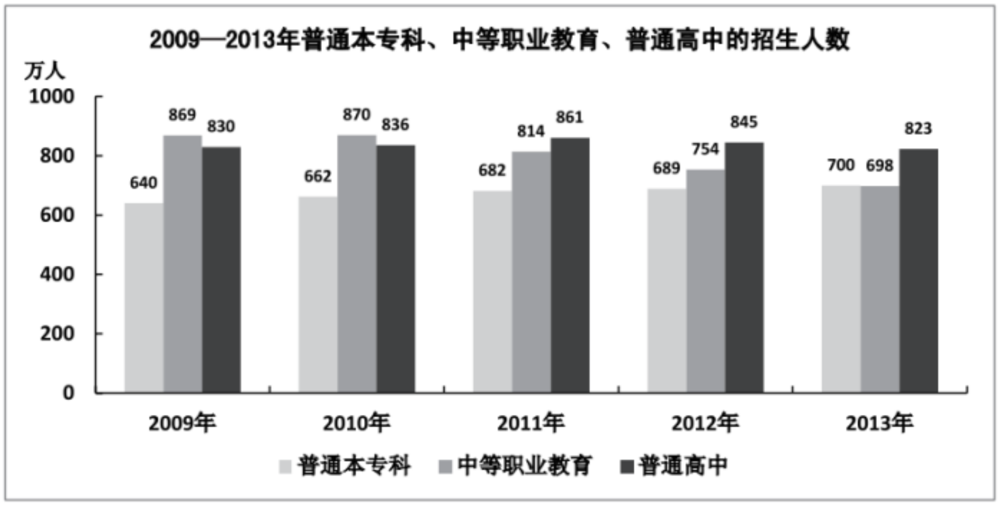

**81.** 2013年，招生人数和毕业生人数相差最小的教育层次是：

A. 研究生
B. 普通本专科
C. 中等职业教育
D. 普通高中

**82.** 2013年我国中等职业教育招生人数比2012年大约：

A. 减少7.4%
B. 减少8.4%
C. 增加7.4%
D. 增加8.4%

**83.** 我国普通本专科、中等职业教育及普通高中招生人数总和最多的年份是（）年。

A. 2009
B. 2010
C. 2011
D. 2012

**84.** 下列说法正确的是：

A. 2013年专科以上毕业生人数为638.7万人
B. 2013年特殊教育毕业生人数多于招生人数
C. 2013年普通高中在校生人数多于其他教育层次的在校生人数
D. 2013年普通小学毕业生有80万以上没有入读我国初中学校

**85.** 下列说法不正确的是：

A. 2010~2013年，普通本专科的招生人数逐年增加
B. 2010~2013年，中等职业教育的招生人数逐年减少
C. 2009~2013年，普通高中的招生人数先增加后减少
D. 2009~2013年，普通本专科的招生人数总是比中等职业教育少

2016年“一带一路”沿线64个国家GDP之和约为12.0万亿美元，占全球GDP的16.0%；人口总数约为32.1亿人，占全球总人口的43.4%；对外贸易总额（进口额+出口额）约为71885.6亿美元，占全球贸易总额的21.7%。

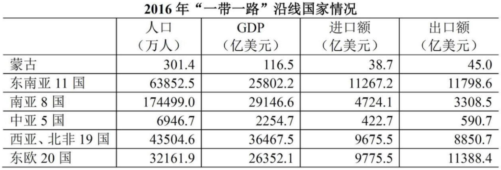

**86.** 2016年全球贸易总额约为多少万亿美元？

A. 28
B. 33
C. 40
D. 75

**87.** 2016年“一带一路”沿线国家中，东欧20国的人均GDP约是中亚5国的多少倍？

A. 2.5
B. 3.6
C. 5.3
D. 11.7

**88.** “一带一路”沿线主要区域中，2016年进口额与出口额数值相差最大的是：

A. 东南亚11国
B. 南亚8国
C. 西亚、北非19国
D. 东欧20国

**89.** 2016年，蒙古GDP约占全球总体GDP的：

A. 0.61‰
B. 1.56‰
C. 0.06‰
D. 0.16‰

**90.** 关于“一带一路”沿线国家2016年状况，能够从上述资料中推出的是：

A. 超过六成人口集中在南亚地区
B. 东南亚和南亚国家GDP之和占全球的8%以上
C. 平均每个南亚国家对外贸易额超过1000亿美元
D. 平均每个东欧国家的进口额高于平均每个西亚、北非国家的进口额
