# M15　广东省考行测模拟卷（题本）

## 第一部分　政治理论

**1.** 坚定不移一体推进不敢腐不能腐不想腐，必须坚定走好中国特色反腐败之路，加强中央纪委对反腐败工作的集中统一领导。

A. 正确　　B. 错误

**2.** 人民立场是中国共产党的根本政治立场，是马克思主义政党区别于其他政党的显著标志。

A. 正确　　B. 错误

**3.** 广东省地处中国大陆最南部，大陆海岸线长度居全国首位。

A. 正确　　B. 错误

**5.** 二十届五中全会《决定》要求厉行节约、反对浪费，坚持党政机关过紧日子，从紧控制“三公”经费，严格控制新建楼堂馆所。下列古语与这一要求最为契合的是（　）。

A. 苟利国家生死以，岂因祸福避趋之
B. 历览前贤国与家，成由勤俭破由奢
C. 千磨万击还坚劲，任尔东西南北风
D. 不畏浮云遮望眼，自缘身在最高层

**15.** 广东省2026年政府工作报告分析“十五五”时期的发展环境时指出，广东具有更多更强的综合优势，完全可以实现更高质量和更可持续的发展。下列表述与报告内容不符的是（　）。

A. 广东处在改革开放前沿和链接内外循环的关键节点
B. 拥有粤港澳大湾区建设等国家重大战略叠加的政策优势
C. 具有新兴产业未来产业诸多领域的后发优势
D. 具有市场化法治化国际化一流营商环境优势

## 第三部分　言语理解与表达

**16.** 如果一味________于所谓的“成功之道”，放弃对生活的体验和思考，则有可能在追求“成功”的路上，与自己最初的梦想________。
填入划横线处最恰当的一项是：

A. 沉溺 南辕北辙
B. 沉湎 南辕北辙
C. 沉迷 渐行渐远
D. 沉醉 渐行渐远

**17.** 形成坚定理想信念，既不是（）的，也不是一劳永逸的，而是要在斗争实践中不断砥砺、经受考验。

A. 一成不变
B. 一帆风顺
C. 一气呵成
D. 一蹴而就

**18.** 基层减负应当让乡镇干部自冗务中（），自羁绊中（），恢复矫健的姿态，重获澎湃的动能，在乡村振兴中更好地发挥引领带动作用。

A. 突围 逃脱
B. 解围 逃脱
C. 突围 脱身
D. 解围 脱身

**19.** 保障粮食安全，确保主要农产品基本供给，是保持国民经济健康持续稳定（）的战略需要。

A. 运转
B. 运作
C. 运营
D. 运行

**20.** 中国对世界的贡献，不仅有中国资金、中国（）、中国市场，还有中国对策、中国（）、中国经验，更有中国思想、中国（）、中国愿景。

A. 技术 方案 智慧
B. 技术 智慧 方案
C. 智慧 技术 方案
D. 智慧 方案 技术

**21.** “幸福不幸福，关键看收入，收入多少直接决定着员工的满意度和幸福度。”在采访中，大多数员工认为薪酬最能体现自身的职业价值，并认为工资待遇是激发员工积极性最重要的因素。
作者通过这段文字意在强调：

A. 提高工资待遇就可以激发员工的积极性
B. 企业应该重视薪酬的激励作用
C. 工资收入越高，员工的幸福感就越强
D. 工资待遇比个人发展前景更具激励作用

**22.** 戴口罩等遮挡条件下的人脸识别其实是一项“老”技术，此前研究人员在解决军事刑侦和视频监控问题时就曾长期研究过该技术，并发展出诸多成熟应用。因此，____。但是以往的技术基础并没有完全打消人们对戴口罩人脸识别“先天不足”的顾虑。相较于以往，口罩遮挡面部，使得人脸识别系统收集到的面部信息大量减少。不过研究表明，人脸识别的关键信息集中于眉毛和眼睛，只要模型训练得当，戴口罩人脸识别的准确率并不会大幅下降。
填入画横线部分最恰当的一项是：

A. 提高识别精准度才是这一技术的难点所在
B. 该技术的稳定性和准确率是有一定基础的
C. 人脸识别技术已经被广泛应用于各个领域
D. 人脸识别并不需要对全脸进行整体识别

**23.** 深化财税体制改革要坚持社会主义市场经济改革方向，完善体制机制和调节政策，充分发挥市场机制作用，更好激发各方面积极性，实现资源配置效率最优化和效益最大化，同时，要统筹促进规则公平、机会公平、结果公平，打破利益固化、阶层固化的藩篱，规范财富积累机制，加大税收、社会保障、转移支付等调节力度，更好地让广大人民群众共享改革发展成果。
对上述文段概括最准确的是（）。

A. 深化财税体制改革的目的是让广大人民群众共享改革发展成果
B. 深化财税体制改革要做好统筹协调，实现资源优化配置
C. 深化财税体制改革需要政府和市场协同发力
D. 深化财税体制改革要兼顾效率与公平

**24.** 这个时代有两个看似彼此矛盾的趋向：一方面，随着人们受教育水平的提高及获得信息渠道的多元化，人们能对各种传言作出更清醒的理性判断；但另一方面，信息的爆炸性增长和技术进步也使谣言传播的速度大大加快，人们往往来不及一一分辨各种信息的真假。虽然人们总是假定，只要不断提升人类的理性水平，并使信息透明化，就能消弭谣言产生的土壤，但迄今为止这一直只是个理想。没有哪个社会的人所传播的信息是完全正确的，在很多情况下，人们为了尽快获知自己所关心的真相，常常都在不知不觉中传播着谣言。
根据这段文字，下列说法正确的是：

A. 人类的理性水平达到一定的程度就能阻止谣言的产生
B. 谣言的传播往往反映了人们迫切想了解真相的需要
C. 人们的理性判断与信息技术的进步是彼此矛盾的趋向
D. 信息的增长和技术进步是谣言产生的主要根源

**25.** 过去，不少干部存在“先污染后治理”的惯性思维，认为追赶发展阶段“环境代价还是得付”；生态环保与修复各唱各调，谋全局不足，缺乏整体推进。如今，“不搞大开发”“绿色发展”深入人心，“共抓大保护”“生态优先”成为共识，沿江各省市“去污还绿”“拒黑植绿”。环境保护联防联控、生态修复加强合作、环境犯罪联合执法……为搞好长江大保护，沿江省市逐渐摒弃各自为战，在“共”字上做好文章。
上述文字主要说的是（）。

A. 长江沿岸省市转变理念，形成合力治理生态
B. 沿江地区共同治理长江，成效令人瞩目
C. 长江生态文明建设的系统工程正稳步推进
D. 大干快上、追求规模速度的发展模式已然走到尽头

**26.** 早在战争年代，毛泽东同志就强调，各级指挥员必须首先是军事技术专家。二十多年前，钱学森同志在展望21世纪时大声疾呼：未来在挑战，军人比任何时候都需要科学，我们要有紧迫感。然而，由于受传统的“重道轻器”等思想的影响，部分指挥员“智谋”有余、“技谋”不足。我们应清醒认识到，科技是问鼎世界一流军队的“强大引擎”，技术决定战术是制胜铁律，各级指挥员不重视“技谋”就无法有效形成实战能力。惟有那些科技知识的博学者、科学技术的领跑者，才能在未来战场上运筹帷幄、决胜千里。
最适合做这段文字标题的是：

A. “重道轻器”可休矣
B. 现代战场“技谋”不可弱
C. 英雄当以“谋”为先
D. 指挥员的“制胜密码”

**27.** 在某种意义上说，中国传统文化的复兴正当其时：现代化建设已见成效，但也面临着一些难题。然而，一些传统文化的“复兴者”认为：传统文化与现代化是矛盾的，至少与现代性和启蒙是矛盾的，于是以反现代性和反启蒙为其定位。
下列说法中，符合作者观点的是（）。

A. 中国已实现了现代化
B. 中国亟需复兴传统文化
C. 传统文化与现代化无法融合
D. 一些人对传统文化复兴的定位有误

**28.** 事实推定是指法官在确证基础事实之上，借助经验法则推定待证事实的一种司法认知方法，这实际上是法官价值判断的过程，受个人经验、情感、家庭背景等因素的影响，法官进行价值判断时可能具有个体特征，价值判断联通了基础事实与推定事实，对各类事实所作的价值判断不同，得出的判决结论也将不同。因此，____。
填入画横线部分最恰当的一项是：

A. 对事实推定价值判断的说理可提升判决的可接受性
B. 需要对事实推定中的价值判断进行规范
C. 程序正义有助于减少法官个体差异对判决的影响
D. 价值判断不仅要符合形式合理性也要及时回应社会关切

**29.** 在生命科学领域，观测和解析蛋白质结构一直是令科学家着迷的话题，但也面临着难度大、成本高、进展有限的局面。传统观测蛋白质结构的方法主要有三种：核磁共振、X射线、冷冻电镜。这些方法依赖大量试错和昂贵设备，每种结构的研究长达数年。现有的实验手段还不足以揭示一些重要的蛋白质结构，需借助更多计算生物学手段。用计算机来计算蛋白质结构，运算量惊人，连超级计算机也难以承受。为此，蛋白质结构预测成为结构生物学的重要分支。未来将通过人工智能算法，根据氨基酸序列预测其空间结构。
这段文字没有解释：

A. 传统蛋白质结构观测方法存在哪些弊端
B. 人工智能算法预测蛋白质结构有何优势
C. 现有技术为何无法满足对蛋白质结构的探索
D. 蛋白质结构预测为何成为结构生物学的分支

**30.** ①海绵是一种最原始的多细胞动物，化石记录最早可追溯到寒武纪时期，至今已发展到一万多种
②阿糖腺苷成为首个从海洋天然产物衍生并成功上市的抗病毒药物
③目前，从海绵提取物中分离得到的天然产物往往具有独特的结构骨架或显著的生理功能，可用于开发药物和作为有机合成或半合成化学中间体，具有作为药物先导物的巨大潜力
④日本化学家从日本黑海绵中提取了软海绵素，将其衍生成抗肿瘤药物，用于治疗转移性乳腺癌等癌症
⑤作为一种营固着生长的生物体，海绵极易被其它生物猎食，却能在残酷的海洋环境中生存，可能依赖于独特的化学防御策略
⑥美国化学家从海绵中分离得到抗病毒药阿糖腺苷和抗癌药物阿糖胞苷的先导化合物
将以上6个句子重新排列，语序正确的一项是：

A. ①⑤③⑥②④
B. ①③④②⑥⑤
C. ⑤①④⑥②③
D. ⑤③①④②⑥

## 第四部分　数量关系

**31.** 100，7，14，（    ），100，5，20，0，100，3，33，1

A. 1
B. 2
C. 3
D. 4

**32.** $\frac{1}{4}$，$\frac{2}{9}$，$\frac{1}{5}$，$\frac{2}{11}$，（）

A. $\frac{1}{6}$
B. $\frac{1}{7}$
C. $\frac{5}{29}$
D. $\frac{2}{13}$

**33.** 3.2，5.5，11.9，19.21，43.37，（ ）

A. 73.89
B. 75.85
C. 85.73
D. 89.75

**34.** 2 9 11 20 31（    ）

A. 39
B. 43
C. 47
D. 51

**35.** -1，2，6，21，43，（ ）

A. 61
B. 75
C. 82
D. 98

**36.** 小李开车从甲市到乙市，需要走一段高速公路和一段国道。已知在高速公路上汽车油耗为0.05升/公里，在国道上油耗比在高速公路上多0.03升/公里。小李在高速公路上行驶了200公里，是在国道上行驶路程的4倍，则从甲市到乙市，小李汽车的油耗为（）升。

A. 15
B. 14
C. 12
D. 10

**37.** 大型体育竞赛开幕式需要列队，共10排。导演安排演员总数的一半多一个在第一排，安排剩下演员人数的一半多一个在第2排……依次类推。如果在第10排恰好将演员排完，那么参与排队列的演员共有（）名。

A. 2000
B. 2008
C. 2012
D. 2046

**38.** 某单位租赁了两辆同样的大巴车运送员工外出活动，从出发地到目的地的车程是2个小时，两车以相同速度同时出发，但甲车刚出发10分钟即发生故障，只能以原速的1/3匀速较慢行驶，乙车将本车员工送到目的地后，原路返回与甲车相遇，载上甲车员工驶往目的地，当所有员工到达目的地时，在途用时总计为（）（上下车时间不计）。

A. 3小时50分钟
B. 4小时
C. 4小时20分钟
D. 4小时40分钟

**39.** 小李有一部手机，手机充满电后，可供通话6小时或者供待机210小时。某天，小李乘坐火车，上车时手机处于满电状态，而当他下车时手机电量刚好耗尽。如果小李在火车上的通话时长相当于他乘坐火车时长的一半，其余时间手机均为待机状态，那么他乘坐火车的时长是：

A. 9小时10分
B. 9小时30分
C. 10小时20分
D. 11小时40分

**40.** 某博物馆拟举办一次为期4天的文物展览活动，展出的文物共有5类：青铜器、瓷器、玉器、书法、国画。若要求每天仅展出2类文物，每类文物都要展出但不能连续2天展出，且玉器和国画这2类文物不在第1天展出，则不同的展出方式共有：

A. 72种
B. 120种
C. 216种
D. 360种

**41.** 在长120米、宽100米的空地上开挖若干个边长大于1米的正方形鱼池，相邻鱼池之间要预留至少1米的走道，则开挖的鱼池总面积最大为（）平方米。

A. 11097
B. 11444
C. 11559
D. 11805

**42.** 有一批边长为1厘米的小正方体，其中一面涂红色的有400个，相邻两面涂红色的有30个，相邻三面涂红色的有1个，其余小正方体各面都没有涂颜色。用这一批小正方体组成一个大正方体，要求这个大正方体有三个面是红色，且这三个面两两相邻，其余的三个面没有颜色。假如没有涂颜色的小正方体数量足够多，那么这个正方体的边长最大是（）厘米。

A. 10
B. 11
C. 12
D. 13

**43.** 某商店购进一款无线路由器，进价100元/个，加价30%出售，半年后将剩下的打7折全部售出，共盈利7410元。
若成本利润率为19%，则打7折售出的无线路由器共有（    ）。

A. 90个
B. 100个
C. 105个
D. 110个

**44.** 某单位有107名职工为灾区捐献了物资，其中78人捐献衣物，77人捐献食品。该单位既捐献衣物，又捐献食品的职工有多少人？

A. 48
B. 50
C. 52
D. 54

**45.** 某机构计划在一块边长为18米的正方形空地开展活动，需要在空地四边每隔2米插上一面彩旗，若该空地的四个角都需要插上彩旗，那么一共需要（）面彩旗。

A. 32
B. 36
C. 44
D. 48

## 第五部分　判断推理

**46.** 从所给的四个选项中，选择最合适的一个填入问号处，使之呈现一定的规律性：

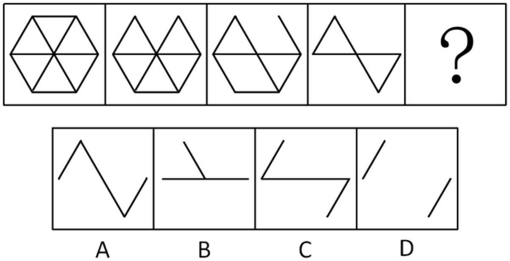

**47.** 从所给的四个选项中，选择最合适的一个填在问号处，使之呈现一定的规律性：

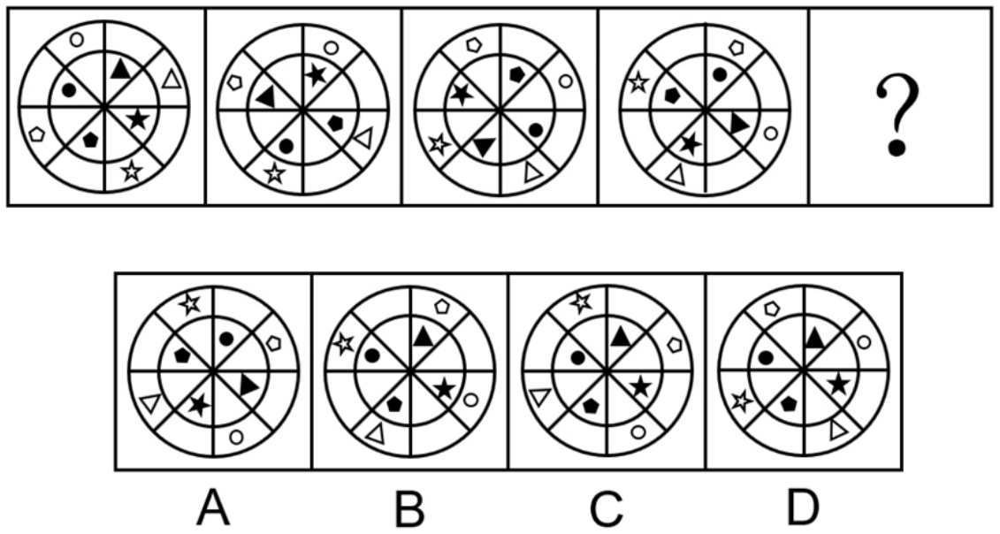

**48.** 下列4张纸条，沿折痕能够折出如图所示图形的是（）。

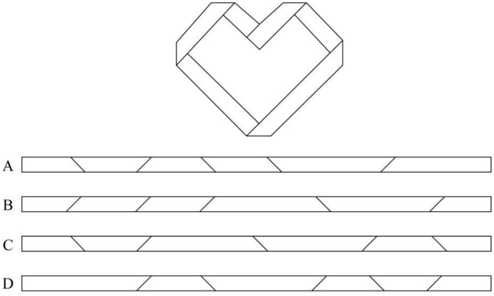

**49.** 下列各项中不可能是如上图所示立方体组成部分的是（）。

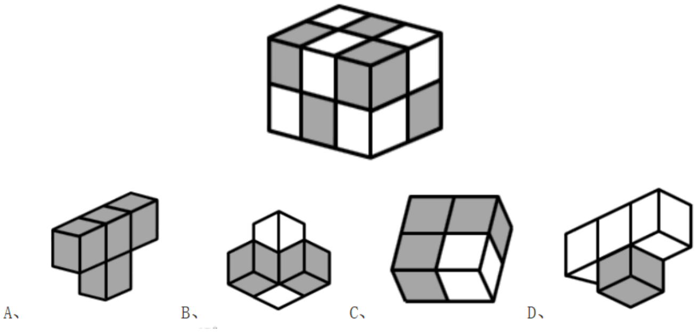

**50.** 下列选项中，与所给的立体图形不同的是（）。

A. 
B. 
C. 
D. 

**51.** 为促进员工交流，营造积极参加体育锻炼的良好氛围，某单位组织了跑步、羽毛球、排球、篮球等多支运动队。已知：
（1）所有员工至少参加了跑步队或羽毛球队中的一个；
（2）参加了跑步队的员工都没有加入篮球队；
（3）财务部小丽加入了篮球队。
工会委员了解上述情况后推断，小丽也加入了排球队。
要使这一推断成立，可以补充的前提是（）。

A. 小丽没有参加跑步队
B. 小丽没有加入羽毛球队
C. 加入了排球队的人都参加了羽毛球队
D. 未加入排球队的人都没有参加羽毛球队

**52.** 某健身房如果在同一天既开设瑜伽课程又开设动感单车课程，则该健身房一定也开设了形体芭蕾课程。该健身房只在每星期一开设形体芭蕾课程，王女士只有在开设瑜伽课程时才会去健身房。
根据以上表述，下列判断不一定正确的是（）。

A. 如果王女士在星期一参加了瑜伽课程，则当天该健身房一定开设了动感单车课程
B. 如果该健身房在星期二开设了动感单车课程，则王女士星期二必定不会去该健身房
C. 如果王女士在该健身房参加了形体芭蕾课程，那么她不可能是在星期三去的
D. 如果王女士这周四去了该健身房，那么王女士并没有参加该健身房的动感单车课程

**53.** 某市举办了一场职业技能竞赛，有甲、乙、丙、丁四支代表队进入决赛，每支队伍有两名参赛选手，获得第一名的选手将得10分，第二名得8分，第三名到第八名分别是6、5、4、3、2、1分，最后总分最高的队伍将获得冠军。比赛的排名情况如下：
甲队选手的排名都是偶数，乙队两名选手的排名相连，丙队选手的排名一个是奇数一个是偶数，丁队选手的排名都是奇数；第一名是丁队选手，第八名是丙队选手；乙队两名选手的排名在甲队两名选手之间，同时也在丙队两名选手之间。
根据以上条件，可以判断各队总分由高到低的排列顺序为：

A. 丁＞甲＞丙＞乙
B. 甲＞丁＞乙＞丙
C. 甲＞丁＞丙＞乙
D. 丁＞甲＞乙＞丙

**54.** 某运动会有跳高、跳远、铅球和长跑四个项目，甲乙丙丁四人报名参加了其中一个项目，且四人参加的项目各不相同，四人并不知道其他人参加的项目。
甲猜测：乙参加的是跳高。
乙猜测：丙没参加跳远。
丙猜测：丁没参加跳远。
丁猜测：甲没参加长跑。
结果表明，只有跳高和长跑项目的参加者猜对了。下列陈述正确的是（）。

A. 甲参加的是跳远
B. 乙参加的是长跑
C. 丙参加的是铅球
D. 丁参加的是跳高

**55.** 近期，某公司推出了一款空调，其耗电量比市面上所有其他同类产品都要低。因此，该公司管理层认为，这款空调的销量将会超过市面上所有其他同类产品。
以下哪项为真，最能质疑该公司管理层的判断？

A. 该公司的品牌知名度低于其他同类企业
B. 该款空调的售后服务质量比不上其他同类产品
C. 该款空调的使用寿命低于同类产品的平均水平
D. 耗电量并不是大部分消费者在选购空调时的主要关注点

**56.** 某广告宣称，甲、乙两个品牌美白爽肤水的主要卖点都是其美白功效，而甲品牌的美白爽肤水有超过70%成分与知名乙品牌产品成分一样，但甲品牌爽肤水的售价却不到乙品牌的五分之一。如果上述广告不存在虚假成分，则消费者可以据此认为甲品牌爽肤水性价比远远高于知名乙品牌。
下列最能削弱上述论点的是（）。

A. 两个品牌的爽肤水的相同成分为基础成分，不具美白效果
B. 使用者反映，两个品牌爽肤水的使用感受有一定差异
C. 产品组成成分是决定产品性能的关键因素
D. 爽肤水还可以具有其他功效

**57.** 在我国的黄海和东海的海底地层中，蕴藏着丰富的石油资源，这些石油就是远古时大量陆地植物的遗骸生成的。这说明，远古时代，黄海和东海的大陆架是一片生长茂密植物的大平原。
以下能够支持上述结论的一项是：

A. 大陆架会随着地球地壳的移动而持续着缓慢但永不停息的变化
B. 川流不息的江河就像传送带，把陆地上的有机物质源源不断地运到大海中
C. 中东的海湾地区大多是广袤的沙漠，地下蕴藏着丰富的石油资源
D. 一般来讲，陆地上相近纬度的山区比平原地区的植被资源更加丰富

**58.** 目前，我国民用航空市场还不够发达，民航飞行时长与一些发达国家有较大差距。不过，随着我国经济的发展与人民生活水平的提高，人民群众的旅游需求日益增长。因此，我国民用航空市场潜力巨大。
上述论证最可能基于的潜在假设是（）。

A. 我国旅游需求仍有较大的增长空间
B. 旅游需求的增长能够有效推动民用航空市场的发展
C. 我国民航飞行时长将达到与发达国家相当的水平
D. 经济的发展与人民生活水平的提高有关

**59.** 据调查，90%以上的在校大学生更看重手表的装饰效果，而不是实用性。因此，国产手表生产商只要生产更多符合潮流的“好看”的手表，就能极大提高手表销量。
上述推论最可能基于的假设是（）。

A. 在校大学生是国产手表的主要目标消费群体
B. 国产手表在实用性方面已处于国际先进水平
C. 现在的青年已不仅仅局限于购买经典款手表
D. 潜在消费群体对于手表的产地没有特殊偏好

**60.** 有研究显示，中国脑卒中（俗称中风）的患者数量正迅速上升，但对于中风防治效果好、费用低的颈动脉内膜剥脱手术（CEA）却尚未得到普及，该研究进而建议要培养大量能够熟练施行CEA手术的医生以应对严峻形势。
上述论证最可能基于的潜在假设是（）。

A. CEA手术的普及能够使患者、医生双赢
B. CEA手术的难度极高
C. CEA手术普及的瓶颈在于熟练施行该手术的人才缺乏
D. CEA手术的尚未普及使脑卒中患者数量上升

**61.** 小王经营着一家打印店，他发现，店内员工都很忙，大部分精力都花在了文件排版上。
为了节省人力，他给店里的电脑安装了能自动完成常规排版操作的新款软件。然而，软件安装几个月后，店内员工反而更忙了。
以下选项如果为真，最能解释这一现象的是（）。

A. 部分文档有特殊的排版要求，依然需要人工操作完成
B. 能自动排版文档后，该店的文印装订等业务量也因此大涨
C. 新软件操作有一定难度，员工需要接受培训才能熟练掌握
D. 安装软件后，该店并没有相应地调整排版和打印的收费标准

**62.** 对患有某严重疾病的10位患者的研究表明，虽然他们都生活在某县的不同地方，有着不同的生活习惯、饮食爱好及病史，但他们都在同一家石棉厂工作。由此可以得出结论：长期接触石棉是导致他们患该严重疾病的原因。
下列选项中，与上述推理结构最为相似的是（）。

A. 调查了上千名中小学生后发现，他们在智力测验上的表现与其考试成绩存在显著正相关。故智力水平能够在一定程度上预测考试成绩
B. 牛顿、法拉第与爱因斯坦所处时代及成长经历大不相同，但他们都渴望发现这个世界的规律。因此，正是这种渴望使他们成为了伟大的物理学家
C. 光伏发电和水力发电的发电机制虽然大不相同，所需条件也有很大区别，但它们都使用可再生资源进行发电，显然也都属于低碳环保的发电方式
D. 我们虽然来自不同的地方，有着不同的性格特点，但我们有着共同的理想。所以，我们能够齐心协力，共同奋斗

**63.** 我国经济正处于结构转型升级的重要时期，人口老龄化压力也日益增大。开发老年人力资源，对缓解人口老龄化的压力、促进经济结构转型升级具有十分重要的现实意义。因此，我国应当积极开发老年人力资源。
下列选项中，与上述论证在结构上最为相似的是（）。

A. 中国人口迁移存在农村劳动力向城市转移的特点。农村劳动力向城市转移是农业劳动力饱和的必然结果，因此我国的农业劳动力已经饱和
B. 产业空心化是指物质生产部门由高度发达的地区转移到欠发达地区的过程。某地许多工厂转移到了周边地区，因此该地是发达地区
C. 税收减免是应对经济下行的有效举措。当前，我国经济面临一定的下行压力，因此，采取适当的减税措施能有效应对这一压力
D. “一带一路”是一项长远规划，很多工程尚处于规划阶段。因此，“一带一路仅仅是援助计划”的评判为时过早

**64.** 2018年，有的诺贝尔奖授予了技术应用的研究者，例如：诺贝尔化学奖研究成果在能源与医疗领域开辟了新的实用途径；诺贝尔物理学奖研究成果将可应用于工业和医疗领域。可见今年的诺贝尔奖更看重应用性研究。
以下与上述推理在结构上最为相似的是（）。

A. 今年的年度优秀员工中，好几位都是销售成绩排名靠前的，可知个人的销售业绩是优秀员工评比的主要指标
B. 领导表扬了小白善于团结同事，注重团队合作，可见业绩并非评价员工的唯一指标
C. 在出版行业评选的最受欢迎报刊杂志中，大都是一些关注民生的刊物，因此群众的接受度是评选标准
D. 某高校部分大一新生有考研深造的念头，可见考研深造是不少高校学生本科毕业后的第一选择

**65.** 员工的业务能力，对企业来说是至关重要的。某企业对符合招聘条件的应聘者进行面试筛选后发现，通过了面试并工作了一段时间的员工业务能力都很强。所以，完全有理由相信该企业使用的面试筛选方法是非常有效的。
以下最能说明上述推论漏洞的是（）。

A. 未说明员工的业务能力对企业至关重要的原因
B. 假设了即使依据一个实例，也可以得出一般性的结论
C. 忽视了应聘者即使业务能力很强，也无法保证其今后表现
D. 忽视了只有业务能力强的人才能满足该企业的招聘条件

## 第六部分　科学推理

**66.** 如图，用绳子分别将两颗不同的磁力球M₁和M₂系在上、下两个平面上，M₁、M₂互相吸引，此时上平面对M₁的作用力为F₁，下平面对M₂的作用力为F₂，则以下关于F₁、F₂说法准确的是：

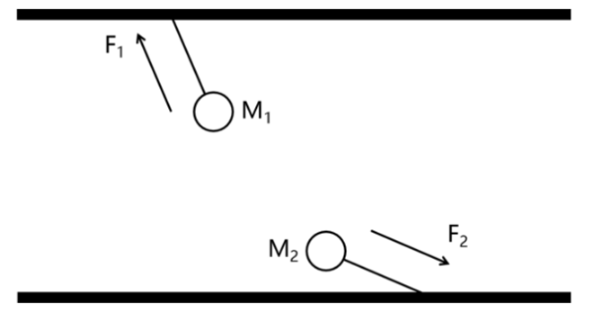

A. F₁大于F₂
B. F₁等于F₂
C. F₁小于F₂
D. 无法判断

**67.** 下图是一束光在空气和玻璃两种不同的介质中传播的路径示意图，则下列说法正确的是（）。

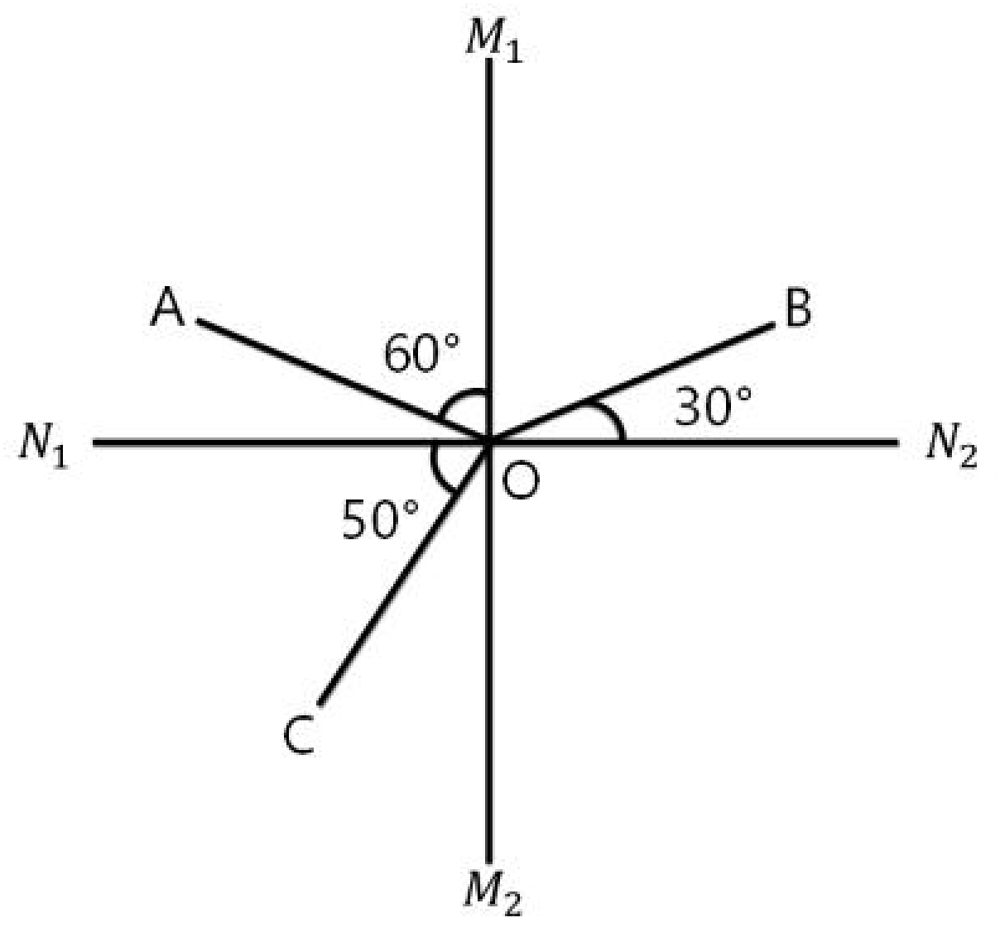

A. M₁M₂是界面
B. AO 是入射光线
C. OC 是反射光线
D. N₁N₂下方是玻璃介质

**68.** 下列物质与其用途搭配正确的是（）。
①臭氧——用作氧化剂
②二氧化碳——用作干燥剂
③氦气——用作燃料
④液氮——用作制冷剂

A. ①④
B. ②③
C. ①②
D. ③④

**69.** 无性繁殖是一种不涉及生殖细胞，不需要经过受精过程，由母体的一部分直接形成新个体的繁殖方式。以下繁殖过程不属于无性繁殖的是（）。

A. 西瓜的花被授粉后结出了果实
B. 一个草履虫经过细胞分裂变成两个
C. 水螅母体的体壁上形成与母体相似的芽体
D. 马铃薯的块茎发芽生长后，形成新的个体

**70.** 在赛车比赛中，赛车在水平直道转入弯道时，常常在弯道上冲出跑道。下列分析正确的是（）。

A. 赛车的速度越快，赛车的惯性越大
B. 赛车的速度越快，转弯所需的向心力越大
C. 赛车的转角越大，发动机对抗的离心力越大
D. 赛车的转角越大，轮胎与地面之间的摩擦系数越小

## 第七部分　资料分析

社会保险包括了养老保险，工伤保险，医疗生育保险等，是社会保障体系的重要组成部分。其在整个社会保障体系中居于核心地位，社会保险是一种缴费型的社会保障，资金主要由用人单位和劳动者缴纳（一般而言，各类社会保险的缴纳费用=缴费基数×缴纳比例），政府财政给予补贴并承担最终责任。
在经历了一段时间的摸索后，我国的社会保障制度在上世纪90年代进入了创新式的改革、发展时期。1995年3月1日，国务院发出《关于深化企业职工养老保险制度改革的通知》，确定了社会统筹与个人账户相结合的养老保险制度，职工基本养老保险制度在全国范围内正式实行统账结合模式。
近年来，随着我国经济发展出现一系列新形式新情况，企业对进一步降低社保费率的呼声较强，党中央、国务院提出新的要求。2019年《政府工作报告》明确提出，各地可将养老保险单位缴费比例降至16%。2019年，B市率先降低养老保险单位缴费比例。预计今后每年可减轻该市企业社保费缴费负担超百亿元。

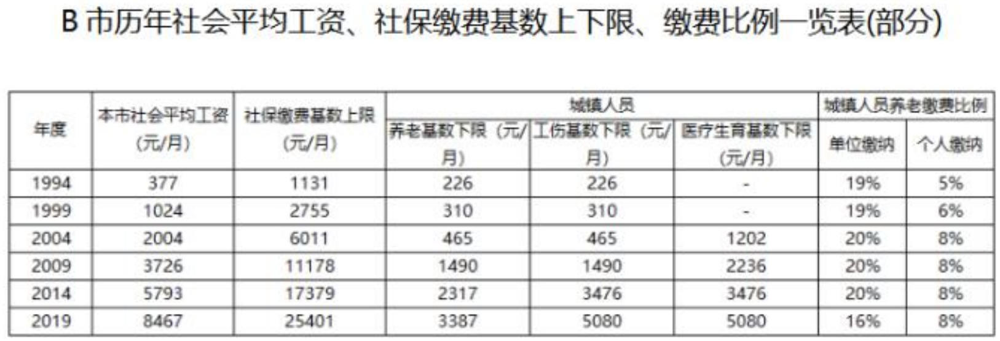

**71.** 一般来说，社保管理部门会根据当地上一年社会平均工资来确定当年的社保缴费基数上限，两者比值相对固定。下列选项中，B市这一比值与其他年份差别最大的是（）。

A. 1999年
B. 2004年
C. 2014年
D. 2019年

**72.** 根据行业的风险性质不同，工伤保险缴费的比例也不同。假如B市某企业所属行业类别的工伤保险缴费比例一直为0.5%（职工个人不缴纳工伤保险费用），在按照工伤基数下限为其员工缴纳工伤保险的情况下，2019年每名员工缴纳的工伤保险金额约为10年前的（）倍。

A. 1.46
B. 2.27
C. 3.41
D. 4.23

**73.** 在B市某企业工作的小王，2019年月平均工资为10161元，如果该企业将养老保险缴费基数下限调整为小王的实际月平均工资，则该企业全年将增加支出约（）元。

A. 1084
B. 5058
C. 9032
D. 13006

**74.** 以下最有可能符合B市1998-2018年社会平均工资增长率变化情况的曲线是（）。

A. 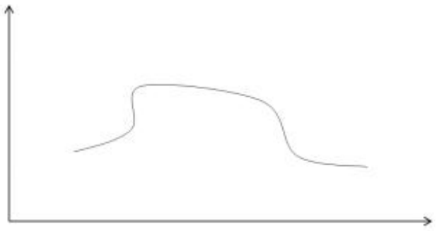
B. 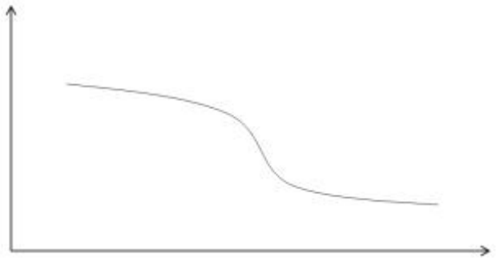
C. 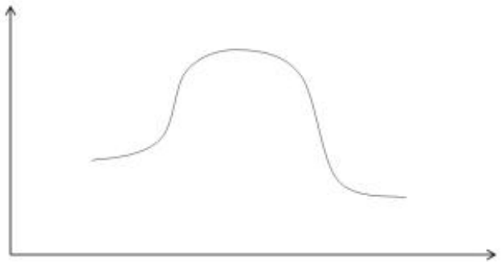
D. 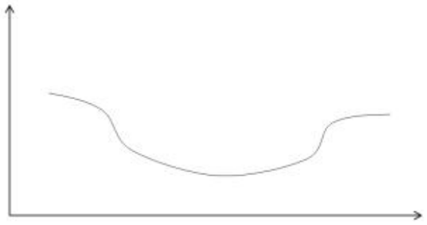

**75.** 如果B市社保缴费基数，每5年调整一次，则根据上述资料，以下说法正确的是（）。

A. 1994-2019年，B市城镇人员养老保险缴纳基数下限与上年社会平均工资的比值逐渐缩小
B. 1994-2019年，B市城镇人员养老保险的单位缴纳比例和个人缴纳比例逐渐降低
C. 2004-2019年，B市城镇人员的工伤和医疗生育保险缴纳基数下限始终不低于养老基数下限
D. 2009-2019年，B市城镇人员与农业户口人员的各项保险缴纳差距逐渐缩小

2012年某市居民人均日常时间利用情况如下表所示，根据图表回答下列问题：

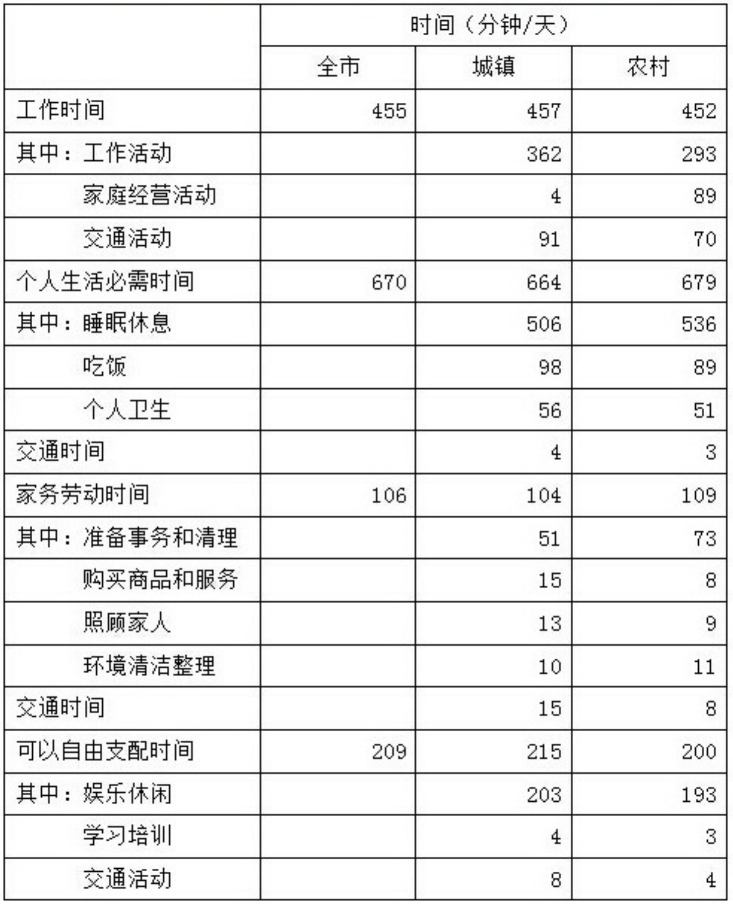

**76.** 该市居民各项活动占用时间最多的是：

A. 工作时间
B. 个人生活必需时间
C. 家务劳动时间
D. 可以自由支配时间

**77.** 在下列时间的分配上，城镇居民和农村居民差异最大的一项是：

A. 工作活动
B. 家庭经营活动
C. 交通活动
D. 个人生活必需时间

**78.** 在个人生活必需时间的分配上，城镇居民比农村居民耗用时间多的活动项目共多少项：

A. 1
B. 2
C. 3
D. 4

**79.** 根据上表，可以推断该市城镇居民与农村居民的人数比是：

A. 2：1
B. 3：2
C. 4：3
D. 无法推断

**80.** 根据上表，以下说法正确的一项是：

A. 人们平均每天约40%的时间用于工作
B. 农村居民人均每天比城镇居民节约交通时间21分钟
C. 农村居民家庭经营活动平均耗时约占工作时间的1/5
D. 农村居民人均每天比城镇居民睡眠多一个小时

2013年全年，我国出口苹果数量为994664.1吨，同比增长1.9%，金额为10.3亿美元，同比增长7.3%。
2013年12月，我国出口苹果数量为117478.4吨，比11月下降8.0%，金额为1.2亿美元，比11月下降7.7%，同比出口数量增长2.6%，金额增长12.5%。
2013年1~11月，我国对亚洲出口苹果数量为764096.4吨，同比增长6.8%，对非洲出口苹果数量为1943.9吨，同比下降56.6%；对欧洲出口苹果数量为106279.0吨；对南美洲出口苹果数量为711.3吨，同比增长7.6%；对北美洲出口苹果数量为3843.3吨，同比增长25.0%；对大洋洲出口苹果数量为311.8吨，同比增长48.3%。

**81.** 2013年1~11月，我国对各大洲出口苹果数量最多的是：

A. 亚洲
B. 非洲
C. 欧洲
D. 北美洲

**82.** 2013年1~11月，我国对各大洲出口苹果数量同比增长率的大小关系是：

A. 大洋洲<亚洲
B. 南美洲>北美洲
C. 亚洲>南美洲
D. 北美洲<大洋洲

**83.** 2013年我国平均每月出口苹果数量为多少吨：

A. 82888.7
B. 87997.3
C. 98734.8
D. 117478.4

**84.** 2013年1~11月我国出口苹果金额约占2013年全年的：

A. 66%
B. 79%
C. 88%
D. 93%

**85.** 下列说法错误的是：

A. 2013年12月我国出口苹果的平均单价低于前11月的平均单价
B. 2013年12月我国出口苹果的平均单价高于2012年12月
C. 2013年1-11月，我国对各大洲出口苹果数量同比变化量最大的是非洲
D. 2013年1-11月，我国对欧洲出口苹果数量同比出现下降

2017年全国二手车累计交易量为1240万辆，同比增长19.3%；二手车交易额为8092.7亿元，同比增长34%。2017年12月，全国二手车市场交易量为123万辆，交易量环比上升7.4％，上年同期交易量为108万辆。

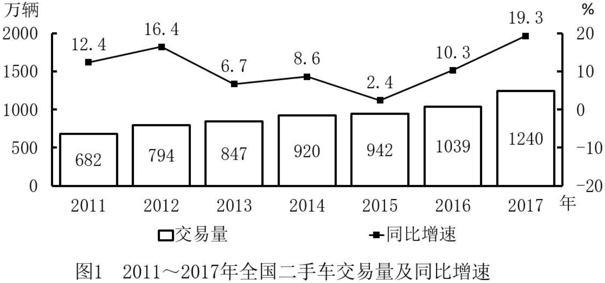

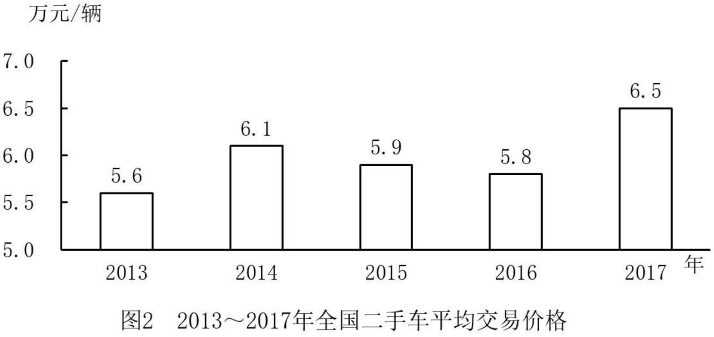

**86.** 2011～2017年，全国二手车交易量同比增量低于80万辆的年份有几个？

A. 3
B. 4
C. 5
D. 7

**87.** “十二五”（2011～2015年）期间，全国二手车总计交易约多少亿辆？

A. 0.46
B. 0.50
C. 0.38
D. 0.42

**88.** 2017年1～10月，平均每月全国二手车交易量约为多少万辆？

A. 100
B. 105
C. 90
D. 95

**89.** 2015年全国二手车交易总金额比2014年：

A. 减少了不到100亿元
B. 减少了100亿元以上
C. 增长了100亿元以上
D. 增长了不到100亿元

**90.** 能够从上述资料中推出的是：

A. 2016～2017年，全国二手车平均交易价格在6.1～6.15万元之间
B. 2011～2017年，全国二手车交易量同比增速第4高的年份，当年二手车平均交易价格高于6万元
C. 2011～2017年，全国二手车交易量同比增长量最高的年份其增长量是最低年份的9倍多
D. 2011～2017年，全国二手车交易量同比增速低于10%的年份有4个
