# M16　广东省考行测模拟卷（题本）

## 第一部分　政治理论

**1.** 持之以恒推进全面从严治党，坚持全面从严，要把严的基调、严的措施、严的氛围体现到党的建设重点领域和关键环节。

A. 正确　　B. 错误

**2.** 政治工作永远是人民军队的生命线，改革是人民军队的立军之本。

A. 正确　　B. 错误

**3.** 党的二十大科学论述了习近平新时代中国特色社会主义思想的世界观和方法论。

A. 正确　　B. 错误

**4.** 唯物辩证法认为，矛盾的主要方面处于支配地位，起主导作用；次要方面处于被支配地位，起次要作用。

A. 正确　　B. 错误

**5.** 二十届五中全会《决定》要求弘扬马克思主义学风，推动党员、干部联系本地区本部门本单位实际和个人思想工作实际，自觉深化理论学习，运用党的创新理论分析和解决实际问题，做到学思用贯通、知信行统一。下列古语与这一要求最为契合的是（　）。

A. 先天下之忧而忧，后天下之乐而乐
B. 穷则独善其身，达则兼善天下
C. 博学之，审问之，慎思之，明辨之，笃行之
D. 不谋万世者，不足谋一时；不谋全局者，不足谋一域

**8.** 关于中国特色大国外交，下列说法有误的是（　）。

A. 和平共处五项原则是中国外交政策的宗旨
B. 中国坚定奉行独立自主的和平外交政策
C. 推动构建相互尊重、公平正义、合作共赢的新型国际关系
D. 深化拓展平等、开放、合作的全球伙伴关系

**15.** 2023年4月，习近平总书记考察广东，就科技创新、产业发展、生态保护和城镇化建设等作出指示。下列表述不符合总书记指示精神的是（　）。

A. 实现高水平科技自立自强，是中国式现代化建设的关键
B. 广东要始终坚持以服务业立省，更加重视发展现代服务业
C. 湛江红树林是“国宝”，要像爱护眼睛一样守护好
D. 要积极推进以县城为重要载体的新型城镇化建设

## 第三部分　言语理解与表达

**16.** 利用互联网等信息技术促进留守儿童家庭的亲子交流，不仅有很强的必要性，也具备相当的_______。长期以来，我国科技和信息工作的推进，已经为______留守儿童难题奠定了良好的软硬件基础。
依次填入画横线部分最恰当的一项是：

A. 合理性 根治
B. 现实性 治理
C. 可行性 缓解
D. 针对性 解决

**17.** 或许一个人的力量（），但如果全国人民同心同德，和衷共济，心往一处想，劲往一处使，那便能积沙成塔，集腋成裘，为民族复兴注入不竭动力。

A. 差强人意
B. 沧海一粟
C. 微不足道
D. 轻如鸿毛

**18.** 金砖五国孕育出各自灿烂文明，彼此（），人文交流合作（）。我们要继续以民心相通为宗旨，广泛开展文化、教育、卫生、体育、旅游等各领域人文大交流，筑牢金砖合作民意基础。

A. 交相辉映 大有可为
B. 同气连枝 势在必行
C. 各有所长 蓄势待发
D. 互通有无 刻不容缓

**19.** 真情关注民生，着力改善民生，切实________民生，努力解决好群众最关心、最直接、最现实的利益问题。
填入划横线处最恰当的一项是：

A. 保证
B. 保障
C. 保护
D. 保卫

**20.** 没有人能够完全知道中国何以为“中国”，（）我们可以尽力去认识人们所选择的社会机制、文化决策和自然环境，（）我们对于那些影响历史进程的诸多因素会有更深入的了解，（）它们使得中国文明与众不同。

A. 因为 而且 所以
B. 所以 因为 就是
C. 尽管 但是 所以
D. 但是 由此 正是

**21.** 大数据给人类呈现的是一幅既美好又可怕的未来图景：美好之处在于，它将给我们带来更大的视野和更新的发现，进而改变我们的工作和生活方式；可怕之处在于，它给我们带来更多的风险和更大的挑战，除了数据本身的安全之外，它更多地关乎人们的隐私。与此同时，在研究和制定大数据发展的政策中，需要打破思想上的束缚，做到与时俱进，与网俱进；需要有一个强有力的集中统一指挥与协调机制；需要处理好发展与安全的辩证关系；需要主动平衡全球治理的责任权利。
这段文字旨在说明：

A. 大数据的政策选择要考虑发展与安全
B. 安全问题将成为大数据应用的瓶颈
C. 大数据应用对人们生活的影响利大于弊
D. 大数据的安全风险应该引起足够的重视

**22.** 当我们仔细观察当今世界上的主流火箭时，就会发现它们用的发动机、燃料箱等都是上世纪的产物。比如要在2018年首飞的太空发射系统用的是改进过的航天飞机的火箭发动机，燃料箱用的是改进过的航天飞机的外挂燃料箱，两侧的固体燃料推进器用的也是改进过的航天飞机的固体燃料推进器。____。火箭是非常复杂的东西，设计并制造火箭需要考虑的因素太多，就连火箭制造商们也只能去选择一些经受过时间考验的产物，从而确保产品的可靠性。
填入画横线部分最恰当的一句是：

A. 这是因为新技术的推广需要一定的时间
B. 这并不意味着火箭技术没有任何新的进展
C. 事实上，制造火箭的材料并不都是前沿科技产物
D. 也就是说，在火箭这个领域内并不是最新的就是好的

**23.** 此次政府机构改革再次强调了“要坚决破除制约市场在资源配置中起决定性作用，更好发挥政府作用的体制机制弊端”，“提高行政效率，全面提高政府效能，建设人民满意的服务型政府”。这突出了政府机构改革要服务于市场经济转型发展、服务于人民获得感的目标。
这段文字主要论述了（）。

A. 政府机构改革的方向
B. 政府机构改革的对象
C. 政府机构改革的原因
D. 政府机构改革的意义

**24.** 宋、明、清三代，非进士出身者，基本无法成为宰相，而许多炙手可热的官职，也规定不是进士出身者不许担任。能考上一个进士，已经殊为不易，更何况作为进士中第一名的状元了！状元一旦出笼，便立刻进入国家的储才机构——翰林院，被作为未来的宰相加以重点培养，各种别人削尖了脑袋也谋不到的美差也会扑面而来，挡都挡不住。
根据这段文字，下列说法正确的是：

A. 考取状元是成为宰相的必经之路
B. 重要官职都由进士出身者担任
C. 状元在仕途上有更好的发展机会
D. 只有状元才能进入翰林院

**25.** 正确认识和把握经济发展形势，既要看当前之“形”，也要察长远之“势”，既要算“眼前账”，更要算“长远账”。当前及今后一个时期，我国经济发展面临的环境仍然是战略机遇和风险挑战并存，但机遇大于挑战、有利条件强于不利因素，经济回升向好、长期向好的基本趋势没有改变。只要把握机遇、化危为机，有力有效应对这些风险挑战，就能够推动经济发展态势持续向好。
以下最能准确概括文段含义的是（）。

A. 勿以善小而不为
B. 行百里者半九十
C. 风物长宜放眼量
D. 知屋漏者在宇下

**26.** 染色食品曝光后，许多人表示无法理解：食品色素仅仅是改变颜色，只有“悦目”的作用，为什么一定要染色呢？事实并非如此。食物的颜色会改变人们对食物的味觉体验，进而影响对食物的选择。现代食品技术中有一个领域，就是专门研究食物的各种性质如何影响人们对食物的感受的。成分和加工过程完全相同的食物，仅仅是所采用的颜色不同，就会导致人们对它们的评价显著不同，还会影响人们对食物的选择。
最适合做这段文字标题的是：

A. 你不知道的食品添加剂
B. 食品色素背后的心理学
C. 哪些因素影响食物味道
D. 现代食品制作中的染色技术

**27.** 不可否认，数学在经济学、管理学研究中有广泛的应用，为推动学术研究和科学决策发挥了积极作用。但是，
学术研究应以问题为导向，而不是以技术为导向，数学方法只是工具和手段，不是目的。研究实践中，一些论文
只用文字或辅以简单的图表，学术水平依然很高；有的论文没有使用数学模型，明白晓畅，即使非专业人士都能
读懂。说到底，论文是用来表达思想和观点的，优秀的论文应兼具思想启迪性、理论创造性、通俗可读性。
根据这段文字，作者最可能想批评的是：

A. 学术论文存在片面追求数理模型的倾向
B. 经管研究类论文缺乏深度、创新和易读性
C. 学术研究成果在一定程度上与现实需求脱节
D. 学术评价中“唯论文”、重数量、功利化的现状

**28.** 群体免疫力是一种保护整个社区免受疾病侵害的手段：通过免疫社区里足够多的人，有效地打断疾病从
一个人传染到另一个人的接力，中断感染链，从而保护少数不能接种疫苗的人群。但是，这个模式要真正起作用，
社区中接种疫苗的人必须足够多。接种疫苗的人数必须高于一个最小的百分值（学术界称之为“阈值”），群体免
疫才会生效。接种的社区成员越多， ____ 。
填入画横线处最恰当的是：

A. 整个社区就越能够避免疾病的暴发
B. 才能有效阻断疾病源感染整个社区
C. 越能保护少数拒绝接种疫苗的人群
D. 整个社区的免疫模式才能发生作用

**29.** 同位素定年方法利用放射性同位素衰变原理来计算地表水进入封闭地下环境的时间，可以反映水在地下的补给径流排泄规律；稳定同位素有同位素分馏和季节效应，在不同体系中分布比例存在差异，因此可以用来示踪地下水的混合过程。目前，地下水循环研究中常用的同位素包括碳、氢、氧、硫等。随着技术发展，金属同位素等非传统同位素的应用，扩大了地下水定年范围。其中，镁元素是主要造岩元素，易在风化过程中以离子形式进入水体，且镁元素迁移行为简单、参与地球化学行为广，可以在地下水科学研究中发挥重要作用。
这段文字没有提及：

A. 稳定同位素用于示踪地下水混合过程的原理
B. 镁元素在地下水研究中发挥重要作用的原因
C. 推动非传统同位素用于地下水研究的关键技术
D. 计算地表水进入封闭地下环境所用时间的意义

**30.** ①以此来看，种植一些价廉物美的乡土草木，更易于达到上述效果，更能满足适地、适物以及“好种、好管、好活、好看”的绿化需求
②绿化具有生态、经济和社会三种效益
③所以在城市绿化上选择这些乡土草木资源，更能体现自己的品牌和地方特色，有助于营造有特色的园林城市风格
④城市绿化是以栽种植物来改善城市环境的活动
⑤乡土草木资源是长期自然选择的结果，不仅能适应本地的生态环境，而且不需要特别的投入
⑥同时，各个城市都有不同的市情，有的城市还有自己的市花、市树
将以上6个句子重新排列，语序正确的是：

A. ②⑤⑥③①④
B. ④②①⑤⑥③
C. ②①④⑤③⑥
D. ④③⑤①⑥②

## 第四部分　数量关系

**31.** 22，42，44，84，88，168，（），（）

A. 176，336
B. 236，352
C. 264，386
D. 312，412

**32.** $\frac{1}{3}$，$\frac{1}{2}$，$\frac{3}{5}$，$\frac{2}{3}$，（    ）

A. $\frac{5}{8}$
B. $\frac{7}{8}$
C. $\frac{5}{7}$
D. $\frac{6}{7}$

**33.** 11，27，51，87，141，（ ）

A. 222
B. 231
C. 259
D. 286

**34.** 1 1 2 6 24（    ）

A. 86
B. 112
C. 120
D. 144

**35.** 2，3，4，3√3，√46，（ ）

A. 8
B. 4√5
C. 9
D. 2√21

**36.** 某辆货车载有20吨货物，上午卸了货物总重的20%，下午卸了剩余货物的30%，则下午卸货后，货车上的货物还剩（）吨。

A. 10
B. 10.4
C. 11.2
D. 12.6

**37.** 某服装店有一批衬衣共76件，分别卖给了33位顾客，每位顾客最多买了3件。衬衣定价为100元，买1件按原价，买2件总价打九折，买3件总价打八折。最后卖完这批衬衣共收入6460元，则买了3件的顾客有（）位。

A. 4
B. 8
C. 14
D. 15

**38.** 一辆客车与一辆货车从东、西两个车站同时出发匀速相向而行，客车和货车的行驶速度之比为4∶3。两车相遇后，客车的行驶速度减少10%，货车的行驶速度增加20%，当客车到达西车站时，货车距离东车站还有17公里。东、西两个车站的距离是（）公里。

A. 59.5
B. 77
C. 119
D. 154

**39.** 甲施工队每天能完成某项工程的1/9，乙施工队施工效率是甲施工队的两倍，则甲、乙两队同时施工（）天就能完成该工程。

A. 2
B. 3
C. 4
D. 5

**40.** 某企业举行职业技能大赛，3个下属分公司均选2名员工参赛。若同一分公司的员工比赛时出场顺序不能相邻，则参赛的6名员工不同的出场顺序共有：

A. 80
B. 120
C. 160
D. 240

**41.** 甲、乙两地稻谷同时成熟，分别需要15台和13台大型收割机进行收割，计划从丙、丁两地分别调配20台和8台收割机进行支援。若从丙地调配一台收割机到甲、乙两地分别需要油费40元、50元；从丁地到甲、乙两地分别需要50元、30元，则完成所有的收割机调配至少需要油费（）元。

A. 1000
B. 1090
C. 1180
D. 1270

**42.** 有一批商品需要装箱运输。商品每件均为10厘米×40厘米×80厘米的长方体。包装箱为边长为1.2米的立方体，一个包装箱最多能装多少件商品？

A. 54
B. 53
C. 52
D. 51

**43.** 某商品的进货单价为80元，销售单价为100元，每天可售出120件。已知销售单价每降低1元，每天可多售出20件。若要实现该商品的销售利润最大化，则销售单价应降低的金额是：

A. 5元
B. 6元
C. 7元
D. 8元

**44.** 某公司38名员工一起去划船，共租了8条船，大船坐6人，小船坐4人，刚好坐满，则小船共有（）条。

A. 5
B. 4
C. 3
D. 2

**45.** 一个大的正方体的6个面分别写有数字1～6，甲、乙、丙、丁四人分别面对正方体的四个侧面，分别能看到正方体的一个侧面和顶部。甲、乙、丙三人看到的正方体侧面和顶部的点数之和分别是4、9和5，则正方体底部的点数是（）。

A. 4或5
B. 3或4
C. 2或3
D. 1或2

## 第五部分　判断推理

**46.** 从所给的四个选项中，选择最合适的一个填入问号处，使之呈现一定的规律性：

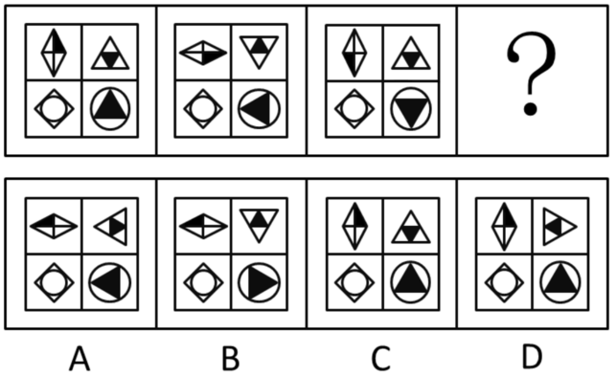

**47.** 从所给的四个选项中，选择最合适的一个填入问号处，使之呈现一定的规律性：

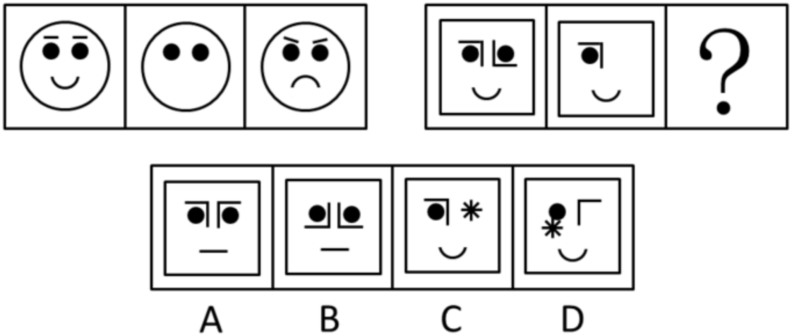

**48.** 下列选项中最符合所给图形规律的是（）。

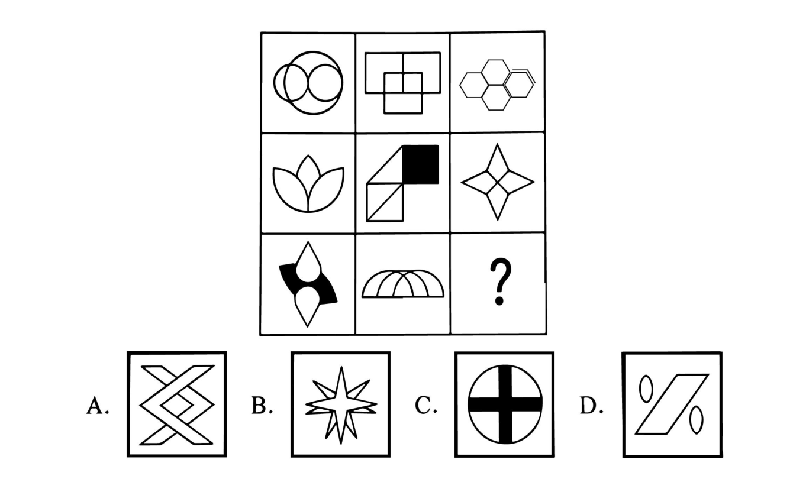

**49.** 下图是从不同角度观察同一个正方体得到的图像。该正方体的六个面分别被标记为1到6。则不可能相对的两个面是（）。

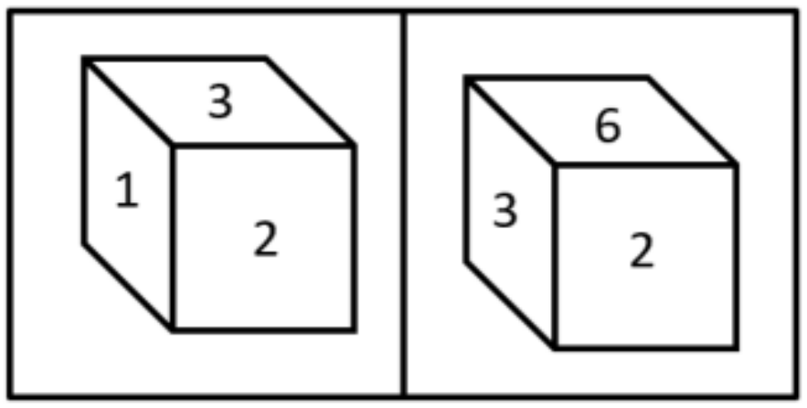

A. 1和6
B. 2和5
C. 3和4
D. 4和5

**50.** 下列选项中最符合所给图形规律的是：

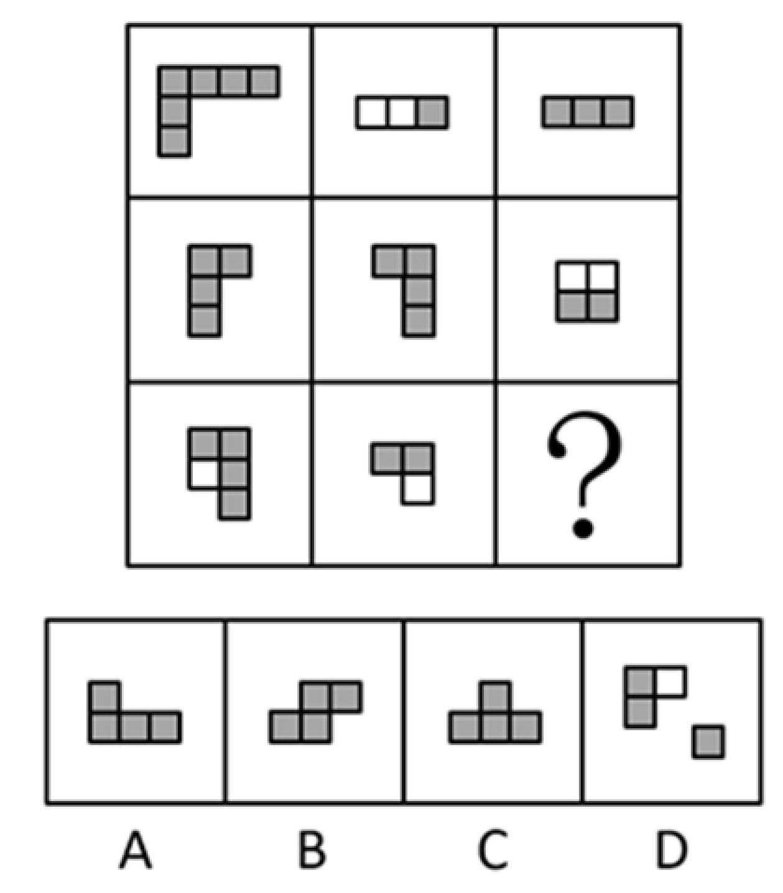

**51.** 改革开放40年来，我国的交通巨变产生了一个又一个世界之最。交通既是经济发展的服务者，又是40年建设成就的最佳象征。
根据上述表述，下列判断一定错误的是（）。

A. 交通可能是经济发展的服务者
B. 交通不可能不是经济发展的服务者
C. 交通将继续为我国改革发展作出贡献
D. 交通可能不是40年建设成就的最佳象征

**52.** 一个企业形象如何，取决于它的经济效益和社会效益。企业管理者需要明确的是，只有不断提高企业的经济效益，才能不断提高企业的社会效益。
由此可知，下列关系必然正确的是（）。
①企业的经济效益好，其社会效益必然好
②企业的经济效益差，其社会效益必然差
③企业的社会效益好，其经济效益必然好
④企业的社会效益差，其经济效益必然差

A. ①③
B. ②③
C. ①④
D. ②④

**53.** 某高中只有文科班和理科班，男生人数比女生多，理科班人数比文科班多。根据以上条件，可以判断下列说法必定为真的是：

A. 文科班的男生总人数多于文科班的女生总人数
B. 理科班的男生总人数多于理科班的女生总人数
C. 文科班的男生总人数多于理科班的女生总人数
D. 理科班的男生总人数多于文科班的女生总人数

**54.** 甲、乙、丙3人同时申请某个课题项目。评审专家组进行评审后，最终通过了其中1人的申请。专家们最初的预测如下：
①专家一：甲的申请没有通过。
②专家二：乙的申请通过了。
③专家三：丙的申请没有通过。
如果只有1名专家预测正确，则下列推论必然错误的是（）。

A. 专家一预测正确
B. 专家三预测正确
C. 甲的申请通过了
D. 乙的申请通过了

**55.** 随着气候变化，严重干旱和极端高温现象变得越来越频繁。有研究预计，全球棉花产量将大幅下降，以棉花为主要原材料的纺织品价格会进一步上涨，因此服装的批发及零售价格也会大幅上涨。
以下无法削弱上述结论的是（）。

A. 棉花作为纺织面料生产的原材料是可以替代的
B. 目前已培育出在干旱条件下能保持产量的棉花新品种
C. 我国用于生产服装的纺织品原料，部分依赖进口
D. 服装生产已经越来越多地使用化学合成纤维材料

**56.** 据统计，和去年相比，今年1月以来流感患者的数量有明显的下降。这得益于新型特效药的发明和投入使用。以下最能反驳上述结论的是：

A. 2月份为流感的高发期
B. 流感患者很少到医院去治疗
C. 流感病毒具有抗药性
D. 新型特效药定价高，患者使用少

**57.** 人类学家测量了历史上各个时期的人类头骨之后发现，当代成人的脑容量平均为1349毫升，相比中石器时代人类的脑容量，男性减少了10%，女性减少了17%。研究者认为，在分工日益明确的时代，富有合作精神的人比其他人有更多的生存和繁衍机会，“最友好者生存”是导致人类大脑不断缩小的重要原因。
以下哪项如果为真，最能支持上述结论？

A. 当代脑科学研究表明，脑容量更小会使得人类更富有合作精神
B. 合作会减少人类的攻击性，而攻击性的减少会使人身体变轻、脑容量减少
C. 随着气温的升高，人们对体重的要求降低，身体的缩小必然带来大脑的缩小
D. 外部信息存储介质的出现减轻了大脑的记忆负担，人类的大脑随之缩小

**58.** 21世纪是信息大爆炸的时代，随着互联网和移动智能设备的普及，人们获得信息越来越多，越来越容易。有理由相信，这样的条件为我们提供了更多了解真相的机会，也表示我们离事物的真相越来越近。
上述推论最可能基于的假设是（）。

A. 过多的信息会对人们的生活造成干扰
B. 信息加工过程对每个人来说存在差别
C. 互联网上充斥着大量虚假信息
D. 信息是了解事物真相的基础

**59.** 每个“熊孩子”的背后都有一个“熊家长”。这些“熊家长”对“熊孩子”百依百顺，溺爱娇惯，这使得“熊孩子”以自我为中心，缺乏规则意识，容易产生过激的非理性行为。当“熊孩子”有些行为对他人和社会造成伤害时，“熊家长”也会以“他还是个孩子”来护短辩解，要求原谅。
以下哪项最可能是“熊家长”辩解所隐含的前提？

A. “熊孩子”犯错误不是故意为之
B. 只要是孩子就难免犯错
C. “熊孩子”长大后会成为好孩子
D. 孩子犯错误应当被原谅

**60.** 如今越来越多企业认识到中欧班列具有时效更高、周转更快等优势，从而选择通过中欧班列发运货物。例如，在广州大朗站，2021年前9个月已开行出口中欧班列97列、发运标箱9698个、货值29.47亿元，同比分别增长25.97%、33.80%、19.94%。尽管大朗站的工作人员数量没有明显增加，但有不少企业发现，大朗站货物通关效率比去年更高了。
下列选项最能解释这一现象的是：

A. 珠三角地区增设了多个通关口岸
B. 当地海关简化了通关流程
C. 中欧班列的列车运行速度有所提高
D. 当地货物通关时间较去年有所减少

**61.** 羚羊是短跑能手，它们的代谢系统无法维持长时间的持续奔跑。因此即使羚羊是世界上跑得最快的哺乳动物之一，原始人类依然能捕获它们。办法就是，一直追逐，直到羚羊耗尽体能而无法逃跑。
根据以上表述，下列判断一定正确的是（）。

A. 羚羊的代谢能力比原始人类差
B. 原始人类的耐力跑能力优于羚羊
C. 原始人类是比羚羊跑得更快的哺乳动物
D. 奔跑中人类的体能消耗一定比羚羊少

**62.** 《茶经》的作者是陆羽。它是世界上最早的研究茶的著作。因此，陆羽创作了世界上最早的研究茶的著作。
以下与上述推理在结构上最为相似的是（）。

A. 地动仪的发明者是张衡。它是测量地震的仪器。因此，如果没有张衡就没有地动仪
B. 班固是《汉书》的作者之一。《汉书》具有重大的史学价值。因此，班固是一位伟大的历史学家
C. 贝多芬创作了《命运交响曲》。它是一部优秀的作品。因此，贝多芬创作了很多优秀的交响曲
D. 天王星的发现者是威廉·赫歇尔。它是太阳系由内向外的第七颗行星。因此，威廉·赫歇尔发现了太阳系由内向外的第七颗行星

**63.** 过分密集的城市布局不仅容易使城市产生热岛效应，也不符合生态美学的要求。因此，城市建设应该尽可能拉开布局，合理地间隔各城市组团，使城市看起来舒缓有序，不拥挤、不杂乱。
以下和该论述过程的逻辑最为类似的是（）。

A. 只有有趣的故事和通俗的理论相结合，才能吸引人，让人真正理解其中的内涵，爱上科学。所以，从日常生活中的小事入手，科普也可以很有趣
B. 中小学课业负担太重，是影响中小学生快乐健康成长的大问题。所以，要将课业减负进行到底，扫除线上培训等减负盲区
C. 天文学的起源与文明的起源大致处于同一时期。因此，追寻天文学的起源也就意味着我们可以在某种程度上把握文明诞生和发展的脉络
D. 律师队伍事关群众对法治的需求，也与一个地方的竞争力直接相关。所以，完善的法律服务是营商环境的重要内容，也是衡量城市吸引力的重要标尺

**64.** 汽车无人驾驶技术发展至今，还未实现大规模推广应用。其主要原因是无人驾驶技术还存在安全问题，一旦随着技术的发展解决了这一问题，汽车无人驾驶技术就能很快普及。
以下与上述推理形式最为相似的是（）。

A. 没有高强度的训练，就无法取得优异的比赛成绩。比赛成绩不理想，肯定是因为训练强度不够
B. 没有充分理论基础研究，就无法解决实际问题。现在理论基础研究多了，有更多的实际问题将得以解决
C. 恶性竞争主要是由于企业缺乏核心竞争力，因此，要建立良好的市场秩序，就需要企业发展属于自己的竞争优势
D. 法治与德治相辅相成，法律的有效实施有赖于道德的支撑和滋养，法律是准绳，道德是基石，缺一不可

**65.** 广告模特的选择，会在很大程度上影响一个商业广告的投放效果。最新研究结果表明，那些面带微笑的广告模特，反而会给人们更“酷”的感觉；而一些面无表情的广告模特虽然俊美，却会令潜在消费者对该产品印象不佳。因此，专家建议，拍摄广告时应更多地选择面带微笑的模特。
下列各项最好地总结了上述论证缺陷的是（）。

A. 忽视了模特的知名度等因素会影响商业广告的效果
B. 暗含了模特的外在形象会影响人们对广告的印象
C. 忽视了俊美的模特可能会使广告更容易吸引人们的关注
D. 假设了更能给消费者“酷”的感觉的广告效果更好

## 第六部分　科学推理

**66.** 将一个圆锥体由腰部正中间截断成M1、M2，放在天平如图所示的位置。如果要使天平保持平衡，则M1需要（）。

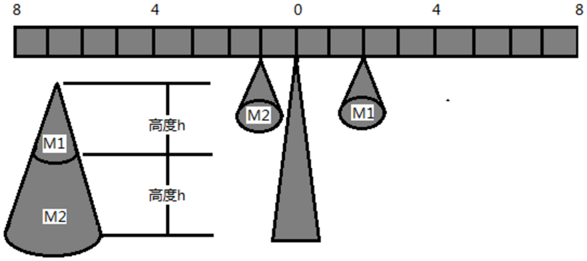

A. 右移5格
B. 右移4格
C. 右移1格
D. 左移1格

**67.** 如图，物体 A、B 分别位于木板上下方，且处于静止状态，如果将物体 B 往左移动一段距离，但仍位于木板下方，则下列说法准确的是：

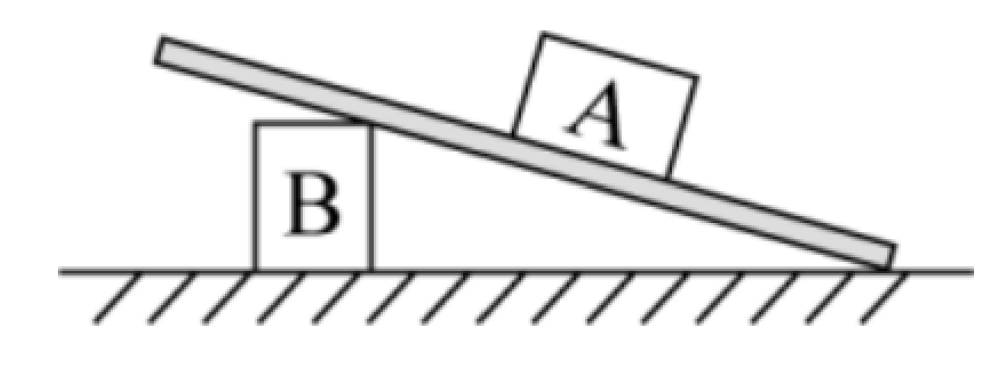

A. 物体 A 所受合力为零
B. 物体 A 所受的摩擦力增加
C. 木板对物体 A 的作用力减小
D. 木板对物体 A 的作用力增加

**68.** 小王用塑料圆筒做了一个简易哨子（如图），当他从吹气口吹气的同时，将活塞慢慢往下拉，可以听到哨声：

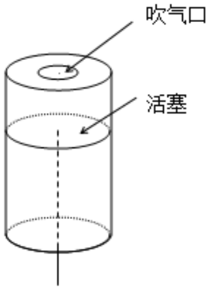

A. 逐渐变小声
B. 音调越来越高
C. 音调越来越低
D. 没有变化

**69.** 下图是A、B两种物质的溶解度曲线，下列说法正确的是：

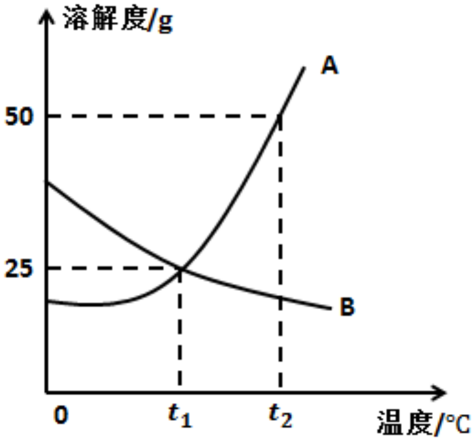

A. A物质的溶解度大于B物质的溶解度
B. 温度越高，则A、B两种物质的溶解度越大
C. 将t₁℃时A物质的饱和溶液降温，A物质变为不饱和溶液
D. 将t₂℃时B物质的饱和溶液降温至t₁℃时，没有B物质析出

**70.** 大棚种植是一种被广泛采用的农作物种植方式。以下大棚种植的增产做法，有误的是（）。

A. 在大棚内补充二氧化碳，促进农作物的光合作用
B. 维持大棚昼夜温度相对稳定，提高农作物的生长速度
C. 傍晚和夜间在大棚内开灯，增加光照时间和光照强度
D. 合理密植农作物，增加单位面积内农作物的光照面积

## 第七部分　资料分析

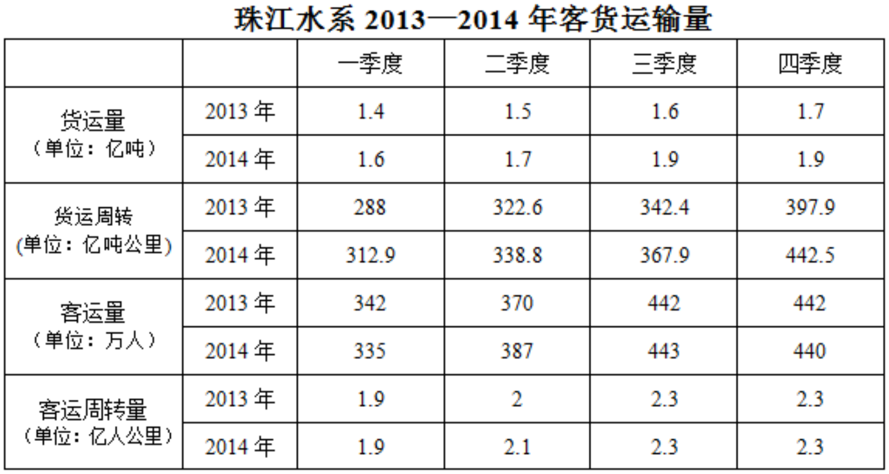

**71.** 珠江水系2014年货运量比2013年多多少亿吨：

A. 0.5
B. 0.9
C. 1.2
D. 1.7

**72.** 珠江水系2014年客运量与2013年相差最大的是：

A. 一季度
B. 二季度
C. 三季度
D. 四季度

**73.** 与2013年相比，珠江水系2014年货运周转量增长率最高、最低的分别是：

A. 一季度、二季度
B. 一季度、三季度
C. 四季度、三季度
D. 四季度、二季度

**74.** 与2013年相比，珠江水系2014年客货运输量增长率最低的是：

A. 货运量
B. 货运周转量
C. 客运量
D. 客运周转量

**75.** 下列说法正确的是：

A. 珠江水系2014年客运量与2013年相差最大的季度是一季度
B. 珠江水系2014年货运周转量与2013年相差最小的季度是一季度
C. 与2013年相比，珠江水系2014年客运周转量增长率低于2%
D. 2013年、2014年，珠江水系货运量、客运量的最高值都出现在四季度

2012年，某地区农作物播种总面积达到1625.55万亩，同比增长4.6%。其中，粮食和蔬菜播种面积大幅增长，分别为459.40万亩、109.06万亩，同比增长32.7%和30.5%；棉花、油料和甜菜播种面积下降，分别为698.52万亩、103.42万亩、30.45万亩，同比下降17.3%、5.7%和18.2%。粮食作物中，小麦295.61万亩，同比增长67.7%；玉米93.77万亩，同比增长3.1%；大豆21.51万亩，同比增长76.6%；水稻32.66万亩，同比下降7.7%。蔬菜播种面积中，番茄65.48万亩，同比增长60.7%；辣椒21.27万亩，同比下降0.7%。
（注：与上一年同一时期相比称为“同比”。）

**76.** 2012年，下列农作物播种面积同比增幅最大的一种是：

A. 棉花
B. 小麦
C. 玉米
D. 番茄

**77.** 根据上述资料，2011年油料播种面积约为多少万亩：

A. 90
B. 100
C. 110
D. 120

**78.** 2012年粮食和蔬菜播种总面积：

A. 超过600万亩
B. 同比增长超过40%
C. 约占该地区农作物总播种面积的35%
D. 比棉花的播种面积少近200万亩

**79.** 2012年水稻播种面积比2011年大约少多少万亩：

A. 2.21
B. 2.33
C. 2.72
D. 2.88

**80.** 根据上述资料，以下说法正确的一项是：

A. 农作物播种面积的同比增长，主要是因为粮食作物和蔬菜播种面积的增加
B. 由于种植面积的减少，2012年水稻产量必然会减少
C. 粮食作物的种植是该地区最主要的农业生产项目
D. 2011年番茄播种面积是辣椒播种面积的近两倍

据统计，2013年我省完成货运量305830万吨，比上年增长14.8%；完成货运周转量12407.08亿吨公里，比上年增长26.9%。

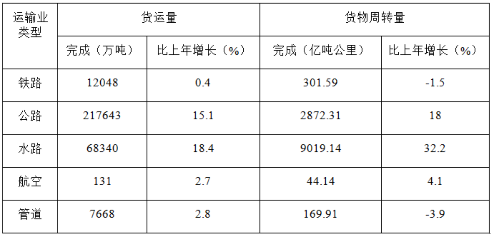

**81.** 2013年，我省各类运输业务货运量完成最多的是：

A. 铁路
B. 公路
C. 水路
D. 管道

**82.** 2013年，我省各类运输业货物周转量比上年出现下降的运输业有（）个。

A. 4
B. 3
C. 2
D. 1

**83.** 2012年，我省完成货物周转量约（）亿吨公里。

A. 8907
B. 9777
C. 10198
D. 11764

**84.** 2013年，我省各类运输业中，货运量和货物周转量增长率均超过15%的是：

A. 公路、水路
B. 公路、航空
C. 水路、航空
D. 铁路、管道

**85.** 2012年，全省运输业货运量中水路完成的比例，比货物周转量中水路完成的比例约低（）个百分点。

A. 52
B. 46
C. 50
D. 48

单位：件

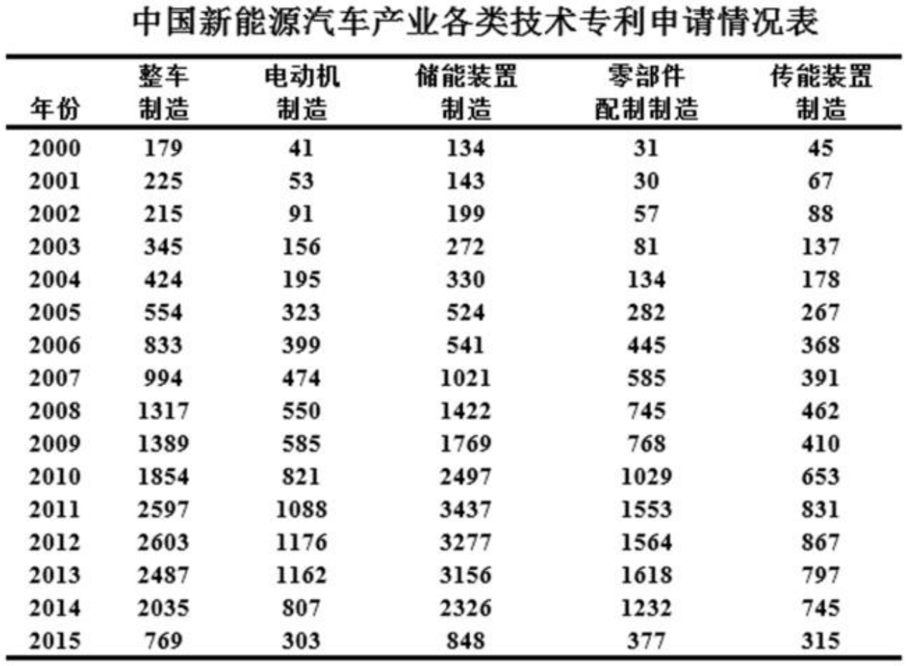

**86.** 表中新能源汽车产业零部件配件制造技术专利申请数增速最快的年份为：

A. 2005年
B. 2002年
C. 2014年
D. 2010年

**87.** 能够正确描述2015年新能源汽车产业五种专利申请数占比的统计图是：

A. 
B. 
C. 
D. 

**88.** “十二五”期间整车制造专利申请总数约是“十五”期间总数的多少倍？

A. 2
B. 4
C. 6
D. 8

**89.** 2001～2015年间，新能源汽车五种技术专利申请数均高于上年的年份有多少个？

A. 7
B. 8
C. 9
D. 10

**90.** 能够从上述资料中推出的是：

A. 2000～2015年间，五种技术专利中申请数年均增速最快的是零部件配件制造
B. 2011～2015年间，储能装置制造专利申请数均超过电动机制造的3倍
C. 2010年传能装置制造专利申请数比2005年翻了两番
D. 2001～2015年间，储能装置制造专利申请数增加最多的年份是2010年
