# M17　广东省考行测模拟卷（题本）

## 第一部分　政治理论

**1.** 持之以恒推进全面从严治党，必须进一步完善党和国家监督体系，完善纪检监察工作双重领导体制，做实监督检查和查办腐败案件以同级党委领导为主。

A. 正确　　B. 错误

**2.** 党中央集中统一领导是党的领导的最高原则，是党保持团结统一和强大战斗力、不断取得胜利的关键所在。

A. 正确　　B. 错误

**3.** 三国时期，岭南属吴。226年，从交州划出4郡另置广州，州治番禺，“广州”之名由此开始。

A. 正确　　B. 错误

**4.** “存在即被感知”“物是观念的集合”体现的是客观唯心主义的观点。

A. 正确　　B. 错误

**5.** 二十届五中全会《决定》要求教育引导党员、干部说老实话、办老实事、做老实人，做到襟怀坦荡、光明磊落、言行一致。下列古语与这一要求最为契合的是（　）。

A. 天行健，君子以自强不息
B. 仰不愧于天，俯不怍于人
C. 君子成人之美，不成人之恶
D. 温故而知新，可以为师矣

**6.** 2023年4月，习近平总书记在广东考察时指出，要加强陆海统筹、山海互济，强化港产城整体布局，加强海洋生态保护，全面建设海洋强省。这一要求最能体现习近平新时代中国特色社会主义思想（　）的立场观点方法。

A. 必须坚持人民至上
B. 必须坚持守正创新
C. 必须坚持系统观念
D. 必须坚持自信自立

**7.** 二十届五中全会《决定》提出坚持制度治党、依规治党，要求完善党内法规制度体系，增强制度执行力。下列表述不符合《决定》要求的是（　）。

A. 统筹党内法规立改废释，注重系统集成，加强配套衔接
B. 完善党内法规解释机制，健全党内法规同国家法律法规衔接协调机制
C. 坚决纠正有令不行、有禁不止，防止制度执行做选择、打折扣、搞变通
D. 严格控制党内法规公开范围，加强党内法规制度学习培训

**8.** 在我国，国家一切权力属于人民。关于我国的政治制度和全面依法治国，下列说法有误的是（　）。

A. 我国的政体是工人阶级领导的、以工农联盟为基础的人民民主专政
B. 人民代表大会制度是我们党领导人民在人类政治制度史上的伟大创造
C. 人民代表大会制度是实现全过程人民民主的重要制度载体
D. 党的十八届四中全会通过了关于全面推进依法治国若干重大问题的决定

**13.** 习近平在2026年7月召开的国家科学技术奖励大会、两院院士大会、中国科协第十一次全国代表大会上，回顾党的十八大以来科技事业的发展，分析科技发展面临的新形势。下列表述与讲话内容不符的是（　）。

A. 党的十八大以来，党中央把科技创新摆在现代化建设突出位置，系统擘画科技强国建设蓝图
B. 科技创新是人类文明进步的不竭动力，科技实力和创新能力越来越成为国家的核心竞争力
C. 要抓住历史机遇，迎接时代挑战，扎扎实实以科技创新支撑和引领中国式现代化
D. 要加快推进高水平科技自立自强，向着到2050年建成科技强国的目标坚定迈进

**15.** 广东省2026年政府工作报告在回顾2025年工作时指出，全省加快推进科技创新和产业创新深度融合。下列表述与报告内容不符的是（　）。

A. “百万英才汇南粤”行动吸纳超110万名高校毕业生在粤就业创业
B. 全省研发人员达159万人、高技能人才达843万人，均居全国第二
C. 建成国家人工智能学院深圳河套学院，创建3个国家人工智能应用中试基地
D. 全球灯塔工厂增至10家，国家卓越级智能工厂增至22家

## 第三部分　言语理解与表达

**16.** 每一寸鲜血浸染的红色热土，每一段感人至深的红色往事，都______着艰苦卓绝的牺牲奉献，______着气吞山河的壮丽辉煌，是全党全国各族人民弥足珍贵的精神财富。
依次填入画横线部分最恰当的一项是：

A. 汇聚 镌刻
B. 凝聚 描绘
C. 汇集 勾勒
D. 凝结 铭刻

**17.** 农民工就业难题的破解是一个长期过程，不可能（），需要政府、企业、社会组织以及农民工自己协同作战。

A. 轻而易举
B. 易如反掌
C. 一蹴而就
D. 唾手可得

**18.** 从自动化的生产线，到自动驾驶汽车，从跨越山河的无人机，到远程联动的手术室，5G技术正全面________各行各业，________制造业高端化、智能化、绿色化发展。
依次填入画横线部分最恰当的一项是（）。

A. 进入，引导
B. 渗入，引领
C. 迈入，带领
D. 融入，带动

**19.** 随着社会老龄化进入了第一高峰期，广大老年人精神文化生活方面的需求也进一步（）出来。

A. 体现
B. 呈现
C. 表现
D. 凸显

**20.** 现代社会获取盐分轻而易举，以至于人们认为吃盐是____的事情。而事实上，由于盐在地理上的分布不均以及交通不畅等原因，其在古代一直都属于____之物。在人类历史的绝大部分时间里，人们都在寻找盐，甚至令盐业成为了历史上第一个由国家垄断的产业。可以说，盐贯穿着整个人类历史，并在人类文明的发展中起到了____的作用。
依次填入画横线部分最恰当的一项是：

A. 稀松平常 必需 举足轻重
B. 理所当然 稀缺 至关重要
C. 天经地义 关键 承上启下
D. 手到擒来 珍贵 一以贯之

**21.** 当前，新闻媒体正在深入推进融合发展。新闻作品版权是媒体的核心资产，但目前加剧的侵权现实让人无奈。作为新闻媒体，一般乐见自己的作品被广泛传播，但前提是尊重原创劳动，并得到授权方能使用。如果对未经授权擅自使用、传播新闻作品的行为置之不理，传统产业的发展将受到严重影响，媒体的融合发展也会面临严重困难。
这段文字意在强调（）。

A. 新闻媒体的融合有利于版权保护
B. 新闻媒体的融合发展面临严重困难
C. 新闻媒体应避免自己的作品被随意转载
D. 推动新闻媒体融合发展，必须做好版权保护

**22.** 良法是善治的前提。“法非从天下，非从地出，发于人间，合乎人心而已。”____，发挥好人大及其常委会在立法工作中的主导作用，坚持尊重和体现客观规律，坚持为了人民、依靠人民，坚持严格依照法定权限和法定程序，深入推进科学立法、民主立法、依法立法。
填入画横线部分最恰当的一项是：

A. 要抓住提高立法质量这个关键
B. 人大要统筹运用法定监督方式
C. 法律体系须与时俱进加以完善
D. 治国理政要保障人民当家作主

**23.** 虽然中国的救灾能力在经历过多次大型自然灾害后有了较大的提升，但是防灾教育依然落后。中国扶贫基金会2015年对中国公众的防灾意识进行了调查，结果显示，仅有24.3%的城市居民表示关注灾害应对的相关知识，这一数据在农村仅为11%。此外，只有不到4%的城市居民在日常生活中做了基本的防灾准备，超过半数的农村居民从未参加过任何防灾培训。形同虚设的防灾教育无法提高民众的自救能力，等到灾难发生后才开始组织学习，逝去的生命已经无法挽回。
这段文字意在说明：

A. 防灾教育比救灾更重要
B. 中国的防灾教育亟待加强
C. 防灾教育是提高自救能力的基础
D. 城市与农村在防灾教育上严重失衡

**24.** “气凝胶”是一个不断发展的概念，早期提及气凝胶，更多强调它是一种由湿凝胶去除溶剂之后得到具有纳米孔的多孔材料。但是后来出现的新型气凝胶，有一部分并不满足纳米孔的特点，甚至还有的气凝胶是由气相法制备的。气凝胶最传统的制备方法是利用有机醇盐等前驱体的水解聚合反应，先获得湿凝胶，接着将湿凝胶中的液相去除得到最终的干凝胶，这种方法称为气凝胶制备的溶胶——凝胶路线或者分子路线。由于前驱体难以获得且存在安全问题，此法只在少数氧化物体系获得了成功的应用——这至今仍是二氧化硅和氧化铝等气凝胶通用的制备路线。
根据这段文字，以下说法正确的是：

A. 有机醇盐难以获得且存在安全隐患
B. 气相法是气凝胶最传统的制备方法
C. 纳米孔是新型气凝胶的典型特点
D. 制备气凝胶的分子路线方法应用广泛

**25.** 中国的科技进步举世瞩目。2010年中国科技人力资源总量居世界第一位，国际科技论文数量居世界第二位，发明专利授权量居世界第三位……但调查显示，我国人才资本对经济增长的贡献率远远低于西方国家，而关键技术的对外依存度明显高于西方国家。
这段文字主要想传递的信息是：

A. 缺乏关键核心技术的支持已成为科技发展的瓶颈
B. 中国科技发展的自主创新能力不强，研究基础薄弱
C. 中国的科技实力发展迅猛，取得了许多重大成果
D. 中国已成为科技大国，但仍与发达国家存在较大差距

**26.** 海洋学家揭开了珊瑚礁颜色绚丽多变的秘密。原来，珊瑚虫体内负责控制色素生成的基因存在多种变异，激活的基因越多，珊瑚颜色就越明亮鲜艳。这些色素对与珊瑚共生并为之提供食物的海藻有保护作用。在日照强烈的地方，为了避免海藻被阳光杀死，珊瑚虫便会生成更多色素，珊瑚的颜色就会更鲜艳。
最适合做这段文字标题的是：

A. 保卫海藻
B. 多彩珊瑚之谜
C. 阳光与珊瑚
D. 乐于奉献的珊瑚虫

**27.** 科学家们成天经历的就是无知、疑惑、不确定，这种经历是极其重要的。当科学家不知
道答案时，他是无知的；当他心中大概有了猜测时，他是不确定的；即便他满有把握时，他
也会永远留下质疑的余地。承认自己的无知，留下质疑的余地，这两者对于任何发展都必不
可少。科学知识本身是一个具有不同层次可信度的集合体：有的根本不确定，有的比较确定，
但没有什么是完全确定的。
通过这段文字作者主要强调：

A. 科学就是在不断质疑的过程中发展的
B. 科学知识本身常常是充满不确定性的
C. 科学家并非永远对自己的工作有自信
D. 承认自己无知并不影响科学家的声誉

**28.** 博物馆研学，要“研之有物”“学而广博”。博物馆研学不是“打卡”拍照的旅游，也不仅是提供托管服务，
而是要让年轻一代明白，生而为中国人，最根本的是有中国人独特的精神世界，有百姓日用而不觉的价值观。
近年来，中华文明探源工程等重大工程的研究成果，进一步证实了我国悠久的人类史和璀璨的文化史，其中也
包含着中华优秀传统文化、革命文化和社会主义先进文化。这些都被缩影于文物当中。因此，博物馆研学，就
是要 ____ 。
填入画横线部分最恰当的一项是：

A. 从文物中学习这些文化
B. 深入了解中华文明的独特性
C. 不断提高自身文化素养
D. 有的放矢地学习历史和文化

**29.** 穿山甲的外壳由被称作角蛋白的有机骨骼组成，能为躯体提供强有力的保护作用，却不会妨碍行动或损伤自身。穿山甲能把角质鳞片组成重叠结构，灵活无碍地移动。受其启发，工程师设计出一个拥有重叠鳞片设计的微型机器人，用于在人体内进行安全和微创的医学治疗。它通过变形，可以到达人体内难以触及的胃或小肠等区域。在概念验证实验中，微型机器人能够加热到70℃，对人体组织进行医疗处理，包括在难以触及区域进行癌症热疗或止血。此外，机器人能够将负载物释放到组织，未来可用于递送药物。
关于微型机器人，下列说法与这段文字不相符的是：

A. 鳞片结构与穿山甲类似
B. 具有灵活机动的移动能力
C. 治疗能力已在临床中得到验证
D. 可用在微创手术中进行止血

**30.** ①大脑能够极其敏锐地探测到环境中的威胁
②它们会激活我们大脑中的恐惧回路，有时候我们会反击，有时候则逃跑
③大脑还擅长鉴别哪些乍看之下的威胁或者惊吓的刺激其实是无害的，或者是可以被解决的
④新的研究发现了一种神经回路，它使大脑具有“删除”不良记忆的能力，这项发现可能为焦虑症找到新的治疗方法
⑤但如果该系统失灵，一些不愉快的联想就会萦绕不去，这种机能失常被认为是创伤后应激障碍以及其他焦虑症的根源
⑥嘈杂的声音、有毒的气味、正在靠近的捕食者，这些因素都会对我们的感觉神经元发出电刺激
将以上6个句子重新排列，语序正确的是：

A. ①⑥②③⑤④
B. ①③⑥②⑤④
C. ④②①③⑥⑤
D. ④②⑥①③⑤

## 第四部分　数量关系

**31.** 23，24，22，25，21，26，（    ），（    ）

A. 19 28
B. 20 27
C. 26 21
D. 32 39

**32.** 0.5 3 8 18 38（    ）

A. 75
B. 78
C. 82
D. 85

**33.** 81，27，18，18，24，（    ）

A. 36
B. 40
C. 44
D. 48

**34.** 26，20，15，11，8，（    ）

A. 3
B. 5
C. 6
D. 7

**35.** $\frac{1}{2}$，$\frac{1}{5}$，$\frac{5}{7}$，$\frac{7}{17}$，$\frac{23}{25}$，（ ）

A. $\frac{27}{31}$
B. $\frac{39}{43}$
C. $\frac{47}{49}$
D. $\frac{35}{64}$

**36.** 在某大型医院的建设过程中，施工单位调配了吊机、挖掘机和推土机共120台工程设备进场施工。其中，推土机数量是吊机的3倍，挖掘机数量是吊机的4倍，则吊机有（）台。

A. 18
B. 15
C. 12
D. 10

**37.** 一些员工在某工厂车间工作，如果有4名女员工离开车间，在剩余的员工中，女员工人数占九分之五，如果有4名男员工离开车间，在剩余的员工中，男员工人数占三分之一。原来在车间工作的员工共有（）名。

A. 36
B. 40
C. 48
D. 72

**38.** 上午7点，A、B市干部同时乘车前往省城参观学习，汽车时速均为每小时80公里。但由于突发状况，B市干部在路上停留了2个小时。最终，A市干部于当天上午9点到达省城；B市干部于当天下午3点到达。则如果从A市出发，途经省城到达B市，总路程为（）公里。

A. 720
B. 640
C. 320
D. 280

**39.** 甲、乙、丙三人合作完成一项任务。乙先做9天，再和甲合作6天，完成了任务的60%，剩下的任务，若由丙做，恰好10天完成。甲、乙、丙三人的工作效率之比是：

A. 5：4：6
B. 6：4：5
C. 10：15：12
D. 12：15：10

**40.** 某公司实行弹性工作制，允许居家办公，但要求员工每周的周一到周五至少有两天在公司工作。小王、小李和小陈都是该公司的员工，若他们分别从下周的周一到周五中随机选2天、3天、4天去公司工作，则他们下周三都去公司工作的概率是：

A. 1/25
B. 6/125
C. 24/125
D. 3/250

**41.** 某公园有一个周长为1千米的长方形花坛，计划在其周围每隔100米放置一个垃圾桶。现已将所需垃圾桶全部放在其中一个放置点（如图所示），接下来要用手推车将垃圾桶运到每一个放置点。假如该手推车每次最多能运3个垃圾桶，则将垃圾桶运到最后一个放置点时手推车行程最少为（）米。

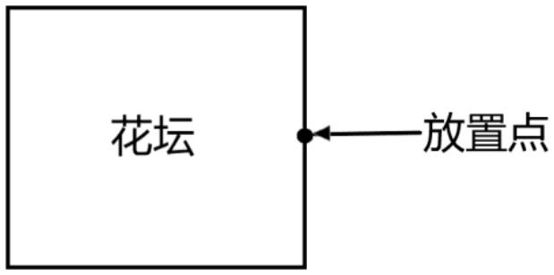

A. 1600
B. 1800
C. 1900
D. 2200

**42.** 某食品企业为丰富产品造型，将一款甜点的外形由圆柱形改为半球形。若圆柱形甜点的底面半径是高的2倍，半球形甜点的体积缩小到圆柱形甜点的9/16，则半球形甜点的底面半径是圆柱形甜点底面半径的：

A. 1/4
B. 1/3
C. 2/3
D. 3/4

**43.** 小王早上看到挂钟显示8点多，急忙赶往公司上班。但是到了公司却发现时间和自己出门看到的挂钟时间一样，才明白是自己出门前误把挂钟的时针看成分针、分针看成时针。已知小王平时上班路程不超过1.5小时，今天上班他花费了（）。

A. 48分钟
B. 55分钟
C. 1小时
D. 1小时3分钟

**44.** 某单位购买了30个文件袋，有大、中、小三个型号。已知大号文件袋和中号文件袋数量之比为5：6，中号文件袋和小号文件袋数量之比为3：2。那么，所购的小号文件袋有（）个。

A. 4
B. 6
C. 8
D. 10

**45.** 一条长20厘米的纸带，先从左端开始涂上4厘米红色，之后每间隔4厘米再涂4厘米红色；再从右端开始涂上5厘米绿色，之后每间隔5厘米再涂5厘米绿色，则红绿色重叠的部分共有（）段。

A. 4
B. 3
C. 2
D. 1

## 第五部分　判断推理

**46.** 从所给的四个选项中，选择最合适的一个填入问号处，使之呈现一定的规律性：

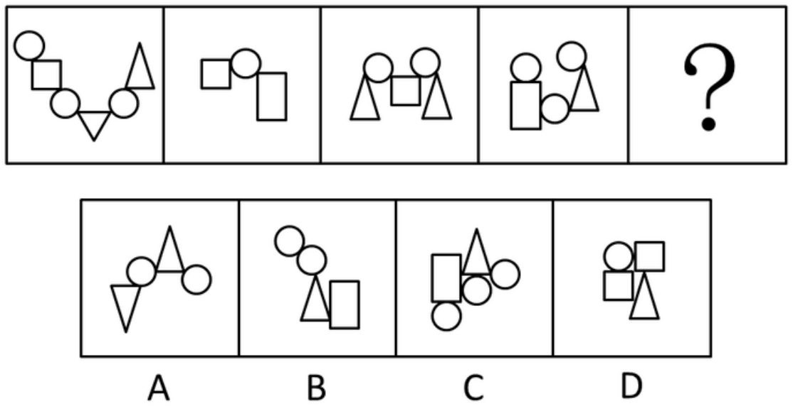

**47.** 从所给的四个选项中，选择最合适的一个填入问号处，使之呈现一定的规律性：

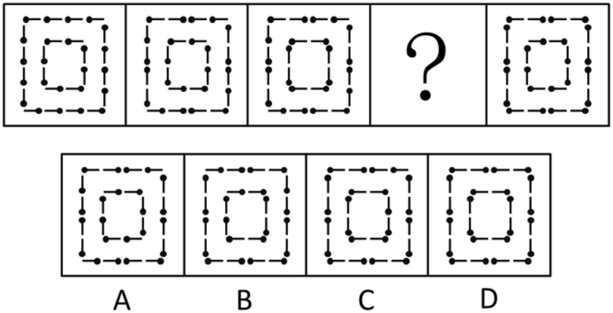

**48.** 从所给的四个选项中，选择最合适的一个填入问号处，使之呈现一定的规律性：

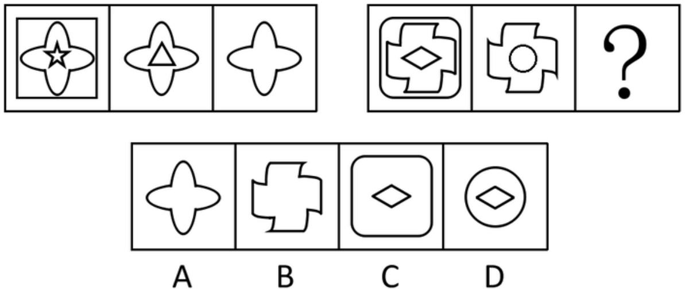

**49.** 下列选项中最符合所给图形规律的是：

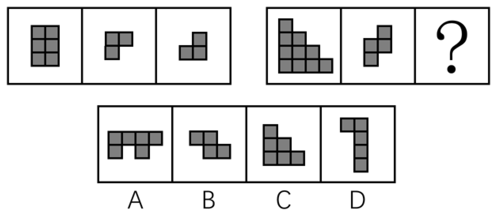

**50.** 下列选项最不可能是左侧立体图形某一角度视图的是（）。

**51.** 集训队教练宣称，只要集训队全体队员都在承诺书上签名，那么，如果发生训练迟到的情况，则全部队员都要接受惩罚。结果训练时仍然有人迟到，但是队长没有接受惩罚。
根据以上情况可以得知（）。

A. 迟到的人是队长本人
B. 集训队多数人没有迟到
C. 集训队有人没在承诺书上签名
D. 集训队没有人在承诺书上签名

**52.** 某扶贫产业基地计划种植紫薯、红薯、南瓜以及玉米四种农作物。四种农作物的种植面积大小不一，且需要满足以下条件：
①要么紫薯种植面积最大，要么南瓜种植面积最大；
②如果紫薯的种植面积最大，红薯的种植面积便最小。
如果红薯的种植面积大于玉米，可以推出的是（）。

A. 南瓜种植面积大于玉米种植面积
B. 紫薯种植面积大于玉米种植面积
C. 紫薯种植面积小于红薯种植面积
D. 玉米种植面积大于南瓜种植面积

**53.** 甲、乙、丙、丁四名青少年拥有手机、电脑、相机三种电子产品的情况如下：
①只有一个同时拥有手机、电脑、相机；
②有三个人拥有手机，有两个人拥有电脑，只有一个人拥有相机；
③每个人至少拥有三种电子产品中的一种；
④甲和乙是否拥有电脑的情况相同（要么两人都有，要么两人都没有）；
⑤乙和丙是否拥有手机情况相同；
⑥丙和丁是否拥有手机的情况不同。
拥有相机的是：

A. 甲
B. 乙
C. 丙
D. 丁

**54.** 张、王、李、赵四人计划在6至9月中分别选择一个月休年假，但部门人手短缺，一个月中不能有两个人休假。赵不希望安排在6月，张要求不要安排在9月，李表示6月或8月都可以，王提出只能安排在7、8月份。
如四人的要求均得到满足，则可以推出以下哪项？

A. 张只能安排在6月或者7月
B. 只要李不在6月，王一定会在7月
C. 如果李安排在8月，那么张安排在7月
D. 如果王安排在7月，那么李安排在6月

**55.** 公众人物需要担当更多的道德责任，因为权力和责任是相等的，既然拥有常人不具备的优势地位，那么就应该比一般人承担更高的道德要求。因此，承受更多的舆论批评甚至人身攻击，哪怕是一定程度的失真，也是不得不付出的必要代价。
最能质疑上述观点的一项是：

A. 普通人和公众人物应该具有同等的道德责任
B. 失真评价会影响公众人物对道德义务的履行
C. 更多的道德责任并不意味着一定要承受舆论批评
D. 公众人物正是因为没有尽到道德责任才会受到舆论批评

**56.** 过年放鞭炮，上元吃汤圆，端午赛龙舟，随着社会的发展，许多传统文化中的节日习俗离我们渐行渐远。90年代出生的人开始相信圣诞老人，开始在西餐厅里过生日。文化发展是个“取其精华，去其糟粕”的过程，因此，有人认为，西方文化优于中国传统文化。
以下各项最有助于反驳上述观点的是：

A. 我国传统文化中的许多内容在西方国家受到热捧
B. 现代社会的一些不文明行为源于西方社会
C. 国家的经济优势有利于本国文化的对外传播
D. 能够不断吸收和借鉴正是我国文化的优势

**57.** 据一项调查显示，对所学专业满意的大学生不到一半。某高校为了调动学生的学习主动性和积极性、提高学生对所学专业的满意度，允许在原专业中成绩名列年级前10%且不存在挂科的学生更换专业。有专家指出，这一成绩要求违背了该校制定转专业政策的初衷。
以下哪项如果为真，最能支持上述专家的观点？

A. 许多学生因为对原专业不感兴趣而缺乏学习的动力，导致学习成绩差
B. 一些学生对所学专业很感兴趣，但因为方法不对，学习成绩不是很理想
C. 不少学生考上大学后没有把心思花在学习上，即使更换专业也不会满意
D. 学校出台转专业政策时不仅要考虑学生因素，更要考虑专业的平衡发展

**58.** 新时代对党员干部提出了更高的要求。在现实中，由于一些党员干部理论学习不足，“本领恐慌”问题越来越突出。因此，只要广大党员干部切实加强理论学习，就可以避免出现“本领恐慌”。
上述论证最可能的潜在假设是（）。

A. 解决“本领恐慌”问题必须依靠党员干部自身努力
B. 理论学习不足是出现“本领恐慌”的唯一原因
C. 广大党员干部都存在理论学习不足的问题
D. 只有加强学习才能达到新时代的更高要求

**59.** 如果全球变暖的趋势持续下去，主要粮食作物的害虫会变得更为活跃。对于绝大多数害虫而言，温带地区是其主要栖息地，因此在全球变暖背景下，温带粮食产区受到的虫害影响将会更为严重。
上述论证最可能基于的潜在假设是（）。

A. 全球变暖是当今各国正面临的主要气候问题
B. 绝大多数害虫在生长繁殖过程中不会进行大的迁移活动
C. 现代农业科技手段始终难以消除各种虫害的影响
D. 全球变暖不会直接导致主要粮食作物的生长状况发生变化

**60.** 调查研究显示，相较传统的农业生产方式，有机农业生产出的农作物产量会有一定程度的下降。但现在仍然有越来越多的农民从传统农业转向有机农业，甚至花费资金，添置用于有机农业耕作的农用设备。
以下选项如果为真，最能解释上述现象的是：

A. 有机农业耕作方式更有助于保护生态环境
B. 许多科技节目都在推广有机农业耕作方式
C. 有机农业生产出的农作物市场售价远高于传统农业
D. 对于少部分农作物而言，有机农业耕作并不会降低其产量

**61.** 我国法律规定，用人单位由于生产经营需要，经协商，取得工会和劳动者同意后可以延长工作时间，且一般每日不超过一小时。某国有企业有员工在周五晚上延长工作时间，但并没有违法。
根据上述信息可以推知：

A. 该企业员工延长工作一定不超过一小时
B. 该企业所有员工都同意延长工作时间
C. 该企业工会同意延长工作时间
D. 该企业属于不受工作时间限制的特殊行业

**62.** 对企业而言，产品质量是其生存发展的关键。企业要加快发展，提升品质，需要的是更高水平的工人，涌现越来越多的大国工匠，传承工匠精神。因此，企业对于工匠精神的培养是其实现高质量发展的关键。
以下与上述论断结构最为相似的是（）。

A. 生态环境保护离不开生态文明体系构建，所以要建设美丽中国，必须加快生态文明制度建设
B. 创新发展必须以创新型人才为基础，创新成果是创造性劳动的结果。因此，创新发展都是创新型人才实现的
C. 理论研究离不开严密的论证过程，严密的论证需要有普遍性和规律性的论点，所以，理论研究一般都有普遍性和规律性的论点
D. 人才培养离不开社会实践，大学生都要通过社会实践考核，所以只有通过社会实践考核的大学生才能毕业

**63.** 农业得到极大发展后，农民的收入水平会显著提高，农业科技水平相对落后的地区农民收入水平不能提高。
由此可知，农业科技水平相对落后的地区，农业产业有待发展。
下列选项的逻辑结构与题干最相似的是：

A. 气温低于10摄氏度时，某地的滑雪场就会对外开放。每年的国庆节当地的滑雪场都不对外开放。因此，每年国庆节当地气温都在10摄氏度及以上
B. 景无月不美，酒缺月无味。因此，只有赏月时，才能欣赏到美景、品尝到美味
C. 教育水平不高的地区，往往缺乏优秀的农业生产人才。乡村振兴需要大量的农业生产人才。因此，教育水平不高的地区较难实现乡村振兴
D. 人在逆境中要不忘初心，才能迎难而上，克服挑战；在顺境中也要不忘初心，才能戒骄戒躁，稳步前行，因此，人在任何处境下都要做到不忘初心

**64.** ①死海是淹不死人的。因为②死海海水含盐量很大。据统计，③死海海水中有135亿吨氯化钠，有64亿吨氯化钙，有20亿吨氯化钾……各种盐的质量加在一起占死海全部海水的23%~25%。由于④死海海水的比重超过了人体的比重，以致⑤人到死海里会自然漂起来，沉不下去。
若用“A←B”表示陈述B是陈述A 的论据，则题干的论证关系应表示为：

A. ⑤←①←②←③←④
B. ①←⑤←③←④←②
C. ①←⑤←④←②←③
D. ⑤←①←④←③←②

**65.** 如果领导干部在单位中扮演“和事佬”的角色，不愿指出下属错误、不愿得罪人，将严重影响单位工作的正常开展。所以，领导干部必须公开指出下属错误并进行严厉的批评。
以下选项最好地总结了上述论证缺陷的是（）。

A. 假设了“和事佬”现象大量存在
B. 暗含了“和事佬”现象危害严重
C. 忽视了指出下属错误的其他方式
D. 忽视了不同单位的不同情况

## 第六部分　科学推理

**66.** 小张乘坐的小船在平静的湖面上匀速行驶，他在甲板上竖直跳起后下落，则下落点（）。

A. 在起跳点
B. 在起跳点前
C. 在起跳点后
D. 位置不确定

**67.** 水平地面上有甲、乙两块由不同材质构成、质地分布均匀的长方体金属块。已知甲的体积>乙的体积，甲的底面积<乙的底面积，甲的质量>乙的质量。则以下判断一定正确的有（）。
①甲的高度>乙的高度
②甲的高度<乙的高度
③甲的密度>乙的密度
④甲的密度<乙的密度

A. ①
B. ③
C. ①③
D. ②④

**68.** 一个边长为a的正方体木块漂浮在水池中，木块底部距离水面10厘米。如果将一个边长为2a的相同材质的正方体木块也放入该水池，则这一木块底部应距离水面（）。

A. 5厘米
B. 10厘米
C. 20厘米
D. 40厘米

**69.** 如图所示，以下说法正确的是（）。

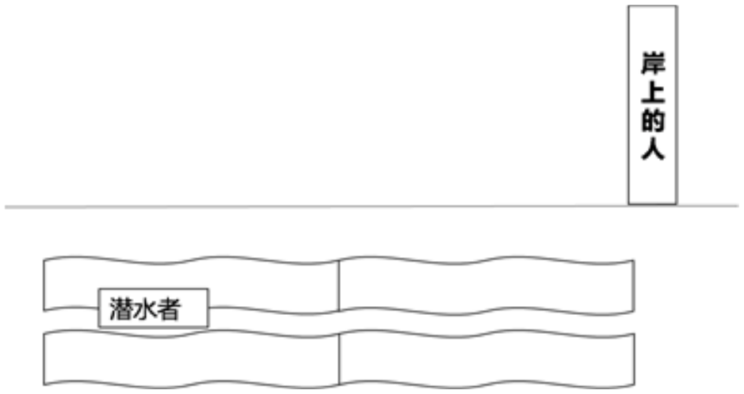

A. 潜水者看到的岸上的人比实际中更高；岸上的人看到的潜水者位置比实际更深
B. 潜水者看到的岸上的人比实际中更高；岸上的人看到的潜水者位置比实际更浅
C. 潜水者看到的岸上的人比实际中更矮；岸上的人看到的潜水者位置比实际更深
D. 潜水者看到的岸上的人比实际中更矮；岸上的人看到的潜水者位置比实际更浅

**70.** 将标有“220V 40W”和“220V 100W”字样的两只白炽灯串联后接在220V的电路中，不考虑温度对灯丝电阻的影响，下列说法正确的是（）。

A. 标有“40W”的灯较亮
B. 标有“100W”的灯较亮
C. 两只灯一样亮
D. 两只灯都能正常发光

## 第七部分　资料分析

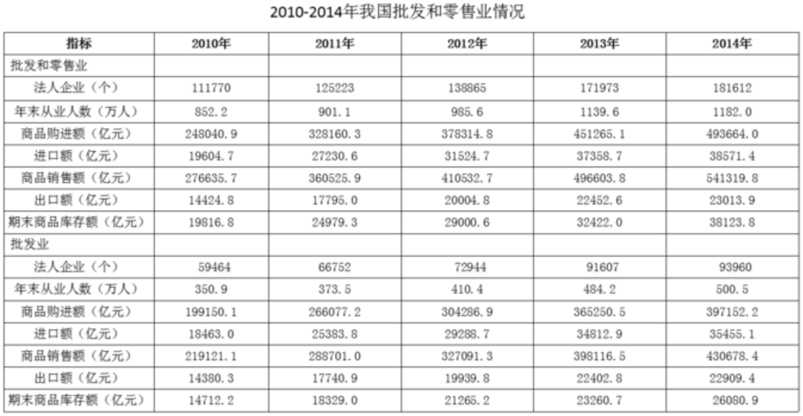

**71.** 2013年，批发业法人企业比零售业多（）个。

A. 7023
B. 7158
C. 8281
D. 11241

**72.** 零售业期末商品库存额最多的年份是（）年。

A. 2011
B. 2012
C. 2013
D. 2014

**73.** 与2013年相比，下列指标在2014年增长额最小的是（）。

A. 批发业出口额
B. 批发业进口额
C. 零售业商品购进额
D. 零售业商品销售额

**74.** 以下各项中两个指标之间差额最大的是（）。

A. 2014年批发业期末商品库存额与零售业期末商品库存额
B. 2013年批发业进口额与出口额
C. 2012年批发和零售业商品销售额与商品购进额
D. 2011年批发和零售业进口额与出口额

**75.** 以下说法正确的是（）。

A. 2010-2013年，批发业每年年末从业人数均多于零售业
B. 2010-2014年，零售业出口额逐年上升
C. 相比2010年，2013年的零售业进口额翻了一番
D. 2011-2014，批发业期末商品库存额增幅逐年收窄

截至2019年末，全国已有残疾人康复机构9775个，比2018年增长739个。2019年，1043.0万残疾儿童及持证残疾人得到基本康复服务，其中包括0—6岁残疾儿童18.1万人。

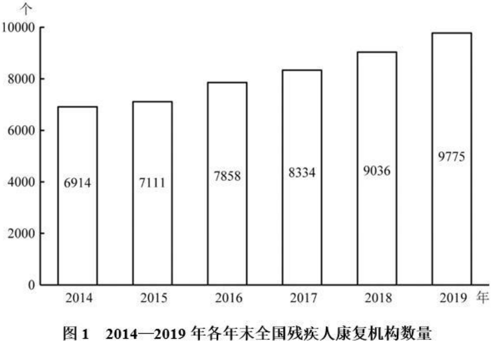

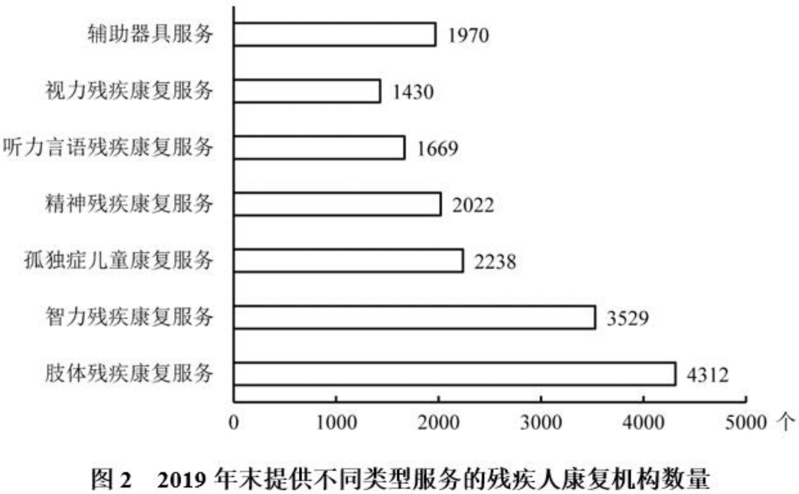

截至2019年末，全国已竣工的各级残疾人综合服务设施2341个，总建设规模584.5万平方米，总投资183.1亿元；已竣工各级残疾人康复设施1006个，总建设规模414.2万平方米，总投资132.2亿元。

**76.** 2016—2019年，全国残疾人康复机构数量同比增量最大的年份是：

A. 2016年
B. 2017年
C. 2018年
D. 2019年

**77.** 2019年末，提供肢体残疾康复服务的康复机构的数量占全国残疾人康复机构总数的比重，比提供精神残疾康复服务的康复机构的数量占全国残疾人康复机构总数的比重高约多少个百分点？

A. 13
B. 18
C. 23
D. 28

**78.** 如提供视力残疾康复服务的残疾人康复机构中，同时提供听力言语残疾康复服务的机构比不提供该服务的机构多20%，则2019年末全国有多少家残疾人康复机构不提供以上两种康复服务中的任意一种？

A. 不到7300家
B. 7300—7600家之间
C. 7600—7900家之间
D. 超过7900家

**79.** 截至2019年末，全国平均每个已竣工的残疾人综合服务设施建设规模约是已竣工残疾人康复设施的多少倍？

A. 0.6
B. 0.8
C. 1.2
D. 1.7

**80.** 能够从上述资料中推出的是：

A. 2019年全国得到基本康复服务的0—6岁残疾儿童占得到基本康复服务的残疾儿童及持证残疾人的2%以上
B. 2015年，全国平均每月新增残疾人康复机构20家以上
C. 2019年末，全国残疾人康复机构中，超过25%提供孤独症儿童康复服务
D. 截至2019年末，全国已竣工的各级残疾人综合服务设施平均每平方米的投资额在3000—4000元之间

2019年全国地铁运营线路长度达5181公里，占城轨交通运营线路总里程的76.8%。

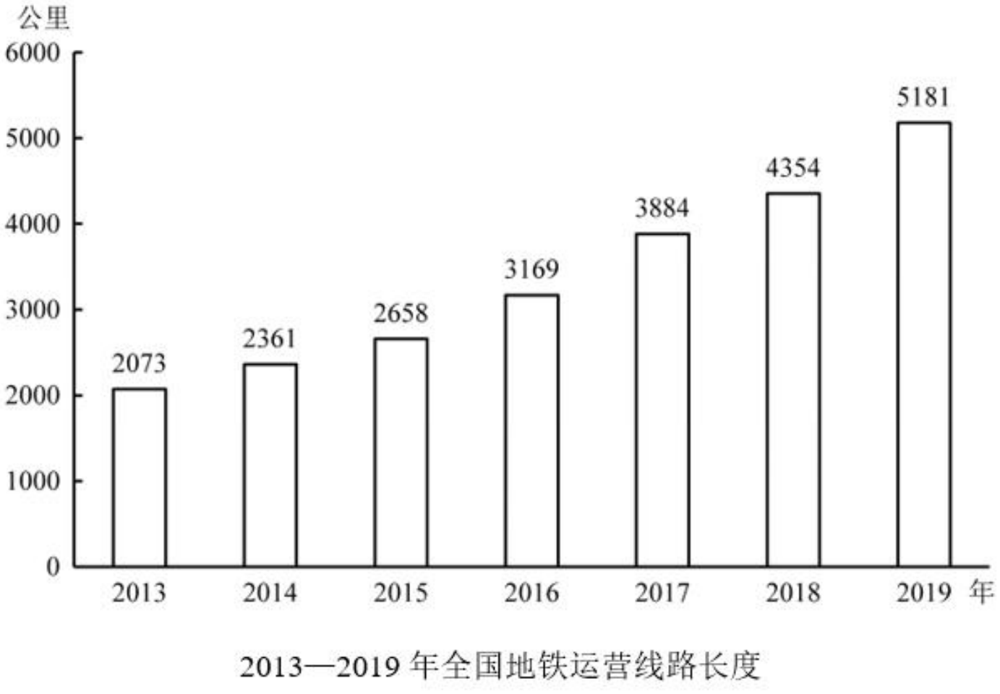

2019年末，我国城轨交通配属地铁列车6178列，全年实现地铁客运量227.76亿人次。

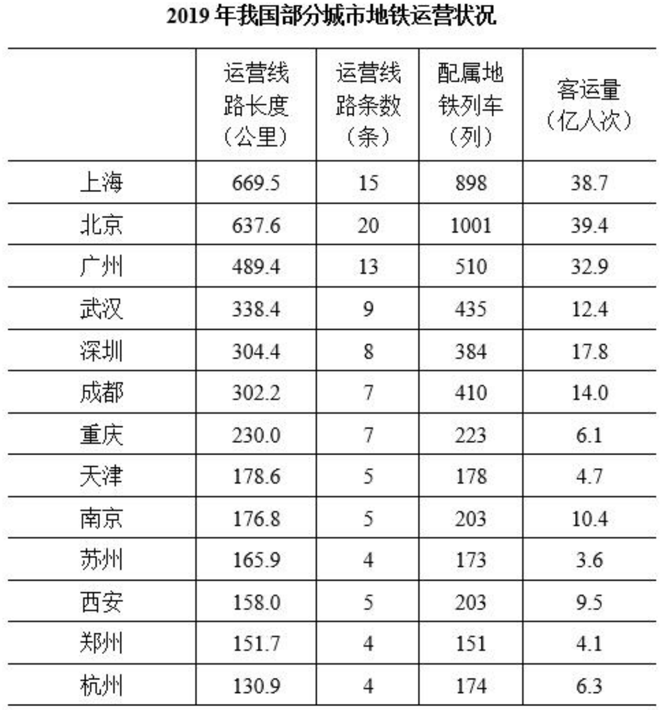

注：除客运量为全年数值外，其余指标为年末时点值。

**81.** 2014—2019年间，全国地铁运营线路长度同比增长20%以上的年份有几个？

A. 1
B. 2
C. 3
D. 4

**82.** 2019年，直辖市（北京、天津、上海、重庆）地铁客运量占全国地铁客运总量的比重在以下哪个范围内？

A. 不到40%
B. 40%—45%之间
C. 45%—50%之间
D. 超过50%

**83.** 以下城市中，2019年末平均每条运营的地铁线路配属地铁列车数最多的是：

A. 广州
B. 武汉
C. 成都
D. 南京

**84.** 表中所列2019年地铁客运量超过10亿人次的城市中，2019年平均每条地铁运营线路长度超过40公里的城市有几个？

A. 1
B. 2
C. 3
D. 4

**85.** 能够从上述资料中推出的是：

A. 2019年全国城轨交通运营线路总里程不到6000公里
B. 2019年全国地铁运营线路长度相比2016年增量是2016年相比2013年增量的两倍以上
C. 表中2019年末地铁运营线路长度排名前3的城市地铁运营线路长度之和占全国总量的50%以上
D. 表中2019年平均每条运营线路客运量最少的城市，地铁客运量在表中各城市排前10位

截至2014年12月底，全国实有各类市场主体6932.22万户，比上年末增长14.35%，增速较上年同期增加4.02个百分点；注册资本（金）129.23万亿元，比上年末增长27.70%。其中，企业1819.28万户，个体工商户4984.06万户，农民专业合作社128.88万户。
2014年，全国新登记注册市场主体1292.5万户，比上年同期增加160.97万户，注册资本（金）20.66万亿元，比上年同期增加9.66万亿元。其中，企业365.1万户，个体工商户896.45万户。农民专业合作社30.95万户。
2014年，新登记注册现代服务业企业114.10万户，同比增长61.41%。其中，信息传输、软件和信息技术服务业14.67万户，同比增长97.87%；科学研究和技术服务业26.26万户，同比增长70.32%；文化、体育和娱乐业6.59万户，同比增长83.51%；教育业0.68万户，同比增长86.17%。
2014年，新登记注册外商投资企业3.84万户，同比增长5.76%。投资总额2763.31亿美元，同比增长15.05%；注册资本1796.39亿美元，同比增长23.87%。

**86.** 截至2012年12月底，全国实有各类市场主体户数最接近以下哪个数字？

A. 6100万
B. 5500万
C. 5100万
D. 4500万

**87.** 2014年,全国新登记注册市场主体中个体工商户所占比重约为：

A. 75%
B. 69%
C. 85%
D. 81%

**88.** 2014年，以下哪个现代服务业新登记注册企业的户数同比增速最快？

A. 科学研究和技术服务业
B. 教育业
C. 文化、体育和娱乐业
D. 信息传输、软件和信息技术服务业

**89.** 2014年，新登记注册外商投资企业户均注册资本约比上年同期增长：

A. 17%
B. 12%
C. 8%
D. 4%

**90.** 能够从上述资料中推出的是：

A. 2014年新登记注册现代服务业企业大部分属于教育行业
B. 2014年末超过三分之一的农民专业合作社成立不满一年
C. 2013年全国实有各类市场主体注册资本（金）不足100万亿元
D. 2013年新登记注册科学研究和技术服务业企业不到20万户
