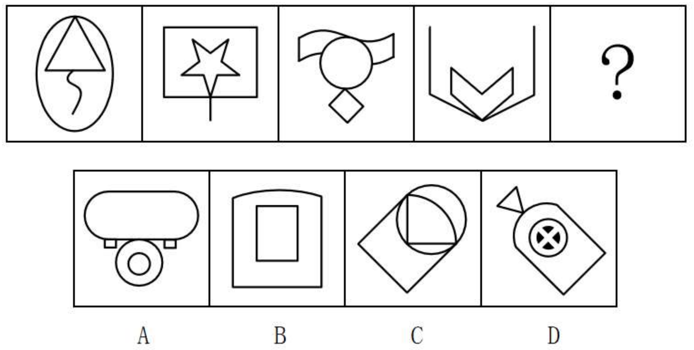
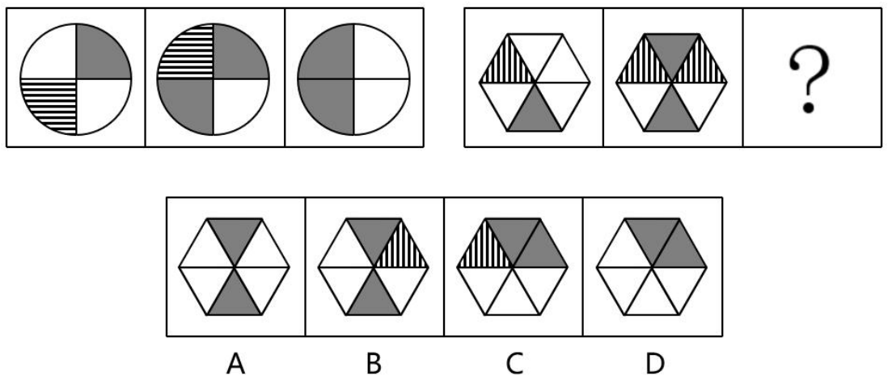
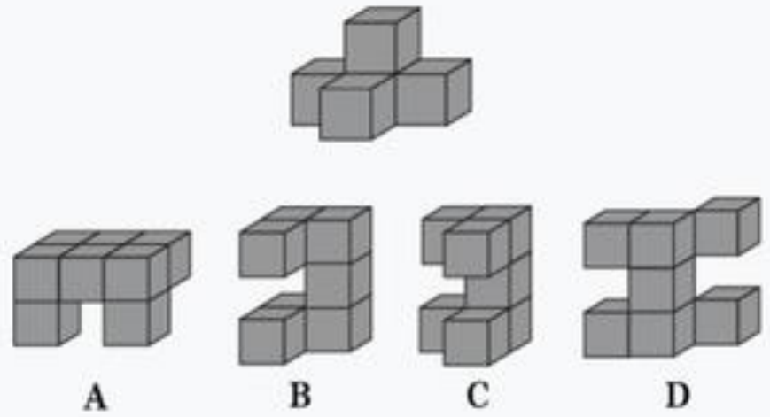
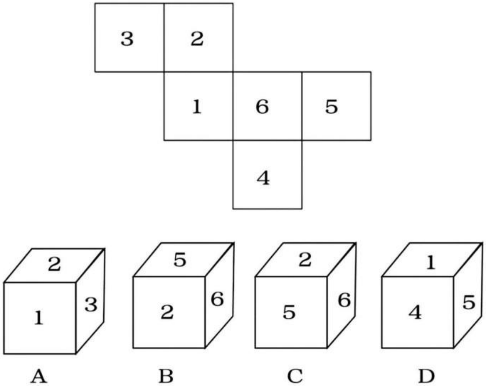
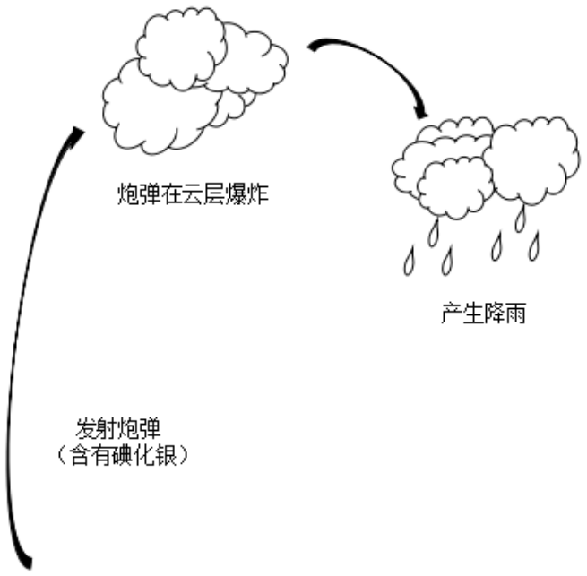
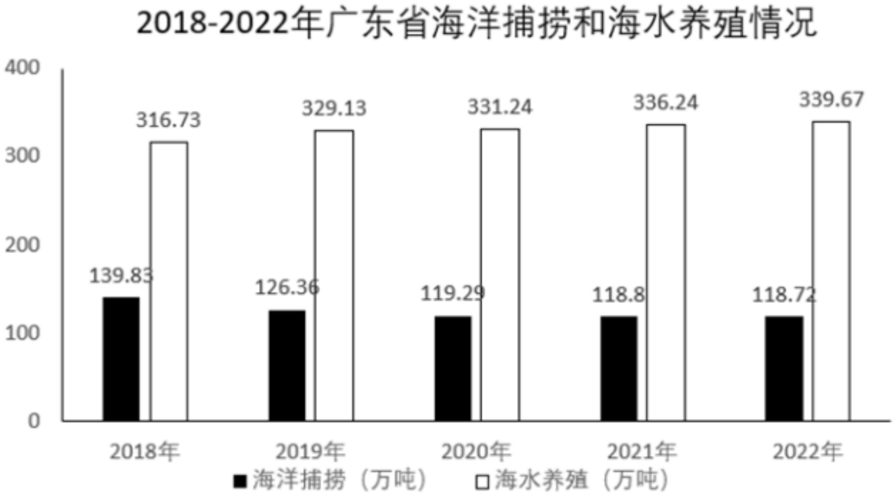
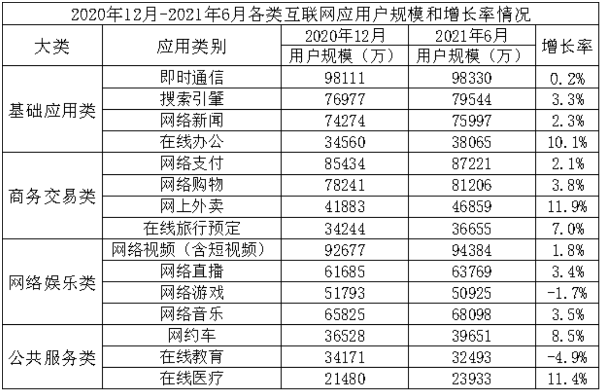
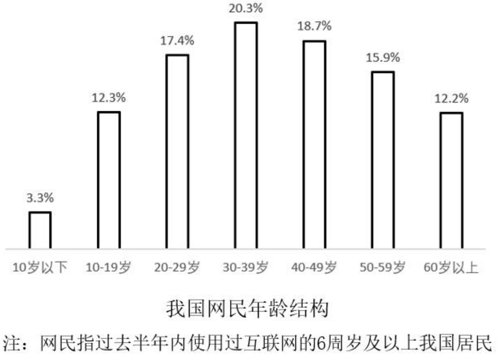

# S02　广东省考行测模拟卷（题本）

## 第三部分　言语理解与表达

**16.** 亚洲是全球最具活力的地区之一，经济规模占世界的1/3，人口有40多亿，劳动力供给充足，后发优势明显，发展潜力远未（）。同时，亚洲大多是发展中国家，人均GDP不高，地区发展水平很不平衡，还有7亿多人生活在国际贫困线以下，发展经济、改善民生的任务依然（）。

A. 开发 艰难
B. 解放 艰险
C. 释放 艰巨
D. 发挥 困难

**17.** 发展没有局外人，谁也不能______，各级领导干部更是要身先士卒、做出表率。
填入划横线部分最恰当的一项是：

A. 置之度外
B. 置身事外
C. 置之不理
D. 置若罔闻

**18.** 造成城市白领们“亚营养”危机的原因之一，是他们长期在外就餐且通常凑合应付。这样容易导致某种营养素的______，并使他们不知不觉中养成多油、高糖、高盐等______膳食习惯。
填入划横线部分最恰当的一项是：

A. 缺乏 不良
B. 失衡 不当
C. 流失 不良
D. 失调 不当

**19.** 规范旅游市场的秩序，仅靠主管部门是远远不够的。夯实旅游业发展的长远之基，需要加强行业（），以此推进经营行为的规范化。

A. 管理
B. 自律
C. 管辖
D. 自强

**20.** 有关取消全运会奖牌榜的消息成为既定事实之后，体育界对此的看法并不（）。取消了奖牌榜，竞技体育还有什么存在价值？类似的不解与怨艾，（）没有成为业界的主流声音，（）丝丝缕缕、不绝于耳。

A. 同意 如果 仍然
B. 一致 一旦 那就
C. 统一 虽然 却也
D. 成熟 即便 也是

**21.** 金鱼实际上是一类人工驯养的鲫鱼。大约2000年以前，中国的古人就开始养殖银鲫，作为食物和观赏鱼。随着时间的推移，基因突变和人工选择使银鲫身上出现了橙、红、黄等颜色，改变了其沉闷乏味的形象，也造就了我们今天看到的多姿多彩的金鱼。17世纪的时候，金鱼传到欧洲，并于19世纪50年代传到美国。
这段话主要介绍了：

A. 金鱼的演进
B. 金鱼的特点
C. 金鱼的用途
D. 金鱼的养殖

**22.** 简单恢复历史旧貌，绝不可能实现复兴的目标。只有创造一种融合古今的新兴文明，才能恢复曾经有过的世界一流兴盛状态。因此，________________。
下列选项中，最适合填入横线上的是：

A. 复兴之道，应当是改革创新之道
B. 要复兴，就要敞开胸怀学习全世界
C. 要复兴，就要批判地继承历史遗产
D. 复兴之道，需要敢想、敢干、能干

**23.** 如果手机一整天没有响，你会不会觉得不习惯？遇到什么难以解决的问题，不求助网络你是不是不知该怎么办？坐在地铁上，没有手机，时光会不会流逝得格外缓慢？不知从什么时候开始，我们身边的电子产品越来越多，电脑、手机、掌上游戏机，还有最新的平板……
这段文字主要说明了（）。

A. 电子产品在生活中的重要作用
B. 现代人对电子产品的依赖
C. 如何合理使用电子产品
D. 电子产品的不断发展

**24.** 一个时代有一个时代的审美趣味，古人以为美的东西，未必符合今人的审美需求，今天人们认为的美，也未必是后人审美的准则。世殊事异，环境在变，社会在变，生活不同，审美自然存在差异性。
通过这段文字，可以得知（）。

A. 古人认为美的东西今人觉得都不美
B. 每个时代的审美完全不同
C. 不同国家地区的审美并不一样
D. 一个时代的审美受到多种因素影响

**25.** 工业革命开始以后，化石燃料（煤炭、石油、天然气）的燃烧量越来越大，使大气中二氧化碳的浓度不断增加。同时，雷击、虫害、砍伐造成的森林火灾、草地衰退和森林破坏也使能够吸收二氧化碳的绿色植物遭到破坏。所以，要控制全球变暖，必须改变能源结构，大力植树造林。有科学家指出，只有以核燃料代替化石燃料，才能从根本上防止温室效应的加剧。
这段文字意在：

A. 探讨全球气候变暖现象出现的主要原因
B. 强调核能在防止温室效应加剧中的关键作用
C. 阐明大气层中二氧化碳含量上升的巨大危害
D. 呼吁人们改变能源结构并大力植树造林

**26.** 秉承着艰苦奋斗精神，中国共产党带领全国人民赢得了新民主主义革命的胜利，让中国在20世纪发生了一次又一次划时代的历史巨变。而今，中国实现了从“赶上时代”到“引领时代”的伟大跨越。让“中国号”巨轮在新的时代浪潮中行稳致远，更需要继续发扬艰苦奋斗精神，励志笃行，以身践行。
最适合作为这段文字标题的是（）。

A. 新时代更需坚持艰苦奋斗
B. 成功的秘诀——艰苦奋斗
C. 大力践行艰苦奋斗精神
D. 艰苦奋斗造就革命胜利

**27.** 一直以来，医改的议题之重就是降价。无论是由政府购买医疗服务的医保覆盖、统一招标采购减少中间环节的加价，还是对公立医院各项收费的行政调节，无一不是以减少个人看病负担为目标。然而，如果上游的费用控制难以实现，即便是再精良的制度设计，也会显得乏力。
根据上述文字，可以看出作者的观点是：

A. 应加大政府对医疗服务的购买力
B. 应加强政府对医院各项收费的调节作用
C. 政府应该减少医院在招标采购中的环节
D. 政府应想办法从源头上降低成本

**28.** 我们要提醒自己不要向生活提太多的要求，因为如果这样做，我们幸福所依靠的基础就变得太广大了。依靠如此广大的基础才可以建立起来的幸福是很容易倒塌的，因为遭遇变故的机会增多了，而变故无时不在发生，______。
以下最适合填在划线处的是（）。

A. 因此，我们应当根据自身条件，适当降低对生活的要求
B. 因此，我们应当尽量简化生活中的各种关系
C. 因此，我们往往在目标实现的时候，对生活又有了新的要求
D. 因此，我们在生活中应该谨慎小心，未雨绸缪

**29.** 首先，我们要认识到双循环新发展格局是包括了国内和国际两个循环，两者缺一不可、相得益彰。双循环不是不要国外市场，更不是封闭起来搞自己的经济循环，而是要在继续参与国际竞争的前提下，让国内市场在资源配置和经济成长中起决定性作用，不仅要以国内大市场体系循环代替“两头在外、大进大出”的单循环格局，而且要让国内市场与国际市场连接起来，以国内市场发展和壮大，促进和带动国内企业参与国际市场循环。
下列说法不准确的是（）。

A. 双循环新发展格局需要国内国际市场相连接
B. 双循环新发展格局应以国内市场循环为主体
C. 双循环新发展格局下应当弱化国际市场循环
D. 双循环新发展格局是开放的国内国际双循环

**30.** ①因为乡村是熟人社会，乡里乡亲知根知底，失信一次得不偿失。
②让现代信用体系在乡村茁壮成长，激发“三农”发展的新动能。
③其实，信用对于广袤农村而言，并不陌生。
④可以说，农村信用“土壤”肥沃，前景广阔，关键要用现代理念去培育、引导。
⑤从讲“人情”、讲“情面”变为更注重市场公认的契约、规则。
⑥面对市场经济需求，不仅要做好顶层设计，完善信息征集、强化信用意识，也需要技术、资金、人才等方面的保障，完善农村信用软环境。
将以上句子重新排列，顺序最恰当的一组是（）。

A. ②①③⑥⑤④
B. ⑤④②⑥③①
C. ⑥⑤②①④③
D. ③①④⑥⑤②

## 第四部分　数量关系

**31.** 98，86，74，62，（    ）。

A. 49
B. 50
C. 51
D. 52

**32.** 1.3，4.1，2.4，5.2，3.5，（    ）。

A. 6.3
B. 6.4
C. 6.5
D. 6.6

**33.** 2，4，8，16，20，40，44，（    ）

A. 48
B. 60
C. 64
D. 88

**34.** $\frac{1}{5}$，$\frac{1}{5}$，$\frac{3}{17}$，$\frac{2}{13}$，（    ）。

A. $\frac{2}{13}$
B. $\frac{1}{11}$
C. $\frac{4}{35}$
D. $\frac{5}{37}$

**35.** 从所给的四个选项中，选择最合适的一个填入问号处，使之呈现一定的规律性（）。

A. 3
B. 4
C. 5
D. 6

**36.** 某地教育部门计划向当地各小学发放学习材料，如果每所小学分配6套材料，则剩余70套材料，如果每所小学分配8套材料，则缺40套材料，则当地共有（）所小学需要发放资料。

A. 40
B. 55
C. 70
D. 85

**37.** 甲、乙两名工人合作完成一批零件的加工任务，当乙完成了200个零件的加工时，甲完成了总量的一半，当零件加工完成时，甲完成了总量的3/5，假如两人的工作效率始终保持不变，则这批零件共有（）个。

A. 500
B. 600
C. 640
D. 800

**38.** 由A地发往B地的火车共有甲乙两趟，甲的时速为300千米，乙的时速为200千米，甲乙两车所经历路程相同，甲乙同时从A地发往B地，快车所花费的时间比慢车少40分钟，则该路线车程为（）千米。

A. 200
B. 300
C. 400
D. 500

**39.** 五一节期间，某商场开展促销活动，将一款冰箱的价格下调20%销售。促销结束后，这款冰箱计划恢复原价销售，那么此时该商品的价格应上调（）。

A. 10%
B. 15%
C. 20%
D. 25%

**40.** 水果零售商采购了一批苹果，包括特级果和一级果两种规格。原计划特级果比一级果多采购200公斤，但在清点分拣后发现，特级果中有10%是一级果，一级果中有20%是特级果，这批水果中实际有60%的特级果，则该零售商共采购苹果（）公斤。

A. 600
B. 800
C. 1200
D. 1400

**41.** 某单位工会组织春节茶话会，需要从6名男职工和4名女职工中选出5人担任主持人。如果选出的5人中至少有3名女职工，则有（）种不同的主持人组合。

A. 60
B. 66
C. 120
D. 132

**42.** 某单位组织植树活动，共有20名职工参加，并分成了3个2人小组、3个3人小组和1个5人小组。如果从所有组中随机选出3个组，则选出的3个小组人数之和为3的倍数的概率（）。

A. 不到15%
B. 在15%到25%之间
C. 在25%到35%之间
D. 超过35%

**43.** 如图所示，圆柱形的容器内放着一块实心圆柱体，容器的底面直径为20cm，实心圆柱体的直径为10cm、高为8cm。往容器内装满水后，再将完全浸没的实心圆柱体取出，此时容器内的水面将会下降（）cm。

A. 1
B. 2
C. 3
D. 4

**44.** 某地计划围绕周长2000米的环湖绿道，每50米安装一个路灯，共需设置路灯（）盏。

A. 40
B. 41
C. 80
D. 81

**45.** 小李晚上到镇中心广场看电影。第一排共有21个座位，部分座位已有人就座，小李发现，他无论坐在第一排的哪个位置，都将与第一排已经就座的人相邻。在小李之前已在第一排就座的人数最少是：

A. 6
B. 7
C. 8
D. 9

## 第五部分　判断推理

**46.** 下列选项中最符合所给图形规律的是（）。

**47.** 从所给的四个选项中，选择最合适的一个填在问号处，使之呈现一定的规律性（）。

**48.** 请从所给的四个选项中，选择最合适的一个填入问号处，使之呈现一定的规律性（）。

**49.** 以下哪项能与题干中图形组成一个长方体？（）

**50.** 如图，所给图形是某一立方体的展开图。若不考虑立方体表面数字的大小、方向，下列选项中最有可能属于该立方体视图的是（）。

**51.** 一个谦虚的人不会炫耀他的才华，王教授从来没有炫耀过自己的才华，所以王教授是一个谦虚的人。
以下选项的逻辑结构与题干最为相似的是（）。

A. 收益越高风险越大，小刘的投资获得了高额回报，所以他承担了很大风险
B. 目标明确的人不会无所事事，小李这段时间一直无所事事，所以小李没有明确的目标
C. 爱国的人一定热爱祖国的历史文化，小吴热爱祖国的历史文化，所以小吴是一个爱国的人
D. 如果没有老师的建议，我还在纠结是否考研，现在我已经决定考研，所以老师的建议很重要

**52.** 一项针对11岁青少年的研究发现，生活在绿化程度较低的社区的青少年空间工作记忆能力较差，生活在绿化程度较高的社区的青少年空间工作记忆能力较强。据此，有人建议青少年应该居住在绿化程度较高的地方。
以下最能质疑上述建议的是（）。

A. 青少年在10岁到14岁间的空间工作记忆能力较差
B. 生活在绿化程度低的城市的成年人空间工作记忆能力较强
C. 社区绿地数量多有利于促进青少年的大脑发育
D. 绿化程度较高社区的家庭通常更注重青少年空间工作记忆能力的培养

**53.** 某位鸟类爱好者连续多个上下午都观察到了翠鸟的踪影，并记录了翠鸟每天的捕食情况：
①翠鸟每天都会在上午、下午各捕食一次；
②翠鸟只捕食小鱼或螃蟹，且每次只捕食一种食物；
③当上午捕食小鱼时，下午就捕食螃蟹；
④一共有3个上午、3个下午捕食小鱼；
⑤一共有4个下午捕食螃蟹。
则该鸟类爱好者一共观察了（）天？

A. 6
B. 7
C. 8
D. 9

**54.** 为了提高国内青少年的身体素质，有人建议增加义务教育阶段体育课的课时。因为体育课课时越多，中小学生进行体育锻炼的时间越长，他们的身体素质就会越好。
要使上述论证成立，必须补充的前提是（）。

A. 中小学生会在体育课上进行体育锻炼
B. 体育课课时越少，中小学生体育锻炼时间也越短
C. 体育课是中小学生提升身体素质的唯一途径
D. 增加体育锻炼时间有利于提高身体素质

**55.** 为了提高司机的安全意识，某地在高速公路安装了动态警示牌，并在警示牌儿上流动播放附近路段的车祸发生率等相关数据。有研究机构对比了警示牌安装前后高速公路的车祸发生率，结果发现，警示牌附近路段的车祸发生率反而增加了。下列选项如果为真，最能解释这一现象的是（）。

A. 该段高速公路仅在道路的一侧安装了动态警示牌
B. 滚动播放的数据会在一定程度上导致司机驾驶时分心
C. 多数司机无法在短时间内理解车祸发生率等数据的含义
D. 警示牌附近路段转弯较多，车祸发生率始终高于其他路段

**56.** 有研究显示，电子游戏在促进中国文化出海方面具有极大优势，其互动机制允许玩家深度参与文化叙事，游戏场景设计可突破时空壁垒实现即时触达，沉浸式体验则能强化文化记忆。有学者据此提出，电子游戏的沉浸性和全球可及性，使其成为中国文化出海的重要载体。以下选项如果为真，最能支持上述结论的是（）。

A. 海外玩家在游戏中深度参与文化叙事，能够促使他们主动搜索了解相关文化背景
B. 有调查显示，许多外国人通过观看华语电影和阅读中文书籍了解和学习中国文化
C. 近期多款电子游戏在国内游戏平台上架后销售火爆，受到许多玩家的追捧
D. 有研究发现，玩家探索游戏场景时激活的脑部区域与观看历史文化纪录片时激活的脑区高度重合

**57.** 只有遇到下雨天，客车才不会准时到达。现在，客车没有准时到达，所以（）遇到下雨天。
填入括号部分最恰当的一项是：

A. 没有
B. 可能
C. 一定
D. 不可能

**58.** 中国戏曲具有丰富的表现力。粤剧是我国著名的戏曲剧种，所以粤剧具有丰富的表现力。
下列选项中，与上述推理结构最为相似的是（）。

A. 公共交通很便捷。地铁是公共交通，所以地铁很便捷
B. 护士是白衣天使。小舟是白衣天使，所以小舟是护士
C. 杜甫是诗人。杜甫是唐朝人，所以唐朝人擅写诗
D. 鸟儿都会飞。鸵鸟不会飞，所以鸵鸟不是鸟

**59.** 近日，某市出现了一种收费自习室，这种自习室置身于写字楼中，主要供需要参加职业资格考试的白领使用。但推出一段时间后，经营者发现自习室空置率较高。
以下选项中最不能解释上述现象的是（）。

A. 获取职业资格与个人薪酬未直接挂钩
B. 收费自习室定价过高
C. 收费自习室前期宣传效果不理想
D. 许多白领选择公共图书馆看书备考

**60.** 某市环保部门的监测结果显示：今年上半年，该市的空气质量整体处于优良水平，严重污染天数不足15天，污染天数比去年同期少了4天。由此可知，今年的空气质量好于去年。
最能质疑上述结论的一项是：

A. 该市去年关停了几家重污染企业
B. 该市今年开展了植树造林活动
C. 该市的严重污染时段一般在下半年
D. 该市环保部门今年更新了空气检测设备

**61.** 赵先生、钱先生、孙先生、李先生四人参加一项技能比赛，获得了比赛的前四名。据了解，他们之间有以下关系：
①孙先生和李先生经常相约一起打篮球；
②第一名和第三名在这次比赛中刚认识；
③第二名不会骑自行车，也不打篮球；
④赵先生的名次比钱先生的名次靠前；
⑤钱先生和李先生每天一起骑自行车上班。
根据以上条件，可以判断此次比赛的第一、二、三、四名次的获得者是：

A. 孙先生、赵先生、钱先生、李先生
B. 李先生、赵先生、孙先生、钱先生
C. 李先生、孙先生、赵先生、钱先生
D. 孙先生、李先生、赵先生、钱先生

**62.** 有研究发现，当小白鼠的食物中增加了西蓝花、花椰菜等富含芳香烃受体的十字花科类蔬菜时，其肺部感染的症状得以减轻，对病原体的防御能力增强。因此，为增强身体抵抗力，可以推荐肺部感染者多吃十字花科类蔬菜。
要使上述结论成立，必须补充的前提是（）。

A. 小白鼠的生理免疫机制与人类非常类似
B. 所有的十字花科类蔬菜都富含芳香烃受体
C. 肺部感染患者迫切需要增强身体免疫力
D. 只有十字花科类蔬菜含有芳香烃受体

**63.** 有的街道办负责运营便民服务中心，有的便民服务中心上线了数字化服务平台，因此有的街道办负责运营数字化服务平台。
下列选项与题干论证方式最为相似的是（）

A. 有些养老机构是医养结合机构，而医养结合机构入住率高，因此有些养老机构入住率高
B. 有的公共图书馆是24小时开放的公共设施，有的设施在24小时内都有市民使用，因此有的市民使用了公共图书馆
C. 部分邻里议事会是线上进行的，部分居民没有参加线上活动，因此部分居民没有参加邻里议事会
D. 有些健身设施是智能化设施，有些社区安装了健身设施，因此有些社区安装了智能化设施

**64.** 随着新能源汽车技术的快速发展，许多市民选择购买新能源汽车作为交通工具。近期某市新建设了许多公共充电桩，然而正式运营一段时间后该市发现，新建设的公共充电桩使用率始终较低。以下选项如果为真，最能解释这一现象的是（）。

A. 调查显示，该市现有的多数充电桩充电效率都比较低
B. 部分新能源汽车车主认为新能源汽车的保值率低于燃油车
C. 新建设的公共充电桩收费比原有的充电桩高，许多车主不愿意使用
D. 新建设的公共充电桩主要集中在人流密集的区域，充电排队时间较长

**65.** 去年，某市共发生道路安全交通事故764起，死亡456人。据估算，只有不到8%的交通工具配备了急救医疗包。如果有更多的交通工具配备急救医疗包，那么道路安全交通事故死亡人数会大大减少。
以下选项最能够指出上述论证缺陷的是（）。

A. 忽视了遭遇交通事故立即死亡的案例
B. 忽略了绝大多数交通工具从来没有发生过交通事故
C. 默认了未配备急救医疗包是导致交通事故死亡的主要原因
D. 暗含了配备急救医疗包能有效避免交通事故的发生

## 第六部分　科学推理

**66.** 下列词语所描述的场景中，涉及化学变化的是（）

A. 聚沙成塔
B. 百炼成钢
C. 香气四溢
D. 冰冻三尺

**67.** 为提升其行驶过程的稳定性，挖掘机装有履带，其原理是：

A. 减小挖掘机对地面的压强
B. 增大挖掘机对地面的压强
C. 减小挖掘机对地面的压力
D. 增大挖掘机对地面的压力

**68.** 用一个开关控制办公室里的两盏灯，最合理的电路图是（）。

A. 
B. 
C. 
D. 

**69.** 现在，人们常利用碘化银实现人工降雨。通过高炮将含有碘化银的炮弹打入云雾厚度比较大的高空中，碘化银因为炮弹的爆炸在高空扩散，促使降雨产生（如图所示）。下列说法正确的是（）。

A. 利用碘化银人工降雨需要选择炎热的天气才能实现
B. 银是重金属，利用碘化银人工降雨会对环境造成极大破坏
C. 碘化银在高空形成极细的粒子，云中的水分在其周围凝聚，形成降雨
D. 碘化银作为催化剂，让高空中固态的水液化，实现人工降雨

**70.** 以下延长粮食存放时间的措施，最不合理的是（）。

A. 粮库的粮食存放区保持较低温度
B. 将其真空包装，以避免接触氧气
C. 适当在粮库中洒水，保持空气湿度
D. 给粮库的粮食存放区充入二氧化碳

## 第七部分　资料分析

2022年，全国海洋渔业增加值4343亿元，比上年增长3.1%。全国海水产品产量3459.53万吨，同比增长2.1%。
2022年，广东省海洋渔业增加值为538亿元，同比增长0.9%。全省海水产品产量458.39万吨，同比增长0.7%，其中，海水养殖产量339.67万吨，同比增长1.0%；海洋捕捞产量118.72万吨，其中远洋捕捞产量6.3万吨。

**71.** 2022年，全国海水产品产量同比增长（）。

A. 小于40万吨
B. 40万吨到60万吨
C. 60万吨到80万吨
D. 超过80万吨

**72.** 与2021年相比，2022年广东省海洋渔业增加值占全国海洋渔业增加值的比重约（）。

A. 增加0.3个百分点
B. 减少0.3个百分点
C. 增加2.7个百分点
D. 减少2.7个百分点

**73.** 与2018年相比，2022年广东省海洋捕捞产量减少约（）。

A. 11%
B. 15%
C. 19%
D. 23%

**74.** 2018年-2021年，广东省海水养殖产量占海水产品产量比重最高的是（）。

A. 2018
B. 2019
C. 2020
D. 2021

**75.** 根据资料，下列说法正确的是（）。

A. 与2018年相比，2022年广东省海水产品产量增长小于1%
B. 2021年，广东省海水养殖产量同比增长约3.5%
C. 2019年，广东省海水产品产量同比增加约1万吨
D. 2022年，广东省远洋捕捞产量占海洋捕捞产量的比重同比有所下降

城市社区卫生服务中心和农村乡镇卫生院是我国卫生体系的重要组成部分。
2011年底，我国共有社区卫生服务中心7861家，从业人员328676人，其中，卫生技术人员276252人，占全国卫生技术人员总数的4.5%，占城市卫生技术人员总数的8.8%，城市每千人口卫生技术人员数为7.97人。
2011年底，乡镇卫生院37295家，从业人员1165996人，其中，卫生技术人员981227人，占全国卫生技术人员总数的15.8%，占农村卫生技术人员总数的32.1%。农村每千人口卫生技术人员数为3.18人。

**76.** 2011年底，社区卫生服务中心的机构数量和乡镇卫生院相比：

A. 社区卫生服务中心多
B. 乡镇卫生院多
C. 两者一样多
D. 无法比较

**77.** 2011年底，乡镇卫生院从业人员约为社区卫生服务中心从业人员的（）倍。

A. 1.5
B. 2.5
C. 3.5
D. 4.5

**78.** 2011年底，我国社区卫生服务中心从业人员中，不是卫生技术人员的有：

A. 48790
B. 52424
C. 57438
D. 69873

**79.** 2011年底，社区卫生服务中心和乡镇卫生院的卫生技术人员数量之和占全部卫生技术人员总数的：

A. 17.5%
B. 18.6%
C. 19.8%
D. 20.3%

**80.** 2011年底，城市每千人口卫生技术人员数比农村每千人口卫生技术人员数（）人。

A. 多4.79
B. 少4.79
C. 多3.87
D. 少3.87

从2014年起，我省在粤东西北地区以县（市、区）为单位遴选首批14个省级新农村连片示范建设工程，三年将建成42个省级新农村示范片（不含珠三角地区）。根据工作进度安排，示范片建设一年初见成效，两年基本实现目标。与此同时，珠三角地区每年选取6个片区开展示范片建设，为期三年。
截至2015年年底，全省第一、二批40个示范片（含珠三角6市）启动建设项目2693个（粤东西北1539个，珠三角1154个），竣工项目1711个（粤东西北821个，珠三角890个），累计投入各类资金40亿元（粤东西北16.6亿元，珠三角23.4亿元）。
示范片村庄规划编制：首批示范片的64个行政村和375个自然村，已100%完成村庄规划编制。第二批示范片的59个行政村和386个自然村中，已完成村庄规划编制的行政村55个，自然村307个，分别占93.2%和79.5%。
示范片村庄环境卫生：首批示范片中已完成环境卫生整治的自然村357个，占95.2%。第二批391个自然村中，310个自然村已完成环境卫生整治，占79.3%。
示范片自来水建设：首批示范片中有326个自然村实现通自来水，占86.9%。第二批391个自然村中，有67.0%的自然村实现通自来水。
村巷道硬底化建设：首批示范片中完成村巷道硬底化建设的自然村有256个，占68.3%。第二批中有59.8%的自然村完成村巷道硬底化建设。
群众参与共谋共建情况：首批示范片375个自然村中，成立村民理事会的占99.7%。第二批391个自然村中，成立村民理事会的占98.2%。

**81.** 在第一、二批40个示范片（含珠三角6市）已竣工的项目中，粤东西北地区约占了（）。

A. 47%
B. 48%
C. 49%
D. 50%

**82.** 第二批示范片的自然村中，实现通自来水的约有（）个。

A. 256
B. 262
C. 267
D. 273

**83.** 首批示范片的自然村中，完成率最高的是（）。

A. 村庄环境卫生
B. 自来水建设
C. 村巷道硬底化建设
D. 群众参与共谋共建情况

**84.** 第一、二批示范片的自然村中，完成率差距最大的是（）。

A. 村庄规划编制
B. 村庄环境卫生
C. 自来水建设
D. 群众参与共谋共建情况

**85.** 下列说法有误的是（）。

A. 第一、二批示范片建设中粤东西北启动的项目比珠三角多
B. 第一、二批示范片建设中粤东西北的项目竣工率低于珠三角的项目竣工率
C. 第二批示范片成立村民理事会的自然村比第一批少
D. 第一批示范片完成村庄规划编制的行政村比第二批多

我国个人互联网应用用户规模呈持续稳定增长态势。截至2021年6月，我国网民规模为10.11亿，较2020年12月增长2.2%，互联网普及率达71.6%，较2020年12月提升1.2个百分点。
在所有类别中，即时通信应用的网民使用率（该类应用的用户规模在网民中的占比）最高，约为97.3%。其次为网络视频（含短视频）应用，网民使用率约为93.4%；其中短视频用户规模达8.88亿，较2020年12月增长1.6%。
截至2021年6月，20-29岁年龄段网民对网络音乐、网络视频、网络直播等应用的使用率在各年龄段中最高，分别达84.1%、97.0%和73.5%。30-39岁年龄段网民对网络新闻应用的使用率在各年龄段中最高，达83.4%。10-19岁年龄段网民对在线教育应用的使用率在各年龄段中最高，达48.5%。

**86.** 相比2020年12月，2021年6月，下列应用类别中，用户规模增长最多的是（）。

A. 即时通信
B. 搜索引擎
C. 网络新闻
D. 在线办公

**87.** 相比2020年12月，2021年6月，表中所示应用类别中，网民使用率有所提升的有（）项。

A. 10
B. 11
C. 12
D. 13

**88.** 截至2021年6月，我国6～19岁网民比60岁以上网民多约（）亿。

A. 0.01
B. 0.34
C. 1.01
D. 3.44

**89.** 截至2021年6月，关于不同年龄段网民中各类互联网应用用户规模，以下排序正确的是（）。

A. 20-29岁年龄段网民中网络音乐应用用户规模＞10-19岁年龄段网民中在线教育应用用户规模＞30-39岁年龄段网民中网络新闻应用用户规模
B. 20-29岁年龄段网民中网络音乐应用用户规模＞30-39岁年龄段网民中网络新闻应用用户规模＞10-19岁年龄段网民中在线教育应用用户规模
C. 30-39岁年龄段网民中网络新闻应用用户规模＞10-19岁年龄段网民中在线教育应用用户规模＞20-29岁年龄段网民中网络音乐应用用户规模
D. 30-39岁年龄段网民中网络新闻应用用户规模＞20-29岁年龄段网民中网络音乐应用用户规模＞10-19岁年龄段网民中在线教育应用用户规模

**90.** 根据材料，以下说法正确的是（）。

A. 与2020年12月相比，2021年6月网络视频（含短视频）应用的用户中，短视频用户的增长率高于非短视频的用户增长率
B. 与2020年12月相比，2021年6月网络游戏应用用户减少不到一百万
C. 截至2021年6月，50-59岁年龄段网络直播应用用户规模在我国网民中的占比小于13%
D. 2021年6月，40岁以上网民的数量比40岁以下网民多
