# S03　广东省考行测模拟卷（题本）

## 第三部分　言语理解与表达

**16.** 物质消费________，但违背公序良俗和高尚生活的畸形消费则应抵制，树立科学、文明的消费观________。
填入划横线处最恰当的一项是：

A. 无可厚非 迫在眉睫
B. 无可厚非 急不可待
C. 无可置疑 急不可待
D. 无可置疑 迫在眉睫

**17.** 随着国际反腐合作深化，外逃腐败分子难逃________的命运。
填入画横线部分最恰当的一项是：

A. 害群之马
B. 瓮中之鳖
C. 井底之蛙
D. 涸辙之鲋

**18.** 冷静观察，直面现实，正视困难，我们的双脚就能站到_______的大地上，拥有牢固的立足点，就能看到远方的地平线，找到_______的方位感。
依次填入画横线部分最恰当的一项是：

A. 结实 正确
B. 坚韧 精准
C. 坚实 准确
D. 坚硬 精确

**19.** 传统美德，是一片（）的土地，生长着本真的人生体验，孕育着鲜活的道德追求。

A. 丰收
B. 丰饶
C. 丰产
D. 丰盛

**20.** 在新时代，我们要大力提升发展质量和效益，坚持质量第一、（）质量变革、（）质量优势、建设质量强国、（）高质量发展。

A. 发动 增强 追求
B. 提倡 增加 达到
C. 推动 增强 实现
D. 倡导 增加 完成

**21.** 所谓荒野，是指未受人类活动干扰或者人工改造较少的自然环境。在传统观念中，荒野是没有多少价值的。然而，在生态经济日益发展的今天，荒野显得越来越重要。荒野具有原生性、多样性、开放性等特点，有很高的经济价值、休闲价值和审美价值。
这段文字强调了（）。

A. 人们对荒野的认识不准确
B. 应保护荒野不受破坏
C. 应该大力开发荒野
D. 荒野有巨大的价值

**22.** 如今，人们对美好生活的期待日益从物质走向精神。这既给中国电影带来更广阔的发展空间，______。如何更好地挖掘新人，为电影市场注入新的活力？如何坚定文化自信，提升创作水平，讲好中国故事？如何进一步承载时代精神、展现中国风貌，提升中华文化影响力？回答好这些问题，中国电影才能书写出更加精彩的时代篇章。
以下选项最适合填入画横线处的是（）。

A. 同时也给电影市场提出了更高要求
B. 同时也为中国电影的发展指明了方向
C. 同时也标志中国电影市场不断走向成熟
D. 同时也为中国电影打开了一扇通往世界的窗口

**23.** 很多孩子只能听赞美之词，听不得半点反对意见；有的孩子外表高傲，内心脆弱，敏感多疑。他们遇到一些不顺心的事情，就会有极端的举动，这就是所谓的“蛋壳心理”。过分骄纵、百般溺爱是导致这种心理的最直接原因。建议父母在孩子顺心的成长道路上制造一点挫折，让孩子学会在逆境中保持自信，学会在挫折面前保持乐观，培养孩子的韧性和抗挫折能力。另外，父母要学会对孩子说“不”，要让孩子知道并不是所有的要求都能够得到满足，使他们学会接受拒绝。
最能概括这段文字的一项是：

A. 针对“蛋壳心理”，父母应采取恰当的教养方式
B. 父母在赞美孩子的同时要让其学会接受拒绝
C. “蛋壳心理”直接反映了孩子的脆弱心理
D. 孩子的脆弱心理大多源于父母的教养方式

**24.** 人力资源竞争，固然是一种市场竞争，却与普通商品的市场属性有所不同。薪资待遇固然是不可或缺的重要因素，但劳动者对于职业的权衡，却是多方面因素综合考量的结果。因此，人力资源的竞争，必须回归以人为本的理念。
根据这段文字，下列表述正确的是：

A. 人力资源与普通商品存在本质上的差异
B. 劳动者在选择职业时不考虑薪资待遇
C. 劳动者会从多方面综合考量职业
D. 只要以人为本就能在人力资源竞争中获胜

**25.** 制度型开放是更高层次、更高水平的开放。这一战略部署，强调在经济发展和对外开放的过程中，不断对标国际通行规则，进而实现进一步的制度创新。重点关注发达国家的高标准规则，通过在贸易规则和规制、投资规则和规制、生产中的管理和标准等方面进行对接与协调，有效促进中国与世界经济安全有序的融合。开放方式创新，坚持引进来与走出去更好结合，创新跨境资本流动及投资合作的制度标准。
本文段主要阐述了（）。

A. 制度型开放的背景和目的
B. 制度型开放的内涵和路径
C. 制度型开放与发达国家的关系
D. 制度型开放的深远影响与重要意义

**26.** 紫禁城文华殿区域的北侧，有一座二层楼的皇家书库，名为文渊阁。文渊阁建于清乾隆四十一年，是藏储《四库全书》的场所。乾隆帝对防火极其重视，下令模仿从未遭受火患的宁波范氏天一阁来建造文渊阁，并特地选址在文华殿区域的内金水河北岸。这种建筑布局有利于防火：文渊阁北部为开阔空间，南部与文华殿隔着内金水河。如若文华殿区域发生火患，由于内金水河的阻隔，火势将无法向北蔓延，从而有效保证了文渊阁的安全。不仅如此，内金水河还提供了丰富的水源，一旦文渊阁遭受火患，救火人员可以就近取水。
最适合做这段文字标题的是：

A. 皇家书库的防火之道
B. 从天一阁到文渊阁
C. 紫禁城的建筑布局与防火
D. 我国古代建筑选址的智慧

**27.** 上世纪80年代有一句口号叫“从我做起，从现在做起”，现在提倡“少说空话，多干实事”。具体在解决交通堵塞这个问题上，如果大家都能够“从我做起，从现在做起”，少发一点牢骚，在行车时多观察一下周围再采取适当的行动，交通堵塞的现象肯定会大大缓和，也就是驾驶员如果能自觉一点，不需要现在那么多的交警也能够有很好的交通秩序。
这段文字的主要观点是：

A. 营造良好的交通秩序需要大家的自觉性
B. “只说空话，不干实事”会加剧交通堵塞
C. 解决交通堵塞的根本在于提高人们的素质
D. 增加交警的数量无助于缓解交通堵塞

**28.** ________。今天，创新增志气、斗志强骨气、发展添底气，“中国人民一定能，中国一定行”。时与势在我们一边，坚定战略自信、保持必胜信念，把国家和民族发展放在自己力量的基点上、把中国发展进步的命运牢牢掌握在自己手中，没有任何力量能够撼动我们伟大祖国的地位，没有任何力量能够阻挡中国人民和中华民族的前进步伐。
以下句子填入画横线处，最恰当的是（）。

A. 团结就是力量，奋斗开创未来
B. 人无精神不立，国无精神不强
C. 信心赛过黄金，自信才能自强
D. 天视自我民视，天听自我民听

**29.** 长期以来，人们习惯用癌细胞出现的位置来定义癌症，例如胃癌、肺癌、肝癌等。但这样的定义却无法体现出癌症的“脾气秉性”。《细胞》杂志刊登的美国癌症基因组图谱（TCGA）的研究显示，科学家通过对33种癌症类型、1万多个肿瘤病例进行研究，发现在不同器官上的一些癌症却具有很强的分子相似性，而有些癌症虽然发生在同一器官，但却拥有完全不同的分子亚型。不同分子亚型的癌症可能需要采取不同的治疗方法，否则有可能适得其反。“有文章甚至报告了超进展病例，患者在接受抗PD-1/PD-L1等免疫检查点抑制剂的治疗后，肿瘤发生了非同寻常的快速恶化。”北京大学肿瘤医院副院长沈琳教授表示，要甄别采取某一疗法哪些患者能够获益、哪些患者可能受损，需要有效的生物标志物。
以下理解不准确的是（）。

A. 同一种疗法可能适用于不同器官上的癌症
B. 找到生物标志物就能够有效治疗癌症
C. 癌症的“脾气秉性”并非由其出现的位置决定
D. 不同分子亚型的癌症可能不宜采取同样的疗法

**30.** ①当时的塞纳省省长奥斯曼规划了一座地下之城，将巴黎发展成一座立体化的城市
②从中世纪延续而来的平面化城市已经难以满足经济社会飞速发展的新需要
③后来，这个以下水道系统为基础的地下巴黎，随着公共产品种类的增加而不断添入新功能
④现在，地上的巴黎光彩照人，底下的巴黎默默付出，二者共同承载着这座千年古都的迷人风情
⑤城市形态由地上向地下延展，拓展了城市的空间
⑥作为法国的政治、经济和文化中心，19世纪的巴黎面临着一场迫切的现代化转型
将以上6个句子重新排列，语序正确的是：

A. ②⑥④③⑤①
B. ④⑥③⑤①②
C. ⑥②①⑤③④
D. ①⑥④⑤②③

## 第四部分　数量关系

**31.** 300，290，281，273，（    ），260

A. 270
B. 266
C. 264
D. 262

**32.** 5，7，13，31，85，（    ）。

A. 217
B. 227
C. 237
D. 247

**33.** 3、10、31、94、（    ）

A. 125
B. 188
C. 283
D. 2914

**34.** 1.2，3，1.8，6，4.2，9，4.8，12，（    ）

A. 5.4
B. 6.6
C. 7.2
D. 8.4

**35.** $\frac{1}{7}$，$\frac{1}{4}$，$\frac{1}{3}$，（    ），$\frac{5}{11}$，$\frac{1}{2}$。

A. $\frac{2}{3}$
B. $\frac{2}{5}$
C. $\frac{3}{7}$
D. $\frac{7}{13}$

**36.** 某志愿组织向社区图书馆捐赠一批图书，其中文学类书籍比艺术类的2倍多500册，自然科学类书籍比文学类的2倍少1500册，比艺术类书籍的3倍多1000册，则自然科学类书籍有（）册。

A. 1500
B. 3500
C. 5500
D. 7500

**37.** 某单位工会组织全体员工测量血压，如果只使用仪器甲，需要90分钟才能完成；如果同时使用仪器甲和仪器乙，则只需要50分钟。已知仪器甲每5分钟比仪器乙多检测一人，则这个单位共有职工（）人。

A. 45
B. 60
C. 75
D. 90

**38.** 某部门组织全体员工参与甲、乙两项考核，其中有9人未通过甲考核，有12人通过了乙考核。如果只通过了其中一项考核的员工有10人，通过了两项考核的员工有5人，则该部门员工总人数为（）。

A. 17
B. 20
C. 23
D. 26

**39.** 某工程队给一个长方形广场铺地砖，已知每平方米铺设成本为25元，若广场的宽不变，长增加5米，总成本则上升1.25万元；若广场的长不变，宽增加3米，总成本则上升1.5万元。则广场原来铺设的总成本为（）万元。

A. 50
B. 60
C. 70
D. 80

**40.** 将120克酒精和40克水相融合，要想使得溶液的酒精浓度达到80%，则需要再添加酒精（）克。

A. 20
B. 40
C. 60
D. 80

**41.** 在400米的环形跑道上每隔16米插一面彩旗。现在要增加一些彩旗，并且保持每两面相邻彩旗的距离相等，起点的一面彩旗不动，重新插完后发现共有5面彩旗没有移动，则现在彩旗间的间隔最大可达到（）米。

A. 15
B. 12
C. 10
D. 5

**42.** 甲、乙两个仓库共有货物102吨。如果从甲仓库调出3吨到乙仓库，那么甲仓库的货物正好是乙仓库的2倍。则甲仓库原有货物多少吨：

A. 31
B. 37
C. 70
D. 71

**43.** 某公司计划在年终庆典上用若干无人机进行方阵表演。活动当天突然有41台无人机发生故障无法使用，剩下的无人机恰好仍能组成方阵，但比原计划少了一行和一列。则原计划方阵表演使用的无人机数量可能是（）台。

A. 400
B. 441
C. 484
D. 529

**44.** 两辆汽车同时从两地相向开出，甲车每小时行驶60千米，乙车每小时行驶48千米，两车在离两地中点48千米处相遇。则两地相距（）千米。

A. 192
B. 224
C. 416
D. 864

**45.** 一款手机打七折后价格为1050元，则该手机原价为（）元。

A. 1100
B. 1400
C. 1500
D. 2100

## 第五部分　判断推理

**46.** 从所给的四个选项中，选择最合适的一个填入问号处，使之呈现一定的规律性：

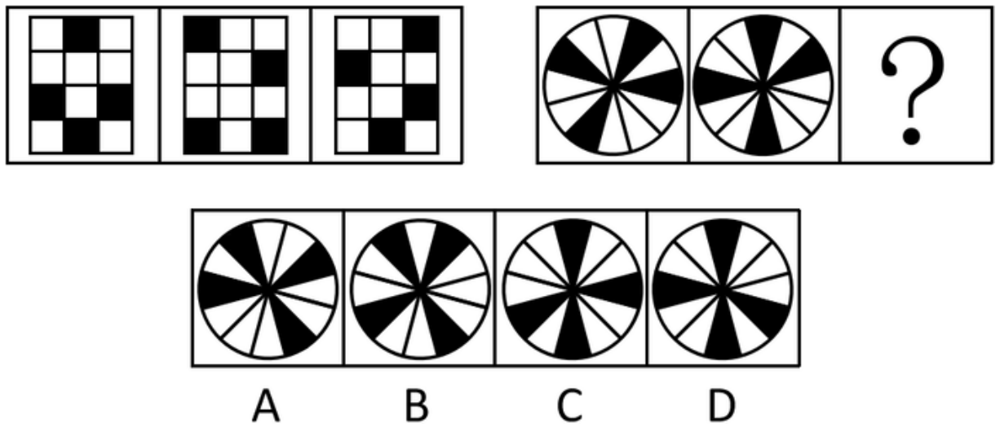

**47.** 从所给四个选项中，选择最合适的一个填入问号处，使之呈现一定规律性：

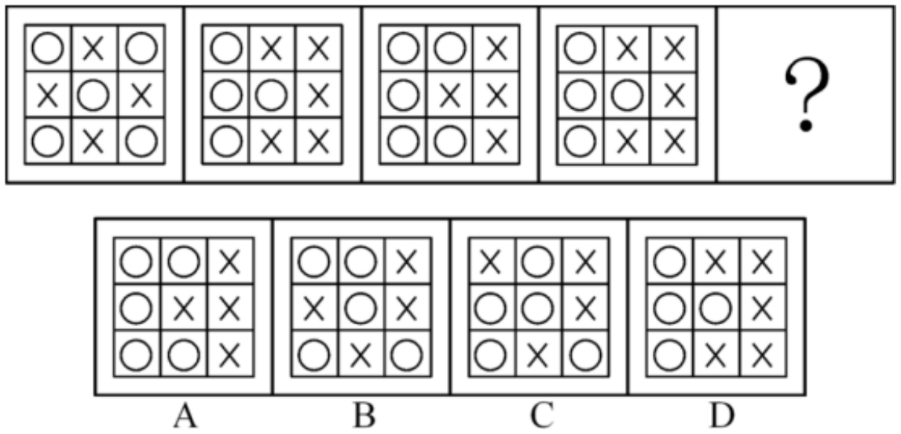

**48.** 请从所给的四个选项中，选择最合适的一项填在问号处，使之呈现一定的规律性。

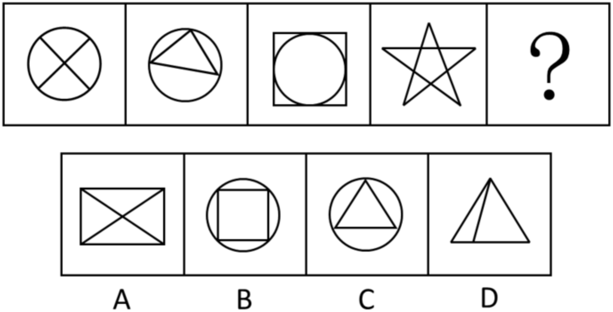

**49.** 以下哪项是由题干中正方体展开图折叠而成的？（）

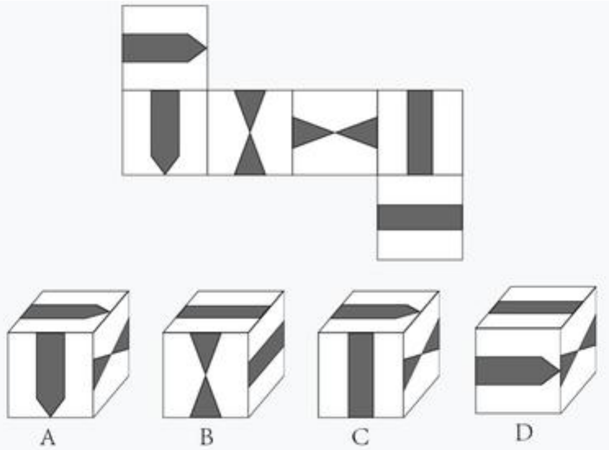

**50.** 下列选项中，最有可能由两个所给立体图形组成的是（）。

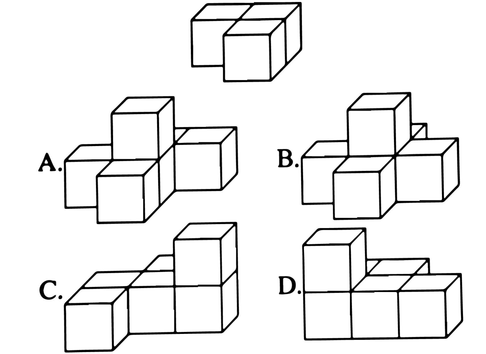

**51.** 如果你不爱笑，就不容易开心；如果你不容易开心，别人就不喜欢和你交往；如果别人不喜欢和你交往，你就没有知心朋友；而只有拥有知心朋友，你才会感觉生活很幸福。
如果以上描述为真，下列推断必然正确的是（）。

A. 爱笑的人会感觉生活很幸福
B. 不爱笑的人不会感觉生活很幸福
C. 如果你感觉生活不幸福，说明你不容易感到开心
D. 你感觉生活很幸福，说明你喜欢和别人交往

**52.** 为了提升公司内部的技术创新能力，公司成立之初组建了技术创新小组，该小组的部分成员拥有高级技术职称。近日，出于降本增效考虑，公司所有高管都赞同解散该小组的决定，但该小组所有成员都反对这一决定。
由此可以得出，该公司内（）。

A. 有些拥有高级技术职称的员工不是高管
B. 所有高管都没有高级技术职称
C. 该小组的成员都拥有高级技术职称
D. 有些高管拥有高级技术职称

**53.** 某单位4名员工小贾、小杨、小李、小陈住在以单位为中心的正东、正南、正西、正北四个方向。其中，小贾住在小李的西南方，小李住在小杨的东南方。
根据以上陈述，可以推出的是（）。

A. 小陈住在小杨的东南方
B. 单位在小贾家的正北方
C. 小李住在小陈的东北方
D. 小陈住在单位的正东方

**54.** 甲、乙、丙、丁4个人参加考核评比，他们作出了如下猜测：
甲：我一定不会得最后一名。
乙：我不是第一名，就是第二名。
丙：我一定是第一名。
丁：我的名次在乙和丙前面。
考核评比结果公布后发现，4个人中只有1个人预测错误，且4人名次不存在并列，则以下判断一定正确的是（）。

A. 甲获得第三名
B. 乙获得第一名
C. 丙不可能获得第四名
D. 丁不可能获得第四名

**55.** 随着群众对公园多样化需求的不断提升，某市近年来积极探索公园市场化改革，引入社会资本参与公园建设管理运营，结合当地历史文化底蕴打造特色主题公园，全面提升服务品质，丰富消费场景。然而，有反对者提出，公园市场化改革势必引入餐饮、娱乐等收费项目，影响市民在公园休闲健身、亲近自然，损害公园的公益属性。
如果下列选项为真，最能削弱反对者观点的是（）。

A. 市场化改革可吸引社会资本，弥补公园绿地建设运营的资金缺口，缓解财政压力
B. 某公园将当地历史文化与自然景观深度融合，打造了具有特色的主题公园，成为市民休闲的好去处
C. 公园市场化改革也会完善停车场、健身步道、无障碍设施等，有助实现群众满意、经济效益提升的“双赢”
D. 市场化运营后，企业往往将商业设施集中布局在公园某一区域，不会过度压缩市民的免费活动空间

**56.** 如今是一个大数据技术收集个人信息数据的时代，所以，个人信息安全将受到越来越严重的威胁。
以下最能削弱上述推论的是（）。

A. 现代商业模式高度依赖对消费者数据的分析
B. 我国正逐步完善有关个人信息安全的法律法规
C. 某大型企业建立了能够储存海量个人信息的大型数据库
D. 某医药公司通过大数据技术获取了上百万客户的健康数据

**57.** 语音意识是指有意识地探查和操纵口语语音单位和语音结构的能力，有研究表明该意识在儿童早期读写发展中有着重要的作用。某课题组将上百名小学生随机分成实验组和对照组。实验组以语音意识教学与常规听力练习相结合的方式开展英语教学，对照组则仅开展常规英语听力练习。10周后，实验组的听力测试成绩显著高于对照组。因此，应当在小学英语课程中推广语音意识教学。
要使上述结论成立，需要补充的前提包括（）。

A. 常规听力练习有助于提升语音意识教学的效果
B. 开展语音意识教学所花费的时间与普通教学相当
C. 实验结束后对照组学生对英语的兴趣低于实验组
D. 提升听力测试成绩是小学英语课程的教学目标之一

**58.** 普通牛奶中通常含有3%左右的脂肪，而脱脂牛奶借助脱脂加工工艺能够将牛奶中的脂肪含量降低至0.5%以下，由于过度摄入脂肪是人体肥胖的原因之一，因此，对于每天喝牛奶的人而言，相较于饮用普通牛奶，饮用脱脂牛奶的人更不容易肥胖。
要使上述推论成立，可以补充的前提是（）。

A. 脱脂牛奶与普通牛奶的口感差别不大
B. 脱脂加工工艺不会显著增加牛奶的生产成本
C. 不管选择哪种牛奶，人们每天的牛奶摄入量基本一致
D. 脱脂牛奶在希望控制体重的人群中广受欢迎

**59.** 无论是手洗还是使用洗衣机，洗衣服的程序一般由多次的漂洗和脱水组成。在许多人看来，只清洗少量衣物时，并不需要太多次的漂洗，此时手洗不仅更快，而且用水量也会显著少于洗衣机。但事实并非如此，在清洗效果基本一致的情况下，即使是清洗2-3件衣物，使用洗衣机仍然更能节约用水。
下列选项如果为真，最不能解释这一现象的是（）。

A. 在每次漂洗衣物的时候，手洗的用水量往往高于洗衣机
B. 要达到相同的清洗效果，洗衣机所需的漂洗次数少于手洗
C. 衣物减少时，洗衣机相应减少洗涤剂用量及用水量
D. 许多人没有形成循环利用洗衣服的水的习惯

**60.** 数据统计显示，人们看电影的年均时长相较于20年前有所减少，然而电影院的票房收入却持续增长。
下列选项如果为真，最不能解释这一现象的是（）。

A. 人们在电影院的消费常常包括购买食品、饮品等其他消费
B. 20年前，人们更倾向于在家通过电视或录像带观看电影
C. 随着经济不断发展，电影票的平均价格远高于20年前
D. 与20年前相比，前往电影院看电影的人数大幅增加

**61.** 只有当家政服务的社会认可度显著提高或社会需求明显上升，才能说明员工制的推行对家政服务的高质量发展起到了促进作用，所以，如果家政服务的社会认可度和社会需求都下降，说明员工制的推行没有促进家政服务的高质量发展。
以下与上述推论结构最为相似的是（）。

A. 只有家政服务行业推行员工制，才能让从业者对行业更有归属感，所以，如果家政服务行业没有推行员工制，那么从业者一定对行业没有归属感
B. 如果消费者对家政服务不满，要么是实际服务水平和宣传不符，要么就是服务人员素质良莠不齐，某消费者对家政服务满意，说明不存在虚假宣传且服务人员素质较高
C. 员工制度让经营管理更加便捷高效，而高效的经营管理能培育出优质的家政服务品牌，所以员工制有助于培育优质的家政服务品牌
D. 家政服务领域的专业化、规范化水平不断提高，能在一定程度上促进服务业转型升级，因此，服务业转型升级离不开家政服务水平的提升

**62.** 植物需要光合作用，珊瑚不是植物，因此珊瑚不需要光合作用。
下列选项与题干论证方式最为相似的是（）。

A. 光合作用是植物将光能转化为化学能的过程，而动物主要通过捕食获取化学能量，因此光合作用不是动物获取能量的主要途径
B. 应届毕业生已修完所有课程，校友不是应届毕业生，因此校友没有修完所有课程
C. 狗的臼齿发达，狗不是猫科动物，因此猫科动物的臼齿不发达
D. 汉语言专业的学生不是理科生，小明不是汉语言专业的学生，因此小明是理科生

**63.** 某企业是一家以海外营收为主的外贸企业，其最大的海外市场在S国。今年年初，该企业因多种原因退出了S国市场。据此有人预测，该企业今年的营收较去年会大幅下滑。
以下选项中，最能指出上述推论存在逻辑漏洞的是（）。

A. 默认了该企业往年的经营业绩都非常亮眼
B. 忽视了该企业在其他市场营收增长的可能性
C. 没有考虑该企业未来重返S国市场的可能性
D. 没有对比同类外贸企业今年的业务经营状况

**64.** 有甲、乙两家公司，甲公司售后服务部门接到的产品投诉电话是乙公司的3倍。因此，甲公司产品的质量没有乙公司的好。
以下最能反驳上述结论的是：

A. 乙公司的产品操作相对来说更为简单
B. 甲公司接到的电话大多数是咨询电话
C. 甲公司的咨询电话机数量比乙公司多
D. 甲公司产品的市场占有率达到76%

**65.** 相比于化工“污染地”、重金属“污染地”，化肥、农药、农膜带来的农地污染并没有那么触目惊心，但却具有量大、面广、隐蔽性强、持续时间长等特点。一些受污染严重的土地，已经不能进行正常的农业生产。农地的“批量污染”治理已经到了刻不容缓的地步。以农膜为例，由于塑料残余物在自然条件下可在土壤中残存数十年甚至上百年而不降解，这些废膜的存在会影响土壤的通透性，阻碍土壤水分的补给和养分转移。
根据以上表述，可以得出的结论是：
①化工和重金属的污染往往量不大、面不广、易发现、持续时间不长
②农膜残留通过阻碍土壤的水分补给和养分转移对农地产生影响
③农膜残留是当前农地“批量污染”中最为突出和严重的
④农地污染不能因其隐蔽性强等特点而在治理土地污染中被人们忽视
⑤化工和重金属对土地的污染比农地污染更为严重

A. ①②
B. ①③④
C. ②④
D. ②③⑤

## 第六部分　科学推理

**66.** 如图所示，将弹簧测力计一端固定，另一端钩住长方体木块A，木块下面是一长木板，实验时拉着长木板沿水平地面向左运动，读出弹簧测力计示数即可测出木块A所受摩擦力大小，在木板运动的过程中，以下说法正确的是（）。

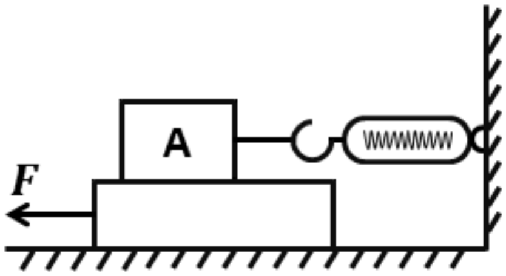

A. 木块A受到的是静摩擦力
B. 木块A会相对地面匀速运动
C. 木块A所受摩擦力的方向向左
D. 拉动速度变大时，弹簧测力计示数变大

**67.** 如图所示，两根绝缘细线悬挂着带有同种电荷的小球a和b。因静电力，两根绝缘细线张开，分别与垂直方向成夹角α和β，且静止时两球处于同一水平面。如果夹角α大于夹角β，则下列结论正确的是（）。

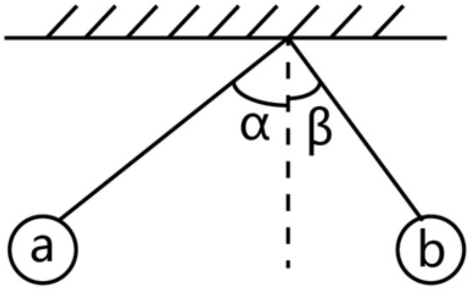

A. 小球a带电荷量比小球b多
B. 小球b受到拉力比小球a小
C. 小球b的质量比小球a大
D. 同时剪断两根细线，小球a先落地

**68.** 如图所示，电路两端的电压保持不变，当滑动变阻器的滑动触头P向左移动，电阻变大时，三个灯泡亮度的变化情况是（）。

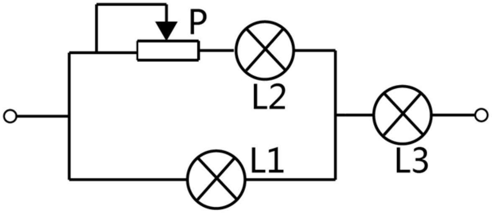

A. L1变亮，L2变亮，L3变暗
B. L1变亮，L2变暗，L3变暗
C. L1变暗，L2变暗，L3变暗
D. L1变暗，L2变暗，L3变亮

**69.** 某人利用石英砂、活性炭、蓬松棉和纱布制作了一个简易净水器。下列说法正确的是（）。

A. 该净水器可以有效去除重金属元素
B. 该净水器可以将自来水变为纯净水
C. 该净水器可以降低自来水的硬度
D. 蓬松棉应置于离出水口最近的地方

**70.** 为了研究唾液对淀粉的消化作用，实验员往装有5ml淀粉液的试管1和试管2中分别加入2ml清水和2ml唾液，再将试管1和试管2同时放入37℃的温水中水浴10分钟，冷却后往两支试管中滴入等量的碘液，则可以观察到（）。

A. 两支试管的溶液均为蓝色
B. 两支试管的溶液均为无色
C. 试管1的溶液为无色，试管2的溶液为蓝色
D. 试管1的溶液为蓝色，试管2的溶液为无色

## 第七部分　资料分析

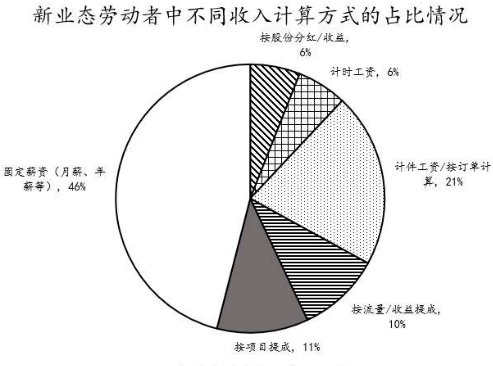

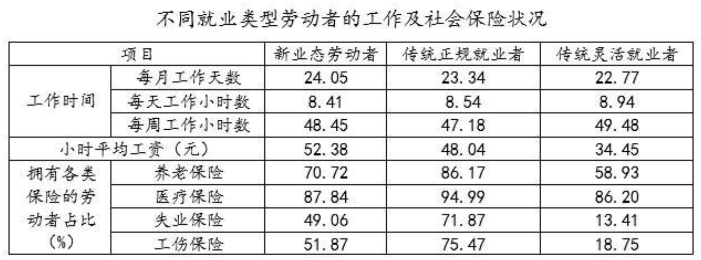

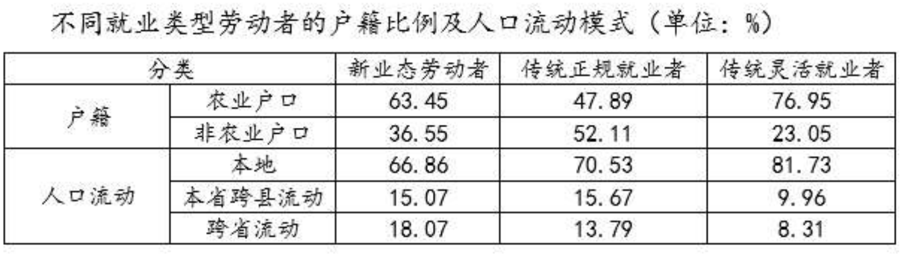

**71.** 新业态劳动者中，按流量/收益提成计算收入的和按项目提成计算收入的占总体的比重为（）。

A. 10%
B. 21%
C. 27%
D. 31%

**72.** 关于不同就业类型劳动者工作时间，以下表述正确的是（）。

A. 新业态劳动者每月工作天数最多，但每周工作小时数最少
B. 传统灵活就业者每月工作天数最少，但每周工作小时数最多
C. 传统正规就业者每周工作小时数最少，每月休息的天数也最少
D. 新业态劳动者每天工作小时数最多，传统灵活就业者每天工作小时数最少

**73.** 按照不同就业类型劳动者的小时平均工资计算，新业态劳动者的月收入大约比传统灵活就业者多（）。

A. 20%
B. 30%
C. 40%
D. 50%

**74.** 按拥有各类保险的劳动者占比排序。下列选项与3种就业类型劳动者的社会保险状况相符的是（）。

A. 医疗保险＞养老保险＞工伤保险＞失业保险
B. 医疗保险＞养老保险＞失业保险＞工伤保险
C. 养老保险＞医疗保险＞工伤保险＞失业保险
D. 养老保险＞医疗保险＞失业保险＞工伤保险

**75.** 根据材料，以下说法无法判断正误的是（）。

A. 非农业户口的劳动者中，传统正规就业者占了多数
B. 3种就业类型劳动者中，本省跨县流动的比例均最高
C. 新业态劳动者跨省流动的比例高于其他两种就业类型劳动者
D. 新业态劳动者和传统灵活就业者中，农业户口占比均超过非农业户口

《2023年我国卫生健康事业发展统计公报》显示，我国卫生资源总量持续稳步增长。2023年末，全国医疗卫生机构总数1070785个，比上年增加37867个，其中医院38355个，比上年增加1379个。2023年末，全国卫生技术人员总数1248.8万人，比上年增加83.0万人，其中医院卫生技术人员772.3万人。

根据公报，我国医疗服务提供量和效率同步提升。2023年，全国医疗卫生机构总诊疗人次95.5亿，比上年增加11.3亿人次，居民平均到医疗卫生机构就诊6.8次，入院人次30187.3万，比上年增加5501.1万人次。2023年，乡镇卫生院诊疗人次13.1亿，比上年增加1.0亿人次，入院人次3992.1万，比上年增加753.0万人次。社区卫生服务中心诊疗人次8.3亿，入院人次480.4万，社区卫生服务站诊疗人次2.1亿，村卫生室诊疗人次14.0亿，比上年增加1.2亿人次。

公报还显示，2023年全国卫生总费用初步核算为90575.8亿元，其中政府卫生支出占26.7%，社会卫生支出占46.0%，个人卫生支出占27.3%。

**76.** 2023年，全国医疗卫生机构总数同比增长约（）%。

A. 2.1
B. 2.7
C. 3.1
D. 3.7

**77.** 2023年，全国平均每家医院有卫生技术人员约（）人。

A. 101
B. 201
C. 301
D. 401

**78.** 2022～2023年，平均每年全国医疗卫生机构总诊疗人次（）。

A. 不到80亿
B. 在80亿～85亿之间
C. 在85亿～90亿之间
D. 在90亿～95亿之间

**79.** 将①全国医疗卫生机构入院人次，②乡镇卫生院诊疗人次，③乡镇卫生院入院人次，④村卫生室诊疗人次按2023年同比增速从高到低排序，以下顺序正确的是（）。

A. ①②③④
B. ①④②③
C. ③①④②
D. ③②④①

**80.** 根据材料，以下说法错误的是（）。

A. 2023年，全国卫生总费用中政府卫生支出超过3万亿元
B. 2023年，村卫生室诊疗人次约是社区卫生服务站诊疗人次的6.7倍
C. 2023年末，全国卫生技术人员中有超过一半是医院卫生技术人员
D. 2023年，乡镇卫生院入院人次比社区卫生服务中心入院人次多约3512万人次

2023年上半年，交通运输经济运行持续恢复，整体好转，人员流动大幅增加，货运量、港口货物吞吐量同比均实现较快增长，为推动经济回升向好提供了有力保障。2023年上半年，完成营业性货运量259.3亿吨，同比增长6.8%；完成营业性客运量43.2亿人，同比增长56.3%。

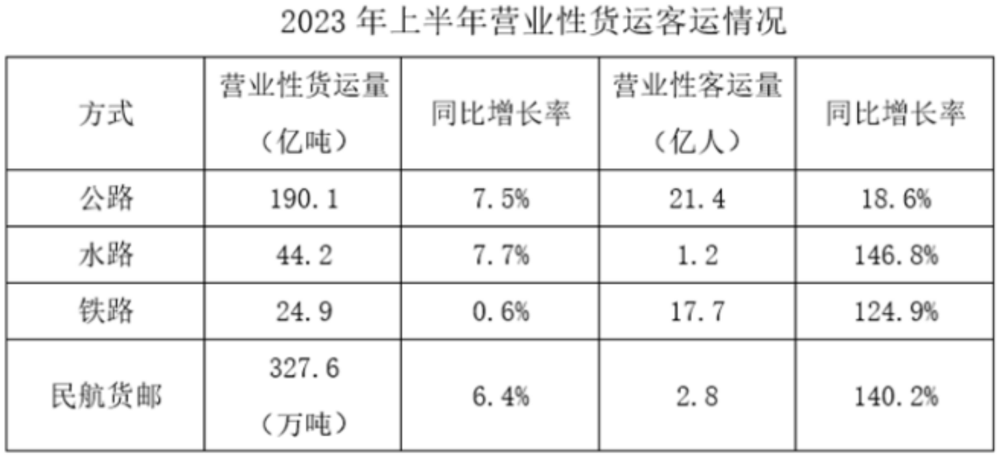

上半年，全国港口完成货物吞吐量81.9亿吨，同比增长8.0%，其中二季度完成货物吞吐量43.3亿吨，同比增长9.7%。分结构看，内贸吞吐量同比增长7.6%，外贸吞吐量同比增长8.9%，主要受煤炭等大宗物资进口带动。完成集装箱吞吐量1.5亿标箱，同比增长4.8%。
城市客运方面，上半年全国完成城市客运量454.2亿人，同比增长15.0%。分方式看，公共汽电车、城市轨道交通、巡游出租车、轮渡分别完成客运量198.7亿人、136.4亿人、118.7亿人和3872万人，同比分别增长4.6%、45.9%、6.8%和113.0%。

**81.** 2022年上半年，公路、水路、铁路、民航货邮4种方式中，完成营业性货运量最大的是（）。

A. 公路
B. 水路
C. 铁路
D. 民航货邮

**82.** 2023年上半年，完成营业性客运量最多的交通方式，其客运完成量比2022年上半年增加了约（）亿人。

A. 0.7
B. 1.6
C. 3.4
D. 9.8

**83.** 2022年上半年，全国完成城市客运量约是营业性客运量的（）倍。

A. 11.0
B. 12.1
C. 13.2
D. 14.3

**84.** 2023年上半年，以下城市客运方式中，对城市客运量同比增长贡献最大的是（）。

A. 公共汽电车
B. 城市轨道交通
C. 巡游出租车
D. 轮渡

**85.** 根据资料，下列说法不正确的是（）。

A. 2022年上半年，全国完成营业性货运量超240亿吨
B. 2022年一季度，全国港口完成货物吞吐量小于40亿吨
C. 2023年上半年，全国港口内贸吞吐量小于外贸吞吐量
D. 2023年上半年，全国集装箱吞吐量同比增长量超500万标箱

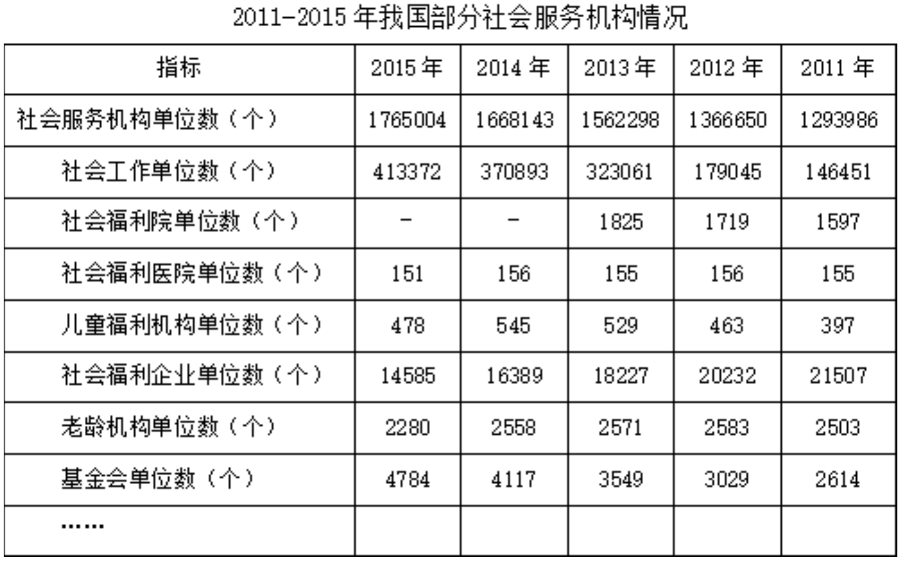

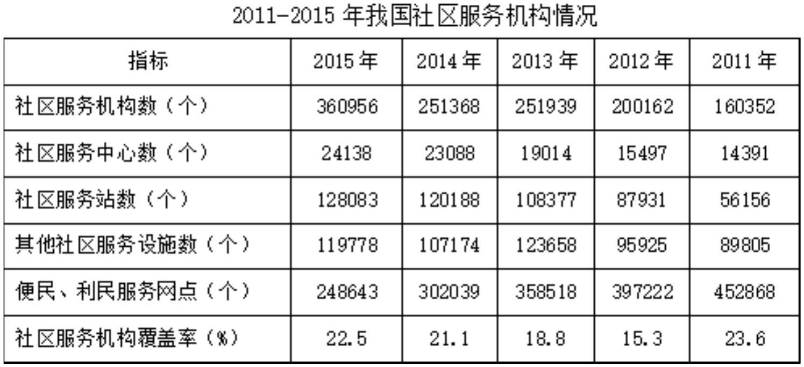

**86.** 与2012年相比，2013年下列社会服务机构中单位数增加最多的是（）。

A. 社会福利院
B. 儿童福利机构
C. 老龄机构
D. 基金会

**87.** 2015年，社会服务机构单位数比2011年增加约（）万个。

A. 46
B. 47
C. 48
D. 49

**88.** 2012—2015年，老龄机构单位数占社会服务机构单位数的比重最大的是（）。

A. 2012年
B. 2013年
C. 2014年
D. 2015年

**89.** 2012—2015年，社区服务中心数量同比增加最多的年份是（）。

A. 2012年
B. 2013年
C. 2014年
D. 2015年

**90.** 以下说法不正确的是（）。

A. 2015年，社会福利企业单位数较2014年有所减少
B. 2011—2014年，社会福利医院单位数变化不大
C. 2015年，社区服务机构数、社区服务站数较2013年均有所增加
D. 2011—2015年，每年的社区服务机构覆盖率逐年提高
