# S04　广东省考行测模拟卷（题本）

## 第三部分　言语理解与表达

**16.** 暴雨暴露了城市公共管理和应急机制中的____，更____了市政规划建设中的硬伤。
依次填入画横线部分最恰当的一项是：

A. 隐患 显现
B. 软肋 凸显
C. 顽疾 揭示
D. 漏洞 呈现

**17.** 民生工作无小事，每一件看似_____的事情都可能产生巨大的影响。
填入横线部分最恰当的一项是：

A. 不足挂齿
B. 微不足道
C. 谨小慎微
D. 不容赘述

**18.** 广大知识分子的前途命运与中华民族伟大复兴事业（）。纵览历史，那些（）的知识分子，无不是将聪明才智赤诚奉献于国家富强、民族振兴和人民幸福的追求之中。

A. 休戚与共 博闻强识
B. 无出其右 高山仰止
C. 息息相关 名垂青史
D. 相得益彰 万古流芳

**19.** 要加快新型产业布局，就需要进一步结合广东资源和经济发展的现状，以科技创新去（）产业新优势。

A. 构造
B. 构建
C. 建筑
D. 建造

**20.** 开展国土绿化行动，既要注重数量，更要注重质量，坚持科学绿化、规划引导、（），走科学、生态、节俭的绿化发展之路，久久为功，善做善成，不断（）森林面积，不断（）森林质量，不断提升生态系统质量和稳定性。

A. 因地制宜 扩大 提高
B. 因势利导 加大 增强
C. 因地制宜 扩充 强化
D. 因势利导 增加 改善

**21.** 理想信念是事业和人生的灯塔，决定我们的方向和立场。理想信念不是拿来说、拿来唱的，更不是用来装点门面的，只有见诸行动才有说服力。领导干部将理想信念内化于心、外化于行、知行合一，自觉肩负起为民谋幸福、为中华民族谋复兴的重托才能步稳力沉。
这段文字主要论述了（）。

A. 理想信念的重要性
B. 理想信念应落实到行动
C. 理想信念与民族复兴的关系
D. 理想信念应当成为我们的奋斗方向

**22.** 作为世界上最成功的室内栽培植物之一，绿萝几乎就是盆栽的代名词，____。绿萝这个物种早在1880年就被确认了，但是你很难想象，直到2004年，它的原产地才被确定为法属波利尼西亚社会群岛的莫雷阿岛。更为神秘的是，绿萝是一种过分矜持的植物，虽然它已经扩散到了全世界的热带地区，却只在1962年有过一次确切的开花记录，直到2016年，人们才发现了它开花的秘密。
填入画横线部分最恰当的一句是：

A. 唯一的遗憾就是绿萝从来不开花
B. 因为它非常适合人类的居住环境
C. 但它却也是我们最熟悉的陌生人
D. 是一种不可多得的室内观叶植物

**23.** 分享经济作为一种新的经济形态，面临的挑战和问题不少，行业、社会、监管等也在逐渐调整和适应。但是不能因此采取一种压制态度，而应创造更好的环境，使其规范健康地发展。
这段文字主要表达的意思是（）。

A. 要以包容的态度，营造分享经济发展的良好环境
B. 相关法规的调整和监管手段都跟不上分享经济的步伐
C. 分享经济是新生事物，本身仍有许多需要完善的地方
D. 不能压制新生事物的发展，否则就无法跟上新时代的发展

**24.** 对于雾霾天气，人们深受其害。殊不知，精神上也存在雾霾现象，如果不及时驱除，就会使心灵压抑灰暗，精神萎靡不振，思想浑浑噩噩，危害一点儿都不比雾霾天气小。现代社会，节奏快，压力大，矛盾多，这种精神的雾霾对于个人生活和各项事业的害处多多。如何调适心情，驱散雾霾？一剂良方就是借助文艺的力量，以文“明”志、以文“养”心、以文“怡”情、以文“化”人。
对这段文字理解准确的一项是：

A. 借助文艺有助于驱散精神雾霾
B. 精神雾霾比雾霾天气更难驱散
C. 不良生活方式是导致精神雾霾出现的原因
D. 精神雾霾对人们的危害比雾霾天气更大

**25.** 实践证明，打赢脱贫攻坚战，关键在于对扶贫对象进行精细化管理、对扶贫资源进行精确化配置、对扶贫对象进行精准化扶持。贫有百种，困有千样。只有坚持因村因户因人施策，因贫困原因施策，因贫困类型施策，对症下药，精准滴灌，靶向治疗，才能做到真扶贫、扶真贫、真脱贫。
以下最能概括上述文段所表达的“脱贫攻坚精神”内涵的是：

A. 尽锐出战
B. 开拓创新
C. 攻坚克难
D. 精准务实

**26.** 科学的发展总带给人类崭新的思维方式。比如，在大数据背景下，人类的许多行为都是可以被预测的。从这个角度看，人类的行为并不是互不相关的独立事件，而是相互关联的数据网络中的一个片段。在这张数据大网之中，许多事件的相关性与其发展的规律变得有迹可寻。再比如，日常生活中，我们只能感知和意识到三维世界，而超弦理论却把我们带进一个十维的宇宙世界，带来新的科学思维与方法，开拓出一个新颖刺激而富有美感的精神新领域。
下列最适合做这段文字标题的是：

A. 独领风骚的数据科学
B. 未来世界的无限可能
C. 科学思维无所不在
D. 科学之光点亮思维

**27.** 流行语不仅是一种词汇现象，更是一种社会现象。它就像我们生活中的一面镜子，投射了人们在一个时期内普遍关注的事物和问题，也传达着人们对不同事件和生活的态度。当然，仍有不少人对流行语充满了怀疑，认为一些词汇不知所云，污染了语言之河。其实，要相信语言之河有着相当的自净能力，对于那些真正具有创新性的流行语，我们应该持海纳百川的态度。
根据这段文字，作者对真正具有创新性的流行语的态度是（）。

A. 包容的
B. 审慎的
C. 怀疑的
D. 反对的

**28.** 从古村落整体发展的层面来看，其更新改造过程中应 ____ 。如今的古村落物质空间形态是不同历史发展
阶段不断叠加的产物，其中既有人们在村落整体空间布局结构、街巷空间肌理等方面的精心谋划，体现了人与
自然和谐共生、文化追求等方面的精髓，也有人们在不同年代由于认识不足或其他原因导致的种种改变。因
此，要深入研究古村落历史发展沿革，提取古村落选址和布局中的山水田园人居精华，做到去芜存菁，通过更
新改造，更好体现古村落在整体空间布局方面的生态智慧和人文内涵，凸显古村落的整体风貌特色和历史文化
价值。
填入画横线处最恰当的一项是：

A. 辩证处理“取”与“舍”的关系
B. 将文化遗产保护与文旅资源开发相结合
C. 正确对待历史文化价值同特色产业发展的关系
D. 把挖掘历史文化内涵同打造特色文化品牌统一起来

**29.** 有些人总是羡慕别人的高超技艺和非凡功业，总是想从别人身上学得成功的方法、经验和法宝。殊不知，向别人学“规矩”容易，向别人学刻苦、学奋斗、学执著却不容易。要想成就一番事业，将本职工作做到炉火纯青地步，仅学得“规矩”远远不够，还需坚持不懈、潜心修炼，不怕吃苦、勤习不辍。古往今来的大家、大艺、大品都不是轻易修来的，唯有心无旁骛，凝神专注，“焚膏继晷，兀兀穷年”，才能达到一定技艺，上升到艺术之境。
以下对这段文字理解有误的是（）

A. 只有坚持不懈才能取得事业成功
B. 历练是技艺登峰造极的必经之路
C. 高超的技艺可以在短时间内掌握
D. 学得“规矩”是成就事业的前提

**30.** ①有些鸟类就因为食物缺乏、体能补充不足而夭折在迁徙途中
②迁徙距离愈远，消耗脂肪愈多
③因此，鸟类栖息地食物的充足就显得极为重要
④飞越沙漠和大海的迁徙鸟类，由于途中无法获取食物，必须不停顿地一次完成迁徙，故而需要存储的脂肪更多一些
⑤有的鸟种迁飞前脂肪积累可达体重的50%，有的鸟种迁飞结束时减重可达44%
⑥鸟类迁徙期间的能量消耗完全依赖体内以脂肪形式储存的能量
将以上6个句子重新排列，语序正确的是：

A. ⑥②④⑤③①
B. ⑥③①②⑤④
C. ④⑤⑥②①③
D. ④②③①⑤⑥

## 第四部分　数量关系

**31.** 4，6，10，18，34，66，（    ）

A. 82
B. 98
C. 114
D. 130

**32.** 2、4、16、96、768、（    ）

A. 864
B. 3072
C. 7680
D. 9216

**33.** 10，5，15，20，35，（    ）

A. 50
B. 55
C. 65
D. 70

**34.** 768，199，827，69，904，（    ）

A. 92
B. 77
C. 53
D. 39

**35.** 10，6，10，12，30，48，150，（    ）

A. 266
B. 277
C. 288
D. 299

**36.** A、B、C三辆车应该装载108箱货物，A车比B车多装6箱，C车比B车少装6箱，那么B车装了（）箱。

A. 33
B. 34
C. 35
D. 36

**37.** 某单位采购了大、中、小3种不同尺寸的文件袋，大号文件袋和中号文件袋共145个，小号文件袋的数量比大号文件袋多26%，且比中号文件袋的数量多，则大号文件袋的数量比中号文件袋多（）个。

A. 45
B. 55
C. 65
D. 75

**38.** 甲、乙两艘巡逻艇同时从河流的某处出发，沿河道开展巡查，甲船逆流而上，乙船顺流而下。1小时后，甲、乙两艘船同时掉头，甲船比乙船早1小时返回出发点。已知甲船的静水速度是水流速度的5倍，那么乙船的静水速度是水流速度的（）倍。

A. 3
B. 4
C. 5
D. 6

**39.** 某地计划选择甲、乙、丙、丁工程队中的1支，修建一段长度为18千米的公路。如果4支工程队平均每天分别能完成90、80、75、72米的公路施工，但甲工程队要求每施工4天休整1天，乙每施工15天休整1天，丙每施工30天休整1天，丁无休整要求。则为了尽早完成施工，应选择（）工程队。

A. 甲
B. 乙
C. 丙
D. 丁

**40.** 在一场射击训练中，甲、乙、丙三人击中目标的概率分别为1/2、2/3和3/4。如果三人向同一个目标射击，则目标至少被其中一人击中的概率是（）。

A. 3/4
B. 5/6
C. 11/12
D. 23/24

**41.** 李先生购买了一张10月12日7时出发的车票，因计划有变，他在10月10日21时办理退票。如果原票价为480元，则根据现行的梯次退票政策（如下表所示），他可以退得（）元。

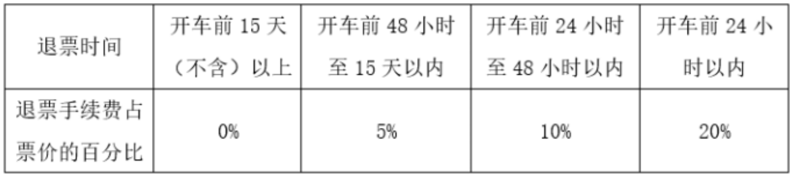

A. 240
B. 384
C. 432
D. 456

**42.** 如图所示，一块正方形土地阴影部分为草地，草地的总面积为800平方米，那么土地的边长（）。

A. 是40米
B. 是60米
C. 是80米
D. 不能确定

**43.** 修建一条铁路，如果每4米铺设5根枕木，共需5000根；如果每5米铺设6根枕木，一共要用（）根。

A. 3600
B. 4200
C. 4800
D. 7500

**44.** 杯中有280ml的水，加入浓度为60%的酒精溶液后，杯中溶液的酒精浓度为18%，则加入的酒精溶液为（）ml。

A. 90
B. 120
C. 150
D. 180

**45.** 某公安行动组有成员若干名，如果有1名女同志在外执勤，剩下组员中1/4是女性；如果有3名男同志在外执勤，剩下组员中有2/5是女性。如果行动组要派出男女各2名组员在外执勤，那么执勤人员的组成方式有多少种？

A. 168
B. 216
C. 286
D. 356

## 第五部分　判断推理

**46.** 从所给的四个选项中，选择最合适的一个填在问号处，使之呈现一定的规律性（）。

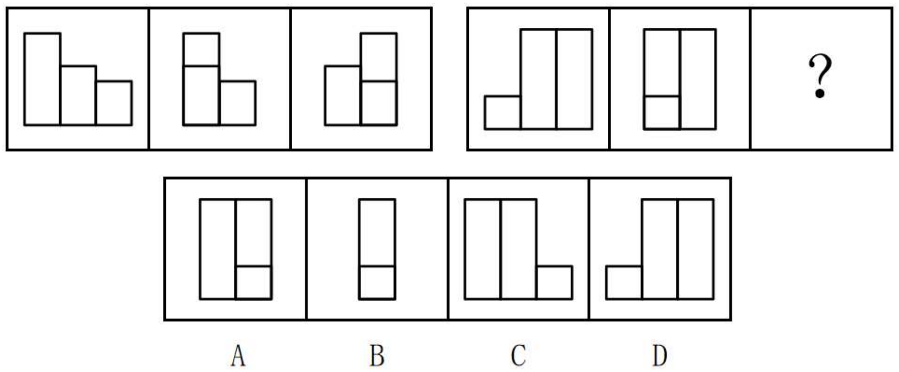

**47.** 从所给的四个选项中，选择最合适的一个填入问号处，使之呈现一定的规律性：

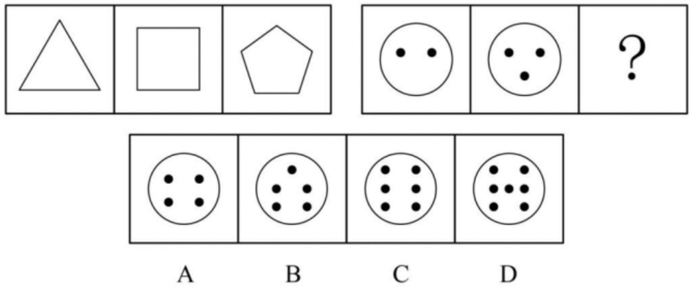

**48.** 从所给四个选项中，选择最合适的一个填入问号处，使之呈现一定规律性：

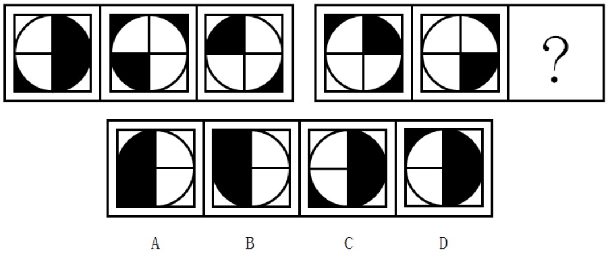

**49.** 下列选项中最符合所给图形规律的是（）。

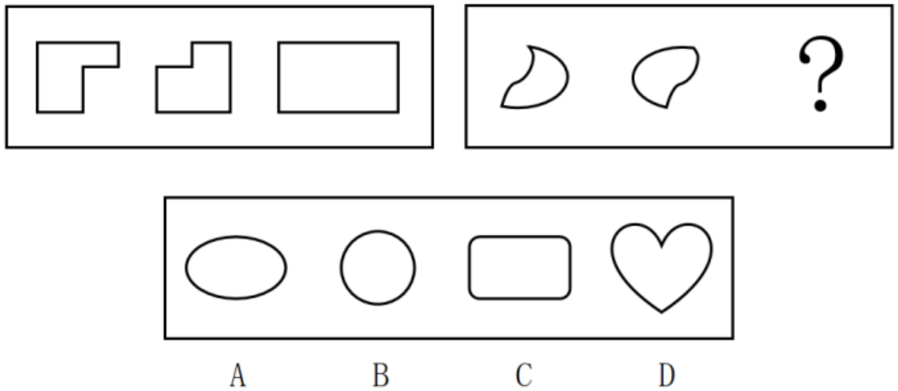

**50.** 如图是一物体某两个角度的视图，则该物体最可能是：

**51.** 爸爸、妈妈只要有一个人在家时，孩子可以留在家里；爸爸、妈妈都出差时，家中必须有人照顾孩子，才能把孩子留在家里。
根据以上条件，下列判断必定成真的是：

A. 爸爸出差时，孩子不能留在家里
B. 妈妈出差时，孩子不能留在家里
C. 孩子不能和爸爸、妈妈一起外出
D. 爸爸、妈妈出差时，可以由外祖母在家照顾孩子

**52.** 到游泳池深水区游泳，只需要具备两个条件，一是戴泳帽，二是持有深水游泳证。小王戴着游泳帽到深水区游泳，被工作人员阻止。
根据以上条件，下列条件必定为真的是：

A. 小王不会游泳，到深水区游泳比较危险
B. 小王是儿童，不适合到深水区游泳
C. 小王没有深水游泳证
D. 小王到游泳池时，深水区已经暂停开放

**53.** 甲、乙、丙、丁4人参加象棋排位赛，赛前小王、小张和小李对4人的排名情况预测如下：
小王：乙会是第一名，丙会是第三名。
小张：甲会是第二名，乙会是第四名。
小李：丙会是第二名，丁会是第三名。
比赛结束后发现，小王、小张和小李都只预测对了一半。如果4人未出现名次并列，那么此次比赛中获得第四名的是（）。

A. 甲
B. 乙
C. 丙
D. 丁

**54.** 已知甲、乙、丙、丁四人具有以下直系、旁系血亲关系：甲是乙的父亲，丙是甲的弟弟，丁是丙的母亲。
则甲、乙、丙、丁四人中年龄最大的是：

A. 甲
B. 乙
C. 丙
D. 丁

**55.** 某地一企业今年招聘时，平均每个职位的应聘人数比去年减少了30%。因此，该公司对求职者的吸引力有所下降。
以下最能削弱上述推论的一项是：

A. 今年全国应届毕业生人数比去年有所增加
B. 今年到该地求职的总人数有所减少
C. 该企业今年招聘的部分职位应聘人数多于去年
D. 该企业今年招聘的职位有八成提高了用人标准

**56.** 有调查显示，那些作息时间不同的夫妻，虽然每天相处的时间较少，但他们发生争吵的次数比作息时间基本相同的夫妻更多。因此，为了建立良好的夫妻关系，夫妻之间应当尽量有相同的作息时间。
最能削弱上述论点的一项是：

A. 夫妻产生矛盾后，往往以作息时间不同来表现不满
B. 具有同事关系的夫妻更容易在工作上产生矛盾
C. 作息时间不同的夫妻更容易产生矛盾
D. 生活习惯不同是夫妻产生矛盾的主要原因

**57.** 由于某市路边的报刊亭大多属于违章建筑，影响城市管理，而且普遍存在超范围经营等问题，当地政府考虑拆除路边报刊亭，居民可以直接到当地超市、书店或专门的报刊销售点购买报刊、杂志。
以下有助于推动当地政府作出拆除路边报刊亭决定的信息不包括：

A. 不少路边的报刊亭存在贩卖非法出版物的问题
B. 当地超市、书店和专门的报刊销售点相当充足，随处可见
C. 路边报刊亭的销售收入主要来源于贩卖烟酒零食而非报刊
D. 数据显示，当地居民购买报刊、杂志主要还是通过邮局订购

**58.** 有研究表明，社区环境与居民的生活满意度息息相关，居民满意度的提升是政府的工作重点之一。因此，各地政府都应当在改善社区环境上加大资源投入。
要使上述推论成立，需要补充的前提是（）。

A. 政府应当以尽可能少的资源投入获得尽可能大的效益
B. 多地政府已经投入了大量的资源用以改善社区的环境
C. 生活满意度的提升有助于提高居民对当地政府的认可度
D. 政府在改善社区环境上投入的资源越多，居民的生活满意度越高

**59.** 某村村民反映，作为村主要农作物的甘蓝出现了根肿病，产量严重下降，村民收入锐减。对此，村里引进了多个蔬菜品种，并组织村民进行了蔬菜种植技术培训，可以预见，村民的收入将因此而有较大提高。
要上述推断成立，必备的前提条件不包括：

A. 村民经培训后开始种植其他品种的蔬菜
B. 村民掌握了种植其他品种蔬菜的技术
C. 村官有销售其他蔬菜品种的渠道
D. 其他蔬菜品种的产量比甘蓝要高

**60.** 有调查显示，虽然新能源汽车的充电费用较低，但由于同一品牌的新能源汽车售价往往显著高于燃油汽车，因此在汽车的生命周期内，购买新能源汽车未必省钱。但现如今仍然有越来越多的人购买新能源汽车而不是传统的燃油汽车。
以下选项如果为真，最能解释上述现象的是（）。

A. 多地政府对新能源汽车生产企业给予了财政补贴政策
B. 新能源车主往往更关注新能源汽车环保、智能驾驶等优点
C. 夏季驾驶汽车时，如果长时间开启车内空调，新能源汽车更节能
D. 新能源汽车生产企业往往在外观设计上投入较多资源

**61.** 据国家权威科研机构研究证实，当前市场上热销的某品牌保健食品并不含有提高人类身体机能、增强个体免疫力的成分。但调查结果表明，不少身体虚弱的人在购买服用了该品牌的保健食品一段时间后，身体素质明显提高。
以下最有助于解释上述矛盾的一项是：

A. 保健食品作用的发挥具有一定的时间滞后性
B. 许多身体健康的人在服用保健食品后体质也增强了
C. 购买该品牌保健品的人大多经济条件较好
D. 服用保健品的人在生活其他方面也开始注重健康

**62.** 所有的灌木植物都很矮小，冬青植株很矮小，所以冬青属于灌木植物。
下列选项的逻辑结构，与题干最相似的是（）。

A. 落叶乔木的叶子会在秋冬脱落，柏树不会落叶，所以柏树不是落叶乔木
B. 水果往往含水量很高，山楂含水量极低，所以有的山楂不是水果
C. 沙漠植物的叶子都呈针状，雪松有针状的叶子，所以雪松属于沙漠植物
D. 几乎所有的有毒植物颜色都很鲜艳，断肠草有毒，所以断肠草颜色鲜艳

**63.** 只要奋力追赶，再遥远的梦想也总有实现的一天。所以，如果不奋力追赶，梦想又怎么可能实现？
以下选项与题干逻辑最为相似的是（）。

A. 人才是科技产业发展的重要支撑。所以，要想大力发展科技产业，必须着力培养科技人才
B. 只有整体考量、系统谋划，才能驾驭全局。所以，推进全盘工作，离不开系统思维
C. 理论一旦对接了实践，就赋有了生命。所以，离开实践的理论是没有生命力的
D. 中国式现代化不是中国独善其身的现代化。所以，中国愿与世界各国共享机遇，互相成就

**64.** 定都易、建城难，建大都城更难，北京、南京、西安都是经历磨难才能成为著名大都城，因此，著名大都城是经历过自然和战争的洗礼才凝结出的社会文明结晶。
以下与上述逻辑结构最为相似的是（）。

A. 成为全国冠军难，成为世界冠军更是难上加难。顶级运动员必须付出巨大努力才能获得冠军，因此，马龙、王嘉男等世界冠军无不付出了巨大努力
B. 天将降大任于斯人也，必先苦其心智，劳其筋骨，饿其体肤，空乏其身，行拂乱其所为，所以动心忍性，增益其所不能
C. 人才兴则乡村兴、人才旺则乡村旺。因此，要更好地推动乡村振兴，就要为乡村人才发展营造良好环境，更大程度地激发人才的活力
D. 正是强大的爱国主义精神，支撑着董存瑞、黄继光、邱少云等革命先烈为我们的国家前赴后继。因此，革命先烈都具有爱国主义精神

**65.** 调查显示，如果长期饮用的饮料口感发生变化，人们往往会怀疑饮料存在品质问题，为此，某饮料品牌要求全国各地门店统一安装水处理系统，控制水的硬度以保持其产品稳定的口感，该品牌负责人对此表示，保持稳定的口感，能让顾客始终相信和享受品质如一的产品。
以下最能反映其负责人推断中存在的逻辑漏洞的是（）。

A. 默认了饮料的口感主要由水的硬度决定
B. 忽视了人们更适应其长期居住地的水质
C. 默认口感稳定能让顾客认为饮料不存在品质问题
D. 忽视了水处理系统无法使各门店的水的硬度完全一致

## 第六部分　科学推理

**66.** 下图是蹦极运动过程的简化示意图，弹性绳一端固定在O点，另一端系住运动员，运动员从O点自由下落，到达A点处弹性绳自然伸直，在B点处运动员受到的重力与弹性绳对运动员的拉力相等，C点是运动员所能到达的最低点，运动员从O点到C点的运动过程中忽略空气阻力，则：

A. 从O至A过程中运动员速度一直减小
B. 从A至B过程中运动员速度一直减小
C. 从B至C过程中运动员速度一直减小
D. 从C至A过程中运动员速度一直减小

**67.** 关于常见用电器的工作情况，以下说法不准确的是：

A. 道路两边的路灯定时开关，晚上同时亮，早晨同时灭，则所有路灯是串联的
B. 抽油烟机里的照明灯和电动机，既能同时工作，又能单独工作，则照明灯和电动机是并联的
C. 楼道中的感应电灯是由声控开关和光控开关共同控制的，只有在没有光线且出现声音时才能亮起，则电灯和声控开关、光控开关是串联的
D. 电吹风里的电热丝和电动机，可以控制出风温度，则电热丝和电动机是并联的

**68.** 常见的泡沫灭火器内有两个容器，外壳内装碳酸氢钠与泡沫灭火剂的混合溶液。另有一玻璃瓶内胆，装有硫酸铝水溶液。如图所示，正常情况（图Ⅰ）下，两种溶液互不接触。当需要使用泡沫灭火器时把灭火器倒立（图Ⅱ），两种溶液发生化学反应Al₂(SO₄)₃+6NaHCO₃==3Na₂SO₄+2Al(OH)₃↓+6CO₂↑，打开灭火器开关时，泡沫从灭火器中喷出，覆盖在燃烧物品上。则下列说法正确的是（）。

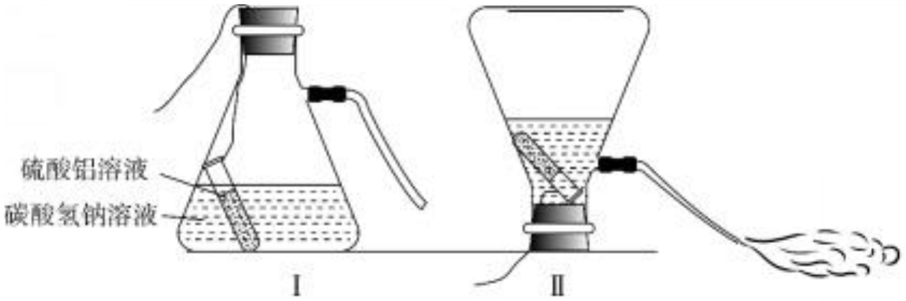

A. 泡沫灭火器灭火时喷出的物质会对周围环境造成污染
B. 泡沫灭火器在灭火时使燃烧物与空气隔绝，达到灭火的目的
C. 泡沫灭火器适宜用于扑救汽油、柴油、带电设备等引起的火灾
D. 泡沫灭火器使用完静置一段时间后，内装物质将全部变为液体

**69.** 细胞膜能够防止细胞外物质自由进入细胞，保证细胞内环境的相对稳定。这是因为（）。

A. 细胞膜具有流动性
B. 细胞膜具有选择透过性
C. 细胞膜主要由氨基酸构成
D. 细胞膜具有维持细胞形状的功能

**70.** 冬天气温很低的时候往玻璃杯里倒开水，杯壁较厚的玻璃杯更容易发生炸裂，这是因为（）。

A. 内壁和外壁受热不均
B. 开水遇到玻璃后温度迅速降低
C. 空气对杯壁的压力超过杯壁的承受范围
D. 倒水时水的冲击力将玻璃杯击破

## 第七部分　资料分析

2021年12月，全国天然气产量达192亿立方米，与2019年同期相比，两年平均增长7.9%。2021年全国共生产天然气2053亿立方米，同比增长8.2%，比2019年增长18.8%，两年平均增长9.0%。
2021年12月，全国进口天然气1165万吨，同比增长3.8%，增速比上月回落14.0个百分点。2021年全国共进口天然气超1.2亿吨，同比增长19.9%。（天然气1亿立方米=7.174万吨）

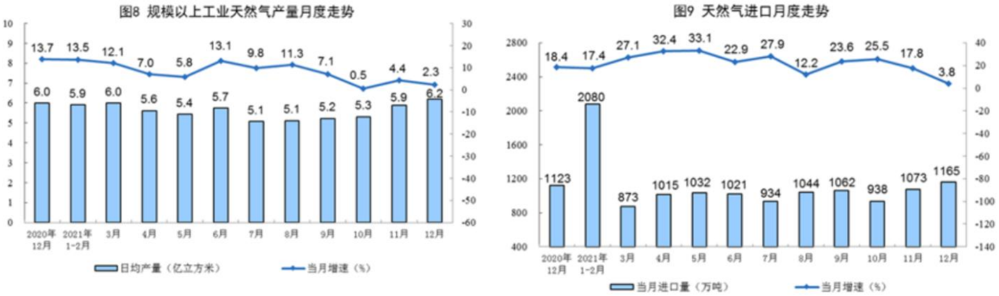

**71.** 与2019年同期相比，2021年12月全国天然气产量的增长量（）。

A. 小于10亿立方米
B. 在10-20亿立方米之间
C. 在20-30亿立方米之间
D. 大于30亿立方米

**72.** 2021年3-12月，全国天然气日均产量增速最高的月份，当月的天然气产量比进口量约（）。

A. 低了20%
B. 高了20%
C. 低了2%
D. 高了2%

**73.** 2020年各季度中，全国天然气产量最高的是（），最低的是（）。

A. 第一季度，第二季度
B. 第二季度，第四季度
C. 第三季度，第一季度
D. 第四季度，第三季度

**74.** 下列折线图中，最有可能准确反映2021年7-12月全国天然气进口量环比增量变化趋势的是（）。

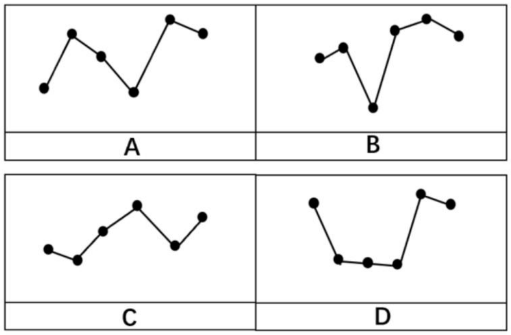

**75.** 根据资料，下列说法错误的是（）。

A. 2021年我国天然气产量大于进口量
B. 2019年我国天然气产量不足1500亿立方米
C. 2020年我国天然气进口量超过了1亿吨
D. 2021年9-12月，我国天然气日均产量逐月增加

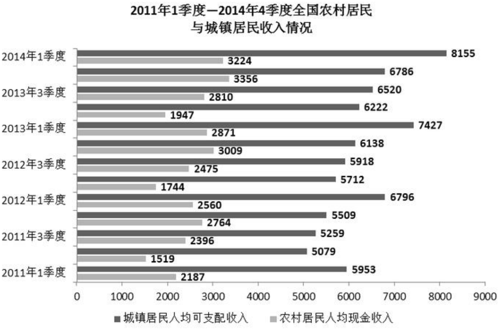

**76.** 与2011年同期相比，2014年1季度农村居民人均现金收入约增长了：

A. 25.9%
B. 36.8%
C. 47.4%
D. 52.5%

**77.** 2013年城镇居民人均可支配收入同比增加了：

A. 1千多元
B. 2千多元
C. 3千多元
D. 4千多元

**78.** 综合2011-2013年的数据，农村居民人均现金收入和城镇居民人均可支配收入最高的季度分别是：

A. 1季度和1季度
B. 1季度和4季度
C. 4季度和4季度
D. 4季度和1季度

**79.** 2011—2013年，农村居民年人均现金收入超过1万元的年份有几个：

A. 3
B. 2
C. 1
D. 0

**80.** 能够从上述资料中推出的是：

A. 2013年各季度农村居民人均现金收入均同比增加
B. 2013年4季度城镇居民人均可支配收入同比增速低于环比增速
C. 2013年1季度城镇居民人均可支配收入环比增长了三成多
D. 2013年下半年农村居民人均现金收入比上半年多约2000元

2014年全国棉花播种面积4219.1千公顷，比2013年减少2.9％。棉花总产量616.1万吨，比2013年减产2.2％。

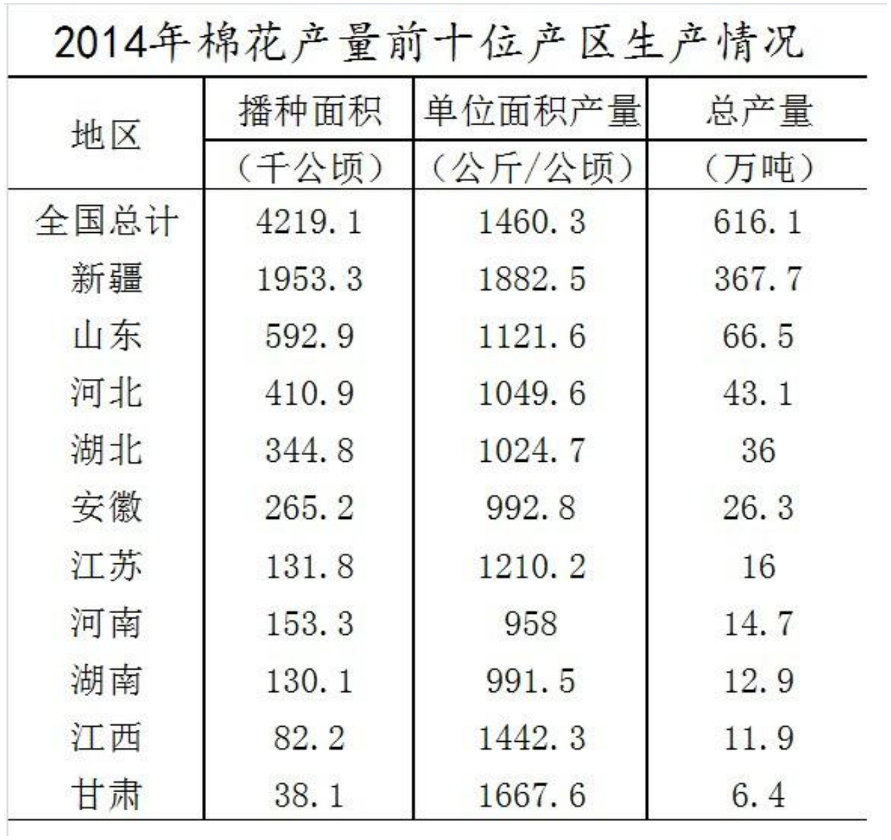

**81.** 2014年全国棉花单位面积产量比上年约：

A. 提高了5.1%
B. 提高了0.7%
C. 降低了5.1%
D. 降低了0.7%

**82.** 2014年棉花总产量最高的省（区）播种面积占全国棉花播种面积的比重约为：

A. 52%
B. 60%
C. 40%
D. 46%

**83.** 表中有几个省（区）2014年棉花单位面积产量不低于全国平均水平的80%？

A. 2
B. 3
C. 4
D. 5

**84.** 如果2014年安徽省的棉花单位面积产量能够达到全国平均水平，那么其棉花总产量将达到约多少万吨？

A. 30
B. 26
C. 39
D. 35

**85.** 关于2014年棉花生产情况，能够从上述资料中推出的是：

A. 山东棉花总产量和单位面积产量均为全国第二
B. 河南棉花播种面积和单位面积产量均高于湖南
C. 全国播种面积比2013年多126千公顷
D. 新疆棉花产量占全国总产量的一半以上

2016年，全国城市公园数量排名前五的省份依次是广东、浙江、江苏、山东和云南，公园数量分别为3512个、1171个、942个、828个和683个。其中，广东省的公园面积达到65318公顷，占全国公园面积的比重超过17%；公园绿地面积达到89591公顷，占全国公园绿地面积的比重约为14%。

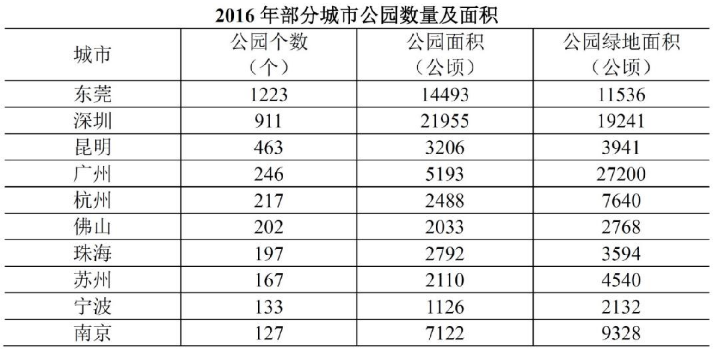

注：公园绿地指具有公园作用的所有绿地的统称，即公园性质的绿地，并非公园中的绿地面积，包括综合公园、专类公园、带状公园、街旁游乐园和社区公园等。

**86.** 2016年，佛山市平均每个公园的面积约为多少公顷？

A. 10
B. 15
C. 20
D. 25

**87.** 2016年，全国公园绿地面积约为多少万公顷？

A. 200
B. 640
C. 20
D. 64

**88.** 表中公园面积大于公园绿地面积的城市有几个？

A. 1
B. 2
C. 3
D. 4

**89.** 2016年，杭州公园数量约占浙江省公园总数的：

A. 19%
B. 15%
C. 27%
D. 23%

**90.** 关于表中城市公园数量及面积，能够从上述资料中推出的是：

A. 平均每个公园面积最大的城市是深圳
B. 公园绿地面积最大的城市，其公园面积排第3
C. 昆明市公园数量多于云南其他城市公园数量之和
D. 珠海和佛山两市公园面积之和为400多公顷
