# S06　广东省考行测模拟卷（题本）

## 第三部分　言语理解与表达

**16.** 总理在两会上所作的政府工作报告是一个（）民心、（）民意、体现民情的报告，也是一个增强信心、鼓舞士气、催人奋进的报告。

A. 代表 反应
B. 表现 反映
C. 表现 反应
D. 代表 反映

**17.** 各地将技能大赛融入推动产业工人队伍建设改革的进程中。广大职工踊跃参与，一批具有劳动热情和创造潜能的技术人才破土冒尖、________，展现出工人阶级的时代风采。

A. 鹤立鸡群
B. 一枝独秀
C. 所向披靡
D. 脱颖而出

**18.** 转变城市发展方式，关键要更加注重（）高效。有的城市“把每一寸土地都规划得清清楚楚再开始建设”；有的城市扎实推进城市更新行动，实现老城市新活力，在紧凑的空间里腾挪，“（）”推进口袋公园建设。
依次填入最恰当的一项是（）。

A. 集约，见缝插针
B. 精细，精雕细琢
C. 协同，精益求精
D. 循环，刻意求工

**19.** 个人成长进步靠什么？有人说靠组织培养，有人说靠自身努力。实际上，二者并不（）。在现实生活中，绝大多数人的成长进步既离不开组织培养，也离不开自身努力。
填入空格处最恰当的一项是：

A. 相关
B. 统一
C. 重复
D. 矛盾

**20.** （）的中华民族发展史是中国人民书写的，（）的中华文明是中国人民创造的，（）的中华民族精神是中国人民培育的，中华民族迎来了从站起来、富起来到强起来的伟大飞跃是中国人民奋斗出来的。

A. 波澜壮阔 博大精深 历久弥新
B. 恢弘壮丽 源远流长 同舟共济
C. 气势磅礴 奔流不息 与时俱进
D. 延绵不断 厚积薄发 奋发有为

**21.** 老年人与青少年、中年人等群体在阅读内容、形式、时间等方面有着较大的差异，他们的阅读需求多元化，从人文社科到营养健康，从网络“冲浪”到手机阅报，涉及的领域和场景较多，以数字阅读为例，不仅面向老年群体的产品较少，且有的服务页面夹杂广告，影响他们的数字阅读体验，满足老年人的阅读需求，并不是调大字体，调高音量那么简单，需要做好谋划设计，多角度、全方位开展阅读产品和服务的适老化改造。
上述文段意在说明的是（）。

A. 老年人在阅读内容、形式等方面与其他群体差异很大
B. 应针对老年人的阅读需求及特点调整阅读产品和服务
C. 着力改造数字阅读产品，提升老年人的数字阅读体验
D. 整治阅读产品中的软广植入，防止老年人上当受骗

**22.** 陨星体冲入地球大气圈的速度各有不同，这取决于____。如果它正对着地球运动，那么冲入的速度是最大的，可达到每秒70公里。这种迎面而来的陨星体，即使有几万或几十万吨重，也会在地球大气圈中被完全破坏。相反，“追赶”地球或被地球“追赶”的陨星体的冲入速度最小，每秒大约11公里，这种相对“慢”的陨星体的残体，就能到达地球表面，成为陨石。
填入画横线部分最恰当的一句是：

A. 陨星体在星际空间的运动方向
B. 陨星体的主要组成成份和质量
C. 陨星体与地球大气圈的摩擦面积
D. 陨星体在星际空间中的初始速度

**23.** 先进制造业是与传统产业相对而言的，它可以由传统产业融入先进技术升级而成，也可以由新技术的颠覆性突破而衍生出，通常具备以下特点：处在全球生产体系的高端，生产流通高度智能化……产品附加值高、技术含量高；吸收计算机、电子信息、材料以及现代管理技术等领域的高新技术成果，在技术和研发方面保持先进水平；采用先进的管理方式和技术手段，有较好的经济收益和市场效果。
这段文字主要讲了（）。

A. 先进制造业与传统制造业的区别
B. 先进制造业的主要特征
C. 先进制造业的突出优势
D. 传统产业与先进制造业的关系

**24.** 不可否认，学生到职场人的角色转换注定需要时间。一方面，职场的“游戏规则”不同于校园。在学校，一个人只需在所学专业有所建树，再辅以丰富的实践经历，便可成为师弟、师妹心中的榜样。而职场对人的要求大大提高，团队协作、人际沟通等能力样样不可少。高智商与高情商是在职场站稳脚跟的关键，后者甚至显得更为重要。步入职场，过往的成绩归零。无论你是不是名校毕业生，无论你的学历是本科还是硕博，在新的跑道上“栽跟头”在所难免。
对这段文字理解最准确的是（）。

A. 要想在所学的专业有所建树就必须要有高智商
B. 与学校相比，职场对刚踏进社会的毕业生要求更高
C. 学生的在校学习成绩对踏入社会工作的帮助不大
D. 毕业生可以通过提前积累经验避免在职场“栽跟头”

**25.** 不论是以巴尔扎克为代表的19世纪欧洲文学，还是以鲁迅为先导的中国现代文学，多半高擎现实主义大旗开垦生活，塑造典型。新时期以来的文学创作，基本也都坚守现实主义立场，比较善于揭露、针砭生活中的负面客观真实，这是完全必要且非常宝贵的。然而，部分小说缺乏对生活中积极因素和正面形象的塑造，缺少对正面价值和情感的呼吁。其实，现实主义创作以人道主义思想为武器，不仅注重剖析社会的阴暗面，也应注重展示生活的亮点；不仅看重批判社会阴暗面的准确性和深刻性，也更看重作家对人物命运的关怀和同情。
这段文字主要批评了新时期以来文学创作中哪个方面的问题？

A. 典型人物的塑造过于刻板单一
B. 作家缺乏对现实生活的关注
C. 缺乏对优秀文学传统的继承
D. 部分小说存在消极负面的倾向

**26.** 纵观世界，新的垃圾处理时代正在到来。前不久，俄罗斯科学家已经可以利用等离子技术来处理垃圾焚烧过程中产生的有害气体，并对城市生活制造的“污泥浊水”进行无害化处理，使其转为腐殖酸肥料。德国科学家造出“风拣技术”，令世界看到了垃圾处理的广阔未来。该技术终结了垃圾的人工分拣，让风代替人去对垃圾中的塑料、玻璃、纸张等进行分拣，从而将垃圾处理工艺提高到了一个前所未有的新阶段。
最适合做这段文字标题的是：

A. 垃圾：放错地方的资源
B. 科技：垃圾处理的关键
C. 风力：新时代的“机器人”
D. 无害化：垃圾处理的未来

**27.** 古树是指经依法认定、树龄100年以上的树木；名木是指经依法认定的稀有珍贵树木和具有历史价值、重要纪念意义的树木。古树不仅以其年代久远、景观独特见长，也因其蕴含的丰富历史意义而受到广泛关注。它们是活着的历史，连接着过去、现在和未来。其中一些历经世事变迁及岁月洗礼，在跨朝历代中成为“名木”，化作社会历史不可分割的一部分。
这段文字主要讲了（）。

A. 古树的独特景观和历史意义
B. 认定古树及名木的主要标准
C. 古树名木具有社会历史价值
D. 做好古树名木保护的重要性

**28.** ____。十八大以来，国内外形势新变化和实践新要求，迫切需要我们从理论和实践的结合上深入回答关系党和国家事业发展、党治国理政的一系列重大时代课题。我们党勇于进行理论探索和创新，以全新的视野深化对共产党执政规律、社会主义建设规律、人类社会发展规律的认识，取得重大理论创新成果，集中体现为新时代中国特色社会主义思想。
填入画横线部分最恰当的一项是：

A. 马克思主义是我们立党立国、兴党兴国的根本指导思想
B. 坚持和发展马克思主义，必须同中华优秀传统文化相结合
C. 我们必须坚定历史自信、文化自信。坚持古为今用、推陈出新
D. 推进马克思主义中国化时代化是一个追求真理，揭示真理，笃行真理的过程

**29.** 约25亿年前的“大氧化事件”是指大气中的游离氧含量突然增加，这一事件的具体原因迄今尚不得而知，但有若干种假说能加以解释，其中主流说法认为，当时破坏氧气的甲烷细菌所依赖的镍元素急剧减少，而海藻类植物通过光合作用使得地球上的氧气迅速增加，大气中的含氧量不断提升，正是这一事件使地球上矿物的成分发生了变化，也使动物在地球上有了生存可能。而在“大氧化事件”之前，地球表面虽然已出现了海洋和陆地，但是空气中依旧氧气稀薄，因此当时的地球是光秃秃的，毫无绿意。
关于“大氧化事件”，文中没有提及：

A. 对发生原因的主流解释
B. 对地球生态系统的影响
C. 事件发生前的地球面貌
D. 能提供佐证的岩石样本

**30.** ①由于各个作者对所描绘植物和绘画手法有不同的认识，所以诸多本草著作中就出现了风格各异的插图，但准确性欠佳
②植物科学画在中国有过辉煌时期，中国最早对植物的了解来自农业生产和本草医药的需要
③本草学家把社会实践中积累的植物学知识用文字记录下来，并配以形象图画，使人们更容易识别和利用植物，其中最著名的是李时珍的《本草纲目》
④为了能在最鲜活的状态下记录物种的模样，探险队伍中增加了专业画师，这就有了植物科学画的雏形
⑤那个时期的绘画工具是毛笔，技法是中国画中的白描
⑥现代意义的植物科学画源自西方，地理大发现时期，欧洲贵族、商人和科学家组成的舰队探索世界，同时收集动植物标本
将以上6个句子重新排列，语序正确的是：

A. ⑥④②①⑤③
B. ②③⑤①⑥④
C. ②⑤①③④⑥
D. ⑥②③①④⑤

## 第四部分　数量关系

**31.** 1.8，3.6，7.2，14.4，（    ），57.6

A. 18.4
B. 22.6
C. 28.8
D. 34.4

**32.** 11，44，99，176，（    ）

A. 275
B. 265
C. 260
D. 255

**33.** 3，7，9，14，27，28，81，（    ）

A. 132
B. 108
C. 83
D. 56

**34.** 1 2 5 26（    ）

A. 377
B. 477
C. 577
D. 677

**35.** 1，0，0，2，1，2，1，3，2，（    ）

A. 3
B. 4
C. 5
D. 6

**36.** 某车队运输一批蔬菜。如果每辆汽车运3500千克，那么还剩下5000千克；如果每辆汽车运送4000千克，那么还剩500千克，则该车队有多少辆汽车：

A. 8
B. 9
C. 10
D. 11

**37.** 在环保知识竞赛中，男选手的平均得分为80分，女选手的平均得分为65分，全部选手的平均得分为72分。已知全部选手人数在35到50之间，则全部选手人数为：

A. 48
B. 45
C. 43
D. 40

**38.** 甲乙两人绕着周长为600米的环形跑道跑步，他们从相同的起点同时同向起跑。已知甲的速度为每秒4米，乙的速度为每秒3米，则当甲第一次回到起点时，乙距离起点还有（）米。

A. 100
B. 150
C. 200
D. 250

**39.** 有两堆材料需要搬运。工人先搬了第一堆材料的一半，然后分出3/5的人手去搬第二堆材料，其余工人继续搬第一堆。当第二堆材料刚好搬完时，第一堆材料还剩下10%没搬。
则第二堆材料的数量比第一堆少多少：

A. 40%
B. 50%
C. 55%
D. 60%

**40.** 某条道路一侧共有20盏路灯。为了节约用电，计划只打开其中的10盏。但为了不影响行路安全，要求相邻的两盏路灯中至少有一盏是打开的，则共有（）种开灯方案。

A. 2
B. 6
C. 11
D. 13

**41.** 某款影音设备的定价为3.6万元，如打九折销售，则销售10台的利润与以原价销售7台的利润相同。如打八折销售，要使利润不低于10万元，至少要售出（）台。

A. 19
B. 20
C. 21
D. 22

**42.** 某工厂加工出一批正方体奶酪，抽检时质检员从奶酪中切下了一个厚度为2厘米的长方体（如图所示）。如果剩余奶酪的体积为144立方厘米，则奶酪原本的边长为（）厘米。

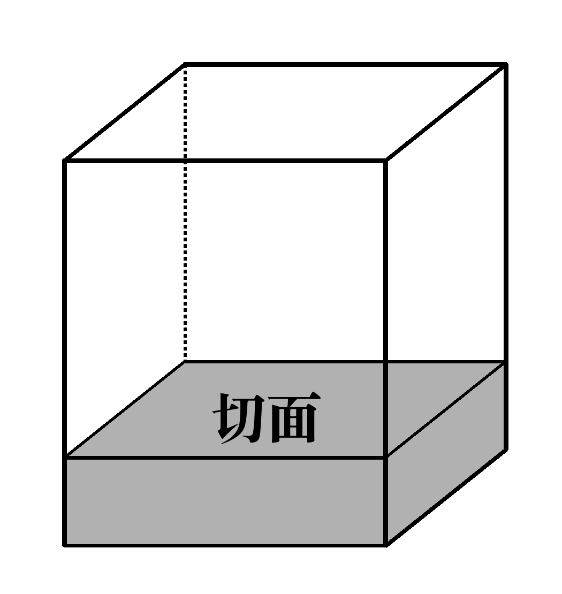

A. 4
B. 6
C. 8
D. 10

**43.** 商店从周一开始销售某种产品，且之后每一天的销量都比前一天多2件，第五周的销量正好是第二周的2倍，则商店第一周销售了（）件这种产品。

A. 82
B. 196
C. 210
D. 224

**44.** 某单位组织全体职工前往外地参观学习，如果所有职工乘坐40座的大巴，则至少需要租用12辆；如果乘坐35座的大巴，则至少需要租用13辆。则该单位职工的人数范围是（）人。

A. 421-455
B. 421-441
C. 441-455
D. 441-480

**45.** 某公司法务、运营、财务三个部门共收到70份求职简历（每名求职者只能向一个部门投递简历），其中有40%的求职者拥有硕士学位。在法务和运营两个部门收到的简历中，拥有硕士学位的求职者占比分别为55%和36%。则在财务部收到的简历中，拥有硕士学位的求职者占比为（）。

A. 21%
B. 24%
C. 29%
D. 32%

## 第五部分　判断推理

**46.** 从所给四个选项中，选择最合适的一个填入问号处，使之呈现一定规律性：

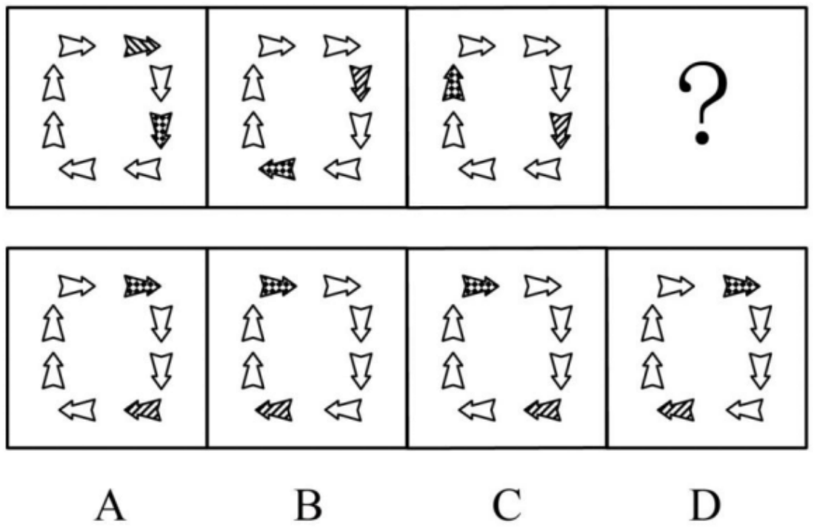

**47.** 下列选项中最符合所给图形规律的是（）。

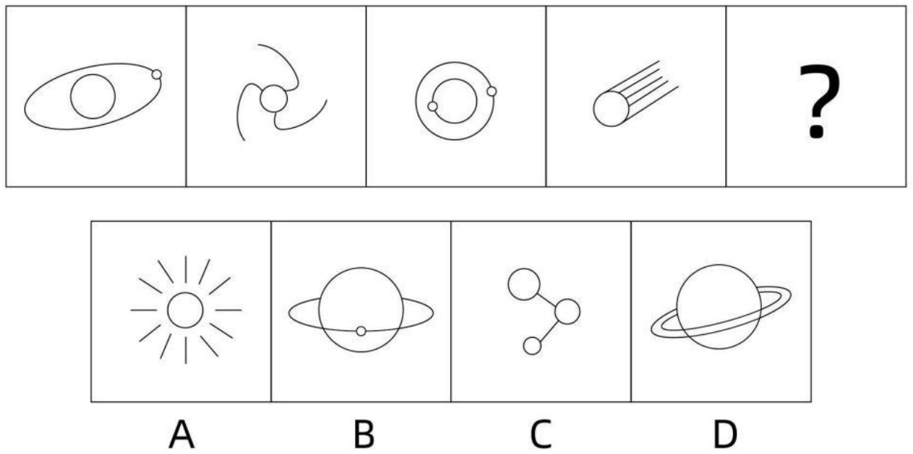

**48.** 下列选项中最符合所给图形规律的是（）。

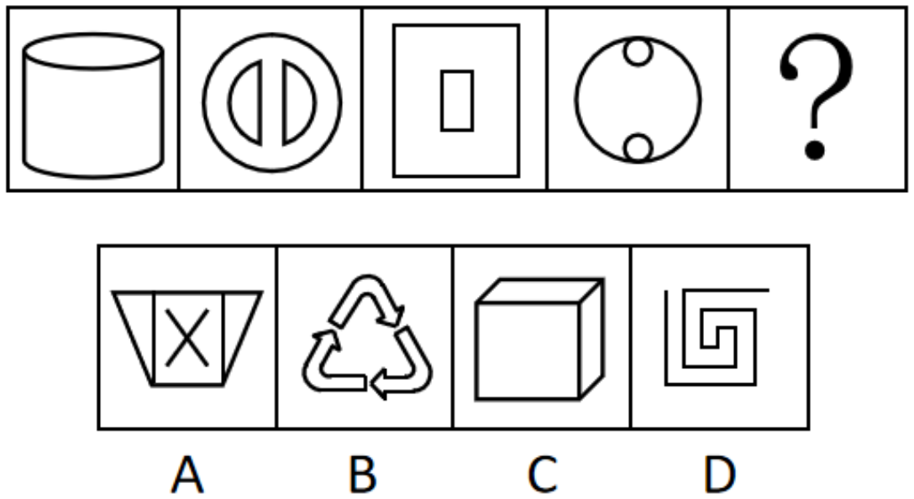

**49.** 下列选项中最符合所给图形规律的是：

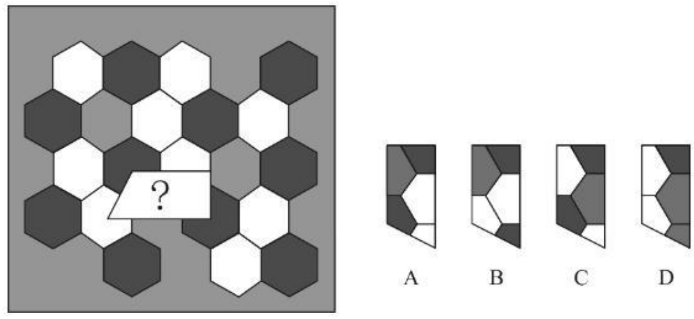

**50.** 下列的三个视图是观察某一多面体得到的，则该立体图形不可能是（）。

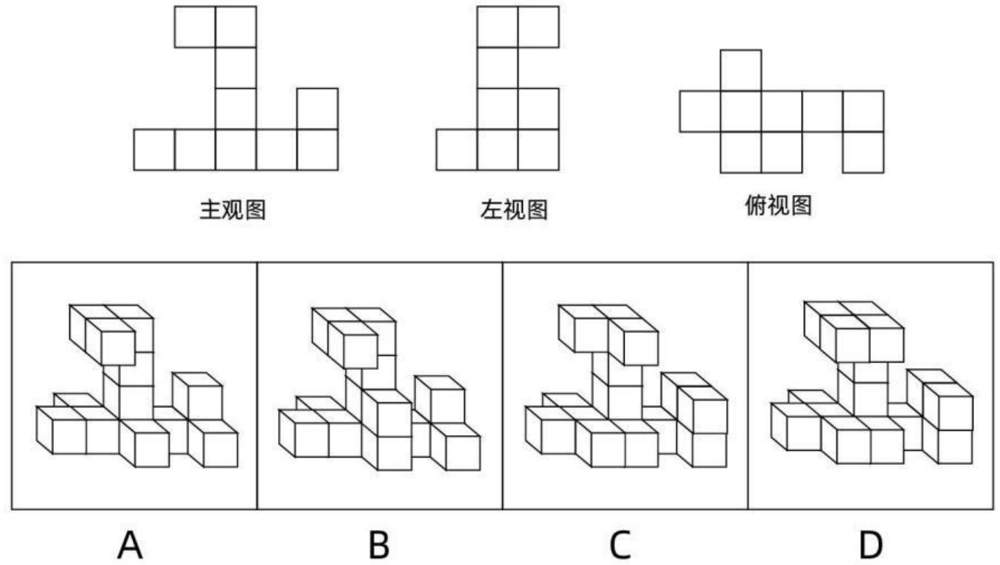

**51.** 某公司计划招聘一批员工，最不可能被录用的是学历在初中以下，或者是没有工作经历的人，在有可能被录用的人中，品德高尚的会被优先录用。
以下最有可能被该公司录用的是：

A. 老李，小学文化水平，从未放松过学习，常参加各种培训班，收获较大
B. 小张，大学应届毕业生，学习成绩优秀，品德高尚
C. 孙先生，40岁，高中文化水平，具有8年工作经验
D. 赵女士，小学文化水平，为人随和，品德高尚

**52.** 调查发现，只有平均每天摄入超过5克钠的人，才会面临心血管疾病风险，在我国接受该调查的人群中，80%的人日均钠摄入量超过5克。
如果上述调查抽样有代表性，可以推出的是（）。

A. 我国80%地区的人口面临着很高的心血管疾病风险
B. 发展中国家的人口大都面临心血管疾病风险
C. 如果某人日均钠摄入量不超过5克，他便不会面临心血管疾病风险
D. 如果某人日均钠摄入量超过5克，他一定会患心血管疾病

**53.** 村里新来一位干部，乡镇村民分别听到这位干部的如下情况：
（1）姓莫，中年，女干部，精通会计
（2）姓徐，中年，男干部，懂建筑设计
（3）姓刘，青年，男干部，熟悉农业生产技术
（4）姓昌，青年，男干部，懂建筑设计
（5）姓莫，老年，男干部，熟悉农业生产技术
每位村民听到的四项情况中各有一项正确，这位新来的干部是一位：

A. 姓刘的青年女干部
B. 姓莫的老年男干部
C. 精通会计的干部
D. 懂建筑设计的干部

**54.** 某企业计划组织员工参观文化馆、档案馆和博物馆，但由于时间有限，这三个场馆不能都去。因此，有3名员工提出了以下建议：
甲：文化馆和档案馆之间距离很远，最多只去其中一个。
乙：档案馆和博物馆都有主题展览，两个都应该参观。
丙：去年已经组织参观过文化馆，今年就不去了。
结果发现，只有1名员工的建议被采纳，则下列判断必然正确的是（）。

A. 该企业一定去了档案馆
B. 该企业一定没去档案馆
C. 该企业一定去了博物馆
D. 该企业一定没去博物馆

**55.** 细颗粒物指数是空气污染程度测控的重要指标之一，环境评估报告显示，某市去年的细颗粒物指数比十年前翻了两番，由此可见，该城市污染比十年前严重了。以下选项如果为真，最能有效削弱上述推论的是（）。

A. 该市的常住人口数量是十年前的5倍
B. 调查表明，该市居民对城市环境的满意度比十年前显著提高
C. 该市的空气碳化物含量及地表水污染指数等指标均较十年前显著下降
D. 受高气压影响，近期该市的大气污染物比较集中，难以散去

**56.** 全球气候变暖给人类带来诸多影响的同时也影响着地球上的其他生物，降水的增加可以改善植被，从而有利于鼠类的增长。研究表明，降水的增加使原本干旱的内蒙古地区植物更加丰富，也增加了鼠类的食物，长爪沙鼠数量随之增加。
以下最能削弱上述论断的一项是（）。

A. 据统计，一些地区的植被覆盖率并没有增加
B. 据测算，全球沙漠化面积近年有所增加
C. 内蒙古地区植被的增加和近年的生态保护有很大关系
D. 植被的增加使各种动物包括鼠类的天敌都增加了

**57.** 据统计，自1901年起共有786位男性和44位女性科学家获得诺贝尔奖。这一男女比例为18：1。其中，在经济学和物理学领域，几乎没有女性科学家获奖。据此，诺贝尔奖存在着严重的性别歧视。
以下最能削弱上述结论的一项是：

A. 能否获得诺贝尔奖不是衡量工作潜能的唯一标准
B. 女性从事科研工作的人数远远低于男性
C. 近些年，诺贝尔评审委员会中女性评委的人数不断提高
D. 其他的国际科学大奖也存在此类获奖者男女失调的现象

**58.** 在我国历史上，北魏时期的佛教造像艺术风格中，“秀骨清像”与“褒衣博带”并存，佛教造像的艺术特点一定程度反映了这一时期人们的审美偏好，由此可以推测，北魏时期人们的审美偏好是不一样的。
以下最能够支持上述推论的是（）。

A. 北魏时期大众审美偏好受到佛教造像艺术特点的影响
B. 某一佛教造像不可能兼具“秀骨清像”和“褒衣博带”的风格
C. “秀骨清像”与“褒衣博带”是两种迥然不同的佛教造像艺术风格
D. 北魏时期，“秀骨清像”与“褒衣博带”的造像常共存于同一石窟中

**59.** 一个国家，如果不树立底线思维，那么将无法防范化解各种风险挑战。如果一个国家无法保持社会长期稳定，就不可能实现高质量发展。因此，一个国家想要实现高质量发展，必须树立底线思维。要使上述结论成立，需要补充的前提是（）。

A. 防范化解各种风险挑战是保持社会长期稳定的必要条件
B. 树立底线思维是保持社会长期稳定的充分条件
C. 只要防范化解各种风险挑战就能保持社会长期稳定
D. 只要防范化解各种风险挑战就能实现高质量发展

**60.** 某县政府部门工作人员表示：“总的来说，我县居民的家庭经济困难情况比起以前更加严峻了。这种情况十分明显，因为我们县居民申请最低生活补助的人数越来越多了。”
以上结论基于的假设是：

A. 金融危机使得很多下岗工人面临家庭经济困难的问题
B. 许多人不找工作，所以申请最低生活补助的人就多了
C. 尽管有的居民有工作，但是他们仍然申请了最低生活补助
D. 是否申请最低生活补助是判断一个家庭经济是否困难的重要标志

**61.** 有研究表明，运动，特别是大量运动，会提高人体内血清基的水平。在某种程度上，人的心情由体内血清基的水平决定。抗抑郁药物可以通过提高体内血清基的水平来起作用。
下列论断一定正确的是（）。
Ⅰ.提高体内血清基水平，要么大量运动，要么吃抗抑郁药物。
Ⅱ.人的心情，可能由运动量决定，也可能受抗抑郁药物影响。
Ⅲ.大量运动会影响人的心情，或影响抗抑郁药物的疗效。

A. Ⅰ
B. Ⅱ
C. Ⅰ和Ⅱ
D. Ⅱ和Ⅲ

**62.** 如果日出前出现鲜红的朝霞，那么今天会下雨。今天下雨了，所以今天日出前出现了鲜红的朝霞。
以下与上述推理在结构上最为相似的是（）。

A. 如果冬天有瑞雪，那么来年一定会丰收。今年丰收了，所以去年冬天有瑞雪
B. 长时间下雨，突然起了大雾，大雾过后必定是晴天。大雾过后出现了晴天，是因为大雾前长时间下雨
C. 如果立秋这天下雨，接下来百天内不会有霜冻。立秋之后出现了霜冻，那么立秋这天下雨了
D. 如果今天早上露水多，那么明天就会是晴天。今天早上没有露水，明天一定不会是晴天

**63.** 电话手表越来越受家长和小朋友的青睐，它能让孩子随时随地与家长进行通话，并且带有GPS定位功能，能够让家长很方便地知道孩子的位置。但是，电话手表还是应该被禁用，这是因为一些电话手表带有游戏功能，可能会对孩子的学习造成影响。
下列选项，与上述论证过程最为类似的是（）。

A. 大多数电动汽车都存在续航问题，所以我不会买电动汽车
B. 小张的经济收入并不稳定，这导致了他很容易出现入不敷出的情况
C. 小赵工作很勤奋，但这并不意味着他能高效地完成工作
D. 虽然同样具有节能功能，但另一个品牌空调的节能效果要比您选的这一款更好，所以我建议您购买另一款

**64.** 某教育机构在选拔学生的时候提出：我们录取学生，不看他的学习成绩，而是看他的潜力。有的同学各科成绩都很好，但是我们仍要怀疑他未来的发展空间。
以下和该教育机构选拔学生的逻辑最不一样的是（）。

A. 投资公司在评价项目的时候，主要看行业的发展前景
B. 小王在交朋友的时候，主要看对方的家庭条件好不好
C. 某专业就业相对困难，小张很感兴趣但是并没有选择报考
D. 老王判断某地房价将会持续上涨，在该地投资买了一栋房子

**65.** 某地区自上世纪70年代开始，引入栽种欧美黑杨，用于造纸。这些欧美黑杨适应当地气候环境，生长速度快，种植面积迅速扩大。然而近年来，当地生态环境问题日趋严重。因此有人认为，可以通过砍掉这些欧美黑杨来修复该地区生态环境。
以下选项最能指出上述论述缺陷的是（）。

A. 假设了有其他的作物可以替代欧美黑杨的经济价值
B. 忽视了该地区引入栽种的其他外来植物也会影响生态环境
C. 假设了该地区引入的欧美黑杨栽种面积远超当地树种面积
D. 默认了欧美黑杨种植面积扩大和生态环境问题间存在因果关系

## 第六部分　科学推理

**66.** 下列能正确反映自由落体速度随时间变化的图像是：

A. 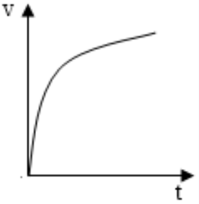
B. 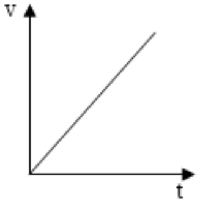
C. 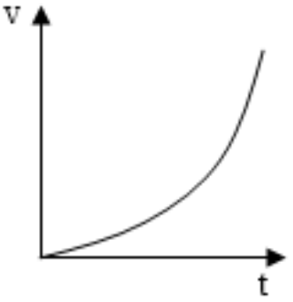
D. 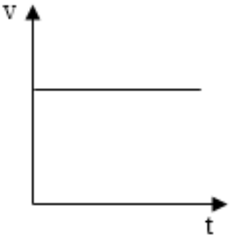

**67.** 将瘪了的乒乓球放在热水里一段时间后，乒乓球便会恢复原来的圆形状态。其原理是（）。

A. 乒乓球内部气体溢出，内部气体减少
B. 乒乓球受热后球壁变软，恢复原来形状
C. 乒乓球内部气体受热膨胀，挤压乒乓球内壁
D. 水蒸气流入乒乓球内部，乒乓球内部压强增大

**68.** 某蔬菜种植户在农田中种植圆白菜时，采取了以下措施。关于这些情形的解释最不准确的是：

A. 圆白菜和玉米间作套种——提高农田利用率
B. 育苗时覆盖地膜——提高地表温度、保持土壤湿度
C. 长期使用化肥——可就地取材，并能改良土壤结构
D. 移栽圆白菜幼苗时带着土坨——保护幼根和根毛

**69.** 如图所示，一个装有水的杯子中悬浮着一个小球，杯子放在斜面上，该小球受到的浮力方向是（）。

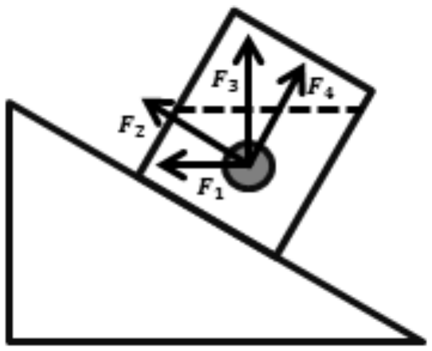

A. F1
B. F2
C. F3
D. F4

**70.** 将如图所示卡片面向平面镜时，则该卡片在平面镜中的成像最可能是：

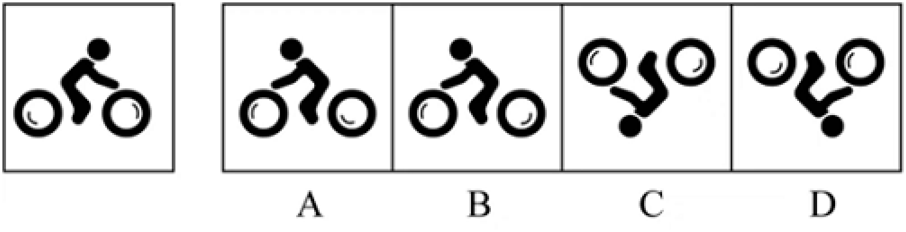

## 第七部分　资料分析

城市综合竞争力十年间(2002年-2011年)的区域变化(单位：个)

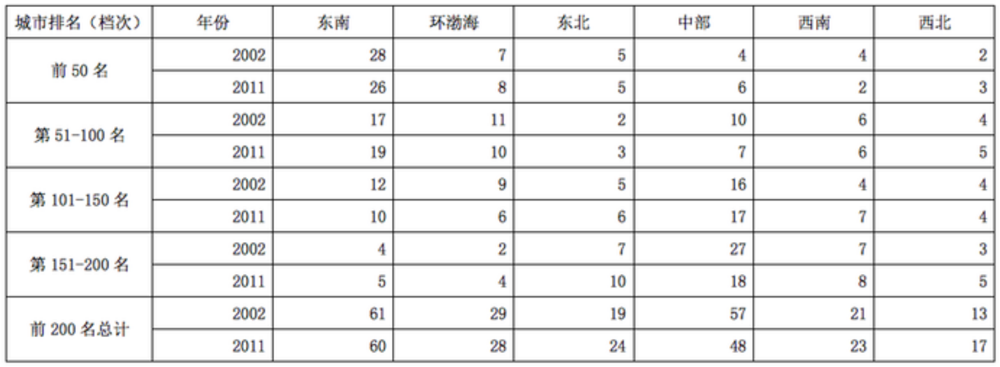

城市综合竞争力十年间(2002年—2011年)不同规模城市数量变化(单位：个)

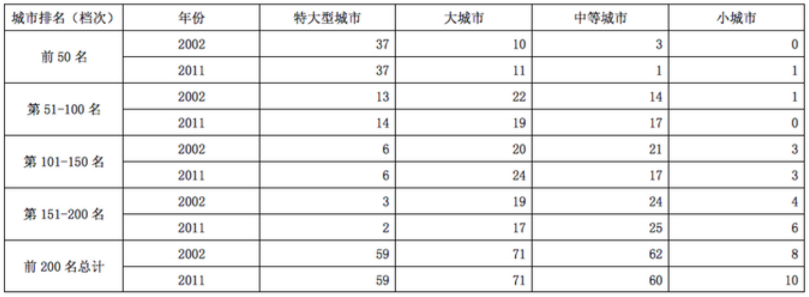

**71.** 与2002年相比，2011年西北地区进入城市综合竞争力前100名的城市增加了（）个：

A. 1
B. 2
C. 3
D. 4

**72.** 与2002年相比，2011年（）地区的城市综合竞争力前200名的城市数量下降最为显著。

A. 环渤海
B. 东南
C. 中部
D. 西南

**73.** 2011年，城市综合竞争力前50名中的特大型城市，至少有（）个位于东南地区：

A. 11
B. 13
C. 18
D. 无法判断

**74.** 十年间，与其他规模的城市相比，（）在各个排名档次内的城市数量变化幅度最小。

A. 特大型城市
B. 大城市
C. 中等城市
D. 小城市

**75.** 根据资料，以下有关2011年城市综合竞争力排名的描述无法判断的是：

A. 排名第101—200名的城市主要为大城市和中等城市
B. 排名第101—200名的城市有1/3以上集中在中部地区
C. 与十年前相比，西南和东南地区均有城市跌出城市综合竞争力前50名
D. 排名前200名的城市中，近1/4数量的城市属于中部地区的大城市和中等城市

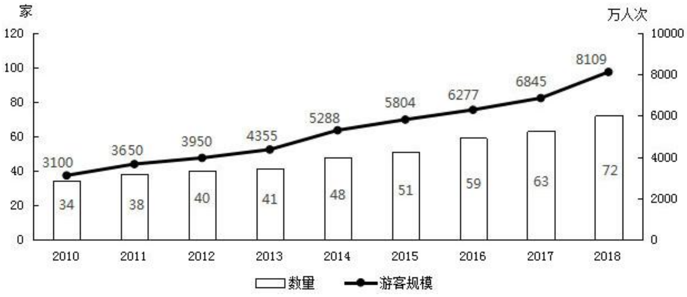

图1　2010-2018年我国海洋主题公园年末数量及全年游客规模

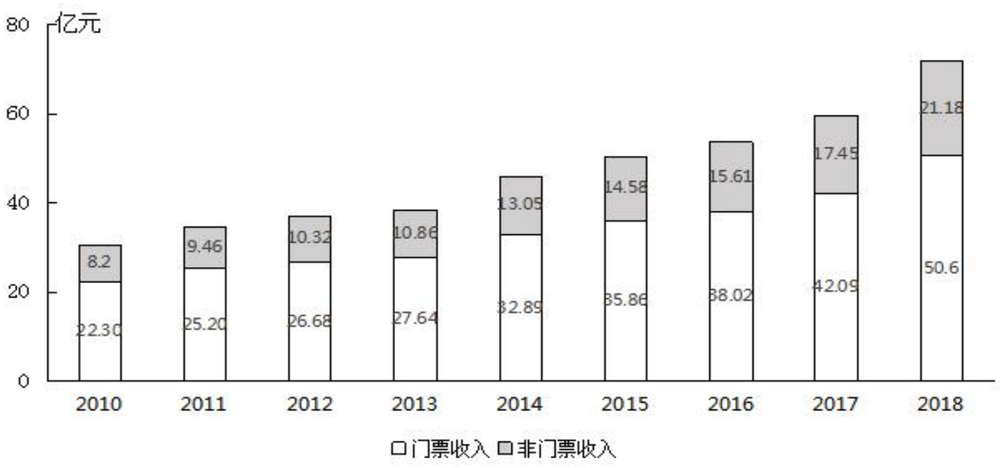

图2　2010-2018年我国海洋主题公园收入构成

**76.** 2018年我国平均每家海洋主题公园全年游客规模比2010年：

A. 减少了30万人次以上
B. 增加了30万人次以上
C. 减少了30万人次以内
D. 增加了30万人次以内

**77.** 已知2011年初～2018年末我国所有开业的海洋主题公园都持续营业，则该期间我国平均约多长时间新开一家海洋主题公园？

A. 两个半月
B. 两个月
C. 三个半月
D. 三个月

**78.** 2011～2018年间，我国海洋主题公园非门票收入同比增速超过10%的年份有几个？

A. 5
B. 6
C. 3
D. 4

**79.** 2016年我国海洋主题公园平均每名游客创造的门票收入比非门票收入多约多少元？

A. 42
B. 48
C. 30
D. 36

**80.** 关于我国海洋主题公园状况，能够从上述资料中推出的是：

A. 2013～2017年间累计游客规模超3亿人次
B. 2013年平均每家海洋主题公园的门票收入高于上年水平
C. 2011～2018年间，年末公园数量同比增量和游客规模同比增量最大的年份不是同一个
D. 2014年海洋主题公园总收入比上年增长了8亿多元

2014年1—5月，我国软件和信息技术服务业实现软件业务收入13254亿元，同比增长20.9%，比去年同期回落3.3个百分点。其中，软件产品完成收入4141亿元，信息系统集成服务完成收入2649.3亿元，信息技术咨询服务完成收入1399.2亿元，数据处理和运营服务完成收入2429.5亿元，嵌入式系统软件完成收入2230.3亿元，IC设计完成收入405.1亿元。

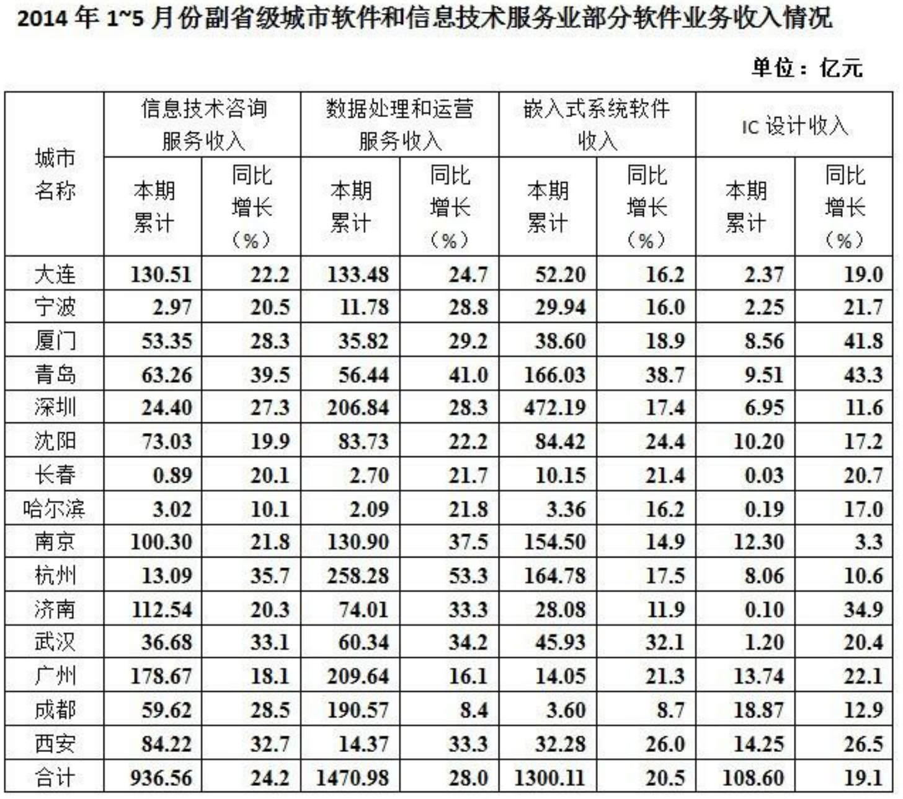

**81.** 2014年前5个月完成收入排名前三的软件业务，同期完成收入占我国软件业务总收入的比重约为：

A. 61.8%
B. 69.6%
C. 81.2%
D. 86.5%

**82.** 2014年1～5月，表中四项软件业务收入之和最高的东北地区副省级城市是：

A. 大连
B. 长春
C. 沈阳
D. 哈尔滨

**83.** 2014年1－5月，副省级城市哪项软件业务完成收入之和低于该业务全国总收入的一半：

A. 数据处理和运营服务
B. 信息技术咨询服务
C. 嵌入式系统软件
D. IC设计

**84.** 2014年1～5月，信息技术咨询服务收入同比增速最快的副省级城市，该项收入约是增速最慢的副省级城市的多少倍：

A. 21
B. 4
C. 201
D. 70

**85.** 关于2014年1～5月副省级城市软件业务收入，能够从上述资料中推出的是：

A. 广州市的四项业务收入在副省级城市中均排名前三
B. 武汉市的四项业务收入增速均高于副省级城市平均水平
C. 深圳市IC设计业务收入超过副省级城市该项业务收入的平均水平
D. 数据处理和运营服务收入与嵌入式系统软件收入最高的副省级城市是同一个

2013年末全国共有群众文化机构44260个。比上年末增加384个，其中乡镇文化站34343个，增加242个。年末群众文化机构从业人员164355人，比上年末增加8127人，群众文化机构实际使用房屋建筑面积3389.4万平方米。比上年末增长6.9%，年末群众文化机构共有馆办文艺团体6022个，演出15.13万场，观众6569万人次。

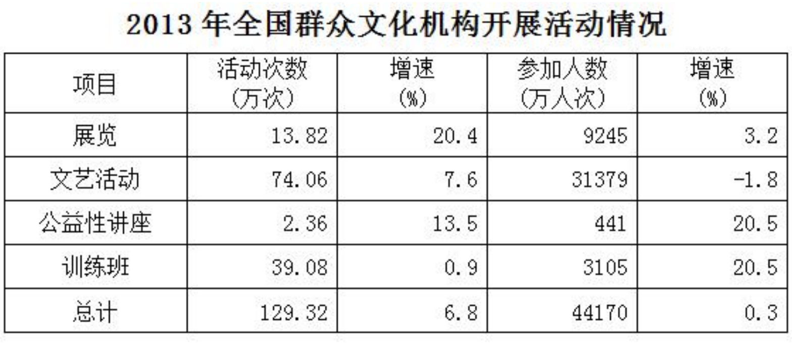

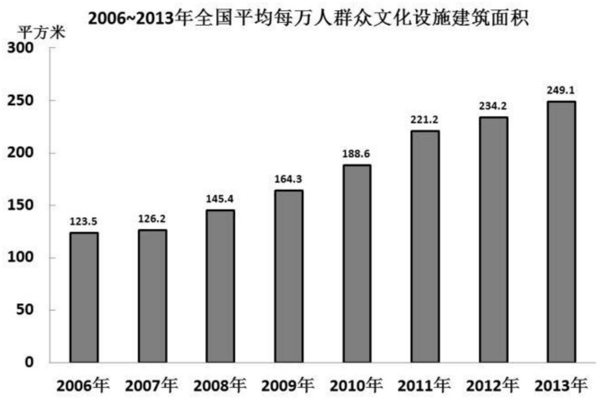

**86.** 2013年末全国群众文化机构数量同比约增长了：

A. 8%
B. 3%
C. 0.9%
D. 0.4%

**87.** 2013年每个馆办文艺团体平均每月演出约多少场：

A. 25
B. 12
C. 5
D. 2

**88.** 2013年群众文化机构开展的活动中，平均每次活动参加人数最多的是：

A. 展览
B. 文艺活动
C. 公益性讲座
D. 训练班

**89.** 2007－2013年间，平均每万人群众文化设施建筑面积同比增速高于10%的年份有几个？

A. 5
B. 4
C. 3
D. 2

**90.** 能够从上述资料中推出的是：

A. 2013年文艺活动的参加人数约是公益性讲座的50倍
B. 2012年末全国群众文化机构共有从业人员16万多人
C. 2013年全国人均群众文化设施建筑面积比2006年翻了一番
D. 2013年乡镇文化站占群众文化机构总数的比重高于上年水平
