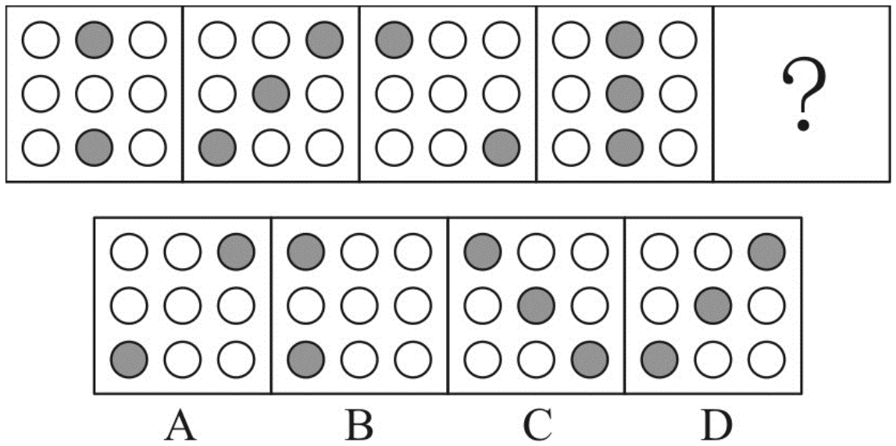
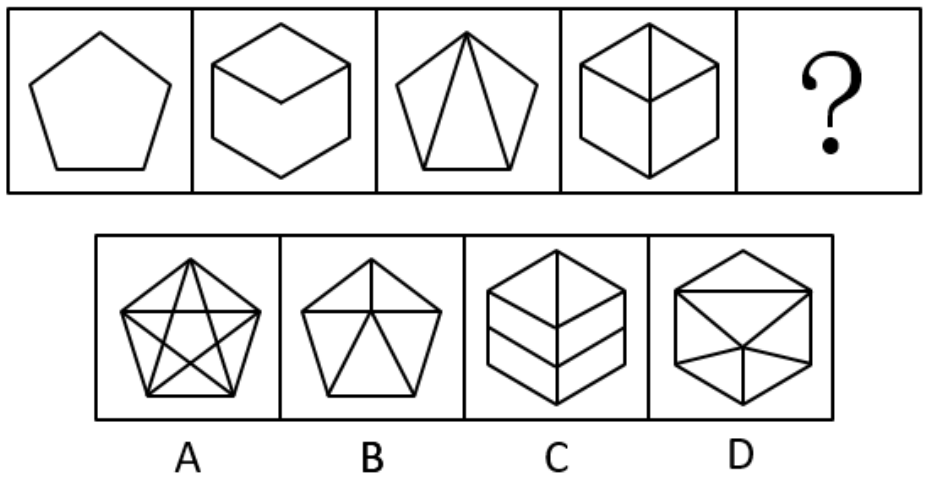
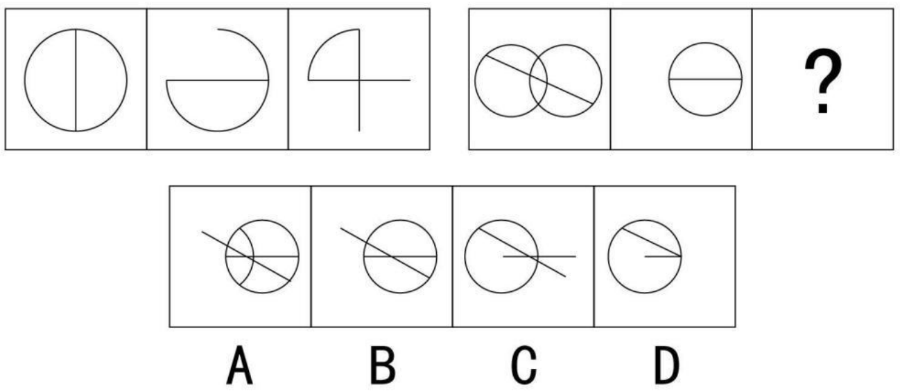
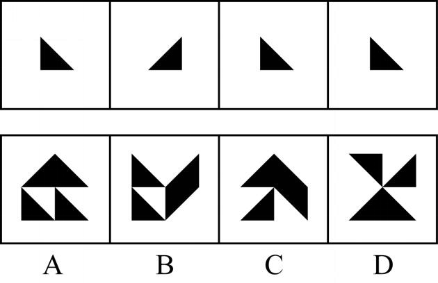
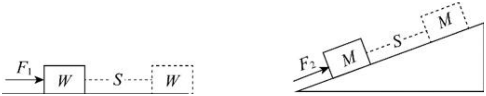
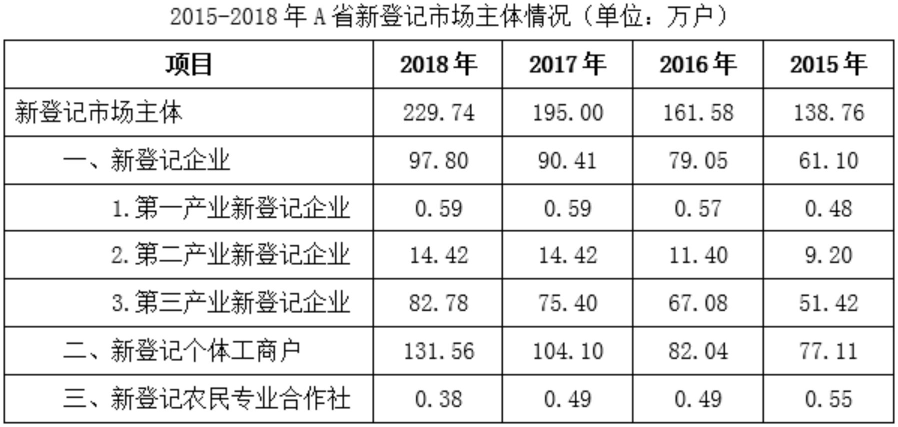
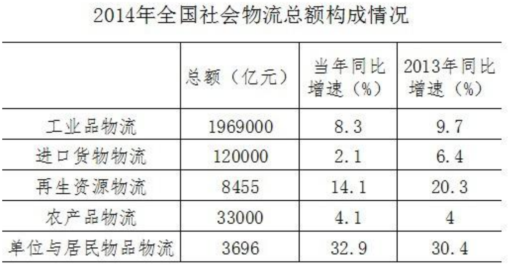
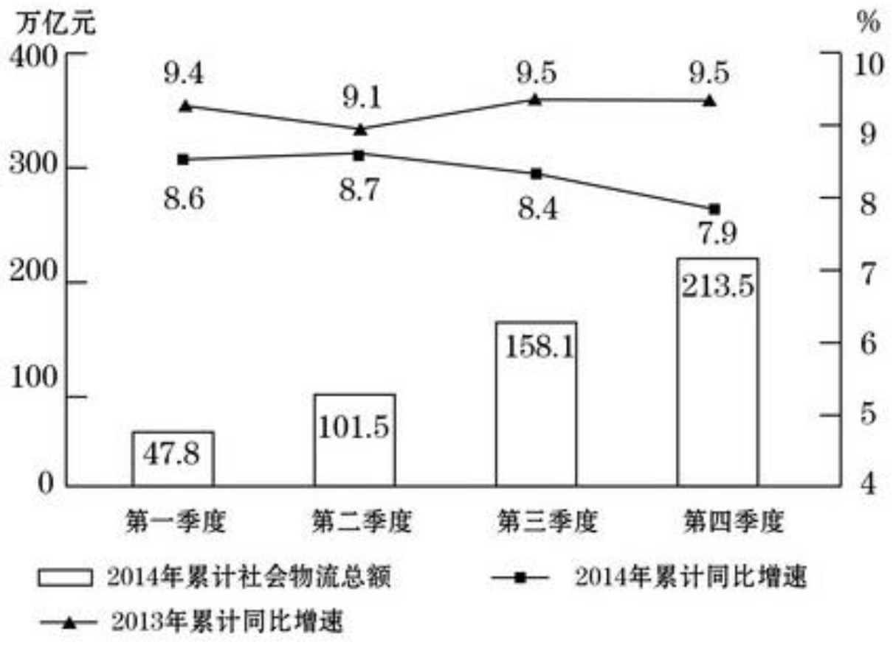
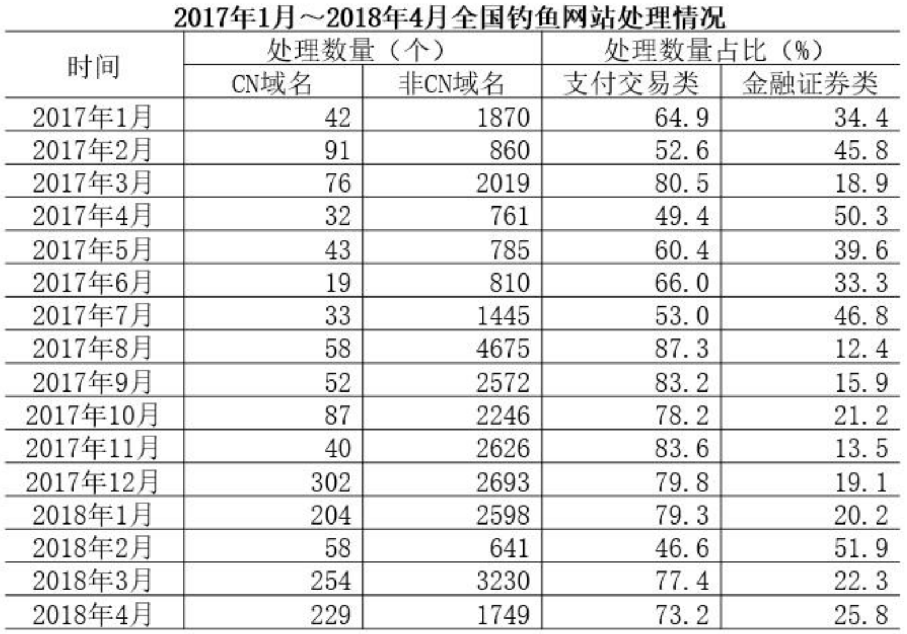

# S07　广东省考行测模拟卷（题本）

## 第三部分　言语理解与表达

**16.** 我国许多传统的老字号药店，____在最困难的情况下，也在千方百计地保证药品的____。
依次填入画横线部分最恰当的一项是：

A. 即使 质量
B. 即使 性能
C. 纵使 性质
D. 尽管 功效

**17.** “报得准”是气象监测预报预警的生命力。天气预报准确率高，防灾减灾才能____，为有关部门正确决策提供科学客观的支撑，应急处置才能有力有效。
填入画横线部分最恰当的一项是：

A. 有条不紊
B. 有的放矢
C. 全力以赴
D. 万无一失

**18.** 打通实体经济与金融服务之间的（），提升经济社会运行效率，才能让金融这一经济血脉融入到实体经济的高质量发展中去，（）国民经济循环，持续激发经济活力。

A. 障碍 联通
B. 梗阻 畅通
C. 妨碍 贯通
D. 阻碍 疏通

**19.** 农村电网（）升级，事关广大农村地区的长远发展。
填入空格处最恰当的一项是：

A. 改造
B. 改线
C. 改变
D. 改良

**20.** 物品的预设用途为用户提供了该如何操作的线索，比如平板是用来推的，旋钮是用来转的。如果物品的预设用途在设计中得到____体现，用户一看便知如何操作，无须借助任何的图解、标志和说明。如果简单物品也需要用图解、标志和说明书来____操作方法，这个设计就是____的。
依次填入画横线部分最恰当的一项是：

A. 全面 呈现 粗糙
B. 有效 指导 落伍
C. 充分 解释 失败
D. 合理 演示 笨拙

**21.** 随着全球气候变暖、冰层融化，南北极所蕴含的巨大能源资源、航道优势等被充分发掘出来，其战略意义愈发凸显。据估算，仅北极地区的煤炭、石油、天然气储量就分别占到全世界潜在储量的25%、13%、30%。同时，极地的战略位置也尤为重要。如今，为赢得竞争优势，不仅美国、俄罗斯、加拿大等极地国家纷纷根据各自的国家利益制定极地战略，而且一些非极地国家和集团也积极参与极地事务，使得极地地区形势骤然变化。作为新兴战略热点，围绕极地尤其是北极地区的国际斗争将日趋复杂和激烈。
这段文字意在强调：

A. 大国的积极参与使得极地地区形势复杂化
B. 各国应从全球战略高度看待极地地区问题
C. 围绕北极地区的国际斗争即将拉开帷幕
D. 极地成为世界各国战略博弈的热点地区

**22.** 从政策沿革来看，行业出现产能过剩时，治理政策通常先从拉动内需的角度去设计。实际上，
________________。许多基础设施比较薄弱的新兴市场经济国家对传统产业产能需求还非常大，外部市场正在帮
助解决内部需求不足的问题。
填入划横线部分最恰当的一项是：

A. 外部需求也是化解产能过剩的突破口
B. 化解产能过剩还要更多依靠市场机制
C. 化解产能过剩必然是个长期的过程
D. 一味依赖市场扩容也仅仅是缓兵之计

**23.** 语言和文化一样，很少是自给自足的，故词语的借用自古至今都是常见的语言现象。但当外来词汇进入
一个国家后，当地民族会在适应吸收新成分的同时，不自觉地变异和改造其原貌。随着时间的推移，外来词会逐
渐本土化，日久天长，源流模糊，体用隔断，变异迭生。一旦借词身上的“异域特征”（诸如音素、音节的构成等）
在使用者的意识里淡化或消失，它们就会被当地人视为自己母语中的一部分。
这段文字重在说明：

A. 外来词汇对本民族语言和文化的影响
B. 本民族语言吸收改造外来词汇的方式
C. 外来词汇使用的普遍性及本土化过程
D. 外来词汇在母语中淡化与消失的原因

**24.** 当炫耀式旅游成了目的，扎堆往知名景点挤，也就在意料之中，其实旅游作为一种现代的生活方式，可以有多样化的功能。如果是为了教育，可以带孩子去看名山大川、古城遗迹，帮助他们了解国家的历史和文化传统；如果是为了休闲放松，可以去海边、深山，或者就近选择市郊的农家小院，能短暂逃避尘世喧嚣就好。理性面对旅游目的，寻找合适的度假所在，才是健康的旅游观念，才能更好地享受旅游的快乐。旅游观念转型升级，旅游市场分化，人满为患的现象才可能消失，旅行中的快乐亦会更加醇厚。
根据这段文字，旅游观念的“转型升级”指的是：

A. 实现多样化的功能
B. 理性面对旅游目的
C. 赋予旅游实际意义
D. 享受旅行中的快乐

**25.** 国产纪录片的成长与蜕变，最核心的力量来自纪录片在内容和形式上的突破。时下，越来越多的纪录片开始告别昔日高大上的形象，注重观照现实生活，剖析社会问题，描述普通人的日常，让观众感受到更多人文关怀，获得了更多情感共鸣，其中不少题材紧跟当下热点，富有强烈的时代感。
这段文字主要说明了（）。

A. 国产纪录片通过内容和形式上的突破取得了进步
B. 富有强烈的时代感是国产纪录片成功的必备条件
C. 过去的国产纪录片往往具有高大上的形象
D. 国产纪录片应体现更多的人文关怀

**26.** 当前，社会治理形势复杂，仅靠职能部门、专业力量远远不够，迫切需要人民群众和社会各界的积极支持与参与，共同创造公共价值。众包是公众和外包的组合词，意指发包方依托互联网或其衍生工具，在数字平台上设计规则与任务并向广泛、非确定的公众发包，公众根据自身能力自愿接包并完成特定事务。众包强调大众参与的开放式合作，促使组织边界向更广泛的大众群体开放，旨在挖掘隐藏在公众中的巨大潜力。因此，相较于政府购买等专业性较强的政府合同外包服务，政府众包展现出更开放的社会治理格局。
最适合做这段文字标题的是：

A. 众包：共享经济下的新型用工模式
B. 政府众包：公众参与社会治理新方式
C. 公众参与：开放式合作的新形式
D. “互联网+”：公共管理新范式

**27.** 南京在历史上的名字变化或褒或贬，根本源头在于统治者的好恶。不惟南京，同样原因也引发了其他地名的变迁，宋廷平定方腊起义之后，深恨江南百姓造反，艺术修养最高的皇帝宋徽宗遂在地名上做文章：方腊的两个活动区域，歙州被改成徽州，取的是“徽”的本意“捆绑束缚”；睦州则被改成严州，意思更是不言自明的。相比之下，朱元璋为避国号讳，取“海定则波宁”之义，将明州改成宁波，已是很“友好”了。
这段文字主要介绍了：

A. 地名变迁背后的政治因素
B. 历史事件对地名的影响
C. 古代帝王在地名方面的偏好
D. 统治者对某些地域的好恶

**28.** ____。我们党当初为什么要创办中央党校？就是为人民解放事业培养骨干力量。90年来，各级党校特别是中央党校与党的事业同频共振、按需施训，教育培训了一批又一批领导干部，肩负起为党育才的神圣职责，推动党的事业从胜利走向新的胜利。例如，党校创办初期，马克思共产主义学校一年多时间里共培训了1000多名干部；延安时期，中央党校常规班次培养各类骨干上万人，其中约65%的七大代表有中央党校的学习工作经历。党的十八大以来，中央党校举办的主体班次共培训轮训干部8.8万人，其中省部级干部1.3万余人。
填入画横线部分最恰当的一项是：

A. 党校是领导干部锤炼党性的“大熔炉”
B. 党校是干部教育培训的主阵地
C. 党校是传承党的精神血脉的殿堂
D. 党校是党的意识形态工作的重要前沿阵地

**29.** 要达成科学上的一致见解，道路是曲折的，会历经许许多多的死胡同。偶尔，人们最后发
现，那个独辟蹊径的人才是正确的——大家乐见其成，但这样的案例比我们想象的要少得多，甚至
比媒体报道的还要少。有时，新的发现推翻了先前的共识。但绝大多数时候，科学的进步是超越并
拓展了过去的概念，而非提出相反的概念。例如，爱因斯坦并没有“推翻”牛顿。他只是超越了牛
顿，为理解空间、时间和引力提供了一个全新的、更为广阔和深刻的视角。
下列说法与文意不符的是：

A. 科学的发展进步大多是在前人基础上的超越
B. 独辟蹊径并且取得成功在科学界其实非常难
C. 新发现推翻先前共识是科学界经常发生的事
D. 许多科学发展并非建立在颠覆原有的认知上

**30.** ①中国企业若想出口稀土产品，必须向行业巨头缴纳高额的专利许可费，否则产品无法出口
②稀土永磁材料领域的研发重点包括提高材料性能、扩大高端领域应用等；稀土发光材料领域的技术创新点集中在光电材料、反光材料等
③经历了被人“扼住咽喉”的切肤之痛后，我国稀土企业的创新脚步愈加快速
④然而在很长一段时间内，我国的稀土企业在国际市场处于受制于人的局面
⑤多年来，在与世界各国的“稀土大战”中，我国凭借世界第一的稀土储量，逐步在开采、分离技术领域确立了全球领先的地位
⑥目前，我国稀土领域的创新主要集中于产业链上游的稀土材料领域，多家企业重点发展具有超高性能的稀土永磁材料、稀土发光材料等
将以上6个句子重新排列，语序正确的是：

A. ⑥④①③⑤②
B. ⑤④①③⑥②
C. ⑤⑥②①④③
D. ⑥②⑤④①③

## 第四部分　数量关系

**31.** 160，80，40，20，（    ）

A. 4
B. 6
C. 8
D. 10

**32.** 11，18，25，32，（    ）

A. 34
B. 37
C. 39
D. 41

**33.** 19、38、57、76、95、（    ）

A. 114
B. 133
C. 171
D. 190

**34.** -1 3 -3 5 -5 7（    ）

A. 7
B. 8
C. -7
D. -8

**35.** 5 15 45 135（    ）

A. 185
B. 225
C. 355
D. 405

**36.** 某企业有员工500人，其中60%的员工是男性，则该企业男员工比女员工多多少人：

A. 100
B. 200
C. 300
D. 400

**37.** 某烟农晾晒一批重量为500斤的烟叶，晾晒期间有3天阴天，其余时间天气晴好，最后收获干烟叶约187斤。已知晴天时烟叶每天较前一天减重20%，阴天时每天较前一天减重10%。
则这批烟叶一共晾晒了多少天：

A. 5
B. 6
C. 7
D. 8

**38.** 老吴从家里出发乘车到银行办理业务，回城时步行，往返共用了45分钟。如果老吴往返都乘车，则只需花30分钟。那么，如果老吴往返时都选择步行，需要花（）分钟。

A. 45
B. 50
C. 55
D. 60

**39.** 做同一种零件，赵师傅3小时做15个，钱师傅4小时做21个，孙师傅5小时做27个，李师傅6小时做31个，则（）的工作效率最高。

A. 赵师傅
B. 钱师傅
C. 孙师傅
D. 李师傅

**40.** 小李今天上午有a、b、c、d这4项工作要完成，下午有e、f、g这3项工作要完成，每半天内各项工作的顺序可以随意调整，则他今天有（）种完成工作的顺序。

A. 30
B. 60
C. 72
D. 144

**41.** 某单位共有8名安保队员，并根据序号每天安排2名队员轮流值班：第一天由队员1、2负责值班；第二天由队员3、4负责值班……以此类推。如果队员3今天负责了值班，则他将在（）天后再次负责值班。

A. 4
B. 5
C. 6
D. 7

**42.** 某单位举办活动，需要制作8米长的横幅20条。用来制作横幅的原料有两种，一种每卷10米，售价10元；另一种每卷25米，售价23元。如果每卷原料截断后无法拼接，则该单位购买横幅原料最少需要花费多少元：

A. 146
B. 158
C. 161
D. 200

**43.** 小陈家住在5楼，他每天上下楼各一次，共需走120级楼梯。后来小陈家搬到同一栋楼的8楼，如果每层楼的楼梯级数相同，则他搬家后每天上下楼一次共需走楼梯多少级？

A. 168
B. 192
C. 210
D. 240

**44.** 小王到某单位办事，只有一个窗口在办理业务，小王排在第6位，第一位客户开始办理业务的时间为9:02。假如每单业务的办理时间为6分钟，而且排在小王前面的人不会提前离开。那么小王在什么时候可以开始办理业务？

A. 9:32
B. 9:38
C. 9:45
D. 9:52

**45.** 某地民政部门对当地民间组织进行摸底调查，发现40%的民间组织有25人以上规模，20个民间组织有50人以上规模，80%的民间组织不足50人，人员规模在25人以上但不足50人的民间组织数量有（）个。

A. 20
B. 40
C. 60
D. 80

## 第五部分　判断推理

**46.** 下列选项中最符合所给图形规律的是（）。

**47.** 下列选项中最符合所给图形规律的是（）。

**48.** 下列选项中最符合所给图形规律的是（）。

**49.** 左边给定的是六面体的外表面展开图，右边哪一项能由它折叠而成？

**50.** 右边四个图形中，只有一个是由左边的四个图形拼合（只能通过上、下、左、右平移）而成的，请把它找出
来。

**51.** 某市为解决市民住房问题，向社会提供多种公共住房，如仅供租赁的公租房、具有自有性质的安居房以及定向租赁给企业人才的人才房等。但申请公共住房有以下规定：
①拥有该市户籍才能申请租赁公租房和购买安居房。
②租赁公租房、人才房期间可以申请购买安居房。
③已有房产者不得申请租赁公租房、人才房和购买安居房。
④租赁公租房、人才房期间，若购买安居房或商品房的，则必须退租公租房、人才房。
⑤不得买卖公租房或人才房。
则下列情形符合该市规定的是（）。

A. 小王没有该市户籍且没有房产，成功申请租赁人才房
B. 小周在当地购买了商品房，并成功申请租赁了公租房
C. 小李拥有该市户籍且没有房产，成功申请购买公租房
D. 小陆在当地购买安居房后，没有退租原来租赁的人才房

**52.** ETC是我国高速公路使用的不停车收费系统。事实上，所有需要停车缴费的场合，都可以借助ETC实现不停车缴费，而不仅限于在高速公路使用。
根据上述表述，下列判断一定错误的是（）。

A. 高速公路是需要停车缴费的场合
B. 有的高速公路无法借助ETC实现不停车缴费
C. 有的需要停车缴费的场合，可以借助ETC实现不停车缴费
D. 能够借助ETC实现不停车缴费的场合，可能是需要停车缴费的场合

**53.** 一座城市要想发展好会展产业，就需要“筑巢引凤”——先具备软硬件基础，再吸引会展活动。拥有完备的会展设施和理想的交通条件，只是说明一座城市具备了发展会展产业的硬件基础，要想吸引足够数量的高质量会展活动，还需要提高公共服务水平、构建良好的营商环境，从而加强软实力的建设。
如果上述表述为真，则以下情况中不可能发生的是（）。

A. 甲市具备了发展会展产业的硬件基础，却发展不好会展产业
B. 乙市大力提升公共服务水平，吸引了足够数量的高质量会展活动
C. 丙市的会展产业非常发达，但市政设施老化的问题日渐突出
D. 丁市会展设施完备、交通条件理想，但未具备发展会展产业的硬件基础

**54.** 单位接到一项工作任务，领导决定从张、王、李、林、沈、赵6人中选出3人组成工作小组。工作组应符合以下3个条件：
①张、林两人中至少需要一人入选。
②王、李两人中至多能有一人入选。
③如果沈、赵两人同时入选，则王不能入选。
以下工作人员组成不符合条件的是：

A. 沈、李、赵
B. 李、张、林
C. 赵、张、王
D. 沈、王、林

**55.** 据统计，与文科专业的大学毕业生相比，理工科大学毕业生刚入职时的收入更高。因此，高中毕业生要想将来毕业后获得较高收入，应该报考理工科专业。
最能削弱上述结论的一项是：

A. 文科生最终获得高收入的比例高于理工科学生
B. 理工科专业由于知识难度大而不容易毕业
C. 如今不少年轻人更愿意按自己的兴趣选择专业
D. 有些没有读过大学的人最后成了著名的企业家

**56.** 一项研究发现：经常喝咖啡的成年人患上心脏病的概率是不常喝咖啡成年人患心脏病概率的2.5倍。由此可以判定，咖啡中的某种物质能够导致人患上心脏疾病。
以下最能削弱上述结论的一项是（）。

A. 咖啡含有提高心脏活力的成分
B. 用餐时喝咖啡有降低血脂的作用
C. 心脏病高危人群更容易爱上喝咖啡
D. 爱喝咖啡的人大都性格开朗，喜欢运动

**57.** 海水经过海水淡化技术的处理可变成淡水，而海水的量是极其巨大的。因此，无须节约使用淡水资源。
最能质疑上述结论的是：

A. 近海海水的污染比较严重
B. 海水淡化成本高昂
C. 冰川水储量巨大，可替代海水淡化
D. 地球上的水资源总量是恒定的

**58.** 某天文学研究团队对金星光谱进行研究时发现，有一条微弱的吸收线与磷化氢的特征相符，表明金星浓密的硫酸云大气中存在磷化氢分子，而在地球上，磷化氢分子来自某些大肠杆菌菌株或动物的肠道。该研究团队由此推测，金星上曾经存在生命活动。
要使上述推论成立，必须补充的前提是（）。

A. 其他研究团队在对金星光谱分析后也发现了相同的吸收线
B. 某些生物能够在地球上类似金星环境的地方生存
C. 如今金星的环境已经不适宜生命活动
D. 磷化氢这一物质只能由生命活动产生

**59.** 近年来，全国各地开展“留白增绿”行动，城市绿色空间不断拓展。一项社会学研究发现，在过去的十年中，城市中绿色空间的增加与居民的幸福感提升显著相关。研究者认为，绿色空间的增加为居民提供了更多的休闲和运动场所，是居民幸福感提升的原因之一。
上述推论暗含的前提是（）。

A. 拓展绿色空间能够有效改善城市生态环境
B. 居民幸福感的提升是城市建设的核心目标
C. 居民幸福感只受城市绿色空间规模的影响
D. 参加休闲活动和运动能够提升居民幸福感

**60.** 甲、乙两份报纸的编辑部，都有专门校对文稿的工作人员。去年，甲报纸出现了一些文字错误，而乙报纸没有文字错误。因此，在去年的校对工作中，乙报纸的校稿员比甲报纸的校稿员的工作更有成效。
以上结论基于的假设是：

A. 乙报纸校稿员的工作时间比甲报纸校稿员长
B. 甲报纸收到的稿件存在文字错误的数量不比乙报纸少
C. 甲报纸每期的版面数量比乙报纸少
D. 文字错误出现的数量是评价校稿员工作成效的标准

**61.** 一项调查表明，有38.6%的人表示记得一两岁时的经历，更有13.4%的人可以描述出自己1岁以前的家庭情景。然而，针对这些幼时记忆的分析发现，其中40%不可能是实际发生过的事情。实际上，这些2岁前的幼时记忆都是人们根据家庭照片和他人叙述而虚构出来的“伪记忆”。
根据以上表述，下列判断一定正确的是（）。

A. 2岁前的孩子不具有记忆能力
B. 在这些2岁前的幼时记忆中，有60%是实际发生过的
C. 成人容易在与儿时玩伴交谈时虚构出共同的“伪记忆”
D. 有些人可以通过家庭照片和他人叙述描述自己早期的家庭情景

**62.** 生活不只包含眼前的苟且，它至少还包含诗和远方。
根据上述表述，下列判断一定正确的是（）。

A. 生活只包含诗和远方
B. 生活可能包含伦理和政治
C. 生活可能不包含眼前的苟且
D. 生活只包含眼前的苟且和伦理

**63.** 传承中华传统文化，既要合理创新，又要保留其精华而不失本色，对京剧、昆曲来说亦是如此。
下列选项中，与上述推理结构最为相似的是（）。

A. 老师必须有教师资格证才能上岗，小朱是老师，所以小朱有教师资格证
B. 注射某种药物后，实验室小白鼠失眠情况大大改善，所以给其他动物注射这种药物也能改善其睡眠状况
C. 运动员的身体素质都很好，小吴身体强健，所以小吴很可能是运动员
D. 水是无色无味的，空气是无色无味的，所以空气和水极其相似

**64.** 几名顾客在某餐厅用餐后，出现了呕吐腹痛等症状。事件发生后，相关部门立刻将剩下的食物送去检验。结果表明，送检食物中的有害细菌含量不超标。所以，在该餐厅用餐不是他们出现呕吐腹痛等症状的原因。
以下选项最能够指出上述论证缺陷的是（）。

A. 暗含了呕吐腹痛等症状并不一定在食物中毒时才会出现
B. 忽视了其他顾客可能在一段时间后才出现呕吐腹痛等症状
C. 忽视了这些出现呕吐腹痛等症状的顾客的消化能力较常人更弱
D. 假设了只有食物中的有害细菌才会导致呕吐腹痛等症状

**65.** 今年暑假，小林去了高原地区旅游。为了防止被晒黑，小林在旅游期间每天都会按照说明来使用某品牌防晒霜，但在旅游结束后，小林发现自己还是被晒黑了。因此，小林认为该品牌防晒霜是不合格产品。
下列各项最好地总结了上述论证缺陷的是（）。

A. 忽视了每款防晒霜在销售之前都需要通过质量检测
B. 假设了小林在旅游期间并没有使用其他的美白产品
C. 默认了对于防晒霜而言，防止皮肤被晒伤的效果并不重要
D. 假设了合格的防晒霜必须起到完全防止皮肤被晒黑的效果

## 第六部分　科学推理

**66.** 人们在乘坐小船时，应尽量坐下，站立会降低小船的稳定性，其根本原因是（）。

A. 人和船的整体重量增加
B. 人和船的整体重心变高
C. 船的行驶速度增加
D. 水流波动幅度变大

**67.** 李先生驾车外出，用导航计算得知出发地到目的地的直线距离是20km，路途中经过测速点时，他看到车内记速表显示为60km/h，半小时后到达目的地，导航显示路程是33km。由此可以判断（）。
①李先生驾车的位移是20km
②李先生驾车的位移是33km
③整个路途中，李先生驾车的平均速度为60km/h
④经过测速点时的瞬时速度是60km/h

A. ①③
B. ②③
C. ②④
D. ①④

**68.** 如图所示，物体M在大小相同的力F1和F2作用下移动了相同的距离S。下列关于F1、F2所做的功说法正确的是（）。

A. F1做的功小于F2做的功
B. F1做的功等于F2做的功
C. F1做的功大于F2做的功
D. 无法判断

**69.** 如图所示，将一只充了气的密封小气球放在针筒壁内，封闭针筒孔后向外抽拉针筒推杆，忽略摩擦力的影响，则在这一过程中（）。

A. 小气球体积会变大
B. 针筒内的压强保持不变
C. 小气球受到的合力为零
D. 针筒内的气体温度会升高

**70.** 目前，我国许多城市已经实现5G 网络全覆盖，由于5G 基站覆盖范围比4G 基站的覆盖范围要小，这就意味着想要覆盖同样的区域，5G 网络基站数量要比4G 基站多。由此可知，与4G 信号相比，5G 信号（）。

A. 频率较低，波长较短
B. 频率较低，波长较长
C. 频率较高，波长较短
D. 频率较高，波长较长

## 第七部分　资料分析

近年来，A省新登记市场主体保持较快增长势头。全省实有各类市场主体从2015年的775.95万户增长到2018年的1146.13万户。2018年，全省新登记市场主体229.74万户，日均新登记市场主体6294户，同比增长17.82%。
2018年，全省新登记企业最集中的三个行业分别是批发和零售业、租赁和商务服务业、制造业，新登记企业数分别为36.14万户、15.19万户、9.25万户，分别同比增长0.23%、增长22.98%、下降6.8%。

**71.** 2015—2018年，A省实有各类市场主体数增长了约（）万户。

A. 170.2
B. 270.2
C. 370.2
D. 470.2

**72.** 2018年，A省新登记市场主体中，数量较上年增幅最大的是（）。

A. 第一产业新登记企业
B. 第二产业新登记企业
C. 第三产业新登记企业
D. 新登记个体工商户

**73.** 2015—2018年，A省新登记市场主体数年增长约（）万户。

A. 15.1
B. 23.2
C. 30.3
D. 36.4

**74.** 2018年，租赁和商务服务业新登记企业数较上年增加约（）万户。

A. 2.8
B. 3.8
C. 4.8
D. 5.8

**75.** 根据材料，以下说法不正确的是（）。

A. 2015—2018年，A省新登记企业数增长超50%
B. 2017年，A省日均新登记市场主体少于4000户
C. 2017年，A省新登记企业最集中的行业是批发和零售业
D. 2015年，A省新登记农民专业合作社多于第一产业新登记企业

2014年全国社会物流总额213.5万亿元，同比增长7.9％，比上年回落1.6个百分点。
2014年全国社会物流总费用10.6万亿元，同比增长6.9%。其中，运输费用5.6万亿元，同比增长6.6%；保管费用3.7万亿元，同比增长7.0%；管理费用1.3万亿元，同比增长7.9％。

**76.** 2014年每实现100万元的社会物流总额，其运输费用平均约为多少万元？

A. 5.6
B. 10.6
C. 2.6
D. 5.0

**77.** 2013、2014年占全国社会物流总额比重均高于上一年水平的分类包括：

A. 再生资源物流、单位与居民物品物流、农产品物流
B. 工业品物流、再生资源物流、单位与居民物品物流
C. 进口货物物流、农产品物流、单位与居民物品物流
D. 工业品物流、进口货物物流、农产品物流

**78.** 2014年全国社会物流总额最高的季度是：

A. 第一季度
B. 第二季度
C. 第三季度
D. 第四季度

**79.** 2012年上半年全国社会物流总额约为多少万亿元？

A. 75
B. 86
C. 93
D. 102

**80.** 能够从上述资料中推出的是：

A. 2013年第三季度社会物流总额同比增速高于第四季度
B. 2014年每万元社会物流总额的平均管理费用低于上年水平
C. 2014年农产品物流额在社会物流总额中的比重高于一成
D. 2014年单位与居民物品物流额超过2012年的两倍

2018年，B市新经济实现增加值10057.4亿元，比上年增长9.3%，占全市地区生产总值的比重为33.2%，比上年提高0.4个百分点。全年全市新设立的企业中，信息服务业、科技服务业企业合计达到70661家，占比为38.5%，注册资本达到7311.4亿元，同比增长13.5%。
2018年，B市高技术产业实现增加值6976.8亿元，比上年增长9.4%，占地区生产总值的比重为23.0%，比上年提高0.2个百分点。战略性新兴产业实现增加值4893.4亿元，增长9.2%，占地区生产总值的比重为16.1%，比上年提高0.1个百分点。信息产业实现增加值4940.7亿元，增长14.3%，占地区生产总值的比重为（X）%，比上年提高0.9个百分点。
2018年，B市高技术服务业完成投资507.8亿元，同比增长18.9%。其中，信息服务业投资增长31.2%，科技服务业投资增长7.7%。
2018年，B市限额以上批发零售业网上零售额达到2632.9亿元，比上年增长10.3%，占全市零售额比重为22.4%，对全市零售额增长的贡献率（限额以上批发零售业网上零售额同比增量在全市零售额同比增量中占的比重）达到80.6%。限额以上住宿餐饮企业通过公共网络实现的餐费收入为124.7亿元，比上年增长39.3%，对全市餐费收入增长的贡献率达到33%。
2018年，B市高新技术示范区规模以上高新技术企业实现技术收入10629.4亿元，比上年增长13.4%，占高新技术示范区规模以上高新技术企业总收入的比重为18.1%，比上年提高1.8个百分点。

**81.** 2018年B市平均每家新设立的信息服务业、科技服务业企业注册资本：

A. 在1000~1100万元之间
B. 超过1100万元
C. 不到900万元
D. 在900~1000万元之间

**82.** 第二段中（X）处应填入的数值最可能是：

A. 15.0
B. 13.7
C. 17.6
D. 16.3

**83.** 2018年，B市零售额同比增长了：

A. 超过600亿元
B. 400~600亿元之间
C. 200~400亿元之间
D. 不到200亿元

**84.** 2018年，B市高新技术示范区规模以上高新技术企业月均收入在以下哪个范围内？

A. 超过5500亿元
B. 4500~5500亿元之间
C. 3500~4500亿元之间
D. 不到3500亿元

**85.** 能够从上述资料中推出的是：

A. 2018年B市地区生产总值超过35000亿元
B. 2017年B市高新技术示范区规模以上高新技术企业非技术收入是技术收入的5倍多
C. 2018年B市战略性新兴产业增加值占新经济增加值的比重高于上年水平
D. 2018年B市高技术服务业完成投资比上年增长了100亿元以上

**86.** 2017年，全国处理的支付交易类钓鱼网站数量超过金融证券类钓鱼网站2倍的月份有几个？

A. 5
B. 6
C. 7
D. 8

**87.** 2018年第一季度全国处理钓鱼网站总数：

A. 不到5000个
B. 在5000～6000个之间
C. 在6001～7000个之间
D. 超过7000个

**88.** 2017年下半年，金融证券类和支付交易类钓鱼网站占当月处理钓鱼网站总数比重最低的月份是：

A. 8月
B. 9月
C. 10月
D. 11月

**89.** 下列折线图中，能准确反映2018年第一季度CN域名钓鱼网站处理数量同比增速变化趋势的是：

A. 
B. 
C. 
D. 

**90.** 能够从上述资料中推出的是：

A. 2018年3月全国支付交易类钓鱼网站处理数量超过2500个
B. 2017年第一季度全国CN域名钓鱼网站处理数量占同期钓鱼网站处理总数的一成以上
C. 2018年2月全国支付交易类钓鱼网站处理数量环比下降了不到50%
D. 2017年全国处理的CN域名钓鱼网站中，超过了一半的网站是在12月处理的
