# D02 资料｜题目册 · v2

[返回第一批入口](README.md)

专项每组做完首遍、二刷后再核对答案。

同一材料的入选设问连续排列，稳定题号不变；135问实际涉及76份材料，不等同于27篇五题材料。

## 材料 01 · ZLM-GD2023Z-3

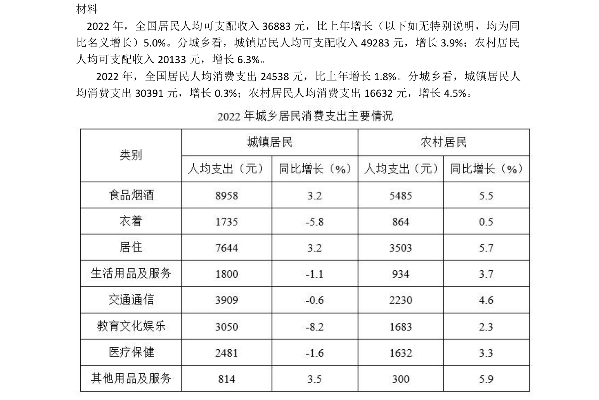

材料文字（图表以原图为准）

材料
2022年，全国居民人均可支配收入36883元，比上年增长（以下如无特别说明，均为同比名义增长）5.0%。分城乡看，城镇居民人均可支配收入49283元，增长3.9%；农村居民人均可支配收入20133元，增长6.3%。
2022年，全国居民人均消费支出24538元，比上年增长1.8%。分城乡看，城镇居民人均消费支出30391元，增长0.3%；农村居民人均消费支出16632元，增长4.5%。
【表】2022年城乡居民消费支出主要情况（见图）

### D02-ZL-001

2021年,全国居民人均可支配收入约为( )万元。

A. 3.33  
B. 3.42  
C. 3.51  
D. 3.60  

## 材料 02 · ZLM-SC2021H-2

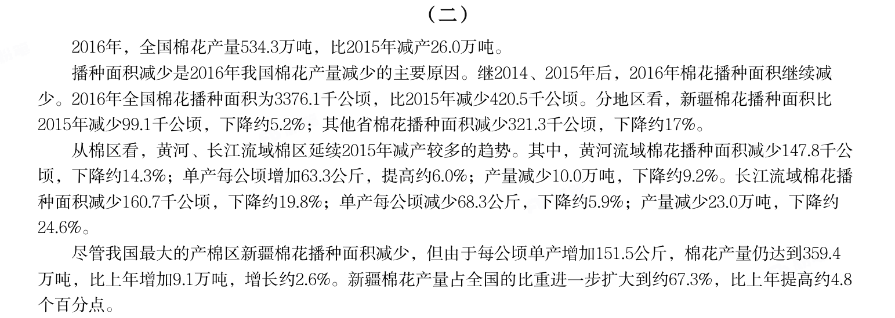

材料文字（图表以原图为准）

（二）
2016年，全国棉花产量534.3万吨，比2015年减产26.0万吨。
播种面积减少是2016年我国棉花产量减少的主要原因。继2014、2015年后，2016年棉花播种面积继续减少。2016年全国棉花播种面积为3376.1千公顷，比2015年减少420.5千公顷。分地区看，新疆棉花播种面积比2015年减少99.1千公顷，下降约5.2%；其他省棉花播种面积减少321.3千公顷，下降约17%。
从棉区看，黄河、长江流域棉区延续2015年减产较多的趋势。其中，黄河流域棉花播种面积减少147.8千公顷，下降约14.3%；单产每公顷增加63.3公斤，提高约6.0%；产量减少10.0万吨，下降约9.2%。长江流域棉花播种面积减少160.7千公顷，下降约19.8%；单产每公顷减少68.3公斤，下降约5.9%；产量减少23.0万吨，下降约24.6%。
尽管我国最大的产棉区新疆棉花播种面积减少，但由于每公顷单产增加151.5公斤，棉花产量仍达到359.4万吨，比上年增加9.1万吨，增长约2.6%。新疆棉花产量占全国的比重进一步扩大到约67.3%，比上年提高约4.8个百分点。

### D02-ZL-002

2015年,黄河流域的棉花单产为:

A. 1118公斤/公顷  
B. 1092公斤/公顷  
C. 1055公斤/公顷  
D. 1003公斤/公顷  

## 材料 03 · ZLM-HB2020-1

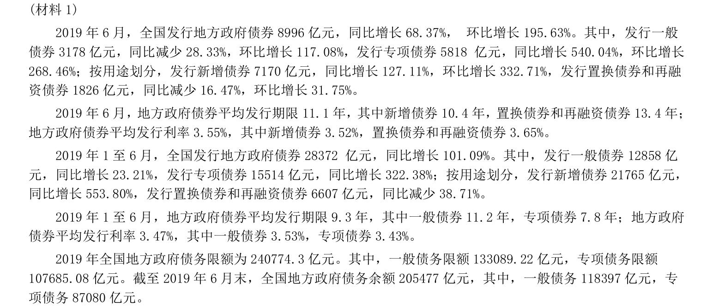

材料文字（图表以原图为准）

（材料1）
2019年6月，全国发行地方政府债券8996亿元，同比增长68.37%，环比增长195.63%。其中，发行一般债券3178亿元，同比减少28.33%，环比增长117.08%，发行专项债券5818亿元，同比增长540.04%，环比增长268.46%；按用途划分，发行新增债券7170亿元，同比增长127.11%，环比增长332.71%，发行置换债券和再融资债券1826亿元，同比减少16.47%，环比增长31.75%。
2019年6月，地方政府债券平均发行期限11.1年，其中新增债券10.4年，置换债券和再融资债券13.4年；地方政府债券平均发行利率3.55%，其中新增债券3.52%，置换债券和再融资债券3.65%。
2019年1至6月，全国发行地方政府债券28372亿元，同比增长101.09%。其中，发行一般债券12858亿元，同比增长23.21%，发行专项债券15514亿元，同比增长322.38%；按用途划分，发行新增债券21765亿元，同比增长553.80%，发行置换债券和再融资债券6607亿元，同比减少38.71%。
2019年1至6月，地方政府债券平均发行期限9.3年，其中一般债券11.2年，专项债券7.8年；地方政府债券平均发行利率3.47%，其中一般债券3.53%，专项债券3.43%。
2019年全国地方政府债务限额为240774.3亿元。其中，一般债务限额133089.22亿元，专项债务限额107685.08亿元。截至2019年6月末，全国地方政府债务余额205477亿元，其中，一般债务118397亿元，专项债务87080亿元。

### D02-ZL-003

2018年6月,发行置换债券和再融资债券约为:

A. 3157亿元  
B. 2186亿元  
C. 1657亿元  
D. 1386亿元  

## 材料 04 · ZLM-GD2020Z-2

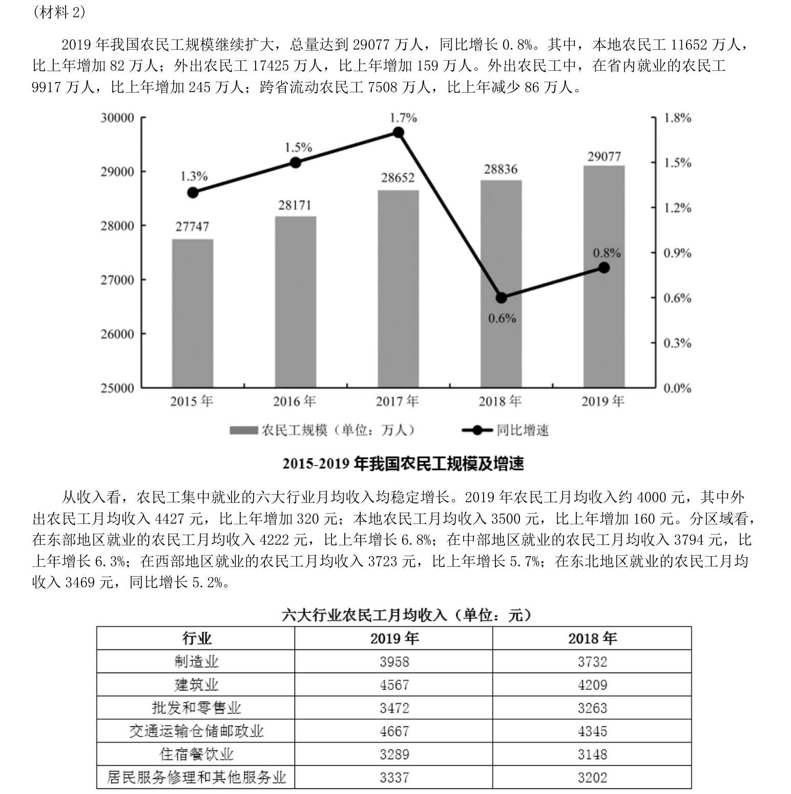

材料文字（图表以原图为准）

（材料2）
2019年我国农民工规模继续扩大，总量达到29077万人，同比增长0.8%。其中，本地农民工11652万人，比上年增加82万人；外出农民工17425万人，比上年增加159万人。外出农民工中，在省内就业的农民工9917万人，比上年增加245万人；跨省流动农民工7508万人，比上年减少86万人。
【图】2015-2019年我国农民工规模及增速（见图）
从收入看，农民工集中就业的六大行业月均收入均稳定增长。2019年农民工月均收入约4000元，其中外出农民工月均收入4427元，比上年增加320元；本地农民工月均收入3500元，比上年增加160元。分区域看，在东部地区就业的农民工月均收入4222元，比上年增长6.8%；在中部地区就业的农民工月均收入3794元，比上年增长6.3%；在西部地区就业的农民工月均收入3723元，比上年增长5.7%；在东北地区就业的农民工月均收入3469元，同比增长5.2%。
【表】六大行业农民工月均收入（单位：元）（见图）

### D02-ZL-004

2018年,省内就业农民工的数量约占外出农民工的:

A. 36%  
B. 46%  
C. 56%  
D. 66%  

### D02-ZL-048

2014—2019年,我国农民工规模增加了约:

A. 3.2%  
B. 4.8%  
C. 6.2%  
D. 7.8%  

## 材料 05 · ZLM-GK2022D-1

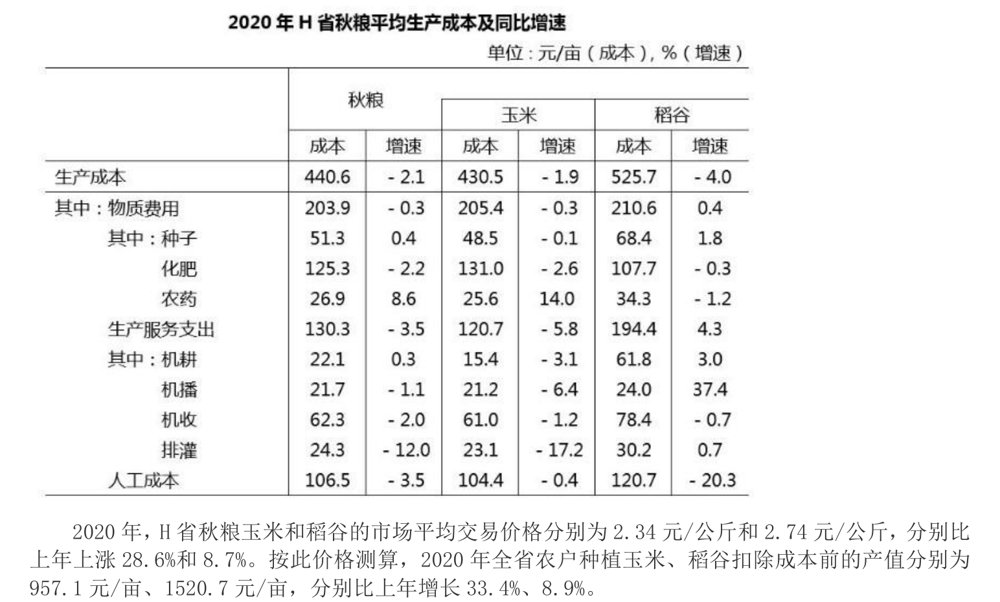

材料文字（图表以原图为准）

【表】2020年H省秋粮平均生产成本及同比增速（见图）
2020年，H省秋粮玉米和稻谷的市场平均交易价格分别为2.34元/公斤和2.74元/公斤，分别比上年上涨28.6%和8.7%。按此价格测算，2020年全省农户种植玉米、稻谷扣除成本前的产值分别为957.1元/亩、1520.7元/亩，分别比上年增长33.4%、8.9%。

### D02-ZL-005

2019年,H省秋粮稻谷的平均生产成本约为多少元/亩?

A. 439  
B. 450  
C. 533  
D. 548  

## 材料 06 · ZLM-GK2023F-3

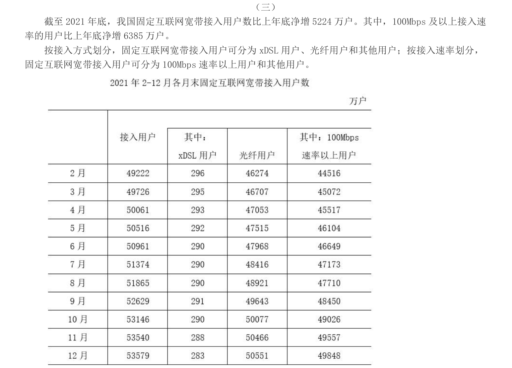

材料文字（图表以原图为准）

（三）
截至2021年底，我国固定互联网宽带接入用户数比上年底净增5224万户。其中，100Mbps及以上接入速率的用户比上年底净增6385万户。
按接入方式划分，固定互联网宽带接入用户可分为xDSL用户、光纤用户和其他用户；按接入速率划分，固定互联网宽带接入用户可分为100Mbps速率以上用户和其他用户。
【表】2021年2-12月各月末固定互联网宽带接入用户数（单位：万户）（见图）

### D02-ZL-006

2021年1~2月,我国固定互联网宽带接入用户数月均约增加多少万户?

A. 867  
B. 629  
C. 434  
D. 315  

## 材料 07 · ZLM-JS2020A-6

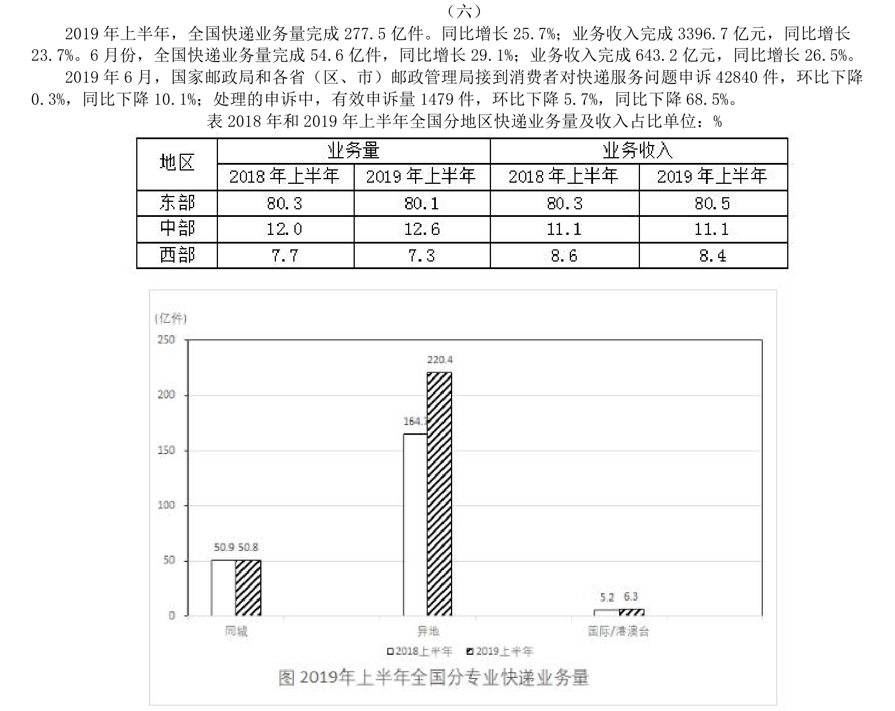

材料文字（图表以原图为准）

（六）
2019年上半年，全国快递业务量完成277.5亿件。同比增长25.7%；业务收入完成3396.7亿元，同比增长23.7%。6月份，全国快递业务量完成54.6亿件，同比增长29.1%；业务收入完成643.2亿元，同比增长26.5%。
2019年6月，国家邮政局和各省（区、市）邮政管理局接到消费者对快递服务问题申诉42840件，环比下降0.3%，同比下降10.1%；处理的申诉中，有效申诉量1479件，环比下降5.7%，同比下降68.5%。
【表】2018年和2019年上半年全国分地区快递业务量及收入占比（单位：%）（见图）
【图】2019年上半年全国分专业快递业务量（见图）

### D02-ZL-007

2018年6月,国家邮政局和各省(区、市)邮政管理局处理的快递服务有效申诉量为()

A. 1479件  
B. 2568件  
C. 3159件  
D. 4695件  

### D02-ZL-017

2018年上半年,中部地区快递业务收入为()

A. 236.1亿元  
B. 285.3亿元  
C. 304.8亿元  
D. 377.0亿元  

## 材料 08 · ZLM-GK2018D-3

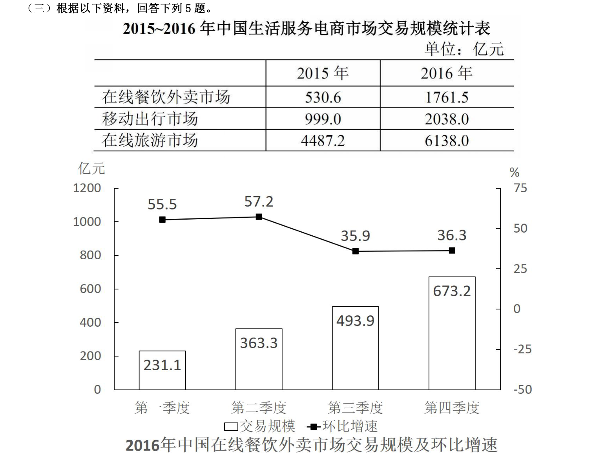

材料文字（图表以原图为准）

（三）根据以下资料，回答下列5题。
【表】2015~2016年中国生活服务电商市场交易规模统计表（单位：亿元）（见图）
【图】2016年中国在线餐饮外卖市场交易规模及环比增速（见图）

### D02-ZL-008

2015年第四季度在线餐饮外卖市场交易规模占全年交易规模的比重约为:

A. 21%  
B. 28%  
C. 37%  
D. 49%  

### D02-ZL-066

如按2016年移动出行市场同比增长趋势估算,2018年该市场规模将为:

A. 接近5000亿元  
B. 6000多亿元  
C. 8000多亿元  
D. 超过1万亿元  

## 材料 09 · ZLM-HB2023-2

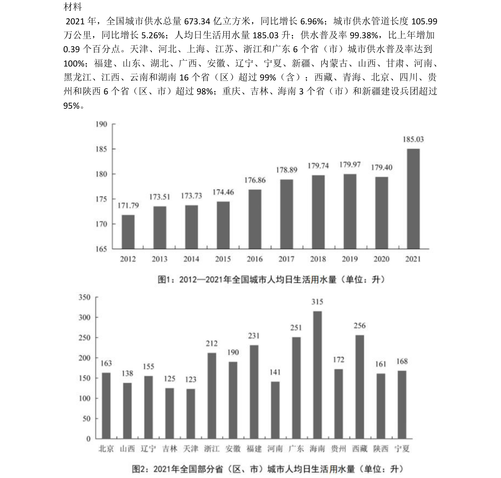

材料文字（图表以原图为准）

材料
2021年，全国城市供水总量673.34亿立方米，同比增长6.96%；城市供水管道长度105.99万公里，同比增长5.26%；人均日生活用水量185.03升；供水普及率99.38%，比上年增加0.39个百分点。天津、河北、上海、江苏、浙江和广东6个省（市）城市供水普及率达到100%；福建、山东、湖北、广西、安徽、辽宁、宁夏、新疆、内蒙古、山西、甘肃、河南、黑龙江、江西、云南和湖南16个省（区）超过99%（含）；西藏、青海、北京、四川、贵州和陕西6个省（区、市）超过98%；重庆、吉林、海南3个省（市）和新疆建设兵团超过95%。
【图1】2012—2021年全国城市人均日生活用水量（单位：升）（见图）
【图2】2021年全国部分省（区、市）城市人均日生活用水量（单位：升）（见图）

### D02-ZL-009

2020年,全国城市供水总量约为:

A. 600亿立方米  
B. 620亿立方米  
C. 630亿立方米  
D. 724亿立方米  

## 材料 10 · ZLM-GD2017-3

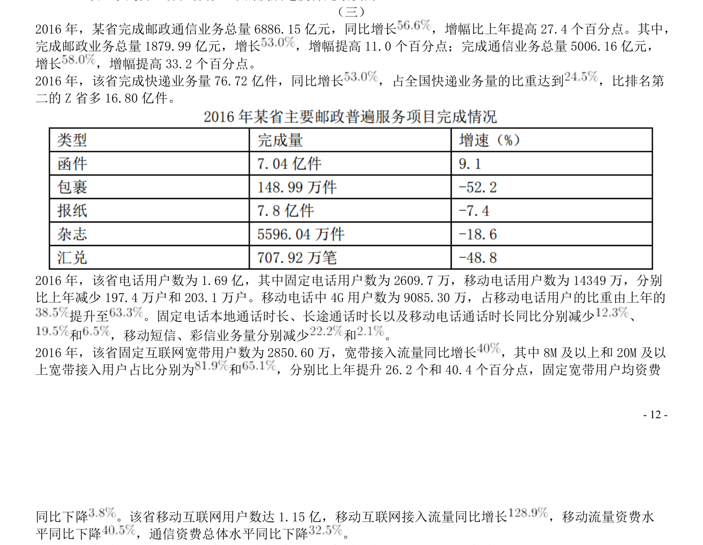

材料文字（图表以原图为准）

（三）
2016年，某省完成邮政通信业务总量6886.15亿元，同比增长56.6%，增幅比上年提高27.4个百分点。其中，完成邮政业务总量1879.99亿元，增长53.0%，增幅提高11.0个百分点；完成通信业务总量5006.16亿元，增长58.0%，增幅提高33.2个百分点。
2016年，该省完成快递业务量76.72亿件，同比增长53.0%，占全国快递业务量的比重达到24.5%，比排名第二的Z省多16.80亿件。
【表】2016年某省主要邮政普遍服务项目完成情况（见图）
2016年，该省电话用户数为1.69亿，其中固定电话用户数为2609.7万，移动电话用户数为14349万，分别比上年减少197.4万户和203.1万户。移动电话中4G用户数为9085.30万，占移动电话用户的比重由上年的38.5%提升至63.3%。固定电话本地通话时长、长途通话时长以及移动电话通话时长同比分别减少12.3%、19.5%和6.5%，移动短信、彩信业务量分别减少22.2%和2.1%。
2016年，该省固定互联网宽带用户数为2850.60万，宽带接入流量同比增长40%，其中8M及以上和20M及以上宽带接入用户占比分别为81.9%和65.1%，分别比上年提升26.2个和40.4个百分点，固定宽带用户均资费同比下降3.8%。该省移动互联网用户数达1.15亿，移动互联网接入流量同比增长128.9%，移动流量资费水平同比下降40.5%，通信资费总体水平同比下降32.5%。

### D02-ZL-010

2016年该省移动电话用户中4G用户数比2015年大约增加了多少万?

A. 3154  
B. 3483  
C. 3844  
D. 4239  

### D02-ZL-028

2015年该省报纸的订销完成量约是杂志的多少倍?

A. 12.3  
B. 13.9  
C. 15.1  
D. 16.7  

### D02-ZL-060

2016年该省完成的通信业务总量占邮政通信业务总量的比重相比2014年大约:

A. 提高了0.6个百分点  
B. 降低了0.6个百分点  
C. 提高了1.9个百分点  
D. 降低了1.9个百分点  

### D02-ZL-106

根据资料,下列选项无法得出的是:

A. 2016年该省邮政通信业务总量的增长速度约是上一年的2倍  
B. 2016年该省手机流量的资费水平大幅降低  
C. 4G正成为该省移动电话用户的主流制式  
D. 固定宽带运营商未采取有效降低资费水平的措施  

### D02-ZL-107

根据资料可知:

A. 2015年该省的快递业务量比Z省少  
B. 2016年该省主要邮政普遍服务项目均出现下滑  
C. 2016年该省8M以下宽带接入用户的占比相较于上一年减少了一半以上  
D. 2016年该省电话通话时长和短信业务量的下降是由于移动互联网的迅速发展所致  

## 材料 11 · ZLM-GK2022X-4

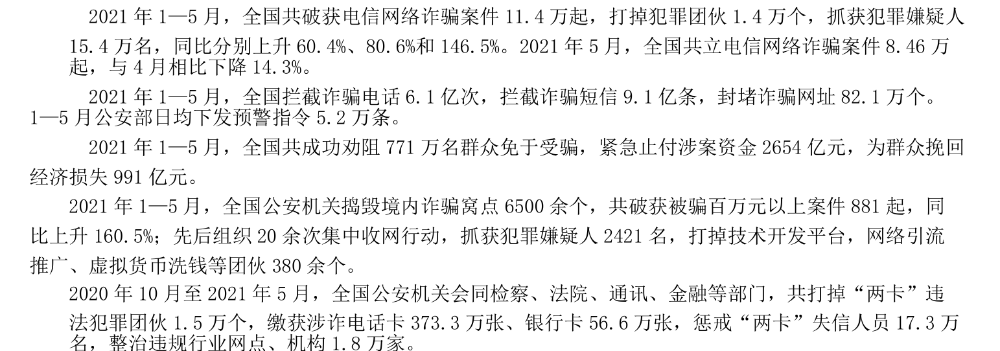

材料文字（图表以原图为准）

2021年1—5月，全国共破获电信网络诈骗案件11.4万起，打掉犯罪团伙1.4万个，抓获犯罪嫌疑人15.4万名，同比分别上升60.4%、80.6%和146.5%。2021年5月，全国共立电信网络诈骗案件8.46万起，与4月相比下降14.3%。
2021年1—5月，全国拦截诈骗电话6.1亿次，拦截诈骗短信9.1亿条，封堵诈骗网址82.1万个。
1—5月公安部日均下发预警指令5.2万条。
2021年1—5月，全国共成功劝阻771万名群众免于受骗，紧急止付涉案资金2654亿元，为群众挽回经济损失991亿元。
2021年1—5月，全国公安机关捣毁境内诈骗窝点6500余个，共破获被骗百万元以上案件881起，同比上升160.5%；先后组织20余次集中收网行动，抓获犯罪嫌疑人2421名，打掉技术开发平台，网络引流推广、虚拟货币洗钱等团伙380余个。
2020年10月至2021年5月，全国公安机关会同检察、法院、通讯、金融等部门，共打掉“两卡”违法犯罪团伙1.5万个，缴获涉诈电话卡373.3万张、银行卡56.6万张，惩戒“两卡”失信人员17.3万名，整治违规行业网点、机构1.8万家。

### D02-ZL-011

2020年1—5月,全国平均每月打掉电信网络诈骗犯罪团伙:

A. 不到1000个  
B. 1000—2000个之间  
C. 2000—4000个之间  
D. 4000个以上  

## 材料 12 · ZLM-HB2025-3

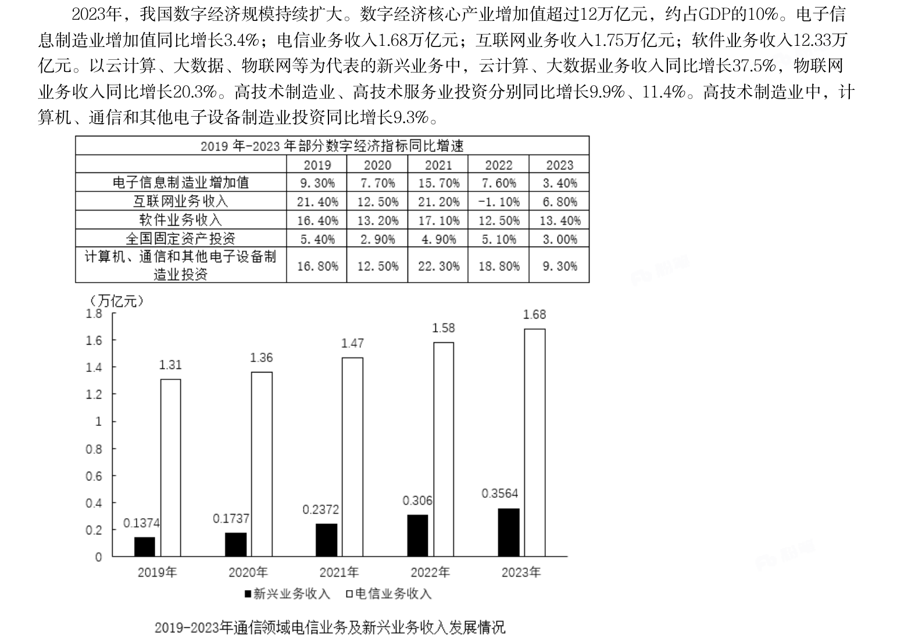

材料文字（图表以原图为准）

2023年，我国数字经济规模持续扩大。数字经济核心产业增加值超过12万亿元，约占GDP的10%。电子信息制造业增加值同比增长3.4%；电信业务收入1.68万亿元；互联网业务收入1.75万亿元；软件业务收入12.33万亿元。以云计算、大数据、物联网等为代表的新兴业务中，云计算、大数据业务收入同比增长37.5%，物联网业务收入同比增长20.3%。高技术制造业、高技术服务业投资分别同比增长9.9%、11.4%。高技术制造业中，计算机、通信和其他电子设备制造业投资同比增长9.3%。
【表】2019年-2023年部分数字经济指标同比增速（见图）
【图】2019-2023年通信领域电信业务及新兴业务收入发展情况（见图）

### D02-ZL-012

2022年我国软件业务收入在以下哪个范围:

A. 10.7-10.9万亿元  
B. 10.9-11.1万亿元  
C. 11.1-11.3万亿元  
D. 11.3-11.5万亿元  

### D02-ZL-073

按照2023年的同比增速,2025年互联网业务收入预计在以下哪个范围:

A. 1.6-1.8万亿元  
B. 1.8-2.0万亿元  
C. 2.0-2.2万亿元  
D. 超过2.2万亿元  

## 材料 13 · ZLM-SC2023-3

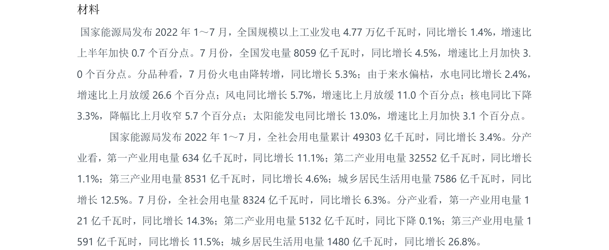

材料文字（图表以原图为准）

材料
国家能源局发布2022年1～7月，全国规模以上工业发电4.77万亿千瓦时，同比增长1.4%，增速比上半年加快0.7个百分点。7月份，全国发电量8059亿千瓦时，同比增长4.5%，增速比上月加快3.0个百分点。分品种看，7月份火电由降转增，同比增长5.3%；由于来水偏枯，水电同比增长2.4%，增速比上月放缓26.6个百分点；风电同比增长5.7%，增速比上月放缓11.0个百分点；核电同比下降3.3%，降幅比上月收窄5.7个百分点；太阳能发电同比增长13.0%，增速比上月加快3.1个百分点。
国家能源局发布2022年1～7月，全社会用电量累计49303亿千瓦时，同比增长3.4%。分产业看，第一产业用电量634亿千瓦时，同比增长11.1%；第二产业用电量32552亿千瓦时，同比增长1.1%；第三产业用电量8531亿千瓦时，同比增长4.6%；城乡居民生活用电量7586亿千瓦时，同比增长12.5%。7月份，全社会用电量8324亿千瓦时，同比增长6.3%。分产业看，第一产业用电量121亿千瓦时，同比增长14.3%；第二产业用电量5132亿千瓦时，同比下降0.1%；第三产业用电量1591亿千瓦时，同比增长11.5%；城乡居民生活用电量1480亿千瓦时，同比增长26.8%。

### D02-ZL-013

2021年7月份,全国发电量大约是多少亿千瓦时?

A. 6570  
B. 6920  
C. 7712  
D. 7800  

### D02-ZL-044

2021年1-6月全社会用电量累计约多少亿千瓦时?

A. 38258  
B. 39851  
C. 40472  
D. 41279  

## 材料 14 · ZLM-GD2018-1

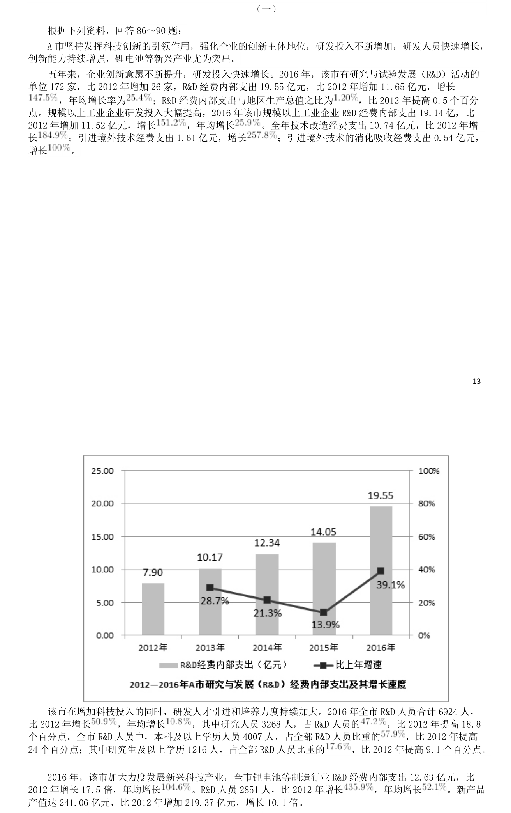

材料文字（图表以原图为准）

（一）
根据下列资料，回答86～90题：
A市坚持发挥科技创新的引领作用，强化企业的创新主体地位，研发投入不断增加，研发人员快速增长，创新能力持续增强，锂电池等新兴产业尤为突出。
五年来，企业创新意愿不断提升，研发投入快速增长。2016年，该市有研究与试验发展（R&D）活动的单位172家，比2012年增加26家，R&D经费内部支出19.55亿元，比2012年增加11.65亿元，增长147.5%，年均增长率为25.4%；R&D经费内部支出与地区生产总值之比为1.20%，比2012年提高0.5个百分点。规模以上工业企业研发投入大幅提高，2016年该市规模以上工业企业R&D经费内部支出19.14亿，比2012年增加11.52亿元，增长151.2%，年均增长25.9%。全年技术改造经费支出10.74亿元，比2012年增长184.9%；引进境外技术经费支出1.61亿元，增长257.8%；引进境外技术的消化吸收经费支出0.54亿元，增长100%。
【图】2012—2016年A市研究与发展（R&D）经费内部支出及其增长速度（见图）
该市在增加科技投入的同时，研发人才引进和培养力度持续加大。2016年全市R&D人员合计6924人，比2012年增长50.9%，年均增长10.8%，其中研究人员3268人，占R&D人员的47.2%，比2012年提高18.8个百分点。全市R&D人员中，本科及以上学历人员4007人，占全部R&D人员比重的57.9%，比2012年提高24个百分点；其中研究生及以上学历1216人，占全部R&D人员比重的17.6%，比2012年提高9.1个百分点。
2016年，该市加大力度发展新兴科技产业，全市锂电池等制造行业R&D经费内部支出12.63亿元，比2012年增长17.5倍，年均增长104.6%。R&D人员2851人，比2012年增长435.9%，年均增长52.1%。新产品产值达241.06亿元，比2012年增加219.37亿元，增长10.1倍。

### D02-ZL-014

2016年,该市生产总值比2012年约多( )亿元。

A. 350  
B. 430  
C. 500  
D. 660  

### D02-ZL-029

2012年,该市的下列各项经费支出最多的是( )。

A. 规模以上工业企业R&D经费  
B. 全年技术改造经费  
C. 引进境外技术经费  
D. 引进境外技术的消化吸收经费  

### D02-ZL-127

2016年,该市R&D人员中,本科学历的人数为(  )。

A. 1216  
B. 1517  
C. 2791  
D. 4007  

## 材料 15 · ZLM-ZJ2024A-2

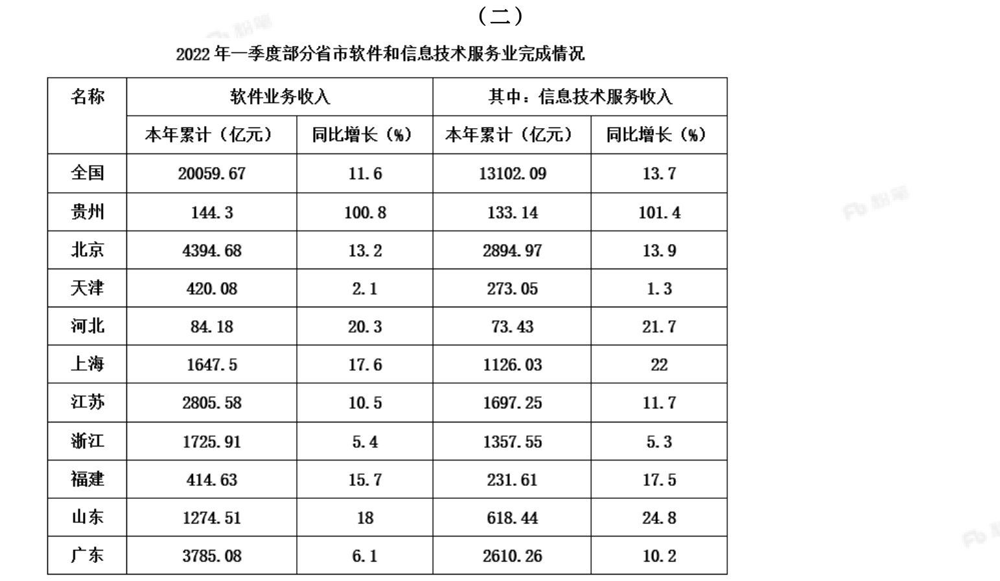

材料文字（图表以原图为准）

（二）
【表】2022年一季度部分省市软件和信息技术服务业完成情况（见图）

### D02-ZL-015

2021年一季度,浙江软件业务收入累计值约为多少亿元?

A. 1600  
B. 1640  
C. 1680  
D. 1800  

## 材料 16 · ZLM-GK2025F-4

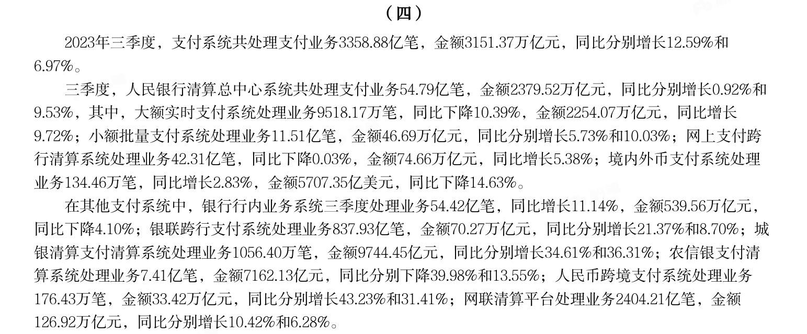

材料文字（图表以原图为准）

（四）
2023年三季度，支付系统共处理支付业务3358.88亿笔，金额3151.37万亿元，同比分别增长12.59%和6.97%。
三季度，人民银行清算总中心系统共处理支付业务54.79亿笔，金额2379.52万亿元，同比分别增长0.92%和9.53%，其中，大额实时支付系统处理业务9518.17万笔，同比下降10.39%，金额2254.07万亿元，同比增长9.72%；小额批量支付系统处理业务11.51亿笔，金额46.69万亿元，同比分别增长5.73%和10.03%；网上支付跨行清算系统处理业务42.31亿笔，同比下降0.03%，金额74.66万亿元，同比增长5.38%；境内外币支付系统处理业务134.46万笔，同比增长2.83%，金额5707.35亿美元，同比下降14.63%。
在其他支付系统中，银行行内业务系统三季度处理业务54.42亿笔，同比增长11.14%，金额539.56万亿元，同比下降4.10%；银联跨行支付系统处理业务837.93亿笔，金额70.27万亿元，同比分别增长21.37%和8.70%；城银清算支付清算系统处理业务1056.40万笔，金额9744.45亿元，同比分别增长34.61%和36.31%；农信银支付清算系统处理业务7.41亿笔，金额7162.13亿元，同比分别下降39.98%和13.55%；人民币跨境支付系统处理业务176.43万笔，金额33.42万亿元，同比分别增长43.23%和31.41%；网联清算平台处理业务2404.21亿笔，金额126.92万亿元，同比分别增长10.42%和6.28%。

### D02-ZL-016

2022年三季度,人民银行清算总中心系统境内外币支付系统处理业务日均处理金额在以下哪个范围内?

A. 超过80亿美元  
B. 70亿-80亿美元之间  
C. 60亿-70亿美元之间  
D. 不到60亿美元  

## 材料 17 · ZLM-GK2022F_xc-3

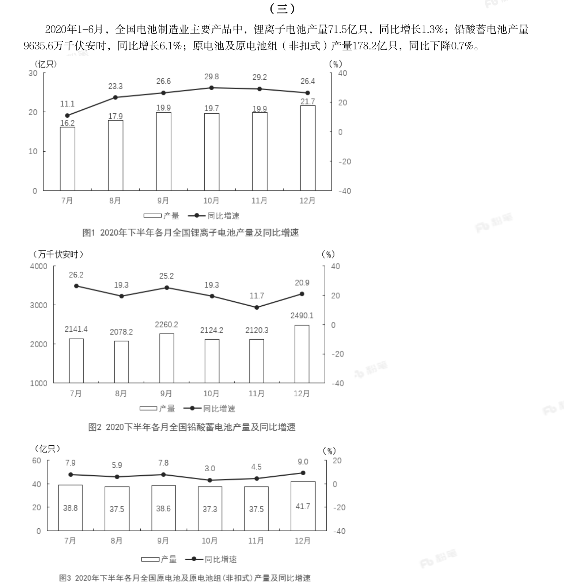

材料文字（图表以原图为准）

（三）
2020年1-6月，全国电池制造业主要产品中，锂离子电池产量71.5亿只，同比增长1.3%；铅酸蓄电池产量9635.6万千伏安时，同比增长6.1%；原电池及原电池组（非扣式）产量178.2亿只，同比下降0.7%。
【图1】2020年下半年各月全国锂离子电池产量及同比增速（见图）
【图2】2020下半年各月全国铅酸蓄电池产量及同比增速（见图）
【图3】2020年下半年各月全国原电池及原电池组（非扣式）产量及同比增速（见图）

### D02-ZL-018

2019年上半年,全国铅酸蓄电池月均产量约为多少亿千伏安时?

A. 0.13  
B. 0.14  
C. 0.15  
D. 0.16  

## 材料 18 · ZLM-GK2025F-1

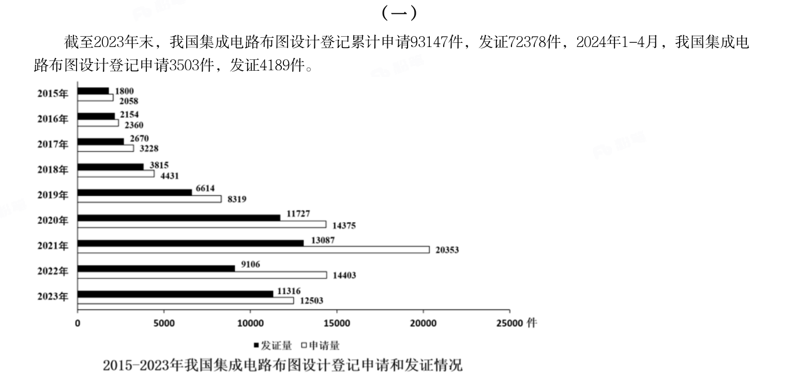

材料文字（图表以原图为准）

（一）
截至2023年末，我国集成电路布图设计登记累计申请93147件，发证72378件，2024年1-4月，我国集成电路布图设计登记申请3503件，发证4189件。
【图】2015-2023年我国集成电路布图设计登记申请和发证情况（见图）

### D02-ZL-019

截至2014年末,我国集成电路布图设计登记累计申请量在以下哪个范围内?

A. 0.8万-1.5万件之间  
B. 不到0.8万件  
C. 1.5万-2.2万件之间  
D. 超过2.2万件  

### D02-ZL-065

如2024年5-12月,我国集成电路布图设计登记月均发证量与1-4月水平相同,则2024年全年,我国集成电路布图设计登记发证量将比上年:

A. 下降不到20%  
B. 下降20%以上  
C. 上升不到20%  
D. 上升20%以上  

## 材料 19 · ZLM-HB2022-4

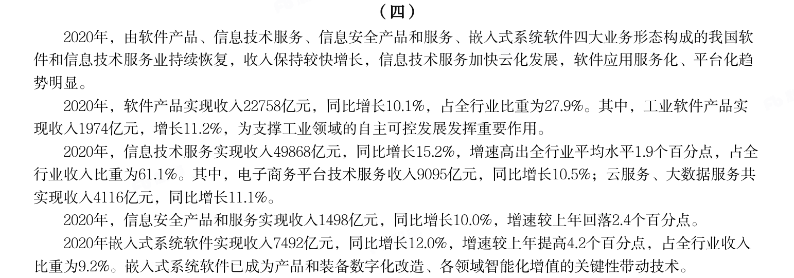

材料文字（图表以原图为准）

（四）
2020年，由软件产品、信息技术服务、信息安全产品和服务、嵌入式系统软件四大业务形态构成的我国软件和信息技术服务业持续恢复，收入保持较快增长，信息技术服务加快云化发展，软件应用服务化、平台化趋势明显。
2020年，软件产品实现收入22758亿元，同比增长10.1%，占全行业比重为27.9%。其中，工业软件产品实现收入1974亿元，增长11.2%，为支撑工业领域的自主可控发展发挥重要作用。
2020年，信息技术服务实现收入49868亿元，同比增长15.2%，增速高出全行业平均水平1.9个百分点，占全行业收入比重为61.1%。其中，电子商务平台技术服务收入9095亿元，同比增长10.5%；云服务、大数据服务共实现收入4116亿元，同比增长11.1%。
2020年，信息安全产品和服务实现收入1498亿元，同比增长10.0%，增速较上年回落2.4个百分点。
2020年嵌入式系统软件实现收入7492亿元，同比增长12.0%，增速较上年提高4.2个百分点，占全行业收入比重为9.2%。嵌入式系统软件已成为产品和装备数字化改造、各领域智能化增值的关键性带动技术。

### D02-ZL-020

2019年全行业实现收入约为:

A. 7.2万亿元  
B. 7.4万亿元  
C. 8.2万亿元  
D. 8.4万亿元  

## 材料 20 · ZLM-GK2023F-6

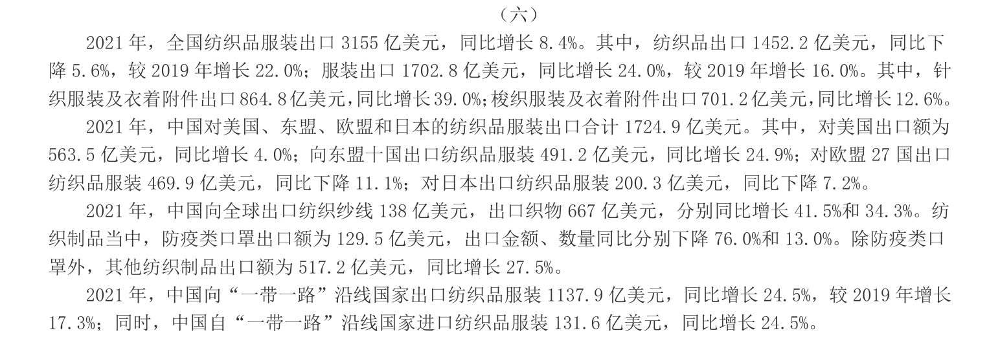

材料文字（图表以原图为准）

（六）
2021年，全国纺织品服装出口3155亿美元，同比增长8.4%。其中，纺织品出口1452.2亿美元，同比下降5.6%，较2019年增长22.0%；服装出口1702.8亿美元，同比增长24.0%，较2019年增长16.0%。其中，针织服装及衣着附件出口864.8亿美元，同比增长39.0%；梭织服装及衣着附件出口701.2亿美元，同比增长12.6%。
2021年，中国对美国、东盟、欧盟和日本的纺织品服装出口合计1724.9亿美元。其中，对美国出口额为563.5亿美元，同比增长4.0%；向东盟十国出口纺织品服装491.2亿美元，同比增长24.9%；对欧盟27国出口纺织品服装469.9亿美元，同比下降11.1%；对日本出口纺织品服装200.3亿美元，同比下降7.2%。
2021年，中国向全球出口纺织纱线138亿美元，出口织物667亿美元，分别同比增长41.5%和34.3%。纺织制品当中，防疫类口罩出口额为129.5亿美元，出口金额、数量同比分别下降76.0%和13.0%。除防疫类口罩外，其他纺织制品出口额为517.2亿美元，同比增长27.5%。
2021年，中国向“一带一路”沿线国家出口纺织品服装1137.9亿美元，同比增长24.5%，较2019年增长17.3%；同时，中国自“一带一路”沿线国家进口纺织品服装131.6亿美元，同比增长24.5%。

### D02-ZL-021

2020年,中国对“一带一路”沿线国家纺织品服装贸易顺差额约为多少亿美元?

A. 1129  
B. 1253  
C. 808  
D. 1006  

### D02-ZL-049

2020年,全国服装出口额比2019年:

A. 增长了10%以上  
B. 下降了10%以上  
C. 增长了不到10%  
D. 下降了不到10%  

## 材料 21 · ZLM-GDXD2020ZH-2

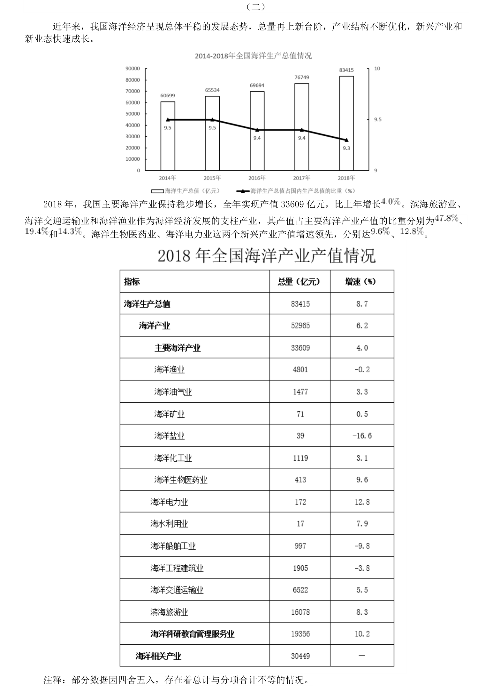

材料文字（图表以原图为准）

（二）
近年来，我国海洋经济呈现总体平稳的发展态势，总量再上新台阶，产业结构不断优化，新兴产业和新业态快速成长。
【图】2014-2018年全国海洋生产总值情况（见图）
2018年，我国主要海洋产业保持稳步增长，全年实现产值33609亿元，比上年增长4.0%。滨海旅游业、海洋交通运输业和海洋渔业作为海洋经济发展的支柱产业，其产值占主要海洋产业产值的比重分别为47.8%、19.4%和14.3%。海洋生物医药业、海洋电力业这两个新兴产业产值增速领先，分别达9.6%、12.8%。
【表】2018年全国海洋产业产值情况（见图）
注释：部分数据因四舍五入，存在着总计与分项合计不等的情况。

### D02-ZL-022

2017年,我国海洋船舶工业产值约比海洋化工业产值( )亿元。

A. 少50  
B. 少20  
C. 多50  
D. 多20  

### D02-ZL-078

如果2019年我国海洋新兴产业保持2018年的增速,则2019年我国海洋新兴产业产值将比2017年多约( )。

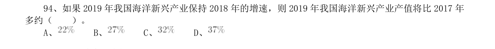

A. 22%  
B. 27%  
C. 32%  
D. 37%  

## 材料 22 · ZLM-SD2020-3

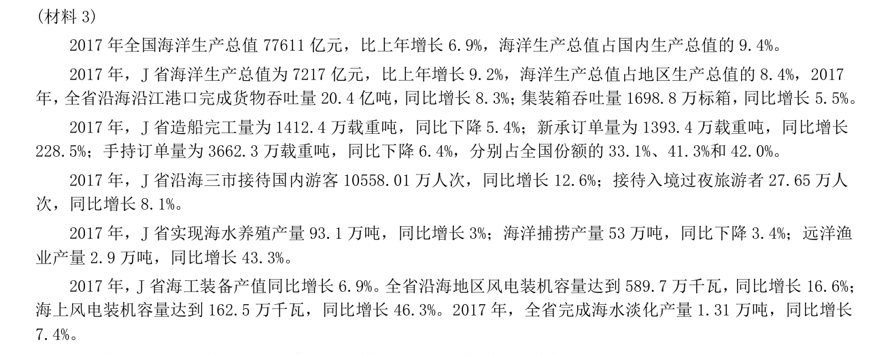

材料文字（图表以原图为准）

(材料3)
2017 年全国海洋生产总值77611 亿元，比上年增长6.9%，海洋生产总值占国内生产总值的9.4%。
2017 年，J 省海洋生产总值为7217 亿元，比上年增长9.2%，海洋生产总值占地区生产总值的8.4%，2017
年，全省沿海沿江港口完成货物吞吐量20.4 亿吨，同比增长8.3%；集装箱吞吐量1698.8 万标箱，同比增长5.5%。
2017 年，J 省造船完工量为1412.4 万载重吨，同比下降5.4%；新承订单量为1393.4 万载重吨，同比增长
228.5%；手持订单量为3662.3 万载重吨，同比下降6.4%，分别占全国份额的33.1%、41.3%和42.0%。
2017 年，J 省沿海三市接待国内游客10558.01 万人次，同比增长12.6%；接待入境过夜旅游者27.65 万人
次，同比增长8.1%。
2017 年，J 省实现海水养殖产量93.1 万吨，同比增长3%；海洋捕捞产量53 万吨，同比下降3.4%；远洋渔
业产量2.9 万吨，同比增长43.3%。
2017 年，J 省海工装备产值同比增长6.9%。全省沿海地区风电装机容量达到589.7 万千瓦，同比增长16.6%；
海上风电装机容量达到162.5 万千瓦，同比增长46.3%。2017 年，全省完成海水淡化产量1.31 万吨，同比增长
7.4%。

### D02-ZL-023

2016年J省海水养殖产量约为海洋捕捞产量的:

A. 0.6倍  
B. 0.8倍  
C. 1.6倍  
D. 1.8倍  

### D02-ZL-091

2017年J省海洋生产总值同比每增长1个百分点,当年其海洋生产总值约增加:

A. 66亿元  
B. 72亿元  
C. 726亿元  
D. 776亿元  

## 材料 23 · ZLM-GK2017D-3

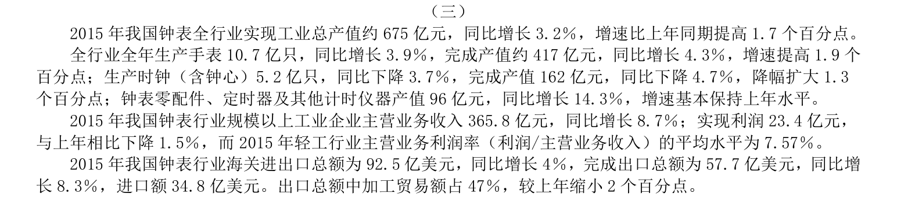

材料文字（图表以原图为准）

（三）
2015年我国钟表全行业实现工业总产值约675亿元，同比增长3.2％，增速比上年同期提高1.7个百分点。
全行业全年生产手表10.7亿只，同比增长3.9％，完成产值约417亿元，同比增长4.3％，增速提高1.9个百分点；生产时钟（含钟心）5.2亿只，同比下降3.7％，完成产值162亿元，同比下降4.7％，降幅扩大1.3个百分点；钟表零配件、定时器及其他计时仪器产值96亿元，同比增长14.3％，增速基本保持上年水平。
2015年我国钟表行业规模以上工业企业主营业务收入365.8亿元，同比增长8.7％；实现利润23.4亿元，与上年相比下降1.5％，而2015年轻工行业主营业务利润率（利润/主营业务收入）的平均水平为7.57％。
2015年我国钟表行业海关进出口总额为92.5亿美元，同比增长4％，完成出口总额为57.7亿美元，同比增长8.3％，进口额34.8亿美元。出口总额中加工贸易额占47％，较上年缩小2个百分点。

### D02-ZL-024

2014年我国钟表行业贸易顺差约为多少亿美元?

A. 27  
B. 25  
C. 23  
D. 18  

### D02-ZL-043

2015年我国钟表全行业生产时钟(含钟心)的产值与2013年相比约:

A. 上升了11%  
B. 下降了11%  
C. 上升了8%  
D. 下降了8%  

## 材料 24 · ZLM-GD2019X-3

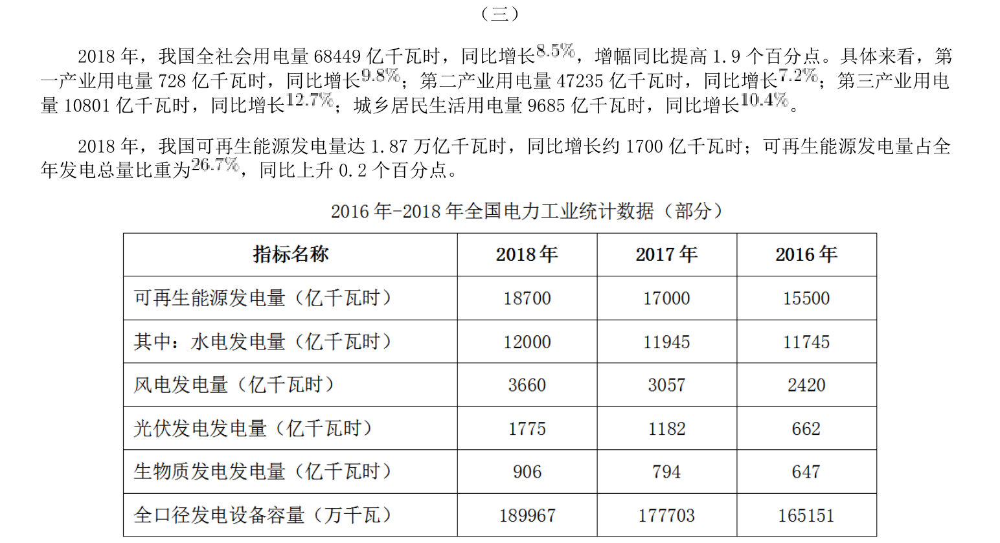

材料文字（图表以原图为准）

（三）
2018年，我国全社会用电量68449亿千瓦时，同比增长8.5%，增幅同比提高1.9个百分点。具体来看，第一产业用电量728亿千瓦时，同比增长9.8%；第二产业用电量47235亿千瓦时，同比增长7.2%；第三产业用电量10801亿千瓦时，同比增长12.7%；城乡居民生活用电量9685亿千瓦时，同比增长10.4%。
2018年，我国可再生能源发电量达1.87万亿千瓦时，同比增长约1700亿千瓦时；可再生能源发电量占全年发电总量比重为26.7%，同比上升0.2个百分点。

### D02-ZL-025

2017年,我国三大产业及城乡居民生活用电量大小排序正确的是( )。

A. 第二产业用电>第三产业用电>城乡居民生活用电>第一产业用电  
B. 第三产业用电>城乡居民生活用电>第一产业用电>第二产业用电  
C. 第二产业用电>城乡居民生活用电>第三产业用电>第一产业用电  
D. 第一产业用电>第二产业用电>第三产业用电>城乡居民生活用电  

### D02-ZL-041

2018年,我国全社会用电量较2016年增加了约( )。

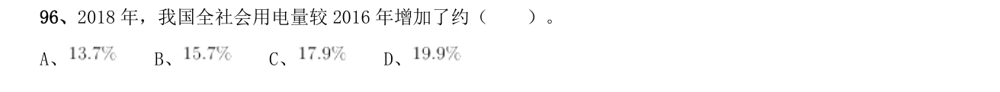

A. 13.7%  
B. 15.7%  
C. 17.9%  
D. 19.9%  

## 材料 25 · ZLM-JS2021A-2

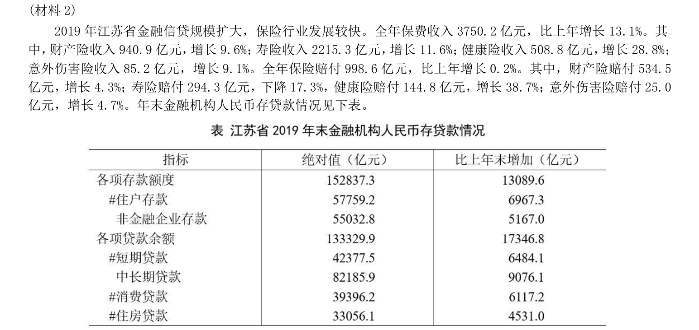

材料文字（图表以原图为准）

（材料2）
2019年江苏省金融信贷规模扩大，保险行业发展较快。全年保费收入3750.2亿元，比上年增长13.1%。其中，财产险收入940.9亿元，增长9.6%；寿险收入2215.3亿元，增长11.6%；健康险收入508.8亿元，增长28.8%；意外伤害险收入85.2亿元，增长9.1%。全年保险赔付998.6亿元，比上年增长0.2%。其中，财产险赔付534.5亿元，增长4.3%；寿险赔付294.3亿元，下降17.3%，健康险赔付144.8亿元，增长38.7%；意外伤害险赔付25.0亿元，增长4.7%。年末金融机构人民币存贷款情况见下表。
【表】江苏省2019年末金融机构人民币存贷款情况（见图）

### D02-ZL-026

2018年江苏省财产险收入与赔付之差为:

A. 346.0亿元  
B. 364.0亿元  
C. 396.6亿元  
D. 406.4亿元  

## 材料 26 · ZLM-GK2022D-4

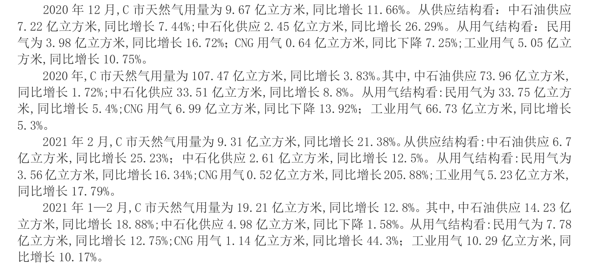

材料文字（图表以原图为准）

2020年12月,C市天然气用量为9.67亿立方米,同比增长11.66%。从供应结构看：中石油供应7.22亿立方米,同比增长7.44%;中石化供应2.45亿立方米,同比增长26.29%。从用气结构看：民用气为3.98亿立方米,同比增长16.72%；CNG用气0.64亿立方米,同比下降7.25%;工业用气5.05亿立方米,同比增长10.75%。
2020年,C市天然气用量为107.47亿立方米,同比增长3.83%。其中,中石油供应73.96亿立方米,同比增长1.72%;中石化供应33.51亿立方米,同比增长8.8%。从用气结构看:民用气为33.75亿立方米,同比增长5.4%;CNG用气6.99亿立方米,同比下降13.92%；工业用气66.73亿立方米,同比增长5.3%。
2021年2月,C市天然气用量为9.31亿立方米,同比增长21.38%。从供应结构看:中石油供应6.7亿立方米,同比增长25.23%；中石化供应2.61亿立方米,同比增长12.5%。从用气结构看:民用气为3.56亿立方米,同比增长16.34%;CNG用气0.52亿立方米,同比增长205.88%;工业用气5.23亿立方米,同比增长17.79%。
2021年1—2月,C市天然气用量为19.21亿立方米,同比增长12.8%。其中,中石油供应14.23亿立方米,同比增长18.88%;中石化供应4.98亿立方米,同比下降1.58%。从用气结构看:民用气为7.78亿立方米,同比增长12.75%;CNG用气1.14亿立方米,同比增长44.3%；工业用气10.29亿立方米,同比增长10.17%。

### D02-ZL-027

2019—2020年,C市CNG用气总量约为多少亿立方米?

A. 15  
B. 17  
C. 11  
D. 13  

### D02-ZL-042

2021年1月,C市天然气用量比上月:

A. 增加了0.2亿立方米以上  
B. 减少了不到0.2亿立方米  
C. 减少了0.2亿立方米以上  
D. 增加了不到0.2亿立方米  

## 材料 27 · ZLM-HB2024-4

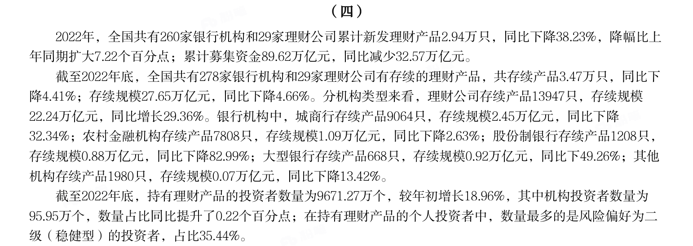

材料文字（图表以原图为准）

（四）
2022年，全国共有260家银行机构和29家理财公司累计新发理财产品2.94万只，同比下降38.23%，降幅比上年同期扩大7.22个百分点；累计募集资金89.62万亿元，同比减少32.57万亿元。
截至2022年底，全国共有278家银行机构和29家理财公司有存续的理财产品，共存续产品3.47万只，同比下降4.41%；存续规模27.65万亿元，同比下降4.66%。分机构类型来看，理财公司存续产品13947只，存续规模22.24万亿元，同比增长29.36%。银行机构中，城商行存续产品9064只，存续规模2.45万亿元，同比下降32.34%；农村金融机构存续产品7808只，存续规模1.09万亿元，同比下降2.63%；股份制银行存续产品1208只，存续规模0.88万亿元，同比下降82.99%；大型银行存续产品668只，存续规模0.92万亿元，同比下49.26%；其他机构存续产品1980只，存续规模0.07万亿元，同比下降13.42%。
截至2022年底，持有理财产品的投资者数量为9671.27万个，较年初增长18.96%，其中机构投资者数量为95.95万个，数量占比同比提升了0.22个百分点；在持有理财产品的个人投资者中，数量最多的是风险偏好为二级（稳健型）的投资者，占比35.44%。

### D02-ZL-030

2021年银行机构存续的理财产品存续规模约为多少万亿元?

A. 5.4  
B. 6.7  
C. 10.5  
D. 11.8  

### D02-ZL-047

2022年全国银行机构和理财公司累计新发理财产品只数与2020年相比约:

A. 下降45%  
B. 下降57%  
C. 下降66%  
D. 下降69%  

## 材料 28 · ZLM-GDXD2019XC-2

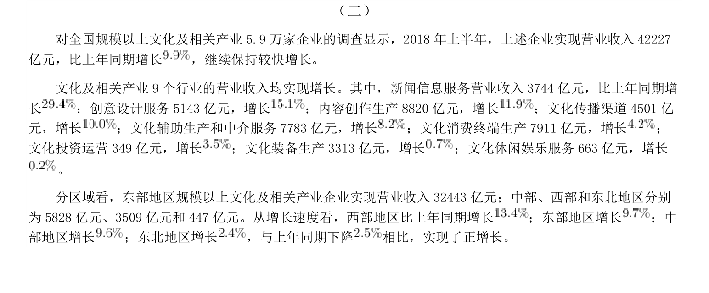

材料文字（图表以原图为准）

（二）
对全国规模以上文化及相关产业5.9万家企业的调查显示，2018年上半年，上述企业实现营业收入42227亿元，比上年同期增长9.9%，继续保持较快增长。
文化及相关产业9个行业的营业收入均实现增长。其中，新闻信息服务营业收入3744亿元，比上年同期增长29.4%；创意设计服务5143亿元，增长15.1%；内容创作生产8820亿元，增长11.9%；文化传播渠道4501亿元，增长10.0%；文化辅助生产和中介服务7783亿元，增长8.2%；文化消费终端生产7911亿元，增长4.2%；文化投资运营349亿元，增长3.5%；文化装备生产3313亿元，增长0.7%；文化休闲娱乐服务663亿元，增长0.2%。
分区域看，东部地区规模以上文化及相关产业企业实现营业收入32443亿元；中部、西部和东北地区分别为5828亿元、3509亿元和447亿元。从增长速度看，西部地区比上年同期增长13.4%；东部地区增长9.7%；中部地区增长9.6%；东北地区增长2.4%，与上年同期下降2.5%相比，实现了正增长。

### D02-ZL-031

2017年上半年,我国文化及相关产业营业收入最高的行业是( )。

A. 内容创作生产  
B. 创意设计服务  
C. 文化休闲娱乐服务  
D. 文化消费终端生产  

### D02-ZL-055

2016年上半年,东北地区规模以上文化及相关产业企业实现营业收入约( )亿元。

A. 425.9  
B. 435.9  
C. 437.7  
D. 447.7  

## 材料 29 · ZLM-GK2019D-4

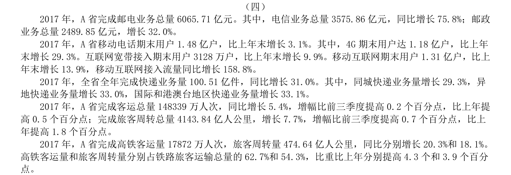

材料文字（图表以原图为准）

（四）
2017年，A省完成邮电业务总量6065.71亿元。其中，电信业务总量3575.86亿元，同比增长75.8%；邮政业务总量2489.85亿元，增长32.0%。
2017年，A省移动电话期末用户1.48亿户，比上年末增长3.1%。其中，4G期末用户达1.18亿户，比上年末增长29.3%。互联网宽带接入期末用户3128万户，比上年末增长9.9%。移动互联网期末用户1.31亿户，比上年末增长13.9%，移动互联网接入流量同比增长158.8%。
2017年，全省全年完成快递业务量100.51亿件，同比增长31.0%。其中，同城快递业务量增长29.3%，异地快递业务量增长33.0%，国际和港澳台地区快递业务量增长33.1%。
2017年，A省完成客运总量148339万人次，同比增长5.4%，增幅比前三季度提高0.2个百分点，比上年提高0.5个百分点；完成旅客周转总量4143.84亿人公里，增长7.7%，增幅比前三季度提高0.7个百分点，比上年提高1.8个百分点。
2017年，A省完成高铁客运量17872万人次，旅客周转量474.64亿人公里，同比分别增长20.3%和18.1%。
高铁客运量和旅客周转量分别占铁路旅客运输总量的62.7%和54.3%，比重比上年分别提高4.3个和3.9个百分点。

### D02-ZL-032

2016年,A省高铁客运量约是普铁(除高铁外的铁路)客运量的多少倍?

A. 1.4  
B. 1.7  
C. 0.8  
D. 1.1  

## 材料 30 · ZLM-HB2020-2

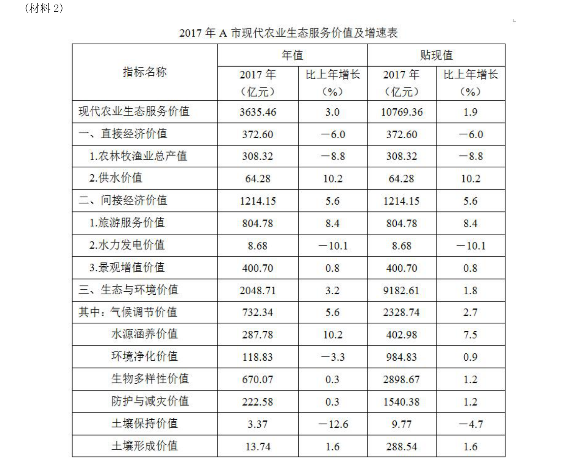

材料文字（图表以原图为准）

（材料2）
【表】2017年A市现代农业生态服务价值及增速表（见图）

### D02-ZL-033

2016年,A市旅游服务价值年值比农林牧渔业总产值年值多:

A. 494.46亿元  
B. 462.79亿元  
C. 441.85亿元  
D. 404.35亿元  

## 材料 31 · ZLM-ZJ2024A-1

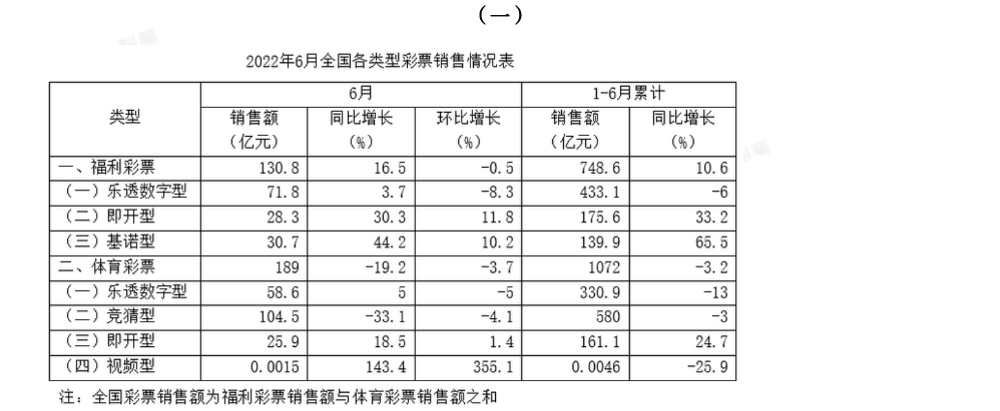

材料文字（图表以原图为准）

（一）
【表】2022年6月全国各类型彩票销售情况表（见图）
注：全国彩票销售额为福利彩票销售额与体育彩票销售额之和

### D02-ZL-034

2021年上半年,全国彩票销售额约为多少亿元?

A. 1780  
B. 1810  
C. 1840  
D. 1880  

### D02-ZL-052

2022年1-4月,福利彩票平均每月销售额约为多少亿元?

A. 110  
B. 115  
C. 120  
D. 125  

## 材料 32 · ZLM-GK2021F-4

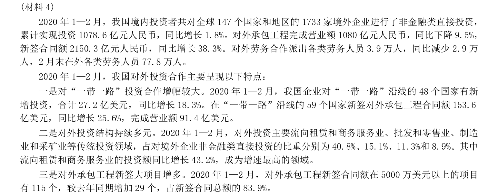

材料文字（图表以原图为准）

（材料4）
2020年1—2月，我国境内投资者共对全球147个国家和地区的1733家境外企业进行了非金融类直接投资，累计实现投资1078.6亿元人民币，同比增长1.8%。对外承包工程完成营业额1080亿元人民币，同比下降9.5%，新签合同额2150.3亿元人民币，同比增长38.3%。对外劳务合作派出各类劳务人员3.9万人，同比减少2.9万人，2月末在外各类劳务人员77.8万人。
2020年1—2月，我国对外投资合作主要呈现以下特点：
一是对“一带一路”投资合作增幅较大。2020年1—2月，我国企业对“一带一路”沿线的48个国家有新增投资，合计27.2亿美元，同比增长18.3%。在“一带一路”沿线的59个国家新签对外承包工程合同额153.6亿美元，同比增长25.6%，完成营业额91.4亿美元。
二是对外投资结构持续多元。2020年1—2月，对外投资主要流向租赁和商务服务业、批发和零售业、制造业和采矿业等传统投资领域，占对境外企业非金融类直接投资的比重分别为40.8%、15.1%、11.3%和8.9%。其中流向租赁和商务服务业的投资额同比增长43.2%，成为增速最高的领域。
三是对外承包工程新签大项目增多。2020年1—2月，对外承包工程新签合同额在5000万美元以上的项目有115个，较去年同期增加29个，占新签合同总额的83.9%。

### D02-ZL-035

2019年1—2月,我国对外承包工程月均完成营业额比月均新签合同额:

A. 高不到300亿元人民币  
B. 高300亿元人民币以上  
C. 低不到300亿元人民币  
D. 低300亿元人民币以上  

## 材料 33 · ZLM-GK2020D-3

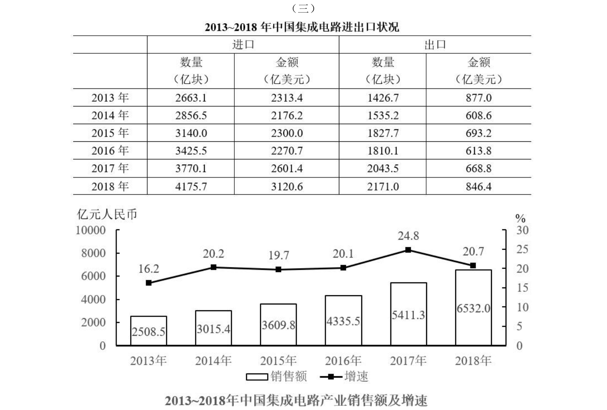

材料文字（图表以原图为准）

（三）
【表】2013~2018年中国集成电路进出口状况（见图）
【图】2013~2018年中国集成电路产业销售额及增速（见图）

### D02-ZL-036

2012~2015年,中国集成电路产业累计销售额在以下哪个范围内?

A. 不到1万亿元  
B. 在1~1.1万亿元之间  
C. 在1.1~1.2万亿元之间  
D. 超过1.2万亿元  

## 材料 34 · ZLM-GD2023X-2

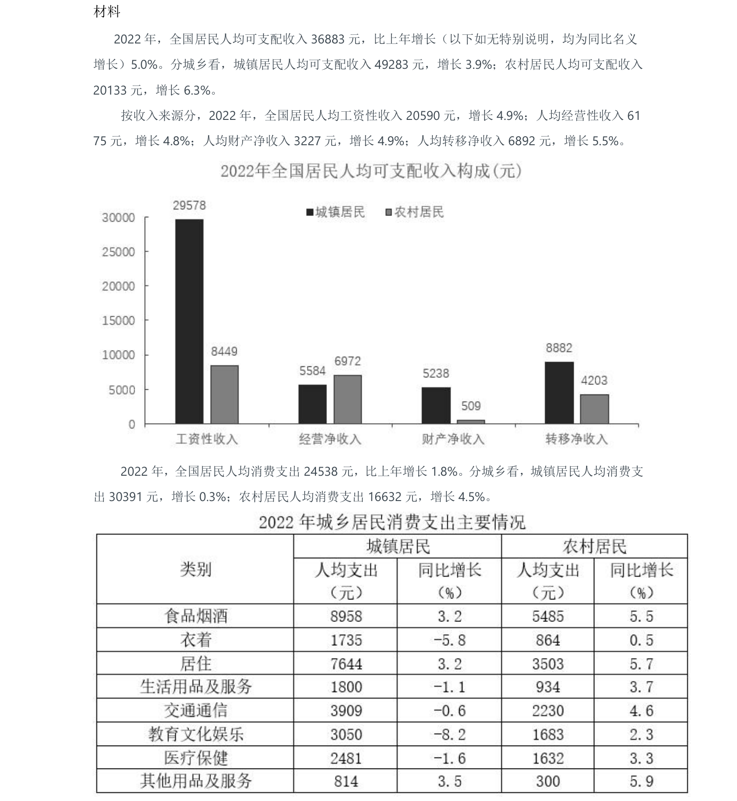

材料文字（图表以原图为准）

材料
2022年，全国居民人均可支配收入36883元，比上年增长（以下如无特别说明，均为同比名义增长）5.0%。分城乡看，城镇居民人均可支配收入49283元，增长3.9%；农村居民人均可支配收入20133元，增长6.3%。
按收入来源分，2022年，全国居民人均工资性收入20590元，增长4.9%；人均经营性收入6175元，增长4.8%；人均财产净收入3227元，增长4.9%；人均转移净收入6892元，增长5.5%。
【图】2022年全国居民人均可支配收入构成（元）（见图）
2022年，全国居民人均消费支出24538元，比上年增长1.8%。分城乡看，城镇居民人均消费支出30391元，增长0.3%；农村居民人均消费支出16632元，增长4.5%。
【表】2022年城乡居民消费支出主要情况（见图）

### D02-ZL-037

2022年,全国居民人均收支盈余比上一年( )。(注:收支盈余=收入-消费支出)

A. 增加了约5%  
B. 减少了约5%  
C. 增加了约12%  
D. 减少了约12%  

## 材料 35 · ZLM-GK2024X-4

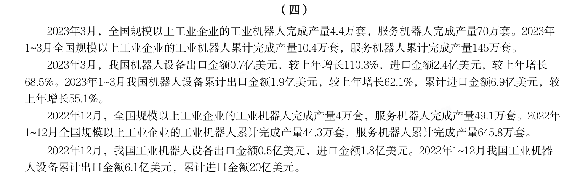

材料文字（图表以原图为准）

（四）
2023年3月，全国规模以上工业企业的工业机器人完成产量4.4万套，服务机器人完成产量70万套。2023年1~3月全国规模以上工业企业的工业机器人累计完成产量10.4万套，服务机器人累计完成产量145万套。
2023年3月，我国机器人设备出口金额0.7亿美元，较上年增长110.3%，进口金额2.4亿美元，较上年增长68.5%。2023年1~3月我国机器人设备累计出口金额1.9亿美元，较上年增长62.1%，累计进口金额6.9亿美元，较上年增长55.1%。
2022年12月，全国规模以上工业企业的工业机器人完成产量4万套，服务机器人完成产量49.1万套。2022年1~12月全国规模以上工业企业的工业机器人累计完成产量44.3万套，服务机器人累计完成产量645.8万套。
2022年12月，我国工业机器人设备出口金额0.5亿美元，进口金额1.8亿美元。2022年1~12月我国工业机器人设备累计出口金额6.1亿美元，累计进口金额20亿美元。

### D02-ZL-038

2023年一季度,我国机器人设备进出口贸易逆差比上年同期:

A. 下降了不到30%  
B. 下降了30%以上  
C. 上升了不到30%  
D. 上升了30%以上  

### D02-ZL-046

2022年12月,全国规模以上工业企业的1工业机器人完成产量和2服务机器人完成产量:

A. 均高于1~11月的月均水平  
B. 均低于1~11月的月均水平  
C. 仅1高于1~11月的月均水平  
D. 仅2高于1~11月的月均水平  

### D02-ZL-061

能够从上述资料中推出的是:

A. 2022年3月,我国机器人设备出口金额不到3000万美元  
B. 2023年3月,我国机器人设备进口金额同比增速快于1~2月同比增速  
C. 2023年一季度,全国规模以上工业企业的服务机器人完成产量高于上年各季度均值  
D. 2022年1~11月,全国规模以上工业企业的工业和服务机器人完成产量之和超过650万套  

## 材料 36 · ZLM-JS2022A-1

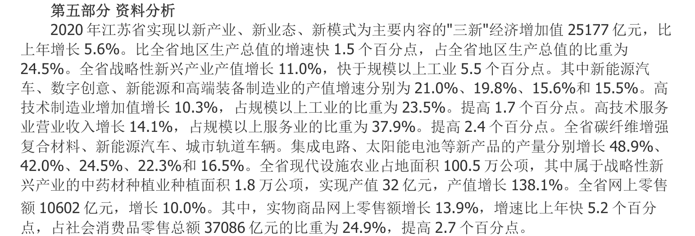

材料文字（图表以原图为准）

2020年江苏省实现以新产业、新业态、新模式为主要内容的"三新"经济增加值25177亿元，比上年增长5.6%。比全省地区生产总值的增速快1.5个百分点，占全省地区生产总值的比重为24.5%。全省战略性新兴产业产值增长11.0%，快于规模以上工业5.5个百分点。其中新能源汽车、数字创意、新能源和高端装备制造业的产值增速分别为21.0%、19.8%、15.6%和15.5%。高技术制造业增加值增长10.3%，占规模以上工业的比重为23.5%。提高1.7个百分点。高技术服务业营业收入增长14.1%，占规模以上服务业的比重为37.9%。提高2.4个百分点。全省碳纤维增强复合材料、新能源汽车、城市轨道车辆。集成电路、太阳能电池等新产品的产量分别增长48.9%、42.0%、24.5%、22.3%和16.5%。全省现代设施农业占地面积100.5万公项，其中属于战略性新兴产业的中药材种植业种植面积1.8万公项，实现产值32亿元，产值增长138.1%。全省网上零售额10602亿元，增长10.0%。其中，实物商品网上零售额增长13.9%，增速比上年快5.2个百分点，占社会消费品零售总额37086亿元的比重为24.9%，提高2.7个百分点。

### D02-ZL-039

下列可以作为计算2019年江苏非实物商品网上零售额的算式是

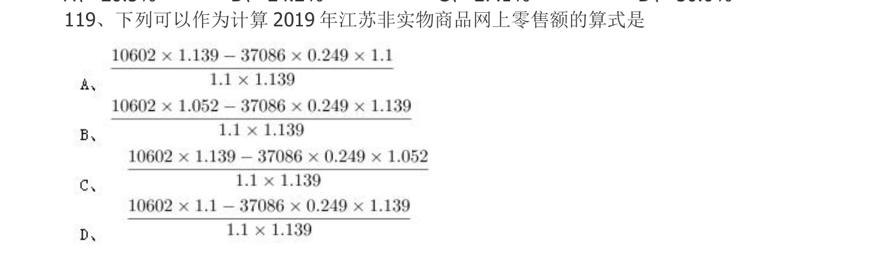

A. (10602×1.139-37086×0.249×1.1)/(1.1×1.139)  
B. (10602×1.052-37086×0.249×1.139)/(1.1×1.139)  
C. (10602×1.139-37086×0.249×1.052)/(1.1×1.139)  
D. (10602×1.1-37086×0.249×1.139)/(1.1×1.139)  

## 材料 37 · ZLM-JS2024A-3

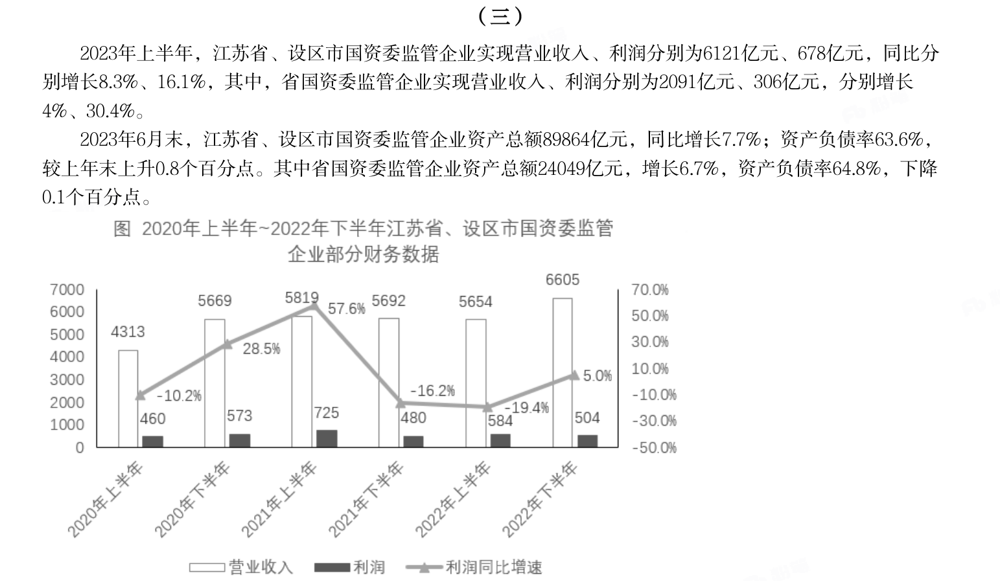

材料文字（图表以原图为准）

（三）
2023年上半年，江苏省、设区市国资委监管企业实现营业收入、利润分别为6121亿元、678亿元，同比分别增长8.3%、16.1%，其中，省国资委监管企业实现营业收入、利润分别为2091亿元、306亿元，分别增长4%、30.4%。
2023年6月末，江苏省、设区市国资委监管企业资产总额89864亿元，同比增长7.7%；资产负债率63.6%，较上年末上升0.8个百分点。其中省国资委监管企业资产总额24049亿元，增长6.7%，资产负债率64.8%，下降0.1个百分点。
【图】2020年上半年~2022年下半年江苏省、设区市国资委监管企业部分财务数据（见图）

### D02-ZL-040

2023年6月末,江苏设区市国资委监管企业资产总额同比增速的计算式可表示为( )。

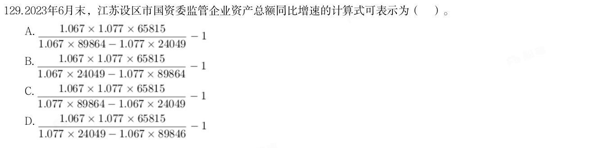

A. 1.067×1.077×65815/(1.067×89864-1.077×24049)-1  
B. 1.067×1.077×65815/(1.067×24049-1.077×89864)-1  
C. 1.067×1.077×65815/(1.077×89864-1.067×24049)-1  
D. 1.067×1.077×65815/(1.077×24049-1.067×89846)-1  

## 材料 38 · ZLM-SC2024-1

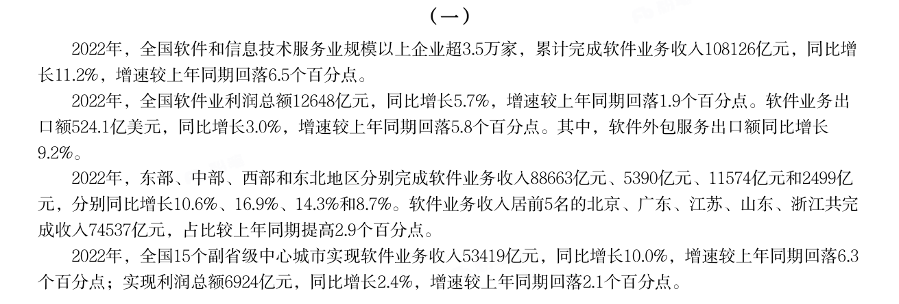

材料文字（图表以原图为准）

（一）
        2022年，全国软件和信息技术服务业规模以上企业超3.5万家，累计完成软件业务收入108126亿元，同比增
长11.2%，增速较上年同期回落6.5个百分点。
        2022年，全国软件业利润总额12648亿元，同比增长5.7%，增速较上年同期回落1.9个百分点。软件业务出
口额524.1亿美元，同比增长3.0%，增速较上年同期回落5.8个百分点。其中，软件外包服务出口额同比增长
9.2%。
        2022年，东部、中部、西部和东北地区分别完成软件业务收入88663亿元、5390亿元、11574亿元和2499亿
元，分别同比增长10.6%、16.9%、14.3%和8.7%。软件业务收入居前5名的北京、广东、江苏、山东、浙江共完
成收入74537亿元，占比较上年同期提高2.9个百分点。
        2022年，全国15个副省级中心城市实现软件业务收入53419亿元，同比增长10.0%，增速较上年同期回落6.3
个百分点；实现利润总额6924亿元，同比增长2.4%，增速较上年同期回落2.1个百分点。

### D02-ZL-045

2022年,全国软件和信息技术服务业规模以上企业累计完成软件业务收入约比2020年增长了:

A. 16%  
B. 23%  
C. 29%  
D. 31%  

### D02-ZL-128

以下信息中,能够从上述资料中推出的有几项?
①2020年平均每个副省级中心城市软件业务收入
②2021年北京、广东、江苏、山东、浙江软件业务收入之和
③2022年软件外包服务出口额占软件业务出口额比重

A. 0  
B. 1  
C. 2  
D. 3  

## 材料 39 · ZLM-SC2022H-1

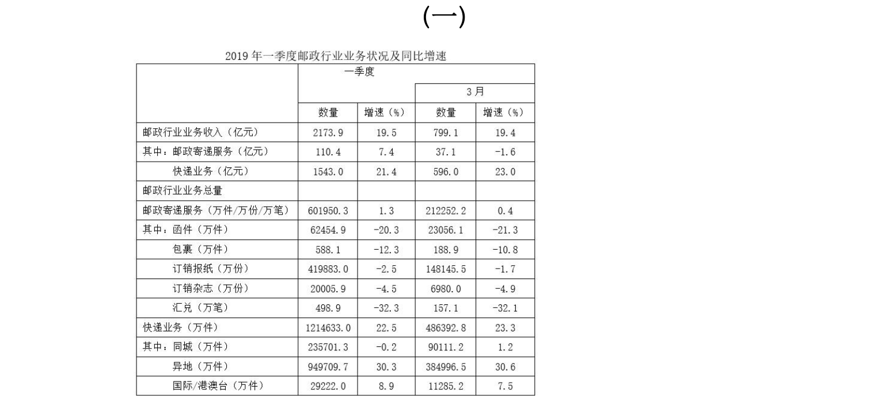

材料文字（图表以原图为准）

（一）
【表】2019年一季度邮政行业业务状况及同比增速（见图）

### D02-ZL-050

2019年1~2月,我国包裏寄递量比去年同期:

A. 下降了不到10%  
B. 下降了10%以上  
C. 上升了不到10%  
D. 上升了10%以上  

## 材料 40 · ZLM-SC2020H-1

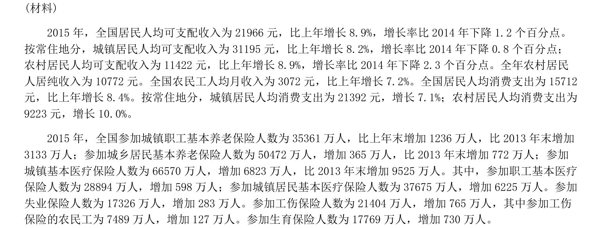

材料文字（图表以原图为准）

（材料）
2015年，全国居民人均可支配收入为21966元，比上年增长8.9%，增长率比2014年下降1.2个百分点。
按常住地分，城镇居民人均可支配收入为31195元，比上年增长8.2%，增长率比2014年下降0.8个百分点；农村居民人均可支配收入为11422元，比上年增长8.9%，增长率比2014年下降2.3个百分点。全年农村居民人居纯收入为10772元。全国农民工人均月收入为3072元，比上年增长7.2%。全国居民人均消费支出为15712元，比上年增长8.4%。按常住地分，城镇居民人均消费支出为21392元，增长7.1%；农村居民人均消费支出为9223元，增长10.0%。
2015年，全国参加城镇职工基本养老保险人数为35361万人，比上年末增加1236万人，比2013年末增加3133万人；参加城乡居民基本养老保险人数为50472万人，增加365万人，比2013年末增加772万人；参加城镇基本医疗保险人数为66570万人，增加6823万人，比2013年末增加9525万人。其中，参加职工基本医疗保险人数为28894万人，增加598万人；参加城镇居民基本医疗保险人数为37675万人，增加6225万人。参加失业保险人数为17326万人，增加283万人。参加工伤保险人数为21404万人，增加765万人，其中参加工伤保险的农民工为7489万人，增加127万人。参加生育保险人数为17769万人，增加730万人。

### D02-ZL-051

2013年,城镇居民人均可支配收入约为多少万元?

A. 1.9  
B. 2.2  
C. 2.6  
D. 3.0  

### D02-ZL-054

2014年,参加城镇职工基本养老保险人数比上年同期约增长了:

A. 4.4%  
B. 4.9%  
C. 5.4%  
D. 5.9%  

## 材料 41 · ZLM-ZJ2023A-2

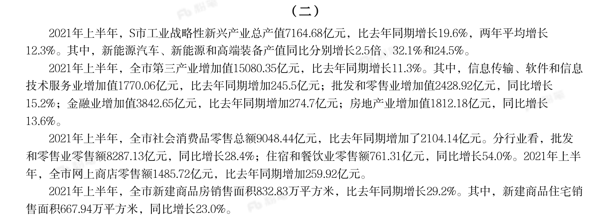

材料文字（图表以原图为准）

（二）
2021年上半年，S市工业战略性新兴产业总产值7164.68亿元，比去年同期增长19.6%，两年平均增长12.3%。其中，新能源汽车、新能源和高端装备产值同比分别增长2.5倍、32.1%和24.5%。
2021年上半年，全市第三产业增加值15080.35亿元，比去年同期增长11.3%。其中，信息传输、软件和信息技术服务业增加值1770.06亿元，比去年同期增加245.5亿元；批发和零售业增加值2428.92亿元，同比增长15.2%；金融业增加值3842.65亿元，比去年同期增加274.7亿元；房地产业增加值1812.18亿元，同比增长13.6%。
2021年上半年，全市社会消费品零售总额9048.44亿元，比去年同期增加了2104.14亿元。分行业看，批发和零售业零售额8287.13亿元，同比增长28.4%；住宿和餐饮业零售额761.31亿元，同比增长54.0%。2021年上半年，全市网上商店零售额1485.72亿元，比去年同期增加259.92亿元。
2021年上半年，全市新建商品房销售面积832.83万平方米，比去年同期增长29.2%。其中，新建商品住宅销售面积667.94万平方米，同比增长23.0%。

### D02-ZL-053

2020年上半年,S市工业战略性新兴产业总产值同比增长在以下哪个范围内?

A. 不到7%  
B. 7~10%  
C. 10~13%  
D. 超过13%  

## 材料 42 · ZLM-GD2020Z-1

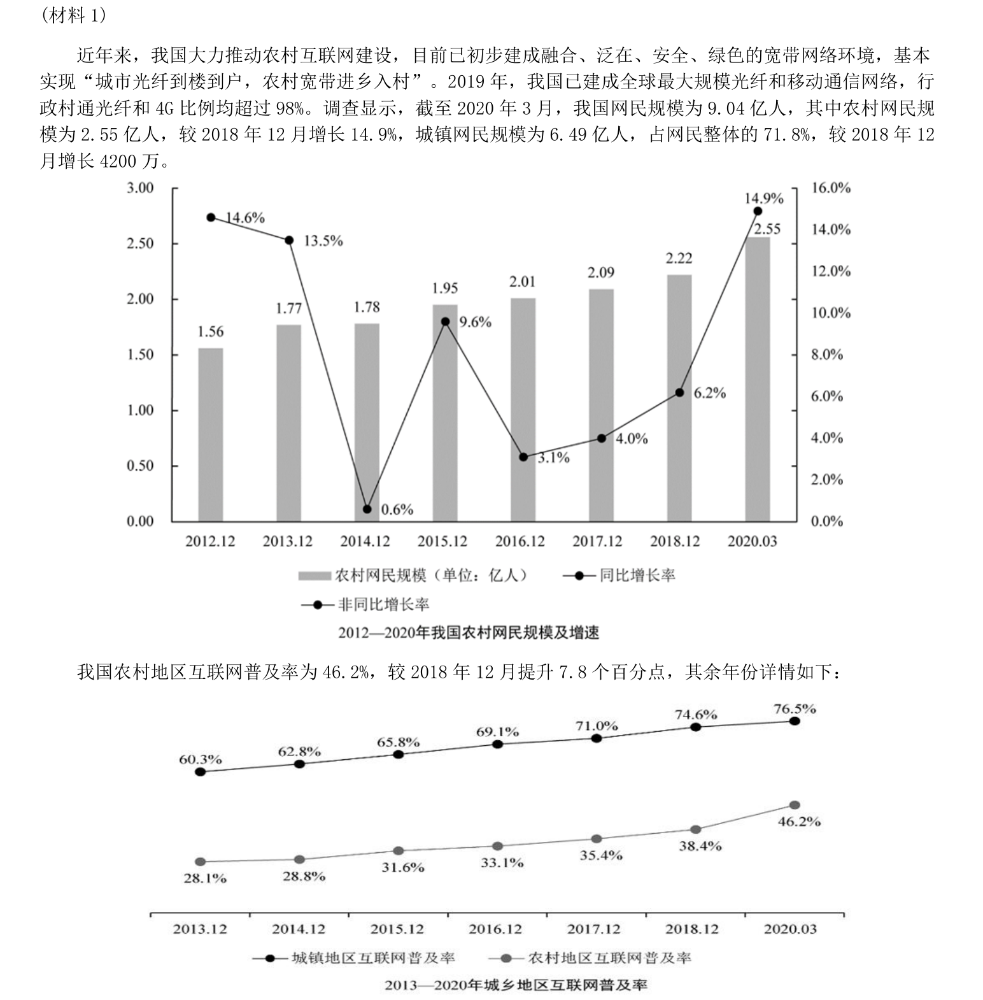

材料文字（图表以原图为准）

（材料1）
近年来，我国大力推动农村互联网建设，目前已初步建成融合、泛在、安全、绿色的宽带网络环境，基本实现“城市光纤到楼到户，农村宽带进乡入村”。2019年，我国已建成全球最大规模光纤和移动通信网络，行政村通光纤和4G比例均超过98%。调查显示，截至2020年3月，我国网民规模为9.04亿人，其中农村网民规模为2.55亿人，较2018年12月增长14.9%，城镇网民规模为6.49亿人，占网民整体的71.8%，较2018年12月增长4200万。
【图】2012—2020年我国农村网民规模及增速（见图）
我国农村地区互联网普及率为46.2%，较2018年12月提升7.8个百分点，其余年份详情如下：
【图】2013—2020年城乡地区互联网普及率（见图）

### D02-ZL-056

与2011年12月相比,2020年3月农村网民规模增长了约:

A. 40.5%  
B. 52.8%  
C. 87.3%  
D. 101.2%  

### D02-ZL-071

如果按照2018年12月到2020年3月的城镇网民规模月均增长量估算,2020年12月,城镇网民规模约为( )亿人。

A. 6.49  
B. 6.74  
C. 6.99  
D. 7.24  

## 材料 43 · ZLM-SC2024-2

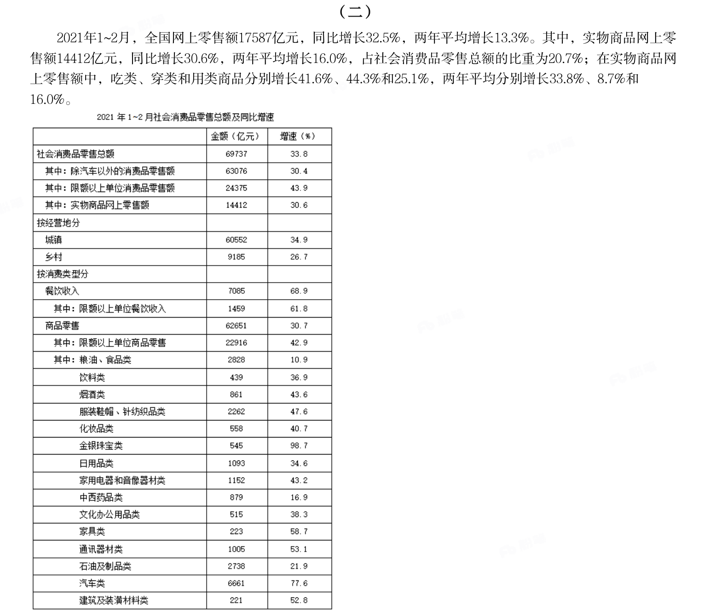

材料文字（图表以原图为准）

（二）
2021年1~2月，全国网上零售额17587亿元，同比增长32.5%，两年平均增长13.3%。其中，实物商品网上零售额14412亿元，同比增长30.6%，两年平均增长16.0%，占社会消费品零售总额的比重为20.7%；在实物商品网上零售额中，吃类、穿类和用类商品分别增长41.6%、44.3%和25.1%，两年平均分别增长33.8%、8.7%和16.0%。
【表】2021年1~2月社会消费品零售总额及同比增速（见图）

### D02-ZL-057

在2020年1~2月1全国网上零售额和2实物商品网上零售额中:

A. 仅1同比正增长  
B. 仅2同比正增长  
C. 1和2均同比正增长  
D. 1和2均未同比正增长  

### D02-ZL-059

2020年1~2月,将吃类、穿类和用类商品的实物商品网上零售额同比增速从高到低排列,下列排序正确的是:

A. 吃类、用类、穿类  
B. 吃类、穿类、用类  
C. 穿类、吃类、用类  
D. 穿类、用类、吃类  

## 材料 44 · ZLM-GK2021D-4

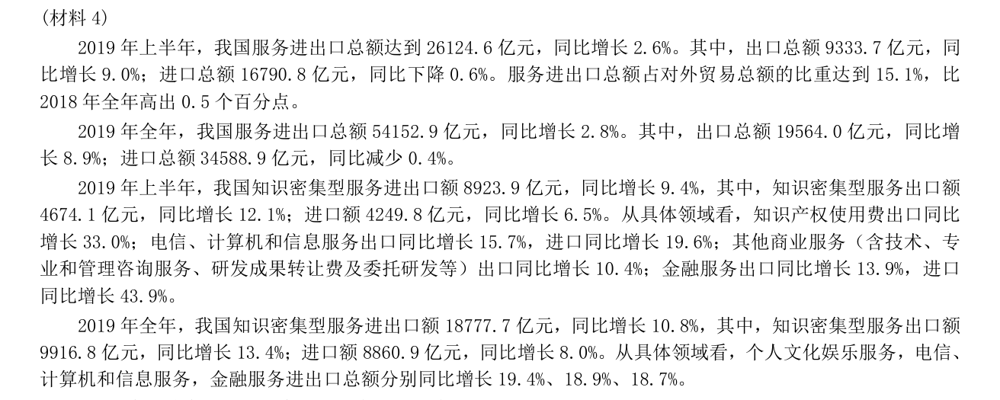

材料文字（图表以原图为准）

(材料4)
2019 年上半年，我国服务进出口总额达到26124.6 亿元，同比增长2.6%。其中，出口总额9333.7 亿元，同
比增长9.0%；进口总额16790.8 亿元，同比下降0.6%。服务进出口总额占对外贸易总额的比重达到15.1%，比
2018 年全年高出0.5 个百分点。
2019 年全年，我国服务进出口总额54152.9 亿元，同比增长2.8%。其中，出口总额19564.0 亿元，同比增
长8.9%；进口总额34588.9 亿元，同比减少0.4%。
2019 年上半年，我国知识密集型服务进出口额8923.9 亿元，同比增长9.4%，其中，知识密集型服务出口额
4674.1 亿元，同比增长12.1%；进口额4249.8 亿元，同比增长6.5%。从具体领域看，知识产权使用费出口同比
增长33.0%；电信、计算机和信息服务出口同比增长15.7%，进口同比增长19.6%；其他商业服务（含技术、专
业和管理咨询服务、研发成果转让费及委托研发等）出口同比增长10.4%；金融服务出口同比增长13.9%，进口
同比增长43.9%。
2019 年全年，我国知识密集型服务进出口额18777.7 亿元，同比增长10.8%，其中，知识密集型服务出口额
9916.8 亿元，同比增长13.4%；进口额8860.9 亿元，同比增长8.0%。从具体领域看，个人文化娱乐服务，电信、
计算机和信息服务，金融服务进出口总额分别同比增长19.4%、18.9%、18.7%。

### D02-ZL-058

2019年上半年,我国知识密集型服务进出口额环比约:

A. 上升了1.5%  
B. 上升了10.5%  
C. 下降了1.5%  
D. 下降了10.5%  

### D02-ZL-095

2019年下半年,我国服务进出口贸易状况为:

A. 顺差5000亿元以内  
B. 顺差5000亿元以上  
C. 逆差5000亿元以内  
D. 逆差5000亿元以上  

### D02-ZL-096

2018年,我国对外贸易总额约为多少万亿元?

A. 17  
B. 25  
C. 36  
D. 48  

### D02-ZL-097

能够从上述资料中推出的是:

A. 2019年下半年,我国服务进口额同比为正增长  
B. 2019年上半年,电信、计算机和信息服务进出口总额占知识密集型服务进出口总额的比重高于上年同期水平  
C. 2019年上半年,非知识密集型服务进出口贸易逆差低于7000亿元  
D. 2019年下半年,我国知识密集型服务出口额占服务出口额的比重低于知识密集型服务进口额占服务进口额的比重  

## 材料 45 · ZLM-GDXD2020ZH-1

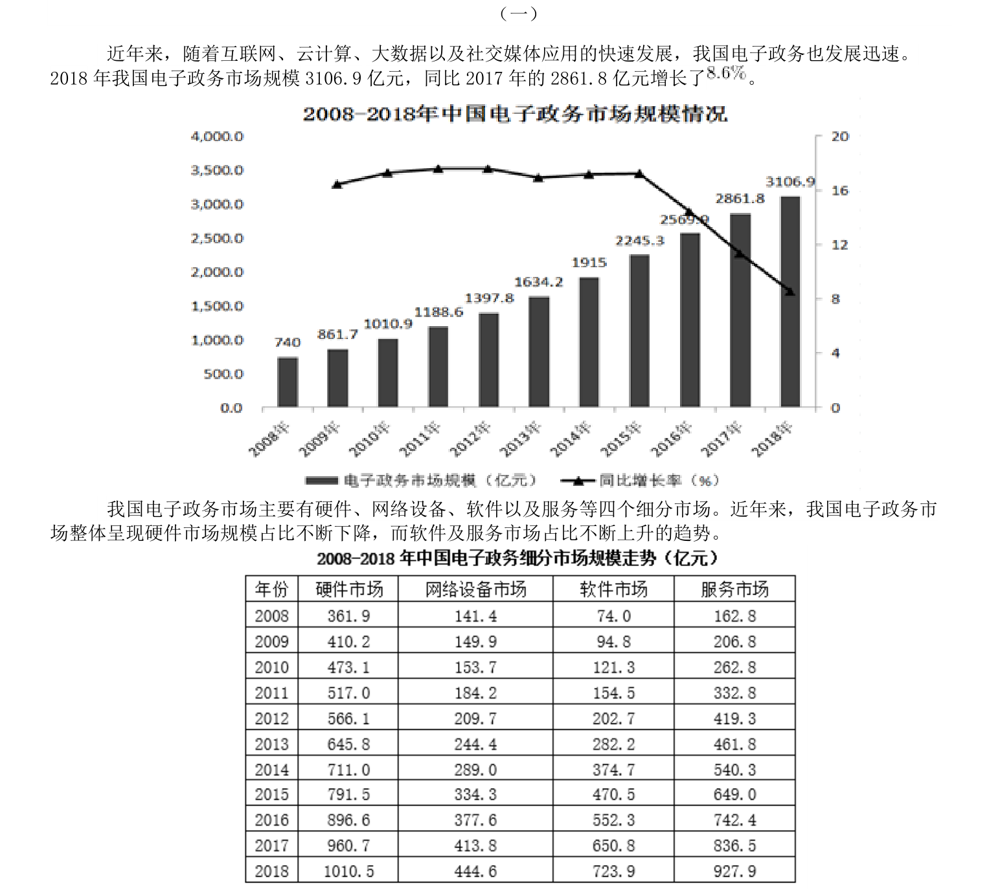

材料文字（图表以原图为准）

（一）
近年来，随着互联网、云计算、大数据以及社交媒体应用的快速发展，我国电子政务也发展迅速。2018年我国电子政务市场规模3106.9亿元，同比2017年的2861.8亿元增长了8.6%。
【图】2008-2018年中国电子政务市场规模情况（见图）
我国电子政务市场主要有硬件、网络设备、软件以及服务等四个细分市场。近年来，我国电子政务市场整体呈现硬件市场规模占比不断下降，而软件及服务市场占比不断上升的趋势。
【表】2008-2018年中国电子政务细分市场规模走势（亿元）（见图）

### D02-ZL-062

根据2018年的增长率预测,2019年我国电子政务市场的规模约为( )亿元。

A. 3270  
B. 3370  
C. 3470  
D. 3570  

## 材料 46 · ZLM-GK2025D-2

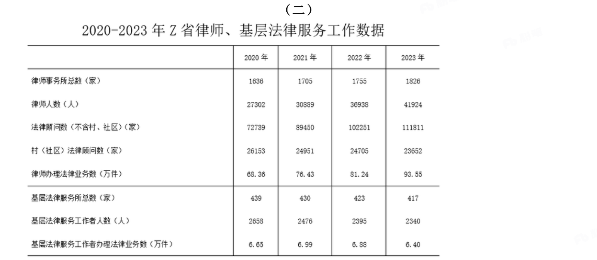

材料文字（图表以原图为准）

（二）
【表】2020-2023年Z省律师、基层法律服务工作数据（见图）

### D02-ZL-063

如保持2023年同比增量不变,则到哪一年Z省律师办理法律业务数将首次超过150万件?

A. 2026年  
B. 2027年  
C. 2028年  
D. 2029年  

## 材料 47 · ZLM-HB2020-3

材料文字（图表以原图为准）

（材料3）
截至2018年底，中国人工智能市场规模约为238.2亿元，同比增长率达到56.6%。从中国人工智能企业地域分布情况来看，北京企业数量最多，企业数量为368家；其次为广东，人工智能企业数量为185家；排名第三的是上海，数量为131家。
【图1】2014-2018年中国人工智能市场规模（见图）
【图2】2018年底人工智能企业地域分布情况（部分省份）（见图）

### D02-ZL-064

若按照2018年同比增长率,到2019年底中国人工智能市场规模约为:

A. 363亿元  
B. 371亿元  
C. 373亿元  
D. 383亿元  

## 材料 48 · ZLM-SD2022-2

材料文字（图表以原图为准）

（二）
数据显示，我国近10年养老相关企业注册量逐年攀升。2020年注册量达5.09万家，同比增长22%。2021年1-3季度共注册3.92万家养老相关企业，同比增长16%。
【图1】2016-2020年我国养老相关企业注册量（见图）
从地区来看，2021年9月月末，江苏省是我国养老相关企业数量最多的省份，占全国总量的9%，山东、广东排名第二、第三位。
【图2】2021年9月月末我国养老相关企业数量排名前十的省（区、市）（见图）
从城市分布来看，2021年9月月末，广州市拥有的养老相关企业数量最多，共7763家，占广东省总量的34.6%。
【图3】2021年9月月末我国养老相关企业数量排名前十的城市（见图）

### D02-ZL-067

如果2021年我国第4季度注册养老相关企业的同比增长幅度与1-3季度相同,则2021年我国养老相关企业注册量约为多少万家?

A. 5.23  
B. 5.45  
C. 5.68  
D. 5.90  

## 材料 49 · ZLM-GK2025F-3

材料文字（图表以原图为准）

（三）
【图】第6-15届CMC（全国大学生数学竞赛）参赛情况（见图）
【表】第15届CMC部分赛区参赛情况（见图）

### D02-ZL-068

若保持第15届CMC参赛人数环比增量不变,问哪一届CMC参赛人数将第一次超过50万人?

A. 第19届  
B. 第20届  
C. 第21届  
D. 第22届  

## 材料 50 · ZLM-JS2021A-1

材料文字（图表以原图为准）

（材料1）
党的十八大以来，我国居民收入水平持续较快增长，消费水平稳步提高，消费结构优化升级，生活质量明显提升，人民生活正阔步迈向全面小康。
2019年，全国居民人均可支配收入30733元，比2000年增长4.4倍。全国居民人均消费支出21559元，比2012年增长78.9%，年均增长8.7%。其中，城镇居民人均消费支出28063元，比2012年增长64.0%；农村居民人均消费支出13328元，比2012年增长99.9%。
2019年全国居民恩格尔系数（人均食品烟酒支出占人均消费支出的比重）为28.2%，比2000年下降14.0个百分点。其中，城镇居民恩格尔系数为27.6%，农村居民恩格尔系数为30.0%，分别比2000年下降11.0和18.3个百分点。
2019年，全国居民平均每百户拥有彩色电视机120.6台、洗衣机96.0台、电冰箱100.9台、空调115.6台、汽车35.3辆。城镇居民人均住房建筑面积为39.8平方米，比2002年增长62.1%；农村居民人均住房建筑面积为48.9平方米，比2000年增长97.2%。全国居民人均交通通信支出2862元，比2000年年均增长14.7%，占人均消费支出的比重较2000年提高6.1个百分点。全国居民人均医疗保健支出1902元，比2000年年均增长13.4%，占人均消费支出的比重较2000年提高2.9个百分点。

### D02-ZL-069

按2001—2019年的年均增速估算,2021年全国居民人均医疗保健支出介于:

A. 2320元和2370元之间  
B. 2370元和2420元之间  
C. 2420元和2470元之间  
D. 2470元和2520元之间  

## 材料 51 · ZLM-GD2022X-1

材料文字（图表以原图为准）

（一）
2020年，全国职工基本医疗保险（以下简称职工医保）参保人数持续增加，基金收支规模基本稳定。参加
职工医保34455万人，比上年同比增加1530万人。其中在职职工25429万人，比上年增长5.0%；退休职工9026万
人，比上年增长3.7%。企业、机关事业、灵活就业等其他人员三类参保人员（包括在职职工和退休人员）分别
为23317万人、6387万人、4751万人，分别比上年增加1050万人、155万人、325万人。
受新冠肺炎疫情影响，2020年2-7月全国多地实施阶段性减半征收职工医保单位缴费，累计减征约1649亿
元，全年职工医保基金（含生育保险）收入15732亿元，比上年减少0.7%；支出12867亿元，比上年增长1.6%。
2020年，职工医保统筹基金（含生育保险）收入9145亿元，比上年减少8.6%；支出7931亿元，比上年减少
0.1%；当期结存1214亿元，累计结存15327亿元。
2020年，职工医保个人账户收入6587亿元，比上年增长12.8%；支出4936亿元，比上年增长4.5%；当期结
存1650亿元，累计结存10096亿元。
2020年就诊量同比有所减少。参加职工医保人员享受待遇17.9亿人次，比上年减少15.6%。职工医保参保人
员住院率15.9%，比上年下降2.8个百分点。其中：在职职工住院率为8.6%，比上年下降1.5个百分点；退休职工
住院率为36.0%，比上年下降6.5个百分点。

### D02-ZL-070

若2-7月未实施阶段性减半征收职工医保单位缴费,则2020年职工医保基金总收入(含生育保险)同比增长:

A. 4%  
B. 7%  
C. 10%  
D. 13%  

### D02-ZL-092

2020年,灵活就业等其他人员参保人数占职工医保参保总人数的比例约为(    )。

A. 12.9%  
B. 13.8%  
C. 15.2%  
D. 16.1%  

### D02-ZL-093

2020年,下列指标的同比增长率从高到低排列正确的是(    )。

A. 职工医保基金(含生育保险)收入>职工医保个人账户收入>职工医保统筹基金(含生育保险)收入  
B. 职工医保个人账户支出>职工医保个人账户收入>职工医保统筹基金(含生育保险)收入  
C. 职工医保个人账户收入>职工医保基金(含生育保险)收入>职工医保基金(含生育保险)支出  
D. 职工医保基金(含生育保险)支出>职工医保统筹基金(含生育保险)支出>职工医保基金(含生育保险)收入  

### D02-ZL-094

根据以上资料,下列说法不准确的是(    )。

A. 2020年,职工医保参保人员人均享受待遇约5次  
B. 2019年,在职职工住院率约为退休职工住院率的四分之一  
C. 2020年,三类职工医保参保人员中,灵活就业等其他人员参保人数同比增速最快  
D. 若职工医保个人账户收入和支出的年同比增幅保持不变,则2021年个人账户当期结存不足2000亿元  

## 材料 52 · ZLM-GK2021D-1

材料文字（图表以原图为准）

（材料1）
【表】2013～2019年我国LED产业不同领域产值规模（单位：亿元）（见图）

### D02-ZL-072

“十三五”(2016—2020年)最后一年我国LED产业总产值要实现比“十二五”(2011—2015年)最后一年翻番的目标,总产值至少要同比增长:

A. 9.6%  
B. 12.5%  
C. 16.3%  
D. 22.1%  

## 材料 53 · ZLM-GK2023D-3

材料文字（图表以原图为准）

（三）
超级计算，也被称为高性能计算。从算力资源的需求看，高性能计算可以分为尖端超算、通用超算、业务超算和人工智能超算四大类。
【表】2016～2021年中国超算服务细分市场规模（单位：亿元）（见图）
【图】2016～2021年中国第三方超算服务市场规模（见图）

### D02-ZL-074

如保持2021年同比增量不变,则到哪一年第三方互联网超算服务商提供的服务市场规模将第一次超过第三方独立超算服务商?

A. 2025年  
B. 2026年  
C. 2027年  
D. 2028年  

## 材料 54 · ZLM-JS2025A-2

材料文字（图表以原图为准）

【表】2019-2023年江苏省中医服务部分数据（见图）

### D02-ZL-075

按2023年的增长率估算,江苏省中医服务的下列指标率先达到2019年水平2倍的是:

A. 中医类医院数  
B. 中医药从业人员数  
C. 中医类医院实有床位数  
D. 中医医院患者门诊次均费用  

## 材料 55 · ZLM-HB2022-3

材料文字（图表以原图为准）

（三）
【图】2012-2020年职工医保参保人员结构（单位：万人）（见图）
【表】2012-2020年居民医保基金收支情况（单位：亿元）（见图）

### D02-ZL-076

假设2021年居民医保基金收入同比增速与2020年相同,那么,2021年居民医保基金收入约为:

A. 9598亿元  
B. 9689亿元  
C. 9727亿元  
D. 9873亿元  

## 材料 56 · ZLM-GK2024D-4

材料文字（图表以原图为准）

（四）
【图1】2017~2022年全国主要电信业务收入（见图）
【图2】2017~2022年全国年末移动电话和蜂窝物联网终端用户数（见图）

### D02-ZL-077

如2022年内每个月移动电话用户数增量和蜂窝物联网终端用户数增量均为固定值,则2022年蜂窝物联网终端用户数第一次超过移动电话用户数是在哪个季度?

A. 第一季度  
B. 第二季度  
C. 第三季度  
D. 第四季度  

## 材料 57 · ZLM-GK2022D-2

材料文字（图表以原图为准）

【图】2011—2020年中国IC封装市场规模及其中IC先进封装市场规模占比（见图）

### D02-ZL-079

已知2020年中国IC封装市场规模同比增长x亿元,IC封装市场中IC先进封装市场规模占比同比增长y个百分点,而2020年往后中国IC封装市场规模及IC先进封装市场规模占比每年都分别同比增长x亿元和y个百分点,则到“十四五”最后一年(2025年),中国IC先进封装市场规模将达到多少亿元?

A. 469  
B. 575  
C. 433  
D. 521  

## 材料 58 · ZLM-GK2018D-5

材料文字（图表以原图为准）

（五）根据以下资料，回答下列5 题。
2017 年1~2 月，全国造船完工936 万载重吨，同比增长123%；承接新船订单221 万载重吨，同比增长133%。
2 月末，手持船舶订单9207 万载重吨，同比下降22.6%，比2016 年末下降7.6%。
2017 年1~2 月，全国完工出口船907 万载重吨，同比增长127%；承接出口船订单191 万载重吨，同比增长

122%。2 月末，手持出口船订单8406 万载重吨，同比下降25.9%。
2017 年1~2 月，53 家重点监测的造船企业（以下简称重点企业）造船完工912 万载重吨，同比增长133%；
承接新船订单197 万载重吨，同比增长119%。2 月末，手持船舶订单8874 万载重吨，同比下降23.1%。
2017 年1~2 月，重点企业完工出口船886 万载重吨，同比增长138%；承接出口船订单171 万载重吨，同比增
长109%。2 月末，手持出口船订单8129 万载重吨，同比下降26.6%。

### D02-ZL-080

2016年末全国手持船舶订单较同年2月末:

A. 降低16.2%  
B. 降低2.2%  
C. 增加16.2%  
D. 增加2.2%  

### D02-ZL-081

2017年1~2月,重点企业下列指标中同比增速最快的是:

A. 造船完工量  
B. 承接新船订单量  
C. 出口船完工量  
D. 承接出口船订单量  

### D02-ZL-082

能够从上述资料中推出的是:

A. 2016年末,重点企业手持船舶订单不到9000万载重吨  
B. 2017年1~2月,非重点企业承接出口船订单约30万载重吨  
C. 2017年2月末,重点企业手持船舶订单同比降幅低于全国平均水平  
D. 2017年2月末,重点企业手持出口船订单占全国比重低于上年同期  

## 材料 59 · ZLM-GK2022F_xc-1

材料文字（图表以原图为准）

（一）
2021年1-2月，J省发电量为167亿千瓦时，其中风力发电量为17.4亿千瓦时。
【图1】2020年2-12月J省累计发电量及同比增速（见图）
【图2】2020年2-12月J省累计风力发电量及同比增速（见图）
（统计表/统计图见图片；下列 transcription 为编者转录，仅供检索与核对，以原图为准）

### D02-ZL-083

2020年第二季度,J省除风力发电之外的发电量在以下哪个范围内?

A. 不到200亿千瓦时  
B. 在200亿~215亿千瓦时  
C. 在215亿~230亿千瓦时  
D. 超过230亿千瓦时  

### D02-ZL-084

2021年1-2月J省累计发电量同比增速比同期风力发电量同比增速:

A. 高不到10个百分点  
B. 低不到10个百分点  
C. 高10个百分点以上  
D. 低10个百分点以上  

### D02-ZL-085

2020年3-12月,J省当月发电量同比增速快于当月累计发电量同比增速的月份有几个?

A. 5  
B. 6  
C. 7  
D. 8  

## 材料 60 · ZLM-SZ2024-2

材料文字（图表以原图为准）

根据以下资料，回答91~95题。
【图1】2018-2022年全国居民人均可支配收入及同比实际增速（见图）
【图2】2022年全国居民人均消费支出（见图）
（统计表/统计图见图片；下列 transcription 为编者转录，仅供检索与核对，以原图为准）

### D02-ZL-086

2022年,全国居民人均可支配收入的同比名义增速与实际增速相差( )个百分点。

A. 2.1  
B. 2.9  
C. 4.9  
D. 5.0  

## 材料 61 · ZLM-GD2023X-1

材料文字（图表以原图为准）

（一）
2021年，广东省财政科学技术支出为982.76亿元，占当年全省财政一般公共预算支出的比重为5.4%。其
中，省本级财政科学技术支出为102.05亿元，占省本级财政一般公共预算支出的比重为6.6%，同比增加0.84个
百分点。珠江三角洲核心区财政科学技术支出845.09亿元，同比增长2.6%。
【表1】2020—2021年广东省各经济区域财政科学技术支出情况（单位：亿元）（见图）
【表2】2020—2021年广东省各分类科目财政科学技术支出情况（单位：亿元）（见图）
（统计表/统计图见图片；下列 transcription 为编者转录，仅供检索与核对，以原图为准）

### D02-ZL-087

2020年,广东省省本级财政科学技术支出为(    )亿元。

A. 83.96  
B. 102.64  
C. 122.32  
D. 132.67  

### D02-ZL-088

2021年,广东省省本级财政一般公共预算支出在全省财政一般公共预算支出中的比重(    )。

A. 小于5%  
B. 在5%~10%之间  
C. 在10%~15%之间  
D. 大于15%  

## 材料 62 · ZLM-GK2019D-1

材料文字（图表以原图为准）

（一）
【图1】2017年3月～2018年2月全国进口药品数量及同比增速（见图）
【图2】2017年3月～2018年2月全国进口药品金额及同比增速（见图）
（统计表/统计图见图片；下列 transcription 为编者转录，仅供检索与核对，以原图为准）

### D02-ZL-089

2017年下半年,全国进口药品数量同比增速低于上月水平的月份有几个?

A. 2  
B. 3  
C. 4  
D. 5  

### D02-ZL-090

以下折线图中,能准确反映2017年第四季度各月全国进口药品金额环比增长率的是:

## 材料 63 · ZLM-GD2020Z-3

材料文字（图表以原图为准）

(材料3)
2019 年全国农村网络零售额从2014 年的1800 亿元增加至逾1.7 万亿元，占全国网络零售总额的16.1%，
较上年略有提升；同比增长19.1%，高于全国网络零售总额增长率2.6 个百分点。
分地区看，东、中、西部和东北地区农村网络零售额分别占全国农村网络零售额的76.6%、12.0%，9.4%和
2.0%，同比增长分别为19.8%，17.1%，17.6%和10.2%。
【图】2014—2019年全国农村网络零售情况（见图）
2019 年，电子商务进农村综合示范工作聚焦脱贫攻坚和乡村振兴，取得了阶段性成果。全国832 个贫困县
实现网络零售额1489.9 亿元，同比增长18.5%，全国农产品网络零售额高达3975 亿元，同比增长27%，其中，
水果、肉禽蛋、奶类同比增速排名前三，分别为53.2%、39.4%和37.5%，生鲜农产品网络零售额持续高速增长，
潜力不断释放。
【图】2019年全国各类农产品网络零售情况（见图）
（统计表/统计图见图片；下列 transcription 为编者转录，仅供检索与核对，以原图为准）

### D02-ZL-098

2019年,全国农产品网络零售额同比增长率较全国网络零售总额同比增长率高约(    )个百分点。

A. 7.9  
B. 10.5  
C. 11.9  
D. 13.5  

### D02-ZL-099

2019年全国各类农产品中,网络零售额排名前三的农产品零售额合计约为(    )亿元。

A. 277.1  
B. 739.4  
C. 1073.3  
D. 1935.8  

### D02-ZL-100

根据以上资料,下列说法正确的是:

A. 2014—2019年,农村网络零售额增长了10倍  
B. 2019年,平均每个贫困县网络零售额超2亿元  
C. 2018年,全国农村网络零售额约占全国网络零售总额的17%  
D. 2019年水产品占全国农产品网络零售额的比重较2018年有所下降  

## 材料 64 · ZLM-SZ2024-1

材料文字（图表以原图为准）

根据以下资料，回答86~90 题。
2022 年，深圳全市绿化覆盖总面积达到101385.6 公顷，比上年增长513.4 公顷；其中建
成区绿化覆盖面积
41457.5 公顷，比上年增长345.2 公顷；建成区绿化覆盖率43.09%，比上年增长0.09 个百
分点；全市绿地面积
98270.2 公顷，比上年增长1.45%；其中建成区绿地面积36613.1 公顷，比上年增长
3.30%；建成区绿地率比上年增长0.98 个百分点；全市公园绿地面积22219.0 公顷，比上年
增长222.5 公顷，按常住人口计算人均公园绿地面积比上年增长1.13%。
2022 年全市公园已达到1260 个，公园总面积38209.9 公顷，分别是2003 年的8.6 倍和
5.6 倍；全市公园中，有自然公园37 个，比上年增加4 个；城市公园191 个，比上年增加4
个；社区公园1032 个，比上年增加14 个。三级公园体系的建成，基本实现了市民出门500
米可达社区公园，2 公里可达城市综合圈，5 公里可达自然公园的目标。全市公园绿化活动场
地服务半径覆盖的居住用地面积达到21018.2 公顷，较上年增长280.8 公顷，公园绿化活动场
地服务半径覆盖率达到90.87%，与上年持平。
2022 年，全市绿道长度3119 公里，比上年增长9.70%，增速较上年收窄5.78 个百分点，
万人拥有绿道长度
1.77 公里，比上年增长9.94%；绿道密度（全市绿道长度与全市面积之
比）1.56 公里/平方公里，居广东省首位。深圳市建成区绿化覆盖率、公园绿化活动场地服务
半径覆盖率、万人拥有绿道长度3 项指标已达到国家生态园林城市标准。

### D02-ZL-101

根据资料，以下说法可以判断属实的是（    ）。

A. 2022年，深圳基本实现了市民出门500米可达城市公园的目标  
B. 2022年，深圳建成区绿地率已达到国家生态园林城市标准  
C. 2022年，深圳绿道密度居全国首位  
D. 2022年，深圳全市公园数量比上年增加20个以上  

（改编题；与同组其他题的附加条件分别独立使用。）

### D02-ZL-102

2022年,深圳市建成区面积约为( )万公顷。

A. 9.6  
B. 9.8  
C. 9.9  
D. 10.0  

### D02-ZL-103

2022年,深圳市每万人拥有公园绿地面积约为( )公顷。

A. 11.6  
B. 12.1  
C. 12.6  
D. 无法判断  

### D02-ZL-104

根据上文,下列指标不能计算求得数值的是( )。

A. 2003年深圳市公园总面积(公顷)  
B. 2020年全市万人拥有绿道长度(公里)  
C. 2022年深圳全市面积(平方公里)  
D. 2021年深圳市常住人口数(万人)  

### D02-ZL-105

根据上文,下列说法错误的是( )。

A. 2021年,深圳市建成区绿地率约为38.2%  
B. 2022年,深圳市自然公园和城市公园数量占公园总数的比重同比均有所提高  
C. 2003-2022年,深圳市公园总面积年均增加约1652公项  
D. 2020年,深圳全市绿道长度不足2500公里  

## 材料 65 · ZLM-ZJ2021A-1

材料文字（图表以原图为准）

（一）
2017年，国内旅游市场高速增长，入出境市场平稳发展，供给侧结构性改革成效明显。国内旅游人数50.01
亿人次，比上年同期增长12.8%；入出境旅游总人数2.7亿人次，增长3.7%；全年实现旅游总收入5.40万亿元，
增长15.1%；全年全国旅游业对GDP的综合贡献为9.13万亿元，占GDP总量的11.04%；旅游直接就业2825万人，
旅游直接和间接就业7990万人，占全国就业总人口的10.28%。
一、全年国内旅游收入增长15.9%
2017年，国内旅游人数50.01亿人次，比上年同期增长12.8%。其中，城镇居民36.77亿人次，增长15.1%；
农村居民13.24亿人次，增长6.8%。国内旅游收入4.57万亿元，增长15.9%。其中，城镇居民花费3.77万亿元，增
长16.8%；农村居民花费0.80万亿元，增长11.8%。
二、全年入境过夜旅游人数增长2.5%
2017年，入境旅游人数13948万人次，比上年同期增长0.8%。其中，外国人2917万人次，增长3.6%；香港
同胞7980万人次，下降1.6%；澳门同胞2465万人次，增长4.9%；台湾同胞587万人次，增长2.5%。入境旅游人
数按照入境方式分，船舶占3.2%，飞机占16.5%，火车占0.8%，汽车占22.2%，其他占57.2%。
2017年，入境过夜旅游人数6074万人次，比上年同期增长2.5%。其中，外国人2248万人次，增长3.8%；香
港同胞2775万人次，增长0.1%；澳门同胞522万人次，增长8.6%；台湾同胞529万人次，增长4.0%。
三、全年国际旅游收入达1234亿美元
2017年，国际旅游收入1234亿美元，比上年同期增长2.9%。其中，外国人在华花费695亿美元，增长
4.1%；香港同胞在内地花费301亿美元，下降1.5%；澳门同胞在内地花费83亿美元，增长8.0%；台湾同胞在大
陆花费155亿美元，增长4.0%。
四、全年入境外国游客亚洲占74.6%，以观光休闲为目的游客占37.1%
2017年，入境外国游客人数4294万人次，亚洲占74.6%，美洲占8.2%，欧洲占13.7%，大洋洲占2.1%，非洲
占1.4%。其中，按照年龄分，14岁以下人数占3.1%，15—24岁占13.2%，25—44岁占49.9%，45—64岁占
29.2%，65岁以上占4.6%；按性别分，男占60.7%，女占39.3%；按目的分，会议/商务占13.3%，观光休闲占
37.1%，探亲访友占2.6%，服务员工占14.8%，其他占32.2%。
2017年，按入境旅游人数排序，我国主要客源市场前17位国家如下：缅甸、越南、韩国、日本、俄罗斯、
美国、蒙古、马来西亚、菲律宾、新加坡、印度、加拿大、泰国、澳大利亚、印度尼西亚、德国、英国。
五、全年中国公民出境旅游人数达13051万人次
2017年，中国公民出境旅游人数13051万人次，比上年同期增长7.0%。

### D02-ZL-108

2017年,全国入境旅游人数较出境旅游人数多多少万人次?

A. 892  
B. 895  
C. 897  
D. 903  

### D02-ZL-109

2016年,全国国内旅游人数约为入出境旅游总人数的多少倍?

A. 17  
B. 19  
C. 21  
D. 23  

### D02-ZL-110

2017年,城镇居民平均每人次旅游消费比农村居民约多多少元?

A. 382  
B. 395  
C. 406  
D. 421  

### D02-ZL-111

根据上述材料,以下分析不正确的是:

A. 2017年,入境外国游客人数:亚洲>欧洲>美洲>大洋洲>非洲  
B. 2017年,入境旅游人数按入境方式分:其他方式>汽车>飞机>船舶>火车  
C. 2017年,入境过夜旅游人数同比增速:澳门同胞>台湾同胞>外国人>香港同胞  
D. 2017年,主要客源市场国家按入境旅游人数:日本>俄罗斯>马来西亚>印度尼西亚>印度  

### D02-ZL-112

根据上述材料,以下说法正确的是:

A. 2017年,全国就业总人口超过8亿人  
B. 2017年,国际旅游收入五成以上由外国人在华花费实现  
C. 2017年,香港同胞在内地花费比台湾同胞在大陆花费多一倍以上  
D. 2017年,入境外国游客中,44岁以下年龄段游客人数占70%以上  

## 材料 66 · ZLM-GD2017-2

材料文字（图表以原图为准）

（二）
2016年，广东民营经济增加值突破四万亿元。经初步核算，全年实现民营经济增加值42578.76亿元，按可比价计算，比上年同期增长7.8%，增幅高于同期GDP增幅0.3个百分点，其中第二产业增幅比同期GDP第二产业增幅高3个百分点。民营经济占GDP的比重为53.6%，比2010年提高3.9个百分点，占比逐年提高；对GDP增长的贡献率为55.5%，同比提高1.3个百分点，拉动GDP增速达4.2个百分点，民营经济的作用不断提升，是广东经济增长的主力军。
【表】2016年广东民营经济各产业增加值（见图）
分行业看，民营经济发展速度快于全部经济类型的行业有工业、金融业和其他服务业，其中民营工业实现增加值15898.95亿元，同比增长9.7%，比全部经济类型工业快3.3个百分点；民营经济占全部经济类型比重较大的行业有农林牧渔业、住宿餐饮业、批发零售业和房地产业，分别为98.2%、85.3%、73.2%和68.3%；民营经济对GDP贡献率较大的行业有工业、其他服务业，分别为25.7%、11.3%。
【表】2016年广东各地区民营经济发展情况（见图）
【注释】
生产总值（GDP）：指按市场价格计算的一个地区所有常住单位在一定时期内生产活动的最终成果。从价格形态看，它是所有常住单位的增加值之和。
增加值：总产出减去中间投入后的余额，反映一定时期内各部门、各单位生产经营活动的最终成果，也就是本部门、本单位对生产总值提供的份额。

### D02-ZL-113

根据资料可知:

A. 2016年广东民营经济对GDP增长的贡献率高于其他经济类型  
B. 广东民营经济占GDP的比重从2011年开始超过50%  
C. 2016年广东的房地产市场中,国有经济占了近三分之一的份额  
D. 民营经济仅在部分行业具有优势  

## 材料 67 · ZLM-ZJ2021A-2

材料文字（图表以原图为准）

（二）
8月份，规模以上工业原煤生产增速回升，煤炭进口保持较高水平；原油生产增速由负转正，进口继续增
加；天然气生产保持较快增长，进口持续高速增长；电力生产加快。
一、原煤生产增速回升，煤炭进口保持较高水平，市场价格小幅波动
8月份，原煤产量3.0亿吨，同比增长4.2%，上月为下降2.0%；日均产量957万吨，环比增加49万吨。1—8月
份，原煤产量22.8亿吨，同比增长3.6%。
8月份，煤炭主产区生产均开始回升。其中，内蒙古同比增长10.0%，上月为下降1.4%；山西同比下降
0.9%，降幅较上月收窄2.2个百分点；陕西同比增长14.0%，增速较上月加快7.6个百分点；新疆同比增长7.1%，
上月为下降5.5%。
8月份，煤炭进口2868万吨，比上月略降33万吨，但仍保持较高水平，同比增长13.5%。1—8月份，煤炭进
口2.0亿吨，同比增长14.7%。
8月底，秦皇岛5500大卡煤炭综合交易价格为573元/吨，比7月底下降3元；5000大卡煤炭价格为510元/吨，
比7月底下降17元；4500大卡煤炭价格为456元/吨，比7月底下降12元。
二、原油生产增速由负转正，进口持续增加
8月份，原油生产1600万吨，同比增长0.2%，上月为下降2.6%，为2015年11月以来首次正增长；日均产量
51.6万吨，环比增加0.5万吨。1—8月份，原油产量12595万吨，同比下降1.8%。
原油进口持续增加，8月份进口原油3838万吨，比上月增加236万吨，同比增长12.9%。1—8月份，进口原
油29919万吨，同比增长6.5%。
国际原油价格震荡上行，截至8月底，布伦特原油现货离岸价格为76.94美元/桶，比7月底上涨2.78美元/
桶。
三、原油加工量增速有所放缓
8月份，原油加工量5031万吨，同比增长5.6%，增速比上月回落6.0个百分点；日均加工162.3万吨，环比减
少1.4万吨。1—8月，原油加工量40041万吨，同比增长8.7%。
四、天然气生产保持较快增长，进口持续高速增长
8月份，天然气产量129亿立方米，同比增长9.7%，增速比上月回落0.8个百分点；日均生产4.2亿立方米，
与上月基本持平。1—8月份，天然气产量1040亿立方米，同比增长5.9%。

天然气进口持续高速增长。8月份，进口天然气777万吨（1吨约为1380立方米），比上月增加39万吨，同
比增长37.3%。1—8月份，进口天然气5718万吨，同比增长34.8%。
五、电力生产加快
8月份，发电量6404.9亿千瓦时，同比增长7.3%，增速比上月加快1.6个百分点；日均发电206.6亿千瓦时，
再创新高。1—8月份，发电量同比增长7.7%，比去年同期加快1.2个百分点。
8月份，除风电外，其他品种电力生产同比增速较7月份均有所加快。其中火电同比增长6.0%，比上月加快
1.7个百分点；水电增长11.5%，加快5.5个百分点；核电增长16.9%，加快2.7个百分点；太阳能发电增长
12.2%，加快1.3个百分点。
因台风、降雨等气候因素影响，8月份风电大幅减少，增速比上月回落24.1个百分点，同比增长0.6%。

### D02-ZL-114

根据资料，以下说法可以判断属实的是（    ）。

A. 本年度8月份，原油产量为2015年11月以来的月度最高水平  
B. 截至本年度8月底，布伦特原油现货离岸价格比上年同期上涨  
C. 本年度8月份，火电、水电、核电、风电的生产同比增速均比7月份加快  
D. 本年度8月份，原煤日均产量高于7月份  

（改编题；与同组其他题的附加条件分别独立使用。）

### D02-ZL-115

本年度8月份,进口天然气环比增长约:

A. 5.28%  
B. 5.42%  
C. 5.73%  
D. 6.02%  

### D02-ZL-116

本年度上半年,煤炭进口量约为多少万吨?

A. 14198  
B. 14231  
C. 14264  
D. 14297  

### D02-ZL-117

以下关于煤炭主产区生产情况的说法正确的是:

A. 本年度8月份,各主产区产量同比均实现了增长  
B. 本年度7月份,山西产区生产煤炭量同比增长1.3%  
C. 本年度7、8月份,同时实现同比增长的只有陕西产区  
D. 本年度7月份,各主产区生产煤炭量同比降幅:内蒙古>山西>新疆  

### D02-ZL-118

根据上述材料,下列描述不正确的是:

A. 本年度1—8月份,我国原油进口量高于原油生产量  
B. 本年度8月份,原煤、天然气、电力的生产同比均增长  
C. 本年度8月份,除风电外其他品种电力生产同比增长幅度:核电>太阳能>水电>火电  
D. 本年度8月份,天然气产量与天然气进口量相差悬殊,表明我国对进口天然气依赖度较低  

## 材料 68 · ZLM-SZ2023-1

材料文字（图表以原图为准）

（一）
2021 年1-2 月，全国房地产开发投资13986 亿元，同比增长3873 亿元，房屋施工面积
770629 万平方米，同比增长11.0%。其中，住宅542503 万平方米，增长11.2%；办公楼31802 万平方米，
增长7.3%；商业营业用房76346 万平方米，增长2.5%；其他类型119978 万平方米。房屋新开工面积17037
万平方米，增长64.3%，其中，住宅12736 万平方米，增长68.5%。商品房销售面积17363 万平方米，同比
增长1.05 倍，比2019 年1-2 月增长23.3%，商品房销售额19151 亿元，同比增长1.33 倍，比2019 年同期
增长49.6%。
2 月末，商品房待售面积比上年末增加2575 万平方米，其中，住宅增加2314 万平方米，
办公楼和商业营业用房分别减少24 万平方米和269 万平方米。
2021 年1-2 月，分地区看，东部地区房地产开发投资8353 亿元，同比增长32.4%；中
部地区2640 亿元，增长52.5%；西部地区2834 亿元，增长45.1%；东北地区158 亿元，增长28.6%。
东部地区商品房销售面积7565 万平方米，同比增长113.9%；销售额11891 亿元，增长
148.1%，中部地区商品房销售面积4369 万平方米，增长104.3%；销售额3280 亿元，增长130.2%，西部地
区商品房销售面积5094 万平方米，增长95.1%；销售额3620 亿元，增长103.6%，东北地区商品房销售面
积425 万平方米，增长82.0%；销售额359 亿元，增长72.7%。

### D02-ZL-119

2020年1-2月,全国商品房销售面积同比增长( )。

A. -40.0%  
B. -32.5%  
C. 40.0%  
D. 17.2%  

### D02-ZL-120

分地区看,2021年1-2月房地产开发投资占全国比重同比提高的地区有( )个。

A. 1  
B. 2  
C. 3  
D. 4  

### D02-ZL-121

根据上文,下列说法正确的是( )。

A. 2021年1-2月,全国房屋新开工面积同比增加超6800万平方米  
B. 2021年2月末,商业营业用房待售面积同比减少量比办公楼多245万平方米  
C. 2020年1-2月,房地产开发投资最低的地区,其投资额与最高的地区相差55倍  
D. 2021年1-2月,分地区看,东北地区的商品房销售均价同比增长最小  

## 材料 69 · ZLM-SD2024-4

材料文字（图表以原图为准）

（四）
        2022年，我国风电、光伏发电新增装机达到1.25亿千瓦，再创历史新高。全年可再生能源新增装机1.52亿
千瓦，占全国新增发电装机的76.2%，其中风电新增3763万千瓦，太阳能发电新增8741万千瓦，生物质发电新
增334万千瓦，常规水电新增1507万千瓦，抽水蓄能新增880万千瓦。截至2022年年底，可再生能源装机达到
12.13亿千瓦，占全国发电总装机的47.3%，较2021年提高2.5个百分点。其中风电3.65亿千瓦，太阳能发电3.93
亿千瓦，生物质发电0.41亿千瓦，常规水电3.68亿千瓦，抽水蓄能0.45亿千瓦。
        2022年，风电、光伏年发电量首次突破1万亿千瓦时，达到1.19万亿千瓦时，较2021年增加2073亿千瓦时，
同比增长21%，占全社会用电量的13.8%，同比提高2个百分点，接近全国城乡居民用电量。2022年，可再生能

源发电量达到2.72万亿千瓦时，占全社会用电量的比重为31.6%，较2021年提高1.7个百分点，可再生能源在保
障能源供应方面发挥的作用越来越明显。

### D02-ZL-122

2022年,我国新增发电装机约为:

A. 1.25亿千瓦  
B. 15.2亿千瓦  
C. 1.99亿千瓦  
D. 2.33亿千瓦  

### D02-ZL-123

2022年,可再生能源新增装机规模从大到小排序正确的是:

A. 风电>太阳能>抽水蓄能  
B. 太阳能>常规水电>生物质  
C. 抽水蓄能>风电>生物质  
D. 常规水电>生物质>抽水蓄能  

### D02-ZL-124

截至2022年年底,各类可再生能源发电装机中占比最大与最小的大约相差:

A. 27个百分点  
B. 29个百分点  
C. 36个百分点  
D. 55个百分点  

## 材料 70 · ZLM-GK2019F-4

材料文字（图表以原图为准）

（四）
2017 年，A 省完成邮电业务总量6065.71 亿元。其中，电信业务总量3575.86 亿元，同比增长75.8%；邮政
业务总量2489.85 亿元，增长32.0%。
2017 年，A 省移动电话期末用户1.48 亿户，比上年末增长3.1%。其中，4G 期末用户达1.18 亿户，比上年
末增长29.3%。互联网宽带接入期末用户3128 万户，比上年末增长9.9%。移动互联网期末用户1.31 亿户，比上
年末增长13.9%，移动互联网接入流量同比增长158.8%。
2017 年，全省全年完成快递业务量100.51 亿件，同比增长31.0%。其中，同城快递业务量增长29.3%，异
地快递业务量增长33.0%，国际和港澳台地区快递业务量增长33.1%。
2017 年，A 省完成客运总量148339 万人次，同比增长5.4%，增幅比前三季度提高0.2 个百分点，比上年提
高0.5 个百分点；完成旅客周转总量4143.84 亿人公里，增长7.7%，增幅比前三季度提高0.7 个百分点，比上
年提高1.8 个百分点。
2017 年，A 省完成高铁客运量17872 万人次，旅客周转量474.64 亿人公里，同比分别增长20.3%和18.1%。
高铁客运量和旅客周转量分别占铁路旅客运输总量的62.7%和54.3%，比重比上年分别提高4.3 个和3.9 个百分
点。

### D02-ZL-125

在以下4条关于A省的信息中,能够直接从资料中推出的有几条?
①2017年非4G移动电话用户全年增量
②2017年移动互联网用户日均增量
③2015年客运总量
④2017年铁路旅客运输总量占客运总量比重

A. 1  
B. 2  
C. 3  
D. 4  

## 材料 71 · ZLM-GK2023F-4

材料文字（图表以原图为准）

（四）
2016-2021年全国及部分省市集成电路产量（单位：亿块）
（统计表/统计图见图片；下列 transcription 为编者转录，仅供检索与核对，以原图为准）

### D02-ZL-126

2017~2021年间,全国集成电路产量同比增速超过20%的年份有几个?

A. 1  
B. 2  
C. 3  
D. 4  

## 材料 72 · ZLM-GK2025F-2

材料文字（图表以原图为准）

（二）
【表】2019-2023年我国厨房小家电全品类零售量及零售额（见图）
【图】2023年我国厨房小家电分品类零售额情况（单位：亿元）（见图）
（统计表/统计图见图片；下列 transcription 为编者转录，仅供检索与核对，以原图为准）

### D02-ZL-129

2019-2023年,我国厨房小家电全品类零售额中线上零售额占比超过75%的年份有几个?

A. 4  
B. 3  
C. 2  
D. 1  

### D02-ZL-130

资料所列厨房小家电品类当中,2023年零售额超过全品类零售总额10%的有几类?

A. 4  
B. 3  
C. 2  
D. 1  

## 材料 73 · ZLM-GD2022X-2

材料文字（图表以原图为准）

（二）
增加森林面积、提高森林质量、提升生态系统碳汇增量，将为我国实现碳达峰、碳中和目标、维护全球生
态安全做出巨大贡献。1973年，我国开展了第一次森林资源清查。目前已完成第9次森林资源清查，我国森林
面积和森林蓄积量连续30年保持“双增长”。“十三五”时期，我国累计造林5.45亿亩，森林覆盖率达到
23.04%，森林蓄积量为175.6亿立方米，森林面积达到2.2亿公顷（1公顷为15亩）。湿地保护率达到52%，治理
沙化土地1.5亿亩。
【图】（森林资源清查及2016-2020年国际重要湿地相关统计图，见图）

### D02-ZL-131

“十三五”期间,我国平均每公顷森林蓄积量达到(    )立方米。

A. 5.3  
B. 32.2  
C. 79.8  
D. 98.6  

## 材料 74 · ZLM-SC2022H-3

材料文字（图表以原图为准）

（三）
2020 年末，全国共有艺术表演团体17581 个，比上年末减少214 个；从业人员43.69
万人，增加2.44 万人。其中各级文化和旅游部门所属艺术表演团体2060 个，占11.7%，从
业人员10.75 万人，占24.6%。
2020 年，全国艺术表演团体共演出225.61 万场，比上年下降24.0%；国内观众8.93 亿
人次，下降27.4%；演出收入86.63 亿元，下降31.7%。
2020 年，全国文化和旅游部门所属艺术表演团体共组织政府采购公益演出13.38 万场，
比上年下降14.9%；观众0.86 亿人次，下降27.9%。
2020 年末，全国公共图书馆实际使用房屋建筑面积1785.77 万平方米，比上年末增长
12.2%；全国图书总藏量117929.99 万册，增长6.1%；阅览室坐席数126.47 万个，增长6.2%；
计算机226234 台，增加419 台；其中供读者使用的电子阅览终端143714 台，减少2022 台。
2020 年末，全国共有群众文化机构43687 个，比上年末减少386 个。其中乡镇综合文
化站32825 个，减少705 个。年末全国群众文化机构从业人员185076 人，比上年末减少4992
人。其中具有高级职称的人员7075 人，具有中级职称人员17969 人。

### D02-ZL-132

以下信息中,能够从上述资料中推出的有几条?
①2019年末全国各级文化和旅游部门所属艺术表演团体数
②2019年全国平均每场政府采购公益演出的观众数量
③2019年全国艺术表演团体平均每场演出收入
④2019年末全国群众文化机构个数

A. 1  
B. 2  
C. 3  
D. 4  

## 材料 75 · ZLM-SC2025-1

材料文字（图表以原图为准）

（一）

2023年上半年，全国新注册登记机动车1688万辆，同比增长1.9%。新注册登记汽车1175万辆，同比增长
5.8%。其中，新注册登记载客汽车1034万辆，同比增长5.6%；新注册登记载货汽车133万辆，同比增长8.1%。
新注册登记新能源汽车313万辆，同比增长41.6%。

2023年上半年，全国办理机动车转让登记业务1134万辆。其中，办理汽车转让登记业务1057万辆，同比增
长5.3%；异地直接办理交易登记二手小客车157万辆。

2023年6月末，全国机动车保有量4.26亿辆，同比增长4.9%。其中，汽车3.28亿辆，同比增长5.8%；新能源
汽车1620万辆，同比增长61.8%。新能源汽车中，纯电动汽车保有量1259万辆，同比增长55.4%；2023年6月
末，全国机动车驾驶人为5.13亿人，同比增长4.3%。其中，汽车驾驶人4.75亿人，同比增长4.6%。2023年上半
年，全国新领证驾驶人1191万人，同比增长8.0%。

2023年6月末，全国有88个城市汽车保有量超过100万辆，同比增加7个城市。其中，41个城市超过200万
辆，24个城市超过300万辆，3个城市超过500万辆，2个城市超过600万辆。

### D02-ZL-133

2023年6月末,新能源汽车保有量占汽车保有量的比重,比当年上半年新注册登记新能源汽车数量占新注册登记汽车数量的比重约低多少个百分点?

A. 12  
B. 17  
C. 22  
D. 27  

### D02-ZL-134

在①2023年6月末除汽车驾驶人之外的机动车驾驶人数量同比增速和②2022年下半年全国新领证驾驶人数量两个指标中：

A. 仅①能够从上述资料中推出  
B. 仅②能够从上述资料中推出  
C. 两者均能从上述资料中推出  
D. 两者均不能从上述资料中推出  

## 材料 76 · ZLM-GK2024F-4

材料文字（图表以原图为准）

（四）
        2022年，京津冀地区生产总值合计10.0万亿元，是2013年的1.8倍。其中，北京、河北跨越4万亿元量级，
均为4.2万亿元，分别是2013年的2.0倍和1.7倍；天津1.6万亿元，是2013年的1.6倍。京津冀第一产业、第二产
业、第三产业增加值占生产总值比重构成由2013年的6.2：35.7：58.1变化为2022年的4.8：29.6：65.6。京津冀
三地第三产业增加值占生产总值比重分别为83.8%、61.3％和49.4%，较2013年分别提高4.3、7.2和8.4个百分
点。
        2013—2022年，京津冀地区城镇累计分别新增就业288.1万、405.5万和748.4万人。2021年，北京法人单位
从业人员中，第三产业比重为84.4%，较2013年提高6.2个百分点，其中信息服务业和商务服务业占比达25.5%，
较2013年提高6.2个百分点；天津和河北第三产业就业人员占比为60.5％和46.6%，较2013年提高10.9和15.1个百
分点。
        2022年，京津冀三地全体居民人均可支配收入分别为77415元、48976元和30867元，与2013年相比，年均
分别增长7.4%、7.1％和8.2%。其中，城镇居民人均可支配收入分别增长7.3%、6.9％和7.1%，农村居民人均可
支配收入分别增长8.2%、7.3％和8.6%。

### D02-ZL-135

在以下信息中,能够从上述资料中推出的有几项?
①2013—2022年京津冀第一产业增加值年均增量(以2013年为基期)
②2013年天津第一产业、第二产业增加值之和
③2013—2022年河北城镇新增就业人员中第三产业就业人员人数

A. 0项  
B. 1项  
C. 2项  
D. 3项  

