# 第 16—33 季 · 科学推理 · 90 题

按原卷第 66—70 题整理。题干、选项、公式和可完整文字化的图表已经转写；其余图形与本文件一同保存在资料包中。答案未随源题本提供。

## 第 16 季 · 科学推理

来源：2026下半年省考第十六季行测模考大赛（广东卷）.pdf

共 5 题，保留原卷题号。分数与数学符号使用 LaTeX；图形使用原图或已标注的矢量重绘图。

### 第 66 题

原卷 PDF 页码：16；题目 ID：`gd-mock-2026h2-s16-q66`

小张在冬季和夏季都做过一个实验，即用手触摸长期置于室外的铝杯和陶瓷杯。无论是冬季还是夏季，他都觉得铝杯和陶瓷杯的触感温度有明显差异。关于此现象及产生的原因，下列最合理的是（    ）。

**A.** 冬季的铝杯比陶瓷杯温度更低，夏季的铝杯比陶瓷杯温度更高

**B.** 铝杯比陶瓷杯更硬，所以触感温度不同

**C.** 铝杯的导热能力更强

**D.** 铝杯的内能更大

### 第 67 题

原卷 PDF 页码：16, 17；题目 ID：`gd-mock-2026h2-s16-q67`

在家庭电路中，有如下操作及现象，其中说法正确的是（    ）。

**A.** 家庭电路中需要安装漏电保护器，并定期进行检测

**B.** 用试电笔检测插座时，若氖管发光，说明所测插孔与零线相连

**C.** 家庭电路中空气开关跳闸，一定是因为电路中的总功率过大

**D.** 发现有人触电时，应立即用手将触电者拉开，再切断电源

### 第 68 题

原卷 PDF 页码：17；题目 ID：`gd-mock-2026h2-s16-q68`

小明在一次跑步比赛中获得了一枚奖牌，奖牌材质仅有三种：纯铁、纯铜、铜铁均匀合金，为了验证奖牌的材质，小明将奖牌放入烧杯，向烧杯中滴加稀盐酸进行验证，并对实验对应的情况作出推测，下列说法不正确的是（    ）。

**A.** 若加入稀盐酸后，奖牌表面有气泡冒出，则奖牌中一定不含铜

**B.** 若加入稀盐酸后，奖牌表面无气泡冒出，则奖牌中一定不含铁

**C.** 若加入过量稀盐酸后，有固体未溶解，则奖牌中一定含有铜

**D.** 若加入稀盐酸后，溶液变为浅绿色，则奖牌中一定含有铁

### 第 69 题

原卷 PDF 页码：17；题目 ID：`gd-mock-2026h2-s16-q69`

在对某山区人群进行遗传病筛查时发现，一种常染色体隐性遗传病在人群中的发病率为 $\frac{1}{20000}$。若一对不患病的夫妇生育了一个患病孩子，则他们再生一个患病孩子的概率为（    ）。

**A.** $\frac{1}{2}$

**B.** $\frac{1}{4}$

**C.** $\frac{1}{20000}$

**D.** $\frac{1}{40000}$

### 第 70 题

原卷 PDF 页码：17；题目 ID：`gd-mock-2026h2-s16-q70`

暑假的某一天，生活在大连的小甄与两位网友视频聊天时发现了两个有趣的现象：
①晚上21点，喀什的网友A说：“我这里天还没有黑”；
②生活在悉尼的网友B说：“我这里现在是冬季”。造成这两种现象的地理原因分别是（    ）。

**A.** ①地球公转；②海陆分布

**B.** ①地球自转；②海陆分布

**C.** ①纬度差异；②地球自转

**D.** ①地球自转；②地球公转

---

## 第 17 季 · 科学推理

来源：2026下半年省考第十七季行测模考大赛（广东卷）.pdf

共 5 题，保留原卷题号。分数与数学符号使用 LaTeX；图形使用原图或已标注的矢量重绘图。

### 第 66 题

原卷 PDF 页码：17；题目 ID：`gd-mock-2026h2-s17-q66`

生活中许多常见的现象都与物态变化有关，而物态变化常伴随着吸热和放热。下列现象中，不属于吸热现象的是（    ）。

**A.** 冰块融化

**B.** 海水蒸发

**C.** 樟脑变小

**D.** 露珠形成

### 第 67 题

原卷 PDF 页码：17, 18；题目 ID：`gd-mock-2026h2-s17-q67`

在如图所示的电路图中，电源电压保持不变， $L_1$ 、 $L_2$ 、 $L_3$ 是三个完全相同的灯泡， $A_1$ 、 $A_2$、 $A_3$ 均为电流表， $V_1$ 、 $V_2$ 、 $V_3$ 均为电压表。闭合开关S后，下列说法不正确的是（    ）。

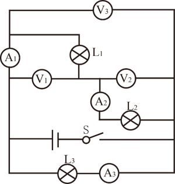

**A.** 电压表 $V_3$ 的示数最小

**B.** 电流表 $A_3$ 的示数最大

**C.** 电流表 $A_1$ 、 $A_2$ 的示数相等

**D.** 电压表 $V_1$ 、 $V_2$ 的示数相等

### 第 68 题

原卷 PDF 页码：18；题目 ID：`gd-mock-2026h2-s17-q68`

某博物馆曾展出过春秋时期的青铜器“云纹铜禁”。古代常以含铜矿物为原料，在高温条件下配合木炭进行冶炼后，将熔融状态的金属浇入模具中成型，从而制成青铜器，虽然青铜器相对较为耐腐蚀，但是这类器物若长期暴露在自然环境中，其表面也会逐渐发生变化，产生铜绿。下列说法正确的是（    ）。

**A.** “云纹铜禁”属于合成材料，因此耐腐蚀性通常强于铜

**B.** 青铜熔点较低，有利于其在铸造过程中成型

**C.** 木炭在青铜冶炼过程中只提供热量，不参与反应

**D.** 为防止铜制品生锈，应将其长期浸泡在水中保存

### 第 69 题

原卷 PDF 页码：18, 19；题目 ID：`gd-mock-2026h2-s17-q69`

某农业示范基地采用“鱼菜共生”系统开展循环种养：在养殖区中养鱼，鱼类排泄物和残饵随水流进入转化槽，经微生物分解转化为无机盐，再由水泵输送至种植区供植物吸收。为提高系统稳定性，研究人员引入以小虾为食的鲈鱼。下列说法正确的是（    ）。

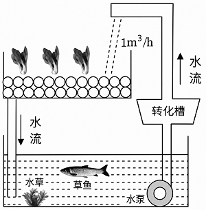

**A.** 转化槽中的细菌属于消费者

**B.** 该生态系统中的能量可以在各营养级之间循环利用

**C.** 引入鲈鱼后，小虾数量先减少后趋于稳定，说明生态系统具有自我调节能力

**D.** 该生态系统中能量的最终来源是鱼类体内储存的化学能

### 第 70 题

原卷 PDF 页码：19；题目 ID：`gd-mock-2026h2-s17-q70`

下表为小明在夏至日（6月22日）这天记录的甲、乙、丙、丁四个地方的白昼时长和黑夜时长的差值（白昼时长-黑夜时长），下列说法不正确的是（    ）。

**夏至日白昼时长与黑夜时长的差值**

| 地方 | 甲 | 乙 | 丙 | 丁 |
| --- | --- | --- | --- | --- |
| 差值/h | 1.5 | 0 | 3 | −2 |

差值方向依题干：白昼时长减黑夜时长。

**A.** 甲、丙两地位于同一半球

**B.** 丙地的纬度高于乙地

**C.** 丁地位于南半球

**D.** 甲地的纬度高于丁地

---

## 第 18 季 · 科学推理

来源：2026下半年省考第十八季行测模考大赛（广东卷）.pdf

共 5 题，保留原卷题号。分数与数学符号使用 LaTeX；图形使用原图或已标注的矢量重绘图。

### 第 66 题

原卷 PDF 页码：17；题目 ID：`gd-mock-2026h2-s18-q66`

如图所示，物块A在水平力F的作用下静止在粗糙程度均匀的地面上，将力F的大小增大至2F，若最大静摩擦力等于滑动摩擦力，则下列判断一定正确的是（    ）。

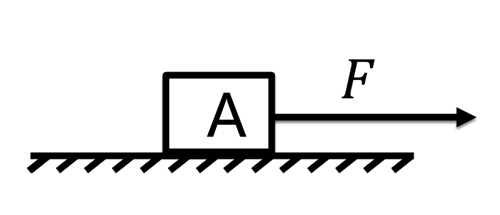

**A.** 物块A会向右做变加速运动

**B.** 物块A会向右做匀变速运动

**C.** 物块A仍保持静止

**D.** 物块A可能仍保持静止，也可能向右做加速运动

### 第 67 题

原卷 PDF 页码：17；题目 ID：`gd-mock-2026h2-s18-q67`

如图，沿着薄纸片的上表面吹气，薄纸片（    ），可知吹气过程中，空气对薄纸片上表面的压力（    ）下表面的压力。

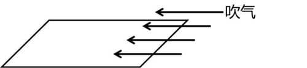

**A.** 落下、大于

**B.** 落下、小于

**C.** 升起、大于

**D.** 升起、小于

### 第 68 题

原卷 PDF 页码：17；题目 ID：`gd-mock-2026h2-s18-q68`

为探究X、Y、Z三种金属的活动性强弱，设计两组实验：实验1：取三份等量稀盐酸，分别加入打磨光亮的 X、Y、Z金属片，只有金属Y发生反应并产生大量气泡，X、Z均无明显现象；实验2：将金属Z放入X的硫酸盐溶液中，充分反应后，金属Z表面析出固体X。则三种金属活动性由强到弱的顺序是（    ）。

**A.** Y>Z>X

**B.** Y>X>Z

**C.** Z>X>Y

**D.** X>Z>Y

### 第 69 题

原卷 PDF 页码：17, 18；题目 ID：`gd-mock-2026h2-s18-q69`

粮站收入粮食后，如果粮食不够干燥，那么堆在内部的粮食就会发霉，为了防止这种情况发生，粮站会对潮湿的粮食进行干燥处理，下列相关说法不正确的是（    ）。

**A.** 粮食可以进行呼吸作用，无法进行光合作用

**B.** 粮食含水量高时更易发霉，说明潮湿环境能提升霉菌的活性

**C.** 干燥处理不会对粮食的呼吸作用产生任何影响

**D.** 粮食堆放过密、通风差，会造成粮堆内部热量积聚

### 第 70 题

原卷 PDF 页码：18；题目 ID：`gd-mock-2026h2-s18-q70`

假如地球没有自转以及公转，下列现象最有可能在地球上出现的是（    ）。

**A.** 全球各地将不再有昼夜交替

**B.** 全球各地将全年温度适宜，四季如春

**C.** 太阳将从西方升起

**D.** 地球磁场将增强

---

## 第 19 季 · 科学推理

来源：2026下半年省考第十九季行测模考大赛（广东卷）.pdf

共 5 题，保留原卷题号。分数与数学符号使用 LaTeX；图形使用原图或已标注的矢量重绘图。

### 第 66 题

原卷 PDF 页码：18；题目 ID：`gd-mock-2026h2-s19-q66`

我国古书《尚书纬·考灵曜》记载：人在舟中闭牖（门窗）而坐，舟行而人不觉。其中“舟行”和“人不觉”对应的参照物分别是（    ）。

**A.** 树、岸

**B.** 门窗、舟

**C.** 岸、门窗

**D.** 门窗、树

### 第 67 题

原卷 PDF 页码：18；题目 ID：`gd-mock-2026h2-s19-q67`

小红在家中发现，当闭合台灯的开关后，整个家庭电路的空气开关跳闸，而其他电器均未使用。经检查，台灯的功率为40W，导线外观无破损。以下哪种情况最可能导致此次跳闸？

**A.** 台灯的开关内部发生短路

**B.** 台灯的灯丝断了

**C.** 灯泡处的零线与火线接触

**D.** 家庭电路的零线某处接触不良

### 第 68 题

原卷 PDF 页码：18；题目 ID：`gd-mock-2026h2-s19-q68`

研究发现，疾病M是一种基因遗传病，若一对正常的父母生育了一个患有疾病M的女儿，则疾病M的遗传方式是（    ）。

**A.** 常染色体隐性遗传

**B.** 常染色体显性遗传

**C.** 伴X染色体隐性遗传

**D.** 伴X染色体显性遗传

### 第 69 题

原卷 PDF 页码：18；题目 ID：`gd-mock-2026h2-s19-q69`

如图所示，A、B、C是三个与二氧化碳有关的化学实验，关于这三个实验的现象与结论，下列说法不正确的是（    ）。

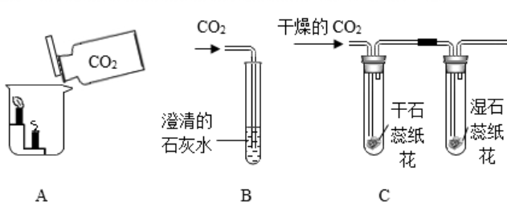

**A.** A实验说明二氧化碳不具有可燃性

**B.** A实验说明二氧化碳密度比空气大

**C.** B实验说明二氧化碳具有氧化性

**D.** C实验中只有湿石蕊纸花会变色

### 第 70 题

原卷 PDF 页码：18, 19；题目 ID：`gd-mock-2026h2-s19-q70`

如图所示为北方某个滑雪场的等高线地形图，下列说法中正确的是（    ）。

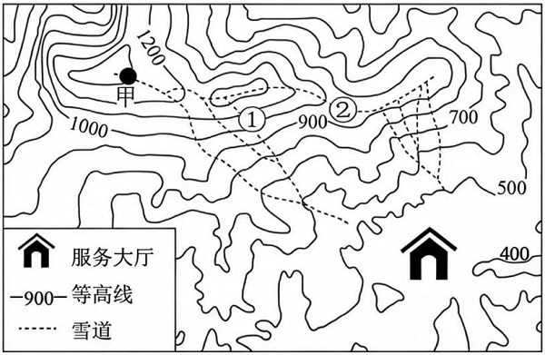

**A.** 对比①、②两雪道，①雪道更适合滑雪初学者

**B.** ②雪道位于山脊上

**C.** 甲地与服务大厅的竖直落差超过900米

**D.** 甲地与服务大厅的竖直落差不足700米

---

## 第 20 季 · 科学推理

来源：2026下半年省考第二十季行测模考大赛（广东卷）.pdf

共 5 题，保留原卷题号。分数与数学符号使用 LaTeX；图形使用原图或已标注的矢量重绘图。

### 第 66 题

原卷 PDF 页码：17；题目 ID：`gd-mock-2026h2-s20-q66`

某科普馆展出了一种“潜浮小车”模型：小车内部有可进水、排水的空腔，将其放入透明水槽后，起初漂浮在水面；当向空腔内缓慢注水时，小车逐渐下沉，直至恰好悬浮在水中。下列说法正确的是（    ）。

**A.** 小车从漂浮到悬浮的过程中，所受浮力逐渐减小

**B.** 小车从漂浮到悬浮的过程中，所受重力逐渐增大

**C.** 小车悬浮时，所受浮力大于重力

**D.** 小车悬浮时，水对小车底部的压强小于对小车顶部的压强

### 第 67 题

原卷 PDF 页码：18；题目 ID：`gd-mock-2026h2-s20-q67`

如图为某用电器的电路图， $R_1$ 、 $R_4$ 是定值电阻， $R_2$ 是温敏电阻，随着环境温度的升高， $R_2$的阻值会变大； $R_3$ 是光敏电阻，随着环境光照强度的增大， $R_3$ 的阻值会变小；V表示电压表， $A_1$ 、 $A_2$ 均表示电流表，电源电压保持不变，闭合开关S后，下列说法正确的是（    ）。

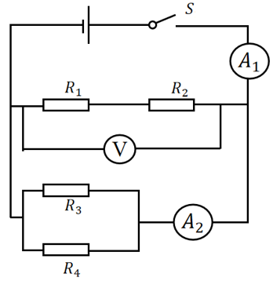

**A.** 若环境温度下降，则V的示数变小， $A_1$ 的示数变大

**B.** 若环境温度下降，则V的示数不变， $A_1$ 的示数变大

**C.** 若环境光照强度增大，则 $A_1$ 的示数变大， $A_2$ 的示数变小

**D.** 若环境光照强度减弱，则 $A_1$ 的示数不变， $A_2$ 的示数变大

### 第 68 题

原卷 PDF 页码：18；题目 ID：`gd-mock-2026h2-s20-q68`

在进行“绿叶在光下制造有机物”实验之前，需将盆栽天竺葵放到黑暗处一昼夜，该操作的主要目的是（    ）。

**A.** 大量消耗叶片内的水分

**B.** 消耗叶片内原有的淀粉（有机物）

**C.** 促进叶片进行光合作用

**D.** 分解叶片内的叶绿素

### 第 69 题

原卷 PDF 页码：18；题目 ID：`gd-mock-2026h2-s20-q69`

小明在学习完与金属活动性相关的知识后，想自己动手验证Fe、Cu、Ag三种金属活动性的强弱，下列实验方案的组合不能达到其目的的是（    ）。
①将Fe放入 $\mathrm{CuSO_4}$ 溶液
②将Cu放入 $\mathrm{AgNO_3}$ 溶液
③将Ag放入 $\mathrm{CuSO_4}$ 溶液
④将Fe、Cu分别放入稀盐酸

**A.** ①③

**B.** ①④

**C.** ②④

**D.** ③④

### 第 70 题

原卷 PDF 页码：18, 19；题目 ID：`gd-mock-2026h2-s20-q70`

下图为某地的等高线地形图，下列说法正确的是（    ）。

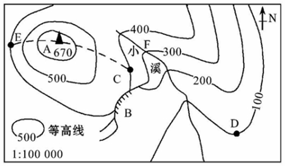

**A.** 图中小溪的流向为自东北向西南

**B.** 图中D处的地形为山谷

**C.** 图中E处的气温比A处的气温低

**D.** 图中B处适宜发展攀岩运动

---

## 第 21 季 · 科学推理

来源：2026下半年省考第二十一季行测模考大赛（广东卷）.pdf

共 5 题，保留原卷题号。分数与数学符号使用 LaTeX；图形使用原图或已标注的矢量重绘图。

### 第 66 题

原卷 PDF 页码：17；题目 ID：`gd-mock-2026h2-s21-q66`

A、B两个物体（可看成质点）均从O点水平抛出，两者做平抛运动的轨迹如下图所示。假设A、B两个物体从抛出到碰到墙壁所用的时间分别为 $t_A$ 、 $t_B$ ，初速度分别为 $v_A$ 、 $v_B$ ，则下列分析正确的是（    ）。

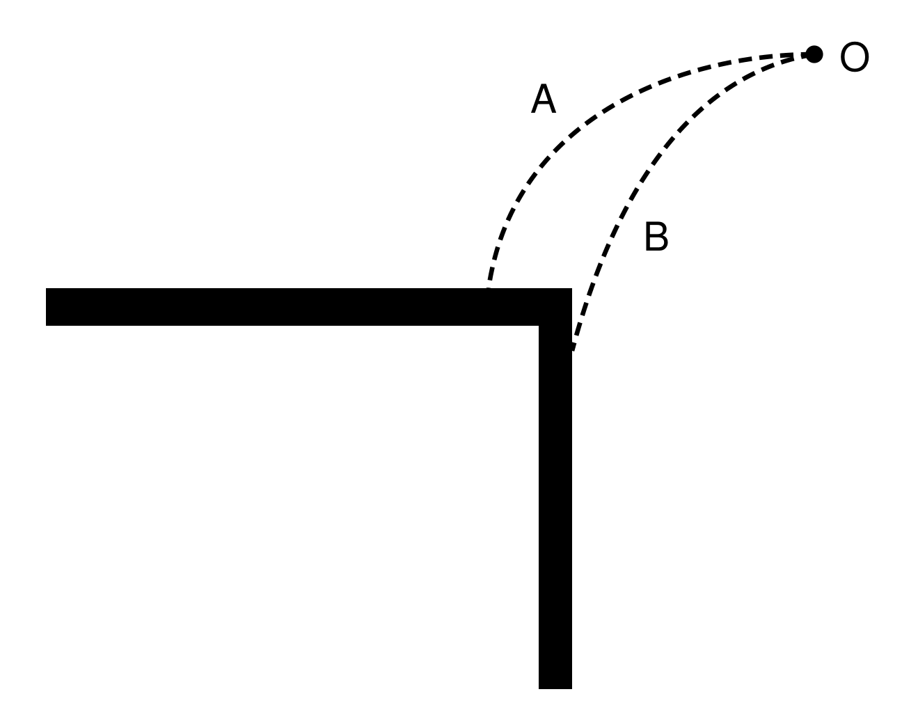

[查看可缩放矢量图 SVG](assets/s21_p17_i04.svg)

① $t_A > t_B$
② $t_A < t_B$
③ $v_A > v_B$
④ $v_A < v_B$

**A.** ①④

**B.** ②③

**C.** ①③

**D.** ②④

### 第 67 题

原卷 PDF 页码：17, 18；题目 ID：`gd-mock-2026h2-s21-q67`

如图所示，竖直轻弹簧下端与水平地面相连，上端放置一个质量为2m的物块A，物块A静止时，弹簧的长度为 $l_1$ 。再将一个质量为m的物块B放置在物块A上，当两者静止时，弹簧的长度为 $l_2$ 。弹簧始终处于弹性限度内，则弹簧的原长和弹簧的劲度系数分别为（    ）。

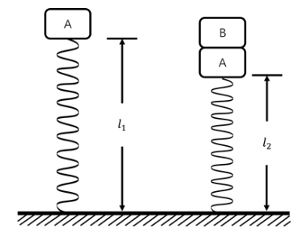

**A.** $3l_1-2l_2$ ； $\frac{mg}{l_1-l_2}$

**B.** $3l_2-2l_1$ ； $\frac{mg}{l_1-l_2}$

**C.** $3l_1-2l_2$ ； $\frac{2mg}{l_1-l_2}$

**D.** $3l_2-2l_1$ ； $\frac{2mg}{l_1-l_2}$

### 第 68 题

原卷 PDF 页码：18；题目 ID：`gd-mock-2026h2-s21-q68`

汽车排放的尾气中所含的一氧化碳，在四氧化三钴（ $\mathrm{Co_3O_4}$ ）的催化作用下，于低温条件下便可与氧气发生反应生成二氧化碳。关于上述反应，下列说法正确的是（    ）。
①该反应为化合反应
②该反应为分解反应
③该反应可降低汽车尾气对大气的污染
④该反应前后四氧化三钴（ $\mathrm{Co_3O_4}$ ）的质量保持不变
⑤该反应中四氧化三钴（ $\mathrm{Co_3O_4}$ ）会不断消耗，质量减少

**A.** ①③⑤

**B.** ②③④

**C.** ①③④

**D.** ②③⑤

### 第 69 题

原卷 PDF 页码：18；题目 ID：`gd-mock-2026h2-s21-q69`

下列关于人体免疫、用药与健康的说法，正确的是（    ）。

**A.** 体液中的杀菌物质和吞噬细胞吞噬病菌，属于特异性免疫

**B.** 抗体是侵入人体、能引发免疫反应的外来异物

**C.** 注射青霉素前进行皮试，是为了防止青霉素引发过敏反应

**D.** 带有“RX”标识的药物属于非处方药，可自行购买服用

### 第 70 题

原卷 PDF 页码：18, 19；题目 ID：`gd-mock-2026h2-s21-q70`

根据下图所示的经纬网，说法正确的是（    ）。

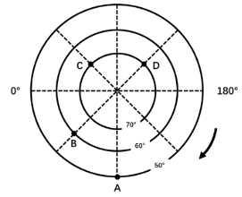

①A、B、C、D四个地区全部位于南半球
②A、B、C、D四个地区全部位于中纬度地区
③A、B、C、D四个地区全部位于温带
④A、D两个地区的经纬度分别是（ $50^{\circ}\mathrm{S}$ ， $90^{\circ}\mathrm{W}$ ）、（ $70^{\circ}\mathrm{S}$ ， $135^{\circ}\mathrm{E}$ ）
⑤B、C两个地区的经纬度分别是（ $60^{\circ}\mathrm{S}$ ， $45^{\circ}\mathrm{E}$ ）、（ $70^{\circ}\mathrm{S}$ ， $45^{\circ}\mathrm{W}$ ）
⑥A、B两个地区位于西半球，C、D两个地区位于东半球

**A.** ①③⑤

**B.** ①⑤⑥

**C.** ②④⑥

**D.** ①④⑥

---

## 第 22 季 · 科学推理

来源：2026下半年省考第二十二季行测模考大赛（广东卷）.pdf

共 5 题，保留原卷题号。分数与数学符号使用 LaTeX；图形使用原图或已标注的矢量重绘图。

### 第 66 题

原卷 PDF 页码：18；题目 ID：`gd-mock-2026h2-s22-q66`

汽车行驶过程中涉及多种力学现象，若忽略空气阻力，下列与汽车有关的物理原理，说法正确的是（    ）。

**A.** 汽车在平直路面上匀速行驶时，发动机的牵引力大于路面对车轮的摩擦阻力

**B.** 汽车刹车时，乘客身体会向前倾，这是因为乘客受到惯性力的作用

**C.** 汽车轮胎设计有凹凸花纹，主要是为了增大车轮与地面之间的摩擦力

**D.** 汽车在平直路面上高速行驶时对路面的压力大于其静止时对路面的压力

### 第 67 题

原卷 PDF 页码：18；题目 ID：`gd-mock-2026h2-s22-q67`

下列关于光的直线传播，说法正确的是（    ）。

**A.** 光在任何情况下都是沿直线传播的

**B.** 激光准直技术利用了光沿直线传播的原理

**C.** 光在真空中的传播速度比在任何介质中的传播速度都要慢

**D.** 日食是光发生反射形成的

### 第 68 题

原卷 PDF 页码：18；题目 ID：`gd-mock-2026h2-s22-q68`

过氧化氢制氧气是中学实验室中比较重要的制氧气的方法，其原理是：$2\mathrm{H_2O_2}=2\mathrm{H_2O}+\mathrm{O_2}\uparrow$ ，常温下这个反应极慢，通常看不到有气泡冒出，因此实验室用此方法制备氧气时，通常加入二氧化锰（ $\mathrm{MnO_2}$ ）加快反应速率，下列相关说法不正确的是（    ）。

**A.** 二氧化锰是实验室制氧气时的催化剂

**B.** 二氧化锰在催化过程中不参与化学反应

**C.** 二氧化锰在化学反应前后质量和化学性质均不变

**D.** 过氧化氢制氧气的反应属于氧化还原反应

### 第 69 题

原卷 PDF 页码：18；题目 ID：`gd-mock-2026h2-s22-q69`

果蝇因生命周期短、繁育速度快、产卵量大等优点，被选为基因研究常用的实验动物。研究发现果蝇的长翅和残翅由一对位于常染色体上的基因控制，可用A和a表示；若一对长翅果蝇（亲代）生育的子代果蝇中既有长翅个体又有残翅个体，则下列说法正确的是（    ）。

**A.** 亲代果蝇的基因型可能是Aa和aa

**B.** 子代果蝇的基因型只有Aa和aa两种

**C.** 果蝇的残翅属于隐性性状

**D.** 子代果蝇中长翅个体占比约为50%

### 第 70 题

原卷 PDF 页码：18；题目 ID：`gd-mock-2026h2-s22-q70`

地球公转时，地轴与公转轨道面的夹角始终保持约 $66.5^{\circ}$ ，且北极始终指向北极星附近。若地轴与公转轨道面的夹角变为 $90^{\circ}$ ，下列现象可能出现的是（    ）。

**A.** 全球各地昼夜等长

**B.** 地球上没有四季变化

**C.** 太阳直射点始终在赤道上

**D.** 以上都有可能

---

## 第 23 季 · 科学推理

来源：2026下半年省考第二十三季行测模考大赛（广东卷）.pdf

共 5 题，保留原卷题号。分数与数学符号使用 LaTeX；图形使用原图或已标注的矢量重绘图。

### 第 66 题

原卷 PDF 页码：18；题目 ID：`gd-mock-2026h2-s23-q66`

野外探险时，人们会在山洞中点燃木炭用于照明、取暖。洞内空气流通较差，氧气不足，木炭不完全燃烧生成一氧化碳，极易引发中毒；洞口通风良好，氧气充足，木炭完全燃烧生成二氧化碳。下列关于碳及其氧化物的说法，正确的是（    ）。

**A.** 一氧化碳与二氧化碳均有毒，均可和人体血红蛋白结合造成缺氧

**B.** 二氧化碳能够用于灭火，是因为该气体能够降低可燃物的着火点

**C.** 加热条件下，向氧化铜中通入一氧化碳，可以观察到黑色固体逐渐变为红色

**D.** 木炭、一氧化碳、二氧化碳三者均具有还原性

### 第 67 题

原卷 PDF 页码：18；题目 ID：`gd-mock-2026h2-s23-q67`

茂名是岭南知名水果产区，大面积种植优质荔枝。果农对比发现，昼夜温差大的果园，结出的荔枝果肉糖分更高、更甜。下列解释最合理的是（    ）。

**A.** 白天温度适宜，荔枝的光合作用较强，有机物消耗得更多

**B.** 夜晚温度较低，荔枝的呼吸作用较弱，有机物消耗得更少

**C.** 温度越高，荔枝细胞内酶的活性越高，越有利于糖分积累

**D.** 昼夜温差大，能够增强荔枝的蒸腾作用，从而积累有机物

### 第 68 题

原卷 PDF 页码：18；题目 ID：`gd-mock-2026h2-s23-q68`

将两个完全相同的实心小球，分别放入装有不同液体的甲、乙两个完全相同的烧杯中，小球静止时两烧杯中的液体液面相平，如图所示，下列说法正确的是（    ）。

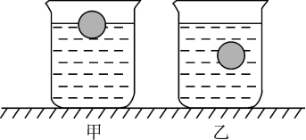

**A.** 乙烧杯中小球排开液体的重力更小

**B.** 乙烧杯底部受到的液体压强更大

**C.** 甲烧杯中液体的质量更小

**D.** 甲烧杯中的液体对烧杯底部的压力更大

### 第 69 题

原卷 PDF 页码：18, 19；题目 ID：`gd-mock-2026h2-s23-q69`

如图所示， $R_1$ 为定值电阻， $R_2$ 为滑动变阻器，L为灯泡，电源电压恒定不变，下列说法正确的是（    ）。

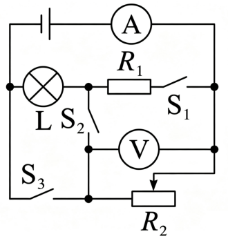

**A.** 闭合开关 $S_1$ ，滑动变阻器 $R_2$ 滑片右移，灯泡变暗

**B.** 闭合开关 $S_2$ ，滑动变阻器 $R_2$ 滑片右移，灯泡变亮

**C.** 闭合开关 $S_1$ 、 $S_3$ ，滑动变阻器 $R_2$ 滑片右移，灯泡亮度不变

**D.** 闭合开关 $S_2$ 、 $S_3$ ，滑动变阻器 $R_2$ 滑片右移，灯泡变亮

### 第 70 题

原卷 PDF 页码：19；题目 ID：`gd-mock-2026h2-s23-q70`

某地等高线地形图如下，下列说法正确的是（    ）。

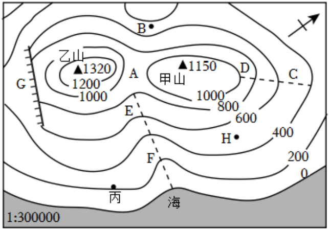

**A.** G处是登山线路中优先选择的通行位置

**B.** CD虚线处所在地形为山谷，容易发育河流

**C.** A处地势高于乙山山顶，适合修建高山气象观测站

**D.** B处暴雨天气下容易汇集水流，出现山洪

---

## 第 24 季 · 科学推理

来源：2026下半年省考第二十四季行测模考大赛（广东卷）.pdf

共 5 题，保留原卷题号。分数与数学符号使用 LaTeX；图形使用原图或已标注的矢量重绘图。

### 第 66 题

原卷 PDF 页码：16；题目 ID：`gd-mock-2026h2-s24-q66`

下图是某冰壶场地的示意图，小明用水平推力使冰壶从A点向右匀速运动到B点后松手，冰壶继续向前运动到C点时静止。若冰面的粗糙程度相同，下列说法正确的是（    ）。

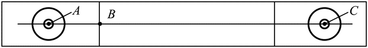

**A.** 冰壶从A点运动到C点的过程中，摩擦力始终做正功

**B.** 冰壶从A点运动到C点的过程中，水平推力始终做正功

**C.** 冰壶从A点运动到C点的过程中，机械能始终不变

**D.** 冰壶从A点运动到B点的过程中，水平推力始终做正功

### 第 67 题

原卷 PDF 页码：17；题目 ID：`gd-mock-2026h2-s24-q67`

如图所示的电路图中，电源电压恒定，P是滑动变阻器，定值电阻 $R_1$ 、 $R_2$ 的阻值相同，开关$S_1$ 始终处于闭合状态，开关 $S_2$ 、 $S_3$ 处于断开状态，下列说法不正确的是（    ）。

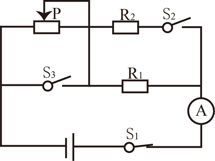

**A.** 将滑动变阻器的滑片向右移动，电流表的示数变大

**B.** 闭合开关 $S_2$ ，电流表的示数变大

**C.** 闭合开关 $S_3$ ，电流表的示数变大

**D.** 同时闭合开关 $S_2$ 、 $S_3$ ，电流表的示数变大

### 第 68 题

原卷 PDF 页码：17；题目 ID：`gd-mock-2026h2-s24-q68`

下表为一些常见溶液的酸碱度，根据表中的信息，以下说法不恰当的是（    ）。

**物质的 pH 值**

| 物质 | 洁厕剂 | 柠檬汁 | 西瓜汁 | 鸡蛋清 | 草木灰水 | 84消毒液 |
| --- | --- | --- | --- | --- | --- | --- |
| pH值 | 2 | 3 | 6 | 8 | 11 | 12 |

保持原图物质顺序和给定数值。

**A.** 胃酸过多的人不宜喝柠檬汁

**B.** 鸡蛋清能使无色酚酞溶液变色

**C.** 西瓜汁的酸性比柠檬汁强

**D.** 洁厕剂与84消毒液不能混合使用

### 第 69 题

原卷 PDF 页码：17；题目 ID：`gd-mock-2026h2-s24-q69`

下图是某茶园生态系统食物网的示意图，下列说法正确的是（    ）。

**食物网的全部箭头关系**

| 箭头起点 | 箭头终点 |
| --- | --- |
| 茶树 | 茶毛虫 |
| 茶树 | 茶尺蠖 |
| 草 | 茶毛虫 |
| 草 | 茶尺蠖 |
| 茶毛虫 | 蛙 |
| 茶毛虫 | 蜘蛛 |
| 茶尺蠖 | 蜘蛛 |
| 茶尺蠖 | 鸟 |
| 蜘蛛 | 蛙 |
| 蛙 | 蛇 |
| 鸟 | 蛇 |

每行表示原图的一条有向箭头（起点 → 终点），完整保留 8 个节点及 11 条连接；行的先后顺序不代表食物链顺序。

**A.** 该食物网中有7条食物链

**B.** 该食物网中，最高营养级为五级

**C.** 蛇捕食鸟后，能吸收鸟全部的能量

**D.** 该食物网包含了该生态系统中所有的生物

### 第 70 题

原卷 PDF 页码：18；题目 ID：`gd-mock-2026h2-s24-q70`

2026美加墨世界杯决赛于北京时间2026年7月20日凌晨3：00在美国新泽西大都会人寿体育场‌举行，经过激烈的角逐，西班牙最终夺得了冠军。已知新泽西位于西五区，那么决赛开始时新泽西的当地时间是（    ）。

**A.** 7月19日14：00

**B.** 7月19日22：00

**C.** 7月20日8：00

**D.** 7月20日16：00

---

## 第 25 季 · 科学推理

来源：2026下半年省考第二十五季行测模考大赛（广东卷）.pdf

共 5 题，保留原卷题号。分数与数学符号使用 LaTeX；图形使用原图或已标注的矢量重绘图。

### 第 66 题

原卷 PDF 页码：16；题目 ID：`gd-mock-2026h2-s25-q66`

高速公路通过村庄密集区时，为了减弱行驶车辆发出的噪声对居民的影响，通常会在高速公路两侧安装玻璃隔声板。下列控制和减弱噪声的途径与之相同的是（    ）。

**A.** 老师在上课时把手机铃声调成静音

**B.** 飞机场附近的村民安装双层真空玻璃

**C.** 禁止商贩在居民区用扩音器叫卖

**D.** 午休时佩戴耳塞

### 第 67 题

原卷 PDF 页码：16, 17；题目 ID：`gd-mock-2026h2-s25-q67`

如图所示，外力 $F_1$ 大小为10N，作用于物块B上，外力 $F_2$ 大小为5N，作用于物块A上。物块B静止于粗糙程度均匀的水平地面上，物块A在物块B上向左做匀速直线运动，假设物块B足够长，下列说法不正确的是（    ）。

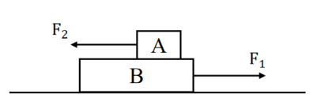

**A.** 物块A共受到4个力的作用

**B.** 物块B共受到6个力的作用

**C.** 地面对物块B的摩擦力一定小于10N

**D.** 物块A对物块B的摩擦力一定小于5N

### 第 68 题

原卷 PDF 页码：17；题目 ID：`gd-mock-2026h2-s25-q68`

寒冷的凌晨，露天放置的金属护栏表面会附着一层白色霜花，等到太阳升起气温回升，霜花又会变成水。上述过程中发生的物态变化依次是（    ）。

**A.** 凝华、升华

**B.** 凝固、汽化

**C.** 液化、熔化

**D.** 凝华、熔化

### 第 69 题

原卷 PDF 页码：17；题目 ID：`gd-mock-2026h2-s25-q69`

小明生火时，他先点燃了紧挨着木头的干草，干草燃烧完后，木头的温度升高了，但还没有被点燃，其原因可能是（    ）。

**A.** 木头的着火点升高了

**B.** 木头的热值太低了

**C.** 木头的温度还没有达到其着火点

**D.** 木头没有和氧气接触

### 第 70 题

原卷 PDF 页码：17；题目 ID：`gd-mock-2026h2-s25-q70`

下图为某家族的某种伴X染色体隐性遗传病的遗传系谱图，下列说法正确的是（    ）。

**遗传系谱图的人物和亲属关系**

| 编号 | 性别 | 患病情况 | 父亲编号 | 母亲编号 | 图示配偶编号 |
| --- | --- | --- | --- | --- | --- |
| 1 | 男 | 未知 | 未给出 | 未给出 | 2 |
| 2 | 女 | 正常 | 未给出 | 未给出 | 1 |
| 3 | 女 | 未知 | 1 | 2 | 未给出 |
| 4 | 女 | 患病 | 1 | 2 | 未给出 |
| 5 | 男 | 正常 | 1 | 2 | 6 |
| 6 | 女 | 患病 | 未给出 | 未给出 | 5 |
| 7 | 女 | 未知 | 5 | 6 | 未给出 |

原图方形代表男、圆形代表女；空白代表正常、实心代表患病、问号代表患病情况未知。“未给出”表示原图没有该项亲属信息。1、2 的子女按图从左至右为 3、4、5；5、6 的子女为 7。

**A.** 1号可能不患病

**B.** 3号一定患病

**C.** 7号一定不患病

**D.** 3号和7号的基因型一定相同

---

## 第 26 季 · 科学推理

来源：2026下半年省考第二十六季行测模考大赛（广东卷）.pdf

共 5 题，保留原卷题号。分数与数学符号使用 LaTeX；图形使用原图或已标注的矢量重绘图。

### 第 66 题

原卷 PDF 页码：18；题目 ID：`gd-mock-2026h2-s26-q66`

如图，使用滑轮组匀速提升完全浸没在水中的实心铁块，铁块未接触水底，且上升过程一直保持浸没。不计滑轮重、绳重与摩擦，下列说法正确的是（    ）。

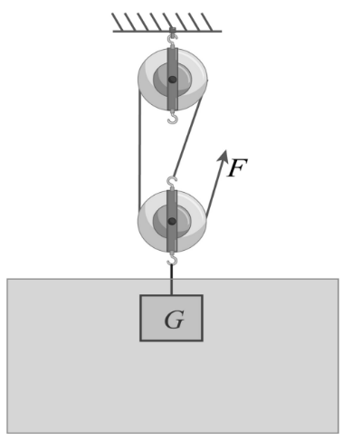

**A.** 上升过程中铁块受到的浮力逐渐增大

**B.** 上升过程中铁块共受到4个力作用

**C.** 铁块所受重力和水对铁块的浮力是一对平衡力

**D.** 绳端拉力 $F=\frac{1}{3}(G-F_{\text{浮}})$

### 第 67 题

原卷 PDF 页码：18, 19；题目 ID：`gd-mock-2026h2-s26-q67`

电梯上升时的v-t图像如图所示，下列说法错误的是（    ）。

**电梯上升时的 v–t 图像**

| 时间 t（s） | 速度 v（m/s） |
| --- | --- |
| 0 | 0 |
| 2 | 6 |
| 6 | 6 |
| 9 | 0 |

横轴为 t/s，纵轴为 v(m/s)。按表中时间顺序，相邻点均以直线连接；t=2 s 和 t=6 s 处画有竖向虚线，v=6 m/s 处有横向标注线。表中没有添加加速度或受力结论。

**A.** 0~2s，电梯处于超重状态

**B.** 6~9s，电梯处于失重状态

**C.** 2~6s，电梯的加速度为0

**D.** 电梯6~9s的加速度大于0~2s的加速度

### 第 68 题

原卷 PDF 页码：19；题目 ID：`gd-mock-2026h2-s26-q68`

某化学反应的微观示意图如下，下列说法正确的是（    ）。

**反应前后的微观粒子示意图**

| 阶段 | 每个图示粒子的原子组成 | 图示粒子个数 |
| --- | --- | --- |
| 反应前 | 1 个碳原子、4 个氢原子 | 1 |
| 反应前 | 2 个氧原子 | 3 |
| 反应后 | 1 个碳原子、2 个氧原子 | 1 |
| 反应后 | 2 个氧原子 | 1 |
| 反应后 | 1 个氧原子、2 个氢原子 | 2 |

原图箭头：反应前 → 反应后；箭头上标“点燃”。图例：大空心圆为碳原子、斜线圆为氧原子、小空心圆为氢原子。按图示粒子逐个计数，保留反应后仍存在的氧粒子；未将原图改写为配平反应方程式。

**A.** 该微观示意图可说明反应前后分子种类、数目均不发生改变

**B.** 该反应的反应物分子个数比为1：3

**C.** 该反应属于氧化还原反应

**D.** 该反应的生成物有三种分子

### 第 69 题

原卷 PDF 页码：19；题目 ID：`gd-mock-2026h2-s26-q69`

在ABO血型系统中，下列关于血型遗传的说法正确的是（    ）。

**A.** 若父母一方为A型血，另一方为B型血，则子女只可能是A型血或者B型血

**B.** 若子女出现O型血，则父母双方至少有一人一定是O型血

**C.** 若父母分别为AB型血与O型血，则子女不可能是O型血

**D.** 若子女为AB型血，则父母一方必定是A型血，另一方必定是B型血

### 第 70 题

原卷 PDF 页码：19；题目 ID：`gd-mock-2026h2-s26-q70`

下图为某地的等高线地形图，下列说法正确的是（    ）。

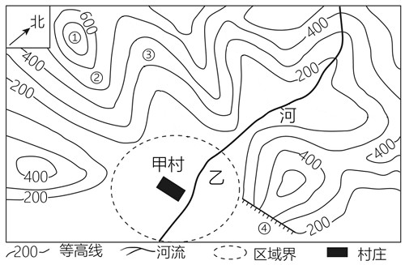

**A.** ②处为山谷，容易发育河流

**B.** 图中河流流向为自北向南

**C.** 甲村所在区域海拔高于400米

**D.** ③处为山脊

---

## 第 27 季 · 科学推理

来源：2026下半年省考第二十七季行测模考大赛（广东卷）.pdf

共 5 题，保留原卷题号。分数与数学符号使用 LaTeX；图形使用原图或已标注的矢量重绘图。

### 第 66 题

原卷 PDF 页码：18；题目 ID：`gd-mock-2026h2-s27-q66`

如图所示，质量分布均匀的实心物块，通过细绳悬挂在墙壁下方，此时物块完全浸没在柱形容器的水中，细绳处于绷紧状态，若剪断细绳，下列说法不正确的是（    ）。

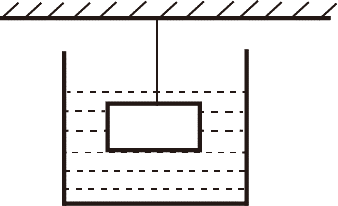

**A.** 物块最终会沉底

**B.** 物块受到的浮力始终不变

**C.** 容器底部受到的液体压强变大

**D.** 物块底部受到的液体压强变大

### 第 67 题

原卷 PDF 页码：18；题目 ID：`gd-mock-2026h2-s27-q67`

下图所示的电路中，电源电压不变，闭合开关S后，滑动变阻器R的滑片从左向右移动的过程中，下列说法错误的是（    ）。

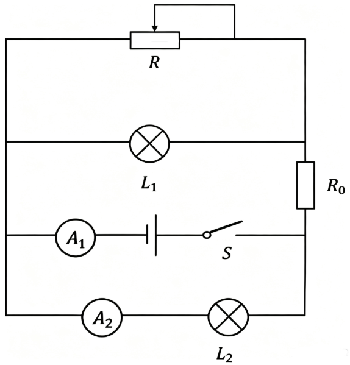

**A.** 电流表 $A_1$ 的示数变小

**B.** 电流表 $A_2$ 的示数不变

**C.** 灯泡 $L_2$ 的亮度不变

**D.** 灯泡 $L_1$ 的亮度不变

### 第 68 题

原卷 PDF 页码：18, 19；题目 ID：`gd-mock-2026h2-s27-q68`

小明在学习完溶解度相关的知识后，了解到蔗糖的溶解度随温度的升高而增大。为了观察蔗糖在水中的溶解情况，他在一定温度下配制了一定量的蔗糖饱和溶液，随后他将该溶液平均倒入甲、乙、丙、丁四个空烧杯中，然后分别对四个烧杯进行了如下操作：①将甲烧杯中的溶液倒出一半；②向乙烧杯中加入10g水；③向丙烧杯中加入10g蔗糖；④对丁烧杯进行加热。下列关于四个烧杯中溶液的说法不正确的是（    ）。

**A.** 甲烧杯中的溶液仍为饱和溶液

**B.** 乙烧杯中的溶液仍为饱和溶液

**C.** 丙烧杯中溶质的质量分数不变

**D.** 丁烧杯中溶质的质量分数不变

### 第 69 题

原卷 PDF 页码：19；题目 ID：`gd-mock-2026h2-s27-q69`

盛夏晴天，研究人员在上午10时、正午12时和下午14时测定同一株阔叶植物的蒸腾速率，发现正午12时蒸腾速率最低，14时又有所回升，同时观察到该株植物在正午时部分气孔缩小或关闭。下列说法不正确的是（    ）。

**A.** 植物体内的大部分水分以水蒸气形式通过叶片气孔散失

**B.** 在正午高温强光下，叶片失水加快，植物可能出现暂时水分亏缺

**C.** 正午蒸腾速率下降是因为光合作用消耗了大量水分

**D.** 气孔部分关闭能够减少水分散失，是植物根据环境变化进行的自我调节

### 第 70 题

原卷 PDF 页码：19；题目 ID：`gd-mock-2026h2-s27-q70`

农历初一前后为“朔”，通常难以看见月亮，初七、初八前后为上弦月，十五、十六前后为满月，二十二、二十三前后为下弦月。月球本身不发光，其总有一半被太阳照亮。关于月相成因，下列说法不正确的是（    ）。

**A.** 月球可见的亮面是因为反射了太阳光

**B.** 地球上看到的月相取决于太阳、地球和月球的相对位置

**C.** 满月时，月球与太阳大致位于地球两侧，月球被照亮的一面朝向地球

**D.** 满月时，月球位于太阳和地球之间，月球被照亮的一面朝向地球

---

## 第 28 季 · 科学推理

来源：2026下半年省考第二十八季行测模考大赛（广东卷）.pdf

共 5 题，保留原卷题号。分数与数学符号使用 LaTeX；图形使用原图或已标注的矢量重绘图。

### 第 66 题

原卷 PDF 页码：17；题目 ID：`gd-mock-2026h2-s28-q66`

如图所示，棱长为1m的正方体物块在外力 $F_1$ 、 $F_2$ 的作用下分别沿斜面和水平面匀速运动了一段距离，外力 $F_1$ 和 $F_2$ 对物块做的功分别记为 $W_1$ 和 $W_2$ ，物块在斜面和水平面所受的摩擦力分别记为 $f_1$ 和 $f_2$ ，若斜面和水平面的粗糙程度一致，则下列大小关系一定正确的是（    ）。

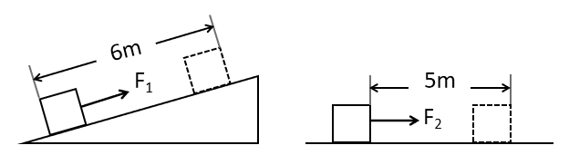

**A.** $W_1 > W_2$

**B.** $W_1 = W_2$

**C.** $f_1 > f_2$

**D.** $f_1 < f_2$

### 第 67 题

原卷 PDF 页码：17；题目 ID：`gd-mock-2026h2-s28-q67`

如图所示，建筑工人正在用水平力推着平板手推车沿水平地面向右运送货物。若在工人推着手推车行走的过程中，货物始终与手推车保持相对静止，则下列说法正确的是（    ）。

**A.** 手推车前轮受到的摩擦力向左，后轮受到的摩擦力向右

**B.** 手推车前轮受到的摩擦力向右，后轮受到的摩擦力向左

**C.** 手推车在加速向右运动的过程中，货物受到的摩擦力向右

**D.** 手推车在匀速向右运动的过程中，货物受到的摩擦力向左

### 第 68 题

原卷 PDF 页码：17, 18；题目 ID：`gd-mock-2026h2-s28-q68`

小明的户外电源同时并联了台灯、手机充电器、小风扇三个用电器，所有设备都正常工作。若他拔掉小风扇，下列说法正确的是（    ）。

**A.** 总电阻变大，总电流变小，其他用电器的电压不变

**B.** 总电阻变大，总电流变大，其他用电器的电压变大

**C.** 总电阻变小，总电流变小，其他用电器的电压变小

**D.** 总电阻变小，总电流变大，其他用电器的电压不变

### 第 69 题

原卷 PDF 页码：18；题目 ID：`gd-mock-2026h2-s28-q69`

生活场景中物理变化与化学变化往往伴随外观改变，下列现象中，仅发生物理变化的是（    ）。

**A.** 用小苏打发酵蒸馒头

**B.** 冬日户外湖水结冰

**C.** 用酒精擦拭手部消毒

**D.** 生石灰干燥剂吸水发热

### 第 70 题

原卷 PDF 页码：18；题目 ID：`gd-mock-2026h2-s28-q70`

冻梨是北方特色水果，冷冻保存的冻梨解冻后会流出大量清甜汁水，这些汁液主要来自果肉细胞的哪种结构（    ）。

**A.** 线粒体

**B.** 液泡

**C.** 细胞膜

**D.** 细胞壁

---

## 第 29 季 · 科学推理

来源：2026下半年省考第二十九季行测模考大赛（广东卷）.pdf

共 5 题，保留原卷题号。分数与数学符号使用 LaTeX；图形使用原图或已标注的矢量重绘图。

### 第 66 题

原卷 PDF 页码：17, 18；题目 ID：`gd-mock-2026h2-s29-q66`

某抽油烟机工作时，若只闭合总开关，则指示灯亮起，但电动机不工作；再闭合一个开关后，电动机开始工作，指示灯仍然亮起；三个开关都闭合后，电动机的转速达到最大，指示灯仍然亮起。若电源电压保持不变，下列最可能是该抽油烟机电路图的是（    ）。

**A.**

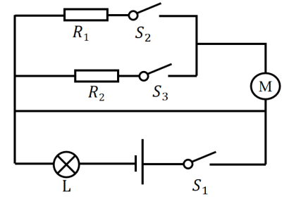

**B.**

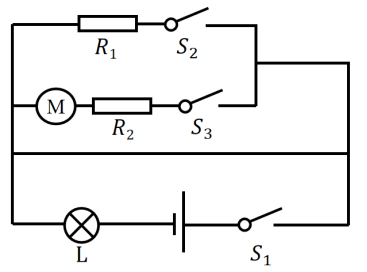

**C.**

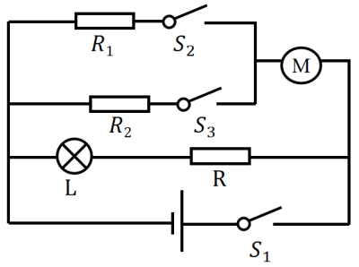

**D.**

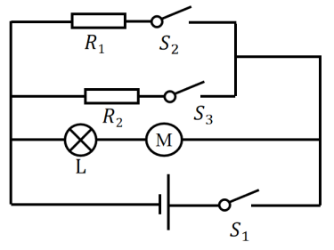

### 第 67 题

原卷 PDF 页码：18；题目 ID：`gd-mock-2026h2-s29-q67`

如图所示，质量为m的磁铁紧贴在汽车车厢左侧的车厢壁上，磁铁始终与车厢保持相对静止，随汽车一起向右运动。下列说法正确的是（    ）。

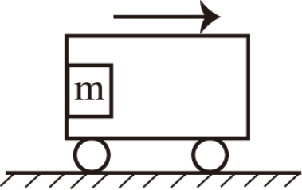

**A.** 汽车匀速运动时，磁铁共受到4个力的作用

**B.** 汽车匀速运动时，磁铁可能不受摩擦力的作用

**C.** 汽车加速运动时，磁铁共受到5个力的作用

**D.** 汽车加速运动时，磁铁受到水平向右的静摩擦力的作用

### 第 68 题

原卷 PDF 页码：18, 19；题目 ID：`gd-mock-2026h2-s29-q68`

甲醛是一种常见的室内空气污染物。利用羟基磷灰石（HAP）可将甲醛转化为无污染物质，反应过程的微观示意图如下所示。下列说法错误的是（    ）。

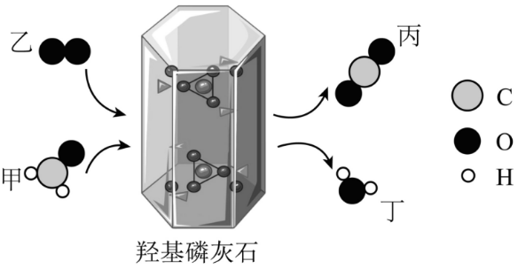

**A.** 反应方程式为 $\mathrm{CH_2O}+\mathrm{O_2}\xrightarrow{\text{HAP催化}}\mathrm{CO_2}+\mathrm{H_2O}$

**B.** 羟基磷灰石（HAP）可以提高甲醛的转化速率

**C.** 该反应属于氧化还原反应

**D.** 物质甲、乙、丙、丁中均含有氧元素，均属于氧化物

### 第 69 题

原卷 PDF 页码：19；题目 ID：`gd-mock-2026h2-s29-q69`

一位摄影爱好者在南京的某一地点拍摄日出照片，在春分日、秋分日发现两张照片中日出的方向十分接近。若夏至日在此处拍摄日出，下列关于日出方向的说法正确的是（    ）。

**A.** 日出方向比春分日偏南

**B.** 日出方向比秋分日偏北

**C.** 日出方向和春分日接近

**D.** 日出方向和秋分日相反

### 第 70 题

原卷 PDF 页码：19；题目 ID：`gd-mock-2026h2-s29-q70`

夏季城市道路两旁多栽种阔叶行道树，树叶的蒸腾作用是植物一项重要的生理活动。下列关于植物蒸腾作用的表述正确的是（    ）。

**A.** 蒸腾作用持续散失植物水分，对植株生长仅有水分损耗，无积极意义

**B.** 蒸腾作用的主要散失通道为叶片气孔，气孔的张开与闭合由保卫细胞调控

**C.** 夏季正午烈日高温环境下，植物叶片上的气孔完全张开，蒸腾作用达到单日强度峰值

**D.** 移栽成年大树时完整保留全部叶片，可充分保障光合作用，提升树木成活率

---

## 第 30 季 · 科学推理

来源：2026下半年省考第三十季行测模考大赛（广东卷）.pdf

共 5 题，保留原卷题号。分数与数学符号使用 LaTeX；图形使用原图或已标注的矢量重绘图。

### 第 66 题

原卷 PDF 页码：16, 17；题目 ID：`gd-mock-2026h2-s30-q66`

如图所示，物块A置于粗糙的水平桌面上，物块B左右两端连接着轻绳静止在空中，轻绳一端固定在竖直墙面上，另一端与物块A相连，物块B下方通过轻绳连接物块C，且物块A、B处于同一水平面上，若物块A、B、C均处于静止状态，下列说法错误的是（    ）。

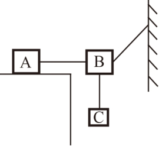

**A.** 物块A共受到5个力的作用

**B.** 物块B共受到4个力的作用

**C.** 物块C共受到2个力的作用

**D.** 物块A受到水平向左的静摩擦力的作用

### 第 67 题

原卷 PDF 页码：17；题目 ID：`gd-mock-2026h2-s30-q67`

我国西北某内陆城市夏季晴天午后气温约为 $35^{\circ}\mathrm{C}$ ，清晨约为 $15^{\circ}\mathrm{C}$ ；同纬度沿海城市午后气温约为 $30^{\circ}\mathrm{C}$ ，清晨约为 $26^{\circ}\mathrm{C}$ 。在两地太阳辐射和天气条件相近的情况下，沿海城市的昼夜温差明显较小。下列解释正确的是（    ）。

**A.** 内陆城市每天接受太阳照射的时间一定更长

**B.** 水的比热容较大且能通过混合等过程缓冲温度变化，沿海城市升温和降温较慢

**C.** 内陆地表岩石土壤比热容大，吸热和放热时温度变化显著

**D.** 水的比热容较大，因此沿海城市白天一定吸收更多热量并升温更高

### 第 68 题

原卷 PDF 页码：17；题目 ID：`gd-mock-2026h2-s30-q68`

某款加酶洗衣粉含有蛋白酶，专门用来清洗衣物上的蛋白类污渍。使用说明书提示，不能用沸水溶解洗衣粉，也不建议用来清洗羊毛、蚕丝面料的衣服。下列说法错误的是（    ）。

**A.** 该款洗衣粉可以去除奶渍

**B.** 沸水会使蛋白酶失活，丧失洗涤效果

**C.** 羊毛、蚕丝会被蛋白酶分解

**D.** 蛋白酶可以高效分解各类污渍

### 第 69 题

原卷 PDF 页码：17；题目 ID：`gd-mock-2026h2-s30-q69`

下列有关说法不正确的是（    ）。

**A.** 空气中体积分数最多的气体可以用来保护文物

**B.** 空气中体积分数第二多的气体可以用来灭火

**C.** 空气中的稀有气体可以用于制作霓虹灯

**D.** 空气中的二氧化碳会使雨水的pH小于7

### 第 70 题

原卷 PDF 页码：17, 18；题目 ID：`gd-mock-2026h2-s30-q70`

下图为某地的等高线地形图，下列说法不正确的是（    ）。

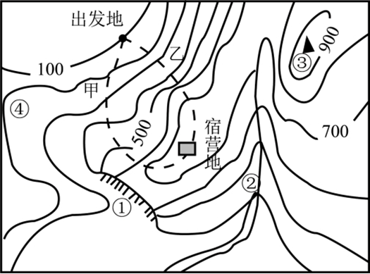

**A.** 若要从出发地到达宿营地，路线甲比路线乙更容易

**B.** ④处的气温比③处的气温低

**C.** 下雨过后②处会有大量积水

**D.** ①处陡崖在宿营地的西南方

---

## 第 31 季 · 科学推理

来源：2026下半年省考第三十一季行测模考大赛（广东卷）.pdf

共 5 题，保留原卷题号。分数与数学符号使用 LaTeX；图形使用原图或已标注的矢量重绘图。

### 第 66 题

原卷 PDF 页码：17；题目 ID：`gd-mock-2026h2-s31-q66`

如图所示，质量为m的柱形容器在水平外力F的作用下静止在粗糙程度均匀的竖直墙壁上。向容器内注入一定量的水后，容器和水沿墙壁匀速向下运动，若水平外力F的大小保持不变，则下列说法不正确的是（    ）。

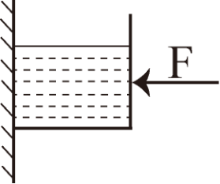

**A.** 注水前，容器受到的摩擦力是静摩擦力

**B.** 注水后，容器受到的摩擦力是滑动摩擦力

**C.** 注水后，容器受到的摩擦力相较于注水前不变

**D.** 注水后，容器受到的摩擦力相较于注水前变大

### 第 67 题

原卷 PDF 页码：17, 18；题目 ID：`gd-mock-2026h2-s31-q67`

下列各现象中，其背后蕴含的科学原理与其他三项不同的是（    ）。

**A.** 火车站要求乘客必须站在站台安全线外候车

**B.** 航海规则中禁止两艘同向航行的船距离过近

**C.** 向两张A4纸中间用力吹气会让两张A4纸贴到一起

**D.** 夏天地面附近的空气会向上升

### 第 68 题

原卷 PDF 页码：18；题目 ID：`gd-mock-2026h2-s31-q68`

下列物质的性质中，属于物理性质的是（    ）。
①氦气非常稳定
②硫酸钡难溶于水
③碳酸钙可溶于酸
④氨气可以使湿润的红色石蕊试纸变蓝
⑤黄金可以拉成很细的金丝
⑥干冰放置在常温常压环境中会消失
⑦羽毛烧焦会产生臭味
⑧熟石灰可用于改良酸性土壤

**A.** ①④⑥

**B.** ②⑦⑧

**C.** ③④⑥

**D.** ②⑤⑥

### 第 69 题

原卷 PDF 页码：18；题目 ID：`gd-mock-2026h2-s31-q69`

胰岛素是一种蛋白质，是人类机体内唯一能够降低血糖的激素，调节其分泌最主要的因素是体内血糖水平。以下有关胰岛素的说法，正确的是（    ）。

**A.** 胰岛素是由胰岛分泌的

**B.** 当人体血糖浓度偏低时，胰岛素的分泌会增多

**C.** 通常在饭后，胰岛素的分泌会增多，使血糖浓度升高

**D.** 糖尿病患者既可以口服胰岛素，还可以注射胰岛素

### 第 70 题

原卷 PDF 页码：18；题目 ID：`gd-mock-2026h2-s31-q70`

下列关于酶的说法正确的是（    ）。

**A.** 酶由活细胞产生，也只能在活细胞中发挥作用

**B.** 酶的化学成分均为蛋白质

**C.** 过高或过低的温度均会彻底破坏酶的空间结构

**D.** 酶促反应的反应速率受pH值影响很大

---

## 第 32 季 · 科学推理

来源：2026下半年省考第三十二季行测模考大赛（广东卷）.pdf

共 5 题，保留原卷题号。分数与数学符号使用 LaTeX；图形使用原图或已标注的矢量重绘图。

### 第 66 题

原卷 PDF 页码：17；题目 ID：`gd-mock-2026h2-s32-q66`

仓库中一个货箱静止在水平地面上，工作人员用水平向右的拉力F拉动货箱。拉力F随时间t变化的曲线如图所示。已知货箱与地面之间的最大静摩擦力 $f_{\text{静}max}$ 大小等于滑动摩擦力大小，下列说法错误的是（    ）。

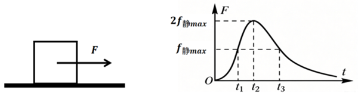

**A.** $t_1$ 时刻货箱受力平衡

**B.** $t_2$ 时刻货箱的加速度达到最大值

**C.** $t_1-t_3$ 时间段内货箱受到的摩擦力先增大后减小

**D.** 货箱与地面之间有2对相互作用力

### 第 67 题

原卷 PDF 页码：17；题目 ID：`gd-mock-2026h2-s32-q67`

如图所示，水平圆盘可以绕竖直中心轴匀速转动，小物块放置在圆盘表面，跟随圆盘一起做匀速圆周运动。下列说法正确的是（    ）。

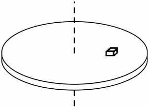

**A.** 物块随圆盘匀速转动时，一共受到重力、支持力、向心力、静摩擦力4个力的作用

**B.** 若圆盘转动角速度变大，物块受到的静摩擦力方向会从指向圆心转为背离圆心

**C.** 若物块到转轴距离不变，圆盘角速度越大，物块受到的静摩擦力越大

**D.** 若物块与圆盘发生相对滑动，物块会沿着半径方向向外滑出

### 第 68 题

原卷 PDF 页码：17, 18；题目 ID：`gd-mock-2026h2-s32-q68`

古法天锅酿酒时，地锅中的发酵原料持续加热，产生含有酒精和水蒸气的高温混合蒸汽；蒸汽向上遇到装有冷水的天锅锅底，气态酒精与水蒸气在锅底凝结为液态，汇聚成酒液经导流装置流出。已知酒精沸点低于水的沸点，下列说法正确的是（    ）。

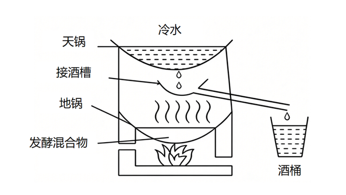

**A.** 地锅中原料加热时，酒精比水更难由液态转化为气态

**B.** 高温混合蒸汽接触装有冷水的锅底发生液化，该过程需要吸收热量

**C.** 酿酒过程中不断更换天锅中的冷水，有助于收集酒液

**D.** 酒液能够持续流出，说明蒸汽液化时装有冷水的锅底温度高于蒸汽温度

### 第 69 题

原卷 PDF 页码：18；题目 ID：`gd-mock-2026h2-s32-q69`

接种疫苗后，人体免疫系统会针对疫苗中的特定抗原发生免疫应答，并留存免疫记忆。当机体后续再次接触到同种致病性病原体入侵时，能够启动速度更快、强度更大的免疫防御，有效降低发病或者重症风险。该免疫过程主要属于（    ）。

**A.** 特异性免疫

**B.** 物理屏障作用

**C.** 非特异性吞噬作用的唯一结果

**D.** 与免疫系统无关的条件反射

### 第 70 题

原卷 PDF 页码：18；题目 ID：`gd-mock-2026h2-s32-q70`

某沿海城市建设海上风电场，工作人员观察发现，白天近地面风常由海洋吹向陆地，夜晚近地面风向可能相反。下列说法正确的是（    ）。

**A.** 白天近地面风的形成与海陆热力性质差异有关

**B.** 海陆风形成说明近地面空气总是从低压区流向高压区

**C.** 夜晚陆地气温通常高于海洋，近地面可能形成海风

**D.** 海上风电的能量最终来源于地球内部的地热能

---

## 第 33 季 · 科学推理

来源：2026下半年省考第三十三季行测模考大赛（广东卷）.pdf

共 5 题，保留原卷题号。分数与数学符号使用 LaTeX；图形使用原图或已标注的矢量重绘图。

### 第 66 题

原卷 PDF 页码：17, 18；题目 ID：`gd-mock-2026h2-s33-q66`

实验室采购一批试剂，标签模糊。已知两瓶液体分别是过氧化氢溶液和蒸馏水，下列方案能一次性区分二者的是（    ）。

**A.** 滴入酚酞溶液，观察颜色变化

**B.** 加入少量二氧化锰固体，观察是否产生气泡

**C.** 品尝液体味道

**D.** 闻气味

### 第 67 题

原卷 PDF 页码：18；题目 ID：`gd-mock-2026h2-s33-q67`

在热带雨林环境与干旱荒漠环境中，植物的光合、呼吸和蒸腾作用的差异显著。下列关于不同环境下植物生理特性的说法，正确的是（    ）。

**A.** 干旱荒漠中植物叶片退化，蒸腾作用极弱，可减少水分消耗

**B.** 热带雨林中光照充足，植物的呼吸作用强度远大于光合作用强度

**C.** 热带雨林阴湿环境中水分充足，植物蒸腾作用无任何生理意义

**D.** 干旱荒漠中植物会永久停止光合作用，仅靠呼吸作用存活

### 第 68 题

原卷 PDF 页码：18；题目 ID：`gd-mock-2026h2-s33-q68`

如图所示，A、B两个物块叠放在粗糙程度均匀的水平地面上，物块A受到一个从零开始逐渐增大的水平拉力F，两个物块均保持静止，当拉力F增大到一定程度后，两个物块共同向右做加速运动，若两个物块始终保持相对静止，下列说法正确的是（    ）。

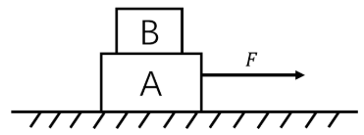

**A.** 静止阶段，物块B受到水平向右的摩擦力

**B.** 静止阶段，物块A不受摩擦力

**C.** 加速阶段，物块B受到动摩擦力

**D.** 加速阶段，物块B受到的摩擦力不断变大

### 第 69 题

原卷 PDF 页码：18；题目 ID：`gd-mock-2026h2-s33-q69`

某物质温度随时间变化的图像如下图所示，其中甲、乙、丙分别表示这种物质的三种物态的微观模型，下列说法错误的是（    ）。

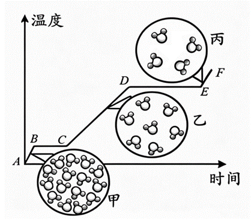

**A.** 图中BC段，该物质的内能增大

**B.** 图中丙表示该物质的气态模型

**C.** 图中DE段，该物质持续吸热

**D.** 图中该物质甲状态下的分子间作用力小于乙

### 第 70 题

原卷 PDF 页码：19；题目 ID：`gd-mock-2026h2-s33-q70`

我国江淮地区常在6月中下旬至7月上中旬出现持续性阴雨天气，正值江南梅子黄熟季节，俗称“梅雨”。此时来自北方的冷空气与来自南方的暖湿气流在江淮流域势力相当，形成移动缓慢的锋面。关于“梅雨”季节，下列说法不正确的是（    ）。

**A.** “梅雨”季节期间，空气湿度大、日照时间短

**B.** 冷暖气团势力相当，使锋面移动缓慢并带来持续阴雨

**C.** 暖湿气流沿锋面抬升，水汽冷却凝结形成降水

**D.** 江淮“梅雨”主要由台风频繁登陆并长时间停留形成

---
