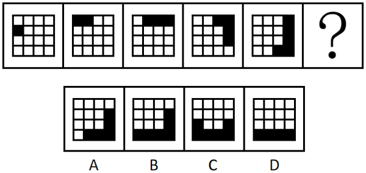
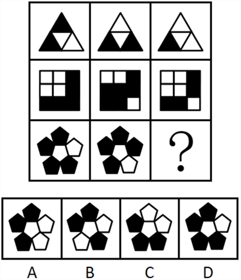
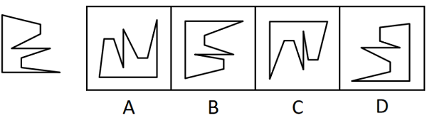
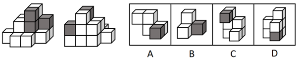
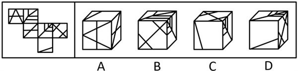

# 第 16 季 · 判断推理

来源：2026下半年省考第十六季行测模考大赛（广东卷）.pdf

共 20 题，保留原卷题号。分数与数学符号使用 LaTeX；图片路径指向同一资料包内的原图。

## 第 46 题

原卷 PDF 页码：10, 11；题目 ID：`gd-mock-2026h2-s16-q46`

从所给的四个选项中，选择最合适的一个填入问号处，使之呈现一定的规律性：

**A.** 见题图中的 A 选项

**B.** 见题图中的 B 选项

**C.** 见题图中的 C 选项

**D.** 见题图中的 D 选项

## 第 47 题

原卷 PDF 页码：11；题目 ID：`gd-mock-2026h2-s16-q47`

从所给的四个选项中，选择最合适的一个填入问号处，使之呈现一定的规律性：

**A.** 见题图中的 A 选项

**B.** 见题图中的 B 选项

**C.** 见题图中的 C 选项

**D.** 见题图中的 D 选项

## 第 48 题

原卷 PDF 页码：11；题目 ID：`gd-mock-2026h2-s16-q48`

右侧选项能与左侧图形组成一个完整正方形的是（    ）。

**A.** 见题图中的 A 选项

**B.** 见题图中的 B 选项

**C.** 见题图中的 C 选项

**D.** 见题图中的 D 选项

## 第 49 题

原卷 PDF 页码：11, 12；题目 ID：`gd-mock-2026h2-s16-q49`

左边为由13个白色正方体和3个灰色正方体组合而成的多面体前后两面的直观图，问其可以由除哪项外的三个多面体组合而成？

**A.** 见题图中的 A 选项

**B.** 见题图中的 B 选项

**C.** 见题图中的 C 选项

**D.** 见题图中的 D 选项

## 第 50 题

原卷 PDF 页码：12；题目 ID：`gd-mock-2026h2-s16-q50`

左边给定的是纸盒外表面的展开图，右边哪一项能由它折叠而成？请把它找出来。

**A.** 见题图中的 A 选项

**B.** 见题图中的 B 选项

**C.** 见题图中的 C 选项

**D.** 见题图中的 D 选项

## 第 51 题

原卷 PDF 页码：12；题目 ID：`gd-mock-2026h2-s16-q51`

每逢节假日亲友聚餐时，鲜榨果汁往往成为餐桌上的热门饮品。有相关研究表明，相较于需要反复咀嚼的完整水果，鲜榨果汁不仅口感更顺滑，还能完整浓缩水果中的核心营养成分，无需经过咀嚼消化就能被人体更高效地吸收。据此有观点认为，日常饮用鲜榨果汁会比直接食用完整水果起到更好的养生效果。
以下哪项如果为真，最不能削弱上述观点？

**A.** 鲜榨果汁会导致维生素C等易氧化营养物质大量流失，养生作用远低于完整水果

**B.** 鲜榨果汁将糖分高度浓缩，被人体快速吸收后易造成血糖波动、热量超标，有损健康

**C.** 鲜榨果汁口感更佳，能让人们更愿意摄入水果相关营养，间接提升身体代谢能力

**D.** 膳食纤维是水果的核心营养成分之一，榨汁后绝大部分膳食纤维都会随果渣一起被丢弃

## 第 52 题

原卷 PDF 页码：12；题目 ID：`gd-mock-2026h2-s16-q52`

某科研团队利用从柑橘皮废料中提取的果胶，研发出新型复合纳米水凝胶材料。实验显示，该材料对糖尿病患者伤口常见的耐甲氧西林金黄色葡萄球菌（MRSA）杀伤率高达99.8%，在糖尿病小鼠感染模型中也展现出优异的抗菌效果。据此有观点认为，这种新型材料能显著加快糖尿病患者伤口的愈合速度。
以下哪项如果为真，最能支持上述结论？

**A.** 柑橘皮提取物可绿色还原纳米银颗粒，对多种常见细菌均具有较强的杀伤作用

**B.** 该新型材料具有良好的生物相容性，可保护正常细胞并促进皮肤组织修复再生

**C.** 我国柑橘加工产业每年产生的果皮废渣数量巨大，该新型材料原料充足且成本低廉

**D.** 有效抑制并清除伤口处的MRSA感染，是促进糖尿病患者伤口快速愈合的关键条件

## 第 53 题

原卷 PDF 页码：12, 13；题目 ID：`gd-mock-2026h2-s16-q53`

为掌握市民对健身运动的参与情况，某市体育局连续三年开展线上抽样调查。调查结果显示，近三年来，宣称自己每周至少进行2次线下健身的市民人数占受访市民总数的比例稳步提升，由12%攀升至30%。但调查该市各健身房的登记数据却发现，近三年来，实际来健身房锻炼的人数其实是下降的。
以下哪项如果为真，最能解释上述现象？

**A.** 近三年该市健身房的数量未出现明显增加，且健身房均维持原有规模，未新增任何健身场地和设施

**B.** 近三年该市部分健身房迫于市场竞争和经营压力，陆续推出了一些优惠活动以吸引客源

**C.** 近三年该市受访市民中，声称每周至少进行2次线下健身的主要群体是青少年，且大多无固定收入，难以承担到健身房锻炼的费用

**D.** 近三年该市户外健身条件改善，更多市民倾向选择户外健身，分流健身房客源的同时提升了健身参与率

## 第 54 题

原卷 PDF 页码：13；题目 ID：`gd-mock-2026h2-s16-q54`

市售瓶装矿泉水在密封状态下依靠臭氧灭菌技术能达到12个月保质期，但一旦瓶盖被拧开，这层保护膜便彻底瓦解。实验数据显示，开封后的瓶装矿泉水在常温环境下，24小时内菌落总数即可突破安全阈值。据此有人认为，这主要是由开封过程中接触空气导致外界细菌进入瓶内引发的。
以下各项如果为真，除哪项外均能削弱上述结论？

**A.** 检测发现，部分瓶装矿泉水在生产灌装时内部已存在少量未被完全杀灭的细菌，这些细菌在开封后会快速繁殖

**B.** 实验表明，瓶装矿泉水的瓶盖密封结构存在缺陷，即使未开封，少量细菌也能缓慢渗入，只是开封后细菌繁殖速度加快

**C.** 对比实验显示，将开封后的瓶装矿泉水置于无菌环境中，72小时内细菌数量仍会超过标准，且增长趋势与在普通环境下相似

**D.** 研究发现，瓶装矿泉水本身含有细菌生长所需的丰富营养物质，这为细菌滋生提供了必要条件

## 第 55 题

原卷 PDF 页码：13；题目 ID：`gd-mock-2026h2-s16-q55`

静态的认知活动，的确能让部分大脑区域“活跃”起来，却不是保持大脑整体健康的最佳途径。研究发现，相比长期久坐的成年人，连续12周保持规律有氧运动的受试者，其工作记忆、认知控制等大脑的执行功能显著提升。据此有研究者认为，规律有氧运动能够有效改善成年人大脑的执行功能。
以下哪项如果为真，最能支持上述研究者的观点？

**A.** 运动频率高的人群出现焦虑、抑郁等情绪障碍的几率更低

**B.** 有氧活动能不断刺激身体释放内啡肽、5-羟色胺等“快乐激素”

**C.** 有氧运动能促进大脑神经元的生长、修复和重建，从而提升认知控制能力

**D.** 大脑的执行功能是衡量成年人认知健康的核心指标，直接影响其工作与学习效率

## 第 56 题

原卷 PDF 页码：13, 14；题目 ID：`gd-mock-2026h2-s16-q56`

现有甲、乙、丙、丁、戊5名工作人员，需分配到综合岗、执法岗、服务岗3个岗位工作，每人只能去1个岗位。已知：
（1）每个岗位至少分配1人、至多分配2人；
（2）若甲不在综合岗，则乙在执法岗；
（3）丙和戊不在同一个岗位；
（4）执法岗分配人数比服务岗多。如果丁在服务岗，则以下哪项一定为真？

**A.** 甲在综合岗

**B.** 乙不在执法岗

**C.** 丙在执法岗

**D.** 戊不在综合岗

## 第 57 题

原卷 PDF 页码：14；题目 ID：`gd-mock-2026h2-s16-q57`

农为邦本，本固邦宁。中国式现代化离不开农业农村现代化，和美乡村建设是乡村振兴的生动载体，因地制宜与精准施策是工作方法。从“千万工程”到各地实践，都印证着尊重规律、实事求是才能行稳致远。坚守因地制宜导向、秉持精准施策方法，就能筑牢防返贫底线，让农业更强、农村更美、农民更富。
由此可以推出：

**A.** 只要坚守因地制宜导向，就能筑牢防返贫底线

**B.** 如果不能做到实事求是，就无法行稳致远

**C.** 中国式现代化是农业农村现代化的必要条件

**D.** 只有因地制宜、精准施策，才能建设和美乡村

## 第 58 题

原卷 PDF 页码：14；题目 ID：`gd-mock-2026h2-s16-q58`

双黑洞并合是重要的引力波源，其最后阶段的铃宕信号蕴含黑洞的关键物理信息，是研究黑洞理论的重要载体。下一代引力波观测设备能够从铃宕信号中提取更多准简正模式，但会造成参数空间迅速膨胀、计算开销大幅增加，严重制约对铃宕信号的深入分析。研究团队开发出“FIREFLY”贝叶斯分析算法，通过引入辅助推断及分步重要性采样策略，将参数空间降维处理，实现了铃宕信号分析的高效加速。因此，该成果为铃宕信号的多准简正模式分析提供了可行方案，为未来引力波观测研究提供了新算法，助力黑洞物理和引力理论的前沿探索。
以下哪项如果为真，不能支持上述结论？

**A.** FIREFLY算法能兼容爱因斯坦望远镜、LISA等下一代引力波观测设备的数据格式并满足其分析需求

**B.** 在下一代地面引力波探测器的背景下，FIREFLY算法相比传统贝叶斯方法可实现数十倍至上百倍的算力压缩

**C.** FIREFLY算法的分析代码已面向全球科研领域开源，被20多个国家和地区的引力波研究团队引入使用

**D.** FIREFLY算法在分析铃宕信号多准简正模式时，在实现数量级加速的同时，仍能获得高保真度的后验样本

## 第 59 题

原卷 PDF 页码：14, 15；题目 ID：`gd-mock-2026h2-s16-q59`

银价上涨后，很多博主教大家用硫磺皂检验银饰真假——用硫磺皂一擦，变黑就是真的，不变色就是假的。实际上，这种检验方式无法判断银饰的真假，因为虽然硫磺皂中单质形态的硫和银接触时，确实会发生化学反应生成硫化银，使银饰变黑，但这只能证明该银饰表面含有银。要使上述观点成立，必须补充的前提是（    ）。

**A.** 硫磺皂会对银饰造成一定的损伤

**B.** 硫与锡发生反应后也会生成黑色硫化物

**C.** 判断银饰真假需要考虑银饰中银的含量

**D.** 硫化银是一种无机化合物，外观为灰黑色粉末

## 第 60 题

原卷 PDF 页码：15；题目 ID：`gd-mock-2026h2-s16-q60`

某小学举行投篮比赛，从大、中、小三种篮球中任选5颗进行投篮，且三种篮球数量充足。投篮规则如下：
（1）投中小球得1分，投中中球得2分，投中大球得3分；
（2）第一次投不中得0分，其他次数投不中给予鼓励分1分。若最终小明得分为9分，则以下除了哪项外均可能是小明的选球方式？

**A.** 三次大球，两次中球

**B.** 两次大球，三次小球

**C.** 一次大球，四次中球

**D.** 一次大球，四次小球

## 第 61 题

原卷 PDF 页码：15；题目 ID：`gd-mock-2026h2-s16-q61`

有人认为，使用某护肤品有利于提升皮肤状态，因为很多皮肤不好的人使用该护肤品一段时间后皮肤状态都有所改善。下列选项的逻辑结构与题干最为相似的是（    ）。

**A.** 很多记忆力不错的青少年都有运动的习惯，所以运动可以帮助青少年提升记忆力

**B.** 食用某保健品可以增强体质，因为不少食用该保健品的人体质都比其他人好

**C.** 大多数使用某品牌洗发水的消费者发量都增加了，所以该品牌洗发水可帮助生发

**D.** 接触大自然有利于减轻精神压力，因为很多逛完自然公园的人都面带笑容

## 第 62 题

原卷 PDF 页码：15；题目 ID：`gd-mock-2026h2-s16-q62`

某地资源枯竭，常住居民较少，夜间亮灯率较低，难以吸引外来投资。但两年后，当地的经济发展水平非但没有持续下降，反而明显提升。下列选项如果为真，最能解释上述现象的是（    ）。

**A.** 当地自然景观独特，每年都能吸引游客前来游玩

**B.** 当地因地制宜建立暗夜星空保护区，发展天文经济

**C.** 扶贫政策使当地居民可以维持基本生活水平

**D.** 两年间当地外出务工人数明显增多，且很少回乡

## 第 63 题

原卷 PDF 页码：15, 16；题目 ID：`gd-mock-2026h2-s16-q63`

如果持续深化整治形式主义为基层减负，那么基层工作人员就会有更多时间和精力干实事。如果不持续深化整治形式主义为基层减负，就无法杜绝“形象工程”“政绩工程”。只有杜绝“形象工程”“政绩工程”，才能真正满足人民群众的切实需求。
由此可以推出（    ）。

**A.** 如果真正满足了人民群众的切实需求，那么基层工作人员就会有更多时间和精力干实事

**B.** 如果基层工作人员有更多时间和精力干实事，那么就能杜绝“形象工程”“政绩工程”

**C.** 如果不能真正满足人民群众的切实需求，那么就没有持续深化整治形式主义为基层减负

**D.** 如果持续深化整治形式主义为基层减负，那么就能杜绝“形象工程”“政绩工程”

## 第 64 题

原卷 PDF 页码：16；题目 ID：`gd-mock-2026h2-s16-q64`

必须加强种业创新、建设好高标准农田，才能解决中国人的吃饭问题。建设好高标准农田离不开政策支持，因此，如果缺乏政策支持就不能解决中国人的吃饭问题。下列选项与题干逻辑结构最为相似的是（    ）。

**A.** 坚持家庭教育、学校教育的有机融合与协同是教育发展的必然要求。学校教育离不开高素质教育工作者，因此，如果高素质教育工作者匮乏，那么教育就不能发展

**B.** 要想更大程度激发市场活力，必须营造安全高效的营商环境。而没有政府的宏观调控，或没有市场的生产要素有序流动，就没有安全高效的营商环境。因此，市场的生产要素有序流动是更大程度激发市场活力的前提

**C.** 因地制宜种植绿化树种、不盲目砍伐本地树种对做好城市绿化来说缺一不可。而不盲目砍伐本地树种就要求当地对网红树种祛魅，因此，如果盲目砍伐本地树种就做不好城市绿化

**D.** 社区保持友好互助氛围的前提有两个，一是多样化的邻里活动，二是完善的组织体系。信任是完善的组织体系的基础，因此，若邻里互不信任，社区就无法保持友好互助的氛围

## 第 65 题

原卷 PDF 页码：16；题目 ID：`gd-mock-2026h2-s16-q65`

雄性清白招潮蟹左右螯大小悬殊，大螯约占其体重的一半，它们用大螯做出不同的运动，比如侧向环绕运动、侧向弹击运动、快速垂直运动和环绕运动，而这四种运动分别在特定的情景下频繁出现。因此，有学者推测雄性清白招潮蟹通过挥舞大螯进行沟通与交流。
以下属于上述推测暗含前提的是（    ）。

**A.** 雄性清白招潮蟹仅用小螯进食

**B.** 雄性清白招潮蟹拥有一定的视力和视野

**C.** 肢体语言是大多数沙蟹科动物的主要沟通方式

**D.** 雄性清白招潮蟹的活动始终以它的洞穴为中心
