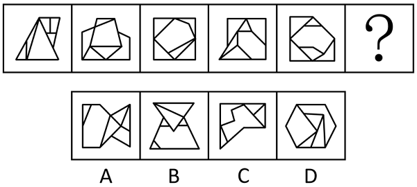
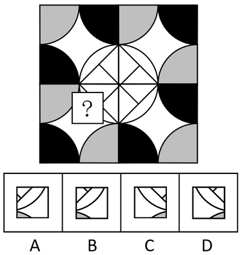
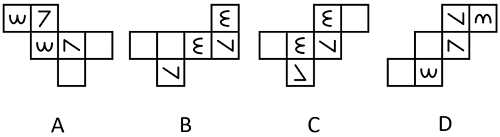
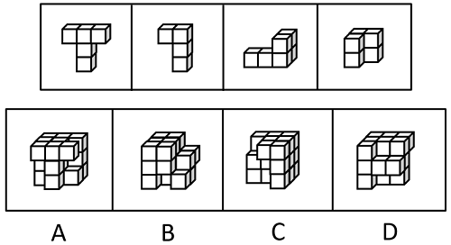

# 第 17 季 · 判断推理

来源：2026下半年省考第十七季行测模考大赛（广东卷）.pdf

共 20 题，保留原卷题号。分数与数学符号使用 LaTeX；图片路径指向同一资料包内的原图。

## 第 46 题

原卷 PDF 页码：11；题目 ID：`gd-mock-2026h2-s17-q46`

从所给的四个选项中，选择最合适的一个填入问号处，使之呈现一定的规律性：

**A.** 见题图中的 A 选项

**B.** 见题图中的 B 选项

**C.** 见题图中的 C 选项

**D.** 见题图中的 D 选项

## 第 47 题

原卷 PDF 页码：11, 12；题目 ID：`gd-mock-2026h2-s17-q47`

从所给的四个选项中，选择最合适的一个填入问号处，使之呈现一定的规律性：

**A.** 见题图中的 A 选项

**B.** 见题图中的 B 选项

**C.** 见题图中的 C 选项

**D.** 见题图中的 D 选项

## 第 48 题

原卷 PDF 页码：12；题目 ID：`gd-mock-2026h2-s17-q48`

下列选项经过旋转后，最符合所给图形规律的是（    ）。

**A.** 见题图中的 A 选项

**B.** 见题图中的 B 选项

**C.** 见题图中的 C 选项

**D.** 见题图中的 D 选项

## 第 49 题

原卷 PDF 页码：12, 13；题目 ID：`gd-mock-2026h2-s17-q49`

以下除哪项外，都是同一正方体纸盒的外表面展开图？

**A.** 见题图中的 A 选项

**B.** 见题图中的 B 选项

**C.** 见题图中的 C 选项

**D.** 见题图中的 D 选项

## 第 50 题

原卷 PDF 页码：13；题目 ID：`gd-mock-2026h2-s17-q50`

以下为4个由若干棱长为1的正方体拼成的多面体，将它们在3×3×3的空间内进行拼接，不可能拼成以下四个选项中的哪一个多面体？

**A.** 见题图中的 A 选项

**B.** 见题图中的 B 选项

**C.** 见题图中的 C 选项

**D.** 见题图中的 D 选项

## 第 51 题

原卷 PDF 页码：13；题目 ID：`gd-mock-2026h2-s17-q51`

宠物的免疫力与它们的饮食息息相关。如果宠物缺乏科学的饮食结构，则会导致免疫系统功能衰退。除非同时满足均衡的营养配比和规律的喂食频率，否则无法形成科学的饮食结构。
由此可以推出：

**A.** 只要同时满足了均衡的营养配比和规律的喂食频率，宠物的免疫系统功能就不会衰退

**B.** 如果同时满足了均衡的营养配比和规律的喂食频率，那么就能形成科学的饮食结构

**C.** 如果宠物的免疫系统功能衰退，那么说明它们没有形成科学的饮食结构

**D.** 除非满足规律的喂食频率，否则宠物的免疫系统功能就会衰退

## 第 52 题

原卷 PDF 页码：13；题目 ID：`gd-mock-2026h2-s17-q52`

我国科研团队成功开发出一种名为“榫卯连接系统”（MT系统）的新型基因编辑技术，其DNA片段插入与替换效率最高达59.47%，能够精准地在植物基因组目标位点插入和替换DNA片段，为植物精准育种提供了全新的编辑工具。该系统的成功研发，标志着我国在基因编辑底层工具领域取得了重大突破，打破了国外对先导编辑系统的专利垄断。据此科研人员认为，MT系统可以大规模应用于育种产业，并推动育种产业的产业化进程。
以下哪项如果为真，是上述论证成立的必要前提？

**A.** MT系统的编辑效率显著高于国外先导编辑系统

**B.** MT系统拥有完全自主知识产权且能绕开专利壁垒

**C.** MT系统的成本与稳定性满足大规模育种应用要求

**D.** 国内其他基因编辑工具尚处于不同的实验室研发阶段

## 第 53 题

原卷 PDF 页码：13, 14；题目 ID：`gd-mock-2026h2-s17-q53`

充电基础设施促进联盟发布的最新数据显示，截至2025年底，北京、上海、深圳等一线城市的新能源汽车与公共充电桩的车桩比已达到1：2.8，充电便利性显著提升。数据还显示，这些城市的充电桩利用率达到15%-18%，远高于行业平均水平。据此有研究人员表示，随着充电基础设施建设模式的成熟，预计到2027年全国范围内新能源汽车与公共充电桩的车桩比有望达到1：3的合理水平。
以下哪项如果为真，最能削弱上述论证？

**A.** 一线城市公共充电桩建设投入成本比二、三线城市高出40%以上

**B.** 中西部地区和县城的公共充电桩覆盖率不足一线城市的30%，增长速度十分缓慢

**C.** 2025年全国新能源汽车保有量同比增长35%，增速超过公共充电桩建设同比增速

**D.** 一线城市已建成的公共充电桩中，快充桩占比达到60%，而全国平均水平仅为42%

## 第 54 题

原卷 PDF 页码：14；题目 ID：`gd-mock-2026h2-s17-q54`

冯、陈、楚、魏、周、吴、郑7人均向同一家公司投递了简历，对于面试的通知情况，大家预测如下：
（1）要么通知周和吴参加面试，要么通知吴和郑参加面试；
（2）只有通知冯和楚参加面试，才会通知郑参加面试或不通知吴参加面试；
（3）如果陈、吴中至少有1人被通知参加面试，则通知魏参加面试且不通知楚参加面试。收到面试通知后，发现上述预测均完全正确。
根据上述信息，一定被通知参加面试的是：

**A.** 周

**B.** 冯

**C.** 楚

**D.** 郑

## 第 55 题

原卷 PDF 页码：14；题目 ID：`gd-mock-2026h2-s17-q55`

在相当长的一段时间里，通过考古证据和染色体数量，人们对于大麦的“今生”已经非常了解。科学家在今天中东地区的新月沃地发现了大量早期人类食用和驯化大麦的考古痕迹，似乎印证着大麦和小麦一样起源于新月沃地，在单一地区驯化。但有学者持相反观点，认为大麦是多地祖先栽培的产物。
以下哪项如果为真，最不能支持上述学者的观点？

**A.** 大麦现今在世界各地广泛栽种，它能成功转变为农作物主要得益于在人类驯化过程中发生的数次关键基因突变

**B.** 青稞（裸大麦）的籽粒与外壳非常容易分离，一旦离开西藏高寒、干燥的环境，其裸粒特性就不利于传播了

**C.** 基因测序显示，不同地区大麦的遗传特性差异明显，且各地种群的独有基因变异并非都源自新月沃地

**D.** 非碎穗性、六棱性以及裸粒性这三个在大麦驯化历史中起到至关重要作用的单倍型出现的时间、地点各不相同

## 第 56 题

原卷 PDF 页码：14, 15；题目 ID：`gd-mock-2026h2-s17-q56`

甲、乙、丙、丁、戊五人选课时都选到了自己喜欢的课程，课程包括地理课、鉴赏课、急救课和历史课，每人只能选一门课程，关于具体选课情况，五人猜测如下：甲：我会选地理课；乙：我和丁会选相同的课程；丙：我和丁中至少有一人不会选鉴赏课；丁：甲不会选急救课或丙不会选历史课；戊：乙不会选鉴赏课。若只有一人猜对了，则可以推出：

**A.** 有人选地理课

**B.** 没人选地理课

**C.** 乙、丙都不会选急救课

**D.** 乙、丁都不会选鉴赏课

## 第 57 题

原卷 PDF 页码：15；题目 ID：`gd-mock-2026h2-s17-q57`

肥胖是指明显超重且脂肪层过厚，由体内脂肪尤其是甘油三酯积聚过多而导致的一种状态。某地一项针对肥胖人群的调查显示，约73%的肥胖人士食欲旺盛，尤其面对自己喜爱的食物时，很容易吃得过多。有人据此认为，食欲旺盛导致了肥胖。
以下哪项如果为真，最能削弱上述结论？

**A.** 一些人只食用自己喜爱的食物，但能保持体型正常，并不肥胖

**B.** 摄入的食物种类过于单一、运动量偏少等也会导致肥胖

**C.** 食欲旺盛的人很可能低估自己每天摄入的热量

**D.** 肥胖的人容易因受挫而郁结，进而暴饮暴食、食欲旺盛

## 第 58 题

原卷 PDF 页码：15；题目 ID：`gd-mock-2026h2-s17-q58`

在网络高度发达的当下，影视、新闻、图书等海量资源触手可及，每日新增数据规模庞大，存储空间是否会有耗尽的一天？有网友对此作出否定的回答，并给出了自己的理由：这些数据信息并不存储在手机等终端设备中，而是存放在遍布全球的数据中心机房里，而数据中心布局不断扩张，从城市延伸至偏远地区，甚至在海底都建起了机房，数据中心数量没有上限。
以下哪项如果为真，最能削弱网友的观点？

**A.** 从长远来看，随着人类进入智能时代，数据量必将呈爆炸式增长

**B.** 数据中心的建造需要考虑地理、经济等因素，可建机房数量有最大值

**C.** 一些试图解决数据存储问题的新技术，如“量子存储”等尚未实现应用

**D.** 数据中心机房依托于现实设备，很可能随着时间发展出现设备磨损甚至严重损坏

## 第 59 题

原卷 PDF 页码：15；题目 ID：`gd-mock-2026h2-s17-q59`

米饭冷藏放置后会发生老化回生，使其抗性淀粉含量增加。经研究证实，抗性淀粉能够改善血脂水平，平缓血糖峰值，还可辅助调理脂肪肝。基于这一作用，有人提出观点，不必刻意食用冷藏后的米饭，通过摄入其他富含抗性淀粉的食物，可以起到相同的健康作用。要使上述推论成立，需要补充的前提是（    ）。

**A.** 其他富含抗性淀粉食物的销售价格要符合普通民众的消费水平

**B.** 大众普遍存在高血脂、高血糖、脂肪肝等需要改善的健康问题

**C.** 抗性淀粉在调节血脂、血糖和改善肝脏健康方面有着显著效果

**D.** 冷藏后的米饭中抗性淀粉和其他食物中抗性淀粉的作用原理完全一致

## 第 60 题

原卷 PDF 页码：15, 16；题目 ID：`gd-mock-2026h2-s17-q60`

小李、小赵、小钱是街舞社的三名成员，他们来自大一、大二、大三，所学专业是文学、数学、计算机。已知：
（1）小李和来自大一数学专业的成员是好友；
（2）小钱是三人中年级最高的成员，曾和来自计算机专业的成员共同演出。
根据上述信息，可以推出小李、小赵、小钱的年级和专业分别是：

**A.** 大二计算机、大一数学、大三文学

**B.** 大二计算机、大三文学、大一数学

**C.** 大一数学、大二文学、大三计算机

**D.** 大一数学、大二计算机、大三文学

## 第 61 题

原卷 PDF 页码：16；题目 ID：`gd-mock-2026h2-s17-q61`

浏览短视频会缩短人们的深度阅读时长，因为本身热爱深度阅读的人，一旦增加短视频浏览时间，就会缩短自己的深度阅读时长。下列选项的逻辑结构与题干最为相似的是（    ）。

**A.** 本身牙齿抗龋能力弱的人，即使少吃甜食，也容易出现龋齿问题，所以吃甜食容易出现龋齿问题

**B.** 熬夜会使肝脏指标异常，因为本身肝脏状态良好的人，一旦长期熬夜，就会出现肝脏指标异常的情况

**C.** 刷题会提高学生的应试分数，但本身成绩较差的人，即使大量刷题，也很难提高自己的应试分数

**D.** 网购会减少人们线下购物的次数，但本身喜欢线下购物的人，一旦减少网购次数，就会增加线下购物的次数

## 第 62 题

原卷 PDF 页码：16；题目 ID：`gd-mock-2026h2-s17-q62`

在聊天中高频出现的“当个事儿办”，在课堂讨论时突然蹦出的“我嘞个豆”，在短视频平台弹幕里刷屏的“爱你老己”······在数智技术深度渗透的今天，梗文化已成为青年群体最具代表性的话语表达，青年们热衷玩梗，对梗文化乐此不疲，家长们却对此忧心忡忡。下列选项如果为真，最不能解释上述现象的是（    ）。

**A.** 青年们认为梗文化是轻松的社交工具，能快速拉近同侪距离，而家长们觉得频繁玩梗会导致孩子词汇贫乏、思维懒惰

**B.** 青年们不仅是梗的使用者，更乐于创作各类网络热梗，而家长们认为网络的虚拟表达行为无助于社会交往能力的提升

**C.** 玩梗是青年们在高竞争的社会环境下释放情绪的渠道，而家长们担忧梗的快速迭代会让孩子过度追逐潮流，影响专注力

**D.** 玩梗使青年们在嬉闹中实现自我表达与群体认同，而家长们因不了解梗的含义，容易对陌生的网络用语产生抵触和担忧

## 第 63 题

原卷 PDF 页码：16, 17；题目 ID：`gd-mock-2026h2-s17-q63`

某乡镇发展报告指出，有了周密的应急预案，就可成功举办乡村大型活动。乡村大型活动要成功举办，则必须确保当地有足够的承载能力。只有当主办方具备丰富的大型活动组织经验，并且当地有足够的承载能力时，乡村大型活动才能举办得安全有序。如果上述报告的观点为真，则下列选项最不可能发生的是（    ）。

**A.** 某乡村大型活动没有周密的应急预案，但当地具有足够的承载能力

**B.** 某乡村大型活动主办方经验丰富且当地承载能力足够，但活动最终出现了混乱

**C.** 某乡村大型活动在当地承载能力足够的情况下，即使主办方经验不足，也举办得安全有序

**D.** 某乡村大型活动最终成功举办，但在活动策划初期，主办方并未预估到会有如此高的关注度

## 第 64 题

原卷 PDF 页码：17；题目 ID：`gd-mock-2026h2-s17-q64`

优质教育品牌必须具备科学的课程体系和专业的师资团队。某教育机构计划打造优质教育品牌，因此，该教育机构必须着力完善科学的课程体系并引进专业师资团队。下列选项的逻辑结构与题干最为相似的是（    ）。

**A.** 科学的学习方法是学生高效学习的必备条件。学生小王想要高效学习，因此，学生小王必须掌握科学的学习方法

**B.** 企业的核心竞争力源于优质的产品质量和售后服务。某企业想要提升核心竞争力，因此，该企业必须提升产品质量

**C.** 城市的宜居建设必须要有完善的基础设施。某省级城市想要完善基础设施，因此，该省级城市必须加大资金的投入

**D.** 非传统文化的传承不需要创新的传播方式。非遗文化的传承属于传统文化的传承范畴，因此，非遗文化传承需要创新的传播方式

## 第 65 题

原卷 PDF 页码：17；题目 ID：`gd-mock-2026h2-s17-q65`

某研究团队研发出新一代裸眼3D显示技术，跟传统裸眼3D显示技术相比，该技术开创了动态模式，该模式打破了裸眼3D领域多年来大尺寸与宽视角不可兼得的局面。研究人员据此认为，该技术要比传统裸眼3D显示技术更有望在教育、医疗、娱乐等多个领域开拓创新应用。要使上述推论成立，需要补充的前提是（    ）。

**A.** 该技术的制造成本不会比传统裸眼3D显示技术高出太多

**B.** 3D显示技术在各领域的应用需要该技术开创的动态模式

**C.** 大尺寸与宽视角可以兼得的目标只有该技术能够实现

**D.** 已有企业表达了对该技术进行产业化落地的合作意向
