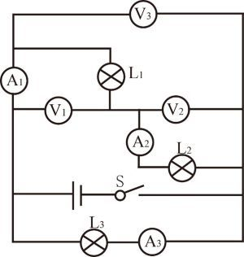
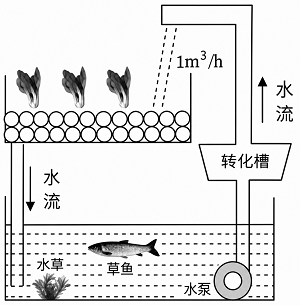

# 第 17 季 · 科学推理

来源：2026下半年省考第十七季行测模考大赛（广东卷）.pdf

共 5 题，保留原卷题号。分数与数学符号使用 LaTeX；图形使用原图或已标注的矢量重绘图。

## 第 66 题

原卷 PDF 页码：17；题目 ID：`gd-mock-2026h2-s17-q66`

生活中许多常见的现象都与物态变化有关，而物态变化常伴随着吸热和放热。下列现象中，不属于吸热现象的是（    ）。

**A.** 冰块融化

**B.** 海水蒸发

**C.** 樟脑变小

**D.** 露珠形成

## 第 67 题

原卷 PDF 页码：17, 18；题目 ID：`gd-mock-2026h2-s17-q67`

在如图所示的电路图中，电源电压保持不变， $L_1$ 、 $L_2$ 、 $L_3$ 是三个完全相同的灯泡， $A_1$ 、 $A_2$、 $A_3$ 均为电流表， $V_1$ 、 $V_2$ 、 $V_3$ 均为电压表。闭合开关S后，下列说法不正确的是（    ）。

**A.** 电压表 $V_3$ 的示数最小

**B.** 电流表 $A_3$ 的示数最大

**C.** 电流表 $A_1$ 、 $A_2$ 的示数相等

**D.** 电压表 $V_1$ 、 $V_2$ 的示数相等

## 第 68 题

原卷 PDF 页码：18；题目 ID：`gd-mock-2026h2-s17-q68`

某博物馆曾展出过春秋时期的青铜器“云纹铜禁”。古代常以含铜矿物为原料，在高温条件下配合木炭进行冶炼后，将熔融状态的金属浇入模具中成型，从而制成青铜器，虽然青铜器相对较为耐腐蚀，但是这类器物若长期暴露在自然环境中，其表面也会逐渐发生变化，产生铜绿。下列说法正确的是（    ）。

**A.** “云纹铜禁”属于合成材料，因此耐腐蚀性通常强于铜

**B.** 青铜熔点较低，有利于其在铸造过程中成型

**C.** 木炭在青铜冶炼过程中只提供热量，不参与反应

**D.** 为防止铜制品生锈，应将其长期浸泡在水中保存

## 第 69 题

原卷 PDF 页码：18, 19；题目 ID：`gd-mock-2026h2-s17-q69`

某农业示范基地采用“鱼菜共生”系统开展循环种养：在养殖区中养鱼，鱼类排泄物和残饵随水流进入转化槽，经微生物分解转化为无机盐，再由水泵输送至种植区供植物吸收。为提高系统稳定性，研究人员引入以小虾为食的鲈鱼。下列说法正确的是（    ）。

**A.** 转化槽中的细菌属于消费者

**B.** 该生态系统中的能量可以在各营养级之间循环利用

**C.** 引入鲈鱼后，小虾数量先减少后趋于稳定，说明生态系统具有自我调节能力

**D.** 该生态系统中能量的最终来源是鱼类体内储存的化学能

## 第 70 题

原卷 PDF 页码：19；题目 ID：`gd-mock-2026h2-s17-q70`

下表为小明在夏至日（6月22日）这天记录的甲、乙、丙、丁四个地方的白昼时长和黑夜时长的差值（白昼时长-黑夜时长），下列说法不正确的是（    ）。

**夏至日白昼时长与黑夜时长的差值**

| 地方 | 甲 | 乙 | 丙 | 丁 |
| --- | --- | --- | --- | --- |
| 差值/h | 1.5 | 0 | 3 | −2 |

差值方向依题干：白昼时长减黑夜时长。

**A.** 甲、丙两地位于同一半球

**B.** 丙地的纬度高于乙地

**C.** 丁地位于南半球

**D.** 甲地的纬度高于丁地
