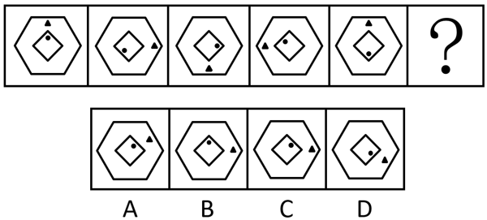
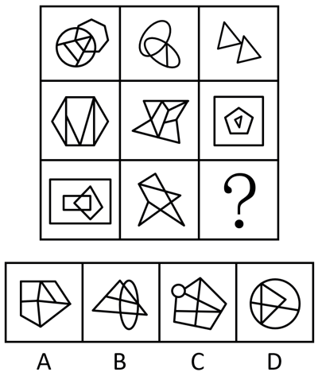
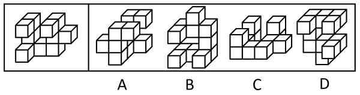
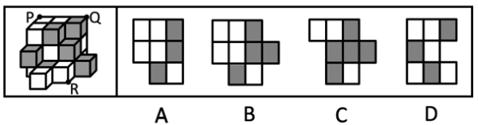
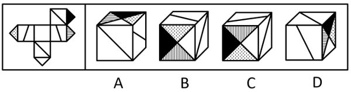

# 第 18 季 · 判断推理

来源：2026下半年省考第十八季行测模考大赛（广东卷）.pdf

共 20 题，保留原卷题号。分数与数学符号使用 LaTeX；图片路径指向同一资料包内的原图。

## 第 46 题

原卷 PDF 页码：10, 11；题目 ID：`gd-mock-2026h2-s18-q46`

从所给的四个选项中，选择最合适的一个填入问号处，使之呈现一定的规律性：

**A.** 见题图中的 A 选项

**B.** 见题图中的 B 选项

**C.** 见题图中的 C 选项

**D.** 见题图中的 D 选项

## 第 47 题

原卷 PDF 页码：11；题目 ID：`gd-mock-2026h2-s18-q47`

从所给的四个选项中，选择最合适的一个填入问号处，使之呈现一定的规律性：

**A.** 见题图中的 A 选项

**B.** 见题图中的 B 选项

**C.** 见题图中的 C 选项

**D.** 见题图中的 D 选项

## 第 48 题

原卷 PDF 页码：11；题目 ID：`gd-mock-2026h2-s18-q48`

下列选项最不可能与左侧立体图形是同一物体的是（    ）。

**A.** 见题图中的 A 选项

**B.** 见题图中的 B 选项

**C.** 见题图中的 C 选项

**D.** 见题图中的 D 选项

## 第 49 题

原卷 PDF 页码：11, 12；题目 ID：`gd-mock-2026h2-s18-q49`

左图为16个白色正方体和6个灰色正方体组合而成的多面体，现用经P、Q、R三个顶点的平面对该多面体进行切割，正确的截面是：

**A.** 见题图中的 A 选项

**B.** 见题图中的 B 选项

**C.** 见题图中的 C 选项

**D.** 见题图中的 D 选项

## 第 50 题

原卷 PDF 页码：12；题目 ID：`gd-mock-2026h2-s18-q50`

左边给定的是纸盒外表面的展开图，右边哪一项不能由它折叠而成？请把它找出来。

**A.** 见题图中的 A 选项

**B.** 见题图中的 B 选项

**C.** 见题图中的 C 选项

**D.** 见题图中的 D 选项

## 第 51 题

原卷 PDF 页码：12；题目 ID：`gd-mock-2026h2-s18-q51`

将人文底蕴转化为城市发展优势，既是满足人民日益增长的美好生活需要的关键，也是加快现代化人民城市建设、推动城市高质量发展的必由之路。如果不能发挥人文精神的引领作用、人文价值的导向作用、文化产业的驱动作用和文化事业的保障作用，就不能将人文底蕴转化为城市发展优势。
由此可以推出：

**A.** 只有加快现代化人民城市建设、推动城市高质量发展，才能满足人民日益增长的美好生活需要

**B.** 发挥人文精神的引领作用、人文价值的导向作用、文化产业的驱动作用和文化事业的保障作用，才能加快现代化人民城市建设、推动城市高质量发展

**C.** 如果发挥人文精神的引领作用、人文价值的导向作用、文化产业的驱动作用和文化事业的保障作用，就能将人文底蕴转化为城市发展优势

**D.** 不能加快现代化人民城市建设、推动城市高质量发展，就不能将人文底蕴转化为城市发展优势

## 第 52 题

原卷 PDF 页码：12, 13；题目 ID：`gd-mock-2026h2-s18-q52`

随着中国航天事业的不断发展，众多航天员进入太空工作和生活，而太空微重力环境会对人体多个生理系统造成损伤。一项研究显示，在微重力环境下，人体骨髓间充质干细胞更倾向于向成脂细胞分化，减少向成骨细胞分化；造血干细胞更倾向于向破骨细胞分化，减少向红系分化。该研究证明了微重力环境会导致骨骼微结构退化、骨量减少，进而引发骨质疏松症，使人体出现骨痛、骨折等不适症状。上述论证的成立须补充以下哪项作为前提？

**A.** 在地面和太空实验中均可以观察到微重力环境对成骨细胞分化的消极影响以及对破骨细胞分化的积极影响

**B.** 破骨细胞承担骨骼分解吸收工作，成骨细胞负责生成新骨，二者的平衡是人体骨量维持正常水平的关键

**C.** 骨质疏松症是以骨密度和骨质量下降为特征的疾病，患者的骨骼脆性显著增高，轻微外力即可引发骨折

**D.** 在微重力环境中，血液更多地涌向头部，导致不同部位骨骼的血流量发生变化，其中下肢血流减少最为显著

## 第 53 题

原卷 PDF 页码：13；题目 ID：`gd-mock-2026h2-s18-q53`

装配式建筑是指由工厂化生产的部品部件，在施工现场通过组装和连接而成的建筑。目前，全国装配式建筑专业人才仅有50万人，且施工人员往往缺乏操作构件吊装设备的技能，技能工人的占比不足2%。此外，与传统现浇式建筑相比，装配式建筑在预制构件的生产、运输及安装的成本居高不下。因此有人认为，传统现浇式建筑仍然是未来建筑行业的建造趋势。
以下哪项如果为真，最不能削弱上述结论？

**A.** 装配式建筑发展需要高经济水平作支撑，但是各地经济水平存在差异，发展不均衡现象明显，一定程度上制约了装配式建筑发展

**B.** 建筑质量是购房决策中的关键因素，以装配式建筑取代传统现浇式建筑，能大幅减少施工失误，解决系统性的质量通病

**C.** 建筑成本需综合考虑规划设计、生产运输、现场施工安装、运维管理以及拆除等环节，装配式建筑的全生命周期综合成本更低

**D.** 绿色建造是建筑业实现可持续发展的必然选择，与传统现浇式建筑相比，装配式建筑仅需进行简单组装与安装，更加环保节能

## 第 54 题

原卷 PDF 页码：13；题目 ID：`gd-mock-2026h2-s18-q54`

某心理学家做测验时发现，一所公立学校的教师对该校部分学生有较高的积极期望后，这部分学生的成绩也明显提升，各方面表现都很优秀。因此这位心理学家认为，教师的积极期望会促使学生成绩提升。
以下哪项如果为真，最能够削弱上述观点？

**A.** 教师对学生的期望不仅基于客观评价也基于一部分主观评价

**B.** 教师的积极期望能增强学生的学习动力和愉悦感从而促进成绩提升

**C.** 学习成绩好或者进步明显的学生更容易让教师对其产生积极期望

**D.** 教师对学生的期望还受学校政策影响，并非仅基于学生个体

## 第 55 题

原卷 PDF 页码：13, 14；题目 ID：`gd-mock-2026h2-s18-q55`

某部门小王、小李、小张、小赵、小刘5人计划在周边游、看电影和做手工中选择本周末的活动安排，每人只能选择其中一项活动，且每项活动都有1-2人选择。已知：
（1）如果小张或小赵选择做手工或看电影，则小王选择周边游；
（2）如果小赵或小刘选择周边游或看电影，则小王或小李选择做手工；
（3）如果小刘选择做手工或小张选择周边游，则小李和小赵选择看电影。根据以上条件，如果小赵选择做手工，以下除哪项外一定可以推出？

**A.** 小刘选择看电影

**B.** 小王选择周边游

**C.** 小李选择做手工

**D.** 小张选择看电影

## 第 56 题

原卷 PDF 页码：14；题目 ID：`gd-mock-2026h2-s18-q56`

为探究百岁老人长寿的秘诀，某国研究人员进行了一项长期研究。他们从国家健康登记系统中选取了所有在1920-1922年间出生且在70岁时依然健在的居民，共计274108人。从他们70岁起，研究人员进行了长达30年的跟踪研究并获得了详细的健康记录，直至他们去世或年龄超过100岁。根据最终寿命，研究人员将这些老人分为两组：第一组是年龄超过100岁的百岁老人，第二组是寿龄在75至95岁之间的非百岁老人。研究人员分析他们的健康记录后发现，百岁老人组从70岁起平均疾病发生率显著低于非百岁老人组，且重大疾病（如心血管疾病等）的平均出现时间较晚。研究人员由此得出结论：百岁老人长寿的秘诀在于重大疾病的延迟发生。
以下哪项如果为真，最能削弱上述观点？

**A.** 非百岁老人组的人数远超于百岁老人组的人数

**B.** 百岁老人组中患癌人数占比高于非百岁老人组

**C.** 研究对象都经历了相似的社会发展和医疗进步

**D.** 百岁和非百岁老人组的性别比例存在显著差异

## 第 57 题

原卷 PDF 页码：14；题目 ID：`gd-mock-2026h2-s18-q57`

在住宅小区中，物业公司为了保障住户的人身和财产安全，都会在电梯内、楼栋入口等处安装摄像头，这些摄像头通常不会引起住户的反感。然而，邻居为了保障自身的人身和财产安全而安装的摄像头，往往会引起其他住户的不满。
以下哪项如果为真，最不能解释上述现象？

**A.** 物业公司安装的摄像头都是经过业主共同授权的，而且住户还能通过投诉机制重新设定其监控范围，但邻居安装的摄像头很难干预

**B.** 相比邻居安装的摄像头，物业公司安装的摄像头具有更高的分辨率，能够更加清晰地记录事件，而且还能24小时不间断地稳定运行

**C.** 相比邻居安装的摄像头，物业公司安装的摄像头是服务于全体住户而非特定个人，在心理上不会对住户造成过大的“个人隐私压力”

**D.** 物业公司安装的摄像头只拍摄真正的公共区域，而邻居安装的摄像头往往会拍摄到非公共区域，有些甚至能拍摄到其他住户的客厅

## 第 58 题

原卷 PDF 页码：14, 15；题目 ID：`gd-mock-2026h2-s18-q58`

近日，某研究所对贵州发现的4.36亿年前的滤食性生物——腕足动物化石群落进行了研究。研究发现，这些腕足动物体表长有细长的刚毛，从外套膜边缘伸出，且这些腕足动物在海底的分布有序，彼此保持均匀距离。据此，研究人员认为，这些刚毛是腕足动物用来调节个体间距离的，而这种空间上的优化配置，最大限度地提高了整个群落的摄食效率。
以下除哪项外，均能支持上述的观点？

**A.** 空间分析表明，这些腕足动物个体间的平均距离大约是刚毛长度的1.5至2倍，说明刚毛直接决定了个体间的“舒适距离”，从而优化了群落空间分布

**B.** 对现代与这些腕足动物类似的滤食性生物的研究表明，它们也能通过调整个体间位置，以维持最佳距离，从而减少彼此间竞争，提高群落的摄食效率

**C.** 刚毛这种软体结构很难在化石记录中保存，但这批化石罕见地保留了完整的刚毛结构，为进一步研究这些腕足动物的繁衍模式和群落稳定性提供依据

**D.** 这些腕足动物作为滤食性生物，保持适当的距离可以避免个体间摄食水流的相互干扰，确保每个个体有独立的摄食区域，从而显著提高营养摄入效率

## 第 59 题

原卷 PDF 页码：15；题目 ID：`gd-mock-2026h2-s18-q59`

某省为了成为戏曲这一文化IP的集聚地，举办了“百戏星耀”活动，推出10-30元惠民票价，联动各大剧场拓展演出场景，增设体验区拍照打卡，创新“票根+”文旅绑定模式，吸引7万余名观众观演。据此有人认为，该戏曲主题活动的开展提高了剧场场地使用率。要使上述推论成立，需要补充的前提是（    ）。

**A.** 这些激增的观众使剧场的营业额得到了显著的提升

**B.** 剧场每天都需增加演出时长和场次以接待这些观众

**C.** 7万余名观演的观众中省外观众所占的比例近三成

**D.** 所演戏剧的精彩程度能够吸引这些观众观看到最后

## 第 60 题

原卷 PDF 页码：15；题目 ID：`gd-mock-2026h2-s18-q60`

某幼儿园举办了一场动物主题的趣味竞速比赛，参赛的7个孩子需要分别化名为猎豹、兔子、狮子、马、羚羊、狼、鹿，并戴着对应动物的饰品。幼儿园将参赛选手从快到慢进行排名，且本次比赛没有并列名次。已知：
（1）猎豹在速度排行榜中位列第4名；
（2）兔子的速度比狮子慢，但比马快；
（3）猎豹的速度比羚羊慢，但比狼快；
（4）如果狮子位列第2名或羚羊位列第3名，则狼位列第1名；
（5）如果羚羊位列第2名或兔子位列第6名，则马位列第3名。根据以上信息，关于参赛选手的速度，以下哪项是不可能的？

**A.** 兔子的速度比狼快

**B.** 猎豹的速度比兔子快

**C.** 狮子的速度比鹿快

**D.** 羚羊的速度比狮子快

## 第 61 题

原卷 PDF 页码：15, 16；题目 ID：`gd-mock-2026h2-s18-q61`

热爱户外的人一定都喜欢收藏露营装备，市民老周喜欢收藏露营装备，因此，老周一定热爱户外。下列选项所犯逻辑错误与题干最为相似的是（    ）。

**A.** 只有在保质期内的商品才能被正常销售，火腿肠正在被正常销售，因此，火腿肠在保质期内

**B.** 浇了这款营养液的盆栽花期都会延长，这盆盆栽花期没有延长，因此，它没浇这款营养液

**C.** 所有正宗的蜂蜜都有自然的花香味，槐花蜜有自然的花香味，因此，槐花蜜是正宗的蜂蜜

**D.** 很多喜欢书法的老年人都心态平和，书法家们也喜欢书法，因此，书法家们的心态都很平和

## 第 62 题

原卷 PDF 页码：16；题目 ID：`gd-mock-2026h2-s18-q62`

一段时间以来，多地西红柿价格持续走高，商超精品西红柿售价一度突破每斤10元，较之前涨幅显著，远超去年同期水平，不少市民调侃“鸡蛋都配不上西红柿了”。但近期，西红柿价格突然出现大幅回落，市场价格甚至低于涨价之前，回归亲民区间。下列选项如果为真，最能解释上述现象的是（    ）。

**A.** 由于西红柿价格过高，近期很多市民选择购买黄瓜、彩椒等蔬菜

**B.** 近期新批次西红柿在多个产区集中上市，市场供应量远超涨价前水平

**C.** 物价部门发布了售价调控通知，要求商家不得随意抬高西红柿售价

**D.** 降雨量较多的黄淮海区域的西红柿大棚的生产能力已恢复至之前水平

## 第 63 题

原卷 PDF 页码：16；题目 ID：`gd-mock-2026h2-s18-q63`

消费者在选购洗衣机时往往会关注转速这个参数。有人认为，洗衣机洗涤阶段的转速越高，衣物去污效果就越好。但实际洗涤过程中，洗衣机转速对去污效果的提升存在边际效应，当转速超过临界值后，衣物会因离心力紧贴桶壁，失去摩擦和摔打空间，去污效果反而会变差。因此，只要洗衣机洗涤时的转速较低，衣物的去污效果就不会下降。下列选项最能指出上述论证缺陷的是（    ）。

**A.** 默认了洗衣机脱水转速与洗涤转速的工作原理一致

**B.** 忽视了洗衣机的洗涤转速会受到多重因素的影响

**C.** 默认不同材质的衣物对转速的适应性几乎没有差别

**D.** 忽视了洗涤剂用量等其他因素对去污效果的影响

## 第 64 题

原卷 PDF 页码：16；题目 ID：`gd-mock-2026h2-s18-q64`

构建数字化的企业管理模式能够提升企业运营效率，企业高质量发展有利于企业管理模式数字化，因此，企业高质量发展有利于提升企业运营效率。下列选项的逻辑结构与题干最为相似的是（    ）。

**A.** 传统手工业的生产模式是个性化的，个性化的生产模式缺乏标准化的生产流程，因此，传统手工业的生产模式缺乏标准化的生产流程

**B.** 品牌内容创作的优质度越高品牌传播效果越好，产品口碑打造的核心是品牌传播效果，因此，品牌内容创作的优质度越高越有利于产品口碑打造

**C.** 城市化发展能推动城市管理水平提升，改革开放的重要成果是城市化发展，因此，城市管理水平提升是改革开放的重要成果

**D.** 提高劳动者的专业能力有利于增强就业竞争力，职业技能培训有利于提高劳动者的专业能力，因此，职业技能培训有助于增强就业竞争力

## 第 65 题

原卷 PDF 页码：16, 17；题目 ID：`gd-mock-2026h2-s18-q65`

某市仅占某湖 $\frac{1}{3}$ 岸线、 $\frac{1}{4}$ 水域，却承担了全湖七成以上的清淤、治藻等核心治理任务，18年来该市通过系列举措实现湖水水质改善与城市发展双赢。有专家据此认为，该市持续投入治理该湖的核心目的，是为城市发展腾挪生态环境容量和空间。要使上述结论成立，需要补充的前提是（    ）。

**A.** 该市在过去的时间里经历过环境问题

**B.** 通过治理该市变得更加适合居住就业

**C.** 该市人均地区生产总值得到大幅提升

**D.** 该湖的水环境危机导致该市发展受限
